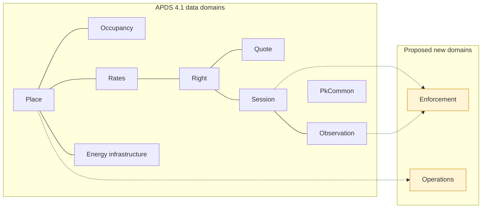

<!-- Generated by tools/build-apds-submission.mjs from spec/proposals/. Do not edit by hand. -->

# APX Data Specification: Overview

*Proposed additions to the APDS data model · Draft for the APDS committee · based on APDS 4.1 (2026-01-14) · APX 0.14.0*

## Introduction

Parking and kerbside operations now run on many connected systems at
once: access control and lane equipment, licence plate recognition,
permits and credentials, payments, merchant validations, enforcement and
the back offices that tie them together. APDS gives these systems a
common language for places, rights, rates, quotes, occupancy, sessions
and observations. In implementing APDS 4.1 end to end across these
systems, we found a small number of things they need to exchange that
the data model does not yet have a place for.

This document set proposes those additions to the APDS data model. It is
offered to the Alliance for Parking Data Standards for consideration,
with thanks for the work that has gone into APDS. Every item here is a
request or a suggestion. None of it changes the meaning of anything APDS
already defines.

### Purpose

To give the APDS working groups, in the same form as the APDS 4.1
documents, a complete and reviewable description of the data elements
and enumerations APX needs so that parking systems can exchange this
information in APDS terms rather than in private extensions.

### Background

APX (APDS Parking eXtensions) began as an open, additive companion to
APDS 4.1. It reuses every APDS construct as published and adds only what
APDS leaves out. In September 2026 APDS accepted APX into the standards
process. Following discussion with the committee, the work is now split
in two:

- **Data elements, proposed to APDS (this document set).** The classes,
  attributes and enumerations that describe what is exchanged. If
  adopted, they would sit in the APDS data model alongside the existing
  domains, and so in a future revision of ISO TS 5206-1.
- **The APX API, kept separate.** The routes, message flows, delivery,
  security and command workflow that implement the exchange. The APX API
  remains the preferred implementation specification built on APDS. It
  is informative here and is not proposed for the data model.

Every element proposed here is already exercised in the APX reference
implementation and its published test scenarios, so each one has been
shaped by real exchanges rather than drawn up in the abstract.

### Guiding principles

The proposals follow the APDS guiding principles and these additional
rules:

1. **APDS first.** Where APDS 4.1 already defines a class, attribute or
   value, it is used as it is. A proposal is made only where nothing in
   the APDS 4.1 Information Model or Data Dictionary fits.
2. **Data, not interface.** Only what is exchanged is proposed. How it is
   requested, delivered or secured stays out of the data model.
3. **Small and mostly optional.** Each new class carries its identity and
   the one or two attributes without which it means nothing. Everything
   else is optional, so a Distributing Party sends only what it has.
4. **Open code lists.** Where values vary by market (reasons, types,
   states), the enumeration lists common values and allows `other`, and
   an external code list may extend it, as APDS already does for vehicle
   types and occupancy levels.
5. **Compatible extensions.** Additions to existing APDS classes are
   written as Level B extensions under the APDS rules for extending the
   model (Information Model, "Extending the APDS Model"), so a valid
   extended instance is always a valid APDS 4.1 instance.
6. **Vendor neutral.** Nothing proposed favours one supplier, technology
   or business model.

### Technical documentation

This document set mirrors the APDS 4.1 technical documentation:

- **Overview (this document):** what each addition is for and the benefit
  of sharing it.
- **Information Model:** the proposed classes, attributes, relationships
  and enumerations for each domain, with diagrams showing where they
  attach to the existing APDS model.
- **Data Dictionary:** the definition of every proposed class, attribute,
  association and enumeration value, in the table format of the APDS 4.1
  Data Dictionary.
- **Use Case Document:** worked examples showing the proposed data in use,
  continuing the numbering of the APDS 4.1 Use Case Document.

### Development priorities

The proposals are grouped in three tiers so the working groups can take
them in steps:

- **Tier 1, propose now:** data every access control, enforcement or LPR
  system already holds and needs to share: access events, equipment
  status, credential status, how a session started and ended, plate read
  attributes, violations and notices, and validation redemptions.
- **Tier 2, proven in APX, propose next:** shapes that are stable in APX
  and widely useful, such as plate lists, validation programmes, payment
  outcomes, reservations and permits, valet custody and alerts.
- **Tier 3, for discussion:** areas that are still settling (electric
  vehicle charging sessions) or may sit outside parking data (customer
  service interactions).

*Figure 1: The APDS data domains, with the two proposed new domains.
Additions are also proposed within Place, Occupancy, Rates, Right,
Session, Observation, Energy infrastructure and PkCommon.*

## Overview of the proposed data specification

### Place Data Specification

Adds what an operator needs to describe how the equipment in a Place is working right now, which way the licence plate cameras on an access lane face, and what is posted on the signs at a Place. It also suggests four lane-equipment values for EquipmentTypeEnum. Equipment status is kept in its own record, apart from the static Place description, for the same reason APDS keeps Demand apart from Supply: it changes far more often.

The Place data specification already describes where a Place is, how it
is organised, and the equipment and services it offers. These proposals
add three things operators share every day but cannot yet express in
APDS terms: whether the equipment is working, which way the licence plate
cameras on a lane face, and what the signs at a Place say.

#### Benefits of the Place additions

A parking operation runs on its equipment. When a barrier fails, a pay
machine runs out of paper or a camera goes offline, the operator, its
monitoring service, its customer-service centre and its enforcement
partner all need to know, and they need to know in the same words. Today
each pair of systems agrees its own list of states.

Licence plate cameras at a lane read the plates of vehicles travelling in
one direction. A receiving system can only tell an entry from an exit if
it knows which way each camera faces.

Signs set the terms of use of a Place. When a customer appeals a parking
charge, the operator must be able to show what the sign said on that day,
even if the sign has since been replaced.

#### Equipment status

An Equipment Status record:

- Has a reference to one item of supplemental equipment in the Place.
- Has the state of that equipment (e.g., available, occupied, faulted).
- Has the time the equipment entered that state.
- Has the time the reporting system last heard from the equipment.

Equipment status is kept in its own record rather than as an attribute of
the equipment. This follows the approach APDS takes for occupancy, where
Supply (which changes rarely) is kept apart from Demand (which changes
often). The equipment description is sent once; its status is sent
whenever it changes.

#### Lane equipment types

APDS 4.1 EquipmentTypeEnum already includes lprCamera, occupancySensor,
paymentMachine and several door types. Four values would complete a
typical off-street access lane: barrier, gate, ticketDispenser and
intercom. We suggest adding them so that lane equipment need not be typed
as 'other'.

#### Lane cameras

A Lane Camera:

- Has a camera identification that matches the cameraID on the images of
  its observations.
- Has a facing: inward (into the Place) or outward (out of the Place).
- Is associated to a Vehicular Access.

#### Signage

A Signage record:

- Has a unique identification and version.
- Has a reference to the element of the Place hierarchy it governs, and
  applies to the elements below it.
- Has the wording of the sign, in each language shown.
- Has a status (active, superseded or removed) and the period it was in
  force.
- May have a sign type, a location, a photo, and a reference to the
  enforcement policy it gives notice of.

A replaced sign is never edited. It is marked superseded and a new
record, or a new version, carries the new wording, so the history is
kept.

### Occupancy Data Specification

APDS already models current occupancy fully through Supply and Demand, so nothing is proposed for the present moment. One small addition is suggested for discussion: letting a DemandType record summarise a period (its highest and average count, and how many readings it rests on), so that hourly or daily occupancy history can be exchanged in APDS terms.

The APDS Occupancy data specification divides occupancy into Supply (the
spaces or area available) and Demand (how much of it is in use). APX
reads and shares occupancy entirely through these classes and proposes
nothing new for the present moment. One small addition is suggested for
discussion: a way to summarise occupancy over a period.

#### Benefits of period summaries

Cities, landlords and operators increasingly ask for occupancy history:
the busiest hour of each day, the average occupancy of a zone across a
month, the effect of a price change. Today a Distributing Party must
either send every individual DemandType reading, which can mean
thousands of records a day for one Place, or agree a private summary
format with each receiver.

A Demand Type record that summarises a period:

- Has the start and end of the period it summarises.
- Has the highest count recorded during the period.
- Has the time-weighted average count over the period.
- Has the number of readings the summary is calculated from.

A receiver can then tell a period with no readings (no data) from a
period with low occupancy, which matters when the figures are used for
pricing or planning decisions.

#### What is not proposed

APX also offers a "current occupancy" view and an hourly history view to
its users. We considered whether either is a new data element and
concluded they are not:

- The current view is made entirely of APDS Supply and DemandType,
  plus a figure for available spaces that any receiver can calculate
  (supply quantity minus demand count). It needs nothing new.
- The history view is a series of period summaries. The only part APDS
  cannot yet express is the summary itself, which is the suggestion
  below.

Counts of electric charging points by status are described in the Energy
Infrastructure domain.

### Rates Data Specification

APDS models the rate deck completely: RateTables, RateLineCollections, RateLines, taxes, surcharges and discounts. APX asks for two small additions. First, a policy on a RateTable that says whether it may be offered as a negotiated rate, so a customer-service agent or a partner can only offer tables the operator has cleared for that. Second, a validation benefit that extends the existing RateDiscount with comped time and a plain-language description, so a merchant validation can say what it is worth in the same terms APDS already uses for discounts.

The Rate data specification already lets an operator publish every
RateTable, RateLineCollection and RateLine for a Place, with taxes,
surcharges and discounts. APX proposes two small additions that let a
rate deck be used, not only published, by the people who sell parking on
the operator's behalf.

#### Benefits of the Rate additions

Customer-service agents, call centres and partners regularly offer a
customer a price other than the posted one: a flat rate for a lost
ticket, a goodwill rate, a rate agreed with an event organiser. Today
there is no way for an operator to say which of its RateTables may be
offered this way, so each partner keeps its own list, which drifts from
the published deck. A flag on the RateTable itself means everyone who
receives the rate deck also receives the operator's answer.

Merchant validations are already recognised by APDS (a validation
payment type, a validation reference on the Segment, and the RateDiscount
class). What APDS cannot yet say is what a validation is worth when the
merchant gives away time rather than money, which is the most common
form ("first two hours free"). Extending RateDiscount with a duration
closes that gap using the class APDS already has.

#### Key concepts

A RateTable (additions):

- Has an indication of whether it may be offered as a negotiated rate.
- Has a short label and guidance shown to the agent or partner offering it.

A ValidationBenefit:

- Is a RateDiscount, so it has a fixed value or a discount rate as today.
- Has, alternatively, an amount of comped time valued at the applicable RateTable.
- Has a plain-language description of what it is worth.
- Is referenced by a ValidationProgram (see the Right additions).

### Right Data Specification

APDS records who holds a right, which credentials prove it, and what was paid for it. APX asks for the lifecycle and context that operators exchange every day around those same classes: the status of an assigned credential and the physical medium it was issued on, a credential as it was actually presented at a reader, the state of a reservation and the renewal chain of a permit, the outcome of a payment and how it was taken, an account status and balance on the RightHolder, merchant validation programmes with their instrument stock, and lists of plates (watch, scofflaw, allow) that tell a site what to do when a plate is seen. Every addition is optional and attaches to an existing APDS class, so every APDS 4.1 instance stays valid.

The Right data specification defines how an owner or operator grants
the use of a Place (the RightSpecification), to whom (the RightHolder),
through which proof (the credentials), and what was paid (MonetaryValue
and Payment). APX proposes optional additions that carry the lifecycle
operators already manage around those same classes, so that a lane, an
enforcement device, a booking platform and a back office can agree on
the current state of a right without a bilateral agreement.

#### Benefits of the Right additions

Access credentials change state constantly: a card is reported lost, a
fob is suspended for non-payment, a replacement is issued with a new
number. APDS lets a credential be attached to an AssignedRight, but not
whether it is still usable or what replaced it, so every reader and
enforcement system must be told separately. A small status list and a
replacement link on the assigned credential fix that, and a medium
(card, fob, transponder, hangtag) separates the item the customer holds
from the read technology APDS already records.

Reservations and permits are already modelled as AssignedRights with
PlannedUses, following the APDS use cases. What partners still exchange
by other means is whether a booking is confirmed, used or lapsed, which
permit a renewal replaces, and how many of a multi-vehicle permit's cars
may be parked at once.

APDS Payment records money collected. Payment systems also produce
declines, authorisations that are not yet captured, and partial refunds,
and operators need to know where and how a customer paid. Optional
attributes on Payment, reusing the APDS MeansOfPaymentEnum, cover these.

Merchant validations are already visible in APDS at the moment they are
used. The programme behind them (who validates, what it is worth, the
limits, the stock of codes) is not, so pay stations, merchant
applications and sites keep separate copies. Finally, cities and
operators share lists of plates (watch, scofflaw, allow, their own
enforcement vehicles) with every system that screens arrivals; a list
says what to do when a plate is seen, which is different from a right.

#### Key concepts

A CredentialAssigned (additions):

- Has a credential status (issued, active, suspended, lost, revoked, expired, replaced).
- Has a validity period of its own.
- Has a reference to the credential it replaced and the one that replaced it.
- Has, optionally, the medium it was issued on, with serial number and deposit.
- Has, while suspended, a suspension reason and end time.

A PresentedCredential:

- Is a Credential (type and additional information, as in APDS).
- Has the identification actually read, whether or not it matches an assigned credential.

An AssignedRight (additions):

- Has a reservation state, the Session that used the reservation, and a no-show time.
- Has a reference to the AssignedRight it renews and the one that renewed it.
- Has a maximum number of concurrent vehicles and the way an overage vehicle is billed.

A RightHolder (additions):

- Has an account status and an account balance.
- Has the Place elements at which the account is valid.

A Payment (additions):

- Has a payment status (approved, declined, reversed) and a capture status.
- Has the means of payment and the channel where it was taken.
- Has the Place element where it was taken.
- Has a cumulative refunded amount.
- Has the rate sold.

A ValidationProgram:

- Has a unique identification and version.
- Has a Place element, a provider (an Organisation) and a status.
- Has a benefit (see ValidationBenefit in the Rate additions).
- Has optional rules (per-Session and per-day limits, validity window, stacking, applicable RateTables) and optional billing terms.
- Has issuances of instruments, each instrument with its own status.

A PlateList:

- Has a unique identification and version, a name, a category and a status.
- Has an owner (an Organisation).
- Has, per Place element, whether a match is enforced, raises an alert on arrival, or refuses service.
- Has entries, each with a credential type and identification, a validity period and the reason for listing.

### Session Data Specification

APDS 4.1 records a Session with its start, end, Segments and credentials, but not what the Session rests on or how it ended. These additions let two parties exchange the observations a Session was built from, why and how it closed (including a close set by rule rather than observed), each access attempt at a lane whether granted or denied, the evidence behind a match between a Session and a right, the anti-passback state of a credential, each merchant validation applied to a stay, and the custody record of a valeted vehicle. Every addition is optional and compatible with APDS 4.1 (Level B): a receiver that does not know them still reads a valid APDS Session.

The Session data domain documents the actual use of an AssignedRight. APDS
4.1 records when a Session started and ended, its Segments, and the
credentials and vehicle identified. The additions proposed here record
what a Session rests on and what happened at the entry and exit points
of a Place, including attempts that never became a Session.

#### Benefits of the Session additions

Two parties that receive the same Sessions should be able to compute the
same dwell times, the same occupancy and the same revenue. Today they
cannot always do so, because a Session does not say whether its end was
observed or set by a rule, or whether its entry was ever seen. A Session
closed after 48 hours with no exit observation and a Session closed by an
exit camera look the same.

Access control systems refuse credentials every day: a lost keycard, an
expired permit, a vehicle already inside. A refusal opens no Session, so
it leaves no trace in APDS today. The help desk that takes the call from
the lane, the issuer of the credential and the operator all need the same
record of what happened.

Merchant validations are already anticipated by APDS through
`Segment.validationId`, but there is no record that the identifier points
to. Adding one lets a merchant, an operator and an auditor see the same
redemption and the actual amount it removed.

Valet operations are mentioned in APDS only as an operating restriction.
A valet ticket records custody of the vehicle, where it and its keys are,
and how it was returned, while the stay and the money remain on the APDS
Session.

#### Key concepts

Session (additions)

- Has the observations it was built from, each with the part it played (entry, exit, duplicate, activity).
- Has a closure: why it ended, whether the end was inferred by rule, and whether the start was observed.
- Has an optional parent Session, for a Session kept for an area inside a wider visit.
- Has optional evidence for each match it rests on.

Access event

- Has a date/time, a direction (entry or exit) and an outcome (granted or denied).
- Has a denial reason when access was refused.
- Has the assigned credential it matched, or the value read when nothing matched.
- Has the Place element, the vehicular access (lane) and the equipment where it occurred.
- Has the Session it opened or closed, when access was granted.

Validation redemption

- Has the validation program it draws on and the Session it was applied to.
- Has the date/time and channel of application, and whether it stands or was reversed.
- Has the actual amount reduced or time given free, which may be less than the nominal benefit.
- Is the record that `Segment.validationId` identifies.

Valet ticket

- Has the Place that took custody, the Session for the stay and an optional AssignedRight.
- Has a status from drop-off to handback, with the time of each step.
- Has where the vehicle is parked and where its keys are kept.
- Has condition reports at drop-off and handback (see Observation).

### Observation Data Specification

APDS 4.1 records an observation with its method, credential, location, images and an overall and per-character confidence. Modern licence plate recognition knows more: a confidence for each recognised attribute (plate, issuing country and state, make, model, colour), the candidate plates that lost, which plate of the vehicle was read, which way the vehicle moved, which reads belong to one passage, and whether a person has reviewed the read. These additions carry that, add two image kinds, record the condition of a vehicle taken into valet custody, and add a toll transaction built from observations. All are optional and compatible with APDS 4.1 (Level B).

The Observation data domain documents the observation of an entity in a
Place performing an action. APDS 4.1 already records the method, the
credential observed, the location, images, an overall confidence and a
confidence for each character. The additions proposed here carry what a
modern licence plate recognition camera reports beyond that, record the
condition of a vehicle, and tie observations at a toll point into a
charge.

#### Benefits of the Observation additions

Enforcement, access control and analytics all act on plate reads, and
each needs to know how far to trust them. A camera can be sure of the
plate characters and unsure of the issuing state, or sure of the plate
and wrong about the colour. One overall confidence cannot say which. A
confidence for each recognised attribute lets every receiver apply its
own thresholds.

When a read is wrong, the right answer is often one of the other
candidates the engine considered. Keeping those alternates lets a
reviewer or a matching system correct the read without a new capture.

On sites without barriers, whether a vehicle entered or left is decided
by the direction it moved past the camera. Recording the movement, the
plate face read and the passage a read belongs to lets several cameras
and frames be treated as one event.

Some jurisdictions require a person to confirm a plate before a penalty
is issued. Recording the review state and its reasons carries that
evidence with the observation.

Valet operators record a vehicle's condition when they take it and when
they return it; that report is the evidence a damage claim is answered
with. Toll operators assemble a charge from one or more observations at
a toll point and must handle disputes about it.

#### Key concepts

Observation element (additions)

- Has a recognised value and confidence for each attribute read (plate, country, state or province, plate category, make, model, colour, body type).
- Has the alternate plate candidates, best first.
- Has the vehicle's movement relative to the camera, the plate face read, and the direction of passage as the recognition system reports it.
- Has a capture group shared by all reads of one passage.
- Has an optional review state, the reasons for review and the original values before correction.

Image (additions)

- Has two more image types: an extended plate crop and a wide context view.
- Has the region of the image that contains the plate.

Condition report

- Has notes, photographs and structured damage findings by area and severity.
- Has when and by whom it was recorded, and whether the customer acknowledged it.

Toll transaction

- Has the toll point, the observations it is built from and the credential read.
- Has the price, the payment that settles it and a status.
- Has an optional dispute with its reason, resolution and the original price.

### EnergyInfrastructure Data Specification

APDS 4.1 describes charging infrastructure as it is built: the SupplementalEquipment, its RefillPoints and ElectricChargingPoints, the Connectors, and a RefillPointStatusEnum for the point as a whole. APX adds only the live, parking-side view that operators exchange every day: the status of each connector, what is physically in the bay in front of a charging point, and one charge of one vehicle (a ChargingSession) linked to the parking Session it happened inside. Status values reuse RefillPointStatusEnum; nothing here restates the static description or the charging network's own protocols. All of it is experimental in APX (Part 23) and is offered for discussion.

The Energy Infrastructure additions let parking operators and charging
networks share the live state of charging points and the charges that take
place inside a parking stay. APDS 4.1 already describes charging
infrastructure as it is built, through SupplementalEquipment, RefillPoint,
ElectricChargingPoint and Connector, and it provides `RefillPointStatusEnum`
for the status of a refill point. The additions build on these and do not
restate them.

#### Benefits of the Energy Infrastructure additions

A driver looking for a charger wants to know whether one is free now, not
only that one exists. An operator wants to know when a bay is taken by a
vehicle that is not charging, and wants to bill a charge together with the
parking. Charging networks already exchange this information among
themselves using their own protocols. What parking systems lack is a
common, parking-side way to describe it alongside Places, Spaces, Sessions
and AssignedRights.

All of these additions are experimental in APX and are offered for
discussion rather than for immediate adoption.

#### Charging point status

A ChargingPointStatus:

- Has a reference to the SupplementalEquipment and the `refillPointIndex` of
  the static RefillPoint it describes, the link APDS already provides
  between static and dynamic publications.
- Has a status taken from the existing `RefillPointStatusEnum`.
- Has a status for each connector, where connectors differ.
- Has what is physically in the bay, where a camera, sensor or attendant can
  tell.
- May reference the Space it serves, the AssignedRight that has reserved it,
  and the ChargingSession in progress.

#### Charging session

A ChargingSession:

- Has a unique identification and a version.
- Is associated to a Place element, a SupplementalEquipment and a refill
  point.
- Has a status, from authorization through charging and idle time to
  closure.
- May reference the parking Session it happened inside, and the
  AssignedRight that entitled it.
- Has the times it was authorized, plugged in, charging, idle and unplugged.
- Has the energy delivered and, where known, the cost and how the cost is
  settled.
- May carry the charging network's own identifiers without interpreting
  them.

### PkCommon Data Specification

One addition to RecordType: the system that first created a record, when the record reaches a receiver through another system. Open code lists need no new element, because APDS ReferencedCodeListEntry and UserDefinedCodeList already provide the pattern. The extensions container and GeoJSON coordinates are already raised as errata 010 and 011 and are not repeated here.

The PkCommon domain holds the classes, datatypes and code list mechanism
shared by every other domain. APX needs very little here. One attribute
is suggested for RecordType; everything else APX relies on is already in
APDS or has been raised separately as an erratum.

#### Benefits of a record origin

Parking data increasingly passes through more than one system before it
reaches its user. A city may receive Place and Session data from a
regional hub that collects it from several operators. A site system may
hold records created at another site and copied to it.

RecordType already says who created a record and when it was last
updated. It cannot say which system first created it when that differs
from the system now distributing it. Without that, a receiver that gets
the same record by two routes cannot easily tell they are the same, or
which source to ask when a record is wrong.

A Record Type may additionally:

- Have an origin: the identifier of the system that first created the
  record, when it differs from the system distributing it.

#### Open code lists

Several APX proposals in other domains add an attribute whose values come
from a list that each region or operator may extend. APDS already has
the right mechanism for this: UserDefinedCodeList, with
ReferencedCodeListEntry used to cite one entry. APX uses these classes
as they are and proposes no new code list element.

#### Already raised as errata

Two changes in this area are already with the group as errata and are
not repeated here:

- **Erratum 010**: the extensions container described in the Use Case
  Document (C.2.5) is not declared on the entities that need it.
- **Erratum 011**: GeoJSON objects have no coordinates attribute.

### Enforcement Data Specification

APDS 4.1 already carries everything an enforcement finding is built from: the Observation and its Images, the Session, the AssignedRight and the Payment. Use Case C.2.2 describes transaction exceptions becoming violation notices, but the model has no class for the violation or the notice itself. This new domain adds them: the Violation (a finding that a vehicle at a place was not covered by a valid right), how it was detected, the Notice issued for it, the Appeal against it, and the EnforcementPolicy that governs notices and penalties at a place. Every class reuses APDS types for places, credentials, vehicles, evidence, locations, money and payments.

The Enforcement domain is new. It gives a name and a structure to what
happens after an operation finds that a vehicle is not covered by a valid
right. APDS 4.1 already carries everything such a finding is built from:
Observations and their Images, Sessions, AssignedRights and Payments. Use
Case C.2.2 describes transaction exceptions being converted into violation
notices that create fines or penalties. The data model, however, has no
class for the violation or the notice. This domain adds them.

#### Benefits of the Enforcement domain

Enforcement usually involves several parties: the operator that owns the
rights and sessions, an enforcement provider with cameras or officers, a
processing agency that sends notices and collects payment, and someone who
hears appeals. Today each keeps its own record of the same violation and
reconciles by hand. A shared description of the violation, its notice and
its outcome lets these parties hand a case from one to the next. It also
lets reporting compare enforcement across places, and lets a driver's
appeal be checked against the same evidence and rules the notice was
issued under.

Every class in the domain reuses APDS types for places, credentials,
vehicles, evidence images, locations, money and payments, so a violation
refers to the same records the rest of the model already uses.

#### Violation

A Violation:

- Has a unique identification and a version.
- Has a violation type and a status.
- Has the date/time it was observed and the element of the Place where it
  was observed.
- May reference the Space, the Observations it is built from, the Session
  the vehicle was in, and the AssignedRight that came closest to covering
  the stay.
- Has the credential and vehicle identified, using the same APDS classes a
  Session uses.
- Has evidence, as APDS Images, and a location, as an APDS Observation
  Location.
- Has how it was detected: automatically, by an officer guided by a system,
  or by an officer alone.
- Has, once issued, a Notice, an amount, a due date and the Payments
  applied to it.
- May have an Appeal.
- May reference the EnforcementPolicy and the Signage in force when it was
  observed.

#### Notice

A Notice:

- Has the notice number printed on or sent with it.
- Has the date/time it was issued.
- Has the kind of notice (for example a warning, a penalty charge notice or
  a citation) and how it was delivered.
- May reference the Organisation on whose authority it was issued.

#### Enforcement policy

An EnforcementPolicy:

- Has a unique identification and a version.
- Applies to an element of the Place and everything below it, unless a
  lower element has its own policy.
- Has a validity period and a status.
- Has the jurisdiction and legal text it summarizes.
- Has which notice delivery methods are lawful for which detection modes,
  by when, and with what minimum evidence.
- Has limits on the penalty, a schedule of increases for late payment, and
  the appeal and payment periods.
- Says whether posted Signage is required, and whether automated findings
  may be issued without review.

### Operations Data Specification

Use Case C.2.2 lists transaction exceptions and space statuses that an operation must act on, and APDS 4.1 describes the places, equipment, sessions and rights they concern, but it has no class for the operational condition itself. This new domain adds the Alert: a condition at a place or piece of equipment that needs attention, with its type, severity and lifecycle. It also offers, for discussion only, a SupportInteraction record of one customer-service contact, which may sit outside the scope APDS sets itself.

The Operations domain is new. It describes conditions in a running parking
operation that need someone's attention. Use Case C.2.2 lists transaction
exceptions and space statuses that an operation acts on, such as no
check-out, a vehicle in the wrong space, or an ICE vehicle in an EV space.
APDS 4.1 describes the places, equipment, sessions and rights these
conditions concern, but has no class for the condition itself. This
domain adds the Alert.

#### Benefits of the Operations domain

Modern parking sites are monitored from many places: the equipment
supplier's service desk, a remote monitoring centre, the operator's
control room, and enforcement and charging partners. Each needs to know
when a barrier faults, a lane is blocked, a charging bay is taken by a
vehicle that is not charging, or a vehicle on a watch list arrives. Each
also needs to know whether someone has already taken the condition in
hand. A shared description of these conditions lets one party raise them
and others act on them, without one integration per supplier.

#### Alert

An Alert:

- Has a unique identification and a version.
- Has an alert type, a severity and a status.
- Has the date/time it was detected and, where known, when it began.
- May have an expiry time, after which it lapses if it is not resolved.
- May reference the element of the Place and the SupplementalEquipment
  where it was detected.
- May reference the record it concerns, such as a Session, an AssignedRight
  or a Violation.
- Has a human-readable description.

#### Support interaction (for discussion)

APX also records customer-service contacts, so that an agent helping a
driver can see earlier calls about the same session. This may lie outside
the scope APDS sets itself in its guiding principles. It is included so
the group can decide, and APX is equally happy to keep it within its own
profile.

A SupportInteraction:

- Has a unique identification and a version.
- Has a channel, the kind of agent (a person or an automated assistant),
  and start and end times.
- Is associated to an element of a Place.
- May reference the Session, AssignedRight, RightHolder or credential the
  contact was about.
- Has the kind of issue, a short summary (not a transcript), and whether it
  was resolved.

## Data specification permission and security

As with APDS, these proposals do not define security or permission rules.
Access to data remains under the control of the Distributing Party, which
decides what each Receiving Party may see.

Several proposed elements carry personal data: plate reads, access events,
violations, notices, appeals and customer service records. Parties
exchanging them should apply the data protection law of their
jurisdiction, share only what the receiving purpose needs, and agree how
long records are kept. The proposals keep personal attributes optional
wherever the element still makes sense without them.

## Relationship to the APX API

The APX API is the implementation specification that APX maintains on top
of APDS. It defines how the data described here is requested, delivered,
changed and secured: routes, change feeds, signed event delivery,
discovery, scopes, and the workflow for commands such as opening a gate.
It is not part of this proposal.

Until APDS adopts an element, the APX API carries it as an APDS extension
under the generic extension mechanism introduced in APDS 4.1 (Use Case
Document §C.2.5). When APDS adopts an element, the APX API moves to the
APDS form in its next release and retires its own, so the two never
disagree.

## Next steps

We would welcome the working groups' views on:

1. Whether the Tier 1 proposals can be taken into the next APDS release.
2. Whether the two new domains, Enforcement and Operations, are best
   added as new domains or folded into existing ones.
3. The values proposed for each new enumeration, especially where they
   differ by country.

We are glad to prepare UML model changes, data dictionary entries or pull
requests in whatever form the Alliance prefers.

*Contact: rneubauer@umojo.com*
