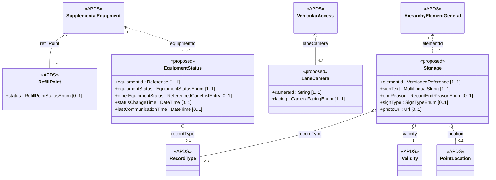
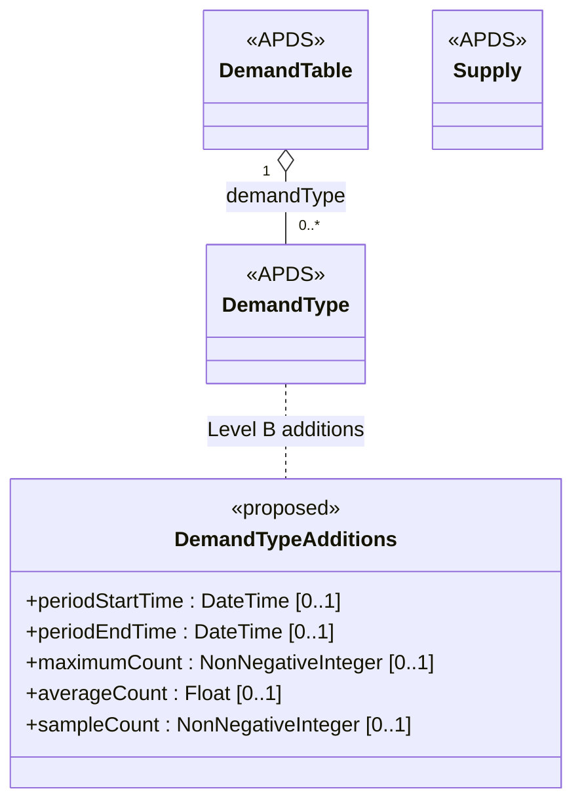
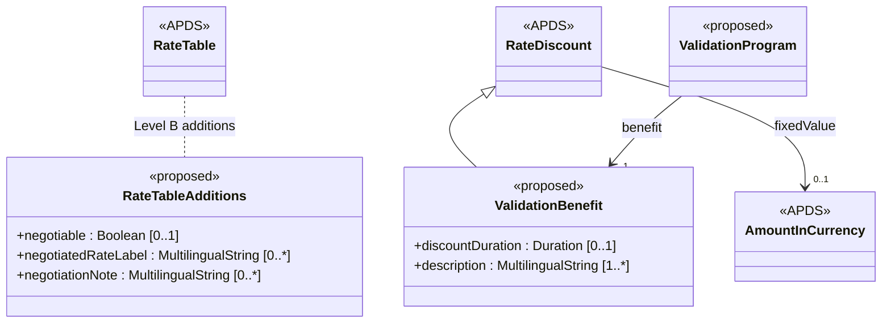
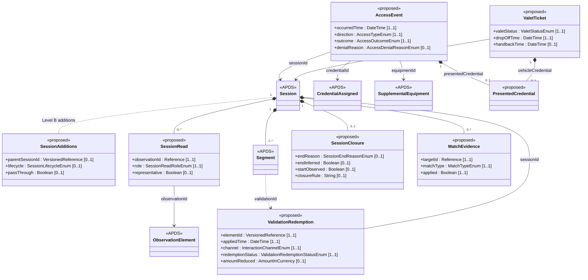
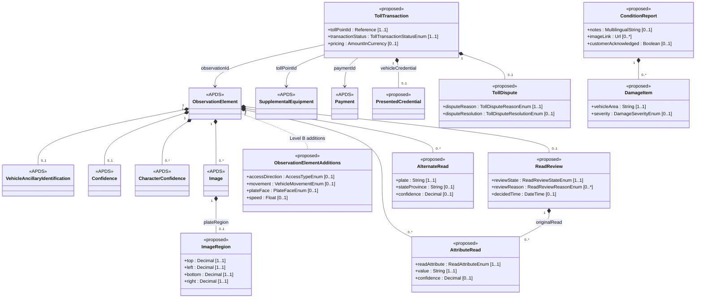
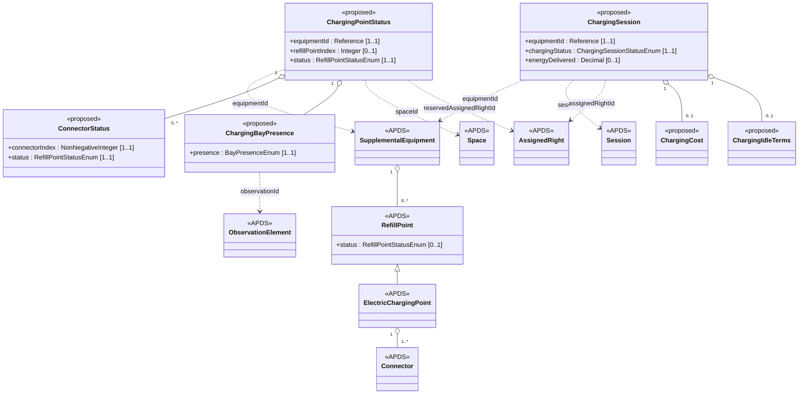
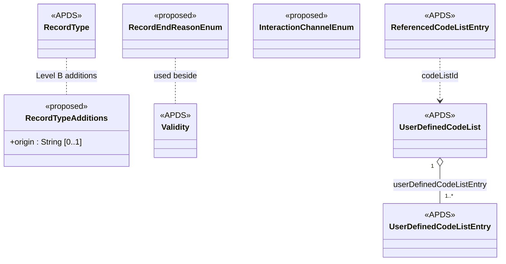
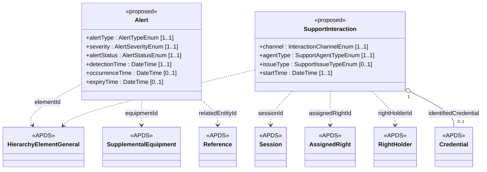

<!-- Generated by tools/build-apds-submission.mjs from spec/proposals/. Do not edit by hand. -->

# APX Data Specification: Information Model

*Proposed additions to the APDS data model · Draft for the APDS committee · based on APDS 4.1 (2026-01-14) · APX 0.14.0*

## Introduction

This document describes the data concepts APX proposes for the APDS data
model, and how they relate to the existing APDS 4.1 classes. It follows
the structure of the APDS 4.1 Information Model: for each domain, a
narrative, a class diagram, the enumerations and any external code lists.
The full definition of every class, attribute, association and value is
in the companion Data Dictionary.

The data concepts are modelled in UML in the same form as APDS, which
aligns with Part 1 of the CEN DATEX II 16157 series (EN 16157-1).

### How the proposals are expressed

Each proposal is one of four kinds:

| Kind | Meaning |
| --- | --- |
| New class | A class APDS has nothing for, placed in an existing or new package |
| Additions to an APDS class | New attributes or associations on a class APDS already defines |
| New enumeration | A new list of values |
| New values for an APDS enumeration | Values added to a list APDS already defines |

Additions to existing APDS classes are Level B extensions under the APDS
rules for extending the model: they add optional content only, never
change an existing multiplicity, definition or type, and never make an
existing APDS class the component of a new one. A valid extended instance
is therefore always a valid APDS 4.1 instance. Classes in the two new
domains, Enforcement and Operations, are marked Level C because they
introduce new root concepts.

One suggestion does change an existing multiplicity: making
`VehicleAncillaryIdentification.country` optional. It is not part of
these additions. It is described in the Observation section and offered
separately, with the other suggested changes to APDS 4.1.

In the diagrams, classes that already exist in APDS 4.1 are marked
`<<APDS>>`. Everything else is proposed.

### Tiers

| Tier | Meaning |
| --- | --- |
| 1 | Propose now: data every access control, enforcement or LPR system already holds |
| 2 | Proven in APX and widely useful: propose next |
| 3 | For discussion: still settling, or possibly outside parking data |

### Consistency notes on APDS 4.1

While checking each proposal against APDS 4.1, we compared the
Information Model and Data Dictionary with the published API document
(`apds-api-4.1.yaml`). A few elements defined in the Data Dictionary do
not yet appear in the API document, for example `RefillPointStatusEnum`
with `RefillPoint.status`, and some `EquipmentTypeEnum` values such as
`lprCamera`. These proposals treat the Data Dictionary as authoritative
and do not propose anything it already defines. The differences are
offered to the Alliance separately, as suggestions, alongside the
corrections already filed against the API document.

## Proposed changes at a glance

119 proposals: 47 new classes, 11 additions to existing APDS classes, 57 new enumerations and 4 sets of new values for existing APDS enumerations. Tier 1: 34, Tier 2: 59, Tier 3: 26.

### Tier 1: propose now

| Element | Change | Package | Tier | Level |
| --- | --- | --- | --- | --- |
| `EquipmentStatus` | New class | SupplementalFacility | 1 | B |
| `EquipmentStatusEnum` | New enumeration | SupplementalFacility | 1 | — |
| `EquipmentTypeEnum` | New values for an APDS enumeration | SupplementalFacility | 1 | — |
| `CredentialAssigned` | Additions to an APDS class | Right | 1 | B |
| `CredentialMedia` | New class | Right | 1 | B |
| `CredentialSuspension` | New class | Right | 1 | B |
| `PresentedCredential` | New class | Right | 1 | B |
| `CredentialStatusEnum` | New enumeration | Right | 1 | — |
| `CredentialMediaFormEnum` | New enumeration | Right | 1 | — |
| `DepositStatusEnum` | New enumeration | Right | 1 | — |
| `Session` | Additions to an APDS class | Session | 1 | B |
| `SessionRead` | New class | Session | 1 | B |
| `SessionClosure` | New class | Session | 1 | B |
| `AccessEvent` | New class | Session | 1 | B |
| `ValidationRedemption` | New class | Session | 1 | B |
| `SessionReadRoleEnum` | New enumeration | Session | 1 | — |
| `SessionEndReasonEnum` | New enumeration | Session | 1 | — |
| `AccessOutcomeEnum` | New enumeration | Session | 1 | — |
| `AccessDenialReasonEnum` | New enumeration | Session | 1 | — |
| `ValidationRedemptionStatusEnum` | New enumeration | Session | 1 | — |
| `ObservationElement` | Additions to an APDS class | Observation | 1 | B |
| `AttributeRead` | New class | Observation | 1 | B |
| `AlternateRead` | New class | Observation | 1 | B |
| `ReadAttributeEnum` | New enumeration | Observation | 1 | — |
| `VehicleMovementEnum` | New enumeration | Observation | 1 | — |
| `InteractionChannelEnum` | New enumeration | CommonClasses | 1 | — |
| `Violation` | New class | Enforcement | 1 | C |
| `ViolationDetection` | New class | Enforcement | 1 | C |
| `Notice` | New class | Enforcement | 1 | C |
| `ViolationTypeEnum` | New enumeration | Enforcement | 1 | — |
| `ViolationStatusEnum` | New enumeration | Enforcement | 1 | — |
| `DetectionModeEnum` | New enumeration | Enforcement | 1 | — |
| `NoticeKindEnum` | New enumeration | Enforcement | 1 | — |
| `NoticeDeliveryMethodEnum` | New enumeration | Enforcement | 1 | — |

### Tier 2: proven in APX, propose next

| Element | Change | Package | Tier | Level |
| --- | --- | --- | --- | --- |
| `VehicularAccess` | Additions to an APDS class | VehicularAccess | 2 | B |
| `LaneCamera` | New class | VehicularAccess | 2 | B |
| `CameraFacingEnum` | New enumeration | VehicularAccess | 2 | — |
| `Signage` | New class | Signage | 2 | B |
| `SignTypeEnum` | New enumeration | Signage | 2 | — |
| `RateTable` | Additions to an APDS class | Rates | 2 | B |
| `ValidationBenefit` | New class | Rates | 2 | B |
| `AssignedRight` | Additions to an APDS class | Right | 2 | B |
| `OverageBilling` | New class | Right | 2 | B |
| `RightHolder` | Additions to an APDS class | Right | 2 | B |
| `Payment` | Additions to an APDS class | Right | 2 | B |
| `ReservationStateEnum` | New enumeration | Right | 2 | — |
| `OverageBillingModeEnum` | New enumeration | Right | 2 | — |
| `AccountStatusEnum` | New enumeration | Right | 2 | — |
| `PaymentStatusEnum` | New enumeration | Right | 2 | — |
| `CaptureStatusEnum` | New enumeration | Right | 2 | — |
| `RightTypeEnum` | New values for an APDS enumeration | Right | 2 | — |
| `PaymentTypeEnum` | New values for an APDS enumeration | Right | 2 | — |
| `ValidationProgram` | New class | Validation | 2 | B |
| `ValidationRules` | New class | Validation | 2 | B |
| `ValidationIssuance` | New class | Validation | 2 | B |
| `ValidationInstrument` | New class | Validation | 2 | B |
| `ValidationIssuanceMethodEnum` | New enumeration | Validation | 2 | — |
| `ValidationIssuanceStatusEnum` | New enumeration | Validation | 2 | — |
| `ValidationInstrumentStatusEnum` | New enumeration | Validation | 2 | — |
| `PlateList` | New class | PlateList | 2 | B |
| `PlateListPlaceFlags` | New class | PlateList | 2 | B |
| `PlateListEntry` | New class | PlateList | 2 | B |
| `PlateListCategoryEnum` | New enumeration | PlateList | 2 | — |
| `ValetTicket` | New class | Session | 2 | B |
| `SessionLifecycleEnum` | New enumeration | Session | 2 | — |
| `ValetStatusEnum` | New enumeration | Session | 2 | — |
| `HandbackVerificationEnum` | New enumeration | Session | 2 | — |
| `ReadReview` | New class | Observation | 2 | B |
| `Image` | Additions to an APDS class | Observation | 2 | B |
| `ImageRegion` | New class | Observation | 2 | B |
| `ConditionReport` | New class | Observation | 2 | B |
| `DamageItem` | New class | Observation | 2 | B |
| `ImageTypeEnum` | New values for an APDS enumeration | Observation | 2 | — |
| `PlateFaceEnum` | New enumeration | Observation | 2 | — |
| `ReadReviewStateEnum` | New enumeration | Observation | 2 | — |
| `ReadReviewReasonEnum` | New enumeration | Observation | 2 | — |
| `DamageSeverityEnum` | New enumeration | Observation | 2 | — |
| `TollTransaction` | New class | Tolling | 2 | B |
| `TollDispute` | New class | Tolling | 2 | B |
| `TollTransactionStatusEnum` | New enumeration | Tolling | 2 | — |
| `TollDisputeReasonEnum` | New enumeration | Tolling | 2 | — |
| `TollDisputeResolutionEnum` | New enumeration | Tolling | 2 | — |
| `RecordEndReasonEnum` | New enumeration | CommonClasses | 2 | — |
| `Appeal` | New class | Enforcement | 2 | C |
| `EnforcementPolicy` | New class | Enforcement | 2 | C |
| `NoticeDeliveryRule` | New class | Enforcement | 2 | C |
| `EscalationStep` | New class | Enforcement | 2 | C |
| `AppealReasonEnum` | New enumeration | Enforcement | 2 | — |
| `AppealResolutionEnum` | New enumeration | Enforcement | 2 | — |
| `Alert` | New class | Operations | 2 | C |
| `AlertTypeEnum` | New enumeration | Operations | 2 | — |
| `AlertSeverityEnum` | New enumeration | Operations | 2 | — |
| `AlertStatusEnum` | New enumeration | Operations | 2 | — |

### Tier 3: for discussion

| Element | Change | Package | Tier | Level |
| --- | --- | --- | --- | --- |
| `DemandType` | Additions to an APDS class | Demand | 3 | B |
| `RateSold` | New class | Right | 3 | B |
| `RateProductEnum` | New enumeration | Right | 3 | — |
| `RateClassEnum` | New enumeration | Right | 3 | — |
| `ValidationBilling` | New class | Validation | 3 | B |
| `ValidationBillingModelEnum` | New enumeration | Validation | 3 | — |
| `ValidationBillingCycleEnum` | New enumeration | Validation | 3 | — |
| `MatchEvidence` | New class | Session | 3 | B |
| `MatchTypeEnum` | New enumeration | Session | 3 | — |
| `MatchDecisionEnum` | New enumeration | Session | 3 | — |
| `ChargingPointStatus` | New class | EnergyInfrastructure | 3 | B |
| `ConnectorStatus` | New class | EnergyInfrastructure | 3 | B |
| `ChargingBayPresence` | New class | EnergyInfrastructure | 3 | B |
| `ChargingSession` | New class | EnergyInfrastructure | 3 | B |
| `ChargingCost` | New class | EnergyInfrastructure | 3 | B |
| `ChargingIdleTerms` | New class | EnergyInfrastructure | 3 | B |
| `BayPresenceEnum` | New enumeration | EnergyInfrastructure | 3 | — |
| `BayPresenceSourceEnum` | New enumeration | EnergyInfrastructure | 3 | — |
| `ChargingSessionStatusEnum` | New enumeration | EnergyInfrastructure | 3 | — |
| `ChargingStopReasonEnum` | New enumeration | EnergyInfrastructure | 3 | — |
| `ChargingSettlementModeEnum` | New enumeration | EnergyInfrastructure | 3 | — |
| `RecordType` | Additions to an APDS class | CommonClasses | 3 | B |
| `PenaltyLimit` | New class | Enforcement | 3 | C |
| `SupportInteraction` | New class | Operations | 3 | C |
| `SupportAgentTypeEnum` | New enumeration | Operations | 3 | — |
| `SupportIssueTypeEnum` | New enumeration | Operations | 3 | — |

## Data model

### Place

Adds what an operator needs to describe how the equipment in a Place is working right now, which way the licence plate cameras on an access lane face, and what is posted on the signs at a Place. It also suggests four lane-equipment values for EquipmentTypeEnum. Equipment status is kept in its own record, apart from the static Place description, for the same reason APDS keeps Demand apart from Supply: it changes far more often.

The Place additions sit in two existing packages, SupplementalFacility and
VehicularAccess, and one new package, Signage, beneath the Place
hierarchy.

#### How equipment status attaches

EquipmentStatus refers to a SupplementalEquipment by reference, in the
same way that DemandTable refers to a hierarchy element through
elementId. A plain reference is used because SupplementalEquipment is a
component of a versioned SupplementalFacility rather than versioned on
its own. EquipmentStatus adds nothing to the equipment description
itself.

APDS 4.1 already gives refill points a status (RefillPoint.status, typed
RefillPointStatusEnum). EquipmentStatusEnum carries the same idea to all
supplemental equipment, and reuses RefillPointStatusEnum literals where
the meaning is the same: available, occupied, blocked, faulted and
unknown. Refill-point states that only make sense for energy (charging,
outOfStock, reserved) are not repeated. Where an item is a refill point,
RefillPoint.status continues to apply; EquipmentStatus covers the barrier,
camera, pay machine or intercom beside it.

APX's current code list uses 'fault' and 'inoperative' for what this
proposal calls faulted and closed. APX would adopt the APDS names once
agreed.

#### How lane cameras attach

LaneCamera is a component of VehicularAccess. It does not repeat the
camera's equipment description, which can be given as SupplementalEquipment
with equipmentType lprCamera. Facing is stated relative to the Place, not
to the lane's flow, so it remains correct on a reversible lane. The
association could equally be placed on AccessLaneSpecific where lanes are
described one by one; we would welcome the group's view.

#### How signage is modelled

Signage is versioned identifiable so a receiver can hold every version
of a sign. Its period and state use the APDS Validity class, with the
shared RecordEndReasonEnum (PkCommon) for why it ended. Its location
uses PointLocation and its photo follows the photoUrl convention of
SupplementalFacility. Signage does not refer to the Enforcement domain:
the EnforcementPolicy proposed there points to the signs that give
notice of it, so these Level B additions stand on their own.

#### Enumerations (for Place)

| Enumeration | Change | Values |
| --- | --- | --- |
| EquipmentStatusEnum | New | available, occupied, blocked, closed, outOfService, faulted, unknown, other |
| EquipmentTypeEnum | Add values | barrier, gate, ticketDispenser, intercom |
| CameraFacingEnum | New | inward, outward |
| SignTypeEnum | New | entrance, paymentMachine, perSpace, ratesBoard, towAway, other |

Signage also uses the shared RecordEndReasonEnum proposed in PkCommon.

#### External code lists (for Place)

States beyond EquipmentStatusEnum are carried in otherEquipmentStatus as a
ReferencedCodeListEntry, pointing to a UserDefinedCodeList published by
the operator or by APX. No new code list mechanism is needed.

#### Elements proposed for Place

| Element | Change | Package | Tier | Level |
| --- | --- | --- | --- | --- |
| `EquipmentStatus` | New class | SupplementalFacility | 1 | B |
| `EquipmentStatusEnum` | New enumeration | SupplementalFacility | 1 | — |
| `EquipmentTypeEnum` | New values for an APDS enumeration | SupplementalFacility | 1 | — |
| `VehicularAccess` | Additions to an APDS class | VehicularAccess | 2 | B |
| `LaneCamera` | New class | VehicularAccess | 2 | B |
| `CameraFacingEnum` | New enumeration | VehicularAccess | 2 | — |
| `Signage` | New class | Signage | 2 | B |
| `SignTypeEnum` | New enumeration | Signage | 2 | — |

### Occupancy

APDS already models current occupancy fully through Supply and Demand, so nothing is proposed for the present moment. One small addition is suggested for discussion: letting a DemandType record summarise a period (its highest and average count, and how many readings it rests on), so that hourly or daily occupancy history can be exchanged in APDS terms.

The suggestion adds five optional attributes to the existing DemandType
class in the Demand package. A DemandType record without them keeps its
current meaning: the count at a moment, given by creationTime.

The `<<proposed>>` box holds the five attributes suggested for
DemandType; the `<<APDS>>` boxes are the existing APDS 4.1 classes,
unchanged.

When periodStartTime and periodEndTime are present, the record describes the
period and count, if given, is the count at its end. Periods are
expected to align with clock boundaries in the Place's time zone (e.g.,
each hour), but the specification does not need to require it. The
supply in force during the period continues to come from Supply.

We have marked this suggestion for discussion (tier 3). It may be that
the group would prefer a separate summary class, or a different place
for these attributes.

#### Enumerations (for Occupancy)

No new enumerations are proposed in Occupancy.

#### External code lists (for Occupancy)

No new external code lists are proposed in Occupancy.

#### Elements proposed for Occupancy

| Element | Change | Package | Tier | Level |
| --- | --- | --- | --- | --- |
| `DemandType` | Additions to an APDS class | Demand | 3 | B |

### Rates

APDS models the rate deck completely: RateTables, RateLineCollections, RateLines, taxes, surcharges and discounts. APX asks for two small additions. First, a policy on a RateTable that says whether it may be offered as a negotiated rate, so a customer-service agent or a partner can only offer tables the operator has cleared for that. Second, a validation benefit that extends the existing RateDiscount with comped time and a plain-language description, so a merchant validation can say what it is worth in the same terms APDS already uses for discounts.

These additions sit in the existing `<Rates>` namespace
(D2Payload/Extension/Parking/Rates). They are Level B: every attribute
is optional, and ValidationBenefit specialises the existing
Right.RateDiscount rather than replacing it, so every APDS 4.1 instance
remains valid.

RateTable gains three optional attributes: `negotiable`, a Boolean, and
two multilingual strings, `negotiatedRateLabel` and `negotiationNote`.
The flag states permission only. It carries no selection rules (length
of stay, time of day, caller type); the party presenting the deck applies
its own policy. A receiving system that does not recognise the attributes
ignores them and sees the RateTable unchanged.

ValidationBenefit is a specialisation of Right.RateDiscount. It inherits
`fixedValue` and `discountRate` and adds `discountDuration` (a Duration)
and a mandatory `description`. Exactly one of `fixedValue`,
`discountRate` or `discountDuration` should be given for a single
benefit. The amount actually removed from a Session's charge is recorded
on the validation redemption (see the Session additions), not here: this
class states the nominal value only.

#### Enumerations (for Rates)

No new enumerations are proposed in `<Rates>`.

#### External code lists (for Rates)

No new external code lists are proposed in `<Rates>`.

#### Elements proposed for Rates

| Element | Change | Package | Tier | Level |
| --- | --- | --- | --- | --- |
| `RateTable` | Additions to an APDS class | Rates | 2 | B |
| `ValidationBenefit` | New class | Rates | 2 | B |

### Right

APDS records who holds a right, which credentials prove it, and what was paid for it. APX asks for the lifecycle and context that operators exchange every day around those same classes: the status of an assigned credential and the physical medium it was issued on, a credential as it was actually presented at a reader, the state of a reservation and the renewal chain of a permit, the outcome of a payment and how it was taken, an account status and balance on the RightHolder, merchant validation programmes with their instrument stock, and lists of plates (watch, scofflaw, allow) that tell a site what to do when a plate is seen. Every addition is optional and attaches to an existing APDS class, so every APDS 4.1 instance stays valid.

Most additions sit in the existing `<Right>` namespace
(D2Payload/Extension/Parking/Right). Two new sub-packages are proposed:
`<Validation>` (D2Payload/Extension/Parking/Right/Validation) and
`<PlateList>` (D2Payload/Extension/Parking/Right/PlateList). As in the
APDS Data Dictionary, their classes are named with the domain prefix
(`Right.ValidationProgram`, `Right.PlateList`). All additions to existing
classes are optional and all new classes are reached only through
optional associations, so every APDS 4.1 instance remains valid (Level B
in the sense of the Information Model's "Extending the APDS Model").

**Credential lifecycle.** CredentialAssigned gains `credentialStatus`
(CredentialStatusEnum) and two references, `replacesCredentialId` and
`replacedByCredentialId`, and three optional associations:
`credentialValidity` (PkCommon.OverallPeriod), `credentialMedia`
(CredentialMedia) and `credentialSuspension` (CredentialSuspension). The
allowed transitions are: issued to active; active to and from suspended;
active or suspended to lost, revoked or expired; and a replacement
creates a successor while the original becomes replaced. Revoked,
expired and replaced are terminal. The status is held on the assigned
credential, not on Credential, because it describes one credential's
use for one AssignedRight.

**PresentedCredential** specialises Right.Credential, inheriting its
`type`, and adds `credentialIdentification`. It is the single class used
wherever a credential value is carried without an assigned credential
record: the access event and the valet ticket in the Session additions,
the toll transaction in the Observation additions, and the plate list
entry below.

**Reservations and permits.** AssignedRight gains `reservationState`,
`checkInSessionId`, `noShowTime`, `renewsAssignedRightId`,
`renewedByAssignedRightId`, `maxConcurrentVehicles` and an optional
`overageBilling` (OverageBilling). The PlannedUse remains authoritative
for the planned start and end. The existing ReservationTypeEnum (whether
a Place requires reservations) is unrelated and unchanged.

**Accounts.** Rather than proposing a separate Account class, RightHolder
gains `accountStatus`, `accountBalance` and `elementId`. In the APDS
Data Dictionary RightHolder is already a versioned identifiable class,
so nothing more is needed.

**Payments.** Payment gains `paymentStatus`, `captureStatus`,
`meansOfPayment` (the existing Place.MeansOfPaymentEnum), `paymentChannel`
(the shared PkCommon.InteractionChannelEnum), `elementId`,
`refundedAmount` and `rateSold` (RateSold). PaymentLine already carries a
payment type, so five values are proposed for the existing
PaymentTypeEnum (`convenienceFee`, `serviceFee`, `discount`, `energy`,
`idle`) rather than a new line code. The existing `base`, `refund`,
`surcharge`, `validation` and `Vat` values are unchanged.

**Validation programmes.** ValidationProgram is versioned identifiable and
references a Place element and a provider Organisation. Its period and
state use the APDS Validity class, with the shared RecordEndReasonEnum
for why it ended. It has a `benefit` (Rates.ValidationBenefit), optional
`validationRules` and `validationBilling`, and the instrument forms it
may issue. ValidationIssuance records a batch of instruments and
ValidationInstrument one code and its status; both carry an optional
Validity. The redemption that applies a validation to a Session is
proposed in the Session additions; its identifier is the APDS Segment
`validationId`.

**Plate lists.** PlateList carries the policy (category, owner, Validity
and per-element flags in PlateListPlaceFlags); PlateListEntry carries one
listed credential, as a PresentedCredential, kept separately so a list
can be maintained entry by entry.

```mermaid
classDiagram
  class Credential {
    <<APDS>>
  }
  class CredentialAssigned {
    <<APDS>>
  }
  class CredentialAssignedAdditions {
    <<proposed>>
    +credentialStatus : CredentialStatusEnum [0..1]
    +replacesCredentialId : Reference [0..1]
    +replacedByCredentialId : Reference [0..1]
  }
  class CredentialMedia {
    <<proposed>>
    +mediaForm : CredentialMediaFormEnum [1..1]
    +serialNumber : String [0..1]
    +depositStatus : DepositStatusEnum [0..1]
  }
  class CredentialSuspension {
    <<proposed>>
    +suspensionReason : String [0..1]
    +suspendedUntilTime : DateTime [0..1]
  }
  class PresentedCredential {
    <<proposed>>
    +credentialIdentification : String [1..1]
  }
  class AssignedRight {
    <<APDS>>
  }
  class AssignedRightAdditions {
    <<proposed>>
    +reservationState : ReservationStateEnum [0..1]
    +checkInSessionId : VersionedReference [0..1]
    +renewsAssignedRightId : VersionedReference [0..1]
    +maxConcurrentVehicles : NonNegativeInteger [0..1]
  }
  class OverageBilling {
    <<proposed>>
    +overageBillingMode : OverageBillingModeEnum [1..1]
  }
  class RightHolder {
    <<APDS>>
  }
  class RightHolderAdditions {
    <<proposed>>
    +accountStatus : AccountStatusEnum [0..1]
  }
  class Payment {
    <<APDS>>
  }
  class PaymentAdditions {
    <<proposed>>
    +paymentStatus : PaymentStatusEnum [0..1]
    +captureStatus : CaptureStatusEnum [0..1]
    +meansOfPayment : MeansOfPaymentEnum [0..1]
    +paymentChannel : InteractionChannelEnum [0..1]
  }
  class RateSold {
    <<proposed>>
  }
  class ValidationProgram {
    <<proposed>>
    +elementId : VersionedReference [1..1]
    +providerId : VersionedReference [1..1]
    +endReason : RecordEndReasonEnum [0..1]
  }
  class ValidationRules {
    <<proposed>>
  }
  class ValidationBilling {
    <<proposed>>
  }
  class ValidationIssuance {
    <<proposed>>
  }
  class ValidationInstrument {
    <<proposed>>
  }
  class ValidationBenefit {
    <<proposed>>
  }
  class Validity {
    <<APDS>>
  }
  class PlateList {
    <<proposed>>
    +category : PlateListCategoryEnum [1..1]
    +endReason : RecordEndReasonEnum [0..1]
  }
  class PlateListPlaceFlags {
    <<proposed>>
  }
  class PlateListEntry {
    <<proposed>>
  }
  Credential <|-- CredentialAssigned
  Credential <|-- PresentedCredential
  CredentialAssigned .. CredentialAssignedAdditions : Level B additions
  CredentialAssigned --> "0..1" CredentialMedia : credentialMedia
  CredentialAssigned --> "0..1" CredentialSuspension : credentialSuspension
  AssignedRight .. AssignedRightAdditions : Level B additions
  AssignedRight --> "0..1" OverageBilling : overageBilling
  RightHolder .. RightHolderAdditions : Level B additions
  Payment .. PaymentAdditions : Level B additions
  Payment --> "0..1" RateSold : rateSold
  ValidationProgram --> "1" Validity : validity
  ValidationProgram --> "1" ValidationBenefit : benefit
  ValidationProgram --> "0..1" ValidationRules
  ValidationProgram --> "0..1" ValidationBilling
  ValidationIssuance ..> ValidationProgram : validationProgramId
  ValidationInstrument ..> ValidationIssuance : issuanceId
  PlateList --> "1" Validity : validity
  PlateList --> "0..*" PlateListPlaceFlags : placeFlags
  PlateListEntry ..> PlateList : plateListId
  PlateListEntry --> "1" PresentedCredential : listedCredential
```

#### Enumerations (for Right)

The following enumerations are proposed in `<Right>`:
CredentialStatusEnum, CredentialMediaFormEnum, DepositStatusEnum,
ReservationStateEnum, OverageBillingModeEnum, AccountStatusEnum,
PaymentStatusEnum, CaptureStatusEnum, RateProductEnum and RateClassEnum.
Values are proposed for two existing enumerations: `valet` for
RightTypeEnum, and `convenienceFee`, `serviceFee`, `discount`, `energy`
and `idle` for PaymentTypeEnum.

In `<Validation>`: ValidationIssuanceMethodEnum,
ValidationIssuanceStatusEnum, ValidationInstrumentStatusEnum,
ValidationBillingModelEnum and ValidationBillingCycleEnum.

In `<PlateList>`: PlateListCategoryEnum.

The payment channel uses the shared InteractionChannelEnum, and
programmes and lists use the shared RecordEndReasonEnum, both proposed in
PkCommon. The full values are in the Data Dictionary.

#### External code lists (for Right)

**PlateListCategoryEnum** (allow, watch, scofflaw, enforcementVehicle) is
suggested as an extensible code list: APDS would fix the attribute and a
starting set of values, and further values would be published as
user-defined code lists (PkCommon UserDefinedCodeList), as APDS already
does elsewhere. APX uses this starting set today.

#### Elements proposed for Right

| Element | Change | Package | Tier | Level |
| --- | --- | --- | --- | --- |
| `CredentialAssigned` | Additions to an APDS class | Right | 1 | B |
| `CredentialMedia` | New class | Right | 1 | B |
| `CredentialSuspension` | New class | Right | 1 | B |
| `PresentedCredential` | New class | Right | 1 | B |
| `AssignedRight` | Additions to an APDS class | Right | 2 | B |
| `OverageBilling` | New class | Right | 2 | B |
| `RightHolder` | Additions to an APDS class | Right | 2 | B |
| `Payment` | Additions to an APDS class | Right | 2 | B |
| `RateSold` | New class | Right | 3 | B |
| `CredentialStatusEnum` | New enumeration | Right | 1 | — |
| `CredentialMediaFormEnum` | New enumeration | Right | 1 | — |
| `DepositStatusEnum` | New enumeration | Right | 1 | — |
| `ReservationStateEnum` | New enumeration | Right | 2 | — |
| `OverageBillingModeEnum` | New enumeration | Right | 2 | — |
| `AccountStatusEnum` | New enumeration | Right | 2 | — |
| `PaymentStatusEnum` | New enumeration | Right | 2 | — |
| `CaptureStatusEnum` | New enumeration | Right | 2 | — |
| `RateProductEnum` | New enumeration | Right | 3 | — |
| `RateClassEnum` | New enumeration | Right | 3 | — |
| `RightTypeEnum` | New values for an APDS enumeration | Right | 2 | — |
| `PaymentTypeEnum` | New values for an APDS enumeration | Right | 2 | — |
| `ValidationProgram` | New class | Validation | 2 | B |
| `ValidationRules` | New class | Validation | 2 | B |
| `ValidationBilling` | New class | Validation | 3 | B |
| `ValidationIssuance` | New class | Validation | 2 | B |
| `ValidationInstrument` | New class | Validation | 2 | B |
| `ValidationIssuanceMethodEnum` | New enumeration | Validation | 2 | — |
| `ValidationIssuanceStatusEnum` | New enumeration | Validation | 2 | — |
| `ValidationInstrumentStatusEnum` | New enumeration | Validation | 2 | — |
| `ValidationBillingModelEnum` | New enumeration | Validation | 3 | — |
| `ValidationBillingCycleEnum` | New enumeration | Validation | 3 | — |
| `PlateList` | New class | PlateList | 2 | B |
| `PlateListPlaceFlags` | New class | PlateList | 2 | B |
| `PlateListEntry` | New class | PlateList | 2 | B |
| `PlateListCategoryEnum` | New enumeration | PlateList | 2 | — |

### Session

APDS 4.1 records a Session with its start, end, Segments and credentials, but not what the Session rests on or how it ended. These additions let two parties exchange the observations a Session was built from, why and how it closed (including a close set by rule rather than observed), each access attempt at a lane whether granted or denied, which record a Session was matched to, each merchant validation applied to a stay, and the custody record of a valeted vehicle. Every addition is optional and compatible with APDS 4.1 (Level B): a receiver that does not know them still reads a valid APDS Session.

The additions extend the `Session` package
(`D2Payload/Extension/Parking/Session`). Each one is a Level B extension
in the sense of the APDS Information Model clause "Extending the APDS
Model": a valid instance of the extended model is also a valid APDS 4.1
instance, and no core class becomes a component of an extension class.

`Session` gains three optional associations (`sessionRead`,
`sessionClosure`, `matchEvidence`) and three optional attributes
(`parentSessionId`, `lifecycle`, `passThrough`). `SessionRead` points to an
existing `ObservationElement`, so the observation itself is still
exchanged through the Observation domain; the Session only says which
observations it used and how. `MatchEvidence` is kept small and offered
for discussion (tier 3): it records what a Session was matched to, but
not the scoring behind the match, which is left to implementations.

`AccessEvent` is a new identifiable class. It is placed in the Session
package because a granted access opens or closes a Session, but it stands
on its own: a refused attempt has no Session. It references the existing
`CredentialAssigned` when the presented value matched one. When nothing
matched, it carries the value as a `PresentedCredential`, the class
proposed in the Right domain for every credential value that is not an
assigned credential. Its direction reuses the existing APDS
`AccessTypeEnum` with the values `entry` and `exit`; the third value,
`reversible`, describes an area rather than a single attempt and does not
apply.

The anti-passback state of a credential is not proposed as a class of its
own: it follows from the access events of that credential.

`ValidationRedemption` is a new versioned identifiable class. Its
`validationId` attribute is the value placed in the existing
`Segment.validationId`, so a receiver that knows only APDS 4.1 still sees
that a validation was applied. Its optional `validationProgramId`
references the validation programme proposed in the Right domain; that
programme is a tier 2 proposal, so a redemption does not depend on it.
Its channel uses the shared `InteractionChannelEnum` proposed in PkCommon.

`ValetTicket` is a new versioned identifiable class. It references the
APDS `Session`, `AssignedRight` and `Space`, and uses the existing
`VehicleAncillaryIdentification` for the vehicle, a `PresentedCredential`
for its plate, and the proposed `ConditionReport` (Observation domain) for
its condition.

#### Enumerations (for Session)

The following enumerations are proposed in the Session package. Their
values are listed in the Data Dictionary.

| Enumeration | Used by | Tier |
| --- | --- | --- |
| SessionReadRoleEnum | SessionRead.role | 1 |
| SessionEndReasonEnum | SessionClosure.endReason | 1 |
| SessionLifecycleEnum | Session.lifecycle | 2 |
| AccessOutcomeEnum | AccessEvent.outcome | 1 |
| AccessDenialReasonEnum | AccessEvent.denialReason | 1 |
| ValidationRedemptionStatusEnum | ValidationRedemption | 1 |
| MatchTypeEnum, MatchDecisionEnum | MatchEvidence | 3 |
| ValetStatusEnum, HandbackVerificationEnum | ValetTicket | 2 |

Two existing or shared enumerations are reused rather than repeated: the
APDS `AccessTypeEnum` for the direction of an access event, and the
`InteractionChannelEnum` proposed in PkCommon for the channel of a
validation or a valet retrieval request.

The end reasons are written in plain terms: `exitObserved`,
`reentryObserved`, `timedOut`, `parentSessionEnded`, `leftArea`,
`notFoundOnCount`, `valetHandback`, `exitWithoutEntry`,
`closedByOperator` and `closedAfterReview`.

#### External code lists (for Session)

Two of the lists above are open by nature: new end reasons and denial
reasons appear as products evolve. APX maintains them today as
user-defined code lists in the APDS `UserDefinedCodeList` shape. We have
proposed them as enumerations so the group can see and discuss the
values, but we would be equally glad to see `endReason` and
`denialReason` typed as `PkCommon.ReferencedCodeListEntry`, with these
values published as the recommended initial list. We leave that choice to
the group.

#### Elements proposed for Session

| Element | Change | Package | Tier | Level |
| --- | --- | --- | --- | --- |
| `Session` | Additions to an APDS class | Session | 1 | B |
| `SessionRead` | New class | Session | 1 | B |
| `SessionClosure` | New class | Session | 1 | B |
| `AccessEvent` | New class | Session | 1 | B |
| `MatchEvidence` | New class | Session | 3 | B |
| `ValidationRedemption` | New class | Session | 1 | B |
| `ValetTicket` | New class | Session | 2 | B |
| `SessionReadRoleEnum` | New enumeration | Session | 1 | — |
| `SessionEndReasonEnum` | New enumeration | Session | 1 | — |
| `SessionLifecycleEnum` | New enumeration | Session | 2 | — |
| `AccessOutcomeEnum` | New enumeration | Session | 1 | — |
| `AccessDenialReasonEnum` | New enumeration | Session | 1 | — |
| `MatchTypeEnum` | New enumeration | Session | 3 | — |
| `MatchDecisionEnum` | New enumeration | Session | 3 | — |
| `ValidationRedemptionStatusEnum` | New enumeration | Session | 1 | — |
| `ValetStatusEnum` | New enumeration | Session | 2 | — |
| `HandbackVerificationEnum` | New enumeration | Session | 2 | — |

### Observation

APDS 4.1 records an observation with its method, credential, location, images and an overall and per-character confidence. Modern licence plate recognition knows more: a confidence for each recognised attribute (plate, issuing country and state, make, model, colour), the candidate plates that lost, which plate of the vehicle was read, which way the vehicle moved, which reads belong to one passage, and whether a person has reviewed the read. These additions carry that, add two image kinds, record the condition of a vehicle taken into valet custody, and add a toll transaction built from observations. All are optional and compatible with APDS 4.1 (Level B).

The additions extend the `Observation` package
(`D2Payload/Extension/Parking/Observation`) and add a `Tolling`
sub-package within it (`D2Payload/Extension/Parking/Observation/Tolling`).
All are Level B extensions.

`ObservationElement` gains three optional associations and four
optional attributes. The recognised values themselves stay where APDS
4.1 puts them: the plate in `observedCredentialId`, and country, state,
make, model and colour in the associated `VehicleAncillaryIdentification`.
Each `AttributeRead` repeats one of those values with its own confidence,
so a receiver that knows only APDS 4.1 still reads the winning values.
The existing `Confidence` (overall) and `CharacterConfidence` (per
character) classes are unchanged and remain the place for those
measures.

`accessDirection` reuses the existing APDS `AccessTypeEnum`, using its
values `entry` and `exit` (`reversible` describes an area, not a single
passage). It records what the recognition system reported for this
passage, which may differ from the configured purpose of a reversible
lane (`AccessLaneTypeEnum`).

`Image` gains one optional association, `plateRegion`, to a new
`ImageRegion` that gives the plate's position as fractions of the image,
and `ImageTypeEnum` gains two values.

`ConditionReport` and `DamageItem` are new classes in the Observation
package; the valet ticket in the Session domain references a condition
report at drop-off and at handback.

`TollTransaction` is a new versioned identifiable class in the
`Tolling` sub-package. It references existing `ObservationElement`,
`SupplementalEquipment` (the toll point) and `Payment` instances, and
carries the credential read as a `PresentedCredential` (proposed in the
Right domain).

#### Suggested change to APDS 4.1 (outside this proposal)

One related suggestion is not an addition and is not part of the Level B
additions above: making `VehicleAncillaryIdentification.country`
optional (`0..1` instead of `1..1`). A read whose plate country the
engine could not place could then still carry make, model and colour,
and those are often the reads that most need them. Today such a read
must omit the whole `VehicleAncillaryIdentification`. The change relaxes
a constraint, so every instance valid today stays valid. It is offered
separately, with the other suggested changes to APDS 4.1.

#### Enumerations (for Observation)

| Enumeration | Change | Used by | Tier |
| --- | --- | --- | --- |
| ImageTypeEnum | adds `plateExtended`, `context` | Image.imageType | 2 |
| ReadAttributeEnum | new | AttributeRead.readAttribute | 1 |
| VehicleMovementEnum | new | ObservationElement.movement | 1 |
| PlateFaceEnum | new | ObservationElement.plateFace | 2 |
| ReadReviewStateEnum | new | ReadReview.reviewState | 2 |
| ReadReviewReasonEnum | new | ReadReview.reviewReason | 2 |
| DamageSeverityEnum | new | DamageItem.severity | 2 |
| TollTransactionStatusEnum, TollDisputeReasonEnum, TollDisputeResolutionEnum | new (Tolling) | TollTransaction, TollDispute | 2 |

#### External code lists (for Observation)

`ReadReviewReasonEnum`, `TollDisputeReasonEnum` and
`TollDisputeResolutionEnum` are maintained by APX today as user-defined
code lists. As in the Session domain, they could
equally be typed as `PkCommon.ReferencedCodeListEntry` with these values
as the recommended initial list. `DamageItem.vehicleArea` is left as a
string from an operator code list; we do not propose standard values for
it yet.

#### Elements proposed for Observation

| Element | Change | Package | Tier | Level |
| --- | --- | --- | --- | --- |
| `ObservationElement` | Additions to an APDS class | Observation | 1 | B |
| `AttributeRead` | New class | Observation | 1 | B |
| `AlternateRead` | New class | Observation | 1 | B |
| `ReadReview` | New class | Observation | 2 | B |
| `Image` | Additions to an APDS class | Observation | 2 | B |
| `ImageRegion` | New class | Observation | 2 | B |
| `ConditionReport` | New class | Observation | 2 | B |
| `DamageItem` | New class | Observation | 2 | B |
| `ImageTypeEnum` | New values for an APDS enumeration | Observation | 2 | — |
| `ReadAttributeEnum` | New enumeration | Observation | 1 | — |
| `VehicleMovementEnum` | New enumeration | Observation | 1 | — |
| `PlateFaceEnum` | New enumeration | Observation | 2 | — |
| `ReadReviewStateEnum` | New enumeration | Observation | 2 | — |
| `ReadReviewReasonEnum` | New enumeration | Observation | 2 | — |
| `DamageSeverityEnum` | New enumeration | Observation | 2 | — |
| `TollTransaction` | New class | Tolling | 2 | B |
| `TollDispute` | New class | Tolling | 2 | B |
| `TollTransactionStatusEnum` | New enumeration | Tolling | 2 | — |
| `TollDisputeReasonEnum` | New enumeration | Tolling | 2 | — |
| `TollDisputeResolutionEnum` | New enumeration | Tolling | 2 | — |

### EnergyInfrastructure

APDS 4.1 describes charging infrastructure as it is built: the SupplementalEquipment, its RefillPoints and ElectricChargingPoints, the Connectors, and a RefillPointStatusEnum for the point as a whole. APX adds only the live, parking-side view that operators exchange every day: the status of each connector, what is physically in the bay in front of a charging point, and one charge of one vehicle (a ChargingSession) linked to the parking Session it happened inside. Status values reuse RefillPointStatusEnum; nothing here restates the static description or the charging network's own protocols. All of it is experimental in APX (Part 23) and is offered for discussion.

The proposed classes sit in the existing `EnergyInfrastructure` package
beside RefillPoint, ElectricChargingPoint and Connector. None of them
changes an existing class, so all are Level B additions to an existing
domain. ChargingPointStatus refers to a refill point the
same way a dynamic publication is expected to: by the SupplementalEquipment
that holds it and its `refillPointIndex`. The point and each connector use
`RefillPointStatusEnum` as it stands. Its values `available`, `occupied`,
`charging`, `reserved`, `blocked`, `inoperative`, `outOfOrder` and `unknown`
cover every state APX reports today. ConnectorStatus adds only the index of
the connector and the power being delivered.

ChargingBayPresence records what is physically in the bay. It is kept apart
from the status because it often comes from a different source, such as an
overhead camera, and because it reveals cases the charger cannot report:
a vehicle parked but not connected, or a bay blocked by cones.

ChargingSession is a versioned, identifiable record of one charge. The
parking stay remains an APDS Session and is only referenced. Cost is
expressed in `AmountInCurrency`, and the idle rule that applied is
recorded with the charge so that a later change of rule does not re-price
it. Identifiers from charger and roaming protocols are carried as
`ExternalIdentifier` values and are not modelled.

#### Enumerations (for Energy Infrastructure)

- **Reused:** `RefillPointStatusEnum` (point and connector status),
  `AuthenticationAndIdentificationEnum` (how a charge was authorized), and
  the unit enumerations already in the package.
- **Proposed:** `BayPresenceEnum`, `BayPresenceSourceEnum`,
  `ChargingSessionStatusEnum`, `ChargingStopReasonEnum` and
  `ChargingSettlementModeEnum`. The session states and stop reasons follow
  the OCPP 2.0.1 vocabulary so that the two can be mapped directly.

#### External code lists (for Energy Infrastructure)

No external code lists are proposed. Identifiers from charging protocols
(EVSE ids, charger transaction ids, roaming session and charge record ids)
are carried as `ExternalIdentifier` values and are not interpreted.

#### Elements proposed for EnergyInfrastructure

| Element | Change | Package | Tier | Level |
| --- | --- | --- | --- | --- |
| `ChargingPointStatus` | New class | EnergyInfrastructure | 3 | B |
| `ConnectorStatus` | New class | EnergyInfrastructure | 3 | B |
| `ChargingBayPresence` | New class | EnergyInfrastructure | 3 | B |
| `ChargingSession` | New class | EnergyInfrastructure | 3 | B |
| `ChargingCost` | New class | EnergyInfrastructure | 3 | B |
| `ChargingIdleTerms` | New class | EnergyInfrastructure | 3 | B |
| `BayPresenceEnum` | New enumeration | EnergyInfrastructure | 3 | — |
| `BayPresenceSourceEnum` | New enumeration | EnergyInfrastructure | 3 | — |
| `ChargingSessionStatusEnum` | New enumeration | EnergyInfrastructure | 3 | — |
| `ChargingStopReasonEnum` | New enumeration | EnergyInfrastructure | 3 | — |
| `ChargingSettlementModeEnum` | New enumeration | EnergyInfrastructure | 3 | — |

### PkCommon

One addition to RecordType: the system that first created a record, when the record reaches a receiver through another system. Open code lists need no new element, because APDS ReferencedCodeListEntry and UserDefinedCodeList already provide the pattern. Two shared enumerations are added: one for the channel through which an action was taken, and one for why a record is no longer in use. Two related gaps in APDS 4.1 common classes are offered in the separate list of suggested corrections and are not repeated here.

The two enumerations are new members of the CommonClasses package. The
origin suggestion adds one optional attribute to the existing RecordType
class and is marked for discussion (tier 3).

origin is a free string so that any identifier scheme can be used. When a
record is created by the system distributing it, origin is absent.

Wherever another domain proposes an "other…" attribute typed
ReferencedCodeListEntry (for example otherEquipmentStatus in Place), the
value cites an entry in a UserDefinedCodeList in the usual APDS way.

#### Enumerations (for PkCommon)

- **InteractionChannelEnum** (tier 1): `lane`, `payStation`, `kiosk`,
  `attendant`, `contactCentre`, `automatedVoice`, `mobileApp`, `web`,
  `textMessage`, `chat`, `email`, `systemInterface`, `other`. Used by
  ValidationRedemption, Payment, ValetTicket and SupportInteraction.
- **RecordEndReasonEnum** (tier 2): `superseded`, `retired`. Used by
  Signage, ValidationProgram, PlateList and EnforcementPolicy beside their
  Validity.

#### External code lists (for PkCommon)

No new external code lists are proposed in PkCommon. The code lists APX
publishes are UserDefinedCodeLists and can be cited through
ReferencedCodeListEntry without change to APDS.

#### Elements proposed for PkCommon

| Element | Change | Package | Tier | Level |
| --- | --- | --- | --- | --- |
| `RecordType` | Additions to an APDS class | CommonClasses | 3 | B |
| `RecordEndReasonEnum` | New enumeration | CommonClasses | 2 | — |
| `InteractionChannelEnum` | New enumeration | CommonClasses | 1 | — |

### Enforcement

APDS 4.1 already carries everything an enforcement finding is built from: the Observation and its Images, the Session, the AssignedRight and the Payment. Use Case C.2.2 describes transaction exceptions becoming violation notices, but the model has no class for the violation or the notice itself. This new domain adds them: the Violation (a finding that a vehicle at a place was not covered by a valid right), how it was detected, the Notice issued for it, the Appeal against it, and the EnforcementPolicy that governs notices and penalties at a place. Every class reuses APDS types for places, credentials, vehicles, evidence, locations, money and payments.

The domain is a new package, `Enforcement`, at
`D2Payload/Extension/Parking/Enforcement`. It contains two identifiable
classes, Violation and EnforcementPolicy, and the components they are
built from.

**Violation** is versioned and identifiable, like a Session. The
attributes a receiver needs to understand the finding are mandatory: type,
status, the time it was observed, the Place element and how it was
detected. Everything else is
optional, so a simple warning and a fully evidenced citation use the same
class. The credential and vehicle use the existing `Right.Credential` and
`PkCommon.VehicleAncillaryIdentification` classes, in the same way
`Session.identifiedCredential` and `Session.identifiedVehicle` do. Evidence
uses the existing `Observation.Image` class, and the location uses the
existing `Observation.Location`. Money is `AmountInCurrency`, and payments
are references to APDS Payments. The violation refers to the
EnforcementPolicy and Signage at the versions in force when it was
observed, so a later change does not alter what applied to it.

**ViolationDetection** records how the violation was found. Its mode
matters because many jurisdictions allow an automated finding to be issued
only after review, or only by post.

**Notice** records what was issued. The notice number and the time of
issue are mandatory, because the number is how drivers, agencies and
courts refer to a violation.

**Appeal** records a challenge and its outcome: upheld, reduced (with the
new amount) or dismissed, with any refund Payment.

**EnforcementPolicy** is versioned and identifiable and applies down the
Place hierarchy in the way APDS data generally does. Its period and its
active, planned or suspended state use the APDS Validity class; only the
reason it ended (superseded or retired) is a code of its own, shared with
other records in PkCommon. Its components are **NoticeDeliveryRule**,
**PenaltyLimit** and **EscalationStep**. It is a summary that systems can
check a notice against. It does not replace the statute.

The policy points to the Signage that gives notice of it, rather than the
other way round, so the Place additions do not depend on this new domain.

In APX, a Violation also keeps a full history of its status changes and
amount changes. That audit detail stays in the APX profile and is not
proposed here.

```mermaid
classDiagram
  class HierarchyElementGeneral {
    <<APDS>>
  }
  class Space {
    <<APDS>>
  }
  class Session {
    <<APDS>>
  }
  class AssignedRight {
    <<APDS>>
  }
  class Payment {
    <<APDS>>
  }
  class ObservationElement {
    <<APDS>>
  }
  class Image {
    <<APDS>>
  }
  class Location {
    <<APDS>>
  }
  class Credential {
    <<APDS>>
  }
  class VehicleAncillaryIdentification {
    <<APDS>>
  }
  class Validity {
    <<APDS>>
  }
  class Signage {
    <<proposed>>
  }
  class Violation {
    <<proposed>>
    +violationType : ViolationTypeEnum [1..1]
    +violationStatus : ViolationStatusEnum [1..1]
    +detectedTime : DateTime [1..1]
    +elementId : VersionedReference [1..1]
    +amount : AmountInCurrency [0..1]
    +dueTime : DateTime [0..1]
  }
  class ViolationDetection {
    <<proposed>>
    +detectionMode : DetectionModeEnum [1..1]
  }
  class Notice {
    <<proposed>>
    +noticeNumber : String [1..1]
    +issuedTime : DateTime [1..1]
    +noticeKind : NoticeKindEnum [0..1]
    +deliveryMethod : NoticeDeliveryMethodEnum [0..1]
  }
  class Appeal {
    <<proposed>>
    +appealReason : AppealReasonEnum [1..1]
    +resolution : AppealResolutionEnum [0..1]
  }
  class EnforcementPolicy {
    <<proposed>>
    +elementId : VersionedReference [1..1]
    +endReason : RecordEndReasonEnum [0..1]
  }
  class NoticeDeliveryRule {
    <<proposed>>
  }
  class PenaltyLimit {
    <<proposed>>
  }
  class EscalationStep {
    <<proposed>>
  }
  Violation ..> HierarchyElementGeneral : elementId
  Violation ..> Space : spaceId
  Violation ..> ObservationElement : observationId
  Violation ..> Session : sessionId
  Violation ..> AssignedRight : assignedRightId
  Violation ..> Payment : paymentId
  Violation ..> EnforcementPolicy : policyId
  Violation ..> Signage : signageId
  Violation "1" o-- "1" ViolationDetection
  Violation "1" o-- "0..1" Credential : identifiedCredential
  Violation "1" o-- "0..1" VehicleAncillaryIdentification : identifiedVehicle
  Violation "1" o-- "0..*" Image : evidence
  Violation "1" o-- "0..1" Location
  Violation "1" o-- "0..1" Notice
  Violation "1" o-- "0..1" Appeal
  EnforcementPolicy ..> HierarchyElementGeneral : elementId
  EnforcementPolicy ..> Signage : signageId
  EnforcementPolicy "1" o-- "1" Validity
  EnforcementPolicy "1" o-- "0..*" NoticeDeliveryRule
  EnforcementPolicy "1" o-- "0..1" PenaltyLimit
  EnforcementPolicy "1" o-- "0..*" EscalationStep
```

#### Enumerations (for Enforcement)

- **ViolationTypeEnum:** `noValidRight`, `expiredRight`, `notYetValidRight`,
  `wrongPlace`, `maximumStayExceeded`, `restrictedSpace`, `permitMisuse`,
  `noParkingPeriod`, `obstruction`, `other`. A value for a vehicle left
  in a charging bay after charging ends can be added if the Energy
  Infrastructure additions, offered for discussion, are taken up.
- **ViolationStatusEnum:** `detected`, `confirmed`, `dismissed`, `issued`,
  `paid`, `appealed`, `closed`, `voided`.
- **DetectionModeEnum:** `automated`, `guided`, `manual`.
- **NoticeKindEnum** and **NoticeDeliveryMethodEnum:** a first draft for the
  group's review. Notices are named differently from one jurisdiction to
  the next, so these lists in particular would benefit from members'
  experience.
- **AppealReasonEnum** (also a first draft) and **AppealResolutionEnum**
  (`upheld`, `reduced`, `dismissed`; the toll dispute resolutions use the
  same `reduced`).
- **Reused from PkCommon:** the proposed `RecordEndReasonEnum` gives why an
  EnforcementPolicy ended; its active, planned and suspended states come
  from the APDS `ValidityStatusEnum`.

#### External code lists (for Enforcement)

Violation types, notice kinds and appeal reasons vary by jurisdiction. As
elsewhere in APDS, an operation that needs a value not on these lists can
publish it in a `UserDefinedCodeList` and use `other` in the enumeration.
APX publishes its violation types as such a list today.

#### Elements proposed for Enforcement

| Element | Change | Package | Tier | Level |
| --- | --- | --- | --- | --- |
| `Violation` | New class | Enforcement | 1 | C |
| `ViolationDetection` | New class | Enforcement | 1 | C |
| `Notice` | New class | Enforcement | 1 | C |
| `Appeal` | New class | Enforcement | 2 | C |
| `EnforcementPolicy` | New class | Enforcement | 2 | C |
| `NoticeDeliveryRule` | New class | Enforcement | 2 | C |
| `PenaltyLimit` | New class | Enforcement | 3 | C |
| `EscalationStep` | New class | Enforcement | 2 | C |
| `ViolationTypeEnum` | New enumeration | Enforcement | 1 | — |
| `ViolationStatusEnum` | New enumeration | Enforcement | 1 | — |
| `DetectionModeEnum` | New enumeration | Enforcement | 1 | — |
| `NoticeKindEnum` | New enumeration | Enforcement | 1 | — |
| `NoticeDeliveryMethodEnum` | New enumeration | Enforcement | 1 | — |
| `AppealReasonEnum` | New enumeration | Enforcement | 2 | — |
| `AppealResolutionEnum` | New enumeration | Enforcement | 2 | — |

### Operations

Use Case C.2.2 lists transaction exceptions and space statuses that an operation must act on, and APDS 4.1 describes the places, equipment, sessions and rights they concern, but it has no class for the operational condition itself. This new domain adds the Alert: a condition at a place or piece of equipment that needs attention, with its type, severity and lifecycle. It also offers, for discussion only, a SupportInteraction record of one customer-service contact, which may sit outside the scope APDS sets itself.

The domain is a new package, `Operations`, at
`D2Payload/Extension/Parking/Operations`.

**Alert** is versioned and identifiable. Its type, severity, status and
detection time are mandatory. Its link to the place uses
`HierarchyElementGeneral`, so subtree filtering works the same way as
elsewhere in APDS. Its link to equipment uses `SupplementalEquipment`. Its
link to the record it concerns is a plain `Reference`, because an alert may
concern any identifiable record. The lifecycle is short: an alert is
raised, may be acknowledged, and ends resolved or expired. In APX the
alert also keeps an append-only history of who changed its status and
when. That audit detail stays in the APX profile.

**SupportInteraction** is versioned and identifiable and refers only to
existing APDS records. Its channel uses the shared
`InteractionChannelEnum` proposed in PkCommon, and its issue types start
from the customer-service issue types APX uses today.

Device status (whether a barrier, camera or pay station is working) is
proposed in the Place domain, next to the SupplementalEquipment it
describes. An Alert of type `deviceFault` or `deviceOffline` is the event
that draws attention to a change in that status.

#### Enumerations (for Operations)

- **AlertTypeEnum:** seeded from the C.2.2 transaction exceptions and space
  statuses (`noCheckOut`, `wrongSpace`, `occupiedWithoutCheckIn`,
  `iceInEvSpace`), the EV bay conditions (`evBayNotCharging`,
  `evBayBlocked`), operational conditions (`overstay`, `deviceFault`,
  `deviceOffline`, `laneBlocked`, `occupancyThresholdExceeded`,
  `paymentException`, `intercomRequest`, `wrongWayTravel`) and plate-list
  arrivals (`watchListArrival`, `scofflawArrival`,
  `refusedServiceArrival`). One further value APX uses concerns its own
  systems rather than the parking operation, so it is not proposed.
- **AlertSeverityEnum:** `info`, `warning`, `minor`, `major`, `critical`. A
  closed scale.
- **AlertStatusEnum:** `raised`, `acknowledged`, `resolved`, `expired`.
- **SupportAgentTypeEnum** and **SupportIssueTypeEnum:** for discussion,
  with SupportInteraction. Its channel uses the shared
  `InteractionChannelEnum` (PkCommon).

#### External code lists (for Operations)

Alert types are open in practice: each site has conditions of its own. An
operation can publish additional types in a `UserDefinedCodeList`, as APX
does today. Severity is deliberately closed, so
that every receiver ranks alerts the same way.

#### Elements proposed for Operations

| Element | Change | Package | Tier | Level |
| --- | --- | --- | --- | --- |
| `Alert` | New class | Operations | 2 | C |
| `SupportInteraction` | New class | Operations | 3 | C |
| `AlertTypeEnum` | New enumeration | Operations | 2 | — |
| `AlertSeverityEnum` | New enumeration | Operations | 2 | — |
| `AlertStatusEnum` | New enumeration | Operations | 2 | — |
| `SupportAgentTypeEnum` | New enumeration | Operations | 3 | — |
| `SupportIssueTypeEnum` | New enumeration | Operations | 3 | — |

## Conformance with the APDS extension rules

The proposals have been checked against the requirements in "Extending
the APDS Model" in the APDS 4.1 Information Model:

- Additions to existing APDS classes and enumerations add optional
  content only and do not alter any existing multiplicity, type,
  definition or ordering (requirements 2, 5, 7 and 8).
- No APDS 4.1 class or enumeration is made a component or subclass of a
  proposed one in a way that would break existing instances
  (requirements 5, 7, 8 and 11).
- Values proposed for existing enumerations are new names only; none
  repeats or redefines an existing value (requirement 10).
- New domains introduce new root concepts and are marked Level C.
- The one suggested change to an existing multiplicity
  (`VehicleAncillaryIdentification.country`) sits outside these additions
  and is offered separately.

Each proposed type resolves either to an existing APDS 4.1 datatype,
class or enumeration, or to another proposed element. This is checked
automatically against the names in the APDS 4.1 Data Dictionary each
time the documents are built.

## Glossary

| Term | Meaning |
| --- | --- |
| APX | APDS Parking eXtensions: the companion specification whose data needs are proposed here |
| APX API | The APX implementation specification (routes, delivery, security); informative, not proposed |
| Distributing Party | The party that holds and sends the data (as in APDS) |
| Receiving Party | The party that receives the data (as in APDS) |
| External code list | A list of values published outside the model that extends an enumeration for a market or deployment |
| Level B extension | A compatible extension: every valid extended instance is a valid core instance |
| Level C extension | An extension that adds new root concepts and is not required to be compatible |
| Tier | The suggested order in which the working groups might take the proposals |

## References

- APDS Overview, Information Model, Data Dictionary and Use Case Document,
  version 4.1 (14 January 2026), Alliance for Parking Data Standards
- APDS API Specification 4.1 (`apds-api-4.1.yaml`)
- ISO/TS 5206-1:2023, Parking — Part 1: Core data model
- EN 16157-1:2018, Intelligent transport systems — DATEX II data exchange
  specifications for traffic management and information — Part 1: Context
  and framework
- APX specification and test scenarios: <https://github.com/rneubauer/apx>

## Annex A (informative) Traceability to APX

Each proposal comes from a data element already used in APX. This annex lists where, for reviewers who want to see it in use.

| Element | Domain | APX source |
| --- | --- | --- |
| `EquipmentStatus` | Place | APX Part 6 §6.4 DeviceStatus |
| `EquipmentStatusEnum` | Place | APX Part 11 code list (device states) |
| `EquipmentTypeEnum` | Place | APX Part 6 §6.4 device references |
| `VehicularAccess` | Place | APX Part 13 §13.3a LaneCameras |
| `LaneCamera` | Place | APX Part 13 §13.3a LaneCameras.cameras |
| `CameraFacingEnum` | Place | APX Part 13 §13.3a LaneCameras |
| `Signage` | Place | APX Part 19 §19.11 Signage |
| `SignTypeEnum` | Place | APX Part 19 §19.11 Signage.signType |
| `DemandType` | Occupancy | APX Part 5 §5.5a OccupancyHistoryPage |
| `RateTable` | Rates | APX Part 6 §6.6 RatePolicy |
| `ValidationBenefit` | Rates | APX Part 20 §20.1 ValidationBenefit |
| `CredentialAssigned` | Right | APX Part 21 §21.1 CredentialRecord |
| `CredentialMedia` | Right | APX Part 21 §21.1 CredentialRecord.media |
| `CredentialSuspension` | Right | APX Part 21 §21.1 CredentialRecord.suspension |
| `PresentedCredential` | Right | APX Part 21 §21.4 PresentedCredential |
| `AssignedRight` | Right | APX Part 14 §14.1 ReservationExtension |
| `OverageBilling` | Right | APX Part 14 §14.2d PermitExtension.overageBilling |
| `RightHolder` | Right | APX Part 13 §13.1 Account |
| `Payment` | Right | APX Part 13 §13.1a PaymentRecord |
| `RateSold` | Right | APX Part 13 §13.6a PaymentDetail.rateSold |
| `CredentialStatusEnum` | Right | APX Part 21 §21.1 CredentialRecord.credentialStatus |
| `CredentialMediaFormEnum` | Right | APX Part 21 §21.1 CredentialRecord.media.form |
| `DepositStatusEnum` | Right | APX Part 21 §21.1 CredentialRecord.media.depositStatus |
| `ReservationStateEnum` | Right | APX Part 14 §14.1 ReservationExtension.reservationState |
| `OverageBillingModeEnum` | Right | APX Part 14 §14.2d PermitExtension.overageBilling.mode |
| `AccountStatusEnum` | Right | APX Part 13 §13.1 Account.accountStatus |
| `PaymentStatusEnum` | Right | APX Part 13 §13.1a PaymentRecord.paymentStatus |
| `CaptureStatusEnum` | Right | APX Part 13 §13.1a PaymentRecord.captureStatus |
| `RateProductEnum` | Right | APX Part 13 §13.6a PaymentDetail.rateSold.product |
| `RateClassEnum` | Right | APX Part 13 §13.6a PaymentDetail.rateSold.class |
| `RightTypeEnum` | Right | APX Part 22 ValetTicket.assignedRight |
| `PaymentTypeEnum` | Right | APX Part 13 §13.6a payment line codes |
| `ValidationProgram` | Right | APX Part 20 §20.1 ValidationProgram |
| `ValidationRules` | Right | APX Part 20 §20.3 ValidationProgram.rules |
| `ValidationBilling` | Right | APX Part 20 §20.1 ValidationProgram.billing |
| `ValidationIssuance` | Right | APX Part 20 §20.2 ValidationIssuance |
| `ValidationInstrument` | Right | APX Part 20 §20.2 ValidationInstrument |
| `ValidationIssuanceMethodEnum` | Right | APX Part 20 §20.2 ValidationIssuance.method |
| `ValidationIssuanceStatusEnum` | Right | APX Part 20 §20.2 ValidationIssuance.issuanceStatus |
| `ValidationInstrumentStatusEnum` | Right | APX Part 20 §20.2 ValidationInstrument.instrumentStatus |
| `ValidationBillingModelEnum` | Right | APX Part 20 §20.1 ValidationProgram.billing.model |
| `ValidationBillingCycleEnum` | Right | APX Part 20 §20.1 ValidationProgram.billing.billingCycle |
| `PlateList` | Right | APX Part 24 §24.1 PlateList |
| `PlateListPlaceFlags` | Right | APX Part 24 §24.1 PlateListPlaceFlags |
| `PlateListEntry` | Right | APX Part 24 §24.2 PlateListEntry |
| `PlateListCategoryEnum` | Right | APX Part 11 code list (plate list categories) |
| `Session` | Session | APX Part 5 §5.8 SessionDetail |
| `SessionRead` | Session | APX Part 5 §5.8 SessionReadBinding |
| `SessionClosure` | Session | APX Part 5 §5.8 SessionClosure |
| `AccessEvent` | Session | APX Part 21 §21.4 AccessEvent |
| `MatchEvidence` | Session | APX Part 5 §5.8 MatchEvidence |
| `ValidationRedemption` | Session | APX Part 20 ValidationRedemption |
| `ValetTicket` | Session | APX Part 22 ValetTicket |
| `SessionReadRoleEnum` | Session | APX Part 5 §5.8 SessionReadBinding.role |
| `SessionEndReasonEnum` | Session | APX Part 11 code list (session end reasons) |
| `SessionLifecycleEnum` | Session | APX Part 5 §5.8 SessionDetail.lifecycle |
| `AccessOutcomeEnum` | Session | APX Part 21 §21.4 AccessEvent.outcome |
| `AccessDenialReasonEnum` | Session | APX Part 11 code list (access denial reasons) |
| `MatchTypeEnum` | Session | APX Part 5 §5.8 MatchEvidence.matchType |
| `MatchDecisionEnum` | Session | APX Part 5 §5.8 MatchEvidence.decidedBy |
| `ValidationRedemptionStatusEnum` | Session | APX Part 20 ValidationRedemption.redemptionStatus |
| `ValetStatusEnum` | Session | APX Part 22 ValetTicket.valetStatus |
| `HandbackVerificationEnum` | Session | APX Part 22 ValetTicket.handback |
| `ObservationElement` | Observation | APX Part 13 §13.3a LprReadDetail |
| `AttributeRead` | Observation | APX Part 13 §13.3a AttributeRead |
| `AlternateRead` | Observation | APX Part 13 §13.3a LprReadDetail.alternateReads |
| `ReadReview` | Observation | APX Part 13 §13.3a LprReadDetail.review |
| `Image` | Observation | APX Part 13 §13.3a LprReadDetail.plateBox |
| `ImageRegion` | Observation | APX Part 13 §13.3a LprReadDetail.plateBox |
| `ConditionReport` | Observation | APX Part 22 ConditionReport |
| `DamageItem` | Observation | APX Part 22 ConditionReport.damage |
| `ImageTypeEnum` | Observation | APX Part 13 §13.3c LprRead.images[].imageType |
| `ReadAttributeEnum` | Observation | APX Part 13 §13.3a LprReadDetail |
| `VehicleMovementEnum` | Observation | APX Part 13 §13.3a LprReadDetail.movement |
| `PlateFaceEnum` | Observation | APX Part 13 §13.3a LprReadDetail.plateFace |
| `ReadReviewStateEnum` | Observation | APX Part 13 §13.3a LprReadDetail.review |
| `ReadReviewReasonEnum` | Observation | APX Part 11 code list (read review reasons) |
| `DamageSeverityEnum` | Observation | APX Part 22 ConditionReport.damage |
| `TollTransaction` | Observation | APX Part 15 TollTransaction |
| `TollDispute` | Observation | APX Part 15 §15.1 TollTransaction.dispute |
| `TollTransactionStatusEnum` | Observation | APX Part 15 TollTransaction.transactionStatus |
| `TollDisputeReasonEnum` | Observation | APX Part 11 code list (toll dispute reasons) |
| `TollDisputeResolutionEnum` | Observation | APX Part 11 code list (toll dispute resolutions) |
| `ChargingPointStatus` | EnergyInfrastructure | APX Part 23 §23.1 ChargingPointStatus |
| `ConnectorStatus` | EnergyInfrastructure | APX Part 23 §23.1 ChargingPointStatus.connectors |
| `ChargingBayPresence` | EnergyInfrastructure | APX Part 23 §23.3 ChargingBayPresence |
| `ChargingSession` | EnergyInfrastructure | APX Part 23 §23.2 ChargingSession |
| `ChargingCost` | EnergyInfrastructure | APX Part 23 §23.5 ChargingSession.cost |
| `ChargingIdleTerms` | EnergyInfrastructure | APX Part 23 §23.10 ChargingSession.idlePolicy |
| `BayPresenceEnum` | EnergyInfrastructure | APX Part 23 §23.3 ChargingBayPresence.presence |
| `BayPresenceSourceEnum` | EnergyInfrastructure | APX Part 23 §23.3 ChargingBayPresence.source |
| `ChargingSessionStatusEnum` | EnergyInfrastructure | APX Part 23 §23.2 ChargingSession.chargingStatus |
| `ChargingStopReasonEnum` | EnergyInfrastructure | APX Part 23 ChargingSession.stopReason |
| `ChargingSettlementModeEnum` | EnergyInfrastructure | APX Part 23 §23.5 ChargingSession.settlement.mode |
| `RecordType` | PkCommon | APX Part 18 §18.6 RecordInfo.origin |
| `RecordEndReasonEnum` | PkCommon | APX Parts 19, 20 and 24 status values |
| `InteractionChannelEnum` | PkCommon | APX Parts 13, 17, 20 and 22 channel values |
| `Violation` | Enforcement | APX Part 19 §19.1 Violation |
| `ViolationDetection` | Enforcement | APX Part 19 §19.4 ViolationDetection |
| `Notice` | Enforcement | APX Part 19 §19.5 Violation.notice |
| `Appeal` | Enforcement | APX Part 19 §19.6 Violation.appeal |
| `EnforcementPolicy` | Enforcement | APX Part 19 §19.10 EnforcementPolicy |
| `NoticeDeliveryRule` | Enforcement | APX Part 19 §19.10 EnforcementPolicy.deliveryRules |
| `PenaltyLimit` | Enforcement | APX Part 19 §19.10 EnforcementPolicy.penaltyCap |
| `EscalationStep` | Enforcement | APX Part 19 §19.10 EnforcementPolicy.escalation |
| `ViolationTypeEnum` | Enforcement | APX Part 11 code list (violation types) |
| `ViolationStatusEnum` | Enforcement | APX Part 19 §19.1 Violation.violationStatus |
| `DetectionModeEnum` | Enforcement | APX Part 19 §19.4 ViolationDetection.mode |
| `NoticeKindEnum` | Enforcement | APX Part 19 §19.5 Violation.notice.noticeKind |
| `NoticeDeliveryMethodEnum` | Enforcement | APX Part 19 §19.5 Violation.notice.deliveryMethod |
| `AppealReasonEnum` | Enforcement | APX Part 19 §19.6 Violation.appeal.reason |
| `AppealResolutionEnum` | Enforcement | APX Part 19 §19.6 Violation.appeal.resolution |
| `Alert` | Operations | APX Part 7 §7.1 Alert |
| `SupportInteraction` | Operations | APX Part 17 §17.6 SupportInteraction |
| `AlertTypeEnum` | Operations | APX Part 11 code list (alert types) |
| `AlertSeverityEnum` | Operations | APX Part 7 Alert.severity |
| `AlertStatusEnum` | Operations | APX Part 7 §7.2 Alert.status |
| `SupportAgentTypeEnum` | Operations | APX Part 17 SupportInteraction.agentType |
| `SupportIssueTypeEnum` | Operations | APX Part 11 code list (issue types) |
