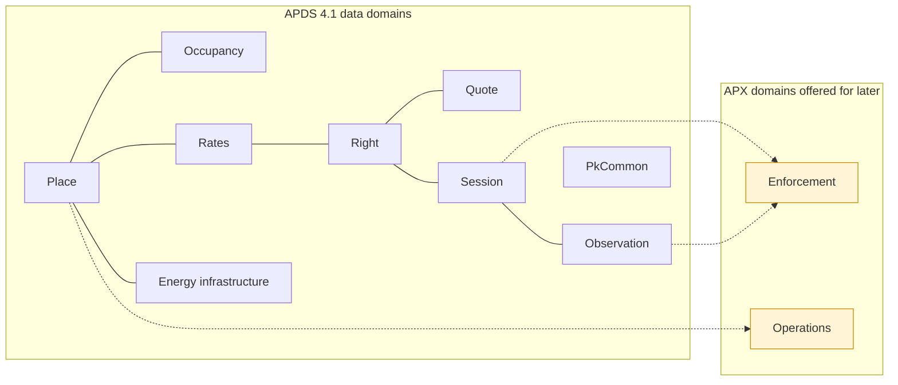

The proposals in this annex are grouped in three tiers, in case the
working groups would one day like to take them in steps:

- **Tier 1, ready to adopt:** data every access control, enforcement or LPR system
  already holds and shares: access events, equipment status, credential
  status, how a session started and ended, plate read attributes,
  violations and notices, and validation redemptions.
- **Tier 2, proven in APX, could follow:** shapes that are stable in APX and widely
  useful, such as plate lists, validation programmes, payment outcomes,
  reservations and permits, valet custody and alerts.
- **Tier 3, for discussion:** areas that are still settling (electric
  vehicle charging sessions) or may sit outside parking data (customer
  service interactions).

*Figure A.1: The APDS data domains, with the two APX domains offered for
later adoption. APX also carries extensions within Place, Occupancy,
Rates, Right, Session, Observation, Energy infrastructure and PkCommon.*

The rest of this annex describes each domain in turn. The Place section
also covers the five `EquipmentTypeEnum` values requested above, for
context.
