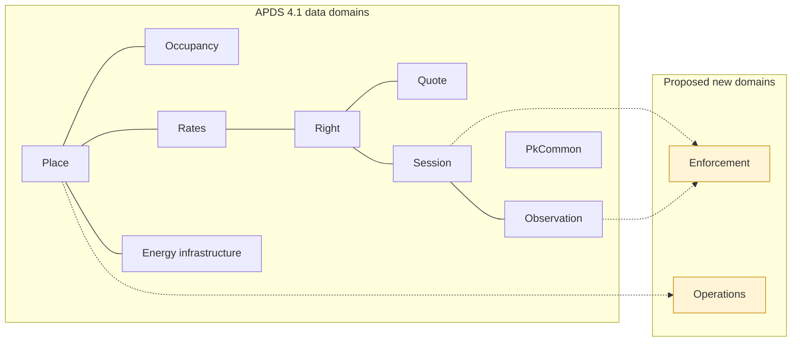

## Introduction

Parking and kerbside operations now run on many connected systems at
once: access control and lane equipment, licence plate recognition,
permits and credentials, payments, merchant validations, enforcement and
the back offices that tie them together. APDS gives these systems a
common language for places, rights, rates, quotes, occupancy, sessions
and observations. In implementing APDS 4.1 end to end across these
systems, we found a small number of things they need to exchange that
the data model does not yet have a place for.

This document set proposes those additions to the APDS data model. It is
offered to the Alliance for Parking Data Standards for consideration,
with thanks for the work that has gone into APDS. Every item here is a
request or a suggestion. None of it changes the meaning of anything APDS
already defines.

### Purpose

To give the APDS working groups, in the same form as the APDS 4.1
documents, a complete and reviewable description of the data elements
and enumerations APX needs so that parking systems can exchange this
information in APDS terms rather than in private extensions.

### Background

APX (APDS Parking eXtensions) began as an open, additive companion to
APDS 4.1. It reuses every APDS construct as published and adds only what
APDS leaves out. APX has been shared with the APDS committee and,
following discussion with the committee, the work is now split in two:

- **Data elements, proposed to APDS (this document set).** The classes,
  attributes and enumerations that describe what is exchanged. If
  adopted, they would sit in the APDS data model alongside the existing
  domains, and so in a future revision of ISO TS 5206-1.
- **The APX API, kept separate.** The routes, message flows, delivery,
  security and command workflow that implement the exchange. The APX API
  remains the preferred implementation specification built on APDS. It
  is informative here and is not proposed for the data model.

Every element proposed here is already exercised in the APX reference
implementation and its published test scenarios.

### Guiding principles

The proposals follow the APDS guiding principles and these additional
rules:

1. **APDS first.** Where APDS 4.1 already defines a class, attribute or
   value, it is used as it is. A proposal is made only where nothing in
   the APDS 4.1 Information Model or Data Dictionary fits.
2. **Data, not interface.** Only what is exchanged is proposed. How it is
   requested, delivered or secured stays out of the data model.
3. **Small and mostly optional.** Each new class carries its identity and
   the one or two attributes without which it means nothing. Everything
   else is optional, so a Distributing Party sends only what it has.
4. **Open code lists.** Where values vary by market (reasons, types,
   states), the enumeration lists common values and allows `other`, and
   an external code list may extend it, as APDS already does for vehicle
   types and occupancy levels.
5. **Compatible extensions.** Additions to existing APDS classes are
   written as Level B extensions under the APDS rules for extending the
   model (Information Model, "Extending the APDS Model"), so a valid
   extended instance is always a valid APDS 4.1 instance.
6. **Vendor neutral.** Nothing proposed favours one supplier, technology
   or business model.

### Technical documentation

This document set mirrors the APDS 4.1 technical documentation:

- **Overview (this document):** what each addition is for and the benefit
  of sharing it.
- **Information Model:** the proposed classes, attributes, relationships
  and enumerations for each domain, with diagrams showing where they
  attach to the existing APDS model.
- **Data Dictionary:** the definition of every proposed class, attribute,
  association and enumeration value, in the table format of the APDS 4.1
  Data Dictionary.
- **Use Case Document:** worked examples showing the proposed data in use,
  continuing the numbering of the APDS 4.1 Use Case Document.

### Development priorities

The proposals are grouped in three tiers so the working groups can take
them in steps:

- **Tier 1, propose now:** data every access control, enforcement or LPR
  system already holds and needs to share: access events, equipment
  status, credential status, how a session started and ended, plate read
  attributes, violations and notices, and validation redemptions.
- **Tier 2, proven in APX, propose next:** shapes that are stable in APX
  and widely useful, such as plate lists, validation programmes, payment
  outcomes, reservations and permits, valet custody and alerts.
- **Tier 3, for discussion:** areas that are still settling (electric
  vehicle charging sessions) or may sit outside parking data (customer
  service interactions).

*Figure 1: The APDS data domains, with the two proposed new domains.
Additions are also proposed within Place, Occupancy, Rates, Right,
Session, Observation, Energy infrastructure and PkCommon.*
