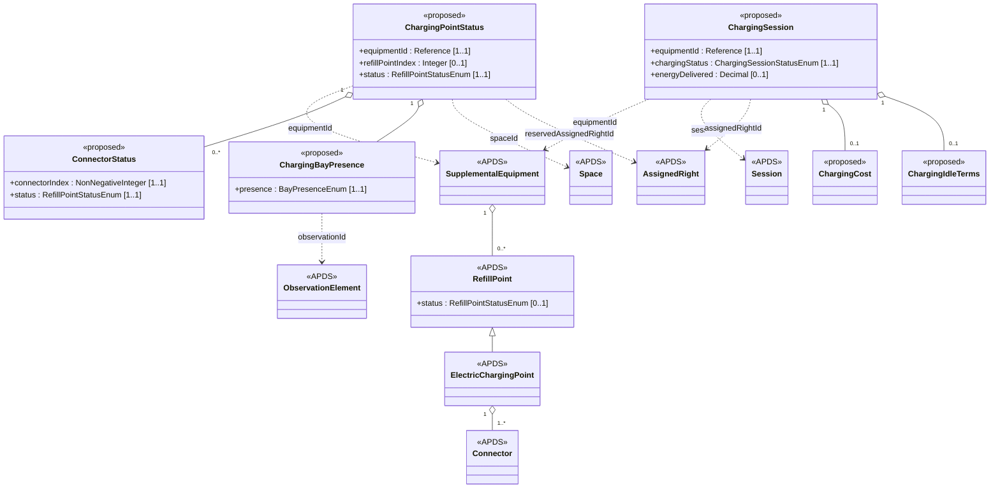

## Overview

The Energy Infrastructure additions let parking operators and charging
networks share the live state of charging points and the charges that take
place inside a parking stay. APDS 4.1 already describes charging
infrastructure as it is built, through SupplementalEquipment, RefillPoint,
ElectricChargingPoint and Connector, and it provides `RefillPointStatusEnum`
for the status of a refill point. The additions build on these and do not
restate them.

### Benefits of the Energy Infrastructure additions

A driver looking for a charger wants to know whether one is free now, not
only that one exists. An operator wants to know when a bay is taken by a
vehicle that is not charging, and wants to bill a charge together with the
parking. Charging networks already exchange this information among
themselves using their own protocols. What parking systems lack is a
common, parking-side way to describe it alongside Places, Spaces, Sessions
and AssignedRights.

All of these additions are in use in APX (Part 23). They are optional
and offered for discussion rather than for immediate adoption, and
nothing else in this package depends on them.

### What a charging point status holds

A ChargingPointStatus:

- Has a reference to the SupplementalEquipment and the `refillPointIndex` of
  the static RefillPoint it describes, the link APDS already provides
  between static and dynamic publications.
- Has a status taken from the existing `RefillPointStatusEnum`.
- Has a status for each connector, where connectors differ.
- Has what is physically in the bay, where a camera, sensor or attendant can
  tell.
- May reference the Space it serves, the AssignedRight that has reserved it,
  and the ChargingSession in progress.

### What a charging session holds

A ChargingSession:

- Has a unique identification and a version.
- Is associated to a Place element, a SupplementalEquipment and a refill
  point.
- Has a status, from authorization through charging and idle time to
  closure.
- May reference the parking Session it happened inside, and the
  AssignedRight that entitled it.
- Has the times it was authorized, plugged in, charging, idle and unplugged.
- Has the energy delivered and, where known, the cost and how the cost is
  settled.
- May carry the charging network's own identifiers without interpreting
  them.

## Information model

The proposed classes sit in the existing `EnergyInfrastructure` package
beside RefillPoint, ElectricChargingPoint and Connector. None of them
changes an existing class, so all are Level B additions to an existing
domain. ChargingPointStatus refers to a refill point the
same way a dynamic publication is expected to: by the SupplementalEquipment
that holds it and its `refillPointIndex`. The point and each connector use
`RefillPointStatusEnum` as it stands. Its values `available`, `occupied`,
`charging`, `reserved`, `blocked`, `inoperative`, `outOfOrder` and `unknown`
cover every state APX reports today. ConnectorStatus adds only the index of
the connector and the power being delivered.

ChargingBayPresence records what is physically in the bay. It is kept apart
from the status because it often comes from a different source, such as an
overhead camera, and because it reveals cases the charger cannot report:
a vehicle parked but not connected, or a bay blocked by cones.

ChargingSession is a versioned, identifiable record of one charge. The
parking stay remains an APDS Session and is only referenced. Cost is
expressed in `AmountInCurrency`, and the idle rule that applied is
recorded with the charge so that a later change of rule does not re-price
it. Identifiers from charger and roaming protocols are carried as
`ExternalIdentifier` values and are not modelled.

### Enumerations (for Energy Infrastructure)

- **Reused:** `RefillPointStatusEnum` (point and connector status),
  `AuthenticationAndIdentificationEnum` (how a charge was authorized), and
  the unit enumerations already in the package.
- **Proposed:** `BayPresenceEnum`, `BayPresenceSourceEnum`,
  `ChargingSessionStatusEnum`, `ChargingStopReasonEnum` and
  `ChargingSettlementModeEnum`. The session states and stop reasons follow
  the OCPP 2.0.1 vocabulary so that the two can be mapped directly.

### External code lists (for Energy Infrastructure)

No external code lists are proposed. Identifiers from charging protocols
(EVSE ids, charger transaction ids, roaming session and charge record ids)
are carried as `ExternalIdentifier` values and are not interpreted.

## Use cases

### Charging inside a parking stay at a controlled garage

A city-centre garage has twelve charging points on level 2, each over a
marked bay with an overhead camera. Drivers enter through LPR-equipped
lanes. A driver arrives, parks in bay 2-07 and plugs in. The charge is
authorized by the plate read at entry. After 90 minutes the vehicle is
full, but the driver returns two hours later. The garage applies a
10-minute grace period and then an idle fee, and the charge is paid
together with the parking at exit.

These specifications support this use case in a number of ways:

**Place.** The charging points are already described in APDS as
SupplementalEquipment with ElectricChargingPoints and Connectors, and each
bay is a Space. Nothing new is needed to describe what is installed.

**Energy Infrastructure.** A ChargingPointStatus for bay 2-07 moves from
`available` to `charging`, then to `occupied` once delivery ends with the
cable still connected, using the existing `RefillPointStatusEnum`. Its
ChargingBayPresence reads `vehiclePluggedIn` from the overhead camera. A
ChargingSession records the authorization, the plug-in, the start and end
of charging, the start of idle time after the grace period, and the
unplug. It records the energy delivered, the idle terms in force when the
charge began, and a ChargingCost with energy and idle components. Its
settlement mode is `parkingSession`.

**Session.** The ChargingSession references the driver's APDS Session.
At exit, the parking system adds the charging cost to the stay and takes
one Payment for both.

**Observation.** The entry plate read and the camera evidence for the bay
are APDS Observations. The bay presence references the camera
Observation, and the charging session references the credential observed
at entry.

### A bay taken by a vehicle that is not charging

At the same garage, a vehicle parks in bay 2-09 and does not plug in. The
camera sees a vehicle, while the charger reports no cable connected. After
the place's grace period the operator wants an attendant to act.

These specifications support this use case in a number of ways:

**Energy Infrastructure.** The ChargingBayPresence for bay 2-09 reads
`vehicleNotPluggedIn` from the overhead camera, with `evCapable` false
where the camera recognizes the vehicle model. The ChargingPointStatus is
`blocked`.

**Operations.** An Alert of type `evBayNotCharging` (or `iceInEvSpace`) is
raised for the bay's SupplementalEquipment and references the camera
Observation as evidence.

**Enforcement.** Where the place's EnforcementPolicy allows it, the
condition can become a Violation of type `restrictedSpace`, with the camera
Image as evidence.
