## Overview

The Enforcement domain is new. It gives a name and a structure to what
happens after an operation finds that a vehicle is not covered by a valid
right. APDS 4.1 already carries everything such a finding is built from:
Observations and their Images, Sessions, AssignedRights and Payments. Use
Case C.2.2 describes transaction exceptions being converted into violation
notices that create fines or penalties. The data model, however, has no
class for the violation or the notice. This domain adds them.

### Benefits of the Enforcement domain

Enforcement usually involves several parties: the operator that owns the
rights and sessions, an enforcement provider with cameras or officers, a
processing agency that sends notices and collects payment, and someone who
hears appeals. Today each keeps its own record of the same violation and
reconciles by hand. A shared description of the violation, its notice and
its outcome lets these parties hand a case from one to the next. It also
lets reporting compare enforcement across places, and lets a driver's
appeal be checked against the same evidence and rules the notice was
issued under.

Every class in the domain reuses APDS types for places, credentials,
vehicles, evidence images, locations, money and payments, so a violation
refers to the same records the rest of the model already uses.

### Violation

A Violation:

- Has a unique identification and a version.
- Has a violation type and a status.
- Has the date/time it was observed and the element of the Place where it
  was observed.
- May reference the Space, the Observations it is built from, the Session
  the vehicle was in, and the AssignedRight that came closest to covering
  the stay.
- Has the credential and vehicle identified, using the same APDS classes a
  Session uses.
- Has evidence, as APDS Images, and a location, as an APDS Observation
  Location.
- Has how it was detected: automatically, by an officer guided by a system,
  or by an officer alone.
- Has, once issued, a Notice, an amount, a due date and the Payments
  applied to it.
- May have an Appeal.
- May reference the EnforcementPolicy and the Signage in force when it was
  observed.

### Notice

A Notice:

- Has the notice number printed on or sent with it.
- Has the date/time it was issued.
- Has the kind of notice (for example a warning, a penalty charge notice or
  a citation) and how it was delivered.
- May reference the Organisation on whose authority it was issued.

### Enforcement policy

An EnforcementPolicy:

- Has a unique identification and a version.
- Applies to an element of the Place and everything below it, unless a
  lower element has its own policy.
- Has an APDS Validity, which gives its period and whether it is active,
  planned or suspended, and an end reason once it is superseded or retired.
- Has the jurisdiction and legal text it summarizes.
- May reference the Signage posted to give notice of it.
- Has which notice delivery methods are lawful for which detection modes,
  by when, and with what minimum evidence.
- Has limits on the penalty, a schedule of increases for late payment, and
  the appeal and payment periods.
- Says whether posted Signage is required, and whether automated findings
  may be issued without review.

## Information model

The domain is a new package, `Enforcement`, at
`D2Payload/Extension/Parking/Enforcement`. It contains two identifiable
classes, Violation and EnforcementPolicy, and the components they are
built from.

**Violation** is versioned and identifiable, like a Session. The
attributes a receiver needs to understand the finding are mandatory: type,
status, the time it was observed, the Place element and how it was
detected. Everything else is
optional, so a simple warning and a fully evidenced citation use the same
class. The credential and vehicle use the existing `Right.Credential` and
`PkCommon.VehicleAncillaryIdentification` classes, in the same way
`Session.identifiedCredential` and `Session.identifiedVehicle` do. Evidence
uses the existing `Observation.Image` class, and the location uses the
existing `Observation.Location`. Money is `AmountInCurrency`, and payments
are references to APDS Payments. The violation refers to the
EnforcementPolicy and Signage at the versions in force when it was
observed, so a later change does not alter what applied to it.

**ViolationDetection** records how the violation was found. Its mode
matters because many jurisdictions allow an automated finding to be issued
only after review, or only by post.

**Notice** records what was issued. The notice number and the time of
issue are mandatory, because the number is how drivers, agencies and
courts refer to a violation.

**Appeal** records a challenge and its outcome: upheld, reduced (with the
new amount) or dismissed, with any refund Payment.

**EnforcementPolicy** is versioned and identifiable and applies down the
Place hierarchy in the way APDS data generally does. Its period and its
active, planned or suspended state use the APDS Validity class; only the
reason it ended (superseded or retired) is a code of its own, shared with
other records in PkCommon. Its components are **NoticeDeliveryRule**,
**PenaltyLimit** and **EscalationStep**. It is a summary that systems can
check a notice against. It does not replace the statute.

The policy points to the Signage that gives notice of it, rather than the
other way round, so the Place additions do not depend on this new domain.

In APX, a Violation also keeps a full history of its status changes and
amount changes. That audit detail stays in the APX profile and is not
proposed here.

```mermaid
classDiagram
  class HierarchyElementGeneral {
    <<APDS>>
  }
  class Space {
    <<APDS>>
  }
  class Session {
    <<APDS>>
  }
  class AssignedRight {
    <<APDS>>
  }
  class Payment {
    <<APDS>>
  }
  class ObservationElement {
    <<APDS>>
  }
  class Image {
    <<APDS>>
  }
  class Location {
    <<APDS>>
  }
  class Credential {
    <<APDS>>
  }
  class VehicleAncillaryIdentification {
    <<APDS>>
  }
  class Validity {
    <<APDS>>
  }
  class Signage {
    <<proposed>>
  }
  class Violation {
    <<proposed>>
    +violationType : ViolationTypeEnum [1..1]
    +violationStatus : ViolationStatusEnum [1..1]
    +detectedTime : DateTime [1..1]
    +elementId : VersionedReference [1..1]
    +amount : AmountInCurrency [0..1]
    +dueTime : DateTime [0..1]
  }
  class ViolationDetection {
    <<proposed>>
    +detectionMode : DetectionModeEnum [1..1]
  }
  class Notice {
    <<proposed>>
    +noticeNumber : String [1..1]
    +issuedTime : DateTime [1..1]
    +noticeKind : NoticeKindEnum [0..1]
    +deliveryMethod : NoticeDeliveryMethodEnum [0..1]
  }
  class Appeal {
    <<proposed>>
    +appealReason : AppealReasonEnum [1..1]
    +resolution : AppealResolutionEnum [0..1]
  }
  class EnforcementPolicy {
    <<proposed>>
    +elementId : VersionedReference [1..1]
    +endReason : RecordEndReasonEnum [0..1]
  }
  class NoticeDeliveryRule {
    <<proposed>>
  }
  class PenaltyLimit {
    <<proposed>>
  }
  class EscalationStep {
    <<proposed>>
  }
  Violation ..> HierarchyElementGeneral : elementId
  Violation ..> Space : spaceId
  Violation ..> ObservationElement : observationId
  Violation ..> Session : sessionId
  Violation ..> AssignedRight : assignedRightId
  Violation ..> Payment : paymentId
  Violation ..> EnforcementPolicy : policyId
  Violation ..> Signage : signageId
  Violation "1" o-- "1" ViolationDetection
  Violation "1" o-- "0..1" Credential : identifiedCredential
  Violation "1" o-- "0..1" VehicleAncillaryIdentification : identifiedVehicle
  Violation "1" o-- "0..*" Image : evidence
  Violation "1" o-- "0..1" Location
  Violation "1" o-- "0..1" Notice
  Violation "1" o-- "0..1" Appeal
  EnforcementPolicy ..> HierarchyElementGeneral : elementId
  EnforcementPolicy ..> Signage : signageId
  EnforcementPolicy "1" o-- "1" Validity
  EnforcementPolicy "1" o-- "0..*" NoticeDeliveryRule
  EnforcementPolicy "1" o-- "0..1" PenaltyLimit
  EnforcementPolicy "1" o-- "0..*" EscalationStep
```

### Enumerations (for Enforcement)

- **ViolationTypeEnum:** `noValidRight`, `expiredRight`, `notYetValidRight`,
  `wrongPlace`, `maximumStayExceeded`, `restrictedSpace`, `permitMisuse`,
  `noParkingPeriod`, `obstruction`, `other`. A value for a vehicle left
  in a charging bay after charging ends can be added if the Energy
  Infrastructure additions, offered for discussion, are taken up.
- **ViolationStatusEnum:** `detected`, `confirmed`, `dismissed`, `issued`,
  `paid`, `appealed`, `closed`, `voided`.
- **DetectionModeEnum:** `automated`, `guided`, `manual`.
- **NoticeKindEnum** and **NoticeDeliveryMethodEnum:** a first draft for the
  group's review. Notices are named differently from one jurisdiction to
  the next, so these lists in particular would benefit from members'
  experience.
- **AppealReasonEnum** (also a first draft) and **AppealResolutionEnum**
  (`upheld`, `reduced`, `dismissed`; the toll dispute resolutions use the
  same `reduced`).
- **Reused from PkCommon:** the proposed `RecordEndReasonEnum` gives why an
  EnforcementPolicy ended; its active, planned and suspended states come
  from the APDS `ValidityStatusEnum`.

### External code lists (for Enforcement)

Violation types, notice kinds and appeal reasons vary by jurisdiction. As
elsewhere in APDS, an operation that needs a value not on these lists can
publish it in a `UserDefinedCodeList` and use `other` in the enumeration.
APX publishes its violation types as such a list today.

## Use cases

### C.2.2 continued: from transaction exception to notice and appeal

This example continues Use Case C.2.2. At Hangzhou Xiaoshan International
Airport, garage P6 logs entry and exit by licence plate camera, and
customers check in to their space by app. The use case lists transaction
exceptions, such as a vehicle checked in to a reserved space without a
valid reservation or an ICE vehicle in an EV space. It notes that these
"can be converted into violation notices that create fines/penalties for
the owner of the vehicle", that an enforcement officer cannot cancel
violations generated by the system, and that an officer can create new
violations from their own observations.

The airport uses a processing agency to send notices and collect payment,
and an independent adjudicator to hear appeals. Here is what happens next.

1. At 14:05 a vehicle checks in by app to reserved space P6-B-112 with no
   AssignedRight for that space. The grace period passes, and the system
   records a Violation with status `detected`.
2. An officer on patrol finds a second vehicle in an EV space with no
   charging connection and records a Violation on their handheld.
3. A reviewer confirms the first violation. A notice is posted to the
   registered keeper, and the keeper pays.
4. The keeper of the second vehicle appeals, saying the signs were unclear.
   The adjudicator reduces the amount.

These specifications support this use case in a number of ways:

**Observation.** The entry read, the check-in and the patrol officer's
photographs are APDS Observations and Images, exactly as C.2.2 describes.
Each Violation references the Observations it was built from and carries
the photographs as evidence Images with their Location.

**Session and Right.** The first Violation references the vehicle's Session
and, as its related AssignedRight, the reservation held for a different
space. Its type is `wrongPlace`. The second has no covering right, and its
type is `restrictedSpace`.

**Enforcement.** The first Violation has detection mode `automated`. Because
the garage's EnforcementPolicy does not allow unreviewed issuance, it moves
from `detected` to `confirmed` only after review, then to `issued`. Its
Notice carries the notice number, the time of issue, kind
`penaltyChargeNotice` and delivery method `post`. The policy's
NoticeDeliveryRule allows posting for automated findings only within 14
days of the observation and with at least two Images, and the processing
agency can check both before sending. When the keeper pays, the Payment is
referenced and the status becomes `paid`, then `closed`.

The second Violation has detection mode `manual` and references the
officer's Contact. Matching C.2.2, the officer can create this violation but
not cancel the system's. Its Notice is `affixedToVehicle`. The keeper opens
an Appeal with reason `signageInadequate`. The adjudicator compares the
Violation with the Signage in force at the space when it was observed, then
records resolution `reduced` with an adjusted amount. The violation returns
to `issued` at the lower amount.

**Place.** Both violations reference the same Place elements, Spaces and
SupplementalEquipment (cameras and handheld devices) that the rest of the
model describes. The EnforcementPolicy applies to the whole of P6 through
the Place hierarchy.

### Escalation of an unpaid notice on street

A city issues a penalty charge notice for an on-street overstay. Its
EnforcementPolicy sets a payment grace period of 14 days, an EscalationStep
adding 50% after 28 days, and a PenaltyLimit whose maximum amount is twice
the amount at issue, with a basis saying the cap includes escalation.

These specifications support this use case in a number of ways:

**Enforcement.** The Violation's amount rises once, after 28 days without
payment, and never above the PenaltyLimit. Any party holding the
EnforcementPolicy version referenced by the Violation can confirm the
increase was lawful. Time spent under appeal does not count towards the
step.

**Right.** The overstay is found against an AssignedRight whose validity
had ended. That right is referenced as the related AssignedRight, with
type `expiredRight`.
