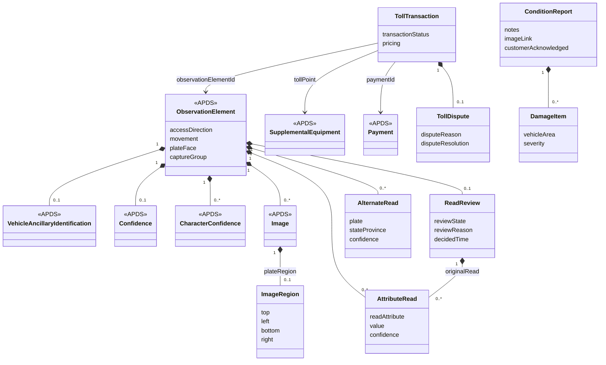

## Overview

The Observation data domain documents the observation of an entity in a
Place performing an action. APDS 4.1 already records the method, the
credential observed, the location, images, an overall confidence and a
confidence for each character. The additions proposed here carry what a
modern licence plate recognition camera reports beyond that, record the
condition of a vehicle, and tie observations at a toll point into a
charge.

### Benefits of the Observation additions

Enforcement, access control and analytics all act on plate reads, and
each needs to know how far to trust them. A camera can be sure of the
plate characters and unsure of the issuing state, or sure of the plate
and wrong about the colour. One overall confidence cannot say which. A
confidence for each recognised attribute lets every receiver apply its
own thresholds.

When a read is wrong, the right answer is often one of the other
candidates the engine considered. Keeping those alternates lets a
reviewer or a matching system correct the read without a new capture.

On sites without barriers, whether a vehicle entered or left is decided
by the direction it moved past the camera. Recording the movement, the
plate face read and the passage a read belongs to lets several cameras
and frames be treated as one event.

Some jurisdictions require a person to confirm a plate before a penalty
is issued. Recording the review state and its reasons carries that
evidence with the observation.

Valet operators record a vehicle's condition when they take it and when
they return it; that report is the evidence a damage claim is answered
with. Toll operators assemble a charge from one or more observations at
a toll point and must handle disputes about it.

### Key concepts

Observation element (additions)

- Has a recognised value and confidence for each attribute read (plate, country, state or province, plate category, make, model, colour, body type).
- Has the alternate plate candidates, best first.
- Has the vehicle's movement relative to the camera, the plate face read, and the direction of passage as the recognition system reports it.
- Has a capture group shared by all reads of one passage.
- Has an optional review state, the reasons for review and the original values before correction.

Image (additions)

- Has two more image types: an extended plate crop and a wide context view.
- Has the region of the image that contains the plate.

Condition report

- Has notes, photographs and structured damage findings by area and severity.
- Has when and by whom it was recorded, and whether the customer acknowledged it.

Toll transaction

- Has the toll point, the observations it is built from and the credential read.
- Has the price, the payment that settles it and a status.
- Has an optional dispute with its reason, resolution and the original price.

## Information model

The additions extend the `Observation` package
(`D2Payload/Extension/Parking/Observation`) and add a new `Tolling`
package (`D2Payload/Extension/Parking/Tolling`). All are Level B
extensions.

`ObservationElement` gains three optional associations and eight
optional attributes. The recognised values themselves stay where APDS
4.1 puts them: the plate in `observedCredentialId`, and country, state,
make, model and colour in the associated `VehicleAncillaryIdentification`.
Each `AttributeRead` repeats one of those values with its own confidence,
so a receiver that knows only APDS 4.1 still reads the winning values.
The existing `Confidence` (overall) and `CharacterConfidence` (per
character) classes are unchanged and remain the place for those
measures.

`accessDirection` reuses the `AccessDirectionEnum` proposed in the
Session domain. It records what the recognition system reported for this
passage, which may differ from the configured purpose of a reversible
lane (`AccessLaneTypeEnum`).

`Image` gains one optional association, `plateRegion`, to a new
`ImageRegion` that gives the plate's position as fractions of the image,
and `ImageTypeEnum` gains two values.

`ConditionReport` and `DamageItem` are new classes in the Observation
package; the valet ticket in the Session domain references a condition
report at drop-off and at handback.

`TollTransaction` is a new versioned identifiable class in the new
`Tolling` package. It references existing `ObservationElement`,
`SupplementalEquipment` (the toll point) and `Payment` instances.

### Change to an existing multiplicity

We would also like to suggest one small change that the table format of
the Data Dictionary cannot show as an addition: making
`VehicleAncillaryIdentification.country` optional (`0..1` instead of
`1..1`). A read whose plate country the engine could not place could
then still carry make, model and colour, and those are often the reads
that most need them. Today such a read must omit the whole
`VehicleAncillaryIdentification`. The change relaxes a constraint, so
every instance valid today stays valid.

### Enumerations (for Observation)

| Enumeration | Change | Used by | Tier |
| --- | --- | --- | --- |
| ImageTypeEnum | adds `plateExtended`, `context` | Image.imageType | 2 |
| ReadAttributeEnum | new | AttributeRead.readAttribute | 1 |
| VehicleMovementEnum | new | ObservationElement.movement | 1 |
| PlateFaceEnum | new | ObservationElement.plateFace | 2 |
| ReadReviewStateEnum | new | ReadReview.reviewState | 2 |
| ReadReviewReasonEnum | new | ReadReview.reviewReason | 2 |
| DamageSeverityEnum | new | DamageItem.severity | 2 |
| TollTransactionStatusEnum, TollDisputeReasonEnum, TollDisputeResolutionEnum | new (Tolling) | TollTransaction, TollDispute | 2 |

### External code lists (for Observation)

`ReadReviewReasonEnum`, `TollDisputeReasonEnum` and
`TollDisputeResolutionEnum` are maintained by APX today as user-defined
code lists (`apx-read-review-reasons`, `apx-toll-dispute-reasons`,
`apx-toll-dispute-resolutions`). As in the Session domain, they could
equally be typed as `PkCommon.ReferencedCodeListEntry` with these values
as the recommended initial list. `DamageItem.vehicleArea` is left as a
string from an operator code list; we do not propose standard values for
it yet.

## Use cases

### Gateless car park with plate recognition and review

A supermarket car park has no barriers. One camera faces the shared
entrance and exit. Customers may stay 90 minutes free; longer stays
receive a parking charge notice, and the national code of practice
requires a person to confirm each plate first.

A vehicle arrives at 10:02 and leaves at 12:10. Its exit read reports
plate `AB12 CDE` with plate confidence 0.97, but colour confidence only
0.41 because of glare.

These specifications support this use case in a number of ways:

**Observations.** Each read carries an `AttributeRead` for the plate, the
country, the make and the colour, each with its own confidence, and
`movement` toward or away from the camera. Because the entrance and exit
share one camera, the movement is what tells the two passages apart; the
recognition system reports `accessDirection` entry or exit accordingly.
Several frames of each passage share one `captureGroup` and are treated
as one event.

**Review.** Because a charge notice will follow, the exit read is sent to
review with `reviewReason` `enforcementHandoff`. The reviewer sees the
`AlternateRead` candidates (`AB12 CDF`, 0.62) and confirms the original.
The read's `ReadReview` records `confirmed`, the time and the reviewer,
and travels with the observation to the enforcement system.

**Sessions.** The Session built from the two reads lists them as its
entry and exit (`SessionRead`), so the 128-minute stay can be checked
against the observations it rests on.

### Valet drop-off and a damage claim

A hotel valet takes a guest's car at 18:30. The attendant photographs the
car and notes a scuff on the rear bumper. At handback the next morning
the guest reports a dent on the driver's door.

These specifications support this use case in a number of ways:

**Condition reports.** The drop-off `ConditionReport` holds the
photographs, a `DamageItem` for the rear bumper with severity `minor`,
and the guest's acknowledgement. The handback report adds a `DamageItem`
for the driver's door. Comparing the two reports, item by item, is the
evidence the claim is answered with.

**Sessions.** The valet ticket (Session domain) references both reports,
the APDS Session for the stay and the Space where the car was parked, so
the operator can see who parked it, where, and when.
