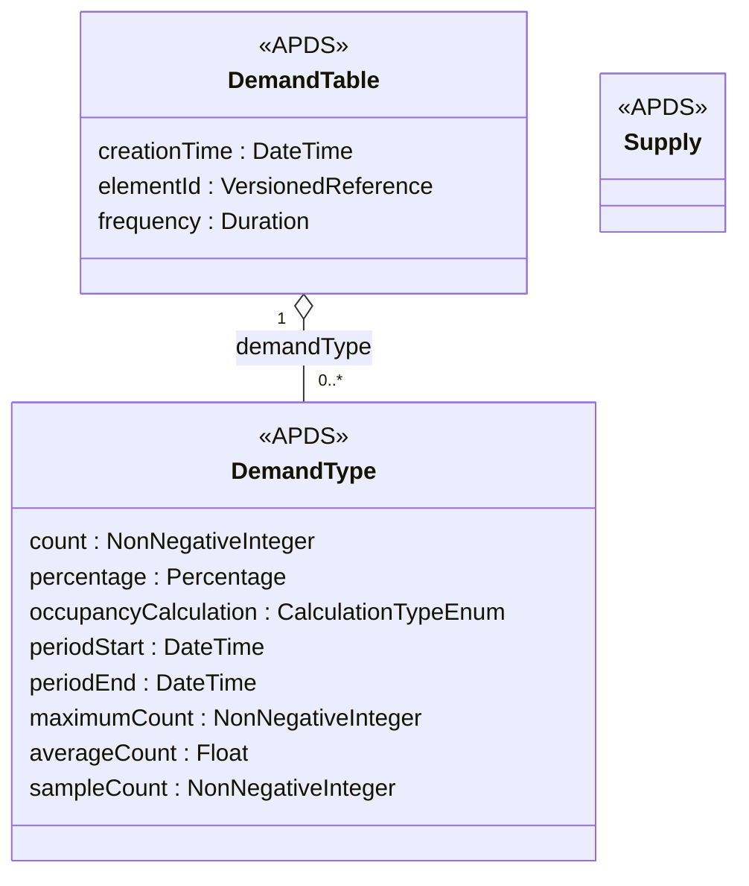

## Overview

The APDS Occupancy data specification divides occupancy into Supply (the
spaces or area available) and Demand (how much of it is in use). APX
reads and shares occupancy entirely through these classes and proposes
nothing new for the present moment. One small addition is suggested for
discussion: a way to summarise occupancy over a period.

### Benefits of period summaries

Cities, landlords and operators increasingly ask for occupancy history:
the busiest hour of each day, the average occupancy of a zone across a
month, the effect of a price change. Today a Distributing Party must
either send every individual DemandType reading, which can mean
thousands of records a day for one Place, or agree a private summary
format with each receiver.

A Demand Type record that summarises a period:

- Has the start and end of the period it summarises.
- Has the highest count recorded during the period.
- Has the time-weighted average count over the period.
- Has the number of readings the summary is calculated from.

A receiver can then tell a period with no readings (no data) from a
period with low occupancy, which matters when the figures are used for
pricing or planning decisions.

### What is not proposed

APX also offers a "current occupancy" view and an hourly history view to
its users. We considered whether either is a new data element and
concluded they are not:

- The current view is made entirely of APDS Supply and DemandType,
  plus a figure for available spaces that any receiver can calculate
  (supply quantity minus demand count). It needs nothing new.
- The history view is a series of period summaries. The only part APDS
  cannot yet express is the summary itself, which is the suggestion
  below.

Counts of electric charging points by status are described in the Energy
Infrastructure domain.

## Information model

The suggestion adds five optional attributes to the existing DemandType
class in the Demand package. A DemandType record without them keeps its
current meaning: the count at a moment, given by creationTime.

In the diagram, periodStart, periodEnd, maximumCount, averageCount and
sampleCount are the proposed attributes; the others exist in APDS 4.1.

When periodStart and periodEnd are present, the record describes the
period and count, if given, is the count at its end. Periods are
expected to align with clock boundaries in the Place's time zone (e.g.,
each hour), but the specification does not need to require it. The
supply in force during the period continues to come from Supply.

We have marked this suggestion for discussion (tier 3). It may be that
the group would prefer a separate summary class, or a different place
for these attributes.

### Enumerations (for Occupancy)

No new enumerations are proposed in Occupancy.

### External code lists (for Occupancy)

No new external code lists are proposed in Occupancy.

## Use cases

### Monthly occupancy report to a city

A city licenses private car parks and asks each operator for monthly
occupancy reports: for each car park, the highest and average occupancy
for each hour of each day.

An operator's garage records a DemandType reading every two minutes,
about 21,600 readings a month.

These specifications support this use case in a number of ways:

**Place.** The garage is described as a Place with its Supply, as it is
today.

**Occupancy.** For each hour the operator sends one DemandType inside a
DemandTable for the garage. Each carries periodStart and periodEnd for
the hour, maximumCount and averageCount, and sampleCount (normally 30).
An hour in which the counting system was offline carries a sampleCount
of 0 and no counts, so the city can see the gap rather than mistake it
for an empty garage. The month is about 720 records instead of 21,600,
and every operator in the city reports in the same form.
