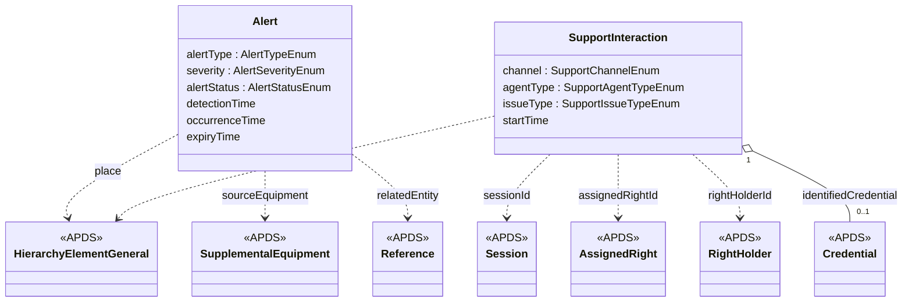

## Overview

The Operations domain is new. It describes conditions in a running parking
operation that need someone's attention. Use Case C.2.2 lists transaction
exceptions and space statuses that an operation acts on, such as no
check-out, a vehicle in the wrong space, or an ICE vehicle in an EV space.
APDS 4.1 describes the places, equipment, sessions and rights these
conditions concern, but has no class for the condition itself. This
domain adds the Alert.

### Benefits of the Operations domain

Modern parking sites are monitored from many places: the equipment
supplier's service desk, a remote monitoring centre, the operator's
control room, and enforcement and charging partners. Each needs to know
when a barrier faults, a lane is blocked, a charging bay is taken by a
vehicle that is not charging, or a vehicle on a watch list arrives. Each
also needs to know whether someone has already taken the condition in
hand. A shared description of these conditions lets one party raise them
and others act on them, without one integration per supplier.

### Alert

An Alert:

- Has a unique identification and a version.
- Has an alert type, a severity and a status.
- Has the date/time it was detected and, where known, when it began.
- May have an expiry time, after which it lapses if it is not resolved.
- May reference the element of the Place and the SupplementalEquipment
  where it was detected.
- May reference the record it concerns, such as a Session, an AssignedRight
  or a Violation.
- Has a human-readable description.

### Support interaction (for discussion)

APX also records customer-service contacts, so that an agent helping a
driver can see earlier calls about the same session. This may lie outside
the scope APDS sets itself in its guiding principles. It is included so
the group can decide, and APX is equally happy to keep it within its own
profile.

A SupportInteraction:

- Has a unique identification and a version.
- Has a channel, the kind of agent (a person or an automated assistant),
  and start and end times.
- Is associated to an element of a Place.
- May reference the Session, AssignedRight, RightHolder or credential the
  contact was about.
- Has the kind of issue, a short summary (not a transcript), and whether it
  was resolved.

## Information model

The domain is a new package, `Operations`, at
`D2Payload/Extension/Parking/Operations`.

**Alert** is versioned and identifiable. Its type, severity, status and
detection time are mandatory. Its link to the place uses
`HierarchyElementGeneral`, so subtree filtering works the same way as
elsewhere in APDS. Its link to equipment uses `SupplementalEquipment`. Its
link to the record it concerns is a plain `Reference`, because an alert may
concern any identifiable record. The lifecycle is short: an alert is
raised, may be acknowledged, and ends resolved or expired. In APX the
alert also keeps an append-only history of who changed its status and
when. That audit detail stays in the APX profile.

**SupportInteraction** is versioned and identifiable and refers only to
existing APDS records. Its issue types are taken from APX's existing
registry of customer-service issue types.

Device status (whether a barrier, camera or pay station is working) is
proposed in the Place domain, next to the SupplementalEquipment it
describes. An Alert of type `deviceFault` or `deviceOffline` is the event
that draws attention to a change in that status.

### Enumerations (for Operations)

- **AlertTypeEnum:** seeded from the C.2.2 transaction exceptions and space
  statuses (`noCheckOut`, `wrongSpace`, `occupiedWithoutCheckIn`,
  `iceInEvSpace`), the EV bay conditions (`evBayNotCharging`,
  `evBayBlocked`), operational conditions (`overstay`, `deviceFault`,
  `deviceOffline`, `laneBlocked`, `occupancyThresholdExceeded`,
  `paymentException`, `intercomRequest`, `wrongWayTravel`) and plate-list
  arrivals (`watchListArrival`, `scofflawArrival`,
  `refusedServiceArrival`). APX's own list also has a value for failed
  message delivery. That value concerns the APX interface rather than the
  parking operation, so it is not proposed.
- **AlertSeverityEnum:** `info`, `warning`, `minor`, `major`, `critical`. A
  closed scale.
- **AlertStatusEnum:** `raised`, `acknowledged`, `resolved`, `expired`.
- **SupportChannelEnum**, **SupportAgentTypeEnum** and
  **SupportIssueTypeEnum:** for discussion, with SupportInteraction.

### External code lists (for Operations)

Alert types are open in practice: each site has conditions of its own. An
operation can publish additional types in a `UserDefinedCodeList`, as APX
does today with `apx-alert-types`. Severity is deliberately closed, so
that every receiver ranks alerts the same way.

## Use cases

### A barrier fault seen by every party that needs it

A shopping-centre car park has its barriers and pay stations maintained by
the equipment supplier, is watched overnight by a remote monitoring
centre, and is run by an operator. At 22:40 the exit barrier on lane 3
stops responding, and a vehicle is waiting.

These specifications support this use case in a number of ways:

**Place.** The lane is a VehicularAccess element and the barrier is
SupplementalEquipment in the Place hierarchy. Its status changes to
`fault` through the device status proposed in the Place domain.

**Operations.** The lane controller raises an Alert of type `deviceFault`,
severity `major`, referencing the barrier and the lane. A second Alert of
type `laneBlocked` follows when the waiting vehicle is detected. The
monitoring centre acknowledges both, so the operator's duty manager can see
they are being handled. When the supplier's engineer repairs the barrier,
both alerts are resolved. All three parties work from the same records,
with the time each condition began, when it was detected, and when it was
dealt with.

**Observation.** The waiting vehicle's plate read is an APDS Observation.
The `laneBlocked` alert references it as the related record.

### C.2.2 transaction exceptions as alerts

At Hangzhou Xiaoshan International Airport (Use Case C.2.2), the system
detects a vehicle occupying space P6-B-112 without a check-in, and another
that checked out but has not exited within the grace period.

These specifications support this use case in a number of ways:

**Operations.** Each exception becomes an Alert, of type
`occupiedWithoutCheckIn` and `noCheckOut` respectively, referencing the
space and the related Session. The enforcement officers' devices show the
open alerts.

**Enforcement.** An officer who confirms that an exception is a violation
creates a Violation that references the same Session and Observations
(see the Enforcement domain). The Alert is then resolved.
