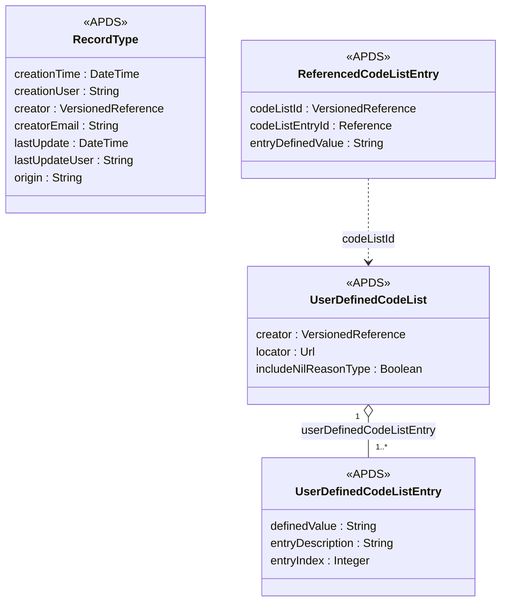

## Overview

The PkCommon domain holds the classes, datatypes and code list mechanism
shared by every other domain. APX needs very little here. One attribute
is suggested for RecordType; everything else APX relies on is already in
APDS or has been raised separately as an erratum.

### Benefits of a record origin

Parking data increasingly passes through more than one system before it
reaches its user. A city may receive Place and Session data from a
regional hub that collects it from several operators. A site system may
hold records created at another site and copied to it.

RecordType already says who created a record and when it was last
updated. It cannot say which system first created it when that differs
from the system now distributing it. Without that, a receiver that gets
the same record by two routes cannot easily tell they are the same, or
which source to ask when a record is wrong.

A Record Type may additionally:

- Have an origin: the identifier of the system that first created the
  record, when it differs from the system distributing it.

### Open code lists

Several APX proposals in other domains add an attribute whose values come
from a list that each region or operator may extend. APDS already has
the right mechanism for this: UserDefinedCodeList, with
ReferencedCodeListEntry used to cite one entry. APX uses these classes
as they are and proposes no new code list element.

### Already raised as errata

Two changes in this area are already with the group as errata and are
not repeated here:

- **Erratum 010**: the extensions container described in the Use Case
  Document (C.2.5) is not declared on the entities that need it.
- **Erratum 011**: GeoJSON objects have no coordinates attribute.

## Information model

The suggestion adds one optional attribute to the existing RecordType
class in the CommonClasses package.

Only origin is new; every other attribute shown exists in APDS 4.1.

origin is a free string so that any identifier scheme can be used. APX
uses the address of the originating system. When a record is created by
the system distributing it, origin is absent.

Wherever another domain in this submission proposes an "other…" attribute
typed ReferencedCodeListEntry (for example otherEquipmentStatus in
Place), the value cites an entry in a UserDefinedCodeList in the usual
APDS way.

### Enumerations (for PkCommon)

No new enumerations are proposed in PkCommon.

### External code lists (for PkCommon)

No new external code lists are proposed in PkCommon. The registries APX
publishes (for example apx-device-states and apx-session-end-reasons) are
UserDefinedCodeLists and can be cited through ReferencedCodeListEntry
without change to APDS.

## Use cases

### Records arriving through a regional hub

A regional parking hub collects Place and Session data from 40 operators
and passes it to the city. One operator also sends its Place data to the
city directly. The city therefore receives some Place records twice:
once from the operator and once from the hub.

These specifications support this use case in a number of ways:

**PkCommon.** Records the hub forwards keep their identification and
carry RecordType.origin naming the operator system that created them.
Records the operator sends directly carry no origin, because the operator
created them. The city sees that both copies come from the same source
and keeps one. When a record is wrong, the city knows to raise it with
the operator rather than with the hub.

**Place and Session.** Nothing else changes. Places and Sessions are
exchanged exactly as today, which is in line with the Overview's
guidance that a Receiving Party should confirm data ownership when the
same record arrives from different Distributing Parties.
