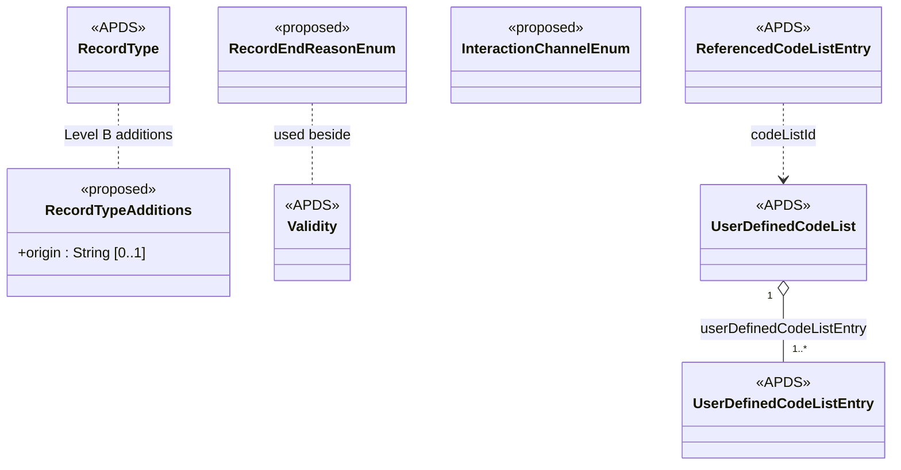

## Overview

The PkCommon domain holds the classes, datatypes and code list mechanism
shared by every other domain. APX needs little here: two shared
enumerations that several domains use, and, for discussion, one attribute
for RecordType. Everything else APX relies on is already in APDS.

### Benefits of shared enumerations

Several proposals record the channel through which something was done:
a payment, a merchant validation, a valet retrieval request, a customer
contact. If each had its own list, the same channel would carry
different codes in different records, and a report across them would
need a mapping table. One shared `InteractionChannelEnum` gives a pay
station, a contact centre or a mobile app the same code wherever it
appears.

In the same way, signage, validation programmes, plate lists and
enforcement policies all have a period of use and an active, planned or
suspended state. APDS already models both with the Validity class. The
only thing Validity cannot say is why a record stopped being used, so a
single small `RecordEndReasonEnum` (superseded or retired) is shared by
all of them instead of a separate status list for each.

### Benefits of a record origin

Parking data increasingly passes through more than one system before it
reaches its user. A city may receive Place and Session data from a
regional hub that collects it from several operators.

RecordType already says who created a record and when it was last
updated. It cannot say which system first created it when that differs
from the system now distributing it. Without that, a receiver that gets
the same record by two routes cannot easily tell they are the same, or
which source to ask when a record is wrong.

### What the PkCommon additions hold

- An interaction channel enumeration, shared by Right, Session and
  Operations.
- A record end reason enumeration, used beside the APDS Validity class.
- For discussion, a Record Type origin: the identifier of the system that
  first created the record, when it differs from the system distributing
  it.

### Open code lists

Several proposals in other domains add an attribute whose values come
from a list that each region or operator may extend. APDS already has
the right mechanism for this: UserDefinedCodeList, with
ReferencedCodeListEntry used to cite one entry. These proposals use those
classes as they are and add no new code list element.

Two related gaps in the APDS 4.1 common classes are offered in the
separate list of suggested corrections and are not repeated here.

## Information model

The two enumerations are new members of the CommonClasses package. The
origin suggestion adds one optional attribute to the existing RecordType
class and is marked for discussion (tier 3).

origin is a free string so that any identifier scheme can be used. When a
record is created by the system distributing it, origin is absent.

Wherever another domain proposes an "other…" attribute typed
ReferencedCodeListEntry (for example otherEquipmentStatus in Place), the
value cites an entry in a UserDefinedCodeList in the usual APDS way.

### Enumerations (for PkCommon)

- **InteractionChannelEnum** (tier 1): `lane`, `payStation`, `kiosk`,
  `attendant`, `contactCentre`, `automatedVoice`, `mobileApp`, `web`,
  `textMessage`, `chat`, `email`, `systemInterface`, `other`. Used by
  ValidationRedemption, Payment, ValetTicket and SupportInteraction.
- **RecordEndReasonEnum** (tier 2): `superseded`, `retired`. Used by
  Signage, ValidationProgram, PlateList and EnforcementPolicy beside their
  Validity.

### External code lists (for PkCommon)

No new external code lists are proposed in PkCommon. The code lists APX
publishes are UserDefinedCodeLists and can be cited through
ReferencedCodeListEntry without change to APDS.

## Use cases

### Records arriving through a regional hub

A regional parking hub collects Place and Session data from 40 operators
and passes it to the city. One operator also sends its Place data to the
city directly. The city therefore receives some Place records twice:
once from the operator and once from the hub.

These specifications support this use case in a number of ways:

**PkCommon.** Records the hub forwards keep their identification and
carry RecordType.origin naming the operator system that created them.
Records the operator sends directly carry no origin, because the operator
created them. The city sees that both copies come from the same source
and keeps one. When a record is wrong, the city knows to raise it with
the operator rather than with the hub.

**Place and Session.** Nothing else changes. Places and Sessions are
exchanged exactly as today, which is in line with the Overview's
guidance that a Receiving Party should confirm data ownership when the
same record arrives from different Distributing Parties.
