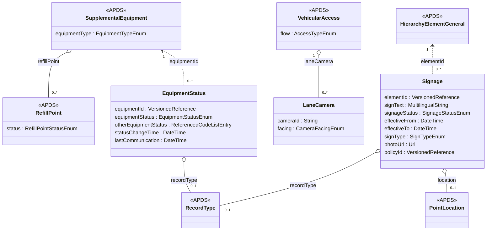

## Overview

The Place data specification already describes where a Place is, how it
is organised, and the equipment and services it offers. These proposals
add three things operators share every day but cannot yet express in
APDS terms: whether the equipment is working, which way the licence plate
cameras on a lane face, and what the signs at a Place say.

### Benefits of the Place additions

A parking operation runs on its equipment. When a barrier fails, a pay
machine runs out of paper or a camera goes offline, the operator, its
monitoring service, its customer-service centre and its enforcement
partner all need to know, and they need to know in the same words. Today
each pair of systems agrees its own list of states.

Licence plate cameras at a lane read the plates of vehicles travelling in
one direction. A receiving system can only tell an entry from an exit if
it knows which way each camera faces.

Signs set the terms of use of a Place. When a customer appeals a parking
charge, the operator must be able to show what the sign said on that day,
even if the sign has since been replaced.

### Equipment status

An Equipment Status record:

- Has a reference to one item of supplemental equipment in the Place.
- Has the state of that equipment (e.g., available, occupied, faulted).
- Has the time the equipment entered that state.
- Has the time the reporting system last heard from the equipment.

Equipment status is kept in its own record rather than as an attribute of
the equipment. This follows the approach APDS takes for occupancy, where
Supply (which changes rarely) is kept apart from Demand (which changes
often). The equipment description is sent once; its status is sent
whenever it changes.

### Lane equipment types

APDS 4.1 EquipmentTypeEnum already includes lprCamera, occupancySensor,
paymentMachine and several door types. Four values would complete a
typical off-street access lane: barrier, gate, ticketDispenser and
intercom. We suggest adding them so that lane equipment need not be typed
as 'other'.

### Lane cameras

A Lane Camera:

- Has a camera identification that matches the cameraID on the images of
  its observations.
- Has a facing: inward (into the Place) or outward (out of the Place).
- Is associated to a Vehicular Access.

### Signage

A Signage record:

- Has a unique identification and version.
- Has a reference to the element of the Place hierarchy it governs, and
  applies to the elements below it.
- Has the wording of the sign, in each language shown.
- Has a status (active, superseded or removed) and the period it was in
  force.
- May have a sign type, a location, a photo, and a reference to the
  enforcement policy it gives notice of.

A replaced sign is never edited. It is marked superseded and a new
record, or a new version, carries the new wording, so the history is
kept.

## Information model

The Place additions sit in two existing packages, SupplementalFacility and
VehicularAccess, and one new package, Signage, beneath the Place
hierarchy.

### Equipment status

EquipmentStatus refers to a SupplementalEquipment by versioned reference,
in the same way that DemandTable refers to a hierarchy element through
elementId. It adds nothing to the equipment description itself.

APDS 4.1 already gives refill points a status (RefillPoint.status, typed
RefillPointStatusEnum). EquipmentStatusEnum carries the same idea to all
supplemental equipment, and reuses RefillPointStatusEnum literals where
the meaning is the same: available, occupied, blocked, faulted and
unknown. Refill-point states that only make sense for energy (charging,
outOfStock, reserved) are not repeated. Where an item is a refill point,
RefillPoint.status continues to apply; EquipmentStatus covers the barrier,
camera, pay machine or intercom beside it.

APX's current registry (apx-device-states) uses 'fault' and 'inoperative'
for what this proposal calls faulted and closed. APX would adopt the APDS
names once agreed.

### Lane cameras

LaneCamera is a component of VehicularAccess. It does not repeat the
camera's equipment description, which can be given as SupplementalEquipment
with equipmentType lprCamera. Facing is stated relative to the Place, not
to the lane's flow, so it remains correct on a reversible lane. The
association could equally be placed on AccessLaneSpecific where lanes are
described one by one; we would welcome the group's view.

### Signage

Signage is versioned identifiable so a receiver can hold every version
of a sign. Its location uses PointLocation and its photo follows the
photoUrl convention of SupplementalFacility. The policyId reference points
to EnforcementPolicy, proposed in the Enforcement domain.

### Enumerations (for Place)

| Enumeration | Change | Values |
| --- | --- | --- |
| EquipmentStatusEnum | New | available, occupied, blocked, closed, outOfService, faulted, unknown, other |
| EquipmentTypeEnum | Add values | barrier, gate, ticketDispenser, intercom |
| CameraFacingEnum | New | inward, outward |
| SignageStatusEnum | New | active, superseded, removed |
| SignTypeEnum | New | entrance, paymentMachine, perSpace, ratesBoard, towAway, other |

### External code lists (for Place)

States beyond EquipmentStatusEnum are carried in otherEquipmentStatus as a
ReferencedCodeListEntry, pointing to a UserDefinedCodeList published by
the operator or by APX (apx-device-states). No new code list mechanism is
needed.

## Use cases

### Lane equipment status at a city-centre garage

A 600-space garage has two entry and two exit lanes. Each lane has an LPR
camera, a barrier, an intercom and, at the entry lanes, a ticket
dispenser. The operator uses a remote monitoring centre to answer
intercom calls after hours, and the city's parking guidance system shows
the garage on its signs.

At 22:10 the barrier on exit lane 2 fails to close. A queue forms at
lane 1. The monitoring centre must see the fault, take calls from lane 1,
and the guidance system should stop sending vehicles while the exit is
congested.

These specifications support this use case in a number of ways:

**Place.** The garage, its vehicular accesses and its lane equipment are
described once as a Place hierarchy. Each barrier, intercom and ticket
dispenser is a SupplementalEquipment with an equipment type from
EquipmentTypeEnum, using the new values barrier, intercom and
ticketDispenser, and each camera uses the existing value lprCamera. Each
VehicularAccess lists its LaneCameras with their facing.

**Equipment status.** When the barrier fails, the site system sends one
EquipmentStatus record: the barrier's reference, equipmentStatus
'faulted' and the statusChangeTime. The monitoring centre and the guidance
system receive the same record and understand it the same way. When the
barrier is repaired, a second record with 'available' closes the episode.
Neither party needs the Place hierarchy resent.

**Observation.** Plate reads from each lane carry the cameraID on their
images. Because each LaneCamera states which way it faces, a receiver can
tell entering from exiting vehicles without knowing the camera vendor's
own configuration.

### Showing the sign at appeal

A surface lot changes its maximum stay from 3 hours to 2 hours on
1 March. The entrance sign is replaced that morning. On 4 March a
customer receives a parking charge notice and appeals, saying the sign
allowed 3 hours.

These specifications support this use case in a number of ways:

**Place and Signage.** The lot holds two Signage records for the
entrance. The first, effective from the previous year, says 3 hours and
is now 'superseded' with effectiveTo 1 March 08:00. The second says
2 hours, is 'active' and is effective from 1 March 08:00. Each has a
photo and a location.

**Enforcement.** The violation record refers to the Place and the time of
the event. The appeals body selects the Signage record in force at that
time and sees the wording and photo of the sign as it stood, which here
shows the 2-hour limit.
