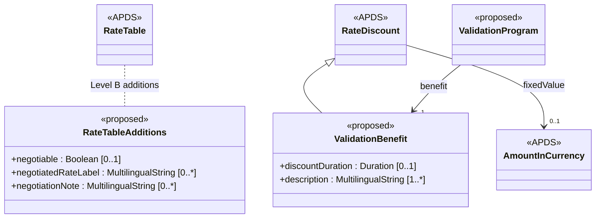

## Overview

The Rate data specification already lets an operator publish every
RateTable, RateLineCollection and RateLine for a Place, with taxes,
surcharges and discounts. APX proposes two small additions that let a
rate deck be used, not only published, by the people who sell parking on
the operator's behalf.

### Benefits of the Rate additions

Customer-service agents, call centres and partners regularly offer a
customer a price other than the posted one: a flat rate for a lost
ticket, a goodwill rate, a rate agreed with an event organiser. Today
there is no way for an operator to say which of its RateTables may be
offered this way, so each partner keeps its own list, which drifts from
the published deck. A flag on the RateTable itself means everyone who
receives the rate deck also receives the operator's answer.

Merchant validations are already recognised by APDS (a validation
payment type, a validation reference on the Segment, and the RateDiscount
class). What APDS cannot yet say is what a validation is worth when the
merchant gives away time rather than money, which is the most common
form ("first two hours free"). Extending RateDiscount with a duration
closes that gap using the class APDS already has.

### What the Rate additions hold

A RateTable (additions):

- Has an indication of whether it may be offered as a negotiated rate.
- Has a short label and guidance shown to the agent or partner offering it.

A ValidationBenefit:

- Is a RateDiscount, so it has a fixed value or a discount rate as today.
- Has, alternatively, an amount of comped time valued at the applicable RateTable.
- Has a plain-language description of what it is worth.
- Is referenced by a ValidationProgram (see the Right additions).

## Information model

These additions sit in the existing `<Rates>` namespace
(D2Payload/Extension/Parking/Rates). They are Level B: every attribute
is optional, and ValidationBenefit specialises the existing
Right.RateDiscount rather than replacing it, so every APDS 4.1 instance
remains valid.

RateTable gains three optional attributes: `negotiable`, a Boolean, and
two multilingual strings, `negotiatedRateLabel` and `negotiationNote`.
The flag states permission only. It carries no selection rules (length
of stay, time of day, caller type); the party presenting the deck applies
its own policy. A receiving system that does not recognise the attributes
ignores them and sees the RateTable unchanged.

ValidationBenefit is a specialisation of Right.RateDiscount. It inherits
`fixedValue` and `discountRate` and adds `discountDuration` (a Duration)
and a mandatory `description`. Exactly one of `fixedValue`,
`discountRate` or `discountDuration` should be given for a single
benefit. The amount actually removed from a Session's charge is recorded
on the validation redemption (see the Session additions), not here: this
class states the nominal value only.

### Enumerations (for Rates)

No new enumerations are proposed in `<Rates>`.

### External code lists (for Rates)

No new external code lists are proposed in `<Rates>`.

## Use cases

### Negotiated rate offered by a customer-service agent

A city-centre garage publishes its rate deck to a remote customer-service
provider and to an event-ticketing partner. Besides the hourly RateTables,
the deck contains a "Lost ticket, flat" table and an "Event organiser,
flat" table. The operator wants agents to be able to offer the lost-ticket
rate to a caller at the exit, and the partner to sell the event rate, but
nobody to offer the hourly early-bird table outside its hours.

These specifications support this use case in a number of ways:

**Rates.** The operator sets `negotiable` to TRUE on the two flat tables
and gives each a `negotiatedRateLabel` ("Lost ticket – flat 20.00").
Every party mirroring the rate deck receives the flag with the table, so
the agent's screen and the partner's catalogue list only cleared tables,
and both show the operator's own wording.

**Session and Right.** When the agent applies the lost-ticket rate to the
vehicle in the lane, the Segment of the Session references the chosen
RateTable as it does today, and the resulting Payment can name the rate
sold (see the Right additions), so revenue reports show which negotiated
rate was used.

### First two hours free at a cinema

A cinema validates parking at the shopping-centre car park: the first two
hours are free for its customers.

These specifications support this use case in a number of ways:

**Rates.** The cinema's ValidationProgram carries a ValidationBenefit with
`discountDuration` of two hours and the description "First 2 hours free".
A pay station can show the description to the customer before applying it.

**Session.** When the ticket is validated, the redemption records the
amount actually removed (for a three-hour stay, the price of the first two
hours at the applicable RateTable), and the Segment carries the validation
reference as APDS 4.1 already provides.
