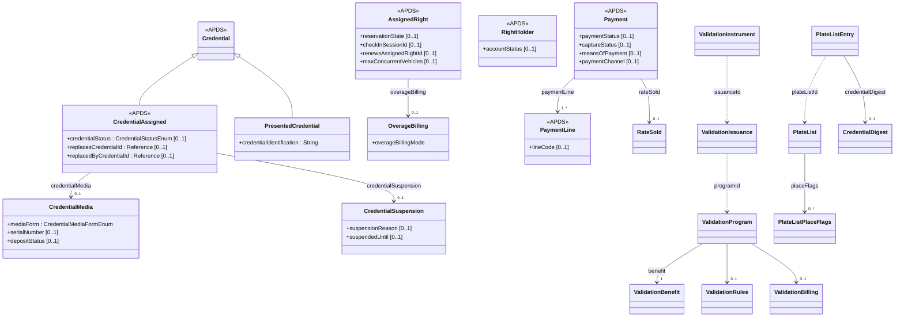

## Overview

The Right data specification defines how an owner or operator grants
the use of a Place (the RightSpecification), to whom (the RightHolder),
through which proof (the credentials), and what was paid (MonetaryValue
and Payment). APX proposes optional additions that carry the lifecycle
operators already manage around those same classes, so that a lane, an
enforcement device, a booking platform and a back office can agree on
the current state of a right without a bilateral agreement.

### Benefits of the Right additions

Access credentials change state constantly: a card is reported lost, a
fob is suspended for non-payment, a replacement is issued with a new
number. APDS lets a credential be attached to an AssignedRight, but not
whether it is still usable or what replaced it, so every reader and
enforcement system must be told separately. A small status list and a
replacement link on the assigned credential fix that, and a medium
(card, fob, transponder, hangtag) separates the item the customer holds
from the read technology APDS already records.

Reservations and permits are already modelled as AssignedRights with
PlannedUses, following the APDS use cases. What partners still exchange
by other means is whether a booking is confirmed, used or lapsed, which
permit a renewal replaces, and how many of a multi-vehicle permit's cars
may be parked at once.

APDS Payment records money collected. Payment systems also produce
declines, authorisations that are not yet captured, and partial refunds,
and operators need to know where and how a customer paid. Optional
attributes on Payment, reusing the APDS MeansOfPaymentEnum, cover these.

Merchant validations are already visible in APDS at the moment they are
used. The programme behind them (who validates, what it is worth, the
limits, the stock of codes) is not, so pay stations, merchant
applications and sites keep separate copies. Finally, cities and
operators share lists of plates (watch, scofflaw, allow, their own
enforcement vehicles) with every system that screens arrivals; a list
says what to do when a plate is seen, which is different from a right.

### Key concepts

A CredentialAssigned (additions):

- Has a credential status (issued, active, suspended, lost, revoked, expired, replaced).
- Has a validity period of its own.
- Has a reference to the credential it replaced and the one that replaced it.
- Has, optionally, the medium it was issued on, with serial number and deposit.
- Has, while suspended, a suspension reason and end time.

A PresentedCredential:

- Is a Credential (type and additional information, as in APDS).
- Has the identification actually read, whether or not it matches an assigned credential.

An AssignedRight (additions):

- Has a reservation state, the Session that used the reservation, and a no-show time.
- Has a reference to the AssignedRight it renews and the one that renewed it.
- Has a maximum number of concurrent vehicles and the way an overage vehicle is billed.

A RightHolder (additions):

- Has an account status and an account balance.
- Has the Place elements at which the account is valid.

A Payment (additions):

- Has a payment status (approved, declined, reversed) and a capture status.
- Has the means of payment and the channel where it was taken.
- Has the Place element where it was taken.
- Has a cumulative refunded amount.
- Has the rate sold.

A ValidationProgram:

- Has a unique identification and version.
- Has a Place element, a provider (an Organisation) and a status.
- Has a benefit (see ValidationBenefit in the Rate additions).
- Has optional rules (per-Session and per-day limits, validity window, stacking, applicable RateTables) and optional billing terms.
- Has issuances of instruments, each instrument with its own status.

A PlateList:

- Has a unique identification and version, a name, a category and a status.
- Has an owner (an Organisation).
- Has, per Place element, whether a match is enforced, raises an alert on arrival, or refuses service.
- Has entries, each with a credential type and identification, a validity period and the reason for listing.

## Information model

Most additions sit in the existing `<Right>` namespace
(D2Payload/Extension/Parking/Right). Two new sub-packages are proposed:
`<Validation>` (D2Payload/Extension/Parking/Right/Validation) and
`<PlateList>` (D2Payload/Extension/Parking/Right/PlateList). All
additions to existing classes are optional and all new classes are
reached only through optional associations, so every APDS 4.1 instance
remains valid (Level B in the sense of the Information Model's
"Extending the APDS Model").

**Credential lifecycle.** CredentialAssigned gains `credentialStatus`
(CredentialStatusEnum) and two references, `replacesCredentialId` and
`replacedByCredentialId`, and three optional associations:
`credentialValidity` (PkCommon.OverallPeriod), `credentialMedia`
(CredentialMedia) and `credentialSuspension` (CredentialSuspension). The
allowed transitions are: issued to active; active to and from suspended;
active or suspended to lost, revoked or expired; and a replacement
creates a successor while the original becomes replaced. Revoked,
expired and replaced are terminal. The status is held on the assigned
credential, not on Credential, because it describes one credential's
use for one AssignedRight.

**PresentedCredential** specialises Right.Credential and adds
`credentialIdentification`. It is the value a reader or officer actually
read. It is used by the access event proposed in the Session additions
when no assigned credential matched.

**CredentialDigest** is a keyed digest (algorithm, key identifier, value)
of a normalised credential identification. It lets a system that only
screens test "is this the same plate?" without holding the plate. It is
proposed on PlateListEntry and may be reused wherever a plate appears.

**Reservations and permits.** AssignedRight gains `reservationState`,
`checkInSessionId`, `noShowAfter`, `renewsAssignedRightId`,
`renewedByAssignedRightId`, `maxConcurrentVehicles` and an optional
`overageBilling` (OverageBilling). The PlannedUse remains authoritative
for the planned start and end. The existing ReservationTypeEnum (whether
a Place requires reservations) is unrelated and unchanged.

**Accounts.** Rather than proposing a separate Account class, RightHolder
gains `accountStatus`, `accountBalance` and `elementId`. In the APDS
Data Dictionary RightHolder is already a versioned identifiable class.
APX erratum 014 (no identifiable RightHolder) concerns the API document
only and is not repeated here.

**Payments.** Payment gains `paymentStatus`, `captureStatus`,
`meansOfPayment` (the existing Place.MeansOfPaymentEnum), `paymentChannel`,
`elementId`, `refundedAmount` and `rateSold` (RateSold). PaymentLine gains
`lineCode`, a shared counterpart to the bilateral `idCode`, which stays.
No refund value is proposed for PaymentTypeEnum: the 4.1 Data Dictionary
already defines `base`, `refund`, `surcharge` and `validation`. (The 4.1
API document lists only `payment` and `validation`; APX notes this as a
difference between the two documents.)

**Validation programmes.** ValidationProgram is versioned identifiable and
references a Place element and a provider Organisation. It has a
`benefit` (Rates.ValidationBenefit), optional `validationRules` and
`validationBilling`, and the instrument forms it may issue.
ValidationIssuance records a batch of instruments and ValidationInstrument
one code and its status. The redemption that applies a validation to a
Session is proposed in the Session additions; its identifier is the
APDS Segment `validationId`.

**Plate lists.** PlateList carries the policy (category, status, owner
and per-element flags in PlateListPlaceFlags); PlateListEntry carries one
credential, kept separately so a list can be maintained entry by entry.

### Enumerations (for Right)

The following enumerations are proposed in `<Right>`:
CredentialStatusEnum, CredentialMediaFormEnum, DepositStatusEnum,
DigestAlgorithmEnum, ReservationStateEnum, OverageBillingModeEnum,
AccountStatusEnum, PaymentStatusEnum, CaptureStatusEnum,
PaymentChannelEnum, RateProductEnum, RateClassEnum and
PaymentLineCodeEnum. One value, `valet`, is proposed for the existing
RightTypeEnum (named RightSpecificationTypeEnum in the API document).

In `<Validation>`: ValidationProgramStatusEnum,
ValidationIssuanceMethodEnum, ValidationIssuanceStatusEnum,
ValidationInstrumentStatusEnum, ValidationBillingModelEnum and
ValidationBillingCycleEnum.

In `<PlateList>`: PlateListCategoryEnum and PlateListStatusEnum.

The full values are in the Data Dictionary.

### External code lists (for Right)

Two of the enumerations are suggested as extensible code lists, where
APDS would fix the attribute and a starting set of values, and further
values would be published as user-defined code lists (PkCommon
UserDefinedCodeList), as APDS already does elsewhere:

- **PaymentLineCodeEnum**: base, convenienceFee, serviceFee, tax,
  discount, validation, energy, idle. Maintained today in the APX
  registry `apx-payment-line-codes`.
- **PlateListCategoryEnum**: allow, watch, scofflaw, enforcementVehicle.
  Maintained today in the APX registry `apx-plate-list-categories`.

## Use cases

### Lost keycard at a monthly-parker garage

A tenant of an office building parks with an RFID keycard under a
monthly AssignedRight. On Tuesday the tenant reports the card lost. The
operator's office issues a replacement card with a new number and charges
a new deposit. The garage's lane controllers come from one vendor, and the
building's enforcement patrol uses a different vendor's handheld.

These specifications support this use case in a number of ways:

**Right.** The original CredentialAssigned moves to `credentialStatus`
lost. The replacement is a new CredentialAssigned on the same
AssignedRight, `credentialStatus` active, with `replacesCredentialId`
pointing to the old card; the old card gains `replacedByCredentialId` and
moves to replaced. The replacement's CredentialMedia records the medium
(physicalCard), the stock serial number and the deposit, with
`depositStatus` held. Both vendors read the same AssignedRight, so the
lane refuses the old card and the handheld treats the old number as
replaced at the same moment.

**Session.** If someone presents the old card at the entry lane, the
access event proposed in the Session additions records a denial with the
reason "credential replaced". Because the card is still on file, the event
references the credential; a card that matched nothing would instead be
recorded as a PresentedCredential.

### Multi-vehicle residential permit with a renewal

A city issues annual residential permits. A household registers three
vehicles under one permit but only two may be parked in the zone at once;
a third is charged the day rate. In December the household renews for the
following year.

These specifications support this use case in a number of ways:

**Right.** The permit is an AssignedRight with three VehicleCredentials,
as in the APDS annual-permit use case. It carries
`maxConcurrentVehicles` 2 and an OverageBilling with mode dayRate and the
day-rate amount. The renewal is a new AssignedRight whose
`renewsAssignedRightId` references the current permit; the current permit
gains `renewedByAssignedRightId`, so the city's portal and the
enforcement vendor can follow the chain.

**Session and Observation.** When an enforcement vehicle reads a third
registered plate while two Sessions are already open under the permit,
the enforcement system finds the overage from the permit itself and bills
the day rate, without a separate agreement with the permit vendor.

**Right (plate lists).** The city also shares a scofflaw PlateList with
the car parks in the zone. PlateListPlaceFlags set `alertOnArrival` at
every car park and `refuseService` at the city-owned ones only. A car park
that only screens arrivals holds a CredentialDigest per entry instead of
the plates themselves.
