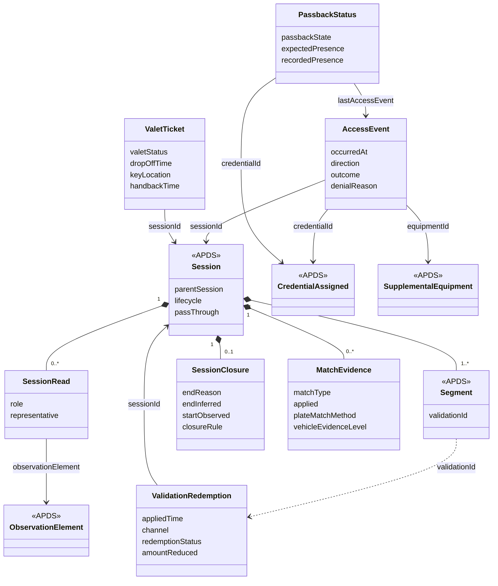

## Overview

The Session data domain documents the actual use of an AssignedRight. APDS
4.1 records when a Session started and ended, its Segments, and the
credentials and vehicle identified. The additions proposed here record
what a Session rests on and what happened at the entry and exit points
of a Place, including attempts that never became a Session.

### Benefits of the Session additions

Two parties that receive the same Sessions should be able to compute the
same dwell times, the same occupancy and the same revenue. Today they
cannot always do so, because a Session does not say whether its end was
observed or set by a rule, or whether its entry was ever seen. A Session
closed after 48 hours with no exit observation and a Session closed by an
exit camera look the same.

Access control systems refuse credentials every day: a lost keycard, an
expired permit, a vehicle already inside. A refusal opens no Session, so
it leaves no trace in APDS today. The help desk that takes the call from
the lane, the issuer of the credential and the operator all need the same
record of what happened.

Merchant validations are already anticipated by APDS through
`Segment.validationId`, but there is no record that the identifier points
to. Adding one lets a merchant, an operator and an auditor see the same
redemption and the actual amount it removed.

Valet operations are mentioned in APDS only as an operating restriction.
A valet ticket records custody of the vehicle, where it and its keys are,
and how it was returned, while the stay and the money remain on the APDS
Session.

### Key concepts

Session (additions)

- Has the observations it was built from, each with the part it played (entry, exit, duplicate, activity).
- Has a closure: why it ended, whether the end was inferred by rule, and whether the start was observed.
- Has an optional parent Session, for a Session kept for an area inside a wider visit.
- Has optional evidence for each match it rests on.

Access event

- Has a date/time, a direction (entry or exit) and an outcome (granted or denied).
- Has a denial reason when access was refused.
- Has the assigned credential it matched, or the value read when nothing matched.
- Has the Place element, the vehicular access (lane) and the equipment where it occurred.
- Has the Session it opened or closed, when access was granted.

Validation redemption

- Has the validation program it draws on and the Session it was applied to.
- Has the date/time and channel of application, and whether it stands or was reversed.
- Has the actual amount reduced or time given free, which may be less than the nominal benefit.
- Is the record that `Segment.validationId` identifies.

Valet ticket

- Has the Place that took custody, the Session for the stay and an optional AssignedRight.
- Has a status from drop-off to handback, with the time of each step.
- Has where the vehicle is parked and where its keys are kept.
- Has condition reports at drop-off and handback (see Observation).

## Information model

The additions extend the `Session` package
(`D2Payload/Extension/Parking/Session`). Each one is a Level B extension
in the sense of the APDS Information Model clause "Extending the APDS
Model": a valid instance of the extended model is also a valid APDS 4.1
instance, and no core class becomes a component of an extension class.

`Session` gains three optional associations (`sessionRead`,
`sessionClosure`, `matchEvidence`) and three optional attributes
(`parentSession`, `lifecycle`, `passThrough`). `SessionRead` points to an
existing `ObservationElement`, so the observation itself is still
exchanged through the Observation domain; the Session only says which
observations it used and how.

`AccessEvent` is a new identifiable class. It is placed in the Session
package because a granted access opens or closes a Session, but it stands
on its own: a refused attempt has no Session. It references the existing
`CredentialAssigned` when the presented value matched one. When nothing
matched, it carries the credential type and the value read, in the same
way `ObservationElement` carries `type` and `observedCredentialId`.

`ValidationRedemption` is a new versioned identifiable class. Its
`validationId` attribute is the value placed in the existing
`Segment.validationId`, so a receiver that knows only APDS 4.1 still sees
that a validation was applied. Its `validationProgram` references the
validation program proposed in the Right domain.

`PassbackStatus` records the anti-passback state of one assigned
credential and references its most recent `AccessEvent`.

`ValetTicket` is a new versioned identifiable class. It references the
APDS `Session`, `AssignedRight` and `Space`, and uses the existing
`VehicleAncillaryIdentification` for the vehicle and the proposed
`ConditionReport` (Observation domain) for its condition.

### Enumerations (for Session)

The following enumerations are proposed in the Session package. Their
values are listed in the Data Dictionary.

| Enumeration | Used by | Tier |
| --- | --- | --- |
| SessionReadRoleEnum | SessionRead.role | 1 |
| SessionEndReasonEnum | SessionClosure.endReason | 1 |
| SessionLifecycleEnum | Session.lifecycle | 2 |
| AccessDirectionEnum | AccessEvent.direction, ObservationElement.accessDirection | 1 |
| AccessOutcomeEnum | AccessEvent.outcome | 1 |
| AccessDenialReasonEnum | AccessEvent.denialReason | 1 |
| MatchTypeEnum, PlateMatchMethodEnum, JurisdictionAgreementEnum, VehicleEvidenceLevelEnum, MatchDecisionEnum | MatchEvidence | 2 |
| PassbackStateEnum, PassbackPresenceEnum | PassbackStatus | 2 |
| ValidationChannelEnum, ValidationRedemptionStatusEnum | ValidationRedemption | 1 |
| ValetStatusEnum, ValetRetrievalChannelEnum, HandbackVerificationEnum | ValetTicket | 2 |

### External code lists (for Session)

Two of the lists above are open by nature: new end reasons and denial
reasons appear as products evolve. APX maintains them today as
user-defined code lists in the APDS `UserDefinedCodeList` shape
(`apx-session-end-reasons`, `apx-access-denial-reasons`). We have
proposed them as enumerations so the group can see and discuss the
values, but we would be equally glad to see `endReason` and
`denialReason` typed as `PkCommon.ReferencedCodeListEntry`, with these
values published as the recommended initial list. We leave that choice to
the group.

## Use cases

### Gated garage with plate recognition at entry and exit

City Centre Garage has two entry lanes and two exit lanes, each with a
plate recognition camera and a barrier. Monthly parkers hold a keycard;
transient customers are identified by their plate. A third-party
analytics provider receives the garage's Sessions to report occupancy and
average dwell to the city.

On Monday morning a monthly parker presents a keycard that was reported
lost on Friday and replaced. The reader refuses it. Later a transient
vehicle leaves through an exit lane, but its entry was not recorded
because the entry camera was being cleaned. On Wednesday a vehicle that
entered on Saturday has still not been seen leaving.

These specifications support this use case in a number of ways:

**Access events.** The refusal is recorded as an `AccessEvent` with
`direction` entry, `outcome` denied and `denialReason`
`credentialReplaced`, referencing the old `CredentialAssigned` and the
reader as `SupplementalEquipment`. The help desk that answers the
intercom, the card issuer and the operator all see the same record,
although no Session was opened.

**Sessions.** The transient exit produces a Session whose
`SessionClosure` has `endReason` `exitOnly` and `startObserved` false; its
start time is a placeholder. The analytics provider leaves it out of
dwell statistics and occupancy instead of counting a visit of zero
minutes. The Saturday vehicle's Session is closed by the operator's rule
with `endReason` `stale`, `endInferred` true and `closureRule` naming the
rule, so it is not mistaken for an observed exit.

**Observations.** Each Session lists its `SessionRead` entries: the entry
and exit observations, and any duplicate frames from a second camera
marked `duplicate`, so a receiver never counts one passage twice.

### Merchant validation at a shopping centre

A cinema validates parking for its customers through a pay station code
and through its own application. The car park operator invoices the
cinema monthly.

These specifications support this use case in a number of ways:

**Validation redemption.** Each validation applied is a
`ValidationRedemption` referencing the cinema's validation program, the
Session, the time, the channel (`payStation` or `merchantApp`) and the
amount actually removed. A customer who stayed 20 minutes and was charged
nothing records the 20 minutes' fee, not the nominal three hours.

**Sessions.** The redemption's `validationId` is written to the Segment's
existing `validationId`, so a receiver that knows only APDS 4.1 still sees
that the Segment was validated.

**Corrections.** A redemption applied in error is not deleted; its
`redemptionStatus` becomes `reversed` with the time and reason, so the
monthly invoice and the audit trail agree.
