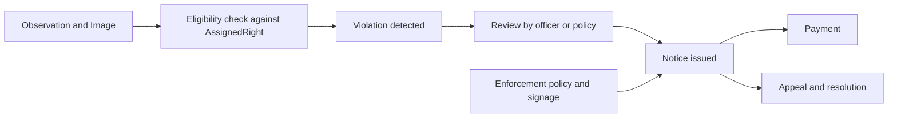
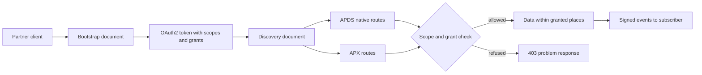

# APX Overview

*APX Specification · APX 0.14.0 · built on APDS 4.1 (2026-01-14) · Draft*

## Overview

Parking and kerbside operations now run on many connected systems at once: access control and lane equipment, licence plate recognition (LPR), permits and credentials, payment systems, merchant validations, enforcement, valet, tolling and the back offices that tie them together. Each pair of systems usually needs its own integration.

The Alliance for Parking Data Standards (APDS) has given these systems a common language. APDS 4.1, whose core data model is the basis of ISO/TS 5206-1:2023, defines what a Place, a Right, a Rate, a Quote, a Session and an Observation are, and an API to exchange them. APX builds on that work.

APX (APDS Parking eXtensions) is an open, additive companion specification to APDS 4.1. It is one API that PARCS, LPR, tolling, permitting and reservations vendors can implement once. It reuses everything APDS defines, as published, and adds only what APDS leaves out: real-time delivery, operational control, alerting, discovery, and the operational domains built on them (APX Part 0 §0.1).

This document gives a summary of the APX specification. It follows the structure of the APDS Overview 4.1 so that readers who know the APDS documents can find their way around.

### Mission

To give parking systems one open, vendor-neutral API for the operational exchanges that sit on top of the APDS data model, so that a system which already speaks APDS can also control a lane, raise an alert, take a payment or issue a permit without a private integration for each partner.

How does APX do this?

- By using the APDS 4.1 routes, schemas and conventions verbatim. The official `apds-api-4.1.yaml` is vendored unmodified (MIT licence, checksum-guarded) and reused by reference (APX Part 0 §0.2).
- By adding new behaviour only where APDS has nothing to say, and by attaching every addition to an existing APDS entity.
- By publishing the result as a machine-readable OpenAPI 3.1 document, a written standard in numbered Parts, code-list registries, sample scenarios with validated wire payloads, and a non-normative simulator.

### Background

APDS deliberately stops at data exchange. It does not define how to vend a gate, issue a lost ticket, push a rate to a lane or apply a validation. It has a webhook subscription, but signing, retries and delivery format are left to each project. Security and permissions are left to the Distributing Party (APX executive summary). As a result, PARCS, LPR, tolling, permitting and reservations vendors still build one-off integrations for exactly these things, and call centres and management platforms integrate each vendor separately.

APX began as a way to fill those gaps without forking APDS. Its first complete draft (0.1.0) was published on 2026-08-21. Later editions added customer service and resolution, violations and enforcement, merchant validation programmes, credential lifecycle, valet, LPR read detail, negotiated rates and ticket matching, EV charging and plate lists (CHANGELOG.md).

In implementing APDS 4.1 end to end across these systems, the work also found a small number of things the APDS data model does not yet have a place for, and some corrections to the published API document. APX has been shared with the APDS committee. Following discussion with the committee, the work is split into two tracks, described in [Relationship to APDS](#relationship-to-apds).

### APX Governance

The repository states the current arrangement (CONTRIBUTING.md):

- **Today.** Umojo stewards the specification. Changes of any size follow one path: a pull request against `main`. A pull request merges on green CI (all validators, dist freshness and a breaking-change gate), review sign-off from a maintainer and, for normative changes, a sentence on APDS alignment: what APDS defines today and why the change is additive.
- **Registries.** New code-list entries follow the registration-authority policy in APX Part 11 §11.3: open to anyone, a 60-day decision, and an appeal path.
- **Proposals.** Substantial proposals (new domains, new conformance classes) start as an issue describing the use case. Design discussion happens before spec text. Proposals from other vendors and operators are decided in the open on the issue tracker, with rejections reasoned in writing.
- **Editions.** Maintainers cut editions. Every edition's normative artifacts are tagged in git and are immutable once published (APX Part 3 §3.4).
- **Intended end state.** Shared industry governance on two tracks. APX's data elements are offered to APDS for its data model (06 Requests to APDS, Part D). The APX API stays APX's implementation specification, built on APDS. In the meantime, APX Part 3 §3.3(8) governs what happens when APDS standardises a concept APX already covers: the APDS construct wins.
- **Licence.** APX is MIT-licensed. Portions reference the APDS API Specification (MIT, © Alliance for Parking Data Standards).

### Guiding Principles

The principles that direct APX, in no particular order, are:

1. **APDS first (the prime directive).** Wherever APDS 4.1 defines a route, schema or convention, an APX implementation uses it verbatim. APX does not redefine, subset or re-shape any APDS entity. APX resources point at APDS entities by `Reference` or `VersionedReference` (APX Part 0 §0.2).
2. **A plain APDS client keeps working.** A client that speaks only APDS 4.1 works against an APX implementation without changes, for the routes it uses (APX Part 0 §0.2; Annex A, APX-CORE-02).
3. **Extend, do not fork.** APX adds to APDS through the mechanisms APDS itself provides: the extension container with keys of the form `apds-ext:apx:<class>@<version>` (APDS Use Case Document §C.2.5), user-defined code lists, and new interaction routes that reference APDS entities (APX Part 10 §10.1).
4. **The APDS construct wins.** When APDS standardises something APX already covers, the next APX edition adopts the APDS form verbatim, deprecates its own, and documents the migration. APX is a proving ground for APDS, never a competitor (APX Part 3 §3.3(8)).
5. **No business logic in APX.** APX carries the facts and the decisions of the systems it connects; it does not take those decisions for them. Screening a plate against a list stays with the operator (APX Part 24 §24.4). The LPR system says whether a read was an entry or an exit; APX does not derive it (APX Part 13 §13.3a(4)). APDS likewise leaves data storage, aggregation policy and business logic out of scope, and APX keeps that boundary (APX Part 0 §0.4).
6. **Additive only within a major version.** New optional fields, new endpoints, new code-list entries and new conformance classes only. Removing or re-typing anything needs a new major version. A deprecated feature remains functional for at least one further edition and 12 months, whichever is longer (APX Part 3 §3.2).
7. **Partial adoption is honest.** APX is divided into conformance classes. A vendor implements only the classes it needs, but never part of a class (APX Part 3 §3.1).
8. **The machine-readable document is normative.** Where prose and the OpenAPI document disagree on an APX path or schema, the OpenAPI document prevails and the prose is corrected. On APDS-native paths the vendored APDS document prevails; APX prose never overrides APDS (APX Part 0 §0.5).
9. **Fail closed.** A token with no place grant can reach no place. An all-places grant must be stated explicitly. For a control plane that can open gates, misconfiguration must fail toward nothing (APX Part 9 §9.3).
10. **Vendor neutral and open.** Every partner gets its own namespace for fields, endpoints and event topics. Nothing in APX favours one supplier, and the specification is free to implement.

### APX Technical Documentation

The APX Specification mirrors the APDS 4.1 technical documentation and adds two documents specific to APX:

| Document | Contents |
|---|---|
| **01 Overview** (this document) | Purpose, principles, the relationship to APDS, a summary of every APX module, security and permissions, and conformance. |
| **02 Information Model** | The APX classes, attributes, relationships and enumerations for each domain, with diagrams showing where they attach to the APDS model. |
| **03 Data Dictionary** | The definition of every APX class, attribute and enumeration value, in the table format of the APDS 4.1 Data Dictionary. |
| **04 Use Cases** | Worked examples of APX in use, from the lane to the back office. |
| **05 Interface Specification** | The APX API: routes, message flows, change feeds, event delivery, commands, errors and security. |
| **06 Requests to APDS** | What APX asks of APDS: corrections to the published API document, suggested additions, and the data elements proposed for the APDS data model. |

The normative interface is the OpenAPI 3.1 document `spec/dist/apx-v1.yaml` (also `spec/dist/apx-v1.json`), bundled from the modular source in `spec/openapi/`, together with the APX data-profile overlay `spec/openapi/overlays/apx-data-overlay.yaml`. The build applies the overlay to produce the effective API description (APX Part 0 §0.5).

The other normative artifacts of an edition are the registry files in `spec/registries/`, the written standard in `docs/standard/` (Parts 0 to 24) and Annex A (conformance requirements and the ICS template). Each edition names that set exactly, by checksum, in `spec/edition.json`. CI fails if the manifest goes stale, so an edition is a fixed set of files, not the state of a branch (APX Part 3 §3.4).

Informative material includes the documentation and examples overlays, the sample scenarios in `docs/scenarios/`, the PARCS Starter Profile (a 26-endpoint subset with its own slim bundle, `spec/dist/apx-parcs.json`) and the simulator in `packages/simulator/`.

A separate, narrower package, the APX Data Specification in `docs/apds-submission/`, lists only the data elements proposed to APDS. Document 06 of this set summarises it.

### APX Specification Development Priorities

APX was built in steps. The base classes came first, then each operational domain as its own optional class.

| Edition | Date | Main addition |
|---|---|---|
| 0.1.0 | 2026-08-21 | First complete v1 draft: data profile, delivery fabric, control, alerts, security, extensibility, registries, errors, accounts, payments, LPR, reservations, permits, tolling, discovery |
| 0.2.0 | 2026-09-02 | Submission-readiness revision |
| 0.3.0 | 2026-09-05 | Customer service and resolution (Part 17) |
| 0.4.0 | 2026-09-19 | Violations (Part 19) |
| 0.5.0 | 2026-09-19 | Validation programmes (Part 20) |
| 0.6.0 | 2026-09-19 | Enforcement policy for each location (Part 19) |
| 0.7.0 | 2026-09-20 | Credentials (Part 21) |
| 0.8.0 | 2026-09-20 | Valet (Part 22) |
| 0.9.0 | 2026-09-21 | LPR read detail (Part 13 §13.3a) |
| 0.10.0 | 2026-09-24 | Negotiated rates and ticket matching (Part 6 §6.6 and §6.7) |
| 0.11.0 | 2026-09-25 | Vetting release: every class exercised against the bundle |
| 0.12.0 | 2026-09-28 | LPR access events: reads say what happened |
| 0.13.0 | 2026-09-29 | Audit of every Part against the bundle, Annex A and the registries, ahead of APDS working-group review |
| 0.14.0 | 2026-10-12 | EV charging (Part 23), plate lists (Part 24), and what an external pairing engine needs to write back (session detail, read review, imported violations) |

For the data elements proposed to APDS, the work is grouped in three tiers (`docs/apds-submission/01-overview.md`):

- **Tier 1, propose now.** Data every access control, enforcement or LPR system already holds: access events, equipment status, credential status, how a session started and ended, plate read attributes, violations and notices, and validation redemptions.
- **Tier 2, proven in APX, propose next.** Shapes that are stable in APX and widely useful: plate lists, validation programmes, payment outcomes, reservations and permits, valet custody and alerts.
- **Tier 3, for discussion.** Areas still settling (EV charging sessions) or that may sit outside parking data (customer service interactions).

Looking ahead, the repository names these next steps: the APDS working groups' views on the Tier 1 proposals and the two proposed new domains; re-vendoring any new APDS release as a new APX edition (APX Part 3 §3.5); and, on the steward's side, a contributor patent-commitment mechanism and royalty-free declaration before standards-body submission (CONTRIBUTING.md).

## Relationship to APDS

APX sits on APDS 4.1. It pins exactly one APDS release per edition, currently 4.1, vendored byte for byte and checksum-guarded (APX Part 3 §3.5). A server advertises the APDS version it implements as `apdsVersion` in its bootstrap document. There is no in-band version negotiation.

### Two tracks

Following discussion with the APDS committee, the work is split in two (README.md):

| Track | What it contains | Where it goes |
|---|---|---|
| **Data elements** | The classes, attributes and enumerations that describe what is exchanged: access events, equipment status, credential lifecycle, plate read detail, violations, validation redemptions and the like | Proposed to APDS for its data model, in the APX Data Specification (`docs/apds-submission/`). If taken up, they would sit beside the existing APDS domains and so in a future revision of ISO TS 5206-1. |
| **The APX API** | Routes, change feeds, signed event delivery, discovery, scopes, the command workflow, request and response bodies | Stays in APX. It is APX's preferred implementation specification on top of APDS. It is not proposed for the data model. |

Until APDS takes up an element, the APX API carries it as an APDS extension under the generic extension mechanism of APDS 4.1 (Use Case Document §C.2.5). When APDS takes up an element, the APX API moves to the APDS form in its next release and retires its own, so the two never disagree.

APX also keeps a list of suggested corrections to the published `apds-api-4.1.yaml` (fourteen errata filed on `parkingdata/spec`) and a short list of additions APDS could consider (`docs/apds-change-requests.md`, `docs/errata/`). None of them blocks APX: APX works around each item in its own overlay. Every item is a request or a suggestion, offered with thanks for the work that has gone into APDS. Document 06 sets them out.

### How APX elements relate to the APDS model

Every APX schema falls into one of four kinds (`docs/data-model-by-domain.md`):

| Kind | Meaning | Proposed to APDS? |
|---|---|---|
| **APDS** | An existing APDS entity, used as it is | Already there |
| **Extension** | Fields APX adds to an APDS entity, carried in an `apds-ext:apx:*` block in its `extensions` container | Candidate: the fields could move onto the APDS entity |
| **New element** | A data element APDS has nothing for | Candidate if small and stable |
| **API only** | An envelope, command, request body, search or computed view | No; stays in APX |

### Extension levels

The APDS Information Model uses the DATEX II extension taxonomy. Against it, APX takes this position (APX Part 10 §10.3):

- **Level B, backward compatible.** APX decorations carried in an entity's `extensions` container. A plain APDS consumer ignores them and still reads a valid APDS instance. Examples: the reservation marker on an AssignedRight, LPR read detail on an Observation, session detail on a Session, device status on equipment.
- **Level C adjacent.** The APX companion API (commands, alerts, subscriptions beyond APDS, discovery and the operational domains). These are new interaction roots that APDS consumers never see. They reference APDS entities by Reference and never restate them.

APX declares `extensionName: apx` and its `extensionVersion` in the OpenAPI `info` block, following the Information Model's extension declaration rule.

### Where APX modules sit on the APDS domains

```mermaid
flowchart TB
  subgraph APDS["APDS 4.1 data domains"]
    Place
    Right
    Session
    Rate
    Occupancy
    Quote
    Observation
  end
  subgraph Fabric["APX base and fabric"]
    Data["Data profile and change feeds"]
    Events["Subscriptions and events"]
    Discovery
    Security["Security, scopes and grants"]
  end
  subgraph Ops["APX operational modules"]
    Control["Control and device status"]
    Alerts
    Accounts["Accounts and payments"]
    LPR
    Reservations["Reservations and permits"]
    RatesMatch["Negotiated rates and ticket matching"]
    Tolling
    Violations["Violations and enforcement"]
    Validations
    Credentials
    Valet
    PlateLists["Plate lists"]
    Resolution["Resolution and customer support"]
    Charging["EV charging"]
  end
  Data --> Place
  Data --> Session
  Data --> Occupancy
  Control --> Place
  Alerts --> Place
  Accounts --> Right
  LPR --> Observation
  Reservations --> Right
  Reservations --> Quote
  RatesMatch --> Rate
  RatesMatch --> Session
  Tolling --> Observation
  Violations --> Right
  Violations --> Observation
  Validations --> Rate
  Validations --> Session
  Credentials --> Right
  Valet --> Session
  PlateLists --> Right
  Resolution --> Session
  Charging --> Place
  Charging --> Session
```

*Figure 1: The APX modules and the APDS domains each one builds on. The base and fabric modules apply to every domain.*

## Overview of the APX Specification

This section summarises each APX module in the order of the APDS Overview: what it is for, the benefit of sharing it, and its key concepts. For the normative detail, see the APX Part cited in each section. The Information Model, Data Dictionary, Use Cases and Interface Specification in this set give more depth.

### Common conventions

A few rules apply across every module (APX Parts 4 and 12):

- Every APX resource has an `id` (a UUID) and a `version` (an integer that increases on every change). Objects point at each other with a typed reference, `{"id": "...", "className": "Session"}` (APX Part 4 §4.1).
- A write against a stale `version` is refused with `version-conflict`. Operations that change the real world carry an `Idempotency-Key`, so a retry never acts twice (APX Part 4 §4.2a).
- Unknown keys in an `extensions` container are preserved on round trip (APX Part 4 §4.3).
- Times are RFC 3339 in UTC. Money uses the APDS `AmountInCurrency`.
- Every error is an RFC 9457 `application/problem+json` object with a registered `type` URI (APX Part 12).
- Open vocabularies (alert types, command types, device states, topics and others) are published as APDS UserDefinedCodeLists in `spec/registries/`. Entries are only ever added (APX Part 11).

### Discovery

Discovery tells a client what a server offers and what that client in particular may do (APX Part 16).

#### Benefits of Discovery

Onboarding a new integration partner usually means emailed documents and guesswork. With APX, a partner needs one thing: a hostname. Everything else can be discovered. Discovery is contractual, not advertising: a client can call everything its discovery document lists, and nothing more (APX Part 9 §9.3).

#### Key concepts

- **Bootstrap document.** `GET /.well-known/apx-configuration` is served without authentication at the host root and is required of every implementation. It gives the token endpoint, the APDS version, the APX edition, the conformance classes claimed, optional features (for example `negotiatedRates`, `ticketMatching`), and the location and version of every registry (APX Part 16 §16.1).
- **Capability document.** `GET /v1/discovery` (class `apx-discovery`) returns the endpoints, commands, event topics and places available to the calling credential, reflecting its scopes and grants exactly (APX Part 16 §16.2).
- **Closed claims.** The classes a server claims must be closed under the dependency table in APX Part 3 §3.1. A client that sees a class claimed without one it depends on treats it as not offered.

### Data

The Data module is the base of APX (class `apx-data`, APX Part 5). It defines no parallel data routes. Pull and push use the APDS 4.1 routes (`/places`, `/observations`, `/contacts`, `/rights/specs`, `/rights/assigned`, `/rates`, `/sessions`, `/quotes`) mounted verbatim. APX adds behaviour APDS leaves open.

#### Benefits of the Data profile

Polling full lists does not scale to live occupancy or thousands of sessions. With a cursor feed, a partner that goes offline for an hour replays exactly what it missed, with no gaps and no duplicates. The rule that an explicit `null` clears a field removes a common integration fault. Because every addition is an optional parameter or header on the standard routes, a client that ignores them sees normal APDS behaviour.

#### Push and pull

- **Update modes.** APDS defines Full and Change updates for Place information (Use Case C.1.1.6). APX applies them to every entity class above, in both directions. A Change payload carries identity plus only the changed fields; an explicit `null` clears a field and an absent field is unchanged. A `PUT` declares its mode in the header `APX-Update-Mode` (APX Part 5 §5.1).
- **Change feed.** `mode=change&cursor=...` on a list route returns only what changed since the cursor, with tombstones for deletions. The feed is ordered and gapless per class. Servers keep at least 7 days of history. The APDS `modified_since` parameter remains the coarse fallback (APX Part 5 §5.2). The same feed is offered on the APX list routes of each claimed class (Annex A, APX-CORE-18).
- **Push from client to server.** Partners write through the native APDS routes; an LPR camera, for example, posts to `/observations` (APX Part 5 §5.3).

#### Occupancy and aggregation

- **Occupancy snapshot.** `GET /v1/places/{id}/occupancy` answers "how full is it now" for one garage, level or zone: the verbatim APDS `Supply`, the latest `DemandType` record and a derived `available` count. It is a read model derived from the Place hierarchy, never written directly. Material changes publish `apx.data.occupancy.v1` (APX Part 5 §5.5).
- **Occupancy history.** `GET /v1/places/{id}/occupancy/history` returns one bucket per interval (default one hour) with the highest count, the time-weighted average, the supply in force and the number of demand records behind it. A bucket with no records carries no counts, never a guess (APX Part 5 §5.5a).
- **Session detail.** When the system that pairs plate reads into visits is a separate client, it writes what it decided as the Level B decoration `apds-ext:apx:session-detail@1.0` on the APDS Session: which reads, why the visit ended, how each match was made, and the parent visit of an area stay (APX Part 5 §5.8).
- **Aggregation and onboarding.** APX Part 18 covers a location that moves from its own APX implementation to an aggregating one that fronts many locations from many operators. It defines what survives the move (identifiers and provenance), the onboarding order, and cutover. It has no class of its own; its rules bind whichever classes the aggregator claims.

### Subscriptions and Events

The delivery fabric (class `apx-events`, APX Part 8) pushes events to subscribers instead of making them poll. It is a superset-compatible profile of the APDS `/webhooks` route and `EventSubscription`.

#### Benefits of Subscriptions and Events

Webhooks without rules lead to unsigned payloads, silent drops and duplicates. APX makes the delivery contract normative: signatures, a retry schedule, stable event ids for de-duplication and an auditable ledger. Subscriptions can be filtered by place and severity, so each partner receives only its own world. One subscription can carry a location's whole story for analytics: session lifecycle, payments, plate reads, occupancy, alerts and command outcomes.

#### Key concepts

- **Subscriptions.** Created at the APDS `/webhooks` route, naming the topics wanted. Subscriptions can be paused, resumed, re-keyed and filtered (APX Part 8 §8.1).
- **Envelope.** Every event uses one envelope: `id`, `type`, `time`, `subject` (the object it is about) and `data` (APX Part 8 §8.2).
- **Signed delivery.** Each delivery carries `APX-Signature: v1=<hex>`, an HMAC-SHA256 over the timestamp and raw body. Receivers reject deliveries outside a 5-minute window (APX Part 9 §9.4).
- **Retries and ledger.** Failed deliveries are retried on a fixed schedule (immediately, 30 seconds, 2 minutes, 10 minutes, 1 hour, then hourly up to 24 hours) before the subscription is marked failed, which itself raises an alert. `GET /webhooks/{id}/deliveries` lists every attempt (APX Part 8 §8.3).
- **Server-Sent Events.** The optional class `apx-events-sse` offers the same events over an outbound stream, `GET /v1/events/stream`, with resume after disconnect. This serves equipment behind NAT that cannot accept inbound calls (APX Part 8 §8.4).
- **Topics.** APDS native topics (for example `SessionCreated`) are used as they are. APX topics follow the pattern `apx.<domain>.<event>.v<n>` and are listed in the `apx-topics` registry. A topic's payload never changes within its version (APX Part 3 §3.2).

### Control

The Control module (class `apx-control`, APX Part 6) lets an authorised client act on a site. APDS inventories devices (`SupplementalEquipment`) and marks access-controlled places, but defines no actuation.

#### Benefits of Control

The commands map to what call-centre agents do many times a day: take a call at a lane, see the ticket, apply a validation, vend the gate. Returning a full lifecycle instead of a bare yes or no lets the caller tell "the gate opened" from "the gate is faulted" from "your command expired", and prove it later.

#### Commands

- `POST /v1/commands` executes an action. Command types are an open registry (`apx-command-types`): `vendGate`, `holdGateOpen`, `closeLane`, `lostTicket`, `pushRate`, `applyValidation`, `setDeviceState`, `displayMessage`, `restartDevice`, the passback and courtesy commands of Part 17, `pushNegotiatedRate` and `matchTicket`, and the charger commands of Part 23 (APX Part 6 §6.1).
- Every command is **idempotent** (`Idempotency-Key` is required), **perishable** (a command whose `expiryTime` passes before dispatch expires and must not fire) and **audited** (each state change appends to an immutable `statusHistory`).
- Commands are asynchronous. The server answers `202` and the command moves through states such as `received`, `accepted`, `dispatched`, `executing` and `succeeded` or `failed`; it can also be `rejected`, `expired` or `cancelled`.

#### Lane and device status

- **Lane inquiry.** `GET /v1/lanes/{id}/current` returns the ticket in the machine (amount due, applied validations), the latest plate read with its image, and for monthly parkers whether access was granted or denied and why, with the last 10 events (APX Part 6 §6.2).
- **Device status.** `GET /v1/devices` gives the live state of every gate, pay station and camera, keyed to the APDS SupplementalEquipment. States come from the `apx-device-states` registry (`available`, `occupied`, `inoperative`, `outOfService`, `fault`, `unknown`), which follows the style of the APDS `RefillPointStatusEnum` and shares four of its values. A change to `fault` should raise a `deviceFault` alert (APX Part 6 §6.4).
- **Validation providers.** `GET /v1/validations/providers?place=` lists the businesses allowed to validate at a place. The list is authoritative: an `applyValidation` naming any other provider is refused (APX Part 6 §6.3).

### Alerts

The Alerts module (class `apx-alerts`, APX Part 7) records conditions that need someone's attention. APDS has no alert, event or notification class, so this domain is new.

#### Benefits of Alerts

Parking sites are monitored from many places: the equipment supplier's service desk, a remote monitoring centre, the operator's control room, and enforcement and charging partners. Each needs to know when a barrier faults or a lane is blocked, and whether someone has already taken it in hand. A shared alert lets one party raise a condition and others act on it, without one integration per supplier.

#### Key concepts

- **Alert.** Has an id, a version, an alert type, a severity, a status, a detection time and, where known, an occurrence time, a source place or device, and the entity it concerns (APX Part 7 §7.1).
- **Open types, closed severity.** `alertType` is open (registry `apx-alert-types` or an implementer's own list), because no standard can list everything that goes wrong on a site. `severity` is closed (`info`, `warning`, `minor`, `major`, `critical`), because routing ("page a person at major and above") only works if everyone means the same thing.
- **Lifecycle.** Raise (idempotent), acknowledge and resolve; an alert can also expire. Every transition is recorded in `statusHistory` (APX Part 7 §7.2 and §7.3).
- **Events.** Alerts flow as events over the delivery fabric, so a monitoring centre subscribes once and filters by severity (APX Part 7 §7.4). Charging-bay and plate-list arrival alert types are defined in APX Part 7 §7.5 and §7.6.

### Accounts and Payments

The Accounts module (class `apx-accounts`, with the dependent class `apx-payment-history`, APX Part 13 §13.1 and §13.2) covers account lookup, taking payments and writing them back to accounting.

#### Benefits of Accounts and Payments

The flow follows the real call: "I can't get out." The agent finds the account by phone number, sees the balance, takes payment through a secure phone system, posts it back to accounting, and the gate opens. Every recorded payment also publishes `apx.accounts.payment.recorded.v1`, so finance and analytics systems receive revenue as it happens.

#### Key concepts

- **Account lookup.** `GET /v1/accounts` by name, phone, card or plate, with a body form `POST /v1/accounts:search` (APX Part 13 §13.1).
- **Take payment.** `POST /v1/payments` is idempotent. The means of payment uses the APDS `MeansOfPaymentEnum`. APX never carries full card numbers: card capture stays in the implementer's PCI scope (APX Part 0 §0.4).
- **Write-back.** `POST /v1/payments/{id}/postings` records the payment in the accounting system and returns a confirmation and new balance.
- **Payment lifecycle.** The payment lifecycle and payment links are covered in APX Part 13 §13.1a. A `PaymentRecord` maps to the APDS `Payment` (APX Part 13 §13.6).
- **Payment history.** `GET /v1/payments?ticketLast4=...` finds payments on a ticket. Lookups by the last four digits reach back only 8 hours. This is a privacy control that implementations must not widen (APX Part 9 §9.6 rule 5).

### LPR

The LPR module (class `apx-lpr`, APX Part 13 §13.3) joins plate reads to tickets and sessions and carries what modern recognition engines know.

#### Benefits of LPR

LPR vendors do not need a separate ingestion API. A plate read is an APDS Observation, so it enters through `POST /observations`. The only new need is the join ("which ticket goes with this plate?"), so that is the main new route. Extra detail rides inside the standard Observation, so a camera that knows more can say more without breaking a reader that speaks only APDS.

#### Reads

- **Cross-lookup.** `GET /v1/lpr/reads` by plate, ticket, observation or session returns reads with confidence and images. At least one key is required; the route is never a bulk export. A body form, `POST /v1/lpr/reads:search`, keeps plates out of URLs (APX Part 13 §13.3).
- **Read detail.** The Level B decoration `apds-ext:apx:lpr-read@1.0` gives a value and confidence for each recognised attribute (plate, country, state or province, plate category, make, model, colour, body type), the alternate plate candidates, which plate face was read and how the vehicle moved relative to the camera. The winning values also appear in the APDS fields so APDS-only readers see them (APX Part 13 §13.3a).

#### Access events and lane cameras

- **Access event.** `detail.accessEvent` (`entry`, `exit` or `unknown`) records what the LPR system reports the read was. The lane used does not change it. The LPR system can later change its mind, for example from `unknown` to `entry`, through `PUT /v1/lpr/reads/{observation}/access-event` (APX Part 13 §13.3a(4)).
- **Lane cameras.** The cameras on each lane, and whether each faces inward or outward, are described on the APDS VehicularAccess, so every system on the site knows how the cameras are set up (APX Part 13 §13.3a(5)).

#### Plate review

- A reviewer confirms, corrects or rejects a doubtful read through `PUT /v1/lpr/reads/{observation}/plate`. The engine's original values are kept, and enforcement waits for the decision: a violation cannot be issued while an evidence read is pending or rejected (APX Part 13 §13.3a(4a); Part 19 §19.4).
- Retention and purge of reads and imagery are normative (APX Part 13 §13.3b).

### Reservations and Permits

Reservations and permits (classes `apx-reservations` and `apx-permits`, APX Part 14) are thin profiles over APDS machinery. No parallel booking or permit entity exists.

#### Benefits of Reservations and Permits

Every separate booking object eventually disagrees with the ticket system it shadows. By making the reservation be the APDS AssignedRight, there is nothing to reconcile: the reservation, the permit and the thing the gate checks are the same object.

#### Key concepts

- **Reservation lifecycle.** Quote through the native `POST /quotes`; book through the native `POST /rights/assigned` with the decoration `apds-ext:apx:reservation@1.0` (state and planned times, the APDS PlannedUse concept); amend with a change-mode `PUT`; cancel with `DELETE` or state `cancelled`. Check-in happens when a session that references the reservation starts, and a no-show is published as an event when the window passes with no session (APX Part 14 §14.1).
- **Pooled permits.** `GET /v1/permits/pools/{id}/availability` reports capacity, issued and available. `POST /v1/permits/issue` issues a permit, which may carry several plates (family or fleet), and is refused cleanly when the pool is exhausted (APX Part 14 §14.2).
- **Materialisation.** An issued permit is written onto the APDS AssignedRight, so an APDS-only client sees it (APX Part 14 §14.2b).
- **Renewal and concurrent vehicles.** The permit decoration `apds-ext:apx:permit@1.1` can record the permit it renews, and how many of its registered vehicles may be parked at once (APX Part 14 §14.2d).

### Rates and Ticket Matching

Two optional features of the Control class close open tickets at the exit lane without touching the rate deck (APX Part 6 §6.6 and §6.7). Servers list them in the `features` of the bootstrap document.

#### Benefits of Negotiated Rates and Ticket Matching

Agents and partners regularly offer a customer a price other than the posted one: a flat rate for a lost ticket, a goodwill rate, an agreed event rate. Without a rule, each partner keeps its own list, which drifts from the published deck. APX lets the operator flag which tables may be offered, and requires every change to one ticket to be attributable to a named provider, discount, table or agent. Revenue integrity comes from the design, not from operator discipline (APX Part 6 §6.3).

#### Key concepts

- **Negotiated rates.** A RateTable flagged `negotiable` through the decoration `apds-ext:apx:ratepolicy@1.0` may be applied to the one ticket in the lane with `pushNegotiatedRate`. Where the server offers the `negotiatedAmounts` feature, an agent may instead state an amount. The agent and a reason are required (APX Part 6 §6.6).
- **Ticket matching.** Open-session candidates can be found by plate, phone or credential. `matchTicket` closes the open ticket at the real fare, with the agent on the audit record (APX Part 6 §6.7).
- **The deck stays authoritative.** When the deck is wrong it is corrected with `pushRate`, not with per-ticket changes.

### Tolling

Tolling (class `apx-tolling`, APX Part 15) connects roadside reads to money. APDS has no toll entities, so this domain is new. It is still built to APDS conventions: toll points are SupplementalEquipment, reads are native Observations, money is `AmountInCurrency` and settlement links a Payment.

#### Benefits of Tolling

Tolling is evidence-based billing. A toll transaction keeps its chain intact: the reads it was built from, the price applied, the payment that settled it, and any dispute and its outcome. Every link is a reference to an object elsewhere in the same API.

#### Key concepts

- **TollTransaction.** Created from plate or transponder reads and a price. Creation is idempotent, because gantries retry (APX Part 15 §15.2).
- **Lifecycle.** `created`, `priced`, `paid`. A dispute moves a priced or paid transaction to `disputed`, and resolution to `resolved`. `voided` is final. `statusHistory` is the audit (APX Part 15 §15.1).
- **Credential.** The credential type should be an APDS `CredentialTypeEnum` value, and the identification carries the plate or tag as read.

### Violations and Enforcement

Violations (class `apx-violations`, APX Part 19) cover what operators call tickets, notices, warnings and citations, under one resource. APDS 4.1 has no violation entity, but it has the pieces enforcement needs, and APX builds on them.

#### Benefits of Violations

Enforcement usually involves several parties: the operator that owns the rights and sessions, an enforcement provider with cameras or officers, a processing agency that sends notices and collects payment, and someone who hears appeals. A shared description of the violation, its notice and its outcome lets them hand a case from one to the next, and lets an appeal be checked against the same evidence and rules the notice was issued under.

#### Key concepts

- **Built on APDS.** Eligibility comes from the APDS AssignedRight, which APDS itself calls the most important source of information for enforcement systems. Evidence is native Observation and Image, linked, never inline. Settlement links a Payment. The APDS `ep` (Enforcement Provider) role is reused (APX Part 19, introduction).
- **Detection modes.** `automated` (a camera or sensor pipeline; policy decides), `guided` (the system surfaces a candidate and an officer confirms on site) and `manual` (an officer alone). A guided detection cannot be issued without a person's confirmation on the audit trail (APX Part 19 §19.4).
- **Eligibility check.** `GET /v1/enforcement/eligibility` answers whether a vehicle is entitled to be at a place now, and by what, with a body form `POST /v1/enforcement/eligibility:check` (APX Part 19 §19.3).
- **Lifecycle.** Detect, review, issue a notice or citation, settle (including partial payment), appeal and void. The record and its history stay readable after void (APX Part 19 §19.1, §19.6, §19.6a).
- **Enforcement policy.** The law at each location, machine-readable: lawful notice methods for each detection mode and by when, a penalty cap, an escalation schedule and the appeal window. The server applies it at issue and runs the escalation (APX Part 19 §19.10).
- **Signage.** What the sign said: posted text in each language, a photo, where it stands and when it was in force. It is frozen onto each violation at issue, so an appeal sees the sign the officer saw (APX Part 19 §19.11).
- **Imports.** Citations issued by another system can be imported in whatever state they are in, and linked to their session afterwards with the match evidence (APX Part 19 §19.13).

*Figure 2: The enforcement evidence chain. Each box is a record the next one refers to.*

### Validations

Validations (class `apx-validations`, APX Part 20) manage the merchant side of validation: everything an operator does around the provider list and the `applyValidation` command of Part 6.

#### Benefits of Validations

APDS records that a validation happened (`PaymentTypeEnum: validation`, `Segment.validationId`, `RateTable.validation`, `RateDiscount`), but not who may validate, on what terms, or who pays. Pay stations, merchant applications and sites therefore keep separate copies. APX adds the programme and keeps the APDS record as the thing that actually reduces the amount due. Every redemption carries the actual reduction, not the nominal benefit, so month-end billing rests on evidence.

#### Key concepts

- **ValidationProgram.** Enrols a merchant at a place: the benefit (exactly one of an amount, a duration or a percentage), the rules (for example per-ticket and per-day limits, expiry, stacking), billing terms and how stock is issued (APX Part 20 §20.1).
- **Instruments and issuance.** Batches of codes, QR codes or stamps; the codes are returned exactly once. `GET /v1/validations/instruments/{code}` checks a code before use (APX Part 20 §20.2).
- **Redemption ledger.** Every channel (pay station, merchant app, lane) records redemptions in one ledger, including the agent's `applyValidation`. The redemption's id is the APDS `Segment.validationId` (APX Part 20 §20.3).
- **Statements.** Preview a billing period, then close it into an immutable statement (APX Part 20 §20.6).
- **Merchant scope.** A merchant's own app can check codes, issue its own stock and record redemptions for its own programme, and nothing else (APX Part 20 §20.5).

### Credentials

Credentials (class `apx-credentials`, APX Part 21) manage the life of access credentials: keycards, fobs, RFID tags and transponders, mobile credentials, hangtags and plates used as the credential.

#### Benefits of Credentials

Credentials change state all the time: a card is reported lost, a fob is suspended for non-payment, a replacement is issued with a new number. APDS lets a credential be attached to an AssignedRight, but not whether it is still usable or what replaced it. With APX, the office and the gate agree: a lane that only speaks APDS still refuses a card at 6 p.m. because the office replaced it at noon.

#### Key concepts

- **CredentialRecord.** The read technology (an APDS `CredentialTypeEnum` value), the value the lane reads, the status, the physical medium and serial, any deposit, the holder and the places it works. APDS owns the name `Credential`, so APX uses `CredentialRecord` (APX Part 21 §21.1).
- **APDS materialisation.** An active record is written onto the holder's AssignedRight as an APDS `CredentialAssigned`; a suspended or lost one is taken off it at the same instant (APX Part 21 §21.2).
- **Lifecycle.** Issue, activate, suspend, resume, report lost, revoke and replace. Replacement issues the new credential, retires the old one and settles deposits in one call (APX Part 21 §21.3).
- **Access events.** Every presentation: where, which direction, granted or denied, and why. This answers "why was I denied at the gate?" (APX Part 21 §21.4).

### Valet

Valet (class `apx-valet`, APX Part 22) covers custody of a vehicle. APDS 4.1 has no valet entity; its only mention is the `valetOnly` operating restriction.

#### Benefits of Valet

Hotels, hospitals, restaurants and event venues hand cars to attendants all day, and each valet operator has its own application. APX gives them a shared shape. The stay and the money remain the APDS Session. What APX adds is custody (who has the keys, where the car is, when it was asked for, who it was handed to) and evidence. A drop-off condition report that the customer acknowledged is what settles "that scratch wasn't there".

#### Key concepts

- **ValetTicket.** References the APDS Session for the stay and never restates it. The claim ticket may be an AssignedRight, the parked position a Space and the customer a Contact, RightHolder or Account (APX Part 22 §22.1).
- **Drop-off and condition evidence.** Vehicle, minimised customer details, mileage and fuel, key tag, and a condition report with notes, damage entries, photos and customer acknowledgement (APX Part 22 §22.2).
- **Retrieval queue.** A request from a text, an app, a web page, a voice bot, a kiosk or the stand returns an estimated time. The runner board shows requests in promised-time order (APX Part 22 §22.3).
- **Verified handback.** The car is handed to a verified claimant with a handback condition report and mileage (APX Part 22 §22.4).
- **Customer scope.** The customer's phone sees status and the estimated time, never where the car or the keys are (APX Part 22 §22.5).

### Plate Lists

Plate lists (class `apx-plate-lists`, APX Part 24) carry lists about a plate that someone other than the vehicle's keeper maintains. APDS has nothing for this. A plate list is not a credential (Part 21) and not a right (Part 14).

#### Benefits of Plate Lists

Cities keep scofflaw lists; operators keep watch lists and lists of service vehicles that may park anywhere. The systems that screen arrivals need these lists current, and an edge server must be able to catch up after an outage.

#### Key concepts

- **PlateList.** The policy: a category (`allow`, `watch`, `scofflaw`, `enforcementVehicle`, or an implementer category), an owner, and for each place whether a match is enforced, raises an alert on arrival or refuses service (APX Part 24 §24.1).
- **PlateListEntry.** One credential on a list, with its validity and the reason for listing (APX Part 24 §24.2).
- **Change feed.** The Part 5 change feed on lists and entries, plus the topic `apx.platelists.changed.v1`, a wake-up that carries no plates (APX Part 24 §24.3).
- **Screening stays with the operator.** APX carries the list, the arrival alert (for example `scofflawArrival`) and the proof of what the lane displayed. Matching and the decision stay with the implementation (APX Part 24 §24.4).

### Resolution and Customer Support

Customer Service and Resolution (class `apx-resolution`, which requires `apx-control`, APX Part 17) assembles what an agent needs in one call.

#### Benefits of Resolution

When a customer presses the intercom, the agent, human or automated, should not have to log into another system, find the facility, the lane and the transaction, and reconstruct what happened. One call assembles the context, and the server, not the agent, decides which actions are permitted.

#### Key concepts

- **Identifier resolution.** The caller presents whatever it has (lane, place, device, plate, ticket number, credential, reservation code, session, holder) and the server resolves every relationship it can. APX accepts no telephony identifiers; the call platform maps a call to a lane or device first (APX Part 17 §17.1).
- **Resolution context.** `POST /v1/resolution/contexts` returns the assembled context, and a `GET` recomputes it (APX Part 17 §17.2).
- **Policy and allowed actions.** The server evaluates which actions are allowed, and whether approval is required. Actions are Part 6 commands or domain operations (APX Part 17 §17.3 and §17.4).
- **Plate candidates and correction, passback, support history.** Owned by the domains that already exist (APX Part 17 §17.5 and §17.6).

### EV Charging

EV charging (class `apx-charging`, APX Part 23) is the parking side of charging. It was added in 0.14.0 and is the newest module. It is a registered optional class. Its data elements are offered to APDS as Tier 3, for discussion only.

#### Benefits of EV Charging

A driver wants to know whether a charger is free now. An operator wants to know when a bay is taken by a vehicle that is not charging, and wants to bill a charge with the parking. APDS 4.1 describes the static infrastructure completely (`ElectricChargingEquipment`, `ElectricChargingPoint`, `Connector`, `RefillPoint`), but nothing live and nothing that ties a charge to a stay. APX adds that, and reuses every APDS construct by reference.

#### Key concepts

- **Not a charger protocol.** OCPP and OCPI already exist. The operator's bridge to its charging network speaks them. APX carries their identifiers opaquely and borrows their vocabulary where a parking consumer needs it (APX Part 23, introduction).
- **ChargingPointStatus.** Live availability for each point and connector, the dynamic half of the APDS static and dynamic pair (APX Part 23 §23.1).
- **Bay presence.** What a camera, sensor or attendant sees in the bay (`empty`, `vehiclePluggedIn`, `vehicleNotPluggedIn`, `blocked` or `unknown`), fused with the charger's connector state, so "a car in the EV bay that is not plugged in" becomes a fact with evidence (APX Part 23 §23.3).
- **ChargingSession.** One charge, referencing the APDS Session for the stay, with a lifecycle aligned to OCPP, energy, and idle time after completion decided by the server after a grace period (APX Part 23 §23.2 and §23.4).
- **Settlement.** Three modes: `parkingSession` (one bill at exit), `directPayment` and `chargingNetwork` (APX Part 23 §23.5).
- **Charger control.** `startCharging`, `stopCharging` and `unlockConnector` through the Part 6 command plane (APX Part 23 §23.9).

## Security and Permissions

APDS leaves security to the Distributing Party. APX narrows that to an interoperable profile without prescribing an identity provider (APX Part 9). The APDS guidance still holds: access to data is controlled by the Distributing Party, and different Receiving Parties will receive different sets of data.

### Authentication

- Implementations support OAuth 2.0 client credentials (RFC 6749). The token endpoint is advertised in the bootstrap document. Tokens should be JWTs (APX Part 9 §9.1).
- All APX traffic uses HTTPS. The optional class `apx-mtls` adds mutual TLS.
- APX defines no token issuer. Any client-credentials-capable issuer will do (APX Part 9 §9.5).

### Scopes

Scopes follow the pattern `apx.<domain>:<verb>`. A request whose token lacks the scope is refused with 403 `insufficient-scope` (APX Part 9 §9.2). The scopes in the OpenAPI document are:

| Area | Scopes |
|---|---|
| Data | `apx.data:read`, `apx.data:write` |
| Control | `apx.control:read`, `apx.control:execute` |
| Alerts | `apx.alerts:read`, `apx.alerts:write` |
| Subscriptions | `apx.subscriptions:manage` |
| Accounts and payments | `apx.accounts:read`, `apx.payments:write` |
| LPR | `apx.lpr:read` |
| Reservations and permits | `apx.reservations:manage`, `apx.permits:manage` |
| Tolling | `apx.tolling:manage` |
| Resolution | `apx.resolution:read`, `apx.support:manage` |
| Violations | `apx.violations:read`, `apx.violations:manage` |
| Validations | `apx.validations:read`, `apx.validations:manage`, `apx.validations:redeem` (merchant) |
| Credentials | `apx.credentials:read`, `apx.credentials:manage` |
| Valet | `apx.valet:read`, `apx.valet:manage`, `apx.valet:request` (customer) |
| Plate lists | `apx.platelists:read`, `apx.platelists:manage` |
| EV charging | `apx.charging:read`, `apx.charging:manage` (bridge), `apx.charging:status` (customer) |
| Other | `apx.digest:use`, `apx.replication:write` |

APDS-native routes keep the APDS roles. For example, an enforcement client reads the native routes with the APDS `ep` role and the APX routes with `apx.violations:*` (APX Part 19).

### Grants

Two token claims bound a client's world (APX Part 9 §9.3):

- **`apx_org`** names the client's organisation. Writes are attributed to it.
- **`apx_places`** lists the Place hierarchy elements the client may act on. A grant on an element includes its whole subtree. A token without the claim has no place grant; an all-places grant must be the explicit wildcard `"*"`. A request for a place outside the grant is refused with 403 `insufficient-grant`, even when the scope check passes.

### Visibility outside the grant

Three rules settle what a caller learns about records it may not see (APX Part 9 §9.3a):

1. A request that names a place, lane or device outside the grant gets 403 `insufficient-grant`.
2. Where a Part limits a credential to its own records (a merchant's own programmes, a valet customer's own ticket), another party's record is reported as 404 `target-not-found`, exactly like a record that does not exist.
3. A lookup that names no place (by plate, phone, card digits or ticket) returns only records at granted places. With no grant it returns an empty list, never 403, because a 403 would reveal that matching records exist.

### Privacy and data sharing

Licence plates, plate images and payment records are personal data in many jurisdictions. APX sets an interoperable floor (APX Part 9 §9.6):

- **Minimisation.** Responses and events carry no more personal data than the scope needs. Plate values appear only under the LPR, tolling, violations, accounts and charging scopes. Passage facts such as `accessEvent` are not personal data and are served under `apx.data:read`.
- **Access-controlled imagery.** Image links require the same authentication and place grant as the call that produced them.
- **Retention.** Implementations publish a retention period for plate reads, images and truncated-card payment records, and purge on that schedule. Indefinite retention of plate images does not conform.
- **Purpose limitation.** A subscription cannot deliver a topic the credential could not read directly.
- **Keys in bodies, not URLs.** Every plate-, card- or phone-keyed lookup has a body form, so the key never lands in an access log.
- **Credential digests (optional).** A server may publish a keyed hash of a credential, so a consumer that only needs "is this the same plate?" can match without receiving plates.

Regulatory compliance (lawful basis, data-subject rights, cross-border transfer) remains the Distributing Party's responsibility.

*Figure 3: How a partner connects. Every request passes the same scope and grant check, on APDS routes and APX routes alike.*

### Scenario Examples

**Example 1: A call-centre vendor hired for one garage.**

- Operator A grants a call-centre vendor a token with `apx.control:read`, `apx.control:execute` and `apx_places` naming Garage 1.
- The vendor's agent sees the lane status at Garage 1 and vends the gate there.
- A request to vend a gate at Garage 2 is refused with 403 `insufficient-grant`, although the scope check passes. The vendor's discovery document never listed Garage 2.

**Example 2: A merchant validating its own customers.**

- A restaurant's tablet app holds `apx.validations:redeem`, scoped to the restaurant's organisation.
- It can check codes, issue its own stock and record redemptions for its own programme.
- A request for another merchant's programme at the same garage is reported as 404 `target-not-found`. The answer does not confirm that the other programme exists.

**Example 3: An analytics platform that must not see plates.**

- A city's analytics platform holds `apx.data:read` and `apx.subscriptions:manage` for its places, but no LPR scope.
- It receives occupancy, session lifecycle and passage facts such as `accessEvent`.
- An attempt to subscribe to a plate-bearing topic is refused at creation with 403 `insufficient-scope`, naming the topic and the missing scope.
- If the operator also publishes credential digests and authorises the platform for `apx.digest:use`, the platform can count repeat visits without receiving a plate.

**Example 4: A location moves to an aggregating platform.**

- Garage 3 has run its own APX implementation. Its operator moves it to an aggregating implementation that fronts many locations.
- The aggregator's onboarding grant names exactly Garage 3's subtree, never `"*"`. Imported records keep their provenance (APX Part 18 §18.3).
- After cutover, the old implementation publishes no events for Garage 3, and its change feeds emit tombstones for the records it no longer hosts (APX Part 18 §18.4).
- As APDS advises, a Receiving Party that now gets Garage 3 data from a new source should confirm the change of Distributing Party.

**Example 5: A valet customer checking on a car.**

- A hotel guest texts for their car. The text service holds `apx.valet:request`.
- The guest's request returns the status and an estimated time for their own ticket only.
- The response never shows where the car is parked or where the keys are (APX Part 22 §22.5).

## Conformance

APX functionality is divided into named conformance classes, registered in `spec/registries/apx-conformance-classes.json` (APX Part 3 §3.1). An implementation:

1. implements the APDS 4.1 routes each claimed class requires;
2. advertises its classes in `/.well-known/apx-configuration`;
3. satisfies every normative requirement mapped to those classes;
4. never implements part of a claimed class.

### Conformance classes

| Class | What it covers | Requires | Part |
|---|---|---|---|
| `apx-data` | APDS native routes with the APX data profile (Full and Change updates, tombstones, cursor change feed) | Base | 5 |
| `apx-events` | Delivery fabric over APDS `/webhooks` with HMAC signing and the retry schedule | Base | 8 |
| `apx-events-sse` | Server-Sent Events stream with resume | `apx-events` | 8 |
| `apx-control` | Command plane, lane inquiry, validations, device status | Base classes | 6 |
| `apx-alerts` | Alert resource and lifecycle | Base classes | 7 |
| `apx-discovery` | Credential-scoped capability discovery | Base classes | 16 |
| `apx-accounts` | Account lookup, take payment, accounting write-back | Base classes | 13 |
| `apx-payment-history` | Payment history lookup by ticket | `apx-accounts` | 13 |
| `apx-lpr` | Plate and ticket cross-lookup over APDS Observations | Base classes | 13 |
| `apx-reservations` | Reservations profile over APDS quotes and assigned rights | Base classes | 14 |
| `apx-permits` | Permits profile over RightSpecification, RightPool and Credential | Base classes | 14 |
| `apx-tolling` | TollTransaction and its dispute lifecycle | Base classes | 15 |
| `apx-resolution` | Resolution contexts, allowed actions, passback, plate candidates, support history | `apx-control` | 17 |
| `apx-violations` | Violation lifecycle and the eligibility check | Base classes | 19 |
| `apx-validations` | Merchant enrolment, instrument issuance, redemption ledger, statements | Base classes | 20 |
| `apx-credentials` | Credential lifecycle and access-event history | Base classes | 21 |
| `apx-valet` | Valet custody, retrieval queue, verified handback, customer scope | Base classes | 22 |
| `apx-charging` | Charging-point status with bay presence, ChargingSession, settlement, customer scope | Base classes; `apx-control` for charger commands | 23 |
| `apx-plate-lists` | Plate lists and entries, change feed, `apx.platelists.changed.v1` | Base classes | 24 |
| `apx-mtls` | Mutual TLS on all APX endpoints | None; combines with any set | 9, 16 |

`apx-data` and `apx-events` are the base classes. Every other class builds on them. The unauthenticated bootstrap document is required of every implementation, whatever it claims (APX Part 16 §16.1).

### Vendor classes

A vendor may define its own class, named `<vendor-ns>-<class>`, where the prefix is the namespace of its extension keys. Names beginning with `apx-` are reserved. Clients ignore classes they do not recognise (APX Part 3 §3.1).

### Annex A and the Implementation Conformance Statement

Annex A numbers the testable requirements of each class, so that a certification body, a procurement team or an implementer can build a test matrix. Identifiers have the form `APX-<CLASS>-<NN>` and are never renumbered. Section A.1 holds cross-cutting requirements that apply to every class, for example APX-CORE-01 (APDS constructs used verbatim), APX-CORE-07 (scope and grant refusals) and APX-CORE-10 (personal-data minimisation).

An Implementation Conformance Statement (ICS) is a filled-in copy of Annex A with a header naming the implementation, the supplier, the APX edition and the APDS version. Each requirement of every claimed class is marked PASS, N/A (a conditional requirement that does not apply) or DEVIATION with an explanation. The bootstrap document must advertise exactly the classes the ICS claims. A claim with any unexplained non-PASS row on a claimed class does not conform (Annex A.20).

### Extending APX

APX is built to be extended the same way it extends APDS (APX Part 10, Part 3 §3.3):

- **Extension container.** Vendor fields under `apds-ext:<vendor-ns>:<class>@<M.m>`. The `apx` namespace is reserved.
- **Code lists.** Vendors may publish their own UserDefinedCodeLists and may reference APX lists, but must not give an APX value a different meaning.
- **New domains.** A new module, class, scope family and topic prefix, added without touching existing files. Vendor endpoints live under `/apx/x/<vendor-ns>/` and vendor topics start with `<vendor-ns>.`.
- **Adoption path.** A vendor extension adopted by the working group is renamed into the `apx` namespace in the next edition, with the vendor key kept as an alias for one deprecation window.

For a more detailed review of each module, refer to the Information Model, Data Dictionary, Use Cases and Interface Specification documents of this set, and to the APX Parts cited above.
