<!-- Generated by tools/build-apx-docs.mjs from spec/dist/apx-v1.yaml and docs/apx-specification/src/. Do not edit by hand. -->

# APX Information Model

*APX Specification · APX 0.14.0 · OpenAPI 0.14.0 · built on APDS 4.1 (2026-01-14) · Draft*

## Introduction

APX (APDS Parking eXtensions) is an additive companion specification to
the APDS 4.1 API specification of the Alliance for Parking Data Standards,
whose core data model is published as ISO/TS 5206-1 (APX Part 0 §0.1).
APDS gives the parking sector a common language for places, rates, rights,
sessions, occupancy and observations. APX builds on that language. It
defines the parts of an interoperable API that APDS leaves open on
purpose: real-time delivery, operational control, alerting, discovery,
and the operational domains built on them, such as accounts and payments,
LPR, reservations and permits, tolling, enforcement, validations,
credentials, valet, EV charging and plate lists.

APX follows one rule above all others: APDS first (APX Part 0 §0.2).
Wherever APDS 4.1 defines a route, schema or convention, APX uses it as
published. APX never redefines, subsets or re-shapes an APDS entity. A
plain APDS 4.1 client works against an APX implementation without change
for the routes it uses. APX is a proving ground for APDS, not a
competitor: when APDS standardizes a concept APX occupies, the APDS
construct wins and APX adopts it (APX Part 3 §3.3(8)).

APX has been shared with the APDS committee. Its data elements are
offered to APDS separately, in the APX Data Specification
(`docs/apds-submission/`). This document set describes the whole of APX
as it stands, and marks which elements are proposed to APDS and which
stay in APX.

### APX Technical Documentation

The APX Technical Documentation follows the structure of the APDS 4.1
document set. It comprises:

- **01 Overview**: what APX is, why it exists, and how it relates to APDS.
- **02 Information Model** (this document): the APX modules, their
  classes and relationships, enumerations and code lists, and how each
  builds on APDS classes.
- **03 Data Dictionary**: the definition of every APX class, attribute
  and value.
- **04 Use Case Document**: worked use cases showing how the data and
  the API are applied.
- **05 Interface Specification**: the routes, delivery, security, errors
  and conformance rules of the APX API.
- **06 Requests to APDS**: the corrections, suggestions and data element
  proposals APX offers to APDS.

The normative machine-readable definition is the OpenAPI 3.1 document
`spec/dist/apx-v1.yaml`, together with the APX data-profile overlay
(`spec/openapi/overlays/apx-data-overlay.yaml`) and the registry files in
`spec/registries/` (APX Part 0 §0.5, Part 3 §3.4). For APX paths and
schemas, where prose and OpenAPI disagree, the OpenAPI prevails and the
prose must be corrected. For APDS-native paths, the vendored APDS 4.1
document prevails; APX prose never overrides APDS (APX Part 0 §0.5).

The present document is the Information Model. It describes concepts and
relationships. Exact attribute types, multiplicities and values are
generated from the OpenAPI schemas into the tables of each module, and
defined in full in the Data Dictionary.

## Release changes

APX is published in editions. An edition pins an exact set of artifacts
by checksum in `spec/edition.json` (APX Part 3 §3.4). Within major version
1 every change is additive; removing or re-typing anything needs a new
major version (APX Part 3 §3.2). Changes before 1.0 marked "breaking"
were permitted as pre-1.0 revisions. The full record is `CHANGELOG.md`.

**Unreleased (after 0.14.0)**

- No normative change. The `DeviceStatus` description now states exactly
  how APX device states relate to APDS `RefillPointStatusEnum`.
- Added the APX Data Specification for the APDS committee
  (`docs/apds-submission/`), generated from
  `spec/proposals/apds-additions/*.yaml`.

**0.14.0 (2026-10-12)**

- EV charging (Part 23, class `apx-charging`): live charging-point status
  with bay-presence fusion, and a `ChargingSession` that references the
  APDS Session.
- Session detail written by a pairing engine (Part 5 §5.8): the
  `apds-ext:apx:session-detail@1.0` decoration with the reads behind a
  Session, its lifecycle, closure and match evidence.
- Change feed on eighteen APX list routes (Part 5 §5.2 rule 8).
- Read review and plate correction (Part 13 §13.3a(4a)); read-back by
  path; images of a read (§13.3c).
- Payment detail (Part 13 §13.6a): itemized lines as APDS `PaymentLine`
  and the rate sold.
- Plate lists (Part 24, class `apx-plate-lists`) and list-arrival alerts.
- Replication between a site and an aggregator (Part 18 §18.6);
  credential digests (Part 9 §9.6); occupancy history (Part 5 §5.5a);
  lookup keys in request bodies (`…:search`).
- Negotiated rates may state any amount (`negotiatedAmounts` feature,
  Part 6 §6.6).

**0.13.0 (2026-09-29)**

- An audit of every Part against the bundle, Annex A and the registries.
- Breaking: `PaymentRecord.method` replaced by `meansOfPayment` (APDS
  `MeansOfPaymentEnum`) and `channel`.
- New registries `apx-access-denial-reasons` and `apx-features`; Part 11
  §11.1a sets how to choose the form of a vocabulary.

**0.12.0 to 0.12.2 (2026-09-28)**

- LPR reads report facts; APX no longer derives meaning. New
  `accessEvent` (entry or exit) reported by the LPR system, and the
  `apds-ext:apx:lane-cameras@1.0` decoration on `VehicularAccess`.
  `laneTravel` deprecated.
- 0.12.1: a route to revise `accessEvent`; every APX decoration is now
  validated wherever it appears.
- 0.12.2: native `PUT` bodies are validated against a typed change
  payload per class.

**0.11.0 (2026-09-25)**

- A vetting release. Every declared error has a registered problem type
  (Part 12). One optimistic-concurrency and idempotent-replay rule for
  every versioned write (Part 4 §4.2a).

**0.10.0 (2026-09-24)**

- Negotiated rates and ticket matching (Part 6 §6.6–6.7), optional
  features of `apx-control`, with the `apds-ext:apx:ratepolicy@1.0`
  decoration on the APDS RateTable.

**0.9.0 and 0.9.1 (2026-09-21 to 2026-09-23)**

- LPR read fidelity (Part 13 §13.3a): the `apds-ext:apx:lpr-read@1.0`
  decoration with per-attribute confidence and alternate reads.
- 0.9.1: informative documentation and example overlays; registries
  published on the specification site.

**0.4.0 to 0.8.0 (2026-09-19 to 2026-09-20)**

- 0.4.0 and 0.6.0: Violations (Part 19), enforcement policy and signage.
- 0.5.0: Validations program management (Part 20).
- 0.7.0: Credentials lifecycle (Part 21), materialized as APDS
  `CredentialAssigned`.
- 0.8.0: Valet (Part 22).

**0.3.0 (2026-09-05)**

- Customer Service and Resolution (Part 17); identifier locality and
  aggregation (Part 4 §4.1a); change-feed cursor scope and grant
  expansion (Part 5 §5.2). Breaking: `apx_places` is fail-closed.

**0.1.0 to 0.2.0 (2026-08-21 to 2026-09-02)**

- 0.1.0: the first complete draft of every v1 domain, with APDS 4.1
  vendored verbatim.
- 0.1.1: occupancy snapshot and the analytics event topics.
- 0.2.0: the normative data-profile overlay, privacy rules, event place
  binding and site binding on aggregators.

## Data model overview

### Modules over APDS domains

APX is organized into modules. Each module is one folder of schemas in
`spec/openapi/domains/`, one or more conformance classes, a family of
OAuth scopes and a topic prefix (APX Part 10 §10.1). Every module builds
on one or more APDS domains. APDS classes are reached by `$ref` into the
vendored APDS document, never copied.

Two modules are the base of everything else. `data` (APX Part 5) profiles
the APDS native routes. `events` (APX Part 8) completes the APDS
`/webhooks` delivery contract. `common` holds the conventions every module
reuses. The other modules each add one operational capability.

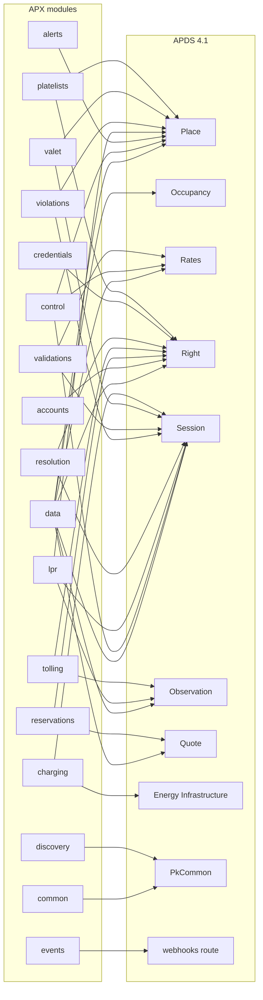

The arrows show the main APDS domains each module builds on. Every
module also uses the PkCommon datatypes (DateTime, Reference,
AmountInCurrency and others), which are not drawn.

### How APX carries APDS objects

APX relates to APDS objects in three ways only:

1. **By reference.** An APX resource names an APDS entity with an APDS
   `Reference` or `VersionedReference`, typed by `className` (APX Part 4
   §4.1). A Command targets `{"id": "…", "className":
   "SupplementalEquipment"}`. An Account names its APDS RightHolder.
   APX never embeds or copies the entity.
2. **By decoration.** APX attaches its own data to an APDS entity
   through the entity's `extensions` container, under a key in the `apx`
   namespace, for example `apds-ext:apx:lpr-read@1.0` on an Observation
   (APX Part 4 §4.3). These are Level B decorations: a plain APDS
   consumer ignores them and still reads a valid APDS object. They are
   the only way APX data appears inside an APDS payload.
3. **By reuse of datatypes.** APX uses APDS DateTime, Duration,
   MultilingualString, AmountInCurrency, Reference, VersionedReference,
   DeletedReference and Url by `$ref`, and never introduces a parallel
   datatype for a concept APDS models (APX Part 4 §4.4).

Some APX resources are read-models rather than stored records. The
occupancy snapshot is derived from the APDS Place hierarchy and is never
written directly (APX Part 5 §5.5). The LPR read is a projection of an
APDS Observation (APX Part 13 §13.3).

### The common envelope

Every APX-defined resource shares one envelope, defined in the `common`
module:

- `ApxResourceCore`: `id` (an RFC 9562 UUID) and `version` (a positive
  integer). This is the same shape APDS uses for `D2VersionedIdentifiable`
  objects, so any APX resource can itself be the target of an APDS
  Reference (APX Part 4 §4.1).
- `RecordInfo`: provenance aligned with the APDS RecordType:
  creation and last-update time and user, the creator, and, for
  replicated records, the origin implementation (APX Part 4 §4.2, Part
  18 §18.6).
- `Extensions`: the APDS extension container, with keys of the form
  `apds-ext:<namespace>:<class>@<major>.<minor>` (APX Part 4 §4.3).

Resources with a lifecycle (Commands, Alerts, toll transactions,
violations and others) also keep an immutable `statusHistory[]`, the
authoritative audit record (APX Part 4 §4.2).

### Identity and versioning

All identifiers, APX and APDS alike, are local to the implementation
that issued them. A client must not assume an id minted by one
implementation resolves at another (APX Part 4 §4.1a). APX resource ids
are UUIDs. APDS entity ids are whatever APDS makes them: unique strings,
UUIDs by convention only. When an aggregating implementation imports a
place whose ids collide, it mints new ids and records each source id in
the APDS `operatorDefinedReference` (APX Part 4 §4.1a, Part 18 §18.2).

`version` increases on every state-changing update. A writer that
replaces or amends a versioned resource sends the version it last read,
as `If-Match` or in the body; a stale version is refused with 409
`version-conflict` and nothing is written (APX Part 4 §4.2a).

The specification itself is versioned at three levels (APX Part 3 §3.2).
The API major version is in the URL (`/v1`). Event topics carry their own
version (`.v1`), and a topic's payload never changes within it. Each
registry versions on its own: every added entry increments the list
version, following the APDS PkCommon rule.

## Data model

### 1 Common elements

*Normative text: APX Parts 4, 5, 10 and 12. Package: `APX/Common`.*

#### Purpose

The common module holds the conventions every other APX module reuses:
resource identity, provenance, the extensions container, the error body,
the event envelope, open code-list values, and the credential digest. It
plays the role for APX that the PkCommon domain plays for APDS. It is
defined in `spec/openapi/domains/common/schemas.yaml` and specified in
APX Part 4 (identity, provenance, extensions), Part 5 (the change payload
shape it shares with the data module), Part 10 (extensibility) and Part
12 (errors).

Nothing here re-models an APDS concept. Where APDS has a datatype (time,
money, reference, multilingual text), APX uses it by `$ref` and adds no
parallel type (APX Part 4 §4.4).

#### Concepts

##### Resource identity

`ApxResourceCore` is the identity of every APX-defined resource: an `id`
(a UUID, unique within the resource class) and a `version` (a positive
integer, incremented on every state-changing update), with optional
`recordInfo` and `extensions` (APX Part 4 §4.1). The shape is deliberately
the one APDS uses for `D2VersionedIdentifiable` objects. So an APX
resource can be the target of an APDS `Reference` or `VersionedReference`
with `className` set to the APX class name, for example `{"id": "…",
"className": "Command"}`. APX resources refer to APDS entities in the same
way and never embed them.

A client may supply the id on create, following the APDS convention; a
collision is 409 `id-collision` (APX Part 4 §4.1). Ids are local to the
implementation that issued them (APX Part 4 §4.1a). Writers send the
version they last read as a precondition, and a stale one is 409
`version-conflict` (APX Part 4 §4.2a).

##### Provenance

`RecordInfo` is aligned with the APDS RecordType: `creationTime`,
`creator` (a Reference to an Organisation or Contact), `creationUser`,
`lastUpdate` and `lastUpdateUser` (APX Part 4 §4.2). It adds `origin`: the
implementation that first created the record, given as that
implementation's `EventEnvelope.source`, when a record reaches a receiver
through replication (APX Part 18 §18.6). `origin` is absent on records the
serving implementation created itself, and only a replicator holding
`apx.replication:write` may set it.

Where a resource has a lifecycle, its immutable `statusHistory[]`, not
`RecordInfo`, is the authoritative audit record (APX Part 4 §4.2).

##### Extensions

`Extensions` is the official APDS extension container (APDS Use Case
§C.2.5). Its keys follow `apds-ext:<namespace>:<class>@<major>.<minor>`;
the version is the extension class's own contract version (APX Part 4
§4.3). Readers ignore unknown keys and writers preserve them (APX Part 3
§3.3(6)).

The `apx` namespace is reserved. Each APX decoration key is bound to its
schema, so a validator checks it wherever the container appears: device
status, rate policy, LPR read detail, lane cameras, reservation, permit
(1.0 and 1.1), session detail, match evidence, violation source, payment
detail and credential digest. Two further keys, `alert-evidence` and
`correlation`, are described in prose only and are not yet bound (APX
Part 4 §4.3). Any other key carries any object.

The container works in both directions. On an APX resource it carries
vendor additions. On an APDS entity it carries APX data as a Level B
decoration, which is the only way APX data appears inside an APDS
payload (APX Part 4 §4.3).

##### Open code-list values

`CodeListValue` carries a `value` (the `definedValue` of a code-list
entry) and an optional `codeListId`, a VersionedReference to the APDS
`UserDefinedCodeList` that defines it. It follows the pattern of the APDS
`ReferencedCodeListEntry`. Implementers extend an APX vocabulary by
publishing their own list and pointing to it this way (APX Part 11
§11.1).

##### Errors

`Problem` is an RFC 9457 problem details body: `type`, `title`, `status`,
and optional `detail` and `instance`, open to extra members. Every APX
error uses it, with a `type` URI from the APX problem-type registry under
`https://apx-standard.org/problems/` (APX Part 12 §12.1–12.2). A `type` is
a stable identifier; clients match the exact string and do not fetch it.
APDS-native routes keep their APDS `ResponseStatus` shape by default and
return the Problem when the client asks for it (APX Part 5 §5.1a).

##### Event envelope

`EventEnvelope` is the single envelope of every asynchronous delivery,
by webhook or SSE (APX Part 8 §8.2). Its attributes follow CloudEvents
1.0: `id` (stable across retries), `type` (the topic), `source` (the
publishing implementation), `time`, optional `dataschema`, and `data`.
`subject` is an APDS Reference, so an event binds natively to the APDS or
APX entity it concerns. For APDS `EventTypeEnum` topics, `data` is the
APDS `EventData` shape. The events module describes delivery.

##### Credential digest

`CredentialDigest` is the optional decoration
`apds-ext:apx:credential-digest@1.0` (APX Part 9 §9.6 rule 6). It is a
keyed HMAC-SHA-256 digest of a normalized credential identification,
typically a plate, so a consumer that only needs to know "same plate?"
can match without seeing the plate. The key is named by `keyId` and
served by `GET /v1/digest-keys`; rotation is by key id.

#### Lifecycle

No lifecycle.

#### Relationship to APDS

APDS classes and datatypes used as they stand: `Reference`,
`VersionedReference`, `DateTime`, `CredentialTypeEnum` (on the digest),
and the `UserDefinedCodeList` pattern from PkCommon. `ApxResourceCore`
mirrors `D2VersionedIdentifiable`, and `RecordInfo` mirrors RecordType.
APX relies on the APDS extension mechanism of Use Case §C.2.5.

The APDS 4.1 API document declares no `extensions` member on its entity
schemas. APX has offered this to APDS as a suggestion (erratum 010,
parkingdata/spec#43: declare `Extensions` once on `VersionedIdentity`).
Until then, the APX data overlay declares it on the eight native entity
schemas and on `Payment` (APX Part 1 §1.3 item 10).

Proposed to APDS (APX Data Specification, PkCommon):

| Element | Change | Tier |
| --- | --- | --- |
| `RecordType` | Addition to an APDS class: optional `origin` | 3 |

`origin` comes from `RecordInfo.origin` and is marked for discussion.

Also offered, as a suggestion rather than a data element: RFC 9457
`application/problem+json` as an error option on APDS-native routes
(`docs/apds-change-requests.md`, Part B).

APX-only: `ApxResourceCore`, `Extensions` (the APX binding of decoration
keys), `CodeListValue`, `Problem`, `EventEnvelope` and `CredentialDigest`.
They describe how the API identifies, extends, reports and delivers data,
not the parking data itself, and the APX Data Specification proposes
data, not interface. `CodeListValue` needs nothing new from APDS, because
`ReferencedCodeListEntry` already provides the pattern.

#### Class diagram

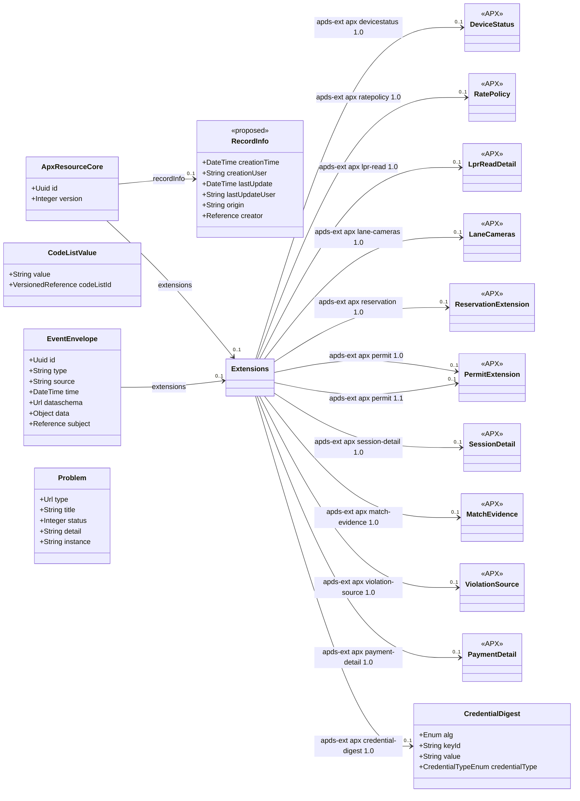

*Figure 1 -- Common elements. Members of a «proposed» class are proposed to APDS (06, Part D). Classes marked «APDS» are defined in APDS 4.1. Up to 12 attributes are shown per class; 03 Data Dictionary lists them all.*

#### Classes in Common elements

| Class | Definition | Members | APDS status |
| --- | --- | --- | --- |
| `ApxResourceCore` | Identity core shared by every APX-defined resource. Shaped so any APX resource can itself be the target of an APDS Reference or VersionedReference (RFC 4122 UUID identifier + integer version). | 4 | APX only |
| `CodeListValue` | A value drawn from an APX or implementer UserDefinedCodeList — carries the defined value plus an optional ReferencedCodeListEntry-style pointer to the list that defines it. | 2 | APX only |
| `CredentialDigest` | The `apds-ext:apx:credential-digest@1.0` decoration (Part 9 §9.6 rule 6): a keyed digest of a normalized credential identification (a plate), so a consumer that only needs "same plate?" can match without the plate itself. `value` is base64url(HMAC-SHA-256(key, normalized identification)); the key is named by `keyId` and distributed through `GET /v1/digest-keys`. Visible under `apx.data:read`. | 4 | APX only |
| `EventEnvelope` | The single envelope for all APX asynchronous delivery (webhooks and SSE). Attribute names are aligned with CloudEvents 1.0 (informative mapping in the standard's annex); `subject` carries an APDS Reference so events bind to APDS/APX entities natively. | 8 | APX only |
| `Extensions` | The official APDS extension container (Use Case Document §C.2.5). Keys MUST follow `apds-ext:<namespace>:<class>@<major>.<minor>`. Implementations MUST preserve unknown extension keys on round-trip (tolerant reader, faithful writer). An APX decoration key, wherever the container appears, MUST carry a value valid against that decoration's schema (Part 4 §4.3); other keys are any object. | 12 | APX only |
| `Problem` | RFC 9457 problem details. APX problem `type` URIs are registered in the APX problem-type registry. Used for all APX error responses; APDS-native routes may alternatively use the APDS ResponseStatus shape. | 5 | APX only |
| `RecordInfo` | Provenance metadata for an APX resource, aligned to the APDS Information Model's RecordType (creationTime/creator/lastUpdate). All timestamps are RFC 3339 (APDS DateTime). | 6 | Proposed: RecordType (Tier 3) |

#### Enumerations in Common elements

| Enumeration | Values |
| --- | --- |
| `CredentialDigest.alg` | `HS256` |

#### External code lists used in Common elements

None.

### 2 Discovery

*Normative text: APX Part 16. Package: `APX/Discovery`.*

#### Purpose

The discovery module tells a client what an APX implementation offers
and what that client may do there (APX Part 16). It has two layers. The
bootstrap document, `/.well-known/apx-configuration`, is unauthenticated
and required of every implementation: it is how a client with nothing but
a hostname gets started. The discovery document, `GET /v1/discovery`, is
computed for the presented token and lists exactly what that credential
can reach. The second layer is the optional class `apx-discovery`.

The schemas are in `spec/openapi/domains/discovery/schemas.yaml`. Neither
document is parking data. Both describe the API, and both refer to APDS
only for the client's Organisation and the place ids it is granted.

#### Concepts

##### Bootstrap configuration

`ApxConfiguration` is the bootstrap document (APX Part 16 §16.1). It
holds:

- `apxVersion`, the APX edition implemented, and optionally `edition`,
  equal to it when present (APX Part 3 §3.4).
- `apdsVersion`, the one APDS release the server implements. There is no
  in-band version negotiation; a client checks this value before first
  use (APX Part 3 §3.5).
- `tokenEndpoint`, where the client obtains an OAuth2 token (APX Part 9).
- `apiBase`, the URL every path in the bundle is relative to, APX and
  APDS-native alike. It is required when the API is not at the origin
  root that serves this document.
- `conformanceClasses`: exactly the classes the Implementation
  Conformance Statement claims, closed under the dependency table of APX
  Part 3 §3.1, and containing only registry values or vendor classes
  named `<vendor-ns>-<class>`.
- `features`: the optional features offered, from the `apx-features`
  registry (`negotiatedRates`, `negotiatedAmounts`, `ticketMatching`) or
  vendor features. An offered feature must be listed; an unlisted one is
  not offered.
- `registries` and `registryVersions`, keyed by registry name: where each
  code list the server validates against is served, and its version (APX
  Part 11 §11.2). An advertised URL that does not resolve does not
  conform.
- `extensions`, the APX extensions container.

Under `apx-mtls`, this document stays retrievable without a client
certificate and lists `apx-mtls`, so a prospective client can learn the
requirement (APX Part 16 §16.3).

##### Discovery document

`DiscoveryDocument` reflects the presented token exactly: its scopes, its
`apx_org` and its `apx_places` grant (APX Part 16 §16.2). It holds:

- `client`, the OAuth client id, and `organisation`, an APDS Reference to
  the client's Organisation.
- `conformanceClasses`, a subset of the bootstrap document's, and the
  token's `scopes`.
- `places`, the granted place subtrees. A token with no place claim is
  reflected as an empty list, never by omitting the member.
- `endpoints`: each an OpenAPI path template exactly as it appears in
  the bundle, relative to `apiBase`, with its upper-case HTTP methods.
  APDS-native routes and vendor routes are listed on the same terms.
- `commandTypes`, the command types this client may execute, and
  `features`, the capabilities of the classes it holds a scope of. The
  first is a permission list; the second is a capability list, so a
  read-only client still sees a feature.
- `topics`: APX registry topics, APDS EventTypeEnum values and vendor
  topics the client may subscribe to.
- `rateLimits`: per-credential integers for `requestsPerMinute`,
  `commandsPerMinute`, `burst`, `subscriptionsMax` and
  `streamConnectionsMax`.
- `replication[]`, present only when a place is shared with a replicated
  site or aggregator: which side, `site` or `aggregator`, is
  authoritative for each entity class at each place, and the peer's event
  source (APX Part 18 §18.6).
- `extensions`.

##### The soundness rule

The discovery document is a promise, not advertising (APX Part 16
§16.2). Every endpoint and command it lists must be callable by the
client for at least one target inside its granted places. A client with
no granted places therefore sees no place-targeting endpoint. Two clients
with different grants receive different documents. What an unlisted call
receives follows APX Part 9 §9.3a: 403 `insufficient-scope` for an
endpoint the token's scopes do not cover, 403 `insufficient-grant` for a
target outside the grant, and 404 `target-not-found` for an endpoint of a
class the server does not claim.

The document is computed per request and is valid for the lifetime of the
token it was computed for. A change of scopes or grant takes effect
through a new token, and a client that receives 403 on a listed endpoint
should fetch discovery again before retrying.

##### Onboarding

Discovery is the third step of onboarding at any implementation: fetch
the bootstrap document, obtain a credential, then call discovery to prove
the boundary before any traffic flows (APX Part 18 §18.3). An aggregator
runs exactly the single-site flow; that uniformity is the design (APX
Part 18 §18.1).

#### Lifecycle

No lifecycle.

#### Relationship to APDS

APDS elements used as they stand: the Organisation, through a Reference,
and HierarchyElement ids in `places`. The documents list APDS-native
routes and APDS `EventTypeEnum` topics alongside APX ones, so a client
learns both from one place. APDS 4.1 itself defines no discovery or
bootstrap document; APX adds them without changing any APDS route.

Proposed to APDS: no data element. Discovery describes the interface, not
the parking data, and the APX Data Specification proposes data only.

APX-only: `ApxConfiguration` and `DiscoveryDocument`, together with the
`apx-conformance-classes` and `apx-features` registries they draw on.

#### Class diagram

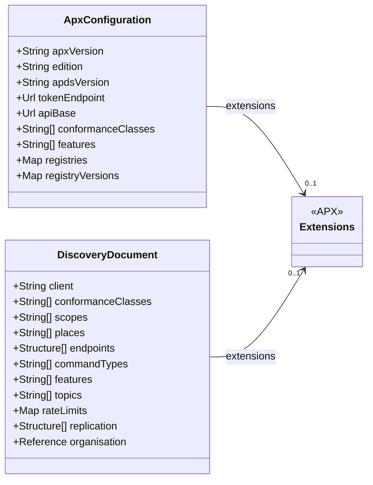

*Figure 2 -- Discovery. Members of a «proposed» class are proposed to APDS (06, Part D). Classes marked «APDS» are defined in APDS 4.1. Up to 12 attributes are shown per class; 03 Data Dictionary lists them all.*

#### Classes in Discovery

| Class | Definition | Members | APDS status |
| --- | --- | --- | --- |
| `ApxConfiguration` | Unauthenticated bootstrap configuration document. | 10 | APX only |
| `DiscoveryDocument` | What THIS credential can do: exactly the endpoints, commands, topics, and places reachable with the presented token's scopes and grants. Two clients with different grants receive different documents; a client can call everything its document lists and nothing more. | 18 | APX only |

#### Enumerations in Discovery

| Enumeration | Values |
| --- | --- |
| `DiscoveryDocument.replication.authority` | `site`, `aggregator` |

#### External code lists used in Discovery

| Code list | Entries | Examples |
| --- | --- | --- |
| `apx-features` | 3 | `negotiatedRates`, `ticketMatching`, `negotiatedAmounts` |

### 3 Data exchange

*Normative text: APX Parts 5 and 18. Package: `APX/Data`.*

#### Purpose

The data module is the APX profile over the APDS native data routes
(`/places`, `/observations`, `/contacts`, `/rights/specs`,
`/rights/assigned`, `/rates`, `/sessions`, `/quotes`). APX defines no
parallel data routes. It adds the behaviour APDS leaves open: update
modes, an ordered change feed, convenience reads of occupancy, and the
record a pairing engine writes on a Session (APX Part 5). Its conformance
class `apx-data` is one of the two base classes.

The schemas are in `spec/openapi/domains/data/schemas.yaml`. Most of them
describe pages and payloads around APDS entities rather than new
entities. The two decorations, `SessionDetail` and `MatchEvidence`, carry
new data on the APDS Session and on APX resources that cite a Session.

#### Concepts

##### Full and Change updates

APDS defines Full and Change updates for Place information (Use Case
§C.1.1.6). APX applies them to every native entity class, in both
directions (APX Part 5 §5.1). A Full payload is the complete current
state. A Change payload carries the identity (`id`, `version`) and only
the changed fields: an explicit `null` clears a field, and an absent field
is unchanged. A native `PUT` names its mode in the `APX-Update-Mode`
header, defaulting to `full`, which is stock APDS behaviour.

`ChangePayload` is the generic change shape: `id` required, `version`
optional, any other member allowed. The build derives a typed change
payload per class, for example `RateTableChangePayload`, which checks each
member present against the class's own property schema and refuses
members the class does not define (APX Part 5 §5.1a). The generic shape
remains the item of every change-feed page, so what a writer sends and
what a reader receives are the same thing.

##### Change feed

APDS's `modified_since` parameter is the coarse fallback. For gapless
incremental sync APX adds `mode` (`ModeParam`) and `cursor`
(`CursorParam`) (APX Part 5 §5.2). With `mode=change`, a native route
returns a `ChangeFeedPage`: `publicationTime` and `publisher`, the
`updateMode`, the changed `items`, `deleted` tombstones (APDS
`DeletedReference`), the opaque `cursor` that resumes after this page,
`grantAdditions`, and `next`.

The key rules (APX Part 5 §5.2):

- The feed is ordered and gapless per class: replaying from any issued
  cursor yields every later change exactly once.
- Cursors are opaque and scoped to class, credential and filter set.
  They are honoured for at least 7 days and never survive a move to a
  different implementation.
- A filtered feed is gapless within its filter, and within the
  credential's `apx_places` grant.
- When a grant gains a subtree, the next page names the new subtree roots
  in `grantAdditions`, and the client runs a full sync for them.

APX list routes of stateful resources (commands, alerts, accounts,
payments, violations and the rest) carry the same feed in their own list
envelope (APX Part 5 §5.2 rule 8). The members `ChangeFeedUpdateMode`,
`ChangeFeedCursor`, `ChangeFeedTombstones`, `ChangeFeedGrantAdditions` and
`ChangeFeedNext` are defined once here and reused by those routes. A
change page there carries `updateMode: change`; items are whole current
representations, never change payloads, because APX resources change by
domain operations and keep their own history.

##### Occupancy snapshot and history

APDS keeps occupancy inside the Place hierarchy, as Supply and
DemandTable. `OccupancySnapshot` answers "how full is this place now" in
one read (APX Part 5 §5.5). It holds the element Reference, `computedAt`,
the verbatim APDS `Supply` and latest `DemandType`, and a derived
`available` count: supply quantity minus demand count, never negative,
and `null` when either side is unknown. It may also carry an `evCharging`
block of charging-point counts (APX Part 23 §23.7).

`OccupancyHistoryPage` gives one bucket per interval between two times,
each with `maxCount`, a time-weighted `avgCount`, the supply in force, and
how many demand records it rests on (APX Part 5 §5.5a). Buckets align to
interval boundaries in the place's time zone. A bucket with no record has
no counts.

Both are read-models, not resources. They have no id or version, are
never written, and must be derivable from the APDS Place hierarchy, which
stays the source of truth. Fields the implementation does not know are
absent, never guessed.

##### Session detail

APDS describes a Session's money and rights but not how the visit was
assembled. When the system that pairs reads into Sessions is a separate
client, it writes what it decided as the Level B decoration
`apds-ext:apx:session-detail@1.0` (`SessionDetail`) on the APDS Session,
through the native `POST /sessions` and `PUT /sessions/{id}` (APX Part 5
§5.8). A server that pairs reads itself should write the same block.

- `reads[]` (`SessionReadBinding`) binds each ObservationElement to the
  Session with a `role`: `entry`, `exit`, `duplicate` or `activity`. At
  most one is `representative`. A read bound as `entry` or `exit` to one
  Session of a place cannot be bound so to another, unless the write
  names the old Session in `supersedes` (409 `read-already-bound`).
- `closure` (`SessionClosure`) says why and how the Session ended:
  `endReason` from the `apx-session-end-reasons` registry, whether the
  end was inferred by a rule, and `startObserved: false` for a Session
  closed from an exit with no observed entry. Consumers exclude such
  Sessions from dwell and occupancy figures.
- `parent` names the visit an area Session belongs to; the parent's
  hierarchy element must be an ancestor of the child's. `passThrough`
  marks an area stay shorter than the area's minimum dwell, never scored
  or billed. Consumers count visits by Sessions without a parent.
- `flags` carries open markers such as `entryUnknown` or `reentry`.

`matches[]` holds `MatchEvidence`: how a link to a target was made. It
records the `target` (an AssignedRight, ValetTicket, Violation,
PlateListEntry or Observation), the `matchType`, how the plates agreed
(`plate.method`, edit cost, jurisdiction), the vehicle evidence level,
whether the match was `applied` or only a shadow, and whether a `system`
or a `person` decided. It carries no plate characters and no make, model
or colour. The same object is the decoration
`apds-ext:apx:match-evidence@1.0` on a Violation and a ValetTicket, with
the Session as target; both ends of one link must agree. Lenient or
unapplied evidence may excuse a stay but never accuse one (APX Part 5
§5.8 rule 5, Part 19 §19.4).

#### Lifecycle

`SessionDetail.lifecycle` records where the writer considers the Session
to be (APX Part 5 §5.8 rule 3).

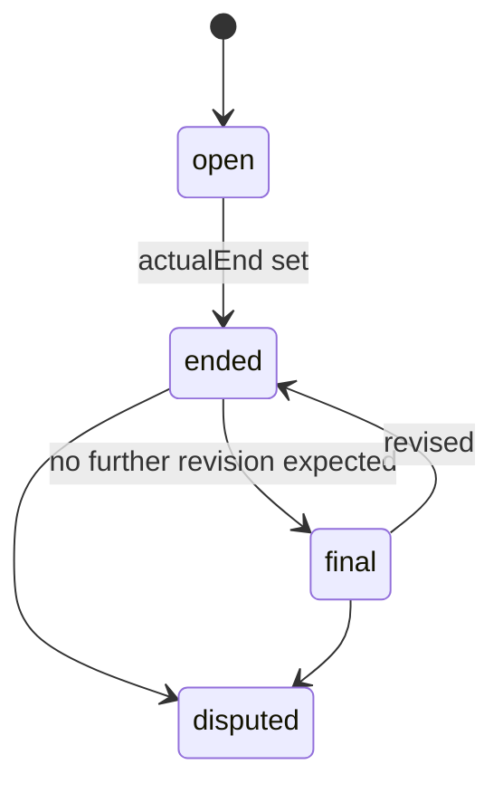

`open` has no `actualEnd`; every other state has one, and a write where
`lifecycle` and `actualEnd` disagree is refused with 422
`request-unprocessable`. `final` is the writer's statement, never a lock:
a server must not refuse a later revision because a Session is `final`.
The diagram shows the usual paths. APX enforces only the agreement of
`lifecycle` with `actualEnd`; it fixes no other transition rule.

#### Relationship to APDS

APDS classes used as they stand: every native entity class served on the
eight routes, `Supply`, `DemandType`, `DeletedReference`, `Reference`,
`DateTime` and `Duration`. The occupancy reads compose APDS Supply and
DemandType without change. Session detail sits in the extensions
container of the APDS Session, which the data overlay declares (APX Part
1 §1.3 item 10).

Proposed to APDS (APX Data Specification):

| Element | Change | Package | Tier |
| --- | --- | --- | --- |
| `Session` | Additions to an APDS class (`sessionRead`, `sessionClosure`, `matchEvidence`, `parentSessionId`, `lifecycle`, `passThrough`) | Session | 1 |
| `SessionRead` | New class (from `SessionReadBinding`) | Session | 1 |
| `SessionClosure` | New class | Session | 1 |
| `SessionReadRoleEnum` | New enumeration | Session | 1 |
| `SessionEndReasonEnum` | New enumeration (from `apx-session-end-reasons`) | Session | 1 |
| `SessionLifecycleEnum` | New enumeration | Session | 2 |
| `MatchEvidence` | New class | Session | 3 |
| `MatchTypeEnum`, `MatchDecisionEnum` | New enumerations | Session | 3 |
| `DemandType` | Additions to an APDS class (period summary) | Demand | 3 |

`MatchEvidence` is kept small in the proposal and offered for discussion:
it records what a Session was matched to, while the scoring behind a
match is left to implementations. The `DemandType` addition lets one
record summarise a period, with its start and end, highest and average
count, and number of readings, so occupancy history can be exchanged in
APDS terms. A Session end reason is also listed among the suggestions in
`docs/apds-change-requests.md`, Part B.

APX-only: the change-feed pages and parameters, the change payloads, the
`APX-Update-Mode` header and the occupancy snapshot. They are interface
behaviour. The snapshot needs nothing new from APDS: it is made of Supply
and DemandType plus an `available` figure any receiver can calculate (APX
Data Specification, Occupancy).

#### Class diagram

```mermaid
classDiagram
  direction LR
  class AssignedRightChangePayload {
    +String id
    +Integer version
    +Object rightSpecification
    +Object rightHolder
    +Object assignedRightIssuer
    +IssueMethodTypeEnum issueMethod
    +DateTime issuanceTime
    +Decimal minutesAvailable
    +Decimal minutesUsed
    +Decimal totalMinutes
    +Object remainingValue
    +Object totalRightValue
    +7 more in 03
  }
  class ChangeFeedCursor
  class ChangeFeedGrantAdditions {
    +Uuid[] item
  }
  class ChangeFeedNext
  class ChangeFeedPage {
    +DateTime publicationTime
    +String updateMode
    +String cursor
    +Uuid[] grantAdditions
    +String next
    +Reference publisher
  }
  class ChangeFeedTombstones
  class ChangeFeedUpdateMode
  class ChangePayload {
    +String id
    +Integer version
  }
  class ContactPointChangePayload {
    +ContactTypeEnum contactType
    +Boolean contactNotDefined
    +Boolean contactUnknown
    +Boolean shareWithPublic
    +Object validityOfContact
    +String id
    +Integer version
    +Object[] organisationName
    +ContactPointTypeEnum type
    +Object[] address
    +Object[] contactDetails
    +Object[] eMailCommonData
    +2 more in 03
  }
  class HierarchyElementChangePayload {
    +String id
    +Integer version
    +HierarchyElementTypeEnum type
    +Object[] name
    +Object[] description
    +MultilingualString[] aliases
    +Object operatorDefinedReference
    +Object parentId
    +Object[] childIds
    +Integer layer
    +Object[] rightSpecifications
    +Object hierarchyElementRecord
    +20 more in 03
  }
  class MatchEvidence {
    +Enum matchType
    +Structure plate
    +Structure vehicle
    +Boolean applied
    +Enum decidedBy
    +DateTime decidedTime
    +Reference target
  }
  <<proposed>> MatchEvidence
  class ObservationElementChangePayload {
    +String id
    +Integer version
    +ObservationTypeEnum method
    +String observer
    +CredentialTypeEnum type
    +String observedCredentialId
    +DateTime observationStartTime
    +DateTime observationEndTime
    +Object[] description
    +DateTime creationDateTime
    +Object location
    +Object[] images
    +5 more in 03
  }
  class OccupancyHistoryPage {
    +Duration interval
    +DateTime from
    +DateTime to
    +Structure[] buckets
    +Reference place
  }
  <<proposed>> OccupancyHistoryPage
  class OccupancySnapshot {
    +DateTime computedAt
    +Integer available
    +Structure evCharging
    +Reference place
  }
  class RateTableChangePayload {
    +String id
    +Integer version
    +Object[] rateTableName
    +Object[] rateTableID
    +RateAvailabilityTypeEnum availability
    +Object rateResponsibleParty
    +Object rateSupersedeLink
    +Boolean validation
    +RateTypeEnum rateType
    +Url additionalInformation
    +Object validity
    +Object[] rateLineCollections
  }
  class RightSpecificationChangePayload {
    +String id
    +Integer version
    +Object[] description
    +RightSpecificationTypeEnum type
    +String financialReference
    +Boolean transferable
    +Boolean transferableConditions
    +CredentialTypeEnum[] credentials
    +Object validity
    +DateTime expiry
    +Object[] rightPools
    +Object issuer
    +3 more in 03
  }
  class SessionChangePayload {
    +String id
    +Integer version
    +DateTime actualStart
    +DateTime actualEnd
    +Object initiator
    +Object hierarchyElement
    +Object[] identifiedCredentials
    +Object[] segments
    +Object identifiedVehicle
  }
  class SessionClosure {
    +String endReason
    +Boolean endInferred
    +Boolean startObserved
    +String rule
  }
  <<proposed>> SessionClosure
  class SessionDetail {
    +Enum lifecycle
    +String[] flags
    +Boolean passThrough
    +Reference supersedes
    +Reference parent
  }
  <<proposed>> SessionDetail
  class SessionReadBinding {
    +Enum role
    +Boolean representative
    +Reference observation
  }
  <<proposed>> SessionReadBinding
  AssignedRightChangePayload --> "0..1" Extensions : extensions
  ChangeFeedPage --> "0..*" ChangePayload : items
  ChangeFeedPage --> "0..*" DeletedReference : deleted
  ChangeFeedTombstones --> "0..*" DeletedReference : item
  ContactPointChangePayload --> "0..1" Extensions : extensions
  HierarchyElementChangePayload --> "0..1" Extensions : extensions
  ObservationElementChangePayload --> "0..1" Extensions : extensions
  OccupancyHistoryPage --> "0..1" Extensions : extensions
  OccupancySnapshot --> "0..1" Supply : supply
  OccupancySnapshot --> "0..1" DemandType : demand
  OccupancySnapshot --> "0..1" Extensions : extensions
  RateTableChangePayload --> "0..1" Extensions : extensions
  RightSpecificationChangePayload --> "0..1" Extensions : extensions
  SessionChangePayload --> "0..1" Extensions : extensions
  SessionDetail --> "0..*" SessionReadBinding : reads
  SessionDetail --> "0..1" SessionClosure : closure
  SessionDetail --> "0..*" MatchEvidence : matches
  class Extensions
  <<APX>> Extensions
  class DeletedReference
  <<APDS>> DeletedReference
  class Supply
  <<APDS>> Supply
  class DemandType
  <<APDS>> DemandType
```

*Figure 3 -- Data exchange. Members of a «proposed» class are proposed to APDS (06, Part D). Classes marked «APDS» are defined in APDS 4.1. Up to 12 attributes are shown per class; 03 Data Dictionary lists them all.*

#### Classes in Data exchange

| Class | Definition | Members | APDS status |
| --- | --- | --- | --- |
| `AssignedRightChangePayload` | A change-mode body for native `PUT /rights/assigned/{id}` (Part 5 §5.1a): `id` plus only the AssignedRight members that changed; an absent member is unchanged and an explicit `null` clears it. Every member present is checked against the class, and a member the class does not define is refused. Generated at build time (tools/change-payloads.mjs); the generic ChangePayload remains the shape of change-feed items. | 20 | APX only |
| `ChangeFeedCursor` | `mode=change` only. Opaque cursor resuming strictly after the last change in this page (Part 5 §5.2 rules 1, 2, 5). | 0 | APX only |
| `ChangeFeedGrantAdditions` | `mode=change` only. Present on the first page served after the credential's `apx_places` grant gained subtrees: the new subtree roots, which the client full-syncs with the route's `place` filter before relying on the feed for them (Part 5 §5.2 rule 7). | 1 | APX only |
| `ChangeFeedNext` | `mode=change` only. Link to the next page when more changes are immediately available (the same request with this page's `cursor`); null otherwise. | 0 | APX only |
| `ChangeFeedPage` | Response of a native APDS list route when called with `mode=change`. Items are VERBATIM APDS entities carrying only changed fields plus identity (change semantics per Part 5: explicit null = clear the field, absent = unchanged — generalizing APDS Use Case C.1.1.6). Deletions are APDS DeletedReferences (tombstones). | 8 | APX only |
| `ChangeFeedTombstones` | `mode=change` only. Resources removed since the cursor (retention purge, Part 9 §9.6; release of a moved place, Part 18 §18.4), as APDS DeletedReferences carrying the APX resource's schema name as `className`. Retained for the cursor window (Part 5 §5.2 rule 4). | 1 | APX only |
| `ChangeFeedUpdateMode` | Present, with the value `change`, exactly when the page answers `mode=change` (Part 5 §5.2 rule 8); absent on an ordinary list page. | 0 | APX only |
| `ChangePayload` | A change-mode payload for any native APDS entity class (Part 5 §5.1): the entity's identity plus only the members that changed. An absent member is unchanged; an explicit `null` clears it. Nested objects that carry their own `id` (a Session segment, say) follow the same rule. | 2 | APX only |
| `ContactPointChangePayload` | A change-mode body for native `PUT /contacts/{contactId}` (Part 5 §5.1a): `id` plus only the ContactPoint members that changed; an absent member is unchanged and an explicit `null` clears it. Every member present is checked against the class, and a member the class does not define is refused. Generated at build time (tools/change-payloads.mjs); the generic ChangePayload remains the shape of change-feed items. | 15 | APX only |
| `HierarchyElementChangePayload` | A change-mode body for native `PUT /places/{id}` (Part 5 §5.1a): `id` plus only the HierarchyElement members that changed; an absent member is unchanged and an explicit `null` clears it. Every member present is checked against the class, and a member the class does not define is refused. Generated at build time (tools/change-payloads.mjs); the generic ChangePayload remains the shape of change-feed items. | 33 | APX only |
| `MatchEvidence` | How a link to a Session was established and how sure it is (Part 5 §5.8; shared by the `matches[]` member of `apds-ext:apx:session-detail@1.0` and the decoration `apds-ext:apx:match-evidence@1.0` on a Violation or ValetTicket). Carries no plate characters and no vehicle attribute values (Part 9 §9.6). Where both ends of one link carry evidence (the Session's `matches[]` entry and the decoration on the Violation or ValetTicket), the two MUST agree. Evidence with `plate.method: lenient` or `applied: false` may excuse a stay but never accuse one: `issue` on a Violation resting on it is 409 `violation-not-issuable` (Part 19 §19.4 rule 5). | 13 | Proposed: MatchEvidence (Tier 3); Proposed: MatchTypeEnum (Tier 3); Proposed: MatchDecisionEnum (Tier 3) |
| `ObservationElementChangePayload` | A change-mode body for native `PUT /observations/{id}` (Part 5 §5.1a): `id` plus only the ObservationElement members that changed; an absent member is unchanged and an explicit `null` clears it. Every member present is checked against the class, and a member the class does not define is refused. Generated at build time (tools/change-payloads.mjs); the generic ChangePayload remains the shape of change-feed items. | 18 | APX only |
| `OccupancyHistoryPage` | Occupancy per clock interval for one HierarchyElement (Part 5 §5.5a): the history behind the §5.5 snapshot, derived from the APDS DemandTable records the implementation holds. Buckets are aligned to the interval boundary in the place's time zone; a bucket with no demand record carries no counts, never a guess. | 11 | Proposed: DemandType (Tier 3) |
| `OccupancySnapshot` | Current occupancy for one HierarchyElement, computed from the APDS occupancy model (Supply + DemandTable) that natively lives in the Place hierarchy. A convenience READ (Part 5 §5.5): the Place payload remains the source of truth; this answers "how full is it right now" without pulling the hierarchy. Composed entirely of verbatim APDS occupancy classes — APX adds no parallel occupancy datatypes. | 13 | APX only |
| `RateTableChangePayload` | A change-mode body for native `PUT /rates/{id}` (Part 5 §5.1a): `id` plus only the RateTable members that changed; an absent member is unchanged and an explicit `null` clears it. Every member present is checked against the class, and a member the class does not define is refused. Generated at build time (tools/change-payloads.mjs); the generic ChangePayload remains the shape of change-feed items. | 13 | APX only |
| `RightSpecificationChangePayload` | A change-mode body for native `PUT /rights/specs/{id}` (Part 5 §5.1a): `id` plus only the RightSpecification members that changed; an absent member is unchanged and an explicit `null` clears it. Every member present is checked against the class, and a member the class does not define is refused. Generated at build time (tools/change-payloads.mjs); the generic ChangePayload remains the shape of change-feed items. | 16 | APX only |
| `SessionChangePayload` | A change-mode body for native `PUT /sessions/{id}` (Part 5 §5.1a): `id` plus only the Session members that changed; an absent member is unchanged and an explicit `null` clears it. Every member present is checked against the class, and a member the class does not define is refused. Generated at build time (tools/change-payloads.mjs); the generic ChangePayload remains the shape of change-feed items. | 10 | APX only |
| `SessionClosure` | Why and how a Session ended (Part 5 §5.8). | 4 | Proposed: SessionClosure (Tier 1) |
| `SessionDetail` | The `apds-ext:apx:session-detail@1.0` decoration on an APDS Session (Part 5 §5.8): what the pairing of reads decided and APDS has no members for — the reads behind the visit, why and how it ended, the matches it rests on, and the parent visit of an area Session. Written with the native Session POST/PUT by an external pairing engine; a server that pairs reads itself SHOULD write the same block on its own Sessions. A plain APDS client ignores it. It adds no event topic and carries no plate characters. A write that breaks a consistency rule of §5.8 is 422 and nothing is written. | 8 | Proposed: Session (Tier 1); Proposed: SessionLifecycleEnum (Tier 2) |
| `SessionReadBinding` | One LPR read attached to a Session by the pairing engine (Part 5 §5.8, member `reads[]` of `apds-ext:apx:session-detail@1.0`). | 3 | Proposed: SessionRead (Tier 1); Proposed: SessionReadRoleEnum (Tier 1) |

#### Enumerations in Data exchange

| Enumeration | Values |
| --- | --- |
| `MatchEvidence.decidedBy` | `system`, `person` |
| `MatchEvidence.matchType` | `right`, `valet`, `violation`, `list`, `exitPairing`, `sweep`, `other` |
| `MatchEvidence.plate.jurisdiction` | `agrees`, `differs`, `unknown` |
| `MatchEvidence.plate.method` | `exact`, `alias`, `fold`, `fuzzy`, `lenient`, `reviewer` |
| `MatchEvidence.vehicle.level` | `unknown`, `mismatch`, `inconclusive`, `weak`, `good`, `strong` |
| `SessionDetail.lifecycle` | `open`, `ended`, `final`, `disputed` |
| `SessionReadBinding.role` | `entry`, `exit`, `duplicate`, `activity` |

#### External code lists used in Data exchange

| Code list | Entries | Examples |
| --- | --- | --- |
| `apx-session-end-reasons` | 10 | `exitRead`, `reentry`, `stale`, `parentExit` |

### 4 Subscriptions and events

*Normative text: APX Part 8. Package: `APX/Events`.*

#### Purpose

The events module is the APX delivery fabric. APDS 4.1 defines the
`/webhooks` route to subscribe and unsubscribe, but leaves the delivery
contract to each project. APX completes it as a superset: a stock APDS
`EventSubscription` with an endpoint and a list of topics works unchanged
(APX Part 8). The module adds signed delivery, a retry schedule, a
delivery ledger, place-bound filtering, and an optional Server-Sent Events
stream for consumers that cannot expose an inbound endpoint.

Its conformance classes are `apx-events` (webhooks, a base class) and
`apx-events-sse` (the stream). The schemas are in
`spec/openapi/domains/events/schemas.yaml`; the envelope itself is in the
common module.

#### Concepts

##### Subscription

`ApxEventSubscription` is a superset of the APDS EventSubscription. Only
`topics` is required. A stock body of `endpoint` and APDS `EventTypeEnum`
topics gets stock behaviour; every APX member is optional (APX Part 8
§8.1). The members are:

- `endpoint` and `topics[]`. Topics mix APDS EventTypeEnum values and APX
  topics (`apx.<domain>.<event>.vN`, registry `apx-topics`) freely.
- `transport`: `webhook` (the default) or `sse`.
- `filters` (`SubscriptionFilters`): `places`, `severityFloor` and
  `alertTypes`.
- The signing material: `secret` or `secretRef`, `keyId`, the read-only
  `activeKeyIds`, and `retireKeyIds` to end a rotation.
- `status`: `active`, `paused` or `failed`.
- `id`, `version`, `recordInfo` and `extensions`.

A topic is accepted only if the credential could read its data
synchronously, and a place filter only inside the token's `apx_places`
grant (APX Part 8 §8.1). The signing secret is returned once, in the
creation response, and never again. `ApxEventSubscriptionPatch` is the
JSON Merge Patch body of an update: members present replace the stored
value and absent members are unchanged.

A filter can narrow a grant but never widen it. `places` is
subtree-inclusive. `severityFloor` and `alertTypes` apply to the alert
topics only, and both must hold (APX Part 8 §8.5a).

##### Envelope and place binding

Every delivery carries exactly one `EventEnvelope` (common module). For an
APDS EventTypeEnum topic, `data` is the APDS `EventData` and `subject`
references the changed entity (APX Part 8 §8.2). Each topic names the
schema of its `data` (APX Part 8 §8.7).

Every event about a physical location is bound to a place, so filters and
grants can be applied (APX Part 8 §8.5). In order of precedence the
binding comes from a `place` field in `data`, a `source.place` field in
`data`, a `subject` that references a HierarchyElement, or the place that
inventories or contains the subject. An event with no resolvable binding
goes only to subscriptions without a place filter, and never to a
subscriber whose grant would not include it: when in doubt, the publisher
drops rather than leaks.

##### Delivery ledger

Webhook delivery is an HTTP POST of the envelope, signed with HMAC-SHA-256
over the attempt's timestamp and the body (APX Part 8 §8.3). Each attempt
is signed on its own; the body, and with it the envelope `id`, is the same
across attempts and is the receiver's deduplication key.

`DeliveryRecord` is one entry in a subscription's ledger: one record per
event and subscription, with the latest `deliveryId`, `eventId`,
`attempts`, `status` (`delivered`, `retrying`, `failed`), `lastCode`,
`time`, and `attemptHistory[]`. Each `DeliveryAttempt` holds that
attempt's delivery id, time and HTTP code. A receiver and a publisher
disputing a retry therefore share one record.

The retry schedule is fixed: 0 s, 30 s, 2 min, 10 min, 1 h, then hourly up
to 24 hours, 27 attempts in all. When the last attempt fails the
subscription becomes `failed`, and a `SubscriptionFailure` is published as
`apx.subscription.failed.v1` to the organisation's other subscriptions
that list the topic, never to the failed one. It names the subscription,
its endpoint, the failure time, the first failed event, the attempts and
the last code. Where `apx-alerts` is implemented, a
`webhookDeliveryFailed` alert is raised as well (APX Part 8 §8.3).

##### Stream

The SSE stream delivers the same envelopes to a subscription whose
`transport` is `sse` (APX Part 8 §8.4). Each frame carries a
per-subscription sequence number and one envelope. A reconnecting client
resumes after its last sequence. The server buffers at least 1000 events
or 15 minutes; a position older than the buffer is refused with 410
`stream-position-expired`, and the client re-syncs through the change
feed. Ordering is best-effort on both transports. The change feed of the
data module is the exactly-once path.

#### Lifecycle

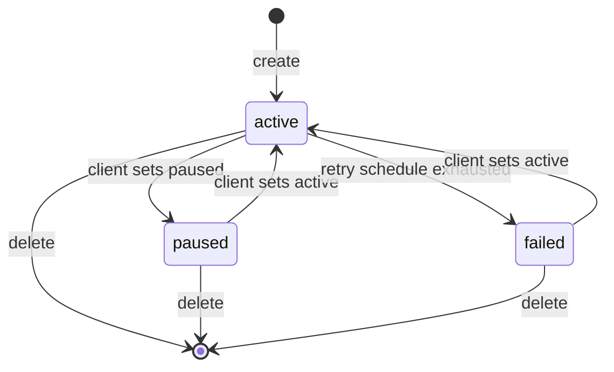

`active` delivers. `paused` is set by the client; matching events are
held for up to 24 hours and delivered in order on resume, and an event
older than that is dropped (APX Part 8 §8.1). `failed` is set only by the
server when the retry schedule is exhausted; a client cannot set it.
While `failed`, the only update accepted is one that sets `status:
active`, which also resets the retry state. Every other update, and the
SSE stream, is refused with 410 `subscription-failed`. Reading the
subscription and its ledger, and deleting it, work in every state.

A secret rotation runs alongside this lifecycle. A new secret joins
`activeKeyIds` and signs every delivery from then on; the old key retires
when the client names it in `retireKeyIds`, or 24 hours after the rotation
(APX Part 8 §8.1, Part 9 §9.4).

#### Relationship to APDS

APDS elements used as they stand: the `/webhooks` route, the APDS
EventSubscription body, the `EventTypeEnum` topics and the `EventData`
shape, together with `Reference`, `DateTime` and `Url`. The stock APDS
response is preserved: a request without `Prefer: return=representation`
receives the APDS `ResponseStatus`, with the new subscription's id in
`ids[]` (APX Part 8 §8.1).

Proposed to APDS: no data element. Delivery is interface behaviour, and
the APX Data Specification proposes data, not interface.

Offered as a suggestion (`docs/apds-change-requests.md`, Part B): event
types in `EventTypeEnum` for access attempts and corrections, so that a
subscriber could hear a lane denial or a corrected read through APDS
events. APX meets that need today with the topics
`apx.credentials.access.v1` and `apx.data.observation.updated.v1`.

APX-only: all schemas in this module (`ApxEventSubscription`,
`ApxEventSubscriptionPatch`, `SubscriptionFilters`, `DeliveryRecord`,
`DeliveryAttempt`, `SubscriptionFailure`). Should APDS later standardize a
delivery contract, the APDS construct wins and APX adopts it (APX Part 3
§3.3(8)).

#### Class diagram

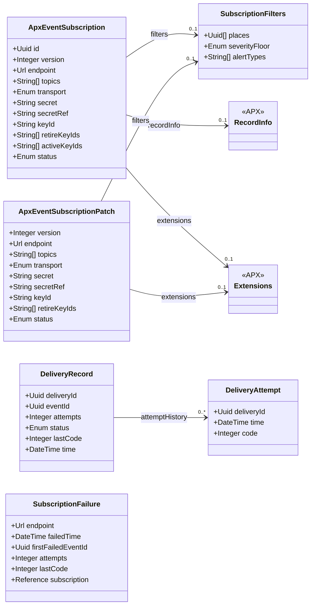

*Figure 4 -- Subscriptions and events. Members of a «proposed» class are proposed to APDS (06, Part D). Classes marked «APDS» are defined in APDS 4.1. Up to 12 attributes are shown per class; 03 Data Dictionary lists them all.*

#### Classes in Subscriptions and events

| Class | Definition | Members | APDS status |
| --- | --- | --- | --- |
| `ApxEventSubscription` | Superset of the APDS 4.1 EventSubscription. A stock APDS client sending only `{endpoint, topics}` (EventTypeEnum values) gets stock behavior; the APX fields are additive and optional. | 14 | APX only |
| `ApxEventSubscriptionPatch` | Body of `PATCH /webhooks/{id}`: a JSON Merge Patch (RFC 7396) over ApxEventSubscription. Members present replace the stored value, an explicit `null` clears an optional member, and absent members are unchanged — so `{"status": "active"}` alone resumes a subscription. `version`, when given, is the precondition (Part 4 §4.2a); a stale one is 409 `version-conflict`. `id`, `activeKeyIds`, and `recordInfo` are server-managed and cannot be patched. | 11 | APX only |
| `DeliveryAttempt` | One delivery attempt of one event to one subscription. | 3 | APX only |
| `DeliveryRecord` | One entry in a subscription's delivery ledger. | 7 | APX only |
| `SubscriptionFailure` | Data of `apx.subscription.failed.v1` (Part 8 §8.3): which subscription stopped, where it was delivering, and the attempt that exhausted the schedule. The envelope `subject` references the same subscription. | 6 | APX only |
| `SubscriptionFilters` | Server-side delivery filtering. | 3 | APX only |

#### Enumerations in Subscriptions and events

| Enumeration | Values |
| --- | --- |
| `ApxEventSubscription.status` | `active`, `paused`, `failed` |
| `ApxEventSubscription.transport` | `webhook`, `sse` |
| `ApxEventSubscriptionPatch.status` | `active`, `paused`, `failed` |
| `ApxEventSubscriptionPatch.transport` | `webhook`, `sse` |
| `DeliveryRecord.status` | `delivered`, `retrying`, `failed` |
| `SubscriptionFilters.severityFloor` | `info`, `warning`, `minor`, `major`, `critical` |

#### External code lists used in Subscriptions and events

| Code list | Entries | Examples |
| --- | --- | --- |
| `apx-alert-types` | 18 | `noCheckOut`, `wrongSpace`, `occupiedWithoutCheckIn`, `iceInEvSpace` |

### 5 Control

*Normative text: APX Part 6. Package: `APX/Control`.*

#### Purpose

The control module is the APX command plane. APDS 4.1 inventories devices
as SupplementalEquipment and marks access-controlled places, but defines
no way to act on them (APX Part 6). This module adds commands against
lanes, devices and places; the lane inquiry a call centre uses as a
screen-pop; the list of venues allowed to validate tickets; the live state
of devices; and two optional features that close an open ticket at the
exit lane: negotiated rates and ticket matching (APX Part 6 §6.6–6.7).

Its conformance class is `apx-control`. The schemas are in
`spec/openapi/domains/control/schemas.yaml`. Every schema refers to APDS
entities rather than copying them.

#### Concepts

##### Command

A **Command** asks for an operational action against a `target`: a
Reference to a SupplementalEquipment (a device) or a HierarchyElement (a
lane or place) (APX Part 6 §6.1). Legacy "location id plus lane number"
addressing maps to the Place and VehicularAccess ids.

- `commandType` is open, from the `apx-command-types` registry:
  `vendGate`, `holdGateOpen`, `closeLane`, `lostTicket`, `pushRate`,
  `applyValidation`, `setDeviceState`, `displayMessage`, `restartDevice`,
  the passback and courtesy commands of Part 17, `pushNegotiatedRate`,
  `matchTicket`, and the charging commands of Part 23 (§6.8).
- `parameters` are normative per type, for example a VersionedReference
  to a RateTable for `pushRate`, or a ticket and provider for
  `applyValidation`.
- `requestedBy` is the organisation. `agent` and `agentType` (`human` or
  `ai`) name the principal who started the command; they are required on
  `pushNegotiatedRate` and `matchTicket`. `reason`, `correlationId` and a
  `resolutionContext` link the command into a customer-service audit
  chain (APX Part 17).
- `approval` carries approval evidence when policy required it. The same
  `Approval` shape is used for domain actions such as refunds (APX Part
  17 §17.3).
- `expiryTime` makes a command perishable: a command not dispatched by
  then becomes `expired` and must not fire. A gate vend requested ten
  minutes ago must not open the gate now.
- `confirmationLevel` says how far success was physically confirmed:
  `accepted`, `deviceAcknowledged` or `physicallyConfirmed`. A consumer
  must not report an outcome stronger than this level.
- `statusHistory[]` is the immutable audit of every transition.

Creating a command requires an `Idempotency-Key`. Refusals the server can
decide from its own state are synchronous errors, and nothing is
dispatched; outcomes only the device can report arrive as `failed` in the
history (APX Part 6 §6.1). A command that succeeds carries a
`CommandResult` naming what it produced: the issued ticket, its Session
and the fee for `lostTicket`; the matched Session and amount for
`matchTicket`; the table version applied for `pushNegotiatedRate`; and,
for `displayMessage`, proof of what the device showed (APX Part 6 §6.1a).

The lost-ticket fee is part of the APDS rate deck: a RateLine described
`lostTicketFee` in the applicable RateTable. With no such line the
command is refused, never guessed (APX Part 6 §6.1).

##### Lane status

**LaneStatus** is the transaction context at a lane now (APX Part 6
§6.2). It composes APDS references and data and adds no parallel
entities. `currentTicket` holds the Session, issue time, amount due,
applied validations (each with the actual amount it removed), the latest
plate read (an APDS Observation reference), any negotiated rate or stated
amount in effect, and the matching command. `monthlyCredential` holds the
credential presented, the access decision and denial reason (registry
`apx-access-denial-reasons`), and recent activity. `matchCandidates[]`
appears when ticket matching applies.

##### Validation provider

A **ValidationProvider** is a venue allowed to validate tickets at a
place, with its `validationType` and nominal `benefit` (APX Part 6 §6.3).
The list is authoritative: an `applyValidation` naming a provider not on
it is refused. Validations are the sanctioned way to adjust one ticket's
amount. When `apx-validations` is claimed, each provider row carries the
`program` it derives from (APX Part 20).

##### Device status

**DeviceStatus** is a live state overlay keyed by a Reference to an APDS
SupplementalEquipment (APX Part 6 §6.4). It never repeats the equipment's
descriptive fields. `deviceState` comes from the `apx-device-states`
registry (`available`, `occupied`, `inoperative`, `outOfService`,
`fault`, `unknown`). APDS 4.1 has a status list only for refill points,
`RefillPointStatusEnum` in the Data Dictionary; APX device states follow
its style and share four of its values. The same object can decorate an
APDS SupplementalEquipment as `apds-ext:apx:devicestatus@1.0`. A
transition to `fault` should raise a `deviceFault` alert.

##### Rate policy and match candidate

**RatePolicy** is the Level B decoration `apds-ext:apx:ratepolicy@1.0` on
an APDS RateTable: `negotiable`, an optional `displayName` and a `note`
(APX Part 6 §6.6). Because it rides inside the table, every consumer that
mirrors `/rates` receives it. `pushNegotiatedRate` applies a flagged
table, or, with the `negotiatedAmounts` feature, a stated amount with a
required reason, to the current ticket at one lane only. The deck itself
never changes. APX sets no selection rules; it requires attribution.

A **MatchCandidate** is an open Session that plausibly belongs to the
vehicle at the lane, found from a plate read, a credential, the account
registry or a reservation (`matchedBy`), with its evidence, confidence and
`amountDueIfMatched` (APX Part 6 §6.7). Candidates are advisory. Only a
`matchTicket` command binds one, and on vend the Session closes in APDS
terms and publishes `SessionUpdated`. APX keeps no parallel matching
store: the match is the Session's exit.

#### Lifecycle

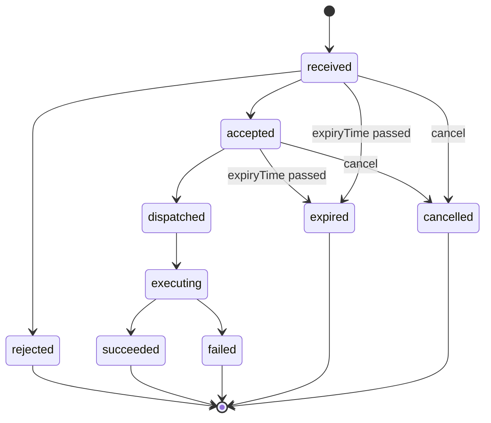

The lifecycle is `received → accepted | rejected → dispatched → executing
→ succeeded | failed | expired | cancelled` (APX Part 6 §6.1). Every
transition appends to `statusHistory[]` and publishes
`apx.control.command.status.v1`. A command can be cancelled until it is
`dispatched`; afterwards cancel is refused with 409
`command-not-cancellable`. A command whose `expiryTime` passes before
dispatch becomes `expired` and never fires. The diagram draws these
rules; the lifecycle stated in Part 6 §6.1 governs.

`holdGateOpen` stays `executing` while the gate is held. It is released by
its own `expiryTime`, by a later `closeLane` at the lane, or by a
`setDeviceState` on the held device, and then becomes `succeeded` with the
cause in `detail`. A dispatched hold is never cancelled.

#### Relationship to APDS

APDS classes used as they stand: SupplementalEquipment (the device),
VehicularAccess and other HierarchyElements (lanes and places), RateTable
and RateLine (the deck, including the lost-ticket fee), Session,
Observation, Credential and RightHolder (as references), and the
datatypes AmountInCurrency, Duration, DateTime, Url, Reference and
VersionedReference. An applied validation should also be recorded in APDS
terms, as a Payment of type `validation` and the Segment's
`validationId`, so APDS consumers see it without speaking APX (APX Part 6
§6.3). A negotiated table is an ordinary RateTable, so the Session segment
references it as it would any other rate.

Proposed to APDS (APX Data Specification, Place and Rates):

| Element | Change | Package | Tier |
| --- | --- | --- | --- |
| `EquipmentStatus` | New class (from `DeviceStatus`) | SupplementalFacility | 1 |
| `EquipmentStatusEnum` | New enumeration (from `apx-device-states`) | SupplementalFacility | 1 |
| `EquipmentTypeEnum` | New values: `barrier`, `gate`, `ticketDispenser`, `intercom` | SupplementalFacility | 1 |
| `RateTable` | Additions to an APDS class: `negotiable`, `negotiatedRateLabel`, `negotiationNote` (from `RatePolicy`) | Rates | 2 |

The proposed `EquipmentStatusEnum` reuses `RefillPointStatusEnum` names
where the meaning is the same. It calls `faulted` and `closed` what the
APX registry calls `fault` and `inoperative`; APX would adopt the APDS
names once agreed. The merchant validation program behind
`ValidationProvider` is proposed with the validations module.

APX-only: `Command`, `CommandResult`, `Approval`, `LaneStatus`,
`ValidationProvider` and `MatchCandidate`. They describe the command
workflow and the lane screen-pop, which are interface rather than data,
and stay in the APX API.

#### Class diagram

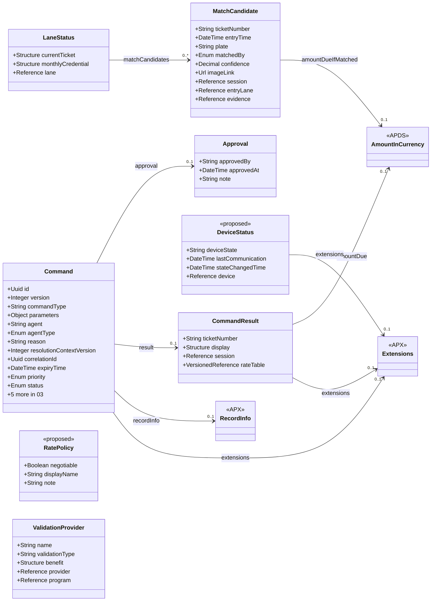

*Figure 5 -- Control. Members of a «proposed» class are proposed to APDS (06, Part D). Classes marked «APDS» are defined in APDS 4.1. Up to 12 attributes are shown per class; 03 Data Dictionary lists them all.*

#### Classes in Control

| Class | Definition | Members | APDS status |
| --- | --- | --- | --- |
| `Approval` | Approval evidence, REQUIRED on a write whose AllowedAction said requiresApproval (Part 17 §17.3). Servers MUST reject a requires-approval action without it (403 approval-required). One shared shape for control commands and domain actions (e.g. refunds). | 3 | APX only |
| `Command` | A request for an operational action against a lane/device/place. Perishable (expiryTime), idempotent (Idempotency-Key), fully audited (immutable statusHistory). | 25 | APX only |
| `CommandResult` | The structured outcome of a command, populated by the server when the command reaches `succeeded` (Part 6 §6.1a) and absent before then. Members are normative per command type: `lostTicket` → `ticketNumber`, `session`, `amountDue`; `matchTicket` → `session`, `amountDue`; `pushNegotiatedRate` → `amountDue`, and `rateTable` when a table was selected (absent for a stated amount, which the lane inquiry reports as `currentTicket.negotiatedAmount`). Other command types leave it absent unless a registry entry says otherwise. It restates what the lane inquiry shows, so a console can continue (print, take payment) without parsing `statusHistory[].detail` or making a second call. | 11 | APX only |
| `DeviceStatus` | Live state overlay keyed by Reference to an APDS SupplementalEquipment — never duplicates its descriptive fields. APDS 4.1 has no general equipment status list: its RefillPointStatusEnum (Data Dictionary A.3.53) covers refill points only and is absent from apds-api-4.1.yaml. deviceState values come from the APX registry apx-device-states, which follows that enumeration's style and shares its available, occupied, inoperative and unknown values. Attachable to APDS payloads as apds-ext:apx:devicestatus@1.0. | 5 | Proposed: EquipmentStatus (Tier 1) |
| `LaneStatus` | The transaction context at a lane right now (the call-center screen-pop). Composes APDS references and data; adds no parallel entities. | 41 | APX only |
| `MatchCandidate` | An open session at the place that plausibly belongs to the vehicle in the lane (Part 6 §6.7). Produced by the lane inquiry from the lane's own LPR read, a presented credential, the account registry (by plate or phone), or a checked-in reservation. Composes APDS references; adds no parallel session store. Advisory until a matchTicket command binds one. | 10 | APX only |
| `RatePolicy` | Level B decoration on an APDS RateTable, carried in its `extensions` container as `apds-ext:apx:ratepolicy@1.0` (Part 6 §6.6). APDS models the rate deck completely; it has no way to say which tables an agent may offer as a negotiated rate. This is that flag — and because it rides inside the RateTable, every consumer mirroring the deck through the native `/rates` route (Part 5 §5.2) receives it with the table, no second query. APX deliberately defines NO selection rules here (length of stay, time of day, caller type): the system presenting the deck to an agent or a third party applies its own guardrails. The server's only rule is enforcement — a pushNegotiatedRate naming a table that is not flagged negotiable is refused (422 rate-not-negotiable). | 3 | Proposed: RateTable (Tier 2) |
| `ValidationProvider` | A venue/organisation allowed to validate tickets at a place. | 9 | APX only |

#### Enumerations in Control

| Enumeration | Values |
| --- | --- |
| `Command.agentType` | `human`, `ai` |
| `Command.confirmationLevel` | `accepted`, `deviceAcknowledged`, `physicallyConfirmed` |
| `Command.priority` | `normal`, `high` |
| `Command.status` | `received`, `accepted`, `rejected`, `dispatched`, `executing`, `succeeded`, `failed`, `expired`, `cancelled` |
| `CommandResult.display.acknowledgedBy` | `player`, `operator`, `none` |
| `MatchCandidate.matchedBy` | `plateRead`, `credential`, `account`, `reservation` |

#### External code lists used in Control

| Code list | Entries | Examples |
| --- | --- | --- |
| `apx-access-denial-reasons` | 11 | `credentialSuspended`, `credentialLost`, `credentialRevoked`, `credentialReplaced` |

### 6 Alerts

*Normative text: APX Part 7. Package: `APX/Alerts`.*

#### Purpose

The alerts module describes operational conditions that need attention:
a faulted device, a blocked lane, an overstay, a vehicle in an EV bay
that is not charging, a watched plate arriving (APX Part 7). APDS 4.1
describes the places, equipment, sessions and rights such conditions
concern, and its Use Case Document lists transaction exceptions and space
statuses an operation must act on (§C.2.2). It has no class for the
condition itself. This domain is net-new, built on the APX common
conventions and delivered over the Part 8 fabric.

Its conformance class is `apx-alerts`. The schemas are in
`spec/openapi/domains/alerts/schemas.yaml`.

#### Concepts

##### Alert

An **Alert** is a versioned, identifiable record of one operational
condition (APX Part 7 §7.1). Its `alertType`, `severity`, `status` and
`detectionTime` are required.

- `alertType` is open. Values come from the `apx-alert-types` registry,
  seeded from the APDS Use Case §C.2.2 exceptions and space statuses, or
  from an implementer's own code list (APX Part 11). Examples are
  `deviceFault`, `occupancyThresholdExceeded`, `evBayNotCharging` and
  `watchListArrival`.
- `severity` is closed: `info < warning < minor < major < critical`, so
  every receiver ranks alerts the same way.
- `source` says where the condition was detected: a `device` (a Reference
  to an APDS SupplementalEquipment) and a `place` (a HierarchyElement
  id). Filtering by place is subtree-inclusive: an alert on a lane matches
  its parent Place.
- `relatedEntity` is the APDS or APX entity the alert concerns, such as a
  Session, an AssignedRight or a Command.
- `occurrenceTime` is when the condition happened; `detectionTime` is
  when the system learned of it. Both are RFC 3339.
- `expiryTime` is the end of the alert's validity window. A client may
  set it on raise, and the server may apply a default per alert type and
  return the value applied.
- `description` is multilingual text.
- `statusHistory[]` is the immutable audit trail: each entry has a state,
  time, actor and optional detail.

The server assigns `id` when the raise carries none. A client may supply
its own UUID; an id that already exists is 409 `id-collision` (APX Part 7
§7.1). Raising requires an `Idempotency-Key`, because device retry storms
must not duplicate alerts; a replay returns the alert as it now stands
(APX Part 7 §7.2).

##### Evidence

When the entity an operator acts on and the evidence for the alert are
different, `relatedEntity` is the entity acted on, and the evidence rides
the alert's `extensions` under `apds-ext:apx:alert-evidence@1.0` as a list
of Observation references (APX Part 7 §7.1). For example, a
`refusedServiceArrival` alert carries the PlateListEntry as
`relatedEntity` and the plate read as evidence, and should reference the
`displayMessage` command whose result proves what the lane showed (APX
Part 7 §7.6). The two EV bay types carry the camera Observation as
evidence (APX Part 7 §7.5).

##### Alerts with no place

An alert whose subject has no place, such as a `webhookDeliveryFailed`
alert about a subscription, carries no `source.place`. It is bound to the
organisation that owns its subject or raised it, is visible to that
organisation's tokens holding `apx.alerts:read` whatever their place
grant, and is excluded from any place-filtered list. Other organisations
never see it (APX Part 7 §7.1).

##### Transitions

`AlertTransition` is the optional body of acknowledge and resolve. Its
`detail` is copied into the history entry the transition appends. Its
`agent` names the human or AI principal acting through the client and is
recorded as that entry's `actor`; authorization is still the token's (APX
Part 7 §7.2).

##### Where alerts come from

Other modules raise alerts as a consequence of their own rules. A device
moving to `fault` should raise `deviceFault` (APX Part 6 §6.4). A
configured occupancy threshold crossing should raise
`occupancyThresholdExceeded` (APX Part 5 §5.5). An exhausted webhook
retry schedule raises `webhookDeliveryFailed` (APX Part 8 §8.3), which
must never itself be delivered to the failed subscription (APX Part 7
§7.4).

#### Lifecycle

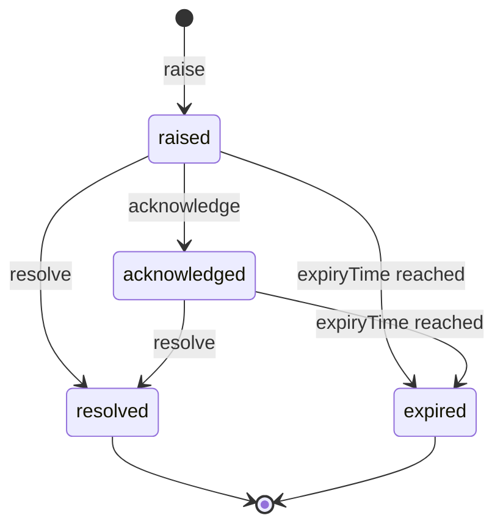

The normal path is `raised → acknowledged → resolved`; `raised →
resolved` directly is permitted (APX Part 7 §7.3). `expired` is a
server-side terminal state: an alert still `raised` or `acknowledged` at
its `expiryTime` becomes `expired`. An alert without an `expiryTime` never
expires. `resolved` and `expired` are terminal and never transition
again. An illegal transition, such as resolving a resolved alert, is 409
`alert-transition-illegal`.

Creation publishes `apx.alert.raised.v1`, and every transition publishes
`apx.alert.status.v1`, with the Alert as `data` (APX Part 7 §7.4).
Subscribers can filter these topics by `severityFloor`, `alertTypes` and
place (APX Part 8 §8.5a).

#### Relationship to APDS

APDS elements used as they stand: SupplementalEquipment (the source
device), HierarchyElements (the source place), any identifiable entity as
`relatedEntity`, Observations as evidence, and the datatypes DateTime,
MultilingualString and Reference. The seed values of the alert types
come from APDS Use Case §C.2.2.

Proposed to APDS, in a new Operations package (APX Data Specification,
Operations):

| Element | Change | Level | Tier |
| --- | --- | --- | --- |
| `Alert` | New class | C | 2 |
| `AlertTypeEnum` | New enumeration | — | 2 |
| `AlertSeverityEnum` | New enumeration | — | 2 |
| `AlertStatusEnum` | New enumeration | — | 2 |

`Alert` is Level C because it adds a new root concept. In the proposal
its link to the place uses `HierarchyElementGeneral`, its link to
equipment uses SupplementalEquipment, and its link to the record it
concerns is a plain Reference. `AlertTypeEnum` carries the APX values
except one: `webhookDeliveryFailed` concerns APX's own delivery systems
rather than the parking operation, so it is not proposed. Alert types
stay open in practice: an operation can publish more in a
`UserDefinedCodeList`. Device status itself is proposed in the Place
domain (see the control module); an alert of type `deviceFault` or
`deviceOffline` draws attention to a change in it.

APX-only: `statusHistory` (audit detail that stays in the APX profile),
`AlertTransition` (an API request body), the
`apds-ext:apx:alert-evidence@1.0` decoration, and the organisation
binding of place-less alerts.

#### Class diagram

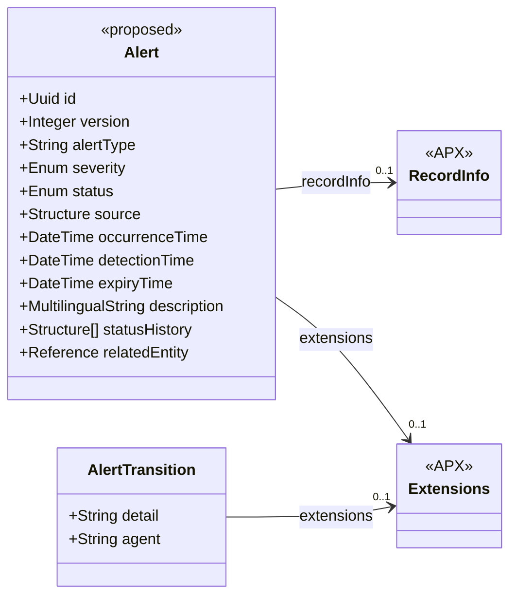

*Figure 6 -- Alerts. Members of a «proposed» class are proposed to APDS (06, Part D). Classes marked «APDS» are defined in APDS 4.1. Up to 12 attributes are shown per class; 03 Data Dictionary lists them all.*

#### Classes in Alerts

| Class | Definition | Members | APDS status |
| --- | --- | --- | --- |
| `Alert` | An operational condition requiring attention. Alert types are OPEN (UserDefinedCodeList `apx-alert-types`, seeded from APDS Use Case C.2.2 transaction exceptions and space statuses); severity is CLOSED. | 20 | Proposed: Alert (Tier 2); Proposed: AlertSeverityEnum (Tier 2); Proposed: AlertStatusEnum (Tier 2) |
| `AlertTransition` | Optional body of `POST /v1/alerts/{id}/acknowledge` and `/resolve` (Part 7 §7.2). Annotates the `statusHistory[]` entry the transition appends. Sending no body is equivalent to sending `{}`. | 3 | APX only |

#### Enumerations in Alerts

| Enumeration | Values |
| --- | --- |
| `Alert.severity` | `info`, `warning`, `minor`, `major`, `critical` |
| `Alert.status` | `raised`, `acknowledged`, `resolved`, `expired` |

#### External code lists used in Alerts

None.

### 7 Accounts and payments

*Normative text: APX Part 13. Package: `APX/Accounts`.*

#### Purpose

The accounts module serves call-centre and back-office work over live
parking state: looking up an account, taking a payment, sending a payment
link, refunding, and writing a payment back to an accounting system (APX
Part 13 §13.1–13.2, §13.6). It is anchored on the APDS Right domain. An
Account is anchored on an APDS RightHolder, and a payment record maps
field by field to the APDS Payment.

Its conformance classes are `apx-accounts` and `apx-payment-history`,
which requires it. The schemas are in
`spec/openapi/domains/accounts/schemas.yaml`. Card capture stays in the
implementer's PCI scope. No APX request carries more than the last four
card digits (APX Part 0 §0.4, Part 13 §13.1).

#### Concepts

##### Account

An **Account** is a billable parking account, such as a monthly parker or
a fleet, anchored on an APDS RightHolder through `holder` (APX Part 13
§13.1). It carries `name`, `phone` and `email` (personal data, returned
only under `apx.accounts:read`), `cardNumber` (an access credential
number, never a payment card number), `plates`, `balance`,
`accountStatus` (`enabled` or `disabled`) and `places`. When the server
claims `apx-credentials`, `credentials` lists the account's credential
records; `cardNumber` and `plates` remain the APDS-only summary.

Lookups by name, phone, email, card or plate return only accounts whose
places fall inside the caller's grant; under an empty grant the answer is
an empty list, never 403, so it never confirms that a record exists
elsewhere (APX Part 13 §13.5). `AccountSearch` carries the same keys in a
request body, so personal data never enters a URL (APX Part 9 §9.6).

##### Payment record

A **PaymentRecord** is the action record of taking a payment:
addressable, idempotent, and able to record outcomes the APDS Payment
cannot, such as a decline (APX Part 13 §13.6). It carries:

- `place`, the required site binding (APX Part 13 §13.5).
- `amount`, `dateCollected` and `transactionID`.
- `meansOfPayment`, the APDS `MeansOfPaymentEnum`, and `channel`, where it
  was captured: `lane`, `payStation`, `agent`, `autoAttendant`, `online`
  or `other`. `autoAttendant` means a PCI-compliant voice system took the
  card out of band.
- `paymentStatus` (`approved`, `declined`, `reversed`) and, for an
  approved payment, `captureStatus` (`captured`, or `authorized` for a
  hold). `captureLater` asks for an authorization only.
- `refundedAmount`, the cumulative amount given back.
- `account` or `ticketNumber`, and `cardLast4`.
- `postings`, the accounting write-backs made.

A declined attempt is still recorded and published. Every recorded
payment, and every later change to its status, amount or refunded amount,
publishes `apx.accounts.payment.recorded.v1` with the full current record
(APX Part 13 §13.4). A hold is kept out of sight of consumers that predate
`captureStatus`: it is not listed unless asked for, not published until
capture, and never materialized as an APDS Payment (APX Part 13 §13.1a).

##### Payment detail

`PaymentDetail` is the Level B decoration
`apds-ext:apx:payment-detail@1.0` (APX Part 13 §13.6a). `lines[]` is the
itemization as APDS `PaymentLine` objects, used by `$ref`. Each line's
code is its `idCode`, from the `apx-payment-line-codes` registry (`base`,
`convenienceFee`, `serviceFee`, `tax`, `discount`, `validation`, `idle`,
`energy`) or an implementer code. A `validation` line is `paymentType:
validation` and records the amount offset, not money collected. The
`payment` lines must sum to `amount`. `rateSold` names the rate sold: its
name, the APDS RateTable at the version applied when the deck is the
source, the `product` and the `class`.

There is one store. `lines` appears only on a PaymentRecord; on a
materialized APDS Payment the lines become the Payment's own
`paymentLines`, and the decoration there carries `rateSold` only. A server
never invents a line it was not given, and an absent fee line means
unknown, not zero.

##### Payment link and posting

A **PaymentLink** is a hosted payment page sent to a customer by SMS or
email for an account, ticket or session (APX Part 13 §13.1a). It is the
customer-service action of first resort when policy blocks a gate
override. It carries the place, the amount, the delivery `channel`, a
masked `sentTo`, `status`, `expiresAt`, and, once paid, the resulting
PaymentRecord. Like a Command, it can carry a `correlationId`, a
resolution context and approval evidence (APX Part 17).
`PaymentLinkCancel` is its cancel body.

A **Posting** is the write-back of an approved, captured payment to a
monthly-parking or receivables system: the confirmation number, whether
the account was updated, the new balance, the target system and the time.
`PostingRequest` is its request body.

##### Payment history

`apx-payment-history` finds the payments made on a ticket or an account
(APX Part 13 §13.2). A query must carry a key: the last four ticket or
card digits, a full ticket number, or an account. A lookup by truncated
digits without a date is limited to the last 8 hours. `PaymentSearch`
carries the same keys in a body. With `mode=change` the route is a change
feed instead, delivering what the payment topic delivers to the same
credential.

#### Lifecycle

The payment states and transitions are normative (APX Part 13 §13.1a).

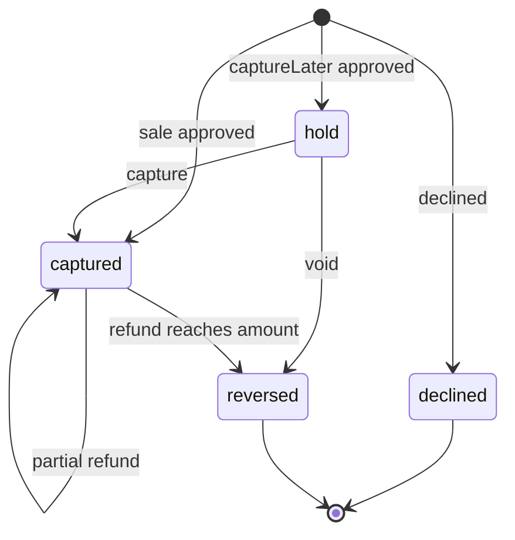

`captured` is `approved` with `captureStatus` captured or absent; `hold`
is `approved` with `captureStatus` authorized. A capture may lower the
amount but not raise it. A void releases the hold and leaves it
`reversed`, with nothing collected. A refund adds to `refundedAmount`;
the record becomes `reversed` when that reaches `amount`. A posting leaves
the state unchanged. Every other action is 409 `payment-state-illegal`,
and `declined` and `reversed` are terminal.

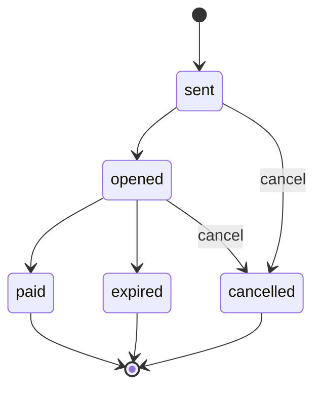

A payment link moves `sent → opened → paid | expired | cancelled`, and
can be cancelled while `sent` or `opened`; from then on the hosted page
accepts no payment. Cancelling a link that is `paid`, `expired` or
`cancelled` is 409 `payment-state-illegal` (APX Part 13 §13.1a).

#### Relationship to APDS

APDS classes used as they stand: RightHolder (the account's holder),
Payment and PaymentLine (the itemization and the materialized record),
RateTable (the rate sold), `MeansOfPaymentEnum`, and the datatypes
AmountInCurrency, DateTime, Reference and VersionedReference. An
implementation that persists APDS Payments must materialize every
approved, captured PaymentRecord as a native Payment, so plain APDS
consumers see the money without speaking APX (APX Part 13 §13.6).
Declined and reversed records exist only on the APX surface, because APDS
has no vocabulary for them.

Proposed to APDS (APX Data Specification, Right and PkCommon):

| Element | Change | Tier |
| --- | --- | --- |
| `RightHolder` | Additions: `accountStatus`, `elementId`, `accountBalance` (from `Account`) | 2 |
| `Payment` | Additions: `paymentStatus`, `captureStatus`, `meansOfPayment`, `paymentChannel`, `elementId`, `refundedAmount` (from `PaymentRecord`) | 2 |
| `AccountStatusEnum`, `PaymentStatusEnum`, `CaptureStatusEnum` | New enumerations | 2 |
| `PaymentTypeEnum` | New values: `convenienceFee`, `serviceFee`, `discount`, `energy`, `idle` | 2 |
| `RateSold` | New class (from `PaymentDetail.rateSold`) | 3 |
| `RateProductEnum`, `RateClassEnum` | New enumerations | 3 |
| `InteractionChannelEnum` | New shared enumeration, used by `Payment.paymentChannel` | 1 |

These let parties exchange declined and reversed payments, uncaptured
authorizations, partial refunds, how and where a customer paid, and which
rate a payment bought, without a second parallel holder or payment record.
The same needs are also listed as suggestions in
`docs/apds-change-requests.md`, Part B, together with an identifiable
RightHolder (erratum 014). Until APDS publishes one, APX refers to a holder
as `{"id", "className": "RightHolder"}` with a local id (APX Part 1 §1.3
item 14).

APX-only: `PaymentLink`, `Posting`, `PostingRequest`,
`PaymentLinkCancel`, `AccountSearch` and `PaymentSearch`. They are
call-centre and accounting operations, not exchanged parking data. The
`ticketNumber`, `cardLast4` and `postings` members of PaymentRecord also
stay on the APX surface (APX Part 13 §13.6).

#### Class diagram

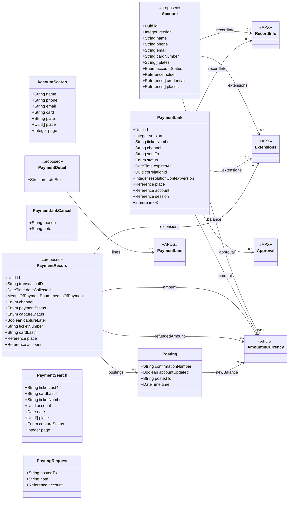

*Figure 7 -- Accounts and payments. Members of a «proposed» class are proposed to APDS (06, Part D). Classes marked «APDS» are defined in APDS 4.1. Up to 12 attributes are shown per class; 03 Data Dictionary lists them all.*

#### Classes in Accounts and payments

| Class | Definition | Members | APDS status |
| --- | --- | --- | --- |
| `Account` | A billable parking account (monthly parker, fleet…), anchored on an APDS RightHolder. | 14 | Proposed: RightHolder (Tier 2); Proposed: AccountStatusEnum (Tier 2) |
| `AccountSearch` | Request body of `POST /v1/accounts:search` (Part 13 §13.1): the same keys as the `GET` lookup, carried in a body so personal data never enters a URL (Part 9 §9.6). | 7 | APX only |
| `PaymentDetail` | The `apds-ext:apx:payment-detail@1.0` decoration (Part 13 §13.6a) on a `PaymentRecord` or an APDS `Payment`: the rate sold and the lines that sum to the total, so revenue reports and the deck price check have the base amount, the fee, and the product without a bilateral code. On a `PaymentRecord` it carries `rateSold` and `lines`; on a native APDS `Payment` it carries `rateSold` only, because the Payment's own `paymentLines` are the itemization there. | 7 | Proposed: RateSold (Tier 3); Proposed: RateProductEnum (Tier 3); Proposed: RateClassEnum (Tier 3) |
| `PaymentLink` | A hosted payment link sent to a customer (Part 13 §13.1a) — the customer-service payment action of first resort. APX carries the link's lifecycle, never card data; the hosted page is the implementer's PCI scope. | 18 | APX only |
| `PaymentLinkCancel` | Request body cancelling a payment link before the customer pays (Part 13 §13.1a). The body is optional; `reason` is recorded on the link's audit trail. | 2 | APX only |
| `PaymentRecord` | A payment taken through APX (maps to the APDS Payment concept; card capture stays in the implementer's PCI scope). | 16 | Proposed: Payment (Tier 2); Proposed: PaymentStatusEnum (Tier 2); Proposed: CaptureStatusEnum (Tier 2) |
| `PaymentSearch` | Request body of `POST /v1/payments:search` (Part 13 §13.2): the same keys and rules as the `GET` lookup, in a body (Part 9 §9.6). | 8 | APX only |
| `Posting` | An accounting write-back of a payment to a monthly-parking/AR system. | 5 | APX only |
| `PostingRequest` | Request body for the accounting write-back of a payment. | 3 | APX only |

#### Enumerations in Accounts and payments

| Enumeration | Values |
| --- | --- |
| `Account.accountStatus` | `enabled`, `disabled` |
| `PaymentDetail.rateSold.class` | `standard`, `validation`, `discount`, `zeroed`, `other` |
| `PaymentDetail.rateSold.product` | `standard`, `pass`, `other` |
| `PaymentLink.status` | `sent`, `opened`, `paid`, `expired`, `cancelled` |
| `PaymentRecord.captureStatus` | `authorized`, `captured` |
| `PaymentRecord.channel` | `lane`, `payStation`, `agent`, `autoAttendant`, `online`, `other` |
| `PaymentRecord.paymentStatus` | `approved`, `declined`, `reversed` |
| `PaymentSearch.captureStatus` | `authorized`, `captured` |

#### External code lists used in Accounts and payments

| Code list | Entries | Examples |
| --- | --- | --- |
| `apx-payment-line-codes` | 8 | `base`, `convenienceFee`, `serviceFee`, `tax` |

### 8 License plate recognition

*Normative text: APX Part 13. Package: `APX/Lpr`.*

#### Purpose

The LPR module makes licence plate reads useful across systems (APX Part
13 §13.3). Ingest is native: LPR vendors post reads to the APDS
`/observations` route, with Confidence and Image, and nothing new is
needed to send them. APX adds what modern recognition engines know beyond
one plate string and one overall score; a way to describe a lane's
cameras; a human review of doubtful reads; and a cross-lookup between
plates, tickets, Observations and Sessions.

Its conformance class is `apx-lpr`. The schemas are in
`spec/openapi/domains/lpr/schemas.yaml`. Two of them are decorations on
APDS entities: `LprReadDetail` on the Observation and `LaneCameras` on the
VehicularAccess.

#### Concepts

##### Read detail

APDS's Observation carries the plate, the vehicle's country, state or
province, make, model and colour, one overall Confidence and a confidence
per character. It has no confidence per attribute, no alternate
candidates, and nothing about how the vehicle moved. APX adds these as the
Level B decoration `apds-ext:apx:lpr-read@1.0` (`LprReadDetail`) in the
Observation's `extensions` container, so a plain APDS consumer still sees
a valid Observation (APX Part 13 §13.3a).

- **Per-attribute reads.** `plate`, `country`, `stateProvince`,
  `plateCategory`, `make`, `model`, `color` and `bodyType` are each an
  `AttributeRead`: a `value` with its own `confidence` on the 0–1 scale.
  The winning values must also appear in the APDS-native fields, so
  APDS-only readers see them. When the engine did not report a country,
  APDS 4.1 cannot form `vehicleAncillaryIdentification`, so make, model
  and colour appear in the decoration only.
- **Alternate reads.** `alternateReads[]` keeps the candidate plates the
  engine rejected, best first.
- **Passage geometry.** These are camera facts: `movement` relative to
  the camera (`toward`, `away`, `stopped`, `unknown`), `frameReads`,
  `platesRead`, `plateFace` (`front`, `rear`, `unknown`), `plateBox` (the
  plate's position as fractions of the frame), and `speed` in km/h when
  measured.
- **Access event.** `accessEvent` (`entry`, `exit`, `unknown`) says
  whether the vehicle was entering or leaving the facility. The LPR system
  reports it; the APX server must not infer it from movement or plate
  face. The LPR system may revise it later, for example after pairing
  reads, and the server then increments the Observation's version and
  publishes `apx.data.observation.updated.v1`.
- `captureGroup` groups the reads of one vehicle's passage, from one
  camera or several; `engine` identifies the recognition engine.

The plate-bearing members are personal data and appear only under
`apx.lpr:*` scopes. The passage facts identify nobody and are also served
under `apx.data:read`, so a counting display can tell an entry from an
exit without learning the plate (APX Part 13 §13.3a(7)).

##### Lane cameras

A lane's LPR cameras are described on its APDS VehicularAccess by the
Level B decoration `apds-ext:apx:lane-cameras@1.0` (`LaneCameras`) (APX
Part 13 §13.3a(5)). Each camera has a `cameraId`, unique within the Place
and equal to `Image.cameraID` on its reads, and `faces`: `inward` (looking
into the facility) or `outward`. Facing is relative to the facility, not
to the lane's mode, so it holds on reversible lanes. The decoration
describes the setup only. APX derives nothing from it, and defines no
notion of wrong-way travel.

##### Reads, passages and Sessions

Each read is one event: one plate seen by one camera, with its access
event. A Session is one complete visit, opened by an entry and closed by
an exit, with times taken from the reads' capture times, never their
arrival times (APX Part 13 §13.3a(6), (8)). How reads are paired into
Sessions is implementation-defined. A pairing engine records which reads
a Session rests on with the session-detail decoration of the data module
(APX Part 5 §5.8), and the server answers "which reads are behind this
Session" from those bindings.

##### The read view

An **LprRead** is one plate read joined with its ticket and Session
context: a projection of one Observation, not a stored resource (APX Part
13 §13.3). It carries the required `place`, the `lane` and `cameraId`
where known, the plate and `confidence`, the `detail`, the `observation`
and `observationDateTime`, the `session`, `imageLink` and every unpurged
image in `images[]`, `purgedImagery`, the customer's `recentReservations`,
and the Observation's other extensions. `laneTravel` is deprecated since
0.12.0 and servers should return `unknown`.

`images[].imageType` is an APDS `ImageTypeEnum` value or one of
`plateExtended` and `context`, carried as strings until APDS adds them
(APX Part 13 §13.3c). When imagery passes its retention it is removed and
`purgedImagery` is set, so "picture purged" is distinguishable from "no
picture taken" (APX Part 13 §13.3b).

A lookup must name a plate, ticket, Observation or Session; it is never a
bulk export, and it returns only reads inside the caller's grant (APX Part
13 §13.3, §13.5). `LprReadSearch` carries the same keys in a request body,
so a plate never enters a URL.

##### Read review

A read the place sends to human review carries `detail.review` with
`state: pending` and its `reasons`, from the `apx-read-review-reasons`
registry (APX Part 13 §13.3a(4a)). A reviewer decides with a
`PlateCorrection`: `confirmed` keeps the engine's values, `corrected`
writes the given plate, country and state into the APDS fields and the
decoration, and `rejected` marks the read unusable for pairing and
enforcement. On the first correction the server keeps the engine's values,
with their confidences, in `review.original`, and never changes them
afterwards. A Violation cannot be issued while any of its evidence reads
is `pending` or `rejected` (APX Part 19 §19.4 rule 6).

#### Lifecycle

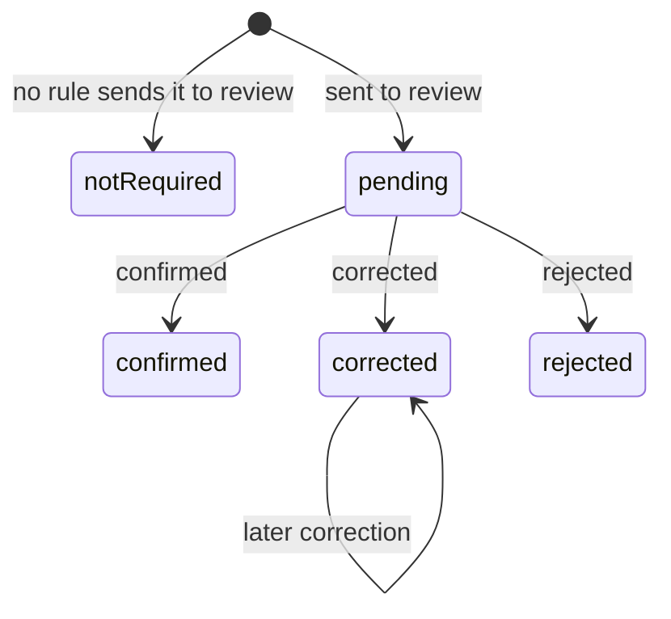

This is the lifecycle of `detail.review.state` (APX Part 13 §13.3a(4a)).
A read no rule sent to review is `notRequired` or carries no `review`. A
review decision is made through `PUT /v1/lpr/reads/{observation}/plate`.
Every decision that changes the read sets the state, `decidedTime` and
`decidedBy`, increments the Observation's version and publishes
`apx.data.observation.updated.v1`; resending the same decision and values
changes nothing. A later correction replaces the current values but never
`review.original`. `corrected` without a plate, or plate values with any
other decision, is 422 `request-unprocessable`. The review queue itself,
including assignment and ordering, stays private to the implementation.

#### Relationship to APDS

APDS classes used as they stand: ObservationElement (with its
Confidence, CharacterConfidence, Image and VehicleAncillaryIdentification),
VehicularAccess (the lane), Session, `ImageTypeEnum`, and the datatypes
DateTime, Reference and Url. APDS 4.1 has no route that returns or
replaces one Observation by id; APX adds read-back and revision routes
under `/v1/lpr/reads/{observation}` (APX Part 13 §13.3, §13.3a(4)).

Proposed to APDS (APX Data Specification, Observation and Place):

| Element | Change | Tier |
| --- | --- | --- |
| `ObservationElement` | Additions: `accessDirection`, `movement`, `plateFace`, `speed`, and associations to the classes below | 1 |
| `AttributeRead`, `AlternateRead` | New classes | 1 |
| `ReadAttributeEnum`, `VehicleMovementEnum` | New enumerations | 1 |
| `ReadReview` | New class | 2 |
| `Image` | Addition: `plateRegion` | 2 |
| `ImageRegion` | New class (from `plateBox`) | 2 |
| `ImageTypeEnum` | New values: `plateExtended`, `context` | 2 |
| `PlateFaceEnum`, `ReadReviewStateEnum`, `ReadReviewReasonEnum` | New enumerations | 2 |
| `VehicularAccess` | Addition: `laneCamera` | 2 |
| `LaneCamera` | New class | 2 |
| `CameraFacingEnum` | New enumeration | 2 |

In the proposal the access event reuses the APDS `AccessTypeEnum`, with
its values `entry` and `exit`, as `accessDirection`. The recognized values
stay where APDS 4.1 puts them, and each AttributeRead repeats one with
its own confidence. Separately, outside these additions, APX suggests
making `VehicleAncillaryIdentification.country` optional, so a read with
no plate country could still carry make, model and colour. Reading and
correcting one Observation by id is also offered as a suggestion
(`docs/apds-change-requests.md`, Part B).

APX-only: `LprRead` (a projection for lookups), `LprReadSearch` and
`PlateCorrection` (request bodies), and the deprecated `laneTravel`. The
decoration members `captureGroup`, `frameReads`, `platesRead` and `engine`
are not part of the proposal and remain in the APX decoration.

#### Class diagram

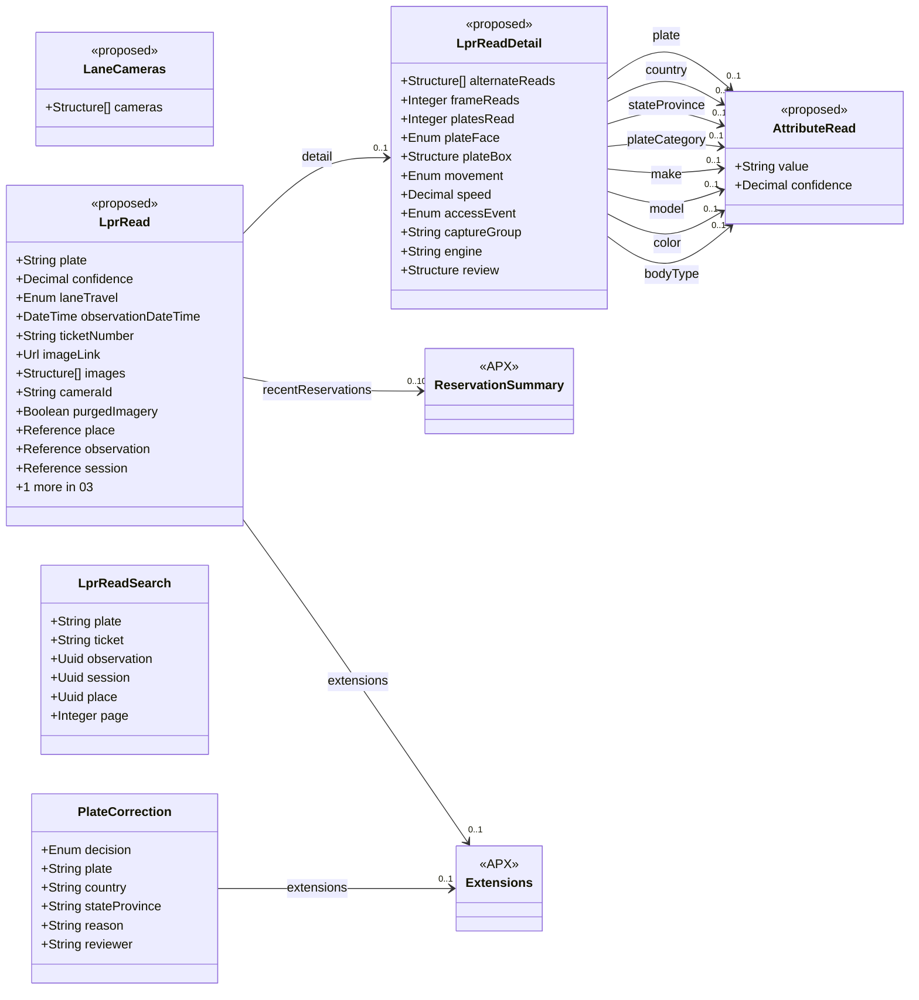

*Figure 8 -- License plate recognition. Members of a «proposed» class are proposed to APDS (06, Part D). Classes marked «APDS» are defined in APDS 4.1. Up to 12 attributes are shown per class; 03 Data Dictionary lists them all.*

#### Classes in License plate recognition

| Class | Definition | Members | APDS status |
| --- | --- | --- | --- |
| `AttributeRead` | One recognized attribute with its own confidence (0–1, APDS Confidence scale). | 2 | Proposed: AttributeRead (Tier 1) |
| `LaneCameras` | The LPR cameras on a lane and which way each one faces (Part 13 §13.3a(5)). Carried on an APDS VehicularAccess as the Level B decoration `apds-ext:apx:lane-cameras@1.0` in its `extensions` container (Part 4 §4.3). Facing is relative to the facility, not to the lane's mode, so it holds on `reversible` lanes. Describes the setup only; APX derives nothing from it. | 3 | Proposed: VehicularAccess (Tier 2); Proposed: LaneCamera (Tier 2); Proposed: CameraFacingEnum (Tier 2) |
| `LprRead` | One plate read joined with its ticket/session context. | 20 | Proposed: ImageTypeEnum (Tier 2) |
| `LprReadDetail` | What a modern LPR camera knows beyond the plate string and one overall score (Part 13 §13.3a). Carried on the ingested APDS Observation as the Level B decoration `apds-ext:apx:lpr-read@1.0` in its `extensions` container (Part 4 §4.3 — plain APDS consumers ignore it), and projected on `LprRead.detail` and `PlateCandidate.detail`. Every field optional; each recognized attribute carries its own confidence. APDS's `vehicleAncillaryIdentification` (country, stateProvince, make, model, color) remains the APDS-visible copy of the winning values; this block adds the per-attribute confidence, the candidates that lost, and the passage geometry APDS has no fields for. | 34 | Proposed: ObservationElement (Tier 1); Proposed: AlternateRead (Tier 1); Proposed: ReadReview (Tier 2); Proposed: Image (Tier 2); Proposed: ImageRegion (Tier 2); Proposed: ReadAttributeEnum (Tier 1); Proposed: VehicleMovementEnum (Tier 1); Proposed: PlateFaceEnum (Tier 2); Proposed: ReadReviewStateEnum (Tier 2) |
| `LprReadSearch` | Request body of `POST /v1/lpr/reads:search` (Part 13 §13.3): the same keys as the `GET` lookup, carried in a body so a plate never enters a URL that proxies and access logs keep (Part 9 §9.6). At least one of `plate`, `ticket`, `observation`, or `session` is REQUIRED. | 6 | APX only |
| `PlateCorrection` | Request body of `PUT /v1/lpr/reads/{observation}/plate` (Part 13 §13.3a(4a)): a reviewer's decision on one read. `confirmed` keeps the engine's values; `corrected` replaces them with the ones given; `rejected` marks the read unusable for pairing and enforcement. `plate`, `country`, and `stateProvince` belong to `corrected` only: sent with another decision they are 422 `request-unprocessable`. | 7 | APX only |

#### Enumerations in License plate recognition

| Enumeration | Values |
| --- | --- |
| `LaneCameras.cameras.faces` | `inward`, `outward` |
| `LprRead.laneTravel` | `withLane`, `againstLane`, `unknown` |
| `LprReadDetail.accessEvent` | `entry`, `exit`, `unknown` |
| `LprReadDetail.movement` | `toward`, `away`, `stopped`, `unknown`, `approaching`, `receding` |
| `LprReadDetail.plateFace` | `front`, `rear`, `unknown` |
| `LprReadDetail.review.state` | `pending`, `confirmed`, `corrected`, `rejected`, `notRequired` |
| `PlateCorrection.decision` | `confirmed`, `corrected`, `rejected` |

#### External code lists used in License plate recognition

| Code list | Entries | Examples |
| --- | --- | --- |
| `apx-read-review-reasons` | 6 | `lowConfidence`, `noConfidence`, `jurisdictionRequiresReview`, `ambiguousCharacters` |

### 9 Reservations and permits

*Normative text: APX Part 14. Package: `APX/Reservations`.*

#### Purpose

This module covers reservations and permits. Both are thin profiles over
the APDS Right domain. APX defines no separate booking or permit entity.
A reservation is an APDS AssignedRight with a small extension that holds
its state. A permit is an APDS AssignedRight issued from a pooled
RightSpecification (APX Part 14).

The aim is that a stock APDS lane or enforcement client can honour a
reservation or permit without knowing anything about APX. APX adds only
what APDS does not yet hold: the state of a reservation, the link to the
Session that used it, the renewal chain of a permit, and a limit on how
many of a permit's vehicles may park at once.

#### Concepts

##### Reservation

A reservation is an AssignedRight that carries the
`apds-ext:apx:reservation@1.0` extension (ReservationExtension). The
presence of the extension marks the right as a reservation (APX Part 14
§14.1). The extension holds:

- `reservationState`: confirmed, amended, checkedIn, cancelled or noShow.
- `plannedStart` and `plannedEnd`: mirrors of the APDS PlannedUse.
- `checkInSession`: the Session that used the reservation.
- `noShowAfter`: a server-set instant after which an unused reservation
  becomes a no-show.

The APDS PlannedUse is authoritative for the planned times.
`plannedUses[0].startTime` and `endTime` win. The extension's mirrors
MUST match them on every write. When the two disagree, the server applies
the PlannedUse and rewrites the extension. So a plain APDS client that
edits the PlannedUse still moves the reservation (APX Part 14 §14.1).

The whole flow uses native APDS routes and classes. A quote is an APDS
QuoteRightRequest and QuoteRightResponse. Booking creates the
AssignedRight. The plate on file is a CredentialAssigned of type
`licensePlate` under `rightHolder.credentials[]`. Cancelling sets
`plannedUses[0].cancelTime`. A no-show sets `plannedUses[0].expiryTime`.

##### Check-in and the link to a Session

Check-in is the creation of an APDS Session whose Segment references the
AssignedRight. This is the normative link (APX Part 14 §14.1, step 5). At
LPR sites the plate usually makes the link. Where it cannot (barcode-only
reservations, unreadable plates), an explicit link binds the Session to
the AssignedRight. The link MUST land in the APDS Session as
`segments[].assignedRight` and be visible to plain APDS clients. A link
is never silently replaced; an audited unlink, with a reason, is the only
undo (APX Part 14 §14.1b).

##### Permit

A permit is an AssignedRight issued from a RightSpecification that has
`rightPools`. One permit may carry many vehicle credentials, following
the APDS annual-permit pattern of one right, many vehicles (APX Part 14
§14.2). The issue request maps onto native classes (APX Part 14 §14.2b):

- the holder becomes a CustomerCredential in `rightHolder.credentials[]`;
- each vehicle becomes a VehicleCredential in the same list;
- the validity becomes one PlannedUse, with `expiry` at its end.

The pool slot belongs to the right, not to a vehicle. Adding or removing
a vehicle never consumes or returns a slot. Cancellation or expiry
returns the slot to the APDS RightPool (APX Part 14 §14.2c).

**PoolAvailability** is a read view over one APDS RightPool: `issued` is
`distributedAssignedRights`, `available` is `availableAssignedRights`,
and `capacity` is their sum. An operator that sells above its space
count MAY also report `spaces`.

**PermitExtension** (`apds-ext:apx:permit@1.1`) links a renewal to the
permit it renews (`renews`, and the server-set `renewedBy`). It also
holds `maxConcurrentVehicles` and `overageBilling`. A vehicle that
arrives while the limit is reached is an overage. Its stay is an ordinary
Session. `overageBilling.mode` is `rack`, `dayRate` or `none` (APX Part
14 §14.2d).

##### Customer identity is local

APX assumes no central catalogue of users. RightHolder identifiers are
local to the system that issued them. A caller correlates customers
across systems by the strongest credential it has: a plate on file,
camera reads, or a ticket number (APX Part 14 §14.1a).
**ReservationSummary** is the compact view returned by history lookups
and carried by the no-show event.

#### Lifecycle

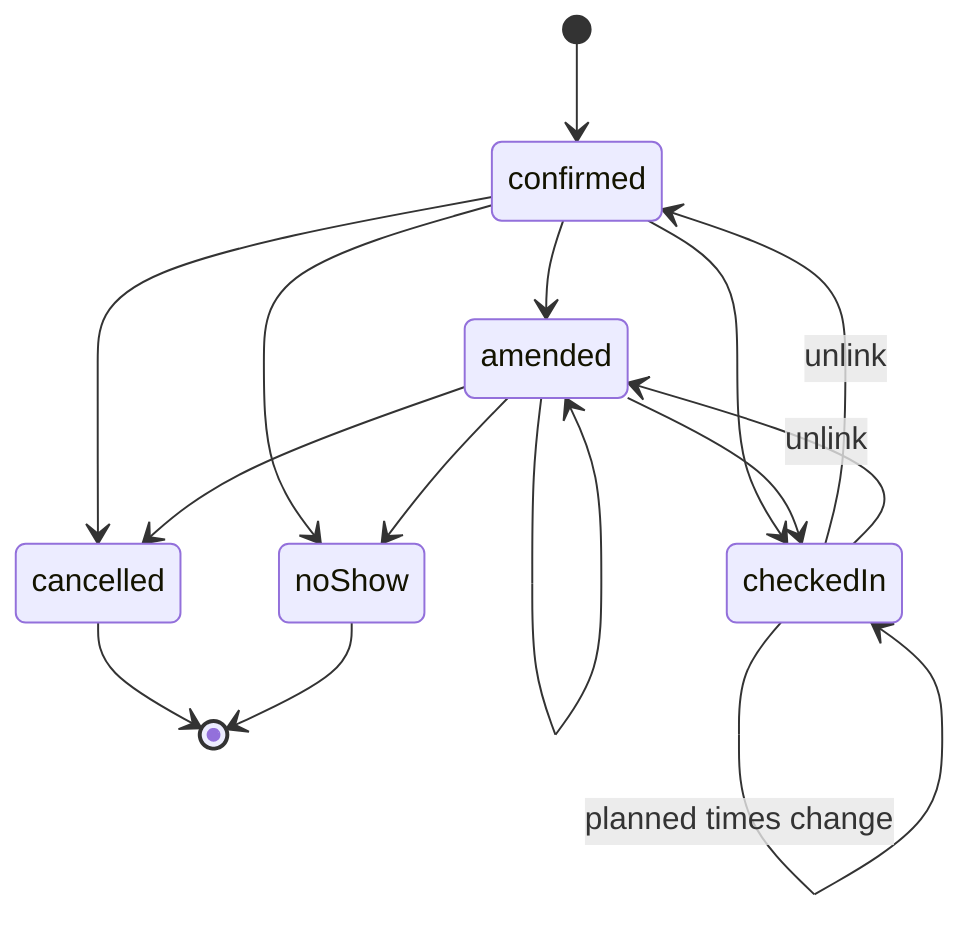

The transition table in APX Part 14 §14.1 is normative. A booking starts
`confirmed`. An amendment before check-in sets `amended`. Creating the
Session sets `checkedIn`. An amendment after check-in changes only the
planned times; the state stays `checkedIn`. The only way back from
`checkedIn` is the audited unlink of §14.1b, which returns the
reservation to its pre-check-in state. `noShow` follows when
`noShowAfter` passes with no check-in. `cancelled` and `noShow` are
terminal. Any other transition is refused with 409.

A permit has no state machine of its own in APX. It is active within its
PlannedUse and ends at `expiry` or on cancellation (APX Part 14 §14.2c).

#### Relationship to APDS

APDS classes used as they stand: AssignedRight, PlannedUse,
RightSpecification, RightPool, RightHolder, CredentialAssigned
(CustomerCredential and VehicleCredential), QuoteRightRequest and
QuoteRightResponse, Payment, and Session with its Segments.

Proposed to APDS, as Level B additions to AssignedRight in the Right
package (see the APX Data Specification):

| Element | Change | Tier |
| --- | --- | --- |
| `AssignedRight` (`reservationState`, `checkInSessionId`, `noShowTime`, `renewsAssignedRightId`, `renewedByAssignedRightId`, `maxConcurrentVehicles`, `overageBilling`) | Additions to an APDS class | 2 |
| `OverageBilling` | New class | 2 |
| `ReservationStateEnum` | New enumeration | 2 |
| `OverageBillingModeEnum` | New enumeration | 2 |

The proposal keeps the PlannedUse authoritative for planned times. The
existing APDS ReservationTypeEnum is unrelated and unchanged.

APDS 4.1's AssignedRight declares no `extensions` container. APX carries
its extension keys there regardless, and lists this as an item for
reconciliation with APDS (APX Part 14 §14.2).

APX-only: PoolAvailability, PermitIssueRequest and ReservationSummary.
They are request and view shapes over APDS data, not new data, so they
are not proposed. The waitlist is not standardised at all (APX Part 14
§14.2).

#### Class diagram

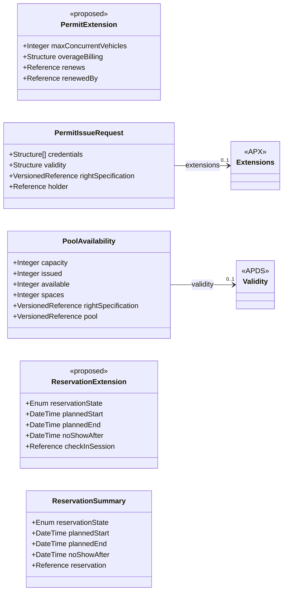

*Figure 9 -- Reservations and permits. Members of a «proposed» class are proposed to APDS (06, Part D). Classes marked «APDS» are defined in APDS 4.1. Up to 12 attributes are shown per class; 03 Data Dictionary lists them all.*

#### Classes in Reservations and permits

| Class | Definition | Members | APDS status |
| --- | --- | --- | --- |
| `PermitExtension` | The `apds-ext:apx:permit@1.1` extension object (Part 14 §14.2; `@1.0` remains valid and carries the first two members only): links a renewal permit to the one it renews, so a portal can follow the chain, and caps how many of a multi-vehicle permit's vehicles may be parked at once (§14.2d). | 6 | Proposed: OverageBilling (Tier 2); Proposed: OverageBillingModeEnum (Tier 2) |
| `PermitIssueRequest` | Issue a permit from a pooled RightSpecification — creates a native AssignedRight with (possibly multiple) vehicle credentials, per the APDS annual-permit use case (one right, multiple vehicles). | 10 | APX only |
| `PoolAvailability` | Availability of one RightPool of a pooled RightSpecification (APDS RightPool profile, Part 14 §14.2). `issued` = `RightPool.distributedAssignedRights`, `available` = `RightPool.availableAssignedRights`, `capacity` = their sum. | 7 | APX only |
| `ReservationExtension` | The apds-ext:apx:reservation@1.0 extension object attached to a native AssignedRight. Presence of this extension marks the AssignedRight as a reservation; state transitions follow Part 14 §14.1 (transition table). `plannedStart`/`plannedEnd` MUST mirror the AssignedRight's `plannedUses[0].startTime`/`endTime`, which is authoritative. | 5 | Proposed: AssignedRight (Tier 2); Proposed: ReservationStateEnum (Tier 2) |
| `ReservationSummary` | Compact view of one past/current reservation, for customer-history lookups. Also the `data` of `apx.reservation.noshow.v1` (Part 14 §14.1 step 6). | 5 | APX only |

#### Enumerations in Reservations and permits

| Enumeration | Values |
| --- | --- |
| `PermitExtension.overageBilling.mode` | `rack`, `dayRate`, `none` |
| `ReservationExtension.reservationState` | `confirmed`, `amended`, `cancelled`, `checkedIn`, `noShow` |
| `ReservationSummary.reservationState` | `confirmed`, `amended`, `cancelled`, `checkedIn`, `noShow` |

#### External code lists used in Reservations and permits

None.

### 10 Tolling

*Normative text: APX Part 15. Package: `APX/Tolling`.*

#### Purpose

This module covers toll charges. It is the one net-new surface in APX:
APDS 4.1 has no toll entities (APX Part 15). APDS already holds every
ingredient of a toll charge: the read of the vehicle, the equipment at
the toll point, the amount and the payment. What it lacks is the record
that ties them into one charge that a customer can pay or dispute.

The TollTransaction is that record. It is still built entirely to APDS
conventions. The toll point is an APDS SupplementalEquipment. The reads
are native APDS Observations. Money is AmountInCurrency. Settlement is a
reference to an APDS Payment.

#### Concepts

##### Toll transaction

A **TollTransaction** is a versioned, identifiable record of one toll
charge (APX Part 15 §15.1). It holds:

- `tollPoint`: a reference to the SupplementalEquipment that charged the
  vehicle.
- `observations`: references to the APDS Observations the charge was
  built from (plate or transponder reads).
- `credential`: the credential as read. `credentialType` SHOULD be an
  APDS CredentialTypeEnum value, such as `licensePlate` or `rfid`.
  `credentialIdentification` is the plate string or tag id as read.
- `pricing`: the amount owed.
- `payment`: a reference to the settling APDS Payment, or APX
  PaymentRecord (APX Part 13).
- `transactionStatus`: where the charge is in its lifecycle.
- `dispute`: the open or resolved dispute, if any.
- `statusHistory`: the immutable audit of every transition (APX Part 4
  §4.2).

Gantries retry. So creating a transaction requires an Idempotency-Key,
and a replay returns the transaction the key created (APX Part 15 §15.2).
A transaction may be created already priced, or created unpriced and
priced later by an external pricing engine.

##### Dispute

A **dispute** is a challenge to a priced or paid charge. The operator
opens it, either on the holder's behalf or on its own initiative.
`disputedBy` names the party (RightHolder, Organisation or Contact) on
whose behalf it was raised; it may be absent when the operator raised it.
APX v1 defines no customer-channel dispute scope (APX Part 15 §15.1).

The base reasons are `wrongVehicle`, `duplicateCharge`, `wrongClass`,
`notLiable` and `other`. The base resolutions are `upheld` (the charge
stands), `refunded` (money returned), `adjusted` (a new amount is owed)
and `withdrawn` (the disputing party abandoned it). Both lists are
registered code lists (`apx-toll-dispute-reasons`,
`apx-toll-dispute-resolutions`); implementers MAY add codes (APX Part 11).

An `adjusted` resolution MUST carry the new amount. The server replaces
`pricing` with it and keeps the old amount in `dispute.originalPricing`.
This is the only way `pricing` changes after a charge is priced.

A paid charge is never voided. It is corrected by a dispute resolved
`refunded`; the refund itself is an APX Part 13 refund.

#### Lifecycle

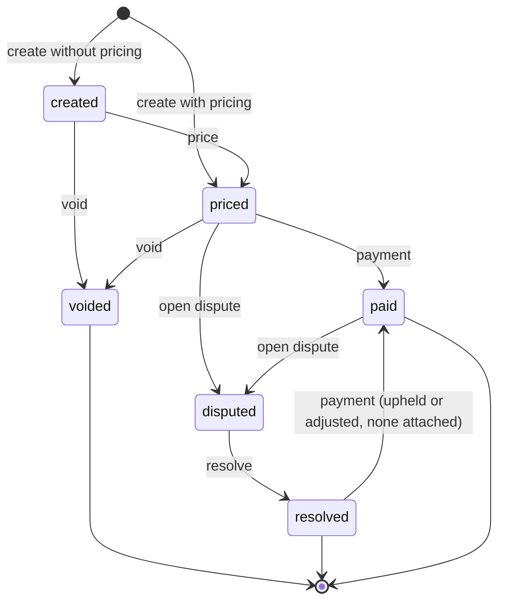

The transition table in APX Part 15 §15.1 is normative. Any other move is
refused with `toll-transition-illegal` and changes nothing.

- A transaction created with `pricing` starts `priced`; otherwise
  `created`.
- Only `created` and `priced` can be voided. `voided` is terminal.
- A payment settles a `priced` charge. It also settles a `resolved` one
  whose resolution was `upheld` or `adjusted` and which has no payment
  attached yet. Re-attaching the same payment is a no-op; a different one
  is refused.
- A dispute can be opened only on a `priced` or `paid` charge. A
  resolved dispute cannot be reopened (`dispute-closed`).
- A `refunded` transaction takes no further payment.

Every transition publishes `apx.tolling.transaction.status.v1` (APX Part
15 §15.3).

#### Relationship to APDS

APDS classes used as they stand: SupplementalEquipment (the toll point),
ObservationElement (the reads), Payment (settlement), RightHolder,
Organisation and Contact (the disputing party), and the AmountInCurrency
datatype. The credential type reuses the APDS CredentialTypeEnum. Toll
reads themselves flow as ordinary APDS Observation data.

Proposed to APDS, in a new `Tolling` sub-package of the Observation
package, as Level B additions (see the APX Data Specification):

| Element | Change | Tier |
| --- | --- | --- |
| `TollTransaction` | New class | 2 |
| `TollDispute` | New class | 2 |
| `TollTransactionStatusEnum` | New enumeration | 2 |
| `TollDisputeReasonEnum` | New enumeration | 2 |
| `TollDisputeResolutionEnum` | New enumeration | 2 |

In the proposal the credential read is carried as a PresentedCredential,
the class proposed in the Right domain for any credential value that is
not an assigned credential. The dispute reasons and resolutions are
maintained by APX today as user-defined code lists. They could equally be
typed as PkCommon ReferencedCodeListEntry, with these values as the
recommended initial list. That choice is left to the APDS committee.

APX-only: `statusHistory` is audit detail and stays in the APX profile.
The request bodies (TollPricing, TollPaymentAttachment, TollVoid,
TollDisputeOpen, TollDisputeResolution) are API operations, not data, and
are not proposed. The void reason is an implementer code list.

#### Class diagram

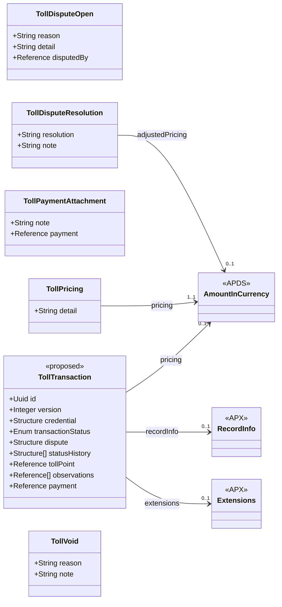

*Figure 10 -- Tolling. Members of a «proposed» class are proposed to APDS (06, Part D). Classes marked «APDS» are defined in APDS 4.1. Up to 12 attributes are shown per class; 03 Data Dictionary lists them all.*

#### Classes in Tolling

| Class | Definition | Members | APDS status |
| --- | --- | --- | --- |
| `TollDisputeOpen` | Request body opening a dispute on a toll transaction. | 3 | APX only |
| `TollDisputeResolution` | Request body resolving an open dispute. | 3 | APX only |
| `TollPaymentAttachment` | Request body attaching the settling Payment to a toll transaction. | 2 | APX only |
| `TollPricing` | Request body pricing a `created` toll transaction (Part 15 §15.1), for operators whose pricing engine runs outside the APX server. | 2 | APX only |
| `TollTransaction` | A toll charge assembled from plate/transponder reads: Observation refs → pricing → Payment ref, with a dispute lifecycle. | 24 | Proposed: TollTransaction (Tier 2); Proposed: TollDispute (Tier 2); Proposed: TollTransactionStatusEnum (Tier 2) |
| `TollVoid` | Request body voiding a toll transaction that should never have been charged (Part 15 §15.1). | 2 | APX only |

#### Enumerations in Tolling

| Enumeration | Values |
| --- | --- |
| `TollTransaction.transactionStatus` | `created`, `priced`, `paid`, `disputed`, `resolved`, `voided` |

#### External code lists used in Tolling

| Code list | Entries | Examples |
| --- | --- | --- |
| `apx-toll-dispute-reasons` | 5 | `wrongVehicle`, `duplicateCharge`, `wrongClass`, `notLiable` |
| `apx-toll-dispute-resolutions` | 4 | `upheld`, `refunded`, `adjusted`, `withdrawn` |

### 11 Violations and enforcement

*Normative text: APX Part 19. Package: `APX/Violations`.*

#### Purpose

This module covers enforcement: what operators variously call tickets,
notices, warnings and citations, under one record, the **Violation**
(APX Part 19). APDS 4.1 has no violation entity, so this is a net-new
surface. But APDS already holds the pieces enforcement needs, and APX
builds on them rather than beside them.

Eligibility comes from the APDS AssignedRight, which the APDS text calls
"the most important source of information for connected enforcement
systems to check the eligibility of a parked vehicle". Evidence is the
APDS Observation and Image. The location is a HierarchyElement. Money is
AmountInCurrency, and settlement links an APDS Payment. Identity reuses
the APDS Enforcement Provider (`ep`) role. The module adds the finding
itself, its lifecycle, the rules that govern issuing it, and the signs
that gave notice.

#### Concepts

##### Violation

A **Violation** is a versioned, identifiable finding that a vehicle at a
place was not covered by a valid right. One record carries the whole
story (APX Part 19 §19.1):

- `violationType`, from the `apx-violation-types` registry or an
  implementer code list, and `violationStatus`;
- `place` (any HierarchyElement) and optionally `space`;
- `detection` (how it was found), `vehicle` (the credential and its
  jurisdiction) and `location`;
- `observations[]` and `evidence[]`: references to APDS Observations and
  access-controlled image links, never inline media (APX Part 9 §9.6);
- `eligibilityCheck`: the eligibility answer at detection time;
- `relatedSession` and `relatedRight`;
- `notice`: what was issued;
- `amount`, `dueTime`, `payments[]`, `amountPaid` and `payment`;
- `appeal`;
- `policy` and `signage[]`: frozen at issue;
- `amountHistory[]` and the immutable `statusHistory[]`.

##### Detection

A **ViolationDetection** records how the violation was found. Its `mode`
is one of three (APX Part 19 §19.4):

- `automated`: a camera or sensor pipeline finds it. It MUST carry at
  least one observation or evidence link, and SHOULD carry a confidence
  and the rule that fired.
- `guided`: the system surfaces a candidate and an officer decides on
  site. It MUST be reviewed by a human before issue.
- `manual`: an officer finds it. The officer still confirms it, so every
  issued violation has a `confirmed` entry with an actor.

The mode matters because many jurisdictions allow an automated finding
to be issued only after review, or only by post. The detector and the
officer are opaque strings; APX implies no personnel directory.

##### Eligibility check

An **EligibilityResult** answers "is this vehicle entitled to be here
right now, and by what?" (APX Part 19 §19.3). It lists every
AssignedRight and Session considered as `basis[]`, each with a status:
`valid`, `expired`, `notYetValid`, `wrongPlace`, `consumed` or
`suspended`. It may give an advisory `suggestedViolationType`, a
`graceUntil` and the latest plate read.

The answer MUST be derivable from the APDS entities the server holds. A
client could compute it from the native routes, and the AssignedRight
stays authoritative where they disagree. A right bound to an ancestor of
the place (a campus permit) covers it; one bound to a sibling is
`wrongPlace`. Evaluation at a past instant uses the rights as they were
then.

##### Notice, payment and appeal

The **notice** records what was issued: kind (warning, notice,
citation), notice number, issue time, issuer and delivery method. The
notice number is how drivers, agencies and courts refer to a violation.

This module never takes money (APX Part 19 §19.6). `amount` is what is
owed. Each payment applied is a **ViolationAppliedPayment** that raises
`amountPaid`; `paid` means `amountPaid` reaches `amount`. A part payment
leaves the violation `issued` (APX Part 19 §19.6a). The money itself moves
through APX Part 13 or an APDS Payment.

The **appeal** records one challenge per violation: reason, appellant,
the state it was opened from, and its resolution, `upheld`, `reduced`
(with a new amount) or `dismissed`. A driver may pay and then appeal
within the policy's appeal window; a refund on such an appeal is a Part
13 refund, recorded as `appeal.refund`.

`amount` changes only at issue, through an appeal reduction, or through
a server-applied escalation step. Every change is appended to
`amountHistory[]`, and `amount` always equals its last entry.

##### Location

**ViolationLocation** is modelled on the APDS `Observation.Location`
shape and reuses its member names and types: `observedLocation`,
`observerLocation` and `observedLocationTextual`. It differs in two
ways: `observerLocation` is optional (a fixed sensor may have none) and
APX adds `accuracyMetres`. GeoJSON positions are longitude first (APX
Part 19 §19.9).

##### Enforcement policy

An **EnforcementPolicy** is a machine-readable summary of the rules that
govern issuing a violation at a place (APX Part 19 §19.10). The operator
configures it from the governing statute, cited in `authority`. It is
never the statute itself. It binds to a HierarchyElement and applies to
its subtree; the policy in force is the nearest active ancestor-or-self
policy whose effective window covers the instant. It holds:

- `deliveryRules[]`: which delivery methods are lawful for which
  detection modes, the notice deadline, the minimum evidence, and whether
  a location is required;
- `unreviewedIssuance`: whether, and above what confidence, an automated
  detection may be issued without review;
- `penaltyCap`: absolute and relative ceilings on the issued amount,
  with `onExceed` `refuse` or `clamp`;
- `escalation[]` and `overallCeiling`: server-applied penalty steps;
- `appealWindowDays`, `paymentGraceDays` and `signageRequired`.

The policy is binding on the server, as allowed actions are in APX Part
17. At issue the server checks the violation against it and refuses what
it forbids. On success it freezes the policy version, the signage in
force, the unpaid fee and the cap onto the violation, so a later change
does not alter what applied. Escalation steps fire once each, after their
number of days, and the clock pauses during an appeal. Clients MUST NOT
compute penalties themselves.

##### Signage

**Signage** records what was posted at a place: the verbatim text, a
photo, the sign's location, its type and the window it was in force (APX
Part 19 §19.11). Notice-and-signage laws make the posted sign evidence,
as much as the plate photo. Signage binds to a HierarchyElement with
subtree inheritance. Its history is immutable: new wording is a new
record or version. The server freezes onto the violation every sign in
force at the place or an ancestor at detection time. Signage records what
was displayed, not what is charged.

##### Imported violations

Enforcement vendors often issue citations on their own systems and
report them later. A **ViolationImport** records such a violation in
whatever state its source reached, with the source's times, actors,
notice, amounts and payments (APX Part 19 §19.13). The
**ViolationSource** decoration (`apds-ext:apx:violation-source@1.0`)
keys it by `system` and `recordId`, and orders updates by
`sourceRevision` or `sourceUpdatedTime`. The source decided, so the
server runs no eligibility check and applies no policy clamp to an
import. Thereafter it follows the normal lifecycle.

A **ViolationSessionLink** sets, corrects or clears `relatedSession`
after creation. It is not a lifecycle transition. Its match evidence is
recorded as `apds-ext:apx:match-evidence@1.0` (APX Part 5 §5.8). A
lenient or unapplied match may excuse a stay but never accuse one: it
blocks issue (APX Part 19 §19.4 rule 5).

##### Charging bays

A vehicle in an EV bay that is not plugged in is the existing
`restrictedSpace` type. `chargingBayIdle` covers a vehicle left connected
beyond the posted idle limit (APX Part 19 §19.12, Part 23 §23.10).

#### Lifecycle

```mermaid
stateDiagram-v2
    [*] --> detected
    detected --> confirmed : review confirm
    detected --> dismissed : review dismiss
    detected --> issued : issue (automated, policy permits)
    confirmed --> issued : issue
    issued --> paid : payment covers amount
    issued --> issued : partial payment or escalation
    issued --> appealed : appeal
    paid --> appealed : appeal within window
    appealed --> issued : upheld or reduced (from issued)
    appealed --> paid : upheld or reduced (from paid)
    appealed --> closed : dismissed
    paid --> closed : administrative close
    detected --> voided : void
    confirmed --> voided : void
    issued --> voided : void
    appealed --> voided : void
    paid --> voided : void
    dismissed --> [*]
    closed --> [*]
    voided --> [*]
```

The lifecycle in APX Part 19 §19.1 is normative. `dismissed`, `closed`
and `voided` are terminal.

- Review is valid only from `detected`. A dismissal MUST carry a reason.
  A detection that finds the vehicle entitled is still recorded, as
  `dismissed`, so the audit shows what was checked.
- Issue is valid from `confirmed`, or from `detected` only when the mode
  is `automated` and the policy in force permits unreviewed issuance.
  Issue is also refused while a cited LPR read is pending or rejected in
  review, or when the match evidence is lenient or unapplied (APX Part 19
  §19.4).
- There is one appeal per violation. `upheld` and `reduced` return the
  violation to the state the appeal was opened from; `dismissed` closes
  it.
- `paid` to `closed` is a server-side administrative step with no API
  operation.
- Void is valid from every non-terminal state and deletes nothing.

An EnforcementPolicy is `active`, `superseded` or `retired`. Signage is
`active`, `superseded` or `removed`. Both are versioned; an update takes
the version last read (APX Part 4 §4.2a).

#### Relationship to APDS

APDS classes used as they stand: AssignedRight and Session (eligibility),
ObservationElement, Image and Confidence (evidence), HierarchyElement and
Space (location of the finding), CredentialTypeEnum (the vehicle),
Contact and Organisation (issuer and appellant), Payment, and
AmountInCurrency. ViolationLocation follows the APDS Location shape.

Proposed to APDS, as a new Enforcement package (Level C, because it adds
new root concepts), and Signage in the Place domain (Level B). See the
APX Data Specification.

| Element | Change | Tier |
| --- | --- | --- |
| `Violation` | New class | 1 |
| `ViolationDetection` | New class | 1 |
| `Notice` | New class | 1 |
| `ViolationTypeEnum` | New enumeration | 1 |
| `ViolationStatusEnum` | New enumeration | 1 |
| `DetectionModeEnum` | New enumeration | 1 |
| `NoticeKindEnum` | New enumeration | 1 |
| `NoticeDeliveryMethodEnum` | New enumeration | 1 |
| `Appeal` | New class | 2 |
| `EnforcementPolicy` | New class | 2 |
| `NoticeDeliveryRule` | New class | 2 |
| `EscalationStep` | New class | 2 |
| `AppealReasonEnum` | New enumeration | 2 |
| `AppealResolutionEnum` | New enumeration | 2 |
| `Signage` | New class (Place) | 2 |
| `SignTypeEnum` | New enumeration (Place) | 2 |
| `PenaltyLimit` | New class | 3 |

The proposal differs from the APX shapes in a few deliberate ways. In
APDS the policy and signage periods and states would use the APDS
Validity class, with the shared RecordEndReasonEnum (proposed in
PkCommon) for why a record ended. The policy points to the signage that
gives notice of it, rather than the other way round, so the Place
additions do not depend on the new Enforcement domain. Notice kinds,
delivery methods and appeal reasons are offered as a first draft, since
they vary by jurisdiction and would benefit from members' experience.

APX-only: `statusHistory[]` and `amountHistory[]` stay in the APX
profile as audit detail. The EligibilityResult is a convenience read over
APDS data. ViolationImport, ViolationSource and ViolationSessionLink are
integration shapes, and the review, issue, payment, appeal and void
bodies are API operations. None of these is proposed.

Should APDS standardise an enforcement entity natively, the APDS
construct wins and this Part migrates to it (APX Part 3 §3.3(8)).

#### Class diagram

```mermaid
classDiagram
  direction LR
  class EligibilityResult {
    +Structure credential
    +DateTime checkedTime
    +Boolean entitled
    +Structure[] basis
    +String suggestedViolationType
    +DateTime graceUntil
    +Structure lastRead
    +Reference place
  }
  class EnforcementPolicy {
    +Uuid id
    +Integer version
    +String name
    +Enum policyStatus
    +DateTime effectiveFrom
    +DateTime effectiveTo
    +Structure authority
    +Structure[] deliveryRules
    +Structure unreviewedIssuance
    +Structure penaltyCap
    +Structure[] escalation
    +Structure overallCeiling
    +5 more in 03
  }
  <<proposed>> EnforcementPolicy
  class Signage {
    +Uuid id
    +Integer version
    +MultilingualString text
    +Enum signageStatus
    +DateTime effectiveFrom
    +DateTime effectiveTo
    +Url imageLink
    +String signType
    +Structure[] statusHistory
    +Reference place
    +Reference policy
  }
  <<proposed>> Signage
  class Violation {
    +Uuid id
    +Integer version
    +String violationType
    +Enum violationStatus
    +ViolationEvidence evidence
    +Structure[] amountHistory
    +Structure notice
    +DateTime dueTime
    +Structure appeal
    +Structure[] statusHistory
    +Reference place
    +Reference space
    +6 more in 03
  }
  <<proposed>> Violation
  class ViolationAppealOpen {
    +String reason
    +String detail
    +Url[] evidenceLinks
    +Reference appellant
  }
  class ViolationAppealResolution {
    +String resolution
    +String note
    +Reference refund
  }
  class ViolationAppliedPayment {
    +DateTime paidTime
    +String reference
    +Reference payment
  }
  class ViolationDetection {
    +Enum mode
    +DateTime detectedTime
    +String principal
    +Decimal confidence
    +String rule
    +Reference detector
  }
  <<proposed>> ViolationDetection
  class ViolationEvidence
  class ViolationImport {
    +Uuid id
    +String violationType
    +Enum violationStatus
    +ViolationEvidence evidence
    +Structure notice
    +DateTime dueTime
    +Structure[] statusHistory
    +Reference place
    +Reference space
    +Reference[] observations
    +Reference relatedSession
    +Reference relatedRight
  }
  class ViolationIssue {
    +String noticeKind
    +String noticeNumber
    +DateTime dueTime
    +String deliveryMethod
    +String note
    +Reference issuedBy
  }
  class ViolationLocation {
    +MultilingualString observedLocationTextual
    +Decimal accuracyMetres
  }
  class ViolationPaymentAttachment {
    +String note
    +Reference payment
  }
  class ViolationReview {
    +Enum decision
    +String reason
    +String note
    +String violationType
    +Reference reviewer
  }
  class ViolationSessionLink {
    +String reason
    +Reference session
  }
  class ViolationSource {
    +String system
    +String recordId
    +String sourceStatus
    +Integer sourceRevision
    +DateTime sourceUpdatedTime
    +DateTime receivedTime
    +String officer
    +String violationCode
  }
  class ViolationVehicle {
    +CredentialTypeEnum credentialType
    +String credentialIdentification
    +String jurisdiction
    +String description
  }
  class ViolationVoid {
    +String reason
    +String note
    +Reference refund
  }
  EligibilityResult --> "0..1" Extensions : extensions
  EnforcementPolicy --> "0..1" RecordInfo : recordInfo
  EnforcementPolicy --> "0..1" Extensions : extensions
  Signage --> "0..1" GeoJsonObject : location
  Signage --> "0..1" RecordInfo : recordInfo
  Signage --> "0..1" Extensions : extensions
  Violation --> "1..1" ViolationDetection : detection
  Violation --> "0..1" ViolationVehicle : vehicle
  Violation --> "0..1" EligibilityResult : eligibilityCheck
  Violation --> "0..1" ViolationLocation : location
  Violation --> "0..1" AmountInCurrency : unpaidAmount
  Violation --> "0..1" AmountInCurrency : capAmount
  Violation --> "0..1" AmountInCurrency : amount
  Violation --> "0..*" ViolationAppliedPayment : payments
  Violation --> "0..1" AmountInCurrency : amountPaid
  Violation --> "0..1" RecordInfo : recordInfo
  Violation --> "0..1" Extensions : extensions
  ViolationAppealResolution --> "0..1" AmountInCurrency : adjustedAmount
  ViolationAppliedPayment --> "1..1" AmountInCurrency : amount
  ViolationImport --> "1..1" ViolationDetection : detection
  ViolationImport --> "0..1" ViolationVehicle : vehicle
  ViolationImport --> "0..1" ViolationLocation : location
  ViolationImport --> "0..1" AmountInCurrency : amount
  ViolationImport --> "0..1" AmountInCurrency : amountPaid
  ViolationImport --> "0..*" ViolationAppliedPayment : payments
  ViolationImport --> "1..1" Extensions : extensions
  ViolationIssue --> "1..1" AmountInCurrency : amount
  ViolationLocation --> "0..1" GeoJsonObject : observedLocation
  ViolationLocation --> "0..1" GeoJsonObject : observerLocation
  ViolationPaymentAttachment --> "0..1" AmountInCurrency : amount
  ViolationSessionLink --> "0..1" MatchEvidence : evidence
  class Extensions
  <<APX>> Extensions
  class RecordInfo
  <<APX>> RecordInfo
  class GeoJsonObject
  <<APDS>> GeoJsonObject
  class AmountInCurrency
  <<APDS>> AmountInCurrency
  class MatchEvidence
  <<APX>> MatchEvidence
```

*Figure 11 -- Violations and enforcement. Members of a «proposed» class are proposed to APDS (06, Part D). Classes marked «APDS» are defined in APDS 4.1. Up to 12 attributes are shown per class; 03 Data Dictionary lists them all.*

#### Classes in Violations and enforcement

| Class | Definition | Members | APDS status |
| --- | --- | --- | --- |
| `EligibilityResult` | "Is this vehicle entitled to be here right now?" — the guided-enforcement screen-pop (Part 19 §19.3). A convenience READ composed from the APDS entities that natively answer the question: AssignedRights (APDS's own enforcement source of truth), Sessions, and reservation/permit profiles. Adds no parallel entitlement entity; the AssignedRight remains authoritative. | 21 | APX only |
| `EnforcementPolicy` | The jurisdictional rules that govern issuing and escalating violations at a place (Part 19 §19.10): lawful notice delivery per detection mode, the initial penalty cap, the escalation schedule, windows, and whether posted signage is required. Bound to a HierarchyElement with subtree inheritance — the nearest ancestor's policy applies unless a descendant overrides it. A machine-readable summary an operator configures from the governing statute; never the statute itself. Edits use versioned `PUT` with the version last read as `If-Match` or body `version` (Part 4 §4.2a; 409 `version-conflict` when stale). | 47 | Proposed: EnforcementPolicy (Tier 2); Proposed: NoticeDeliveryRule (Tier 2); Proposed: PenaltyLimit (Tier 3); Proposed: EscalationStep (Tier 2) |
| `Signage` | A record of what is posted at a place — the text, a photo, the sign's position, and when it was in force (Part 19 §19.11). Bound to a HierarchyElement with subtree inheritance. Versioned so an appeal can show the sign as it stood on the day: superseding a sign is a new version or a new record with `effectiveTo` set, never an edit in place of historical text. Edits use versioned `PUT` (Part 4 §4.2a). | 18 | Proposed: Signage (Tier 2); Proposed: SignTypeEnum (Tier 2) |
| `Violation` | An enforcement finding against a vehicle at a place: the detection (automated, guided, or manual), the eligibility check that justified it, the evidence, the issued notice/citation, settlement, and any appeal — with the immutable lifecycle audit (Part 4 §4.2). | 53 | Proposed: Violation (Tier 1); Proposed: Notice (Tier 1); Proposed: Appeal (Tier 2); Proposed: ViolationStatusEnum (Tier 1); Proposed: NoticeKindEnum (Tier 1); Proposed: NoticeDeliveryMethodEnum (Tier 1); Proposed: AppealReasonEnum (Tier 2); Proposed: AppealResolutionEnum (Tier 2) |
| `ViolationAppealOpen` | Request body opening an appeal on an issued violation, or on a paid one within the policy's appeal window (pay-then-appeal). | 4 | APX only |
| `ViolationAppealResolution` | Request body resolving an open appeal. | 4 | APX only |
| `ViolationAppliedPayment` | One payment applied to a violation (Part 19 §19.6a): a partial payment or the settling one. `payment` references the Part 13 record (APDS Payment or APX PaymentRecord) when the money moved through this server; a payment an import source took itself (§19.13) may carry only the source's own `reference`. | 4 | APX only |
| `ViolationDetection` | How and when the candidate was found. | 6 | Proposed: ViolationDetection (Tier 1); Proposed: DetectionModeEnum (Tier 1) |
| `ViolationEvidence` | Evidence media, as access-controlled LINKS (Part 9 §9.6 — never inline). Each item points at an APDS Image reachable under the same authentication and place grant as this resource. | 5 | APX only |
| `ViolationImport` | Request body of `POST /v1/enforcement/violation-imports` (Part 19 §19.13): a violation as an external enforcement system reports it — in any state, with the `statusHistory[]` times the source recorded, the notice, the amounts and payments, and the `apds-ext:apx:violation-source@1.0` decoration that keys it. The members mean what they mean on `Violation`; the difference is that `violationStatus`, `notice`, `amountPaid`, `payments`, and `statusHistory` are written by the caller here, because the source, not this server, decided them. A state at or past issuance (`issued`, `paid`, `appealed`, `closed`) REQUIRES `notice` (with `noticeNumber` and `issuedTime`) and `amount` (400 `invalid-request` otherwise); `paid` with `amountPaid` below `amount` is 422 `request-unprocessable`. A warning with no fine is `issued` (or `closed`) with `notice.noticeKind` `warning` and a zero `amount`. | 28 | APX only |
| `ViolationIssue` | Request body issuing the notice/citation for a confirmed (or, under automated policy, detected) violation. | 7 | APX only |
| `ViolationLocation` | Where the violation was observed and from where — modelled on the APDS Observation `Location` shape (Part 19 §19.9), with two differences: `observerLocation` is optional here (APDS requires it; an automated finding copied from a fixed sensor may have none), and `accuracyMetres` is added. The member names and the `PointLocation` types are APDS's own. GeoJSON positions are [longitude, latitude] in that order; enforcement tools that store latitude first MUST swap on the wire. Automated detections SHOULD copy this from the underlying Observation. | 4 | APX only |
| `ViolationPaymentAttachment` | Request body attaching a Payment to an issued violation. The full amount (or the remainder) settles it (`paid`); a smaller `amount` is a partial payment (Part 19 §19.6a) that stays `issued`. | 3 | APX only |
| `ViolationReview` | Request body for guided-enforcement review — confirm or dismiss a detected candidate. | 5 | APX only |
| `ViolationSessionLink` | Request body of `POST /v1/violations/{id}/session` (Part 19 §19.13): sets, corrects, or clears `relatedSession` after creation, carrying the match evidence. `session: null` clears the link. `If-Match` carries the Violation version last read. | 3 | APX only |
| `ViolationSource` | The `apds-ext:apx:violation-source@1.0` decoration (Part 19 §19.13): a violation issued by an external enforcement system and imported through `POST /v1/enforcement/violation-imports`, keyed on `system` + `recordId`. `sourceRevision`, or without one `sourceUpdatedTime`, orders the source's revisions. | 8 | APX only |
| `ViolationVehicle` | The credential observed on the vehicle (an APDS CredentialTypeEnum credential). | 4 | APX only |
| `ViolationVoid` | Request body voiding a violation (terminal; never deletes the audit). | 3 | APX only |

#### Enumerations in Violations and enforcement

| Enumeration | Values |
| --- | --- |
| `EligibilityResult.basis.status` | `valid`, `expired`, `notYetValid`, `wrongPlace`, `consumed`, `suspended` |
| `EnforcementPolicy.deliveryRules.detectionModes` | `automated`, `guided`, `manual` |
| `EnforcementPolicy.penaltyCap.onExceed` | `refuse`, `clamp` |
| `EnforcementPolicy.policyStatus` | `active`, `superseded`, `retired` |
| `Signage.signageStatus` | `active`, `superseded`, `removed` |
| `Violation.amountHistory.reason` | `issued`, `escalation`, `appealReduced`, `cap` |
| `Violation.appeal.openedFrom` | `issued`, `paid` |
| `Violation.violationStatus` | `detected`, `confirmed`, `dismissed`, `issued`, `paid`, `appealed`, `closed`, `voided` |
| `ViolationDetection.mode` | `automated`, `guided`, `manual` |
| `ViolationImport.violationStatus` | `detected`, `confirmed`, `dismissed`, `issued`, `paid`, `appealed`, `closed`, `voided` |
| `ViolationReview.decision` | `confirm`, `dismiss` |

#### External code lists used in Violations and enforcement

| Code list | Entries | Examples |
| --- | --- | --- |
| `apx-violation-types` | 11 | `noValidRight`, `expiredRight`, `notYetValidRight`, `wrongPlace` |

### 12 Validations

*Normative text: APX Part 20. Package: `APX/Validations`.*

#### Purpose

This module covers merchant validation programmes: who may validate
parking at a place, on what terms, with what stock of codes or stamps,
and who pays (APX Part 20). It builds around two pieces APX Part 6 §6.3
already defines, the provider lookup and the `applyValidation` command.
It adds merchant enrolment, instrument stock, the redemption ledger every
channel writes, and merchant billing statements.

APDS 4.1 already records that a validation happened: PaymentTypeEnum
`validation`, `Segment.validationType` and `Segment.validationId`,
`RateTable.validation` and RateDiscount. It records nothing about who may
validate, on what terms, or who pays. APX composes the APDS constructs and
redefines none of them. The id of an applied validation is the APDS
`Segment.validationId`.

#### Concepts

##### Validation programme

A **ValidationProgram** is one merchant's enrolment at one place, or at
the root of a subtree (APX Part 20 §20.1). The merchant (`provider`) is
an APDS Contact or Organisation. The place is a HierarchyElement. The
programme holds:

- `benefit`: what one validation is worth;
- `rules`: the closed rule set evaluated at redemption;
- `billing`: how the merchant is charged;
- `issuanceMethods`: the instrument forms it may issue (`code`,
  `qrCode`, `stamp`, `digital`, `api`);
- `programStatus` and its immutable `statusHistory`.

Active programmes are the source of the Part 6 provider list. When this
module is claimed, the provider lookup returns exactly the active
programmes at the queried element or an ancestor (APX Part 20 §20.1).

##### Benefit

A **ValidationBenefit** is exactly one of `amount` (money off),
`duration` (comped time, valued at the applicable rate) or `percentage`
(a proportionate discount with the APDS RateDiscount `discountRate`
meaning). It always carries a plain-language `description`, so an agent
can explain it in a dispute. Benefit changes apply to redemptions from
the update onward. An instrument already issued keeps the benefit it was
issued with.

##### Rules

The rule set is closed, so that two implementations evaluate a programme
the same way (APX Part 20 §20.3): `maxPerTicket`, `maxPerDay`,
`validityWindow`, `stackable` and `applicableRateTables` (APDS
RateTables). Stacking is evaluated both ways: the incoming programme must
be stackable if another is applied, and every programme already applied
must be stackable. A RateTable that does not accept validations, per APDS
`RateTable.validation`, refuses the redemption. Other rules
(day-of-week, minimum spend) ride in `extensions` and are the
implementer's to enforce.

##### Issuance and instruments

A **ValidationIssuance** is a batch of instruments of one method issued
to one programme (APX Part 20 §20.2). For `code`, `qrCode` and `digital`
batches, the server generates the codes and returns them exactly once.
Codes MUST be unguessable and unique across the implementation. A
`stamp` batch carries no codes; it is physical stock counted for billing.
An `api` batch stands for redemptions a merchant system records without
a per-instrument code.

A **ValidationInstrument** is one code and its status, window and
benefit. Voiding a batch voids every instrument in it that is `valid` or
`expired` (the stolen sheet of codes); redeemed instruments are not
touched.

##### Redemption

A **ValidationRedemption** is one validation applied to one ticket or
Session. It is the ledger entry every channel writes: a pay station, a
lane, a merchant app, an API client, or an agent's `applyValidation`
command (channel `callCenter`) (APX Part 20 §20.3).

On success the server MUST materialize the APDS record: a Payment of type
`validation`, and the Segment's `validationType` and `validationId`. It
returns that id as `validationId`, so APDS clients see the same
redemption without speaking APX. `amountReduced` and `durationComped`
record the actual effect on the amount due, never the nominal benefit.
The instrument is consumed.

A reversal restores the amount due while the Session is still open and
returns the instrument to `valid` while inside its window. For a closed,
settled Session it is a billing correction only (APX Part 20 §20.4).

##### Billing statement

`billing.model` says who pays: `merchantPays`, `operatorAbsorbs` or
`split` (APX Part 20 §20.6). A **ValidationStatement** summarises a
period's redemptions. A preview can be computed for any period. Closing a
period produces an immutable statement; closed periods MUST NOT overlap.
A redemption reversed after its statement closed appears as a negative
`credit` line on the next statement, never as an edit to the closed one.
APX does not invoice or take money for statements; that stays in the
operator's accounting system.

##### Merchant scope

The `apx.validations:redeem` scope confines a merchant token to its own
programmes. Another provider's resource is 404, exactly as one that does
not exist (APX Part 20 §20.5). Plate values never appear on validation
records.

#### Lifecycle

```mermaid
stateDiagram-v2
    [*] --> active : enrol
    active --> suspended
    suspended --> active
    active --> ended
    suspended --> ended
    ended --> [*]
```

ValidationProgram (APX Part 20 §20.1). Every change goes through a
versioned PUT. `ended` is terminal; any transition out of it is refused
with `program-not-active`.

```mermaid
stateDiagram-v2
    [*] --> valid : issued
    valid --> redeemed : redemption
    valid --> expired : past validTo
    valid --> void : void code or batch
    expired --> void : void batch
    redeemed --> valid : reversal inside window
    void --> [*]
```

ValidationInstrument (APX Part 20 §20.2 and §20.4). A redeemed code
cannot be voided; reverse the redemption first. A ValidationIssuance is
`issued` or `void`.

```mermaid
stateDiagram-v2
    [*] --> applied
    applied --> reversed : reverse
    reversed --> [*]
```

ValidationRedemption (APX Part 20 §20.4). A second reversal is refused
with `redemption-reversed`. A ValidationStatement is a `preview` with no
id, or `closed` and immutable.

#### Relationship to APDS

APDS classes used as they stand: Contact and Organisation (the
merchant), HierarchyElement (the place), Session and Segment
(`validationType`, `validationId`), Payment with PaymentTypeEnum
`validation`, RateTable (`validation`), RateDiscount (`discountRate`
semantics), AmountInCurrency and Duration.

Proposed to APDS (see the APX Data Specification). Programme classes sit
in a new `Validation` sub-package of the Right package; the benefit sits
in Rates; the redemption sits in Session. All are Level B.

| Element | Package | Change | Tier |
| --- | --- | --- | --- |
| `ValidationRedemption` | Session | New class | 1 |
| `ValidationRedemptionStatusEnum` | Session | New enumeration | 1 |
| `ValidationBenefit` | Rates | New class | 2 |
| `ValidationProgram` | Validation | New class | 2 |
| `ValidationRules` | Validation | New class | 2 |
| `ValidationIssuance` | Validation | New class | 2 |
| `ValidationInstrument` | Validation | New class | 2 |
| `ValidationIssuanceMethodEnum` | Validation | New enumeration | 2 |
| `ValidationIssuanceStatusEnum` | Validation | New enumeration | 2 |
| `ValidationInstrumentStatusEnum` | Validation | New enumeration | 2 |
| `ValidationBilling` | Validation | New class | 3 |
| `ValidationBillingModelEnum` | Validation | New enumeration | 3 |
| `ValidationBillingCycleEnum` | Validation | New enumeration | 3 |

The redemption is proposed first because its `validationId` is the value
already placed in `Segment.validationId`; it does not depend on the
programme proposal. In APDS the programme's period and state would use
the APDS Validity class, with the shared RecordEndReasonEnum (PkCommon)
for why it ended, and the redemption channel would use the shared
InteractionChannelEnum.

APX-only: ValidationStatement and its lines, the issuance request, the
void detail and the reversal body. Statements are an accounting
handoff, not parking data; APX itself does not invoice or take money for
them (APX Part 20 §20.6).

#### Class diagram

```mermaid
classDiagram
  direction LR
  class ValidationBenefit {
    +String description
    +Duration duration
    +Decimal percentage
  }
  <<proposed>> ValidationBenefit
  class ValidationInstrument {
    +String code
    +Enum instrumentStatus
    +DateTime validFrom
    +DateTime validTo
    +Reference program
    +Reference issuance
    +Reference redemption
  }
  <<proposed>> ValidationInstrument
  class ValidationIssuance {
    +Uuid id
    +Integer version
    +Integer quantity
    +Enum method
    +DateTime validFrom
    +DateTime validTo
    +String issuedTo
    +String[] codes
    +Enum issuanceStatus
    +String note
    +Reference program
  }
  <<proposed>> ValidationIssuance
  class ValidationIssuanceRequest {
    +Uuid id
    +Integer version
    +Integer quantity
    +Enum method
    +DateTime validFrom
    +DateTime validTo
    +String issuedTo
    +String[] codes
    +Enum issuanceStatus
    +String note
    +Reference program
  }
  class ValidationProgram {
    +Uuid id
    +Integer version
    +String name
    +String validationType
    +Enum programStatus
    +Structure rules
    +Structure billing
    +Enum[] issuanceMethods
    +Structure[] statusHistory
    +Reference place
    +Reference provider
  }
  <<proposed>> ValidationProgram
  class ValidationRedemption {
    +Uuid id
    +Integer version
    +String instrumentCode
    +String ticketNumber
    +DateTime appliedTime
    +Enum channel
    +String appliedBy
    +String validationId
    +Duration durationComped
    +Enum redemptionStatus
    +Structure reversal
    +Structure[] statusHistory
    +4 more in 03
  }
  <<proposed>> ValidationRedemption
  class ValidationRedemptionReversal {
    +String reason
    +String note
  }
  class ValidationStatement {
    +Uuid id
    +Integer version
    +DateTime periodStart
    +DateTime periodEnd
    +Enum statementStatus
    +Enum billingModel
    +Integer redemptionCount
    +Integer reversedCount
    +Integer creditCount
    +Structure[] lines
    +DateTime closedTime
    +String closedBy
    +3 more in 03
  }
  class ValidationStatementClose {
    +DateTime periodStart
    +DateTime periodEnd
    +String note
  }
  class ValidationVoid {
    +String reason
    +String note
  }
  class ValidationVoidDetail {
    +String reason
    +String note
    +DateTime time
    +String actor
    +Integer voidedCount
  }
  ValidationBenefit --> "0..1" AmountInCurrency : amount
  ValidationInstrument --> "0..1" ValidationBenefit : benefit
  ValidationInstrument --> "0..1" ValidationVoidDetail : voidDetail
  ValidationInstrument --> "0..1" Extensions : extensions
  ValidationIssuance --> "0..1" ValidationVoidDetail : voidDetail
  ValidationIssuance --> "0..1" RecordInfo : recordInfo
  ValidationIssuance --> "0..1" Extensions : extensions
  ValidationIssuanceRequest --> "0..1" RecordInfo : recordInfo
  ValidationIssuanceRequest --> "0..1" Extensions : extensions
  ValidationProgram --> "1..1" ValidationBenefit : benefit
  ValidationProgram --> "0..1" RecordInfo : recordInfo
  ValidationProgram --> "0..1" Extensions : extensions
  ValidationRedemption --> "0..1" AmountInCurrency : amountReduced
  ValidationRedemption --> "0..1" RecordInfo : recordInfo
  ValidationRedemption --> "0..1" Extensions : extensions
  ValidationStatement --> "0..1" AmountInCurrency : totalReduced
  ValidationStatement --> "1..1" AmountInCurrency : billableAmount
  ValidationStatement --> "0..1" RecordInfo : recordInfo
  ValidationStatement --> "0..1" Extensions : extensions
  class AmountInCurrency
  <<APDS>> AmountInCurrency
  class Extensions
  <<APX>> Extensions
  class RecordInfo
  <<APX>> RecordInfo
```

*Figure 12 -- Validations. Members of a «proposed» class are proposed to APDS (06, Part D). Classes marked «APDS» are defined in APDS 4.1. Up to 12 attributes are shown per class; 03 Data Dictionary lists them all.*

#### Classes in Validations

| Class | Definition | Members | APDS status |
| --- | --- | --- | --- |
| `ValidationBenefit` | What a validation is worth. Exactly one of `amount` (money off), `duration` (comped time, valued at the applicable rate), or `percentage` (proportionate discount — the APDS RateDiscount `discountRate` semantics) applies; `description` is always present so agents can answer disputes in plain language. A program body whose benefit carries none or more than one of the three is refused with 422 `request-unprocessable` (Part 20 §20.1); the rule is stated here rather than as a schema `oneOf` so that existing request bodies keep validating. | 4 | Proposed: ValidationBenefit (Tier 2) |
| `ValidationInstrument` | The current state of one validation code — the pay-station / merchant-app "is this code good?" read. | 10 | Proposed: ValidationInstrument (Tier 2); Proposed: ValidationInstrumentStatusEnum (Tier 2) |
| `ValidationIssuance` | A batch of validation instruments issued to a program — printed codes, QR codes, stamp stock, digital tokens. `codes[]` is returned EXACTLY ONCE, in the creation response (the webhook-secret convention, Part 8 §8.1); later reads omit it. `stamp` and `api` batches carry no codes. | 14 | Proposed: ValidationIssuance (Tier 2); Proposed: ValidationIssuanceMethodEnum (Tier 2); Proposed: ValidationIssuanceStatusEnum (Tier 2) |
| `ValidationIssuanceRequest` | Request body for `POST /v1/validations/programs/{id}/issuances`: the writable members of `ValidationIssuance`. The program is the one the path names; `program` MAY be repeated in the body, and a value that differs from the path is 422 `request-unprocessable` (Part 20 §20.2). Server-assigned members (`id`, `version`, `codes`, `issuanceStatus`) are ignored if sent. | 13 | APX only |
| `ValidationProgram` | A merchant's enrolment to validate parking at a place: who the provider is, what the validation is worth, the rules that bound it, how the merchant is billed, and how instruments are issued. Active programs ARE the source of the Part 6 `GET /v1/validations/providers` list when `apx-validations` is claimed. | 27 | Proposed: ValidationProgram (Tier 2); Proposed: ValidationRules (Tier 2); Proposed: ValidationBilling (Tier 3); Proposed: ValidationBillingModelEnum (Tier 3); Proposed: ValidationBillingCycleEnum (Tier 3) |
| `ValidationRedemption` | One validation applied to one ticket/session — the ledger entry every channel writes: a pay station scanning a code, a merchant app, an agent's `applyValidation` command (Part 6), or a lane device. `validationId` is the APDS `Segment.validationId`, so APDS consumers see the same redemption without speaking APX. `amountReduced` is the ACTUAL value removed from the amount due (dispute evidence), never the nominal benefit. | 29 | Proposed: ValidationRedemption (Tier 1); Proposed: ValidationRedemptionStatusEnum (Tier 1) |
| `ValidationRedemptionReversal` | Request body reversing a redemption (wrong ticket, merchant dispute, fraud). | 2 | APX only |
| `ValidationStatement` | A program's redemptions and billable total for a period. Returned as a computed preview by `GET …/statement`, and as an IMMUTABLE record once a period is closed by `POST …/statements` (`statementStatus: closed`; the operator's accounting system invoices from it). Closed periods MUST NOT overlap (409 `statement-overlap`). | 26 | APX only |
| `ValidationStatementClose` | Request body closing a billing period for a program. | 3 | APX only |
| `ValidationVoid` | Request body voiding an issuance batch or a single instrument code (Part 20 §20.2 rule 5) — a stolen sheet, a leaked code, a misprint. | 2 | APX only |
| `ValidationVoidDetail` | Who voided an issuance or instrument, when, and why. Present once `void`. | 5 | APX only |

#### Enumerations in Validations

| Enumeration | Values |
| --- | --- |
| `ValidationInstrument.instrumentStatus` | `valid`, `redeemed`, `void`, `expired` |
| `ValidationIssuance.issuanceStatus` | `issued`, `void` |
| `ValidationIssuance.method` | `code`, `qrCode`, `stamp`, `digital`, `api` |
| `ValidationIssuanceRequest.issuanceStatus` | `issued`, `void` |
| `ValidationIssuanceRequest.method` | `code`, `qrCode`, `stamp`, `digital`, `api` |
| `ValidationProgram.billing.billingCycle` | `monthly`, `weekly`, `perRedemption` |
| `ValidationProgram.billing.model` | `merchantPays`, `operatorAbsorbs`, `split` |
| `ValidationProgram.issuanceMethods` | `code`, `qrCode`, `stamp`, `digital`, `api` |
| `ValidationProgram.programStatus` | `active`, `suspended`, `ended` |
| `ValidationRedemption.channel` | `lane`, `payStation`, `merchantApp`, `callCenter`, `api` |
| `ValidationRedemption.redemptionStatus` | `applied`, `reversed` |
| `ValidationStatement.billingModel` | `merchantPays`, `operatorAbsorbs`, `split` |
| `ValidationStatement.lines.lineKind` | `redemption`, `credit` |
| `ValidationStatement.statementStatus` | `preview`, `closed` |

#### External code lists used in Validations

None.

### 13 Credentials

*Normative text: APX Part 21. Package: `APX/Credentials`.*

#### Purpose

This module covers the lifecycle of access credentials: keycards, fobs,
RFID tags and transponders, mobile credentials, hangtags, and plates used
as the credential (APX Part 21). It covers issue, activation, suspension,
loss, revocation and replacement, and the access events behind the
question "why was I denied at the gate?".

APDS 4.1 models a credential as a CredentialAssigned on an AssignedRight,
with a type, an identifier and an issuer. It has no status, no
replacement, no physical media and no access events. APX adds those in a
**CredentialRecord**; the name differs because APDS already owns the name
`Credential`. APDS stays authoritative for what the credential entitles.
The record is materialized onto the AssignedRight, so a plain APDS lane
or enforcement client always sees the current credential.

#### Concepts

##### Credential record

A **CredentialRecord** is one physical or virtual credential (APX Part 21
§21.1). It holds:

- `credentialType`: the read technology, an APDS CredentialTypeEnum
  value;
- `credentialIdentification`: what the lane reads;
- `credentialAssignedType`: the APDS CredentialAssignedTypeEnum value
  (`vehicle`, `customer`, `other`);
- `holder` and `account`, `assignedRights[]` and `places[]`;
- `validity`, and `activateOnStart`;
- `media`: the physical form (`physicalCard`, `fob`, `transponder`,
  `hangtag`, `mobile`, `plate`, `ticket`, `virtual`), serial number,
  batch and deposit status (`held`, `refunded`, `forfeited`);
- `credentialStatus` and `suspension` (reason and an optional `until`);
- `replaces` and `replacedBy`;
- the immutable `statusHistory[]`.

`credentialIdentification` MUST be unique per `credentialType` across the
implementation among non-terminal records, because a lane cannot tell two
cards with the same number apart (APX Part 21 §21.1 rule 2). Where a
technology has no APDS value (magstripe, NFC), implementations map to the
nearest value and carry the exact technology in `extensions`. That is a
reconciliation item for the APDS committee, not something APX extends on
its own.

##### Materialization onto the AssignedRight

This is the security property the module exists for (APX Part 21 §21.2).
While a record is `active`, the server MUST present it as a
CredentialAssigned on each of its AssignedRights, with `type` equal to
`credentialType` and `identifier` a Reference to the record. A stock APDS
client reading or filtering `/rights/assigned` therefore sees exactly the
credentials that will open the gate. On suspend, loss, revocation or
expiry the server MUST remove that CredentialAssigned, and the lane MUST
deny the credential from that instant. A replacement swaps predecessor
and successor in one AssignedRight update.

##### Replacement

A replacement issues the successor in one call (APX Part 21 §21.3). The
successor inherits holder, account, rights, places and validity unless
the request overrides them, and carries `replaces`. The predecessor
becomes `replaced`, with `replacedBy` set. It keeps every field it had,
as the record of what the card was; only its status, `replacedBy`,
deposit status, history, version and record info change.

##### Access events

Every presentation of a credential at a lane produces an access event
(APX Part 21 §21.4). It records the time, Place, lane (APDS
VehicularAccess), reader (APDS SupplementalEquipment), `direction`
(`entry` or `exit`), `outcome` (`granted` or `denied`), a `denialReason`
when denied, and the APDS Session a granted access opened or closed.

- A **CredentialAccessEvent** names the matched record in `credential`.
- An **AccessEvent** is the superset shape. When nothing matched
  (`denialReason: unknownCredential`), it has no `credential`, and
  `presented` is required instead.
- A **PresentedCredential** is what the reader actually read: a
  `credentialType` and a `credentialIdentification`.

Denial reasons come from the open `apx-access-denial-reasons` registry.
Its seeded values include one per non-active lifecycle state
(`credentialNotYetActive`, `credentialSuspended`, `credentialLost`,
`credentialRevoked`, `credentialReplaced`, `credentialExpired`), plus
`unknownCredential`, `passback`, `accountBalance`, `outsidePlace` and
`outsideValidity`. APDS EventTypeEnum has no access events; the
`apx.credentials.access.v1` topic fills that gap. Passback state itself
stays in APX Part 17.

Identification values, serial numbers and access events are personal
data when joined to a holder. APX Part 9 §9.6 applies, and the server
MUST NOT offer an "is this identification in use" oracle (APX Part 21
§21.5).

#### Lifecycle

```mermaid
stateDiagram-v2
    [*] --> issued
    issued --> active : activate or validity start
    active --> suspended : suspend
    suspended --> active : resume or until reached
    active --> lost : report lost
    suspended --> lost : report lost
    active --> replaced : replace
    suspended --> replaced : replace
    lost --> replaced : replace
    issued --> revoked : revoke
    active --> revoked : revoke
    suspended --> revoked : revoke
    lost --> revoked : revoke
    issued --> expired : validity end
    active --> expired : validity end
    suspended --> expired : validity end
    lost --> expired : validity end
    revoked --> [*]
    expired --> [*]
    replaced --> [*]
```

The lifecycle in APX Part 21 §21.1 is normative. `revoked`, `expired` and
`replaced` are terminal.

- A record issued with `activateOnStart` becomes `active` on its own at
  `validity.start`; otherwise it stays `issued` until activated.
- A suspension MAY carry `until`; the server resumes it at that instant,
  with actor `system`.
- `expired` is applied by the server when `validity.end` passes on any
  record not already terminal.
- A card never handed over (`issued`) is revoked and issued anew, not
  replaced. Replacing from a terminal state is refused with
  `credential-not-replaceable`. Any other illegal move is
  `credential-transition-illegal`.
- A request whose window is already over is refused at once; the server
  never issues and expires in one call.

Every transition appends to `statusHistory[]` and publishes
`apx.credentials.status.v1`.

#### Relationship to APDS

APDS classes used as they stand: AssignedRight and CredentialAssigned
(the materialization target), CredentialTypeEnum,
CredentialAssignedTypeEnum, RightHolder and Contact (the holder),
HierarchyElement, VehicularAccess, SupplementalEquipment and Session.

Proposed to APDS, in the Right and Session packages, as Level B additions
(see the APX Data Specification):

| Element | Package | Change | Tier |
| --- | --- | --- | --- |
| `CredentialAssigned` (`credentialStatus`, `replacesCredentialId`, `replacedByCredentialId`, `credentialValidity`, `credentialMedia`, `credentialSuspension`) | Right | Additions to an APDS class | 1 |
| `CredentialMedia` | Right | New class | 1 |
| `CredentialSuspension` | Right | New class | 1 |
| `PresentedCredential` | Right | New class | 1 |
| `CredentialStatusEnum` | Right | New enumeration | 1 |
| `CredentialMediaFormEnum` | Right | New enumeration | 1 |
| `DepositStatusEnum` | Right | New enumeration | 1 |
| `AccessEvent` | Session | New class | 1 |
| `AccessOutcomeEnum` | Session | New enumeration | 1 |
| `AccessDenialReasonEnum` | Session | New enumeration | 1 |

In the proposal the status sits on the assigned credential, not on
Credential, because it describes one credential's use for one
AssignedRight. PresentedCredential specialises Credential and becomes the
single class for any credential value carried without an assigned
credential: the access event, the valet ticket, the toll transaction and
the plate list entry. AccessEvent stands on its own, since a refused
attempt has no Session. Its direction reuses the APDS AccessTypeEnum
values `entry` and `exit`. The denial reasons could equally be published
as a recommended code list; that choice is left to the APDS committee.

APX-only: the CredentialRecord resource itself, as an API shape, and the
transition and replace request bodies. Their data reaches APDS through
the CredentialAssigned additions above rather than as a separate record.

#### Class diagram

```mermaid
classDiagram
  direction LR
  class AccessEvent {
    +Uuid id
    +DateTime occurredAt
    +Enum direction
    +Enum outcome
    +String denialReason
    +Reference credential
    +Reference place
    +Reference lane
    +Reference device
    +Reference session
  }
  <<proposed>> AccessEvent
  class CredentialAccessEvent {
    +Uuid id
    +DateTime occurredAt
    +Enum direction
    +Enum outcome
    +String denialReason
    +Reference credential
    +Reference place
    +Reference lane
    +Reference device
    +Reference session
  }
  class CredentialRecord {
    +Uuid id
    +Integer version
    +CredentialTypeEnum credentialType
    +String credentialIdentification
    +Enum credentialAssignedType
    +Structure validity
    +Boolean activateOnStart
    +Structure media
    +Enum credentialStatus
    +Structure suspension
    +Structure[] statusHistory
    +Reference holder
    +5 more in 03
  }
  <<proposed>> CredentialRecord
  class CredentialReplaceRequest {
    +String reason
    +CredentialTypeEnum credentialType
    +String credentialIdentification
    +Structure media
    +Enum oldDepositStatus
    +String note
  }
  class CredentialTransition {
    +String reason
    +String note
    +DateTime until
  }
  class PresentedCredential {
    +CredentialTypeEnum credentialType
    +String credentialIdentification
  }
  <<proposed>> PresentedCredential
  AccessEvent --> "0..1" PresentedCredential : presented
  AccessEvent --> "0..1" Extensions : extensions
  CredentialAccessEvent --> "0..1" PresentedCredential : presented
  CredentialAccessEvent --> "0..1" Extensions : extensions
  CredentialRecord --> "0..1" RecordInfo : recordInfo
  CredentialRecord --> "0..1" Extensions : extensions
  class Extensions
  <<APX>> Extensions
  class RecordInfo
  <<APX>> RecordInfo
```

*Figure 13 -- Credentials. Members of a «proposed» class are proposed to APDS (06, Part D). Classes marked «APDS» are defined in APDS 4.1. Up to 12 attributes are shown per class; 03 Data Dictionary lists them all.*

#### Classes in Credentials

| Class | Definition | Members | APDS status |
| --- | --- | --- | --- |
| `AccessEvent` | One access attempt at a lane, whether or not the presented credential matched a CredentialRecord — the item of `GET /v1/access-events` and the data of `apx.credentials.access.v1`. `credential` is REQUIRED whenever a record matched; it is absent only for `denialReason: unknownCredential`, where `presented` is REQUIRED instead (Part 21 §21.4). Every `CredentialAccessEvent` is a valid `AccessEvent`; this schema exists because `CredentialAccessEvent.credential` is required and relaxing it would break clients of the per-credential history. | 12 | Proposed: AccessEvent (Tier 1); Proposed: AccessOutcomeEnum (Tier 1) |
| `CredentialAccessEvent` | One access attempt with a credential at a lane — granted or denied, and why. Fills the gap that APDS EventTypeEnum has no access events (published as `apx.credentials.access.v1`). | 12 | APX only |
| `CredentialRecord` | One access credential — keycard, fob, RFID tag or transponder, mobile credential, hangtag, or a plate used as the credential — with its holder, validity, physical media, and lifecycle. `credentialType` is the APDS read technology; `media.form` is the physical form. | 33 | Proposed: CredentialAssigned (Tier 1); Proposed: CredentialMedia (Tier 1); Proposed: CredentialSuspension (Tier 1); Proposed: CredentialStatusEnum (Tier 1); Proposed: CredentialMediaFormEnum (Tier 1); Proposed: DepositStatusEnum (Tier 1) |
| `CredentialReplaceRequest` | Request body issuing a successor credential. The new record inherits holder, account, assigned rights, places, and validity unless overridden; the old record becomes `replaced` and is removed from the APDS AssignedRights at the same instant the successor is materialized. | 10 | APX only |
| `CredentialTransition` | Request body for activate / suspend / resume / report-lost / revoke. | 3 | APX only |
| `PresentedCredential` | What the reader actually read at the lane. Carried on an access event when no CredentialRecord matched (`denialReason: unknownCredential`), and MAY be carried otherwise. Personal data under Part 21 §21.5: returned only under `apx.credentials:*` scopes. | 2 | Proposed: PresentedCredential (Tier 1) |

#### Enumerations in Credentials

| Enumeration | Values |
| --- | --- |
| `AccessEvent.direction` | `entry`, `exit` |
| `AccessEvent.outcome` | `granted`, `denied` |
| `CredentialAccessEvent.direction` | `entry`, `exit` |
| `CredentialAccessEvent.outcome` | `granted`, `denied` |
| `CredentialRecord.credentialAssignedType` | `vehicle`, `customer`, `other` |
| `CredentialRecord.credentialStatus` | `issued`, `active`, `suspended`, `lost`, `revoked`, `expired`, `replaced` |
| `CredentialRecord.media.depositStatus` | `held`, `refunded`, `forfeited` |
| `CredentialRecord.media.form` | `physicalCard`, `fob`, `transponder`, `hangtag`, `mobile`, `plate`, `ticket`, `virtual` |
| `CredentialReplaceRequest.media.form` | `physicalCard`, `fob`, `transponder`, `hangtag`, `mobile`, `plate`, `ticket`, `virtual` |
| `CredentialReplaceRequest.oldDepositStatus` | `held`, `refunded`, `forfeited` |

#### External code lists used in Credentials

| Code list | Entries | Examples |
| --- | --- | --- |
| `apx-access-denial-reasons` | 11 | `credentialSuspended`, `credentialLost`, `credentialRevoked`, `credentialReplaced` |

### 14 Valet

*Normative text: APX Part 22. Package: `APX/Valet`.*

#### Purpose

This module covers valet custody: taking a vehicle from its owner,
knowing where it and its keys are, bringing it back when asked, and
handing it to the right person with the evidence to answer "that scratch
wasn't there" (APX Part 22). A retrieval may be asked for from a text, an
app, a web page, a voice bot, a kiosk or the stand.

APDS 4.1 has no valet entity; its only mention is the `valetOnly`
operating restriction. So this is a net-new surface, but it is built to
APDS conventions. The stay is a native APDS Session, opened at drop-off,
closed at handback and priced by the place's rates. The claim ticket MAY
be an AssignedRight. The parked position is a Space. APX adds only what
APDS lacks: custody, keys, condition evidence, the retrieval queue,
staging and handback. It holds them in a **ValetTicket** that references
the Session and never restates it.

#### Concepts

##### Valet ticket

A **ValetTicket** is one custody of one vehicle (APX Part 22 §22.1). It
holds:

- `place`, `ticketNumber`, `vehicle`, and a minimized `customer` (a
  display name, an opaque or masked contact handle, and a reference to
  the contact record);
- `session` (the APDS Session) and optionally `assignedRight`;
- `dropOff`: time, lane, attendant, mileage, fuel, key tag, items left
  and the drop-off condition report;
- `storage`: the Space or zone, and where the keys are;
- `retrieval`: channel, requested and scheduled times, ETA, promised
  time, staging lane and the runner;
- `handback`: time, verification method and the handback condition
  report;
- `charging`: an optional charging request (see below);
- `valetStatus` and the immutable `statusHistory[]`.

The server writes `storage`, `retrieval`, `handback` and
`statusHistory`. It ignores them in a create body (APX Part 22 §22.1
rule 5).

##### Condition report

A **ConditionReport** records the state of the vehicle: free-text notes,
structured damage entries (vehicle area, description, severity `minor`,
`moderate` or `major`, and an image), image links for the walk-around,
and whether the customer acknowledged it (APX Part 22 §22.2). Imagery is
carried as access-controlled links, never inline.

A damage claim is answered by comparing the drop-off and handback
reports. The customer's acknowledgement is what makes the drop-off report
binding. Once the ticket leaves `dropped`, the drop-off report is
immutable. A correction is a new damage entry with a later recorded time,
never an edit.

##### Retrieval and the queue

A retrieval request names its channel (`sms`, `app`, `web`, `voiceBot`,
`kiosk`, `attendant`, `callCenter`) and may schedule a pickup. A bot or
support channel may pass an opaque APX Part 17 interaction id; the
contract holds no telephony identifiers (APX Part 22 §22.3).

The server MUST set `etaMinutes` and `promisedTime` on every request.
`etaMinutes` counts down to `promisedTime` and is recomputed on every
read. The runner board lists tickets that are `requested`, `retrieving`
or `staged`, ordered by promised time. A repeat request while a car is
already on its way returns the current ticket and changes nothing.

##### Handback

The attendant MUST verify the claimant by ticket, phone, one-time code,
ID or recognition. A failed verification is refused and MUST be recorded
in the history; the value checked is discarded, never stored (APX Part
22 §22.4). Mileage at handback against mileage at drop-off is the joyride
check. Money is not taken here: the APDS Session is closed and paid
through the place's normal flow, and the valet fee is a rate line on the
Session.

##### Customer scope and privacy

The `apx.valet:request` scope serves texts, web apps and voice bots. It
is bound to the ticket it was minted for, and every ticket it receives is
minimized to a fixed list of members (APX Part 22 §22.5). A ticket it is
not bound to is 404, so a claim link cannot enumerate tickets. Raw phone
numbers and e-mail addresses MUST NOT be carried on the ticket (APX Part
22 §22.6).

##### Charging and pairing

`charging` records that the guest asked for the car to be charged, with a
target state of charge and instructions. Once the valet plugs in, it
references the APX Part 23 ChargingSession (APX Part 22 §22.9). A valet
stay inside a facility is an area Session: it names the visit as its
parent and closes with end reason `valetHandback` (APX Part 5 §5.8).

#### Lifecycle

```mermaid
stateDiagram-v2
    [*] --> dropped
    dropped --> parked : park
    parked --> parked : park (move)
    parked --> requested : retrieve
    requested --> retrieving : pickup
    requested --> staged : stage
    retrieving --> staged : stage
    requested --> parked : cancel retrieval
    retrieving --> parked : cancel retrieval
    staged --> parked : park (re-park)
    staged --> handedBack : handback
    dropped --> handedBack : handback (car not moved)
    dropped --> cancelled : cancel
    handedBack --> closed : Session settles
    closed --> [*]
    cancelled --> [*]
```

The lifecycle in APX Part 22 §22.1 is normative. Any other transition is
refused with `valet-transition-illegal`.

- `retrieve` from `dropped` is refused with `valet-vehicle-not-located`:
  nobody knows where the car is yet.
- `pickup` (the runner taking the car) is optional; `stage` straight from
  `requested` is conforming.
- A re-park from `staged` clears staging and records the cancelled
  retrieval with reason `re-parked`.
- `handedBack` to `closed` is applied by the server when the APDS Session
  settles, paid or comped.
- `cancel` ends a drop-off whose custody was never taken. The server
  SHOULD close the Session it opened at no charge.

Every transition publishes `apx.valet.ticket.status.v1`; a retrieval also
publishes `apx.valet.retrieval.requested.v1` (APX Part 22 §22.7).

#### Relationship to APDS

APDS classes used as they stand: Session (the stay), AssignedRight (the
claim ticket, when used), Space (the parked position), VehicularAccess
(the drop-off lane, or a valet stand), Contact and RightHolder (the
customer, or an APX Part 13 Account), and rate lines on the Session for
the fee.

Proposed to APDS (see the APX Data Specification), as Level B additions:

| Element | Package | Change | Tier |
| --- | --- | --- | --- |
| `ValetTicket` | Session | New class | 2 |
| `ValetStatusEnum` | Session | New enumeration | 2 |
| `HandbackVerificationEnum` | Session | New enumeration | 2 |
| `ConditionReport` | Observation | New class | 2 |
| `DamageItem` | Observation | New class | 2 |
| `DamageSeverityEnum` | Observation | New enumeration | 2 |
| `RightTypeEnum` value `valet` | Right | New value for an APDS enumeration | 2 |

The proposed ValetTicket references the APDS Session, AssignedRight and
Space. It uses VehicleAncillaryIdentification for the vehicle, a
PresentedCredential for its plate, and a ConditionReport at drop-off and
at handback. Its retrieval channel uses the shared InteractionChannelEnum
proposed in PkCommon. The `valet` value lets any APDS consumer, such as
an enforcement vendor, tell a vehicle in valet custody from one parked
without a right. `DamageItem.vehicleArea` stays a string from an operator
code list; no standard values are proposed yet.

APX-only: operational detail that is not proposed, such as the key tag
and key location, mileage, fuel, items left, the staging lane, the
runner, the charging request and `statusHistory[]`. The park, pickup,
stage, retrieval, cancel and handback request bodies are API operations.

#### Class diagram

```mermaid
classDiagram
  direction LR
  class ConditionReport {
    +String notes
    +Structure[] damage
    +Url[] imageLinks
    +DateTime recordedTime
    +String recordedBy
    +Boolean customerAcknowledged
  }
  <<proposed>> ConditionReport
  class ValetCancelRequest {
    +String reason
    +String note
  }
  class ValetCancelRetrievalRequest {
    +String reason
    +String note
  }
  class ValetHandbackRequest {
    +Enum verificationMethod
    +String verificationValue
    +String handedTo
    +Integer mileage
    +String notes
  }
  class ValetParkRequest {
    +String zone
    +String keyLocation
    +String note
    +Reference space
  }
  class ValetPickupRequest {
    +String retrievingBy
    +String note
  }
  class ValetRetrievalRequest {
    +Enum channel
    +DateTime requestedFor
    +String interaction
    +String note
  }
  class ValetStageRequest {
    +String note
    +Reference stagingLane
  }
  class ValetTicket {
    +Uuid id
    +Integer version
    +String ticketNumber
    +Structure vehicle
    +Structure customer
    +Structure dropOff
    +Structure storage
    +Structure retrieval
    +Structure handback
    +Structure charging
    +Enum valetStatus
    +Structure[] statusHistory
    +3 more in 03
  }
  <<proposed>> ValetTicket
  ValetHandbackRequest --> "0..1" ConditionReport : conditionReport
  ValetTicket --> "0..1" RecordInfo : recordInfo
  ValetTicket --> "0..1" Extensions : extensions
  class RecordInfo
  <<APX>> RecordInfo
  class Extensions
  <<APX>> Extensions
```

*Figure 14 -- Valet. Members of a «proposed» class are proposed to APDS (06, Part D). Classes marked «APDS» are defined in APDS 4.1. Up to 12 attributes are shown per class; 03 Data Dictionary lists them all.*

#### Classes in Valet

| Class | Definition | Members | APDS status |
| --- | --- | --- | --- |
| `ConditionReport` | The vehicle's condition as recorded by an attendant (or a scanning device) at drop-off or handback: free-text notes, per-area damage entries, and access-controlled image links (Part 9 §9.6). The drop-off report is the evidence a damage claim is answered with. | 12 | Proposed: ConditionReport (Tier 2); Proposed: DamageItem (Tier 2); Proposed: DamageSeverityEnum (Tier 2) |
| `ValetCancelRequest` | Request body abandoning a drop-off before custody was taken; the ticket becomes `cancelled` (terminal). | 2 | APX only |
| `ValetCancelRetrievalRequest` | Request body cancelling an open retrieval request; the vehicle returns to `parked`. | 2 | APX only |
| `ValetHandbackRequest` | Request body handing the vehicle to a verified customer, with the handback condition report. | 6 | APX only |
| `ValetParkRequest` | Request body recording where the vehicle was parked and where its keys are. | 4 | APX only |
| `ValetPickupRequest` | Request body recording that a runner has gone to fetch the car (`requested → retrieving`). | 2 | APX only |
| `ValetRetrievalRequest` | Request body asking for the car — from the customer (text, app, web, voice bot) or an attendant. | 4 | APX only |
| `ValetStageRequest` | Request body recording the vehicle at the staging lane, ready for handback. | 2 | APX only |
| `ValetTicket` | The custody record for one valeted vehicle: drop-off (with condition evidence), where it is parked and where the keys are, the retrieval request and its ETA, staging, and handback — with the immutable lifecycle audit. The APDS Session remains the stay and the money; this record is what the attendant board, the customer's phone, and a damage claim look at. | 70 | Proposed: RightTypeEnum (Tier 2); Proposed: ValetTicket (Tier 2); Proposed: ValetStatusEnum (Tier 2); Proposed: HandbackVerificationEnum (Tier 2) |

#### Enumerations in Valet

| Enumeration | Values |
| --- | --- |
| `ConditionReport.damage.severity` | `minor`, `moderate`, `major` |
| `ValetHandbackRequest.verificationMethod` | `ticket`, `phone`, `code`, `id`, `attendant` |
| `ValetRetrievalRequest.channel` | `sms`, `app`, `web`, `voiceBot`, `kiosk`, `attendant`, `callCenter` |
| `ValetTicket.customer.contactChannel.type` | `sms`, `app`, `web`, `voice`, `email`, `none` |
| `ValetTicket.handback.verificationMethod` | `ticket`, `phone`, `code`, `id`, `attendant` |
| `ValetTicket.retrieval.channel` | `sms`, `app`, `web`, `voiceBot`, `kiosk`, `attendant`, `callCenter` |
| `ValetTicket.valetStatus` | `dropped`, `parked`, `requested`, `retrieving`, `staged`, `handedBack`, `closed`, `cancelled` |

#### External code lists used in Valet

None.

### 15 Plate lists

*Normative text: APX Part 24. Package: `APX/PlateLists`.*

#### Purpose

This module covers lists about a plate that someone other than the
vehicle's keeper maintains: a city's scofflaw list, an operator's watch
list, the plates allowed to park without a right of their own, and the
enforcement and service vehicles whose visits are recorded but never
enforced (APX Part 24). A list says what to do when a listed plate is
seen at a place.

APDS 4.1 has nothing for this. A plate list is not a credential (APX Part
21 models the media a customer holds) and not a right (APX Part 14 models
what a holder is entitled to). The vehicle credential on a list is the
APDS CredentialTypeEnum pair that a lane reads, reused as it stands.
Screening, that is matching a read against the lists and deciding what
happens, stays with the implementation and its operator.

#### Concepts

##### Plate list

A **PlateList** carries the policy (APX Part 24 §24.1): a name, a
category, an owner, the places where it applies, a status and a
description. Entries are kept separately, so a list can be maintained
entry by entry. `entryCount` is server-set.

The `category` is a value from the `apx-plate-list-categories` registry
or an implementer category: `allow`, `watch`, `scofflaw` or
`enforcementVehicle`. The `owner` is the APDS Organisation that maintains
the list, such as a city or an operator. Visibility follows the place
grant: a list is visible to a token whose grant covers any of its places,
and to tokens of its owner.

##### Place flags

**PlateListPlaceFlags** say what the list does at one HierarchyElement
subtree (APX Part 24 §24.1 rule 2):

- `enforced`: a match counts at this place, as compliant for `allow`, or
  as enforceable for `scofflaw` and `watch`;
- `alertOnArrival`: a match raises the category's arrival alert;
- `refuseService`: a match refuses service at a lane.

A list with no places applies nowhere, but its entries are still kept.

##### Entry

A **PlateListEntry** is one credential on a list (APX Part 24 §24.2). It
holds the credential (an APDS CredentialTypeEnum value, its
identification, and an optional jurisdiction), a validity window with
open bounds where absent, the reasons the owner records (amount owed,
notice count, the owner's reference, a note), and an optional vehicle
description to help an officer confirm the match.

Adding an entry whose credential is already on the list with an
overlapping validity updates that entry rather than creating a second.
So a nightly load is naturally idempotent. `details` carries no personal
data beyond the plate.

##### Screening (informative)

A lane, an LPR system or a handheld screens each read against the lists
that apply at its place. APX defines the facts, not the decision (APX
Part 24 §24.4):

- `alertOnArrival` raises the APX Part 7 alert of the category
  (`watchListArrival`, `scofflawArrival`), with the entry as the related
  record.
- `refuseService` withholds the vend and shows the refused-service
  message through an APX Part 6 `displayMessage` command; the alert is
  `refusedServiceArrival`.
- An `allow` list that is `enforced` satisfies the APX Part 19 §19.3
  eligibility check at that place, with the entry as its basis.
- A match on an `enforcementVehicle` list is recorded and never screened
  further.

Where a Session results, the match is recorded as MatchEvidence with
`matchType: list` (APX Part 5 §5.8).

##### Privacy and synchronisation

Plate values appear only under the plate-list scopes. A consumer that
only screens MAY hold a credential digest of each entry instead and match
by digest (APX Part 24 §24.2 rule 5). Both lists and entries serve the
APX Part 5 change feed, so an edge system can keep a local copy current.
The change event carries no plate values (APX Part 24 §24.3).

#### Lifecycle

```mermaid
stateDiagram-v2
    [*] --> active
    active --> suspended
    suspended --> active
    active --> retired
    suspended --> retired
```

A list is `active`, `suspended` or `retired`. A suspended or retired list
stops applying anywhere; its entries remain readable for audit (APX Part
24 §24.1 rule 4). Part 24 defines no transition table, so the diagram
shows the statuses rather than a normative set of moves. The policy is replaced by a
versioned PUT. An entry has no status of its own: it is in force within
its validity, and is removed by DELETE, which the entry feed reports as a
tombstone.

#### Relationship to APDS

APDS classes used as they stand: CredentialTypeEnum (the listed
credential), Organisation (the owner), HierarchyElement (the places) and
AmountInCurrency (amount owed).

Proposed to APDS, in a new `PlateList` sub-package of the Right package,
as Level B additions (see the APX Data Specification):

| Element | Change | Tier |
| --- | --- | --- |
| `PlateList` | New class | 2 |
| `PlateListPlaceFlags` | New class | 2 |
| `PlateListEntry` | New class | 2 |
| `PlateListCategoryEnum` | New enumeration | 2 |

In the proposal the listed credential is a PresentedCredential, the class
proposed for any credential value that is not an assigned credential. The
list's period and state use the APDS Validity class, with the shared
RecordEndReasonEnum (PkCommon) for why it ended. PlateListCategoryEnum is
suggested as an extensible code list: APDS would fix the attribute and a
starting set of values, and further values would be published as
user-defined code lists, as APDS already does elsewhere. The arrival
alert types are proposed with the Alert in the Operations package.

APX-only: the credential digest decoration and the change event are
delivery mechanisms, not data, and are not proposed. Screening itself is
left to implementations.

#### Class diagram

```mermaid
classDiagram
  direction LR
  class PlateList {
    +Uuid id
    +Integer version
    +String name
    +String category
    +Enum status
    +String description
    +Integer entryCount
    +Reference owner
  }
  <<proposed>> PlateList
  class PlateListEntry {
    +Uuid id
    +Integer version
    +Structure credential
    +Structure validity
    +Structure details
    +Structure vehicle
    +Reference list
  }
  <<proposed>> PlateListEntry
  class PlateListPlaceFlags {
    +Boolean enforced
    +Boolean alertOnArrival
    +Boolean refuseService
    +Reference place
  }
  <<proposed>> PlateListPlaceFlags
  PlateList --> "0..*" PlateListPlaceFlags : places
  PlateList --> "0..1" RecordInfo : recordInfo
  PlateList --> "0..1" Extensions : extensions
  PlateListEntry --> "0..1" RecordInfo : recordInfo
  PlateListEntry --> "0..1" Extensions : extensions
  class RecordInfo
  <<APX>> RecordInfo
  class Extensions
  <<APX>> Extensions
```

*Figure 15 -- Plate lists. Members of a «proposed» class are proposed to APDS (06, Part D). Classes marked «APDS» are defined in APDS 4.1. Up to 12 attributes are shown per class; 03 Data Dictionary lists them all.*

#### Classes in Plate lists

| Class | Definition | Members | APDS status |
| --- | --- | --- | --- |
| `PlateList` | A list of credentials with a category and per-place behaviour (Part 24). Entries are kept separately (`PlateListEntry`); the list carries the policy. | 11 | Proposed: PlateList (Tier 2) |
| `PlateListEntry` | One credential on a list (Part 24 §24.2). The plate value appears only under `apx.platelists:read`/`:manage`; a consumer that only screens may hold the `apds-ext:apx:credential-digest@1.0` decoration instead (Part 9 §9.6 rule 6). | 19 | Proposed: PlateListEntry (Tier 2) |
| `PlateListPlaceFlags` | What the list does at one place (Part 24 §24.1). | 4 | Proposed: PlateListPlaceFlags (Tier 2) |

#### Enumerations in Plate lists

| Enumeration | Values |
| --- | --- |
| `PlateList.status` | `active`, `suspended`, `retired` |

#### External code lists used in Plate lists

| Code list | Entries | Examples |
| --- | --- | --- |
| `apx-plate-list-categories` | 4 | `allow`, `watch`, `scofflaw`, `enforcementVehicle` |

### 16 Resolution and customer support

*Normative text: APX Part 17. Package: `APX/Resolution`.*

#### Purpose

This module covers customer service and resolution. When a customer
presses the intercom, the agent, human or AI, should not have to log into
another system and reconstruct what happened. One call assembles the
context, and the server, not the agent, decides which actions are
permitted (APX Part 17).

The module adds little new data. A resolution context is an aggregation
of records other modules already define: the Place, the lane, the APDS
Session, the RightHolder, the AssignedRight, payments and device status.
The new concepts are the policy decision about each action, the
anti-passback overlay on a credential, plate candidates for correction,
and the record of a support interaction.

#### Concepts

##### Resolution request and context

A **ResolutionResolveRequest** carries whatever parking identifiers the
caller has: device, place, lane, session, holder, credential, plate,
ticket number or reservation code. At least one is required. The server
MUST resolve every relationship it can and MUST NOT fail because some
identifiers are missing (APX Part 17 §17.1). APX accepts no telephony
identifiers. The call platform maps the call to a lane or device before
it calls APX, so no parking system needs telephony concepts.

A **ResolutionContext** is the result. Its core is small: id, version,
computation time, status, Place and the allowed actions. Every other
section is optional: the vehicle as resolved, the lane status, the
Session, the holder, the account, the AssignedRight, a ReservationSummary,
the credential, the passback state, the last access decision, recent
payments, live device status, recent overrides and support history. A
server includes what it knows and omits what it does not (APX Part 17).

Two rules bound the context. It MUST NOT include any section the caller's
token could not read through that section's own route; it is a
convenience, never a privilege escalation. And it MUST NOT wait for a
slow source; it MAY return `status: partial` with the sources still
pending (APX Part 17 §17.2).

A **ResolutionIssue** classifies what the context is about. Its code
comes from the open `apx-issue-types` registry (APX Part 17 §17.8).

##### Allowed actions

An **AllowedAction** is one policy decision about one action, for this
context, this credential and this moment (APX Part 17 §17.3). It says
whether the action is allowed, whether it needs approval and by which
role, and why when it is denied or gated. An `execution` descriptor says
how to run it: a Part 6 control command, or a domain operation by its
operationId. So the agent sees one list and never needs to know which
module executes the action (APX Part 17 §17.4).

The decisions are binding. A command or domain write that the current
context does not allow is refused (`action-not-allowed`); one that needs
approval is refused without approval evidence (`approval-required`). An
AI agent MUST NOT decide permissibility itself. `recommendedAction` is
advisory and MUST be one of the allowed actions. Policy content is
operator-defined and outside APX; only the decision format and its
enforcement are normative.

##### Passback, plate candidates and overrides

A **PassbackStatus** is an anti-passback overlay on one APDS Credential:
its state, where it is expected and recorded to be, and its last access
event. A credential the server knows but does not track has state
`unknown` (APX Part 17 §17.8).

A **PlateCandidate** is one candidate read for a plate correction. It is
a projection over APDS Observations. Its country and state follow APDS
VehicleAncillaryIdentification, and its confidence projects APDS
`Confidence.overallConfidence`. The agent picks a candidate and corrects
the Session's plate. The correction MUST land in the APDS Session
(`identifiedCredentials[]` and `identifiedVehicle`) and MUST NOT create a
parallel plate store (APX Part 17 §17.5).

An **OverrideRecord** summarises a recent manual override, such as a
courtesy exit, from the Part 6 Command that performed it.

##### Support interaction

A **SupportInteraction** records one customer-service contact: channel,
agent type (human or AI), start and end, Place, issue, a short summary,
the subjects it was about (Session, holder, account, credential,
reservation, plate) and references to the actions taken. It holds a
summary, never a transcript (APX Part 17 §17.6). Recorded interactions
appear in later contexts as `supportHistory`, so an agent can see that
the customer called twice yesterday.

##### Correlation

Two identifiers tie an episode together (APX Part 17 §17.7).
`interactionId` is opaque and owned by the calling application; APX
never interprets it. `correlationId` is a UUID a caller may mint at first
contact and carry on every request, context, command, payment link,
event and support interaction of the same episode.

#### Lifecycle

```mermaid
stateDiagram-v2
    [*] --> partial : resolve
    [*] --> full : resolve
    partial --> partial : re-read
    partial --> full : sources answered
    full --> full : recompute
    partial --> expired
    full --> expired
    expired --> [*]
```

A context is created by a resolve request. It is `full` or, while a
source is slow, `partial`. Each read recomputes it, and `version`
increments when anything material changed. Contexts MAY expire; one hour
or more is recommended. After expiry the caller resolves again. When an
action names a context, the server SHOULD record the context version its
check used, and keep that version's allowed actions for the audit period
(APX Part 17 §17.2). `expired` is a descriptive state here; the schema
holds only `full` and `partial`.

```mermaid
stateDiagram-v2
    [*] --> open : record when answered
    [*] --> completed : record after the call
    open --> completed : update with endedAt and resolution
    completed --> completed : update
    completed --> [*]
```

A support interaction MAY be recorded when the call is answered and
completed later with its end time, resolution, summary and actions (APX
Part 17 §17.6). Every update increments `version`. `open` and `completed`
are descriptive; the record has no status field.

#### Relationship to APDS

APDS classes referenced: Place and its hierarchy, VehicularAccess (the
lane), SupplementalEquipment (devices, and an intercom where one is
inventoried), Session, RightHolder, AssignedRight, Credential,
ObservationElement, Confidence and VehicleAncillaryIdentification. Every
entity is referenced, never redefined, and every write goes through an
existing module (Part 6 control, Part 13 payments, the Session plate and
right links).

Proposed to APDS, in the new Operations package (Level C), for discussion
(see the APX Data Specification):

| Element | Change | Tier |
| --- | --- | --- |
| `SupportInteraction` | New class | 3 |
| `SupportAgentTypeEnum` | New enumeration | 3 |
| `SupportIssueTypeEnum` | New enumeration | 3 |

SupportInteraction is offered for discussion only, because it may lie
outside the scope APDS sets itself. In the proposal its channel uses the
shared InteractionChannelEnum proposed in PkCommon, and its issue types
start from the `apx-issue-types` values. The passback state is not
proposed as a class: it follows from the access events of a credential,
and AccessEvent is proposed in the Session package.

APX-only: ResolutionResolveRequest, ResolutionContext, AllowedAction,
ResolutionIssue, PassbackStatus, PlateCandidate and OverrideRecord. They
are aggregation, policy and workflow shapes over APDS data, not new
parking data, so they are not proposed.

#### Class diagram

```mermaid
classDiagram
  direction LR
  class AllowedAction {
    +String action
    +String display
    +Boolean allowed
    +Boolean requiresApproval
    +String approvalRole
    +Structure execution
    +Structure reason
    +Reference target
  }
  class OverrideRecord {
    +String commandType
    +DateTime occurredAt
    +String agent
    +Enum agentType
    +String reason
    +Reference command
    +Reference requestedBy
    +Reference place
  }
  class PassbackStatus {
    +Enum state
    +Enum expectedPresence
    +Enum recordedPresence
    +Structure lastAccess
    +Reference credential
  }
  class PlateCandidate {
    +String plate
    +String country
    +String stateProvince
    +Decimal confidence
    +DateTime observationDateTime
    +Url plateImage
    +Url vehicleImage
    +Boolean purgedImagery
    +Reference lane
    +Reference observation
  }
  class ResolutionContext {
    +Uuid id
    +Integer version
    +DateTime computedAt
    +Enum status
    +String[] pendingSources
    +String interactionId
    +Uuid correlationId
    +String placeDisplay
    +Structure vehicle
    +String holderDisplay
    +Structure accessDecision
    +Structure recommendedAction
    +6 more in 03
  }
  class ResolutionIssue {
    +String code
    +String display
  }
  class ResolutionResolveRequest {
    +String interactionId
    +Uuid correlationId
    +String channel
    +String plate
    +String ticketNumber
    +String reservationCode
    +Reference device
    +Reference place
    +Reference lane
    +Reference session
    +Reference holder
    +Reference credential
  }
  class SupportInteraction {
    +Uuid id
    +Integer version
    +String channel
    +Enum agentType
    +String agent
    +DateTime startedAt
    +DateTime endedAt
    +String summary
    +Structure subjects
    +String interactionId
    +Structure resolution
    +Uuid correlationId
    +2 more in 03
  }
  <<proposed>> SupportInteraction
  PassbackStatus --> "0..1" Extensions : extensions
  PlateCandidate --> "0..1" LprReadDetail : detail
  PlateCandidate --> "0..1" Extensions : extensions
  ResolutionContext --> "0..1" ResolutionIssue : issue
  ResolutionContext --> "0..1" LaneStatus : laneStatus
  ResolutionContext --> "0..1" Account : account
  ResolutionContext --> "0..1" ReservationSummary : reservation
  ResolutionContext --> "0..1" PassbackStatus : passback
  ResolutionContext --> "0..*" PaymentRecord : payments
  ResolutionContext --> "0..*" DeviceStatus : devices
  ResolutionContext --> "0..*" OverrideRecord : recentOverrides
  ResolutionContext --> "0..*" SupportInteraction : supportHistory
  ResolutionContext --> "0..*" AllowedAction : allowedActions
  ResolutionContext --> "0..1" RecordInfo : recordInfo
  ResolutionContext --> "0..1" Extensions : extensions
  SupportInteraction --> "0..1" ResolutionIssue : issue
  SupportInteraction --> "0..1" RecordInfo : recordInfo
  SupportInteraction --> "0..1" Extensions : extensions
  class Extensions
  <<APX>> Extensions
  class LprReadDetail
  <<APX>> LprReadDetail
  class LaneStatus
  <<APX>> LaneStatus
  class Account
  <<APX>> Account
  class ReservationSummary
  <<APX>> ReservationSummary
  class PaymentRecord
  <<APX>> PaymentRecord
  class DeviceStatus
  <<APX>> DeviceStatus
  class RecordInfo
  <<APX>> RecordInfo
```

*Figure 16 -- Resolution and customer support. Members of a «proposed» class are proposed to APDS (06, Part D). Classes marked «APDS» are defined in APDS 4.1. Up to 12 attributes are shown per class; 03 Data Dictionary lists them all.*

#### Classes in Resolution and customer support

| Class | Definition | Members | APDS status |
| --- | --- | --- | --- |
| `AllowedAction` | One policy decision about one action, evaluated for THIS context, THIS credential, and THIS moment (Part 17 §17.3). The server — never the consuming agent, human or AI — decides permissibility. Approval requirements are policy-dependent, which is why they live here at runtime and not in a registry. | 14 | APX only |
| `OverrideRecord` | A recent manual override relevant to this context (courtesy exits, gate opens, passback resets…). Summarizes a Part 6 Command. | 8 | APX only |
| `PassbackStatus` | Anti-passback state overlay for one APDS Credential. | 10 | APX only |
| `PlateCandidate` | One candidate plate read for correction workflows (Part 17 §17.5) — a projection over APDS Observations, imagery as access-controlled links (Part 9 §9.6). | 12 | APX only |
| `ResolutionContext` | The aggregated customer-service context (Part 17): everything the server could resolve about one interaction, plus the policy-decided allowed actions. Every section beyond the required core is OPTIONAL — implementations include what they know and omit what they don't (graceful degradation), and MUST NOT include sections the caller's scopes/grants could not read directly. | 41 | APX only |
| `ResolutionIssue` | The machine-classified issue this context describes. `code` is a definedValue from the apx-issue-types registry (open, per Part 11); `display` is the human-readable summary shown to agents. | 2 | APX only |
| `ResolutionResolveRequest` | Whatever PARKING-DOMAIN identifiers are currently known — the server resolves every relationship it can (Part 17 §17.2). At least one IDENTIFYING member is required — `device`, `place`, `lane`, `session`, `holder`, `credential`, `plate`, `ticketNumber`, or `reservationCode`; all are optional individually. `interactionId`, `correlationId`, and `channel` are correlation metadata and do not count: a body without an identifying member is 400 `invalid-request` (Part 17 §17.1). Unknown members are ignored (tolerant reader) and never used for resolution. (`minProperties: 1` is the only part of this rule the schema states; the full rule is enforced by the server.) | 12 | APX only |
| `SupportInteraction` | One customer-service interaction (human or AI agent), recorded so future resolution contexts can surface "they called twice yesterday". | 25 | Proposed: SupportInteraction (Tier 3); Proposed: SupportAgentTypeEnum (Tier 3) |

#### Enumerations in Resolution and customer support

| Enumeration | Values |
| --- | --- |
| `AllowedAction.execution.type` | `control`, `domain` |
| `OverrideRecord.agentType` | `human`, `ai` |
| `PassbackStatus.expectedPresence` | `inside`, `outside`, `unknown` |
| `PassbackStatus.lastAccess.direction` | `entry`, `exit` |
| `PassbackStatus.recordedPresence` | `inside`, `outside`, `unknown` |
| `PassbackStatus.state` | `normal`, `violation`, `unknown` |
| `ResolutionContext.accessDecision.status` | `granted`, `denied`, `pending`, `unknown` |
| `ResolutionContext.status` | `full`, `partial` |
| `SupportInteraction.agentType` | `human`, `ai` |

#### External code lists used in Resolution and customer support

None.

### 17 EV charging

*Normative text: APX Part 23. Package: `APX/Charging`.*

#### Purpose

This module covers the parking side of EV charging: which chargers are
free, what is actually in the bay in front of each one, and the charge a
vehicle took during its stay (APX Part 23). That charge includes the
energy, the state, the idle time after it finished, what it cost and how
that cost is collected.

**Status.** Part 23 was registered in APX 0.14.0 as the optional class
`apx-charging` (CHANGELOG). Its data elements are offered to APDS as
Tier 3, for discussion only (`docs/data-model-by-domain.md`).

APDS 4.1 describes the static infrastructure completely:
ElectricChargingEquipment, ElectricChargingPoint, Connector, RefillPoint
with its `refillPointIndex`, `evChargingPoints` on PlaceInformation, the
`electricVehicleOnly` restriction, and the Space that is the bay. APX
references all of it and redefines none of it. What APDS does not have is
anything dynamic: no availability, no charging session, no idle handling,
and no link from a charge to the parking Session.

#### Concepts

##### Charging point status

A **ChargingPointStatus** is the dynamic overlay on an APDS
ElectricChargingEquipment, keyed by a reference to it (APX Part 23
§23.1). It carries `refillPointIndex` and `evseId`, so a consumer can join
it to the static APDS record and to the charging network's record. It
holds point-level and per-connector `availability`, the current charging
session, `reservedFor` (an APDS AssignedRight), and `bay`, the fused bay
presence.

`availability` is a closed list: `available`, `occupied` (cable
connected, no energy flowing), `charging`, `reserved`, `blocked`,
`inoperative`, `outOfOrder` and `unknown`. The point's value is the
busiest of its connectors. A blocked bay overrides `available` and
`unknown`, but never a connected cable. `connectorIndex` is the 1-based
position in the static APDS `connectors[]`. Static fields such as
connector type and rated power are not repeated.

##### Bay presence and fusion

The charger knows whether a cable is connected. It does not know whether
a vehicle is in the bay. An overhead camera, a ground sensor or an
attendant knows what is in the bay, but not whether it is charging. The
parking system is where the two meet (APX Part 23 §23.3).

A **ChargingBayPresence** is one report from a presence source: the
presence, the source (`overheadCamera`, `groundSensor`, `charger`,
`attendant`, `inferred`), the APDS Observation carrying the evidence, the
time, a minimized vehicle (plate when the camera has LPR; whether it is
EV-capable), a confidence and an access-controlled image link.

The server MUST fuse the latest report with the connector state into
`bay.presence` and the point's availability. A vehicle with a connected
cable is `vehiclePluggedIn`. A vehicle without one is
`vehicleNotPluggedIn`, and the point becomes `blocked`. An obstruction
is `blocked`. A camera that sees an empty bay while the charger reports
a cable gives `unknown`, because the sources disagree. `sinceTime` is the
dwell clock.

A vehicle not plugged in beyond the place's grace SHOULD raise an alert,
and MAY become a `restrictedSpace` violation candidate (APX Part 19).
Where a free-vend charger has no authentication of its own, the bay
camera's plate MAY attribute the charge to the parking Session the plate
entered on. This is how "one bill at exit" works.

##### Charging session

A **ChargingSession** is one charge of one vehicle (APX Part 23 §23.2).
It references the point and connector, the APDS Session the charge
happened inside (`parkingSession`), and the AssignedRight that entitles
it (a charging reservation or a permit). It holds a minimized vehicle,
the authorization, a timeline, energy, the stop reason, an idle policy
snapshot, cost, settlement, the charging network's identifiers, and the
immutable `statusHistory[]`.

**Energy** carries the charger's meter at start and stop, `deliveredKwh`
(the APDS `kWh` delivery unit), power and state of charge where the
vehicle reports it. Servers MUST NOT invent `deliveredKwh` from time and
rated power (APX Part 23 §23.4).

**Cost** is expressed as APDS AmountInCurrency for energy, time, idle,
fees and total. Absent components are unknown, not zero.

**Settlement** says how the money is collected (APX Part 23 §23.5):

- `parkingSession`: the charge is a line on the APDS Session and is paid
  with the parking;
- `directPayment`: the charge is settled on its own by an APX Part 13
  payment;
- `chargingNetwork`: the charging network or its roaming partner bills
  the driver.

The **idle policy** (grace minutes, idle rate, maximum idle) is
snapshotted at authorization and never re-priced. The customer read MUST
expose it, so an app can say "10 minutes grace, then $0.40 per minute"
before the fact.

##### Events from the bridge

A **ChargingEvent** is the APX counterpart of an OCPP 2.0.1
TransactionEvent. The operator's bridge to its charging network posts
these events to drive the session. APX carries charger and roaming
identifiers (`evseId`, the OCPP transaction id, the OCPI session id, the
charge record id) opaquely. It is not a charger protocol and not a
roaming protocol. Smart charging, tariff publication and roaming clearing
stay with the charging network (APX Part 23 §23.15).

##### Links to other modules

A ValetTicket may carry a charging request and reference the
ChargingSession, which points back (APX Part 23 §23.8). Charger actions
(start, stop, unlock a cable) are APX Part 6 commands, never Part 23
writes (APX Part 23 §23.9). The occupancy snapshot gains an optional
`evCharging` block (APX Part 23 §23.7).

#### Lifecycle

```mermaid
stateDiagram-v2
    [*] --> authorized
    authorized --> pluggedIn : pluggedIn
    pluggedIn --> charging : chargingStarted
    charging --> suspended : suspended
    suspended --> charging : resumed
    pluggedIn --> complete : chargingEnded
    charging --> complete : chargingEnded
    suspended --> complete : chargingEnded
    complete --> idle : grace elapsed
    pluggedIn --> unplugged : unplugged (no energy)
    complete --> unplugged : unplugged
    idle --> unplugged : unplugged
    authorized --> faulted : fault
    pluggedIn --> faulted : fault
    charging --> faulted : fault
    suspended --> faulted : fault
    complete --> faulted : fault
    idle --> faulted : fault
    faulted --> unplugged : unplugged
    faulted --> cancelled : cancelled (never plugged in)
    authorized --> cancelled : cancelled
    unplugged --> closed : settled
    closed --> [*]
    cancelled --> [*]
```

The transition table in APX Part 23 §23.2 is normative; the diagram
renders it. Anything else is refused with `charging-transition-illegal`.
Events MUST be applied in time order. A meter value updates energy
without a transition.

- `complete` to `idle` is applied by the server when the grace period has
  passed since charging ended and the cable is still connected. It also
  publishes `apx.charging.idle.started.v1`. With no idle policy, the
  session stays `complete` until unplugged.
- `unplugged` to `closed` is applied by the server on settlement.
- `closed` and `cancelled` are terminal.

The split of the OCPP state EVConnected into `pluggedIn`, `complete` and
`idle` is deliberate: the parking side cares whether the car is waiting,
done or overstaying.

#### Relationship to APDS

APDS classes used as they stand: ElectricChargingEquipment,
ElectricChargingPoint, Connector, RefillPoint (`refillPointIndex`),
PlaceInformation (`evChargingPoints`), Space (the bay), Session (the
parking stay), AssignedRight, ObservationElement (bay evidence),
DeliveryUnitEnum, AuthenticationAndIdentificationEnum and
AmountInCurrency.

Proposed to APDS, in the existing EnergyInfrastructure package, as Level
B additions offered for discussion (see the APX Data Specification):

| Element | Change | Tier |
| --- | --- | --- |
| `ChargingPointStatus` | New class | 3 |
| `ConnectorStatus` | New class | 3 |
| `ChargingBayPresence` | New class | 3 |
| `ChargingSession` | New class | 3 |
| `ChargingCost` | New class | 3 |
| `ChargingIdleTerms` | New class | 3 |
| `BayPresenceEnum` | New enumeration | 3 |
| `BayPresenceSourceEnum` | New enumeration | 3 |
| `ChargingSessionStatusEnum` | New enumeration | 3 |
| `ChargingStopReasonEnum` | New enumeration | 3 |
| `ChargingSettlementModeEnum` | New enumeration | 3 |

In the proposal, point and connector status reuse the APDS
RefillPointStatusEnum as it stands; its values cover every state APX
reports. A ChargingPointStatus refers to a refill point by its
SupplementalEquipment and `refillPointIndex`, as a dynamic publication is
expected to. The session states and stop reasons follow the OCPP 2.0.1
vocabulary so the two map directly. Charging protocol identifiers are
carried as ExternalIdentifier values and not interpreted. The Operations
proposal adds the alert types `evBayNotCharging` and `evBayBlocked`; a
violation type for a vehicle left in a bay after charging could be added
if these additions are taken up.

APX-only: ChargingEvent and ChargingPaymentAttachment (bridge and API
operations), `statusHistory[]`, and the customer-scope minimization
rules.

#### Class diagram

```mermaid
classDiagram
  direction LR
  class ChargingBayPresence {
    +Enum presence
    +Enum source
    +DateTime observedTime
    +DateTime sinceTime
    +Structure vehicle
    +Decimal confidence
    +Url imageLink
    +String detail
    +Reference observation
  }
  <<proposed>> ChargingBayPresence
  class ChargingEvent {
    +Enum eventType
    +DateTime time
    +Integer connectorIndex
    +Decimal meterWh
    +Decimal powerKw
    +Decimal stateOfChargePercent
    +Enum suspendedBy
    +Enum stopReason
    +String faultCode
    +String externalEventId
    +String detail
  }
  class ChargingPaymentAttachment {
    +String externalReference
    +String note
    +Reference payment
  }
  class ChargingPointStatus {
    +Integer refillPointIndex
    +String evseId
    +Enum availability
    +Structure[] connectors
    +DateTime lastCommunication
    +DateTime stateChangedTime
    +Reference chargingPoint
    +Reference place
    +Reference space
    +Reference currentSession
    +Reference reservedFor
  }
  <<proposed>> ChargingPointStatus
  class ChargingSession {
    +Uuid id
    +Integer version
    +Integer connectorIndex
    +String evseId
    +Structure vehicle
    +Structure authorization
    +Enum chargingStatus
    +Enum suspendedBy
    +Structure timeline
    +Structure energy
    +Enum stopReason
    +Structure idlePolicy
    +10 more in 03
  }
  <<proposed>> ChargingSession
  ChargingPointStatus --> "0..1" ChargingBayPresence : bay
  ChargingPointStatus --> "0..1" Extensions : extensions
  ChargingSession --> "0..1" RecordInfo : recordInfo
  ChargingSession --> "0..1" Extensions : extensions
  class Extensions
  <<APX>> Extensions
  class RecordInfo
  <<APX>> RecordInfo
```

*Figure 17 -- EV charging. Members of a «proposed» class are proposed to APDS (06, Part D). Classes marked «APDS» are defined in APDS 4.1. Up to 12 attributes are shown per class; 03 Data Dictionary lists them all.*

#### Classes in EV charging

| Class | Definition | Members | APDS status |
| --- | --- | --- | --- |
| `ChargingBayPresence` | Part 23 — what the bay in front of a charging point physically contains, as observed by an overhead camera, a ground sensor, the charger's own connector state, or an attendant — fused by the server (Part 23 §23.3). Distinguishes the cases the charger alone cannot: a vehicle parked in the bay but not plugged in (an ICE vehicle, or an EV not charging), and a bay blocked by something that is not a vehicle. Also the request body a camera analytics system POSTs to `…/points/{id}/bay`. | 13 | Proposed: ChargingBayPresence (Tier 3); Proposed: BayPresenceEnum (Tier 3); Proposed: BayPresenceSourceEnum (Tier 3) |
| `ChargingEvent` | Part 23 — one physical-timeline event the charging-network bridge reports for a session — the APX counterpart of an OCPP 2.0.1 TransactionEvent. The server applies the lifecycle transition (Part 23 §23.2) and appends `statusHistory`. `meterValue` events update `energy` without a state change. Idempotent by `Idempotency-Key` (bridges retry). | 11 | APX only |
| `ChargingPaymentAttachment` | Part 23 — request body attaching the settling payment to an `unplugged` `directPayment` session, or recording the network's charge detail record for a `chargingNetwork` one. | 3 | APX only |
| `ChargingPointStatus` | Part 23 — live state overlay keyed by Reference to an APDS ElectricChargingEquipment — the dynamic counterpart of the static ElectricChargingPoint (APDS `refillPointIndex` exists precisely "to link static and dynamic publications"). Never duplicates the static descriptive fields (connector types, power ratings live in APDS). Carries availability per point and per connector, the current session, a reservation, and what the bay camera sees. Same pattern as Part 6 DeviceStatus. Also the request body the charging-network bridge PUTs to `…/points/{id}/status`. | 18 | Proposed: ChargingPointStatus (Tier 3); Proposed: ConnectorStatus (Tier 3) |
| `ChargingSession` | Part 23 — one charge of one vehicle at one charging point, as the parking system sees it: who was authorized and how, the timeline from plug-in to unplug, energy delivered, the idle period after charging completed, cost, and how it settles — while the APDS Session remains the parking stay and is only referenced. The charging network's own identifiers (OCPP transaction, OCPI session/CDR) ride along opaquely so the two records can be reconciled without APX redefining either protocol. | 75 | Proposed: ChargingSession (Tier 3); Proposed: ChargingCost (Tier 3); Proposed: ChargingIdleTerms (Tier 3); Proposed: ChargingSessionStatusEnum (Tier 3); Proposed: ChargingStopReasonEnum (Tier 3); Proposed: ChargingSettlementModeEnum (Tier 3) |

#### Enumerations in EV charging

| Enumeration | Values |
| --- | --- |
| `ChargingBayPresence.presence` | `empty`, `vehiclePluggedIn`, `vehicleNotPluggedIn`, `blocked`, `unknown` |
| `ChargingBayPresence.source` | `overheadCamera`, `groundSensor`, `charger`, `attendant`, `inferred` |
| `ChargingEvent.eventType` | `pluggedIn`, `chargingStarted`, `meterValue`, `suspended`, `resumed`, `chargingEnded`, `unplugged`, `fault`, `cancelled` |
| `ChargingEvent.stopReason` | `evDisconnected`, `evFull`, `targetReached`, `energyLimitReached`, `timeLimitReached`, `remote`, `local`, `deauthorized`, `emergencyStop`, `powerLoss`, `other` |
| `ChargingEvent.suspendedBy` | `ev`, `evse` |
| `ChargingPointStatus.availability` | `available`, `occupied`, `charging`, `reserved`, `blocked`, `inoperative`, `outOfOrder`, `unknown` |
| `ChargingPointStatus.connectors.availability` | `available`, `occupied`, `charging`, `reserved`, `blocked`, `inoperative`, `outOfOrder`, `unknown` |
| `ChargingSession.chargingStatus` | `authorized`, `pluggedIn`, `charging`, `suspended`, `complete`, `idle`, `unplugged`, `closed`, `cancelled`, `faulted` |
| `ChargingSession.idlePolicy.idleRatePer` | `minute`, `hour` |
| `ChargingSession.settlement.mode` | `parkingSession`, `directPayment`, `chargingNetwork` |
| `ChargingSession.stopReason` | `evDisconnected`, `evFull`, `targetReached`, `energyLimitReached`, `timeLimitReached`, `remote`, `local`, `deauthorized`, `emergencyStop`, `powerLoss`, `other` |
| `ChargingSession.suspendedBy` | `ev`, `evse` |

#### External code lists used in EV charging

None.

## Relationship to APDS and DATEX II

### APDS 4.1, reused as published

APX pins exactly one APDS release per edition, currently 4.1 (APX Part 3
§3.5). The APDS 4.1 OpenAPI document is vendored in `spec/vendor/apds/4.1/`
byte-for-byte from the upstream repository, pinned to a named commit and
guarded by a checksum that `tools/check-vendor.mjs` verifies (APX Part 1
§1.1). APX schemas reach APDS classes by `$ref` into that file. Nothing in
it is edited.

While building APX against APDS 4.1, a small number of places were found
where the published API document cannot validate what the APDS documents
describe, for example a `Reference` schema no object can satisfy. Fourteen
such items have been reported to the Alliance, with a suggested fix for
each, and are listed in APX Part 1 §1.3 and `docs/errata/`. We are
grateful for the care that has gone into APDS; these are small points in
a large and useful body of work. Where APX needs a working shape before
an APDS fix is published, the APX data-profile overlay supplies it in the
bundled document, narrowly and citing the item. The vendored file is
never touched, and each workaround is removed in the same change that
vendors a corrected APDS release (APX Part 1 §1.3).

The same overlay carries the APX additions to APDS-native routes: the
update-mode header, the change-feed parameters, and the Problem error
alternative (APX Part 5 §5.1–5.2). A client that sends no APX header or
parameter observes pure APDS 4.1 behaviour (APX Part 5 §5.6).

### Extensions and the Level B / Level C posture

APDS 4.1 introduced a generic extension mechanism (APDS Use Case Document
§C.2.5). APX uses it as its only way into APDS payloads. APX data attached
to an APDS entity rides in that entity's `extensions` container, under a
key `apds-ext:apx:<class>@<M.m>`, and its value is validated against the
APX schema the `Extensions` schema binds to that key (APX Part 4 §4.3).

Measured against the DATEX II extension taxonomy the APDS Information
Model adopts (APX Part 10 §10.3):

- **Level B.** The APX decorations on APDS entities are backward
  compatible. A valid decorated instance is a valid APDS 4.1 instance,
  and a plain APDS consumer ignores the decoration.
- **Level C-adjacent.** The APX companion API (commands, alerts, the
  subscription superset, discovery and the other resources) adds new
  interaction roots that APDS consumers never see. They reference APDS
  entities by Reference only.

APX declares `extensionName: apx` and `extensionVersion` in the
`x-apds-extension` member of the OpenAPI `info` block, following the
extension declaration rule of the APDS Information Model.

The data elements APX proposes to APDS follow the same split. Additions
to existing APDS classes are Level B. Classes in the two new domains
proposed, Enforcement and Operations, are Level C because they add new
root concepts (APX Data Specification, Introduction).

### DATEX II

APDS has substantively adopted the CEN DATEX II modelling approach of EN
16157-1 and describes its model as a Level C model in those terms. APX
does not change that model. APX itself is defined as an OpenAPI 3.1
document with JSON Schema 2020-12 schemas (APX Part 1 §1.1). The class
diagrams in this document are a view generated from those schemas; APX
does not claim to be a platform-independent UML model under the EN
16157-1 rules. The elements proposed to APDS are written in the APDS UML
form, which aligns with EN 16157-1, so that they can sit in the APDS model
unchanged if adopted.

## Extending APX

APX is built to be extended the same way it extends APDS. Three
mechanisms are sanctioned (APX Part 10 §10.1):

1. **The extensions container.** Any APX resource or APDS entity can
   carry namespaced, versioned additions (`apds-ext:<ns>:<class>@<M.m>`).
   Servers preserve unknown keys on round-trip (APX Part 3 §3.3(6)).
2. **User-defined code lists.** Open APX vocabularies are published as
   APDS `UserDefinedCodeList` documents in `spec/registries/` (APX Part
   11). An implementer adds values by publishing its own list and
   referencing its entries; it never changes an APX registry file or
   gives an APX value a new meaning (APX Part 11 §11.1).
3. **New domains.** A new module, conformance class, scope family and
   topic prefix, added without touching existing files. This is how
   reservations, permits and tolling were added to APX itself.

Extension must not change the meaning of an existing field, path, topic
or code; must not add required fields to existing schemas; must not
create parallel constructs for things APDS or APX already model; and must
not use the reserved `apx` namespace or `apx.` topic prefix (APX Part 10
§10.2).

**Registries.** Each registry entry is add-only, and every addition
increments the list version (APX Part 11 §11.1). APX picks the form of
every coded value in a fixed order: an APDS enumeration or code list if
APDS has one; an APX enumeration for a closed set APX fully owns; a
registry for an open set more than one party must interpret; a plain
string for a value meaningful inside one implementation only (APX Part 11
§11.1a). Anyone may request a registry entry; the maintainers decide
within 60 days, and a requester can always publish its own list in the
meantime (APX Part 11 §11.3).

**Partner extensions.** A vendor uses its own namespace on every surface:
extension keys `apds-ext:<vendor-ns>:…`, endpoints under
`/apx/x/<vendor-ns>/`, topics prefixed `<vendor-ns>.`, and conformance
classes named `<vendor-ns>-<class>` (APX Part 3 §3.1, §3.3). A vendor
extension adopted by the working group is renamed into the `apx`
namespace in the next edition, and the vendor key stays valid as an alias
for one deprecation window (APX Part 3 §3.3(7)). The practical guide is
`docs/partner-extension-guide.md`.

## Conformance

APX functionality is divided into named conformance classes, registered
in `spec/registries/apx-conformance-classes.json` (version 8). An
implementation implements the APDS routes each claimed class needs,
advertises its classes in `/.well-known/apx-configuration`, meets every
normative requirement mapped to them, and never implements a claimed class
in part (APX Part 3 §3.1).

| Class | Scope | Requires |
| --- | --- | --- |
| `apx-data` | APDS native routes with the APX data profile (Part 5) | base |
| `apx-events` | Delivery fabric over APDS `/webhooks` (Part 8) | base |
| `apx-events-sse` | Server-Sent Events stream (Part 8 §8.4) | `apx-events` |
| `apx-control` | Commands, lane inquiry, validations, device status (Part 6) | base classes |
| `apx-alerts` | Alert resource and lifecycle (Part 7) | base classes |
| `apx-discovery` | Credential-scoped capability discovery (Part 16) | base classes |
| `apx-accounts` | Accounts, take payment, accounting write-back (Part 13) | base classes |
| `apx-payment-history` | Payment history lookup (Part 13 §13.2) | `apx-accounts` |
| `apx-lpr` | LPR plate and ticket cross-lookup over Observations (Part 13 §13.3) | base classes |
| `apx-reservations` | Reservations over APDS quotes and assigned rights (Part 14) | base classes |
| `apx-permits` | Permits over RightSpecification, RightPool and Credential (Part 14) | base classes |
| `apx-tolling` | Toll transactions and disputes (Part 15) | base classes |
| `apx-resolution` | Customer service and resolution (Part 17) | `apx-control` |
| `apx-violations` | Enforcement (Part 19) | base classes |
| `apx-validations` | Validation program management (Part 20) | base classes |
| `apx-credentials` | Credential lifecycle (Part 21) | base classes |
| `apx-valet` | Valet custody (Part 22) | base classes |
| `apx-charging` | Parking-side view of EV charging (Part 23) | base classes; `apx-control` for charger commands |
| `apx-plate-lists` | Plate lists (Part 24) | base classes |
| `apx-mtls` | Mutual TLS on all routes (Part 16 §16.3) | none; composable with any set |

`apx-data` and `apx-events` are the base classes; every other class except
`apx-mtls` requires both. A claim that is not closed under this
dependency table is non-conforming, and a client treats the dependent
class as not offered (APX Part 3 §3.1). Some classes also have optional
features, such as `negotiatedRates`, `negotiatedAmounts` and
`ticketMatching` of `apx-control`, listed in the `apx-features` registry
and advertised in the bootstrap document (APX Part 6 §6.5, Part 16 §16.1).

Annex A (`docs/standard/annex-a-ics.md`) numbers the testable
requirements of each class as `APX-<CLASS>-<NN>`, citing the defining
section, and provides the Implementation Conformance Statement template
an implementer or certification body fills in. Identifiers never
renumber; new requirements are appended.

Conformance with APX is structural and behavioural. As APDS notes for its
own model, a correctly structured payload is not by that fact a
meaningful one.

## Glossary

Terms defined by APDS 4.1 (Place, IdentifiedArea, Space, RightSpecification,
AssignedRight, RightHolder, Session, Segment, Observation, Credential,
RateTable, Quote, Supply, Demand, Distributing Party, Receiving Party and
others) keep their APDS meanings and are not redefined (APX Part 2).

| Term | Meaning |
| --- | --- |
| Alert | An APX resource describing an operational condition that needs attention (Part 7) |
| APDS | Alliance for Parking Data Standards, and its parking data specification, version 4.1 |
| APDS-first | The APX rule that APDS routes, schemas and conventions are used as published and never re-shaped (Part 0 §0.2) |
| APX | APDS Parking eXtensions: the companion specification described here |
| APX client | A system that consumes an APX implementation under an OAuth2 client registration |
| APX implementation | A server exposing APDS 4.1 routes plus one or more APX conformance classes |
| Aggregating implementation | One APX implementation fronting many locations from many operators (Part 18) |
| Bootstrap document | `/.well-known/apx-configuration`, the unauthenticated starting point for a client (Part 16 §16.1) |
| Change feed | An ordered, gapless stream of changes to one collection, read with `mode=change` and a cursor (Part 5 §5.2) |
| Command | An APX resource requesting an operational action against a lane, device or place (Part 6) |
| Conformance class | A named, testable unit of APX functionality (Part 3) |
| Cursor | An opaque position in a change feed, scoped to class, credential and filter set (Part 5 §5.2) |
| Decoration | APX data carried on an APDS entity or APX resource under an `apds-ext:apx:` key in its `extensions` container (Part 4 §4.3) |
| Device | A physical unit inventoried as an APDS SupplementalEquipment, with APX live state overlaid (Part 6 §6.4) |
| Discovery document | The credential-scoped list of what one client can call (Part 16 §16.2) |
| Edition | A published, checksummed set of APX artifacts named in `spec/edition.json` (Part 3 §3.4) |
| Event | One EventEnvelope delivery (Part 8) |
| Extension key | A key of the form `apds-ext:<ns>:<class>@<M.m>` in an `extensions` container |
| Feature | An optional capability of a conformance class, from the `apx-features` registry (Part 16 §16.1) |
| Grant | The token claims `apx_org` and `apx_places` that bound what a client may see and do (Part 9 §9.3) |
| Lane | The entry or exit position addressed by control commands, modelled as an APDS VehicularAccess (Part 2) |
| Level B extension | A backward-compatible extension: a valid extended instance is a valid core instance |
| Level C extension | An extension that adds new root concepts and is not required to be compatible |
| Overlay | An OpenAPI Overlay 1.0 document applied to the bundle by the build; the data-profile overlay is normative (Part 0 §0.5) |
| Pairing engine | The system that turns reads into Sessions and matches Sessions to rights, tickets and lists (Part 2) |
| Place binding | The rule that attributes each event to a HierarchyElement for filtering and isolation (Part 8 §8.5) |
| Problem | An RFC 9457 error body with a registered APX problem type (Part 12) |
| Read-model | A computed view that is never written directly, such as the occupancy snapshot (Part 5 §5.5) |
| Registry | An APX open vocabulary published as an APDS UserDefinedCodeList (Part 11) |
| Subscription | An APX-extended APDS EventSubscription (Part 8) |
| Tombstone | A record that an entity was deleted, carried as an APDS DeletedReference (Part 5 §5.2) |
| Topic | An event type: an APDS EventTypeEnum value or an APX topic `apx.<domain>.<event>.vN` (Part 2) |

## References

### Normative references

The following are normative references of APX (APX Part 1 §1.1):

- APDS API Specification 4.1, `apds-api-4.1.yaml`, Alliance for Parking
  Data Standards, vendored at `spec/vendor/apds/4.1/`
- APDS Information Model v4.1 and APDS Data Dictionary v4.1, Alliance for
  Parking Data Standards
- RFC 2119 and RFC 8174, key words for use in RFCs
- RFC 3339, Date and Time on the Internet: Timestamps
- RFC 9562, Universally Unique IDentifiers (UUIDs); obsoletes RFC 4122
- RFC 6749, The OAuth 2.0 Authorization Framework (client credentials grant)
- RFC 7240, Prefer Header for HTTP
- RFC 8615, Well-Known Uniform Resource Identifiers
- RFC 8705, OAuth 2.0 Mutual-TLS Client Authentication and
  Certificate-Bound Access Tokens (class `apx-mtls`)
- RFC 9457, Problem Details for HTTP APIs
- OpenAPI Specification 3.1.0 and Overlay Specification 1.0.0
- JSON Schema 2020-12
- HTML Server-Sent Events (WHATWG HTML Living Standard), for the
  `apx-events-sse` class only

### Other references

- APDS Overview v4.1 and APDS Use Case Document v4.1, in particular
  §C.1.1.6 (Full and Change updates), §C.2.2 (enforcement vocabularies)
  and §C.2.5 (extension mechanism) (APX Part 1 §1.2)
- ISO/TS 5206-1:2023, Parking — Part 1: Core data model (APX Part 1 §1.2)
- EN 16157-1:2018, Intelligent transport systems — DATEX II data exchange
  specifications for traffic management and information — Part 1: Context
  and framework (the modelling basis of APDS, and of the Level B / Level C
  terms used here)
- CEN/TS 16157-6, DATEX II parking publications (APX Part 1 §1.2)
- CloudEvents 1.0, informative mapping for the APX EventEnvelope (APX Part
  1 §1.2)
- RFC 7396, JSON Merge Patch, used by `PATCH /webhooks/{id}` (APX Part 8
  §8.1)
- APX Data Specification for the APDS committee, `docs/apds-submission/`
- APX requested changes to APDS 4.1, `docs/apds-change-requests.md`, and
  the errata reports in `docs/errata/`

## Notation

The class diagrams in this document are Mermaid class diagrams generated
from the APX OpenAPI schemas. They are read as follows:

- **Classes.** Each box is a class of the module, listing up to twelve
  of its attributes with their types. 03 Data Dictionary lists every
  member.
- **Stereotype labels.** A box marked «proposed» is an APX class from
  which a data element is proposed to APDS (06, Part D). A box with no
  members is a class from outside the module: «APDS» marks an APDS 4.1
  class, used as published apart from the overlay changes in 03 Annex B,
  and «APX» marks a class from another APX module.
- **Specialization (`<|--`).** The class at the plain end extends the
  class at the open triangle.
- **Association (`-->`).** The class at the tail contains or points to
  the class at the head. The label names the member, and the number at
  the head gives its multiplicity. A member that is an APDS `Reference`
  or `VersionedReference` is shown as an attribute instead, so that the
  diagrams do not all point at the same reference class.
- **Multiplicities.** Written as in UML and APDS: `1..1` exactly one,
  `0..1` optional, `0..*` any number, `1..*` at least one. An attribute
  type ending in `[]` holds a list.
- **Types.** Diagrams show the short class or datatype name. 03 Data
  Dictionary gives the full name, written `Domain.Name` for APDS types
  (for example `PkCommon.DateTime`) and `Package.Name` for APX types.

The UML semantics behind this notation are those of ISO/IEC 19505-1, as
used by DATEX II (EN 16157-1) and the APDS Information Model.
