<!-- Generated by tools/build-apx-docs.mjs from spec/dist/apx-v1.yaml and docs/apx-specification/src/. Do not edit by hand. -->

# APX Use Case Document

*APX Specification · APX 0.14.0 · OpenAPI 0.14.0 · built on APDS 4.1 (2026-01-14) · Draft*

## Introduction

APX (APDS Parking eXtensions) is a companion API specification built on
APDS 4.1, the Alliance for Parking Data Standards specification that is the
basis of ISO/TS 5206-1. APDS defines a common language for parking and
kerbside data: places, rates, rights, sessions, observations and the
relationships between them. APX keeps that language unchanged and adds what
an operating parking system also has to exchange: commands to lane
equipment, alerts, signed event delivery, accounts and payments, licence
plate reads, reservations, customer-service context, enforcement and the
other modules described in the APX standard (docs/standard, Parts 0–24).

### APX technical documentation

The APX technical documentation follows the shape of the APDS 4.1
documentation set. It comprises:

| No. | Document | Content |
|---|---|---|
| 01 | Overview | What APX is, how it relates to APDS 4.1 and ISO/TS 5206-1, conformance classes and how to read the set |
| 02 | Information Model | APX packages and classes, how they attach to the APDS model, relationship diagrams |
| 03 | Data Dictionary | Definitions of every APX data element and code list |
| 04 | Use Case Document | Example use cases for applying APX (the present document) |
| 05 | Interface Specification | The API operations, request and response shapes, errors and security |
| 06 | Requests to APDS | The additions and changes APX proposes to the APDS model |

The present document is the Use Case Document.

### Use cases and examples

Analysing use cases is a useful way to understand functional requirements.
As APDS does for its data model, APX uses this technique to identify and
check the data objects and operations that the specification needs. The use
cases also show the scope and purpose of APX. The use cases in this
document are designed to:

- describe real-world parking operations that cross the boundary between
  two or more systems (a PARCS, a call center, an LPR vendor, an operator
  back office, a city platform, a reservation provider);
- show which APDS 4.1 classes and which APX objects carry each step;
- show how the APX operations are used in sequence.

Each use case comes with example data. The examples are taken from the APX
scenario files and are trimmed for length; they do not introduce fields of
their own. As in APDS, the use cases illustrate the specification; they do
not prescribe how an operator must run its business. Where APDS assumes a
request/response exchange for illustration, APX use cases also show push
delivery (webhooks), because event delivery is part of what APX
standardises (Part 8).

### How to read a use case

Every use case in Annex D uses the same template:

| Field | Content |
|---|---|
| **Summary** | Two to four sentences on the situation and the outcome |
| **Parties** | The systems and people involved, and their role. APDS terms (Distributing Party, Receiving Party) are used where they apply |
| **Preconditions** | What must already be true before the flow starts |
| **Flow** | Numbered steps. Each step names the API operation (for example `POST /v1/commands`) and the data object exchanged |
| Sequence diagram | The same flow as a Mermaid sequence diagram |
| **Data exchanged** | Each object used, where it is defined (APDS 4.1, an APX Part, or proposed to APDS), and notes |
| **Postconditions / outcome** | What is true when the flow ends |
| **Example** | One short JSON example from the scenario file |
| **APX references** | The APX Parts and sections that define the behaviour, and the scenario file |

In the **Data exchanged** tables, "APDS 4.1" means the class is defined in
the APDS 4.1 API (`spec/vendor/apds/4.1/apds-api-4.1.yaml`). "APX Part N"
means the object is defined by APX in that Part. "Proposed to APDS" means
APX has asked APDS to add the class or attribute to the APDS model
(`spec/proposals/apds-additions/`, document 06); until APDS decides, the APX
definition applies. Lane and device references use the APDS classes
`VehicularAccess` and `SupplementalEquipment`; all references follow the
APX identity rules in Part 4.

### Relationship to the APDS use cases

The APDS 4.1 Use Case Document covers the core model. Its C.1 examples show
places, occupancy, rates, quotes, sessions, observations and the main
parking products (prepaid, monthly, transient, permits, reservations,
events). Its C.2 use cases show complex arrangements such as pay-by-space
with check-in and enforcement with check-in. APX does not repeat those.
The APX use cases build on them: they assume the APDS objects exist and
are exchanged on the native APDS routes, and they show the operational
layer APX adds on top.

The short, data-only examples that APX has proposed to APDS for inclusion
in the APDS Use Case Document are kept separately, as section C.3 in
`docs/apds-submission/04-use-cases.md`. The present document is the fuller
APX version: it names the API operations, the order of the exchange and
the parties.

Every use case in Annex D is backed by an executable scenario in
`docs/scenarios/`. Each JSON payload in a scenario that is marked for
validation is checked against the bundled specification
(`spec/dist/apx-v1.yaml`) by `npm run scenarios:check`, so the examples in
this document cannot drift from the specification without the check
failing.

## Annex D (informative) APX use cases

### D.1 Operations, platform, resolution and automated enforcement use cases

The use cases in D.1 cover the lane, the call center, data synchronisation,
reservations, the analytics feed, customer-service resolution and automated
enforcement.

#### D.1.1 Lane status when a call reaches the call center

**Summary.** A driver at the exit lane of Lakeside Garage presses the
intercom help button and the PARCS routes the call to the operator's call
center. Before the agent speaks, the agent console makes one call that
returns everything about the lane: the ticket in the machine, the amount
due, the plate read and any monthly credential that was presented and
denied. A second call confirms that the exit gate itself is healthy.

**Parties.**

| Party | Role |
|---|---|
| Call-center agent console | Receiving Party; client with the `apx.control:read` scope |
| Lakeside Garage APX server (PARCS) | Distributing Party; holds lane, ticket and device state |
| Driver | Person at the lane who started the call |

**Preconditions.**

- The intercom call carries the lane's identifier (a `VehicularAccess` id).
- The console holds an access token with `apx.control:read` (Part 9).
- The server claims the `apx-control` conformance class.

**Flow.**

1. The console requests the live lane context with
   `GET /v1/lanes/{id}/current`. The server returns a `LaneStatus`: the
   current ticket (number, session, issued time, amount due, paid flag,
   validations, LPR read with confidence and image link) and the monthly
   credential presented at the lane, with its access decision and recent
   events.
2. The agent reads the denial reason (`account past due`), which is
   usually the reason for the call.
3. The console checks the exit gate with `GET /v1/devices/{id}`. The
   server returns a `DeviceStatus` with `deviceState`, last communication
   and the time the state last changed.
4. If the lane id is unknown, the server answers with an RFC 9457
   `Problem` of type `target-not-found` (status 404).

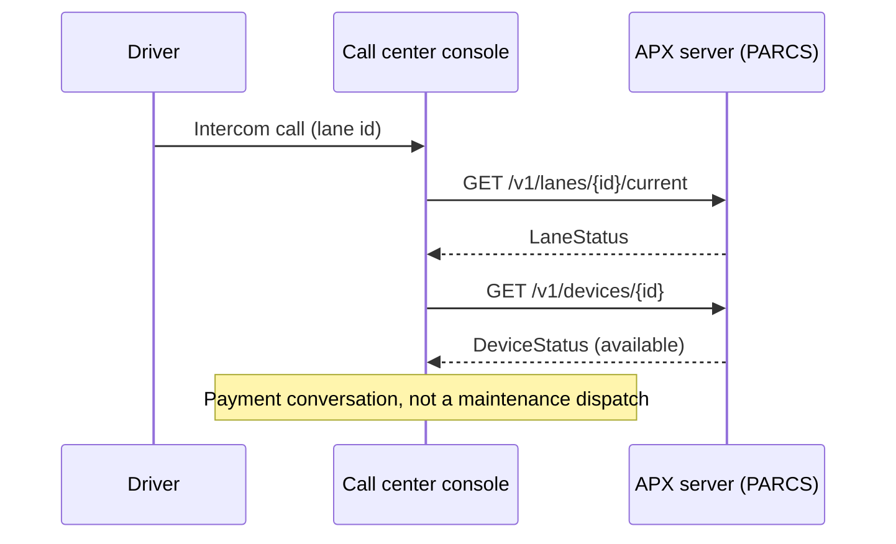

**Data exchanged.**

| Object | Defined in | Notes |
|---|---|---|
| `LaneStatus` | APX Part 6 §6.2 | Screen-pop: current ticket, LPR read, monthly credential |
| `VehicularAccess` | APDS 4.1 | The lane, referenced by id |
| `Session` | APDS 4.1 | Referenced from the current ticket |
| `ObservationElement` | APDS 4.1 | The LPR read behind `currentTicket.lpr` (referenced with `className` `Observation`) |
| `Credential` | APDS 4.1 | The monthly card presented at the lane |
| `DeviceStatus` | APX Part 6 §6.4; proposed to APDS as `EquipmentStatus` | Live state of the gate |
| `SupplementalEquipment` | APDS 4.1 | The gate, referenced by id |
| `Problem` | APX Part 12 | Error document for an unknown lane |

**Postconditions / outcome.** The agent knows the amount owed ($9.00), the
plate and its confidence, that the monthly card was denied for a past-due
account, and that the gate is `available`. No data was changed. The next
actions (apply a validation, vend the gate) are D.1.2.

**Example.** `LaneStatus` returned by `GET /v1/lanes/{id}/current`
(trimmed):

```json
{
  "lane": { "id": "b2000000-0000-4000-8000-000000000002", "className": "VehicularAccess" },
  "currentTicket": {
    "ticketNumber": "T-1001",
    "session": { "id": "f1000000-0000-4000-8000-000000000001", "className": "Session" },
    "amountDue": { "currencyType": "USD", "currencyValue": 9.0 },
    "paidInFull": false,
    "validations": [],
    "lpr": { "plate": "SYN-1234", "confidence": 0.97 }
  },
  "monthlyCredential": {
    "credential": { "id": "e3000000-0000-4000-8000-000000000001", "className": "Credential" },
    "cardNumber": "MC-0777",
    "accessGranted": false,
    "denialReason": "account past due"
  }
}
```

**APX references.** Part 6 §6.2 (lane inquiry), §6.4 (device status);
Part 12 (error model); Part 9 (scopes). Scenario:
`docs/scenarios/01-lane-status-call-center.md`.

#### D.1.2 Call-center gate vend: validate, vend, fault, alert

**Summary.** Continuing D.1.1, the driver saw a film at the cinema next door
but the ticket was never validated. The agent checks which merchants may
validate at the place and what each validation is worth, applies the
cinema's validation and vends the gate, both as audited commands. Meanwhile
a pay station fails; the PARCS publishes the device state change and raises
an alert, which the agent acknowledges without a phone call.

**Parties.**

| Party | Role |
|---|---|
| Call-center agent console | Client with `apx.control:read`, `apx.control:execute`, `apx.alerts:read`, `apx.alerts:write`; Receiving Party for events |
| Lakeside Garage APX server (PARCS) | Distributing Party; executes commands and publishes events |
| Exit gate and pay station | Lane equipment controlled and monitored by the PARCS |
| Lakeside Cinema | Merchant validation provider |

**Preconditions.**

- D.1.1 has run; the agent knows the lane and ticket `T-1001`.
- The console has an event subscription to `apx.control.device.state.v1`
  and `apx.alert.raised.v1` (created as in D.1.3).
- The operator's alerting policy maps pay-station faults to alerts.

**Flow.**

1. The console lists validation providers with
   `GET /v1/validations/providers?place={id}`. Each `ValidationProvider`
   discloses its `validationType` and `benefit`.
2. The console sends `POST /v1/commands` with `commandType`
   `applyValidation`, the lane as target and the ticket and provider in
   `parameters`, plus an `Idempotency-Key` header. The server answers
   `202 Accepted` with the `Command`.
3. The console sends `POST /v1/commands` with `commandType` `vendGate`, a
   `reason` and an `expiryTime`, so the command expires rather than
   opening the gate later for another car.
4. The console polls `GET /v1/commands/{id}`. The `Command` shows the
   append-only `statusHistory` from `received` to `succeeded`.
5. A pay station stops responding. The server delivers an
   `EventEnvelope` on `apx.control.device.state.v1` whose `data` is a
   `DeviceStatus` with `deviceState` `fault`.
6. The server raises an `Alert` (`alertType` `deviceFault`) and delivers
   it on `apx.alert.raised.v1`.
7. The agent acknowledges it with `POST /v1/alerts/{id}/acknowledge`; the
   `Alert` moves to `acknowledged` with the agent's note in
   `statusHistory`.

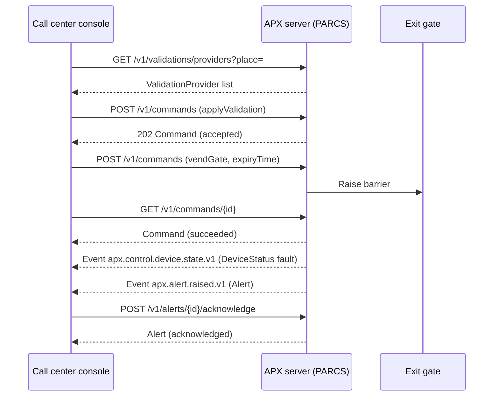

**Data exchanged.**

| Object | Defined in | Notes |
|---|---|---|
| `ValidationProvider` | APX Part 6 §6.3 | Who may validate at the place and the disclosed benefit |
| `Command` | APX Part 6 §6.1 | `applyValidation` and `vendGate`; idempotent, perishable, audited |
| `EventEnvelope` | APX Part 8 §8.2 | Wraps every pushed event |
| `DeviceStatus` | APX Part 6 §6.4; proposed to APDS as `EquipmentStatus` | Data of `apx.control.device.state.v1` |
| `Alert` | APX Part 7 §7.1; proposed to APDS | Raised for the fault, then acknowledged |
| `VehicularAccess`, `SupplementalEquipment` | APDS 4.1 | Command target and faulted device |

**Postconditions / outcome.** The validation is applied and the gate has
opened; who did what, when and why is recorded in each command's
`statusHistory`. The pay-station fault is known to subscribers and the
alert is acknowledged with "field tech dispatched".

**Example.** The `vendGate` command after polling (trimmed):

```json
{
  "id": "5e8d7c6b-4a39-4281-b0f1-2e3d4c5b6a70",
  "version": 5,
  "commandType": "vendGate",
  "target": { "id": "b2000000-0000-4000-8000-000000000002", "className": "VehicularAccess" },
  "reason": "customer assistance — cinema validation applied, remainder waived per policy",
  "expiryTime": "2026-08-06T18:16:00Z",
  "status": "succeeded",
  "statusHistory": [
    { "state": "received", "time": "2026-08-06T18:14:31Z", "actor": "apx-operator" },
    { "state": "accepted", "time": "2026-08-06T18:14:31Z", "actor": "lakeside-parcs" },
    { "state": "dispatched", "time": "2026-08-06T18:14:32Z", "actor": "lakeside-parcs" },
    { "state": "executing", "time": "2026-08-06T18:14:32Z", "actor": "gate-c1000000-0002" },
    { "state": "succeeded", "time": "2026-08-06T18:14:34Z", "actor": "gate-c1000000-0002", "detail": "barrier raised" }
  ]
}
```

**APX references.** Part 6 §6.1 (commands), §6.3 (validations), §6.4
(device status); Part 7 (alerts); Part 8 (delivery fabric). Scenario:
`docs/scenarios/02-call-center-gate-vend.md`.

#### D.1.3 Data synchronisation and signed webhooks

**Summary.** A city curb-management platform onboards Lakeside Garage. It
discovers what the server offers from one well-known URL, obtains a token,
pulls the APDS data on the native routes, stays in sync with the APX change
feed, and subscribes to push events whose signatures it verifies. It can
also query the delivery ledger to check that every event arrived.

**Parties.**

| Party | Role |
|---|---|
| City curb-management platform | Receiving Party; client `city-platform` with `apx.data:read`, `apx.subscriptions:manage` |
| Lakeside Garage APX server | Distributing Party; serves APDS data and delivers events |

**Preconditions.**

- The platform has OAuth2 client credentials issued by the operator.
- The server is reachable at its host and serves
  `/.well-known/apx-configuration`.

**Flow.**

1. The platform reads `GET /.well-known/apx-configuration`
   (unauthenticated). The `ApxConfiguration` names the token endpoint, the
   APX and APDS versions, the conformance classes and the registries.
2. The platform obtains a token with `POST /oauth/token`
   (`grant_type=client_credentials`).
3. The platform makes the initial pull on the native APDS routes, for
   example `GET /places` and `GET /sessions?modified_since=…`. These are
   stock APDS 4.1 exchanges; `modified_since` is a Unix epoch integer.
4. To stay in sync, the platform calls the same routes with
   `mode=change&cursor=…`. The server returns a `ChangeFeedPage` with
   changed items, tombstones in `deleted`, and the next `cursor`.
5. The platform subscribes with `POST /webhooks`, sending an
   `ApxEventSubscription` (a superset of the APDS `EventSubscription`)
   with topics and place and severity filters. The `201` response
   discloses the signing secret once.
6. Events arrive as signed `EventEnvelope` deliveries with `APX-Timestamp`
   and `APX-Signature` headers. The receiver checks the HMAC-SHA256
   signature and rejects anything outside the ±5-minute window.
7. The platform checks delivery with `GET /webhooks/{id}/deliveries`,
   which returns one `DeliveryRecord` per event and subscription.

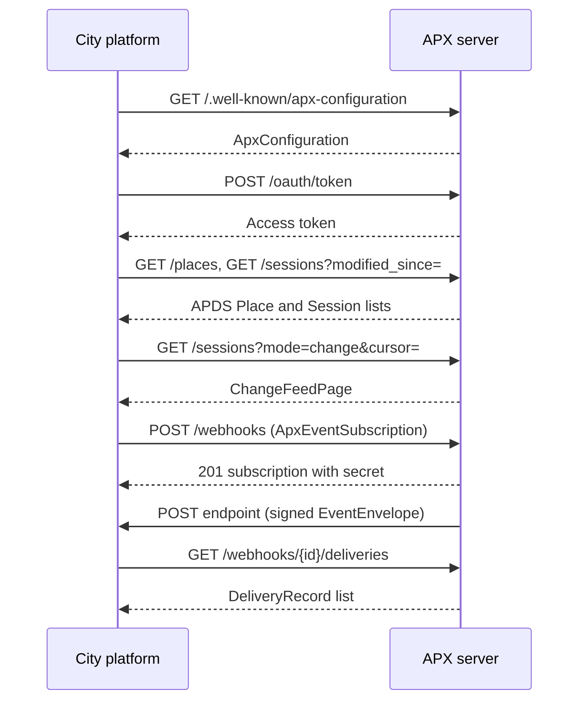

**Data exchanged.**

| Object | Defined in | Notes |
|---|---|---|
| `ApxConfiguration` | APX Part 16; Part 3 | Bootstrap document; lists claimed conformance classes |
| `Place`, `Session` | APDS 4.1 | Stock shapes on the native routes |
| `ChangeFeedPage` | APX Part 5 §5.2 | Ordered changes, tombstones, cursor |
| `ApxEventSubscription` | APX Part 8 §8.1 | Superset of APDS `EventSubscription` |
| `EventSubscription` | APDS 4.1 | The base APX extends at `/webhooks` |
| `EventEnvelope` | APX Part 8 §8.2 | Delivered event |
| `DeliveryRecord` | APX Part 8 §8.3 | Attempt count, status, last HTTP code |

**Postconditions / outcome.** The platform holds a full copy of the data it
is entitled to, keeps it current from a cursor that replays every change
exactly once, receives events it can authenticate, and can audit delivery.
A cursor older than the history window returns `target-not-found`, telling
the client to re-sync with `mode=full`. A subscription that keeps failing
moves to `failed` and the server emits `apx.subscription.failed.v1`.

**Example.** A `ChangeFeedPage` from `GET /sessions?mode=change` (trimmed):

```json
{
  "publicationTime": "2026-08-06T18:20:00Z",
  "updateMode": "change",
  "items": [
    {
      "id": "f1000000-0000-4000-8000-000000000001",
      "version": 4,
      "className": "Session",
      "segments": [{ "actualEnd": "2026-08-06T18:14:34Z" }]
    }
  ],
  "deleted": [
    { "id": "f1000000-0000-4000-8000-000000000099", "className": "Session", "deleteTimestamp": "2026-08-06T17:58:12Z" }
  ],
  "cursor": "c:00042",
  "next": null
}
```

**APX references.** Part 16 (discovery); Part 5 §5.2 (change feed); Part 8
§8.1–8.3 (subscriptions, envelope, webhook delivery); Part 9 §9.1, §9.4
(authentication, webhook authenticity). Scenario:
`docs/scenarios/03-data-sync-and-webhooks.md`.

#### D.1.4 LPR transient parker with a lost ticket

**Summary.** A transient parker reaches the exit without the ticket. The
agent works down an identity chain: the plate the entry camera read, then
any account for that plate, then payment history by the last four digits of
the card. In the scenario the plate read finds the ticket; if nothing had
matched, a `lostTicket` command issues a replacement priced from the
place's disclosed lost-ticket fee. The agent takes the remaining payment,
which posts back to accounting.

**Parties.**

| Party | Role |
|---|---|
| Call-center agent console | Receiving Party; client with `apx.lpr:read`, `apx.accounts:read`, `apx.control:execute`, `apx.payments:write` |
| Lakeside Garage APX server (PARCS) | Distributing Party; holds LPR reads, accounts, payments |
| LPR cameras | Produce the plate reads (APDS observations) |
| Accounting system (PARIS) | Receives the payment posting |
| Driver | Person at the lane without a ticket |

**Preconditions.**

- The lane inquiry (D.1.1) shows no ticket in the machine.
- The entry camera recorded a read of the vehicle.
- The place's rate deck discloses a lost-ticket fee (needed only for the
  fallback in step 4).

**Flow.**

1. The console searches reads with `GET /v1/lpr/reads?plate=SYN-1234`.
   The `LprRead` links the plate to ticket `T-1001`, the session, the
   observation, the entry time and an image link.
2. The console checks for an account with `GET /v1/accounts?plate=…`. The
   list is empty: no monthly account.
3. The console searches payment history with
   `GET /v1/payments?cardLast4=0777&date=2026-08-06`. Only the truncated
   card number is searchable. A `PaymentRecord` shows $4.50 already paid
   on `T-1001`.
4. Fallback, if nothing had matched: `POST /v1/commands` with
   `commandType` `lostTicket`. The `Command` result carries the issued
   ticket and the fee as `amountDue`. The command fails rather than
   guesses if no fee is disclosed.
5. The agent takes the remainder with `POST /v1/payments`. The returned
   `PaymentRecord` carries a `Posting` with the accounting confirmation
   number.

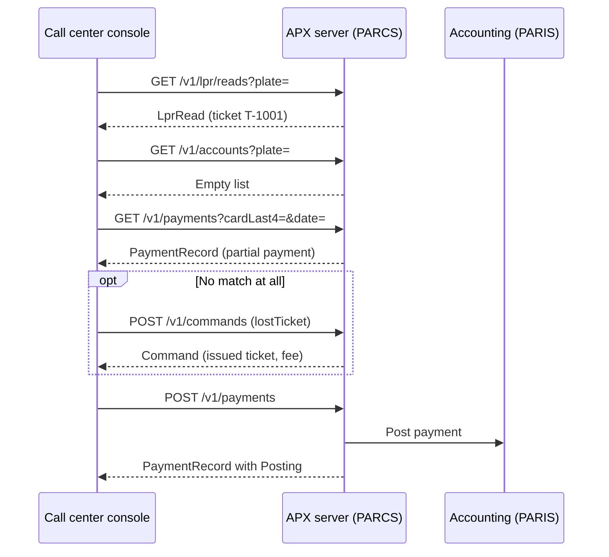

**Data exchanged.**

| Object | Defined in | Notes |
|---|---|---|
| `LprRead` | APX Part 13 §13.3 | Plate read with ticket, session and image link |
| `ObservationElement` | APDS 4.1 | The underlying camera read; LPR detail additions proposed to APDS (Part 13 §13.3a) |
| `Account` | APX Part 13 §13.1; proposed to APDS as an extension of `RightHolder` | Searched by plate; none found |
| `PaymentRecord` | APX Part 13 §13.1a, §13.2; proposed to APDS as an extension of `Payment` | Searchable by `cardLast4` only |
| `Posting` | APX Part 13 §13.1a | Write-back confirmation from accounting |
| `Command` | APX Part 6 §6.1 | `lostTicket` fallback |
| `Session`, `Place` | APDS 4.1 | Referenced from the read and the payment |

**Postconditions / outcome.** The ticket is identified by two independent
credentials (plate and card fragment), the remaining $4.50 is paid, and
the phone payment lands in the same accounting ledger as the earlier
pay-station payment, with a reconcilable `transactionID` and posting
confirmation.

**Example.** The `PaymentRecord` returned by `POST /v1/payments` (trimmed):

```json
{
  "id": "9c0d1e2f-3a4b-4c5d-8e6f-7a8b9c0d1e2f",
  "transactionID": "PARIS-20260806-00347",
  "place": { "id": "b1000000-0000-4000-8000-000000000001", "className": "Place" },
  "dateCollected": "2026-08-06T18:26:40Z",
  "amount": { "currencyType": "USD", "currencyValue": 4.5 },
  "meansOfPayment": "paymentCreditCard",
  "paymentStatus": "approved",
  "ticketNumber": "T-1001",
  "cardLast4": "0777",
  "postings": [
    { "confirmationNumber": "CONF-88214", "accountUpdated": false, "postedTo": "PARIS", "time": "2026-08-06T18:26:41Z" }
  ]
}
```

**APX references.** Part 13 §13.1, §13.1a, §13.2, §13.3 (accounts,
payments, payment history, LPR); Part 6 §6.1 (`lostTicket`). Scenario:
`docs/scenarios/04-lpr-lost-ticket.md`.

#### D.1.5 Reservation lifecycle: quote, book, amend, check-in, no-show

**Summary.** A driver books a space for a concert through a reservation
app, extends the booking, and is recognised by plate on arrival. A second
booking is never used and is marked as a no-show. APX adds no separate
booking object: a reservation is an APDS `AssignedRight` carrying the
`apds-ext:apx:reservation@1.0` extension, so any APDS system sees a normal
assigned right.

**Parties.**

| Party | Role |
|---|---|
| Reservation platform | Distributing Party for bookings; client with `apx.reservations:manage`, `apx.data:read`; Receiving Party for no-show events |
| Lakeside Garage APX server (PARCS) | Receiving Party for bookings; recognises plates, creates sessions, runs the no-show sweep |
| Entry LPR camera | Reads the plate at arrival |
| Driver | Holder of the reservation |

**Preconditions.**

- A `RightSpecification` for the event window exists at the place.
- The server claims `apx-reservations`; the platform subscribes to
  `apx.reservation.noshow.v1` for step 6.

**Flow.**

1. Price discovery uses the stock APDS quote: `POST /quotes` with a
   `QuoteRightRequest`; the server returns a `QuoteRightResponse`.
2. The platform books with `POST /rights/assigned`, sending an
   `AssignedRight` with a client-supplied `id`, `version: 1`, the plate as
   a `CredentialAssigned` under `rightHolder.credentials[]`, the window in
   `plannedUses[0]` and the reservation extension. The server answers
   `201` with an APDS `ResponseStatus` naming the new id.
3. The platform reads it back with `GET /rights/assigned/{id}`; the server
   has set `noShowAfter` (planned start plus the 30-minute grace).
4. To amend, the platform sends `PUT /rights/assigned/{id}` citing the
   version it last read; the extension state becomes `amended` and
   `plannedUses[0]` moves with it. A racing write citing an old version
   is refused with `version-conflict`.
5. On arrival the entry camera reads the plate; the PARCS matches it,
   opens the gate, creates the APDS `Session`, and sets the extension to
   `checkedIn` with `checkInSession`. Agents can see the booking with
   `GET /v1/reservations/recent?plate=…`, which returns
   `ReservationSummary` items.
6. After the grace period the no-show sweep marks the unused booking
   `noShow` and delivers an `EventEnvelope` on
   `apx.reservation.noshow.v1` whose `data` is a `ReservationSummary`.

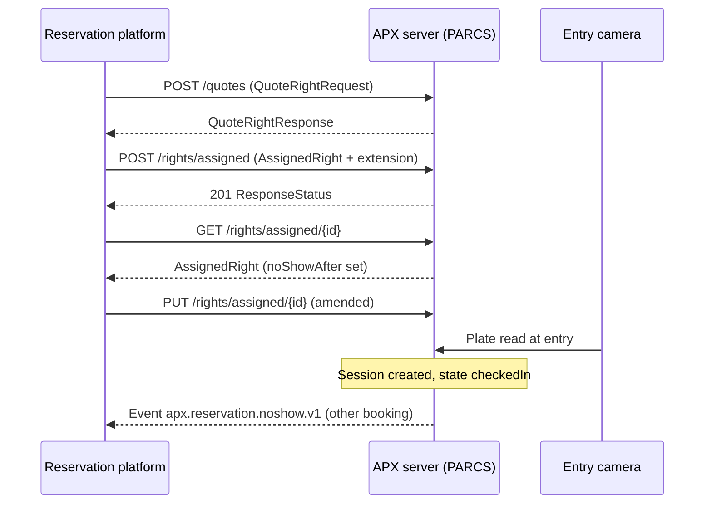

**Data exchanged.**

| Object | Defined in | Notes |
|---|---|---|
| `QuoteRightRequest`, `QuoteRightResponse` | APDS 4.1 | Stock quote flow |
| `AssignedRight` | APDS 4.1 | The reservation itself |
| `CredentialAssigned` | APDS 4.1 | Plate on file (`type` `licensePlate`) |
| `ReservationExtension` | APX Part 14 §14.1; proposed to APDS as an extension of `AssignedRight` (with `ReservationStateEnum`) | State, planned window, `noShowAfter`, `checkInSession` |
| `ResponseStatus` | APDS 4.1 | Answer to the native create |
| `Session` | APDS 4.1 | Created at check-in |
| `ReservationSummary` | APX Part 14 §14.1 | Recent-reservations lookup and no-show event data |
| `EventEnvelope` | APX Part 8 §8.2 | No-show event |

**Postconditions / outcome.** One reservation is `checkedIn` and linked to
its session; the other is `noShow` and the platform has been told, so it
can refund or charge under its own policy. The lifecycle states are
`confirmed`, `amended`, `checkedIn`, `cancelled` and `noShow`. Any APDS
intermediary must pass the `extensions` keys through unchanged.

**Example.** The stored `AssignedRight` after check-in (trimmed):

```json
{
  "id": "e2000000-0000-4000-8000-000000000002",
  "version": 3,
  "rightSpecification": { "id": "e1000000-0000-4000-8000-000000000001", "version": 1, "className": "RightSpecification" },
  "rightHolder": {
    "credentials": [
      { "type": "licensePlate", "credentialAssignedType": "vehicle", "identifier": { "id": "SYN-1234", "className": "USNumberPlate" } }
    ]
  },
  "plannedUses": [ { "startTime": "2026-08-14T18:00:00Z", "endTime": "2026-08-15T01:00:00Z" } ],
  "extensions": {
    "apds-ext:apx:reservation@1.0": {
      "reservationState": "checkedIn",
      "plannedStart": "2026-08-14T18:00:00Z",
      "plannedEnd": "2026-08-15T01:00:00Z",
      "checkInSession": { "id": "f1000000-0000-4000-8000-000000000014", "className": "Session" }
    }
  }
}
```

**APX references.** Part 14 §14.1 (reservations); Part 4 §4.2a
(optimistic concurrency), §4.3 (extensions container); Part 8 §8.7
(topic data). Scenario: `docs/scenarios/05-reservation-lifecycle.md`.

#### D.1.6 Reservation for a set time, then extending it

**Summary.** A business traveller books Lakeside Garage for a fixed window,
06:00–18:00. The window is extended once before arrival and once during the
stay; the mid-stay extension is priced with the stock APDS session-extension
quote. A third request, overnight, is declined by the same quote. No special
"extend" operation exists: every extension is a versioned `PUT` on the same
`AssignedRight`.

**Parties.**

| Party | Role |
|---|---|
| Reservation platform | Distributing Party for the booking; client with `apx.reservations:manage` |
| Lakeside Garage APX server (PARCS) | Receiving Party; prices extensions and holds the reservation |
| Traveller | Holder of the reservation (plate `SYN-5150`) |

**Preconditions.**

- A `RightSpecification` for the product exists.
- The rate deck for the place is disclosed, so the platform can show the
  price of an extension.

**Flow.**

1. The platform books with `POST /rights/assigned` (an `AssignedRight`
   with the plate under `rightHolder.credentials[]`, the window in
   `plannedUses[0]` and the reservation extension). The server answers
   `201` with a `ResponseStatus`.
2. Before arrival the flight moves. The platform sends
   `PUT /rights/assigned/{id}` citing version 1, with the new end time and
   state `amended`. The server stores version 2.
3. At 05:52 the entry camera reads the plate; the PARCS creates the
   `Session` and the extension records `checkInSession`.
4. Mid-stay, the platform prices more time with `POST /quotes`, sending a
   `QuoteSessionExtensionRequest` for the live session. The
   `QuoteSessionExtensionResponse` gives `revisedEndTime` 22:00.
5. The traveller accepts; the platform sends `PUT /rights/assigned/{id}`
   citing version 3. The state stays `checkedIn`; only `plannedEnd` and
   `plannedUses[0]` move.
6. A further request to 09:00 the next day returns a
   `QuoteSessionExtensionResponse` with `reason` `noExtensionPossible`;
   `revisedEndTime` stays at the committed 22:00.

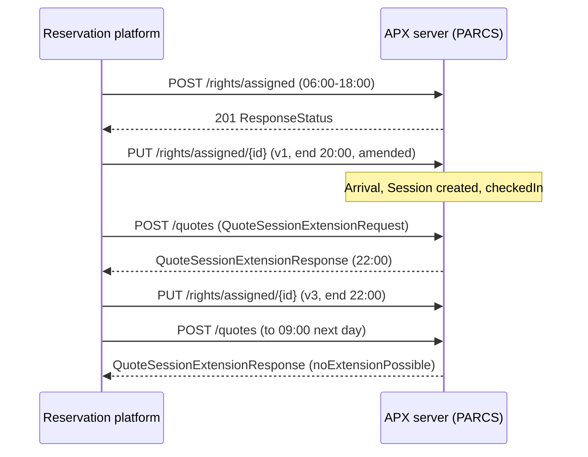

**Data exchanged.**

| Object | Defined in | Notes |
|---|---|---|
| `AssignedRight` | APDS 4.1 | The reservation; its version history is the audit trail |
| `CredentialAssigned` | APDS 4.1 | Plate on file |
| `ReservationExtension` | APX Part 14 §14.1; proposed to APDS as an extension of `AssignedRight` | `plannedStart`/`plannedEnd` mirror `plannedUses[0]` |
| `ResponseStatus` | APDS 4.1 | Answer to the create |
| `QuoteSessionExtensionRequest`, `QuoteSessionExtensionResponse` | APDS 4.1 | Stock session-extension quote; `reason` on decline |
| `Session` | APDS 4.1 | Created at check-in |

**Postconditions / outcome.** The reservation ends at 22:00 after two
extensions. The pre-arrival `amended` state applies only before a session
exists; after check-in the reservation stays `checkedIn`. A declined quote
never shortens what was already granted. Two amendments racing on the same
version are refused with `version-conflict`.

**Example.** The declined extension quote:

```json
{
  "id": "6e7f8a9b-0c1d-4e2f-8a3b-4c5d6e7f8a9b",
  "version": 1,
  "requestSessionExtensionId": { "id": "7f8a9b0c-1d2e-4f3a-8b4c-5d6e7f8a9b0c", "version": 1 },
  "sessionId": { "id": "f1000000-0000-4000-8000-000000000021", "version": 1, "className": "Session" },
  "requestTime": "2026-08-11T21:50:44Z",
  "responseTime": "2026-08-11T21:50:45Z",
  "revisedEndTime": "2026-08-11T22:00:00Z",
  "reason": "noExtensionPossible"
}
```

**APX references.** Part 14 §14.1 rules 3 and 5 (amendment, check-in
linkage); Part 4 §4.2a (optimistic concurrency). Scenario:
`docs/scenarios/06-reservation-set-time-extension.md`.

#### D.1.7 The analytics feed: occupancy, payments, plate reads

**Summary.** The owner of Lakeside Garage runs an analytics platform and
wants utilisation, revenue and sensor traffic in its own warehouse. One
subscription mixes APDS session topics with APX topics for payments,
observations and occupancy. A point-in-time occupancy read answers "how
full is it now", and the change feed fills gaps after an outage.

**Parties.**

| Party | Role |
|---|---|
| Analytics platform (owner BI) | Receiving Party; client `owner-bi` with `apx.data:read`, `apx.accounts:read`, `apx.subscriptions:manage` |
| Lakeside Garage APX server | Distributing Party; publishes events and serves reads |
| Ops team (optional) | Receives `occupancyThresholdExceeded` alerts where `apx-alerts` is deployed |

**Preconditions.**

- The platform has credentials with the scopes above.
- The server supports `apx-data`, `apx-events`, `apx-accounts` and
  `apx-lpr`.
- The operator has configured an occupancy threshold (90%).

**Flow.**

1. The platform subscribes with `POST /webhooks`, sending an
   `ApxEventSubscription` with topics `SessionCreated`, `SessionUpdated`,
   `apx.accounts.payment.recorded.v1`, `apx.data.observation.created.v1`
   and `apx.data.occupancy.v1`, filtered to the place.
2. A dashboard reads `GET /v1/places/{id}/occupancy`. The
   `OccupancySnapshot` carries the APDS `Supply` and `DemandType` and a
   derived `available` count.
3. When occupancy crosses 90%, the server delivers an `EventEnvelope` on
   `apx.data.occupancy.v1` whose `data` is an `OccupancySnapshot`.
4. When a parker pays, the server delivers
   `apx.accounts.payment.recorded.v1` with a `PaymentRecord`. Each camera
   read or RFID hit arrives on `apx.data.observation.created.v1` with the
   APDS `ObservationElement`.
5. For backfill after an outage, the platform pulls
   `GET /sessions?mode=change&cursor=…` and
   `GET /observations?mode=change&cursor=…`.

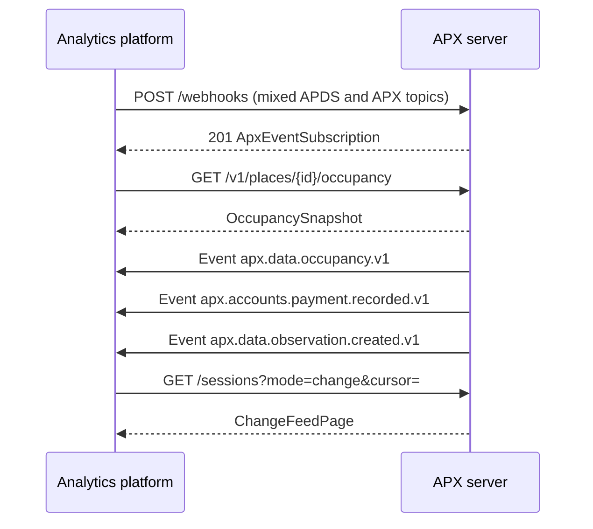

**Data exchanged.**

| Object | Defined in | Notes |
|---|---|---|
| `ApxEventSubscription` | APX Part 8 §8.1 | Topics from APDS and APX mix in one subscription |
| `OccupancySnapshot` | APX Part 5 §5.5 | `available = supplyQuantity − count`, clamped at zero |
| `Supply`, `DemandType` | APDS 4.1 | Carried unchanged in the snapshot |
| `EventEnvelope` | APX Part 8 §8.2 | Every delivery |
| `PaymentRecord` | APX Part 13 §13.1a; proposed to APDS as an extension of `Payment` | Data of the payment topic |
| `ObservationElement` | APDS 4.1 | Data of the observation topic |
| APDS `EventData` (`Session`) | APDS 4.1 | Data of `SessionCreated`/`SessionUpdated` |
| `ChangeFeedPage` | APX Part 5 §5.2 | Backfill and audit |

**Postconditions / outcome.** The warehouse receives sessions, payments,
observations and occupancy in real time, can read occupancy on demand, and
can replay what it missed. APDS `EventTypeEnum` has no payment or
observation events; the `apx.*` topics fill that gap. The Place hierarchy
stays the source of truth for occupancy.

**Example.** An occupancy event (trimmed):

```json
{
  "id": "9a0b1c2d-3e4f-4a5b-8c6d-7e8f9a0b1c2d",
  "type": "apx.data.occupancy.v1",
  "source": "https://api.lakeside-garage.example/v1",
  "subject": { "id": "b1000000-0000-4000-8000-000000000001", "className": "Place" },
  "time": "2026-08-25T17:52:11Z",
  "data": {
    "place": { "id": "b1000000-0000-4000-8000-000000000001", "className": "Place" },
    "computedAt": "2026-08-25T17:52:11Z",
    "supply": { "supplyViewType": "spaceView", "supplyQuantity": 420 },
    "demand": { "count": 379, "percentage": 90.2, "occupancyCalculation": "counted", "recordDateTime": "2026-08-25T17:52:00Z" },
    "available": 41
  }
}
```

**APX references.** Part 5 §5.2 (change feed), §5.5 (occupancy snapshot);
Part 8 §8.7 (topic data schemas); Part 13 §13.4 (analytics feed); Part 7
(alerts). Scenario: `docs/scenarios/07-analytics-occupancy-feed.md`.

#### D.1.8 Resolution context: monthly parker, balance hold, courtesy limit

**Summary.** A monthly parker is denied at the exit because the account has
an outstanding balance. The call platform opens a resolution context for
the lane; one response carries who the parker is, why access was denied,
the two courtesy exits already granted, and what the agent may and may not
do. The courtesy exit is refused by policy, the parker pays through a
payment link, and the interaction is recorded for next time.

**Parties.**

| Party | Role |
|---|---|
| Call-center platform (AI agent) | Receiving Party; client with `apx.resolution:read`, `apx.control:execute`, `apx.support:manage` |
| Lakeside Garage APX server (PARCS and policy engine) | Distributing Party; assembles the context and evaluates policy |
| Intercom | Call-platform hardware, mapped to the lane by the platform |
| Monthly parker | Account holder with the balance |

**Preconditions.**

- The call platform maps the intercom to the lane's id; APX never sees
  telephony identifiers.
- The server claims `apx-resolution` and `apx-control`.
- Operator policy limits courtesy exits (two within 48 hours).

**Flow.**

1. The platform sends `POST /v1/resolution/contexts` with
   `interactionId`, `correlationId`, `channel` `intercom` and the lane.
2. The server resolves lane, denial, credential and account and returns a
   `ResolutionContext`: `issue` `accountBalanceDenied`, vehicle, holder,
   `Account` with balance, `accessDecision`, `recentOverrides` and
   `allowedActions`. `courtesyExit` is `allowed: false` with reason
   `courtesyLimitReached`; sending a payment link is allowed.
3. The parker chooses to pay. Following the action's `execution`
   descriptor (`type: domain`), the platform calls
   `POST /v1/payment-links` with the account, `channel` `sms`, the
   context and the correlation id. The server returns a `PaymentLink`
   with the amount and expiry.
4. The payment arrives as `apx.accounts.payment.recorded.v1`, the hold
   clears and the gate vends on the retry.
5. The platform records the call with `POST /v1/support/interactions`,
   sending a `SupportInteraction` that links the payment link.

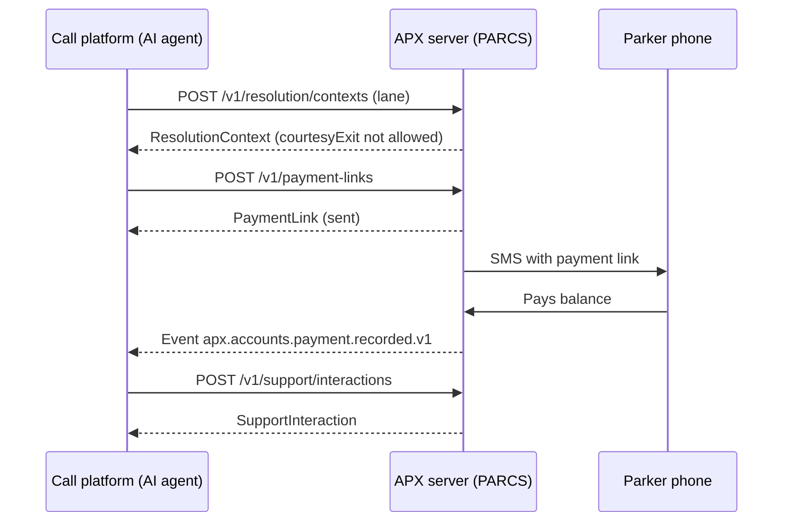

**Data exchanged.**

| Object | Defined in | Notes |
|---|---|---|
| `ResolutionContext` | APX Part 17 §17.2 | Assembled context for the interaction |
| `AllowedAction` | APX Part 17 §17.3, §17.4 | Server-side policy decision with `execution` descriptor |
| `Account` | APX Part 13 §13.1; proposed to APDS as an extension of `RightHolder` | Balance and status |
| `Credential` | APDS 4.1 | Monthly credential referenced from the context |
| `PaymentLink` | APX Part 13 §13.1a | Financial action on the payment surface |
| `PaymentRecord` | APX Part 13 §13.1a; proposed to APDS as an extension of `Payment` | Arrives as the payment event |
| `SupportInteraction` | APX Part 17 §17.6; proposed to APDS | Record of the call |
| `VehicularAccess`, `Place` | APDS 4.1 | Lane and place references |

**Postconditions / outcome.** The balance is paid, the parker exits
normally, and the interaction is stored. A later context for the same
plate carries it in `supportHistory`. The AI agent did not decide that the
courtesy exit was off the table; the policy layer did, and a command for
it would have been refused by the command plane (Part 17 §17.3). One
correlation id ties the call, context, payment and record together.

**Example.** Two entries of `allowedActions` from the context:

```json
[
  {
    "action": "post-apx-v1-payment-links",
    "display": "Send payment link",
    "target": { "id": "c2000000-0000-4000-8000-000000000004", "className": "Account" },
    "allowed": true,
    "requiresApproval": false,
    "execution": { "type": "domain", "operationId": "post-apx-v1-payment-links" }
  },
  {
    "action": "courtesyExit",
    "display": "Courtesy exit",
    "target": { "id": "b2000000-0000-4000-8000-000000000002", "className": "VehicularAccess" },
    "allowed": false,
    "requiresApproval": true,
    "approvalRole": "supervisor",
    "execution": { "type": "control", "command": "courtesyExit" },
    "reason": { "code": "courtesyLimitReached", "display": "Two courtesy exits have already been provided within the previous 48 hours.", "policy": "max-two-courtesy-exits-48h" }
  }
]
```

**APX references.** Part 17 §17.1–17.4, §17.6, §17.7 (resolution,
policy, action categories, support interactions, correlation); Part 13
§13.1a (payment links); Part 6 §6.1. Scenario:
`docs/scenarios/08-resolution-monthly-balance.md`.

#### D.1.9 Resolution context: paid ticket, gate vend failed

**Summary.** A transient parker pays at the pay-on-foot machine, but the
exit gate does not open. The resolution context shows the ticket paid in
full, the gate healthy and communicating, and a single vend allowed by
policy. The agent vends the gate and reports the outcome no more strongly
than the command's confirmation level allows: first "the open command was
sent", then, once the gate sensor confirms, "the gate is open".

**Parties.**

| Party | Role |
|---|---|
| Call-center platform (AI agent) | Receiving Party; client with `apx.resolution:read`, `apx.control:execute` |
| Lakeside Garage APX server (PARCS and policy engine) | Distributing Party; context, policy and command execution |
| Exit gate with gate-state sensor | Executes the vend and confirms it physically |
| Driver | Paid parker at the lane |

**Preconditions.**

- The intercom is mapped to the lane id by the call platform.
- Ticket `T-58201` is paid in full.
- The server claims `apx-resolution` and `apx-control`.

**Flow.**

1. The platform sends `POST /v1/resolution/contexts` with the lane. The
   `ResolutionContext` has `issue` `gateVendFailed`, a `laneStatus` with
   `paidInFull: true`, a `devices[]` entry showing the gate `available`,
   `vendGate` allowed and `holdGateOpen` not allowed
   (`holdOpenRestricted`).
2. The platform sends `POST /v1/commands` with `commandType` `vendGate`,
   a `reason`, the `resolutionContext`, the `correlationId` and an
   `expiryTime`. The `Command` returns with `confirmationLevel`
   `accepted`.
3. The platform polls `GET /v1/commands/{id}`. The `Command` reaches
   `succeeded` with `confirmationLevel` `physicallyConfirmed`, after the
   gate-state sensor reports the barrier open.

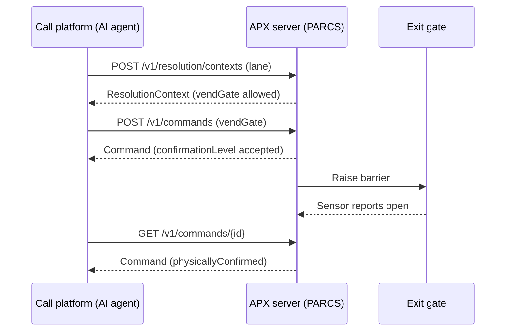

**Data exchanged.**

| Object | Defined in | Notes |
|---|---|---|
| `ResolutionContext` | APX Part 17 §17.2 | Carries `laneStatus` and `devices[]` overlays |
| `LaneStatus` | APX Part 6 §6.2 | Paid ticket in the machine |
| `DeviceStatus` | APX Part 6 §6.4; proposed to APDS as `EquipmentStatus` | Gate health |
| `AllowedAction` | APX Part 17 §17.3 | `vendGate` allowed, `holdGateOpen` refused |
| `Command` | APX Part 6 §6.1; Part 17 §17.4 | `vendGate` with `confirmationLevel` |
| `Session`, `VehicularAccess`, `SupplementalEquipment` | APDS 4.1 | References |

**Postconditions / outcome.** The gate is open and confirmed by the sensor;
the driver leaves. The confirmation levels are `accepted`,
`deviceAcknowledged` and `physicallyConfirmed`, and an agent must not claim
more than the current level. One correlation id ties the call, context,
command and sensor confirmation, and `statusHistory` records who opened
the gate and why.

**Example.** The command after polling (trimmed):

```json
{
  "id": "d1000000-0000-4000-8000-000000000041",
  "version": 4,
  "commandType": "vendGate",
  "target": { "id": "b2000000-0000-4000-8000-000000000002", "className": "VehicularAccess" },
  "resolutionContext": { "id": "e5000000-0000-4000-8000-000000000011", "className": "ResolutionContext" },
  "correlationId": "3f1a2b3c-4d5e-4f60-8a1b-2c3d4e5f6a70",
  "status": "succeeded",
  "confirmationLevel": "physicallyConfirmed",
  "statusHistory": [
    { "state": "received", "time": "2026-09-03T20:41:40Z", "actor": "apx-operator" },
    { "state": "accepted", "time": "2026-09-03T20:41:40Z", "actor": "lakeside-parcs" },
    { "state": "dispatched", "time": "2026-09-03T20:41:41Z", "actor": "lakeside-parcs" },
    { "state": "executing", "time": "2026-09-03T20:41:41Z", "actor": "gate-b3000000-0031" },
    { "state": "succeeded", "time": "2026-09-03T20:41:43Z", "actor": "gate-b3000000-0031", "detail": "barrier raised — gate-state sensor reports open" }
  ]
}
```

**APX references.** Part 6 §6.1 (commands, confirmation level); Part 17
§17.1–17.4; Part 4 §4.2 (provenance). Scenario:
`docs/scenarios/09-resolution-gate-vend-failed.md`.

#### D.1.10 Resolution context: card declined at the exit lane

**Summary.** A transient parker's card is declined twice at the exit
terminal. The resolution context already contains the declined payment
attempt, the $18.00 owed, and one action allowed by policy: a payment link
to the driver's phone. Vending the gate for an unpaid session is refused by
policy. The driver pays through the link with another card and the ticket
then opens the gate on re-insert.

**Parties.**

| Party | Role |
|---|---|
| Call-center platform | Receiving Party; client with `apx.resolution:read`, `apx.payments:write` |
| Lakeside Garage APX server (PARCS and policy engine) | Distributing Party; context, policy, payment links |
| Hosted payment page | Implementer's payment page; holds the card data (PCI scope) |
| Driver | Transient parker with ticket `T-61077` |

**Preconditions.**

- The intercom is mapped to the lane id.
- The server claims `apx-resolution` and `apx-accounts`.
- Operator policy forbids free vends for unpaid transient sessions.

**Flow.**

1. The platform sends `POST /v1/resolution/contexts` with the lane. The
   `ResolutionContext` has `issue` `paymentDeclined`, a `laneStatus` with
   $18.00 due, a `payments[]` entry with `paymentStatus` `declined` and
   `cardLast4` `4242`, a payment link allowed, and `vendGate` refused with
   reason `sessionUnpaid`.
2. Following the `execution` descriptor (`type: domain`), the platform
   calls `POST /v1/payment-links` with the place, ticket number, `channel`
   `sms`, context and correlation id, and no `amount`. Omitting the amount
   charges the current amount due.
3. The server returns a `PaymentLink` with the amount, the masked
   destination and the expiry.
4. The driver pays; the server publishes
   `apx.accounts.payment.recorded.v1`, the lane shows `paidInFull: true`,
   and the ticket opens the gate on re-insert.

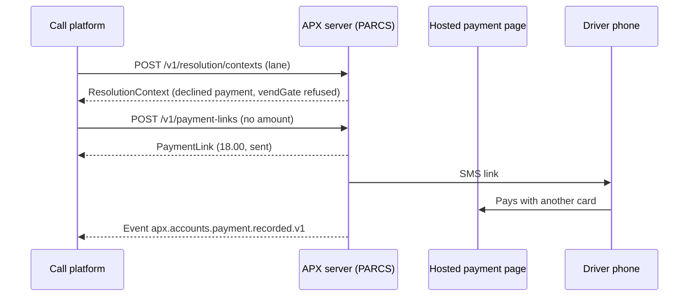

**Data exchanged.**

| Object | Defined in | Notes |
|---|---|---|
| `ResolutionContext` | APX Part 17 §17.2 | With `laneStatus` and `payments[]` overlays |
| `LaneStatus` | APX Part 6 §6.2 | Amount due on the ticket |
| `PaymentRecord` | APX Part 13 §13.1a; proposed to APDS as an extension of `Payment` | The declined attempt, as evidence |
| `AllowedAction` | APX Part 17 §17.3, §17.4 | One financial, one physical action |
| `PaymentLink` | APX Part 13 §13.1a | Lifecycle of the hosted link; never card data |
| `Session`, `Place`, `VehicularAccess` | APDS 4.1 | References |

**Postconditions / outcome.** The session is paid and the driver exits on
the normal flow, without a command. Had the agent sent `vendGate`, the
command plane would have answered `403 action-not-allowed`: the context's
decisions are binding (Part 17 §17.3). One correlation id chains decline,
context, link and payment event.

**Example.** The `PaymentLink` returned by `POST /v1/payment-links`:

```json
{
  "id": "e6000000-0000-4000-8000-000000000052",
  "version": 1,
  "place": { "id": "b1000000-0000-4000-8000-000000000001", "className": "Place" },
  "ticketNumber": "T-61077",
  "session": { "id": "c4000000-0000-4000-8000-000000000022", "className": "Session" },
  "amount": { "currencyType": "USD", "currencyValue": 18.00 },
  "channel": "sms",
  "sentTo": "+1•••••••8812",
  "status": "sent",
  "expiresAt": "2026-09-04T22:38:31Z",
  "resolutionContext": { "id": "e5000000-0000-4000-8000-000000000012", "className": "ResolutionContext" },
  "correlationId": "8d2b3c4e-5f6a-4b70-9c1d-2e3f4a5b6c80"
}
```

**APX references.** Part 17 §17.3, §17.4; Part 13 §13.1a (payment
lifecycle and payment links). Scenario:
`docs/scenarios/10-resolution-payment-declined.md`.

#### D.1.11 Resolution context: a merchant validation that was not applied

**Summary.** A driver sees $14.00 due and says the restaurant validated the
ticket, but the ticket carries no validation. The agent checks the place's
validation provider list, which says whether the restaurant may validate
and what the validation is worth ($3.00 off, not free parking). The agent
applies the validation as a command; the amount due is recalculated and the
driver pays the remainder.

**Parties.**

| Party | Role |
|---|---|
| Call-center platform | Receiving Party; client with `apx.resolution:read`, `apx.control:read`, `apx.control:execute` |
| Lakeside Garage APX server (PARCS and policy engine) | Distributing Party; context, provider list, command execution |
| Harbor Restaurant | Merchant validation provider |
| Driver | Transient parker with ticket `T-70443` |

**Preconditions.**

- The intercom is mapped to the lane id.
- Harbor Restaurant is configured as a validation provider at the place.
- The server claims `apx-resolution` and `apx-control`.

**Flow.**

1. The platform sends `POST /v1/resolution/contexts` with the lane. The
   `ResolutionContext` has `issue` `validationMissing`, a `laneStatus`
   with an empty `validations` list, `applyValidation` allowed and
   `vendGate` refused (`sessionUnpaid`: a validation adjusts the amount,
   it does not waive the remainder).
2. The platform reads `GET /v1/validations/providers?place={id}`. Harbor
   Restaurant is listed with `validationType` `flatDiscount` and a
   `benefit` of $3.00 off.
3. The platform sends `POST /v1/commands` with `commandType`
   `applyValidation`, the ticket and the provider in `parameters`, a
   `reason`, the context and the correlation id. The `Command` reaches
   `succeeded` with `confirmationLevel` `deviceAcknowledged`.
4. The lane now shows the applied validation with `amountReduced` $3.00
   and `amountDue` $11.00. The driver pays at the terminal and the gate
   opens normally.

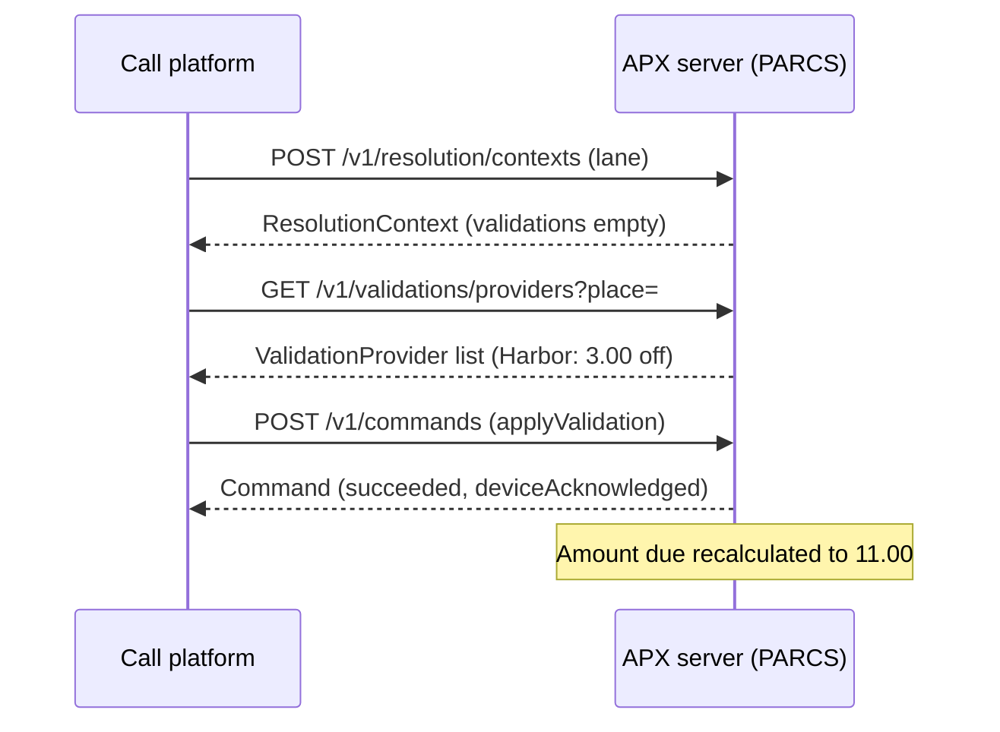

**Data exchanged.**

| Object | Defined in | Notes |
|---|---|---|
| `ResolutionContext` | APX Part 17 §17.2 | Context with `laneStatus` overlay |
| `LaneStatus` | APX Part 6 §6.2 | `currentTicket.validations[]` and `amountDue` |
| `ValidationProvider` | APX Part 6 §6.3 | Authoritative list; benefit disclosed |
| `AllowedAction` | APX Part 17 §17.3 | `applyValidation` allowed, `vendGate` refused |
| `Command` | APX Part 6 §6.1, §6.3 | `applyValidation` with ticket and provider |
| `Session`, `VehicularAccess` | APDS 4.1 | References |

**Postconditions / outcome.** The validation is applied and recorded as
dispute evidence, $11.00 is paid, and the gate opens on the normal exit
flow. An `applyValidation` naming a provider not on the list is rejected
with `422 validation-provider-unknown` (Part 6 §6.3). Every claim the
agent made came from the API.

**Example.** The provider list returned by
`GET /v1/validations/providers`:

```json
{
  "data": [
    {
      "provider": { "id": "a2000000-0000-4000-8000-000000000011", "className": "Organisation" },
      "name": "Lakeside Cinema",
      "validationType": "twoHoursComped",
      "benefit": { "description": "First two hours comped", "duration": "PT2H" }
    },
    {
      "provider": { "id": "a2000000-0000-4000-8000-000000000012", "className": "Organisation" },
      "name": "Harbor Restaurant",
      "validationType": "flatDiscount",
      "benefit": { "description": "$3.00 off", "amount": { "currencyType": "USD", "currencyValue": 3.00 } }
    }
  ]
}
```

**APX references.** Part 6 §6.1, §6.3 (commands, validations); Part 17
§17.3, §17.4. Scenario: `docs/scenarios/11-resolution-validation-missing.md`.

#### D.1.12 Resolution context: rate dispute

**Summary.** On Sunday morning the exit display asks $45.00; the driver
parked four hours and expected the $12.00 daily maximum. The event flat
rate from Saturday's concert is still active at the lane. The agent checks
the rate deck on the native APDS `/rates` route, and, with a supervisor's
approval attached as policy requires, pushes the correct rate table as an
audited command. The correction reprices this ticket and every one behind
it.

**Parties.**

| Party | Role |
|---|---|
| Call-center platform | Receiving Party; client with `apx.resolution:read`, `apx.control:execute` |
| Supervisor | Human approver required by the `approvalRole` |
| Lakeside Garage APX server (PARCS and policy engine) | Distributing Party; context, rate deck, command execution |
| Driver | Transient parker with ticket `T-81290` |

**Preconditions.**

- The intercom is mapped to the lane id.
- The place publishes its rate tables on the native `/rates` route.
- Operator policy requires supervisor approval for a rate-table push.

**Flow.**

1. The platform sends `POST /v1/resolution/contexts` with the lane. The
   `ResolutionContext` has `issue` `rateDispute`, a `laneStatus` with
   $45.00 due, and `pushRate` allowed with `requiresApproval: true` and
   `approvalRole` `supervisor`.
2. The agent reads `GET /rates?place={id}` (APDS). The event table is
   still active at the lane; the standard table with the $12.00 daily
   maximum is the one scheduled for Sunday.
3. A supervisor approves. The platform sends `POST /v1/commands` with
   `commandType` `pushRate`, `parameters.rateTable` as a versioned
   reference to the standard table, a `reason`, the `approval` evidence,
   the context and the correlation id.
4. The `Command` reaches `succeeded` with `confirmationLevel`
   `deviceAcknowledged`; open transactions at the lane are repriced. The
   ticket requotes at $12.00 and the driver pays at the terminal.

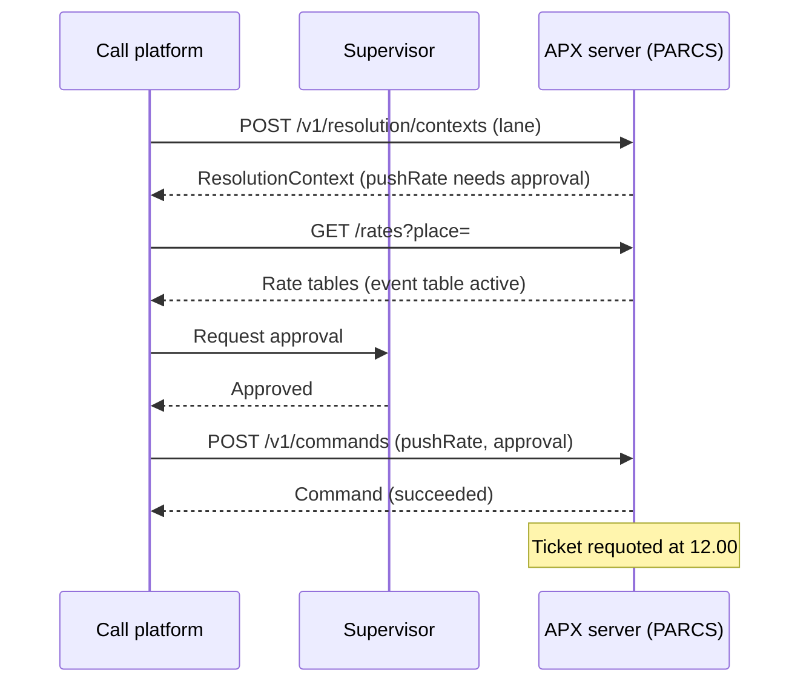

**Data exchanged.**

| Object | Defined in | Notes |
|---|---|---|
| `ResolutionContext` | APX Part 17 §17.2 | Frames the dispute |
| `AllowedAction` | APX Part 17 §17.3 | `pushRate` with `requiresApproval` and `approvalRole` |
| `RateTable` | APDS 4.1 | Read on `/rates`; named by a versioned reference in the command |
| `Command` | APX Part 6 §6.1; Part 17 §17.4 | `pushRate` with `approval` evidence |
| `LaneStatus` | APX Part 6 §6.2 | Amount due before and after |
| `Session`, `VehicularAccess` | APDS 4.1 | References |

**Postconditions / outcome.** The correct table (version 12) is active at
the lane and the driver pays $12.00. The command records what changed, why,
who asked, who approved and against which dispute; later contexts at this
lane show the push in `recentOverrides[]`. Without `approval` the command
plane would answer `403 approval-required` (Part 17 §17.3). APX adds no
parallel rate model; rates stay on the APDS routes.

**Example.** The `pushRate` command (trimmed):

```json
{
  "id": "d1000000-0000-4000-8000-000000000043",
  "version": 3,
  "commandType": "pushRate",
  "target": { "id": "b2000000-0000-4000-8000-000000000002", "className": "VehicularAccess" },
  "parameters": {
    "rateTable": { "id": "f2000000-0000-4000-8000-000000000062", "version": 12, "className": "RateTable" }
  },
  "reason": "rateDispute — event flat-rate table left active after 2026-09-05 concert",
  "approval": { "approvedBy": "supervisor:m.alvarez", "approvedAt": "2026-09-06T15:25:40Z", "note": "Schedule confirms standard table for 2026-09-06." },
  "resolutionContext": { "id": "e5000000-0000-4000-8000-000000000014", "className": "ResolutionContext" },
  "correlationId": "9e0f1a2b-3c4d-4e5f-8a6b-7c8d9e0f1aa0",
  "status": "succeeded",
  "confirmationLevel": "deviceAcknowledged"
}
```

**APX references.** Part 6 §6.1 (`pushRate.rateTable`); Part 17 §17.3,
§17.4. Scenario: `docs/scenarios/12-resolution-rate-dispute.md`.

#### D.1.13 Resolution context: anti-passback violation

**Summary.** A monthly parker is denied at the entry because the system
records her credential as already inside: the day before, an attendant
waved cars out through a blocked exit and her exit was never read. The
resolution context shows the passback state and policy rules out a blind
gate vend. The agent resets the credential's passback state with a command,
and the parker's next badge is granted as a normal entry.

**Parties.**

| Party | Role |
|---|---|
| Call-center platform | Receiving Party; client with `apx.resolution:read`, `apx.control:read`, `apx.control:execute` |
| Lakeside Garage APX server (PARCS and policy engine) | Distributing Party; passback state, context and commands |
| Monthly parker | Credential holder at the entry lane |

**Preconditions.**

- The intercom is mapped to the entry lane id.
- The credential's last recorded access is an entry with no matching
  exit.
- The server claims `apx-resolution` and `apx-control`.

**Flow.**

1. The platform sends `POST /v1/resolution/contexts` with the entry lane.
   The `ResolutionContext` has `issue` `passbackViolation`, a `passback`
   overlay (`state` `violation`, `recordedPresence` `inside`, last access
   an entry the previous morning), an `accessDecision` of `denied`,
   `resetPassback` allowed and `vendGate` refused
   (`passbackUncorrected`).
2. The console refreshes the overlay with
   `GET /v1/credentials/{id}/passback`, which returns a `PassbackStatus`.
3. The platform sends `POST /v1/commands` with `commandType`
   `resetPassback`, the place as target, the credential in `parameters`,
   a `reason`, the context and the correlation id. The `Command` reaches
   `succeeded` (`deviceAcknowledged`).
4. A re-read of `GET /v1/credentials/{id}/passback` shows `state`
   `normal`. The parker badges again and the PARCS grants entry on its own
   rules.

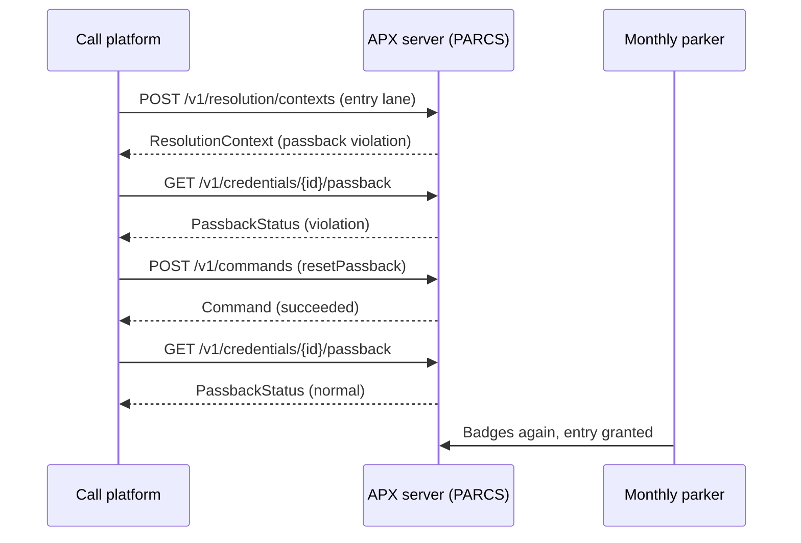

**Data exchanged.**

| Object | Defined in | Notes |
|---|---|---|
| `ResolutionContext` | APX Part 17 §17.2 | With `passback` and `accessDecision` |
| `PassbackStatus` | APX Part 17 §17.4 | Recorded against expected presence, last access |
| `AllowedAction` | APX Part 17 §17.3 | Reset allowed, vend refused |
| `Command` | APX Part 6 §6.1; Part 17 §17.4 | `resetPassback` with `parameters.credential` |
| `Credential` | APDS 4.1 | The monthly credential |
| `Place`, `VehicularAccess` | APDS 4.1 | Command target and lane |

**Postconditions / outcome.** The credential's state is corrected rather
than bypassed, so the next exit will also work. No gate was vended and
nothing counts against courtesy policy. One correlation id links the call,
context, decision and reset.

**Example.** The `passback` overlay in the context:

```json
{
  "credential": { "id": "c3000000-0000-4000-8000-000000000013", "className": "Credential" },
  "state": "violation",
  "expectedPresence": "outside",
  "recordedPresence": "inside",
  "lastAccess": {
    "direction": "entry",
    "occurredAt": "2026-09-01T08:03:47Z",
    "place": { "id": "b1000000-0000-4000-8000-000000000001", "className": "Place" },
    "lane": { "id": "b2000000-0000-4000-8000-000000000001", "className": "VehicularAccess" }
  }
}
```

**APX references.** Part 17 §17.1–17.4 (`resetPassback`, `forceIn`,
`forceOut` command types; passback read side); Part 6 §6.1. Scenario:
`docs/scenarios/13-resolution-passback-violation.md`.

#### D.1.14 Resolution context: prepaid reservation, misread plate

**Summary.** A visitor prepaid an evening reservation for plate `SVN-4821`,
but the entry camera read `5VN-4B21` at 0.41 confidence, so the PARCS
opened a plain transient session. At the exit the terminal asks for the
full drive-up price. The agent picks the correct plate from the lane's
recent plate candidates and corrects the session's plate; the PARCS's own
matching then links the reservation and the amount due drops to zero.

**Parties.**

| Party | Role |
|---|---|
| Call-center platform | Receiving Party; client with `apx.resolution:read`, `apx.lpr:read`, `apx.data:write` |
| Lakeside Garage APX server (PARCS and policy engine) | Distributing Party; context, LPR candidates, session correction |
| Entry and exit LPR cameras | Produced the misread and the clean read |
| Visitor | Reservation holder with confirmation code `LKG-88214` |

**Preconditions.**

- A confirmed reservation (`AssignedRight` with the reservation
  extension) exists for the correct plate.
- The exit camera has produced a fresh read of the vehicle.
- The server claims `apx-resolution`, `apx-lpr` and `apx-reservations`.

**Flow.**

1. The platform sends `POST /v1/resolution/contexts` with the lane and the
   `reservationCode` the visitor reads out. The `ResolutionContext` has
   `issue` `reservationMismatch`, the vehicle read at 0.41, the session,
   a `reservation` summary in state `confirmed`, a plate correction
   allowed (`execution.type: domain`) and `vendGate` refused
   (`sessionUnsettled`).
2. The platform reads
   `GET /v1/lpr/candidates?lane={id}&since=…`. The `PlateCandidate` list
   shows the exit read `SVN-4821` at 0.97 and the entry misread at 0.41.
3. The visitor confirms the plate. The platform sends
   `PUT /v1/sessions/{id}/plate` with the plate, country, state, the
   chosen observation as evidence and a `reason`.
4. The PARCS matches the corrected plate to the reservation and applies
   the prepaid rate.
5. The platform re-reads `GET /v1/resolution/contexts/{id}`; `version` is
   2 and `accessDecision` is `granted` with amount due 0.00.

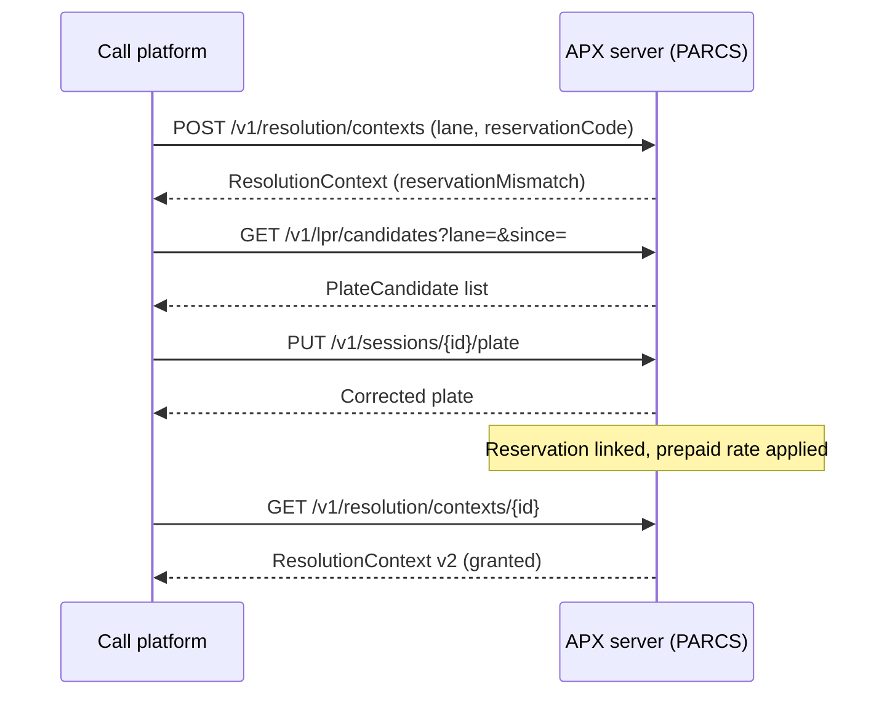

**Data exchanged.**

| Object | Defined in | Notes |
|---|---|---|
| `ResolutionContext` | APX Part 17 §17.2 | With `vehicle`, `session` and `reservation` |
| `ReservationSummary` | APX Part 14 §14.1 | The unlinked reservation |
| `PlateCandidate` | APX Part 17 §17.5 | Ranked reads with access-controlled image links |
| `ObservationElement` | APDS 4.1 | The chosen read, cited as evidence |
| `Session` | APDS 4.1 | Target of the plate correction |
| `AssignedRight` | APDS 4.1 | The reservation; extension proposed to APDS |
| `AllowedAction` | APX Part 17 §17.3, §17.4 | Domain plate correction allowed, vend refused |

The response to `PUT /v1/sessions/{id}/plate` is a small inline shape of
the operation, not a named schema.

**Postconditions / outcome.** The session carries the correct plate, the
reservation is linked and the gate opens on the normal exit flow, with no
override or courtesy counted. Where no plate can carry the link (for
example barcode-only reservations), `PUT /v1/sessions/{id}/assigned-right`
links session and reservation explicitly (Part 14 §14.1b).

**Example.** The plate candidates returned by `GET /v1/lpr/candidates`:

```json
{
  "data": [
    {
      "plate": "SVN-4821", "country": "US", "stateProvince": "FL",
      "confidence": 0.97,
      "observationDateTime": "2026-09-02T22:39:04Z",
      "lane": { "id": "b2000000-0000-4000-8000-000000000002", "className": "VehicularAccess" },
      "observation": { "id": "f2000000-0000-4000-8000-000000000014", "className": "Observation" },
      "plateImage": "https://api.lakeside-garage.example/v1/media/f2000000-0014/plate.jpg"
    },
    {
      "plate": "5VN-4B21", "country": "US", "stateProvince": "FL",
      "confidence": 0.41,
      "observationDateTime": "2026-09-02T17:41:22Z",
      "lane": { "id": "b2000000-0000-4000-8000-000000000001", "className": "VehicularAccess" },
      "observation": { "id": "f2000000-0000-4000-8000-000000000013", "className": "Observation" }
    }
  ]
}
```

**APX references.** Part 17 §17.2, §17.4, §17.5 (plate candidates and
correction); Part 14 §14.1b (linking a reservation to a session); Part 9
§9.6 (privacy of imagery). Scenario:
`docs/scenarios/14-resolution-reservation-plate-mismatch.md`.

#### D.1.15 Resolution context: payment terminal fault

**Summary.** A transient parker's cards do not work at the exit terminal.
The fault is in the terminal's card reader, which failed four minutes
earlier, and the resolution context shows it before the agent asks the
driver to try again. Policy allows a free vend because the fault is the
operator's, and gates a remote restart of the terminal behind maintenance
approval.

**Parties.**

| Party | Role |
|---|---|
| Call-center platform | Receiving Party; client with `apx.resolution:read`, `apx.control:execute` |
| Lakeside Garage APX server (PARCS and policy engine) | Distributing Party; context, commands, device events |
| Payment terminal and exit gate | Lane equipment |
| Maintenance technician | Approves and runs the restart |
| Driver | Transient parker at the lane |

**Preconditions.**

- The intercom is mapped to the lane id.
- The terminal reports `deviceState` `fault`.
- The server claims `apx-resolution`, `apx-control` and `apx-alerts`.

**Flow.**

1. The platform sends `POST /v1/resolution/contexts` with the lane. The
   `ResolutionContext` has `issue` `equipmentFault`, a `devices[]` list
   with the terminal in `fault` and the gate `available`, `vendGate`
   allowed, and `restartDevice` allowed with `requiresApproval: true`
   and `approvalRole` `maintenance`.
2. Where `apx-alerts` is deployed, a `deviceFault` alert has already been
   raised on `apx.alert.raised.v1` (as in D.1.2).
3. The platform sends `POST /v1/commands` with `commandType` `vendGate`,
   a `reason`, an `expiryTime`, the context and the correlation id.
4. The platform polls `GET /v1/commands/{id}`; the `Command` reaches
   `succeeded` with `confirmationLevel` `physicallyConfirmed`.
5. Later a technician approves and runs `restartDevice`. When the
   terminal recovers, the server publishes `apx.control.device.state.v1`
   with a `DeviceStatus` of `available`, and the alert clears on
   `apx.alert.status.v1`.

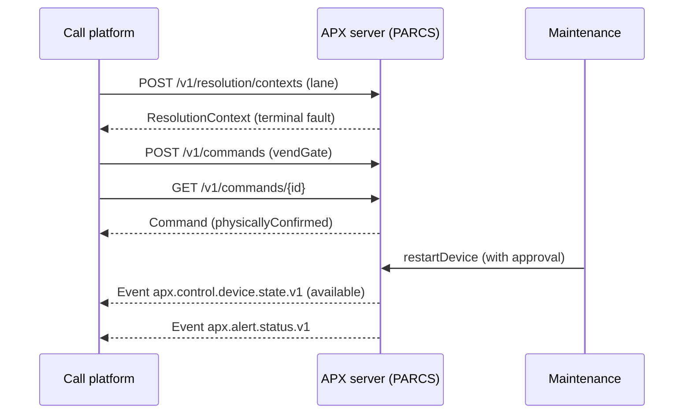

**Data exchanged.**

| Object | Defined in | Notes |
|---|---|---|
| `ResolutionContext` | APX Part 17 §17.2 | With `devices[]` overlay |
| `DeviceStatus` | APX Part 6 §6.4; proposed to APDS as `EquipmentStatus` | Terminal and gate state |
| `AllowedAction` | APX Part 17 §17.3 | Vend allowed; restart needs `maintenance` approval |
| `Command` | APX Part 6 §6.1 | `vendGate`, later `restartDevice` |
| `Alert` | APX Part 7; proposed to APDS | `deviceFault`, raised then cleared |
| `EventEnvelope` | APX Part 8 §8.2 | Device-state and alert events |
| `SupplementalEquipment`, `Session`, `VehicularAccess` | APDS 4.1 | References |

**Postconditions / outcome.** The driver leaves through a confirmed open
gate; the free exit is attributable to policy for an equipment fault, not
to the agent. The terminal is restarted under maintenance approval, and the
next context at the lane shows healthy devices. One correlation id ties the
call, context, fault and vend.

**Example.** The `devices[]` overlay in the context:

```json
[
  {
    "device": { "id": "c1000000-0000-4000-8000-000000000021", "className": "SupplementalEquipment" },
    "deviceState": "fault",
    "lastCommunication": "2026-09-02T19:22:40Z",
    "stateChangedTime": "2026-09-02T19:18:31Z"
  },
  {
    "device": { "id": "c1000000-0000-4000-8000-000000000022", "className": "SupplementalEquipment" },
    "deviceState": "available",
    "lastCommunication": "2026-09-02T19:22:41Z"
  }
]
```

**APX references.** Part 17 §17.2–17.4; Part 6 §6.1, §6.4; Part 7 (alerts);
Part 8 §8.7. Scenario: `docs/scenarios/15-resolution-equipment-fault.md`.

#### D.1.16 Automated enforcement: LPR overstay, mailed notice, appeal, payment

**Summary.** A gateless pay-by-plate lot is swept by a mobile LPR van. The
van reads a plate whose pay-by-plate session ended 26 minutes earlier. The
enforcement pipeline records a violation; the server runs the eligibility
check and stores the result. Operator policy allows unreviewed issuance for
automated detections at confidence 0.9 or above, so a notice is mailed. The
driver appeals, the reviewer reduces the amount, and the driver pays
online.

**Parties.**

| Party | Role |
|---|---|
| LPR enforcement pipeline (mobile van) | Distributing Party for detections; client with `apx.violations:manage` |
| Lakeside Garage APX server | Receiving Party; runs eligibility, holds violations, publishes events |
| Appeals portal | Client with `apx.violations:manage` and `apx.payments:write` |
| Reviewer | Resolves the appeal |
| Driver | Registered keeper of plate `SYN-4471` (a `Contact`) |

**Preconditions.**

- The van's read is stored as an APDS observation (`POST /observations`).
- The lot's published enforcement policy allows unreviewed issuance for
  automated detections with confidence ≥ 0.9.
- The server claims `apx-violations`, `apx-accounts` and `apx-events`.

**Flow.**

1. The pipeline sends `POST /v1/violations` with an `Idempotency-Key`,
   `violationType` `expiredRight`, the place, a `detection` (`mode`
   `automated`, confidence 0.94, rule), the vehicle, the observation and
   image evidence. The server runs the eligibility check, stores the
   `EligibilityResult` in `eligibilityCheck` (session found, `expired`)
   and returns the `Violation` in status `detected`.
   `apx.violations.detected.v1` is published.
2. The pipeline sends `POST /v1/violations/{id}/issue` with `noticeKind`
   `notice`, the amount ($35.00), the due time and `deliveryMethod`
   `mail`. The `Violation` moves to `issued` with a `notice` number.
   `apx.violations.issued.v1` is published.
3. The driver appeals through the portal: `POST /v1/violations/{id}/appeals`
   with `reason` `paidExtension`, detail, appellant and evidence links.
   The status becomes `appealed`.
4. The reviewer checks the APDS session (`GET /sessions/{id}`) and finds
   the extension was bought after the read, then sends
   `POST /v1/violations/{id}/appeals/resolve` with `resolution` `reduced`
   and `adjustedAmount` $15.00. The status returns to `issued`.
5. The portal takes the card with `POST /v1/payments`, then attaches the
   `PaymentRecord` with `POST /v1/violations/{id}/payment`. The status
   becomes `paid`.

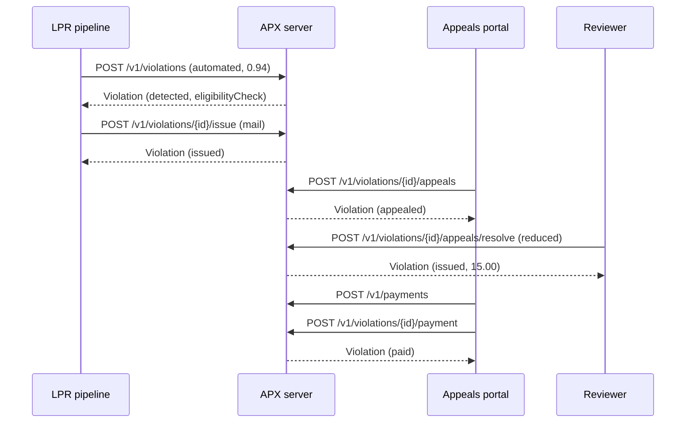

**Data exchanged.**

| Object | Defined in | Notes |
|---|---|---|
| `Violation` | APX Part 19 §19.1; proposed to APDS (with `ViolationDetection`, `Notice`, `Appeal`) | Lifecycle `detected` → `issued` → `appealed` → `issued` → `paid` |
| `EligibilityResult` | APX Part 19 §19.3 | Stored on the violation at creation |
| `ObservationElement` | APDS 4.1 | The van's read |
| `Session` | APDS 4.1 | The expired pay-by-plate session |
| `Contact` | APDS 4.1 | The appellant |
| `PaymentRecord` | APX Part 13 §13.1a; proposed to APDS as an extension of `Payment` | Linked to the violation |
| `SupplementalEquipment`, `Place` | APDS 4.1 | Detector and place references |
| `EventEnvelope` | APX Part 8 §8.2 | `apx.violations.*` and payment events |

**Postconditions / outcome.** The violation is `paid` at the reduced
amount with a complete `statusHistory`. The payment's
`apx.accounts.payment.recorded.v1` event reaches the financial feed and the
violation's `apx.violations.status.v1` event reaches the enforcement feed,
linked by one reference. Had the vehicle been entitled, the violation would
still have been recorded, as `dismissed`, with the basis. A `guided`
detection cannot be issued this way (`409 violation-not-issuable`), and a
second appeal is refused with `409 appeal-closed`.

**Example.** The `eligibilityCheck` stored on the violation (trimmed):

```json
{
  "place": { "id": "b1000000-0000-4000-8000-000000000004", "className": "Place" },
  "credential": { "credentialType": "licensePlate", "credentialIdentification": "SYN-4471" },
  "checkedTime": "2026-09-18T09:31:04Z",
  "entitled": false,
  "basis": [
    {
      "session": { "id": "f1000000-0000-4000-8000-000000000044", "className": "Session" },
      "rightType": "payByPlate",
      "validFrom": "2026-09-18T07:05:00Z",
      "validTo": "2026-09-18T09:05:00Z",
      "status": "expired"
    }
  ],
  "suggestedViolationType": "expiredRight",
  "graceUntil": "2026-09-18T09:20:00Z"
}
```

**APX references.** Part 19 §19.1–19.4 (violation, endpoints, eligibility,
automated and guided enforcement), §19.6 (settlement and appeals), §19.7
(eventing), §19.10 (enforcement policy); Part 13 §13.1a (payments).
Scenario: `docs/scenarios/16-violation-automated-overstay.md`.

### D.2 Commerce, enforcement and service use cases

The use cases in this clause cover the commercial and service side of a
parking operation: enforcement, merchant validation, credentials, valet,
gateless LPR, tolling, negotiated rates, ticket matching, EV charging,
session pairing, plate review, imported citations, catching up after an
outage, and itemized payments. Each one is taken from a worked scenario in
the APX repository (`docs/scenarios/17-…` to `32-…`). The request and
response bodies in those scenarios are checked against the APX bundle
(`spec/dist/apx-v1.yaml`) by the repository's test suite.

Each use case uses the same layout: a summary, the parties, the
preconditions, the flow, a sequence diagram, the data exchanged, the
outcome, a short example taken from the scenario, and references. In the
**Data exchanged** tables, "APDS 4.1" means the class is defined in the
APDS 4.1 API specification and APX uses it unchanged. "APX Part N" means
APX defines it. "Proposed to APDS" means the class is also in the APX
proposals for APDS (`spec/proposals/apds-additions/`). All people, plates,
cards and identifiers are synthetic.

APX routes are served under `/v1/`. APDS-native routes (`/observations`,
`/sessions`, `/rates`, `/rights/assigned`) are served at their APDS paths
on the same host.

#### D.2.1 Guided enforcement with a handheld eligibility check

**Summary.**

An enforcement officer walks a permit-only level with a handheld that
scans plates. For each plate the handheld asks the server whether the
vehicle is entitled to be there now, and shows the officer only the ones
that are not. The officer records the finding, confirms it on site, and
issues a windshield citation. A guided finding cannot be issued until a
person has reviewed it.

**Parties.**

| Party | Role |
|---|---|
| Enforcement handheld app | Receiving Party for the eligibility check; writes the Violation. Scopes `apx.violations:read`, `apx.violations:manage`; APDS `ep` role for native reads |
| Lakeside Garage APX server | Distributing Party; holds rights, observations and violations |

**Preconditions.**

- Level 2 (`b1…0003`) is a child of the garage in the Place hierarchy.
- Monthly permits exist as APDS AssignedRights; LPR observations exist for
  the plates.
- The handheld holds a token with the scopes above and a grant covering the
  garage.

**Flow.**

1. The handheld calls `GET /v1/enforcement/eligibility?credential=SYN-1234&place=…`.
   The EligibilityResult says `entitled: true`, with a monthly permit as
   the basis. The permit is bound to the garage, an ancestor of Level 2,
   and so it counts (Part 19 §19.3 rule 2). Nothing is created.
2. The same call for `SYN-8820` returns `entitled: false`. The basis is a
   valid monthly permit with `status: wrongPlace` (it is for Level 3), and
   the result carries `suggestedViolationType: wrongPlace` and the last LPR
   read.
3. The handheld calls `POST /v1/violations` with an `Idempotency-Key`,
   `detection.mode: guided`, the space, the vehicle and a photo in
   `evidence[]`. The server returns a Violation in state `detected`, with
   the eligibility answer frozen in `eligibilityCheck` and the permit in
   `relatedRight`.
4. An integration that calls `POST /v1/violations/{id}/issue` straight away
   is refused with 409 `violation-not-issuable`: a guided detection must be
   reviewed first.
5. The officer calls `POST /v1/violations/{id}/review` with
   `decision: confirm`. The state becomes `confirmed`.
6. The handheld prints from pre-numbered stock and calls
   `POST /v1/violations/{id}/issue` with `noticeKind: citation`, the
   `noticeNumber`, the amount, `dueTime` and `deliveryMethod: windshield`.
   The state becomes `issued` and `apx.violations.issued.v1` is published.

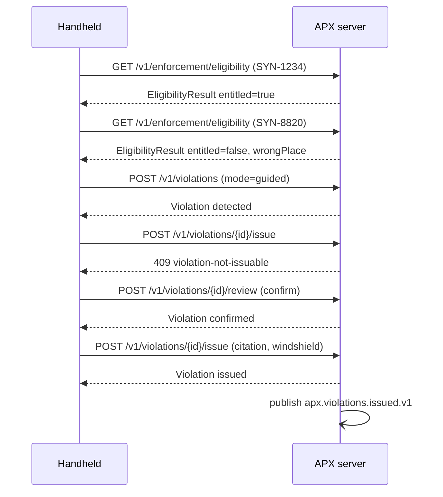

**Data exchanged.**

| Object | Defined in | Notes |
|---|---|---|
| EligibilityResult | APX Part 19 §19.3 | The answer to "is this vehicle entitled here now"; `basis[]` lists the rights considered |
| Violation | APX Part 19 §19.1; proposed to APDS (Enforcement: Violation, ViolationDetection, Notice) | The finding, its notice and its `statusHistory[]` |
| AssignedRight | APDS 4.1 | The permit that forms the basis and `relatedRight` |
| ObservationElement | APDS 4.1 | The LPR read referenced in `lastRead` |
| Place, Space, SupplementalEquipment, Contact | APDS 4.1 | Where the vehicle was, the handheld device, the officer |
| AmountInCurrency | APDS 4.1 | The citation amount |
| Problem | APX Part 12 | The 409 refusal |

**Postconditions / outcome.**

The violation is `issued` with the notice recorded and the officer named in
`statusHistory[]`. It then follows the normal path: paid through the Part 13
payment surface and linked with `POST /v1/violations/{id}/payment`, or
appealed. Had the officer chosen `dismiss`, the record would move to
`dismissed` with the reason. It is never deleted, so the false-positive rate
can be measured.

**Example.**

Step 2, the eligibility answer for the vehicle parked on the wrong level:

```json
{
  "place": { "id": "b1000000-0000-4000-8000-000000000003", "className": "Place" },
  "credential": { "credentialType": "licensePlate", "credentialIdentification": "SYN-8820" },
  "checkedTime": "2026-09-18T10:14:05Z",
  "entitled": false,
  "basis": [
    {
      "right": { "id": "e1000000-0000-4000-8000-000000000027", "className": "AssignedRight" },
      "rightType": "monthlyPermit",
      "validFrom": "2026-09-01T00:00:00Z",
      "validTo": "2026-09-30T23:59:59Z",
      "status": "wrongPlace"
    }
  ],
  "suggestedViolationType": "wrongPlace"
}
```

**APX references.**

Part 19 §19.1 (Violation and lifecycle), §19.3 (eligibility check), §19.4
(automated and guided enforcement), §19.7 (eventing). Scenario
`docs/scenarios/17-violation-guided-handheld.md`.

#### D.2.2 Merchant validation program

**Summary.**

A restaurant in the garage validates two hours of parking for its guests.
The operator enrols the restaurant as a validation program. The restaurant
issues its own QR codes, and a guest redeems one at the pay station. A
second code on the same ticket is refused by the program's rules. At month
end the operator closes the period into a statement that bills the
restaurant.

**Parties.**

| Party | Role |
|---|---|
| Operator back office | Distributing Party for the program; scope `apx.validations:manage` |
| Harbor Bistro app (merchant) | Issues codes; scope `apx.validations:redeem`, with `apx_org` set to the restaurant, so it is confined to its own program (Part 20 §20.5) |
| Operator pay station | Redeems codes for every merchant at the place; scope `apx.validations:manage` |
| Lakeside Garage APX server | Holds programs, instruments, redemptions and statements |

**Preconditions.**

- The garage is a Place on the server; the restaurant is a known
  organisation.
- The guest has an open APDS Session with a ticket number.

**Flow.**

1. The back office calls `POST /v1/validations/programs` with the place,
   provider, benefit (`duration: PT2H`), rules (`maxPerTicket: 1`,
   `maxPerDay: 200`, `validityWindow: P1D`, `stackable: false`) and billing
   (`merchantPays`, $4.00 a unit, monthly). The ValidationProgram is
   `active`. From then on `GET /v1/validations/providers?place=…` (Part 6)
   lists the restaurant, with `program` pointing to it.
2. The restaurant's iPad calls `POST /v1/validations/programs/{id}/issuances`
   with `quantity: 50` and `method: qrCode`. The ValidationIssuance
   returns the codes once. A retry with the same key returns the issuance
   without the codes.
3. The pay station checks a scanned code with
   `GET /v1/validations/instruments/{code}` (ValidationInstrument,
   `instrumentStatus: valid`), then applies it with
   `POST /v1/validations/redemptions`. The ValidationRedemption is
   `applied` and records `amountReduced` ($6.00, what actually came off the
   ticket). The APDS Session now carries the `validationId` on its segment
   and a Payment of type `validation`. `apx.validations.redeemed.v1` is
   published.
4. A second code on the same ticket is refused with 422
   `redemption-limit-exceeded` (`maxPerTicket=1`). The code stays `valid`
   for another ticket.
5. At month end the back office previews the period with
   `GET /v1/validations/programs/{id}/statement?from=…&to=…`, then closes it
   with `POST /v1/validations/programs/{id}/statements`. The
   ValidationStatement is `closed` and
   `apx.validations.statement.closed.v1` is published.

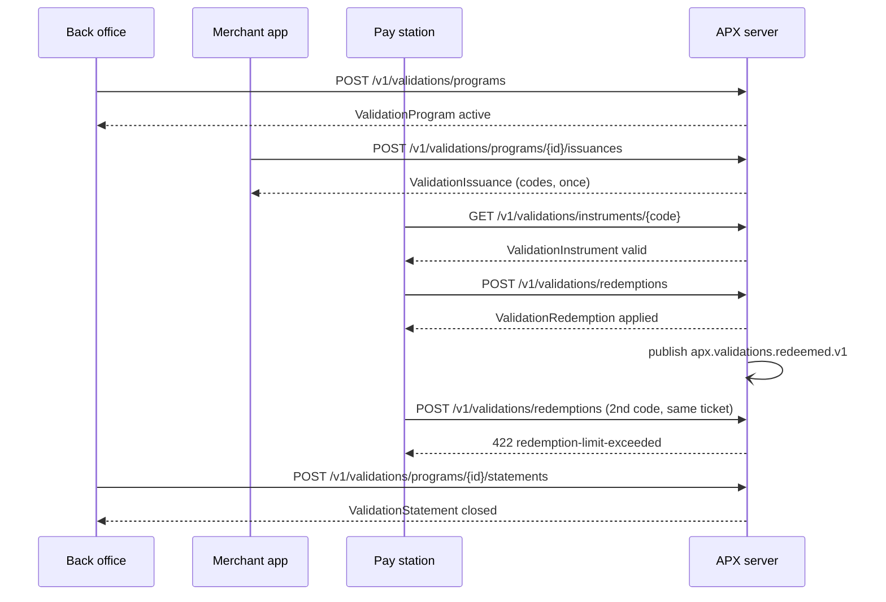

**Data exchanged.**

| Object | Defined in | Notes |
|---|---|---|
| ValidationProgram | APX Part 20 §20.1; proposed to APDS (Right: ValidationProgram, ValidationRules, ValidationBilling; Rates: ValidationBenefit) | The merchant's program, rules and billing terms |
| ValidationIssuance, ValidationInstrument | APX Part 20 §20.2; proposed to APDS (Right) | A batch of codes, and one code's state |
| ValidationRedemption | APX Part 20 §20.3; proposed to APDS (Session) | One code applied to one ticket |
| ValidationStatement | APX Part 20 §20.6 | Closed billing period; APX only |
| Session, Segment, Payment | APDS 4.1 | The stay the code was applied to, and the `validation` Payment an APDS-only consumer sees |
| Place, AmountInCurrency | APDS 4.1 | |
| Problem | APX Part 12 | The 422 refusal |

**Postconditions / outcome.**

The restaurant is invoiced from the statement's `id`: 412 redemptions at
$4.00 is $1,648.00. The $2,418.00 of parking actually comped is the
operator's own figure. The statement cannot be changed after it is closed. A
later reversal of one of its redemptions still succeeds, but it appears as a
negative `credit` line on the next statement (§20.4, §20.6).

**Example.**

Step 3, the redemption the pay station receives (trimmed):

```json
{
  "id": "e7000000-0000-4000-8000-000000000041",
  "version": 1,
  "program": { "id": "e5000000-0000-4000-8000-000000000001", "className": "ValidationProgram" },
  "instrumentCode": "HB-7Q2M-K9X4-3TPD",
  "ticketNumber": "T-2210",
  "session": { "id": "f1000000-0000-4000-8000-000000000210", "className": "Session" },
  "appliedTime": "2026-09-12T21:33:05Z",
  "channel": "payStation",
  "validationId": "VAL-20260912-000318",
  "amountReduced": { "currencyType": "USD", "currencyValue": 6.0 },
  "durationComped": "PT2H",
  "redemptionStatus": "applied"
}
```

**APX references.**

Part 20 §20.1–20.8; Part 6 §6.3 (provider lookup). Scenario
`docs/scenarios/18-validation-program-merchant.md`.

#### D.2.3 Enforcement policy, signage and escalation

**Summary.**

A surface lot is subject to a state law on private-lot notices: which
detections may be mailed, by when, with what evidence, how large the
penalty may be, how it escalates, and that signs must be posted. The
operator puts the law on file as an enforcement policy and records the
entrance sign. A handheld detection that tries to go out by mail is refused.
It is issued on the windshield instead, with the policy and sign frozen on
the record. Thirty days later the server applies the first escalation step
itself.

**Parties.**

| Party | Role |
|---|---|
| Operator back office | Writes the policy and signage; scope `apx.violations:manage` |
| Enforcement handheld | Records and issues the violation; scope `apx.violations:manage` |
| APX server scheduler | Applies escalation steps (`actor: apx-scheduler`) |
| Lakeside Garage APX server | Distributing Party; enforces the policy on issue |

**Preconditions.**

- Lot C (`b1…0004`) is a Place on the server.
- Counsel has summarized the law into delivery rules, a penalty cap and an
  escalation schedule.

**Flow.**

1. The back office calls `POST /v1/enforcement/policies`. The
   EnforcementPolicy holds `deliveryRules` (automated detections: mail or
   electronic within `P14D`, with at least one observation, one image and a
   location; guided or manual: windshield or handed within `PT1H`),
   `penaltyCap` (2× the unpaid fee, `onExceed: refuse`), two `escalation`
   steps (`late-30`: +25%; `late-60`: +$15), `overallCeiling` (3× the
   issued amount), `appealWindowDays: 21` and `signageRequired: true`.
2. The back office calls `POST /v1/enforcement/signage` with the sign text
   in English and Spanish, its location, a photo, `signType: entrance`, and
   the policy. `GET /v1/enforcement/signage/effective?place=…&at=…` returns
   the sign in force at a given time.
3. The handheld calls `POST /v1/violations` with `detection.mode: guided`
   and a `location` holding both `observedLocation` and
   `observerLocation`.
4. The handheld calls `POST /v1/violations/{id}/issue` with
   `deliveryMethod: mail`. The server refuses with 422
   `delivery-method-not-permitted`: under this policy a guided detection
   may only be delivered by windshield or by hand.
5. The handheld issues again with `deliveryMethod: windshield`. The
   Violation is `issued`. It carries `policy` and `signage[]` as versioned
   references, and an `amountHistory[]` entry that records the cap check.
   An amount above the cap would have been refused with
   `penalty-exceeds-cap`; a lot with no sign on file, with
   `signage-required`.
6. With no payment and no appeal, the server applies `late-30` after 30
   days, raises the amount from $35.00 to $43.75, and publishes
   `apx.violations.status.v1`.

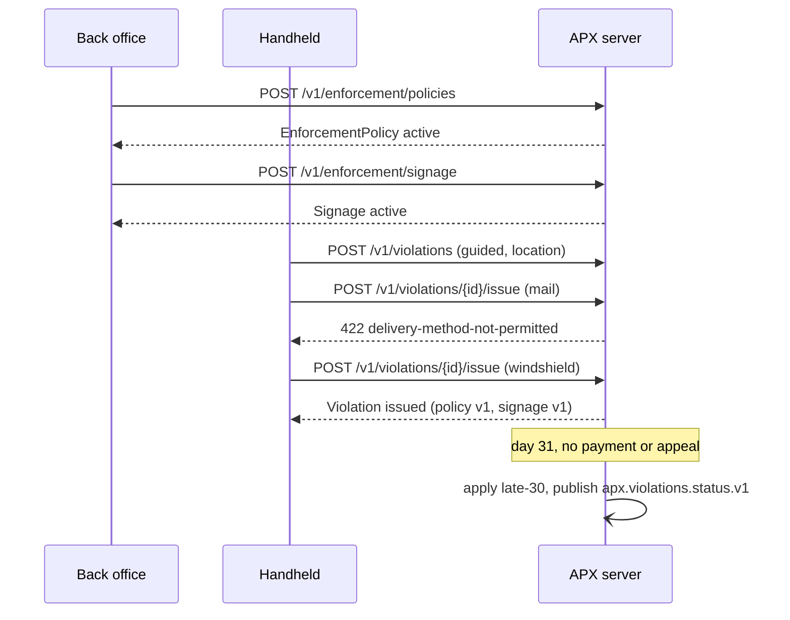

**Data exchanged.**

| Object | Defined in | Notes |
|---|---|---|
| EnforcementPolicy | APX Part 19 §19.10; proposed to APDS (Enforcement: EnforcementPolicy, NoticeDeliveryRule, PenaltyLimit, EscalationStep) | The law at the place; inherited by child places that carry no policy of their own |
| Signage | APX Part 19 §19.11; proposed to APDS (Place) | What was posted, where, and when |
| Violation | APX Part 19 §19.1, §19.9; proposed to APDS (Enforcement) | Carries `location`, frozen `policy` and `signage[]`, `amountHistory[]` |
| MultilingualString, Point, VersionedReference | APDS 4.1 | Sign text, sign and vehicle positions, frozen references |
| Problem | APX Part 12 | The 422 refusal |

**Postconditions / outcome.**

No client computes the escalated amount. The schedule is on the policy, the
server applies it, and every consumer (the driver's portal, collections, the
appeals reviewer) reads the same `amountHistory[]`. `late-60` would add $15
at day 60, and the amount can never pass the ceiling of $105. An appeal
opened in the meantime pauses the schedule (§19.10 rule 3).

**Example.**

Step 6, the amount history after escalation (trimmed):

```json
{
  "id": "d3000000-0000-4000-8000-000000000003",
  "version": 4,
  "violationStatus": "issued",
  "policy": { "id": "d4000000-0000-4000-8000-000000000001", "version": 1, "className": "EnforcementPolicy" },
  "signage": [ { "id": "d5000000-0000-4000-8000-000000000001", "version": 1, "className": "Signage" } ],
  "amount": { "currencyType": "USD", "currencyValue": 43.75 },
  "amountHistory": [
    { "amount": { "currencyType": "USD", "currencyValue": 35.0 }, "time": "2026-09-18T10:24:02Z", "reason": "issued" },
    { "amount": { "currencyType": "USD", "currencyValue": 43.75 }, "time": "2026-10-19T00:00:05Z", "reason": "escalation", "step": "late-30", "detail": "+25% per policy d4000000-…-0001 v1; ceiling 3× = 105.00" }
  ]
}
```

**APX references.**

Part 19 §19.9 (location), §19.10 (enforcement policy), §19.11 (signage).
Scenario `docs/scenarios/19-violation-policy-signage-escalation.md`.

#### D.2.4 Lost keycard replaced in one call

**Summary.**

A monthly parker phones to say their keycard is lost. The agent reports the
card lost and issues a replacement from pre-encoded stock in one call. That
evening someone presents the old card at an entry lane that only speaks
APDS, and the lane refuses it because the card is no longer on the parker's
AssignedRight. The next day the access log shows the parker every use of
the old card.

**Parties.**

| Party | Role |
|---|---|
| Call-center agent console | Scopes `apx.accounts:read`, `apx.credentials:manage` |
| Entry lane (APDS-native) | Receiving Party; reads `/rights/assigned` |
| Parker's app | Scope `apx.credentials:read` |
| Lakeside Garage APX server | Distributing Party; keeps credentials and the AssignedRight in step |

**Preconditions.**

- The parker has an account and a monthly AssignedRight.
- The card is a CredentialRecord in state `active`, materialized on that
  AssignedRight (Part 21 §21.2).
- The front desk holds pre-encoded replacement cards.

**Flow.**

1. The agent calls `GET /v1/credentials?account=…&status=active` and finds
   the card: `credentialType: rfid`, `media.form: physicalCard`, a $25.00
   deposit `held`. It was activated by the server itself on
   `validity.start` (actor `system`, §21.1 rule 6).
2. The agent calls `POST /v1/credentials/{id}/report-lost` with a reason.
   The record becomes `lost`, its CredentialAssigned is removed from the
   AssignedRight, and `apx.credentials.status.v1` is published.
3. The agent calls `POST /v1/credentials/{id}/replace` with an
   `Idempotency-Key`, the new card number, its media and
   `oldDepositStatus: forfeited`. The server returns the successor, which is
   `active`, carries `replaces`, and inherits the holder, account, assigned
   right, places and validity. In the same step the AssignedRight's
   credentials change from the old card to the new one in one
   `AssignedRightUpdated` event. The old record becomes `replaced`, with
   `replacedBy` set. A second `replace` on it is refused with 409
   `credential-not-replaceable`.
4. At 18:02 the old card is presented at the APDS-native entry lane. The lane
   queries `GET /rights/assigned?credential_type=rfid&credential_id=C-0048812`,
   finds nothing, and denies entry. The server records a
   CredentialAccessEvent with `outcome: denied`,
   `denialReason: credentialReplaced`, and publishes
   `apx.credentials.access.v1`.
5. The next morning the parker's app calls
   `GET /v1/credentials/{id}/access-events?since=…` and sees the last
   legitimate exit and the refused attempt.

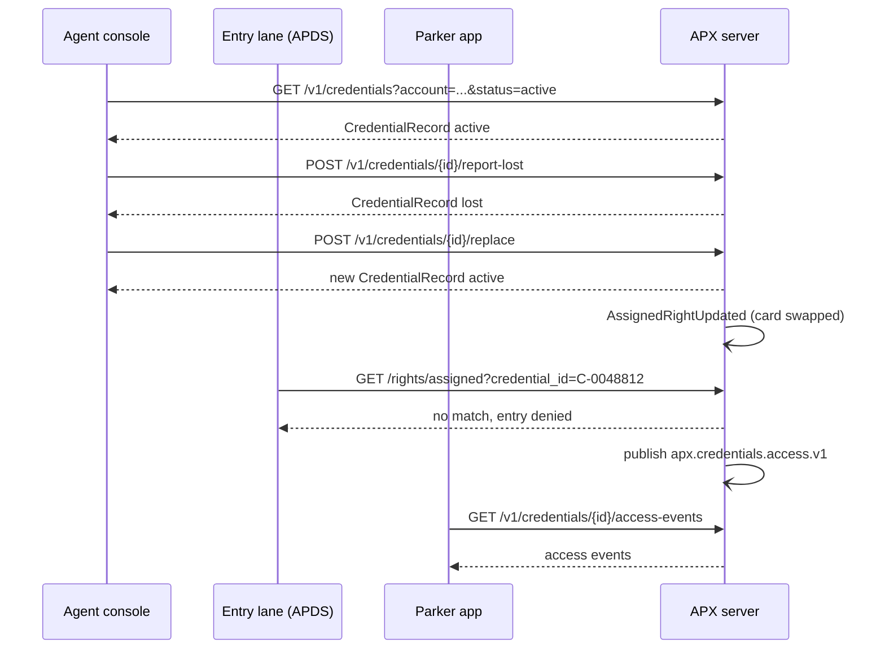

**Data exchanged.**

| Object | Defined in | Notes |
|---|---|---|
| CredentialRecord | APX Part 21 §21.1; proposed to APDS (Right: extension of CredentialAssigned, with CredentialMedia) | The managed card, its media, deposit and lifecycle |
| CredentialAccessEvent | APX Part 21 §21.4; proposed to APDS as AccessEvent (Session) | One presentation at a lane and its outcome |
| AssignedRight, CredentialAssigned | APDS 4.1 | Where the card is materialized; what the lane reads |
| VehicularAccess, SupplementalEquipment, Session | APDS 4.1 | Lane, reader, and the stay a granted presentation belongs to |
| Problem | APX Part 12 | The 409 refusal |

**Postconditions / outcome.**

The new card works and the old card opens nothing. No sync job or separate
blocklist was needed: the lane refused the card because the right no longer
carried it. The old record keeps its history (Part 21 §21.3), and a retry of
the replace call with the same key returns the same successor.

**Example.**

Step 4, the access event recorded for the refused card:

```json
{
  "id": "d7000000-0000-4000-8000-000000000410",
  "credential": { "id": "d6000000-0000-4000-8000-000000000101", "className": "CredentialRecord" },
  "occurredAt": "2026-09-19T18:02:17Z",
  "place": { "id": "b1000000-0000-4000-8000-000000000001", "className": "Place" },
  "lane": { "id": "b2000000-0000-4000-8000-000000000001", "className": "VehicularAccess" },
  "device": { "id": "b2000000-0000-4000-8000-000000000011", "className": "SupplementalEquipment" },
  "direction": "entry",
  "outcome": "denied",
  "denialReason": "credentialReplaced"
}
```

**APX references.**

Part 21 §21.1–21.4, §21.6. Registry `apx-access-denial-reasons`. Scenario
`docs/scenarios/20-credential-lost-card-replacement.md`.

#### D.2.5 Valet drop-off, retrieval by text and verified handback

**Summary.**

A guest leaves a car at a hotel valet stand. The attendant's app records a
condition report with photos and an existing scuff, and the guest
acknowledges it. Later the guest texts to ask for the car and gets an
arrival estimate. The runner stages the car, the attendant checks the claim
code and records the handback condition. When the guest later claims a new
scratch, the acknowledged drop-off report answers the claim.

**Parties.**

| Party | Role |
|---|---|
| Attendant scanning app | Creates and moves the ticket; scope `apx.valet:manage` |
| Guest's phone, through an SMS gateway | Requests the car; scope `apx.valet:request`, on a token bound to this ticket at drop-off |
| Runner board | Reads the queue; scope `apx.valet:read` |
| Lakeside Garage APX server | Distributing Party; opens the APDS Session for the stay |

**Preconditions.**

- The valet stand is a Place (`b1…0005`) with a drop-off lane and a staging
  lane, both VehicularAccess elements.
- The valet rate is charged on the APDS Session, not on the ticket.

**Flow.**

1. The attendant calls `POST /v1/valet/tickets` with an `Idempotency-Key`,
   the ticket number, vehicle, customer display name and masked contact,
   and `dropOff`. `dropOff` holds mileage, fuel, key tag, items left, and a
   `conditionReport` with damage items, photos and
   `customerAcknowledged: true`. The ValetTicket is `dropped`, and the
   server opens and references the APDS Session for the stay.
2. A runner parks the car: `POST /v1/valet/tickets/{id}/park` with the zone
   and key location. The ticket is `parked`.
3. The guest texts "CAR". The gateway calls
   `POST /v1/valet/tickets/{id}/retrieve` with `channel: sms` on the guest's
   token. The ticket is `requested`, with `etaMinutes` and `promisedTime`.
   The customer scope gets a minimized read: no storage, no key tag, no
   `statusHistory`, no condition report (Part 22 §22.5). A repeated request
   returns the same ticket with 200 and adds nothing to the runner board
   (§22.3 rule 4). `apx.valet.retrieval.requested.v1` is published.
4. The runner board calls `GET /v1/valet/queue?place=…` and sees the zone
   and key hook.
5. The runner calls `POST /v1/valet/tickets/{id}/stage` with the staging
   lane. At the stand the attendant calls
   `POST /v1/valet/tickets/{id}/handback` with `verificationMethod: code`,
   the code, mileage and a handback condition report. The ticket is
   `handedBack`. A code that did not match would return 403
   `valet-verification-failed`, and the attempt would be kept in
   `statusHistory`.
6. The session is paid at the stand through the normal payment surface, and
   the ticket moves to `closed`.

```mermaid
sequenceDiagram
    participant ATT as Attendant app
    participant SMS as SMS gateway
    participant RB as Runner board
    participant APX as APX server
    ATT->>APX: POST /v1/valet/tickets (dropOff + conditionReport)
    APX-->>ATT: ValetTicket dropped (Session opened)
    ATT->>APX: POST /v1/valet/tickets/{id}/park
    SMS->>APX: POST /v1/valet/tickets/{id}/retrieve (sms)
    APX-->>SMS: ValetTicket requested, etaMinutes 8 (minimized)
    APX-)RB: apx.valet.retrieval.requested.v1
    RB->>APX: GET /v1/valet/queue?place=...
    RB->>APX: POST /v1/valet/tickets/{id}/stage
    ATT->>APX: POST /v1/valet/tickets/{id}/handback (code)
    APX-->>ATT: ValetTicket handedBack
```

**Data exchanged.**

| Object | Defined in | Notes |
|---|---|---|
| ValetTicket | APX Part 22 §22.1; proposed to APDS (Session) | Custody record from drop-off to close |
| ConditionReport | APX Part 22 §22.2; proposed to APDS (Observation: ConditionReport, DamageItem) | Drop-off and handback condition, photos, acknowledgement |
| Session | APDS 4.1 | The stay; the valet rate is a line on it |
| Place, VehicularAccess | APDS 4.1 | Stand, drop-off lane, staging lane |
| Problem | APX Part 12 | The 403 refusal |

**Postconditions / outcome.**

The ticket is closed with a full custody history. A week later, when the
guest reports a scratch on the bumper, the agent reads the drop-off report:
a 6 cm scuff, photographed and acknowledged by the guest at drop-off, and a
handback report that says it was unchanged. The claim is answered from the
record.

**Example.**

Step 3, the minimized read returned to the guest's token:

```json
{
  "id": "d8000000-0000-4000-8000-000000000419",
  "version": 3,
  "place": { "id": "b1000000-0000-4000-8000-000000000005", "className": "Place" },
  "ticketNumber": "V-20419",
  "vehicle": { "credentialType": "licensePlate", "credentialIdentification": "SYN-7734", "make": "Audi", "colour": "grey" },
  "customer": { "displayName": "R. Ortega" },
  "dropOff": { "time": "2026-09-20T18:30:14Z" },
  "retrieval": {
    "requestedTime": "2026-09-20T20:41:03Z",
    "channel": "sms",
    "etaMinutes": 8,
    "promisedTime": "2026-09-20T20:49:03Z"
  },
  "valetStatus": "requested"
}
```

**APX references.**

Part 22 §22.1–22.5, §22.7. Scenario
`docs/scenarios/21-valet-dropoff-retrieve-handback.md`.

#### D.2.6 Gateless lot with a shared driveway

**Summary.**

A gateless pay-by-plate lot has one driveway with an entry lane and an exit
lane separated only by paint, each with a camera set up to read rear plates.
On a snowy morning a pickup comes in on the exit lane to avoid ice. Both
cameras read it, the LPR system reports both reads as an entry, and a
session opens. APX derives nothing: the cameras report what they saw, the
LPR system says entry or exit, and the session is the visit between them.

**Parties.**

| Party | Role |
|---|---|
| Site LPR system | Distributing Party for reads and lane configuration; scope `apx.data:write` (native ingest) |
| Operator ops console | Receiving Party; scope `apx.lpr:read` |
| Riverside Lot APX server | Stores reads and sessions |

**Preconditions.**

- Each lane is an APDS VehicularAccess whose `accessType` says what the lane
  is for.
- Each lane carries the APX decoration `apds-ext:apx:lane-cameras@1.0`,
  which names its cameras and the way each faces (Part 13 §13.3a(5)). The
  entry camera faces `inward`, the exit camera `outward`.
- Camera ids are unique within the place.

**Flow.**

1. At 07:41 the exit-lane camera reads the pickup's front plate coming
   toward it. The LPR system calls `POST /observations` (native APDS) with
   the decoration `apds-ext:apx:lpr-read@1.0`: per-attribute confidences,
   `plateFace: front`, `movement: toward`, `accessEvent: entry` and a
   `captureGroup`. The Observation `id` is the engine's own read id, so a
   re-send after a network drop gets 409 `id-collision` and no second read
   appears (§13.3a(8)).
2. The entry-lane camera reads the rear plate moving away. A second
   Observation, in the same `captureGroup`, also reports
   `accessEvent: entry`.
3. A session opens at 07:41:08, the capture time of the passage's first
   read.
4. The ops console calls `GET /v1/lpr/reads?plate=RVR-8821`. It sees two
   reads, two cameras, two lanes, one passage, one entry and one session.
   There is no wrong-way flag and no alert: the lane a car uses does not
   change what it did (§13.3a(6)).
5. At 09:12 the exit camera reads the rear plate moving away
   (`accessEvent: exit`) and the session closes. The engine also reports its
   second choice in `alternateReads`.
6. The console calls `GET /v1/lpr/reads?session=…` and gets all three reads
   behind the visit.

```mermaid
sequenceDiagram
    participant LPR as LPR system
    participant OPS as Ops console
    participant APX as APX server
    LPR->>APX: POST /observations (exit-lane cam, front, toward, entry)
    LPR->>APX: POST /observations (entry-lane cam, rear, away, entry)
    APX-)APX: Session opens at first capture time
    OPS->>APX: GET /v1/lpr/reads?plate=RVR-8821
    APX-->>OPS: 2 LprRead, one captureGroup
    LPR->>APX: POST /observations (exit-lane cam, rear, away, exit)
    APX-)APX: Session closes
    OPS->>APX: GET /v1/lpr/reads?session=...
    APX-->>OPS: 3 LprRead
```

**Data exchanged.**

| Object | Defined in | Notes |
|---|---|---|
| VehicularAccess | APDS 4.1; extension proposed to APDS (Place: LaneCamera, CameraFacingEnum) | The lane |
| LaneCameras | APX Part 13 §13.3a(5) | Decoration `apds-ext:apx:lane-cameras@1.0` |
| ObservationElement | APDS 4.1; extension proposed to APDS (Observation) | The native read |
| LprReadDetail | APX Part 13 §13.3a; proposed to APDS (Observation: AttributeRead, AlternateRead, VehicleMovementEnum, PlateFaceEnum) | Decoration `apds-ext:apx:lpr-read@1.0` |
| LprRead | APX Part 13 §13.3 | The read as the LPR query returns it |
| Session | APDS 4.1 | The visit, billed by plate |

**Postconditions / outcome.**

The session runs from 07:41:08 to 09:12:02 and is billed by plate. Its times
come from when the cameras saw the truck, not when the reads reached the
server, which on a bad-signal day can be hours later (§13.3a(8)). The
second-choice plate is kept so that a Part 17 correction could offer it
without anyone retyping it.

**Example.**

Step 1, the APX decoration on the exit-lane read (trimmed):

```json
"apds-ext:apx:lpr-read@1.0": {
  "plate": { "value": "RVR-8821", "confidence": 0.91 },
  "stateProvince": { "value": "IL", "confidence": 0.88 },
  "bodyType": { "value": "pickup", "confidence": 0.96 },
  "frameReads": 4,
  "platesRead": 2,
  "plateFace": "front",
  "movement": "toward",
  "accessEvent": "entry",
  "captureGroup": "riverside/20261214T074108/0417",
  "engine": "vendor-x/7.2"
}
```

**APX references.**

Part 13 §13.3 and §13.3a(3), (5), (6), (8). Scenario
`docs/scenarios/22-lpr-shared-driveway.md`.

#### D.2.7 Toll gantry charge, retry and dispute

**Summary.**

A tolled access road into the garage complex has a gantry that reads
transponders and plates and bills an account on file. A transponder passage
is created, priced and settled. The gantry's retry after an uplink drop is a
no-op because of the idempotency key. A second passage, read by plate only
at low confidence, is billed to a holder who was elsewhere. She disputes it,
the operator agrees and resolves it as refunded, and a later attempt to
reopen it is refused.

**Parties.**

| Party | Role |
|---|---|
| Gantry bridge | Creates transactions; scope `apx.tolling:manage` |
| Back office | Settles and resolves; scopes `apx.tolling:manage`, `apx.payments:write` |
| Holder, through the call center | Raises the dispute |
| Lakeside APX server | Distributing Party for toll transactions |

**Preconditions.**

- The gantry is an APDS SupplementalEquipment (`b4…0001`).
- Transponder and plate reads are first ingested as native APDS
  Observations. The toll transaction references them and does not restate
  them.

**Flow.**

1. The bridge calls `POST /v1/tolling/transactions` with a required
   `Idempotency-Key`, the toll point, the observations, the credential and
   the price. The TollTransaction is `priced` and
   `apx.tolling.transaction.created.v1` is published.
2. After an uplink drop the bridge sends the same request under the same
   key. The server returns 200 with the original transaction, unchanged. The
   same key with a different body would get 409 `idempotency-conflict`.
3. The nightly batch charges the account and calls
   `POST /v1/tolling/transactions/{id}/payment` with a reference to the
   PaymentRecord. The transaction is `paid`.
4. A second passage with no transponder is read by plate at 0.71
   confidence, then created, priced and billed in the same way. Ten days
   later the holder calls. The agent calls
   `POST /v1/tolling/transactions/{id}/disputes` with
   `reason: wrongVehicle`. The transaction is `disputed`, and its reads
   stay referenced.
5. The back office compares the gantry image with the holder's vehicle and
   calls `POST /v1/tolling/transactions/{id}/disputes/resolve` with
   `resolution: refunded`. The transaction is `resolved`. The refund itself
   is a Part 13 refund against the original payment.
6. A reconciliation job working from a stale export tries to open the
   dispute again and is refused with 409 `dispute-closed`.

```mermaid
sequenceDiagram
    participant GB as Gantry bridge
    participant BO as Back office
    participant AG as Call-center agent
    participant APX as APX server
    GB->>APX: POST /v1/tolling/transactions (Idempotency-Key)
    APX-->>GB: TollTransaction priced
    GB->>APX: same request, same key
    APX-->>GB: 200, original transaction
    BO->>APX: POST /v1/tolling/transactions/{id}/payment
    APX-->>BO: TollTransaction paid
    AG->>APX: POST /v1/tolling/transactions/{id}/disputes (wrongVehicle)
    APX-->>AG: TollTransaction disputed
    BO->>APX: POST /v1/tolling/transactions/{id}/disputes/resolve (refunded)
    APX-->>BO: TollTransaction resolved
    BO->>APX: POST /v1/tolling/transactions/{id}/disputes
    APX-->>BO: 409 dispute-closed
```

**Data exchanged.**

| Object | Defined in | Notes |
|---|---|---|
| TollTransaction | APX Part 15 §15.1; proposed to APDS (Observation: TollTransaction, TollDispute) | The passage, its price, payment and dispute |
| ObservationElement | APDS 4.1 | The transponder and plate reads |
| SupplementalEquipment | APDS 4.1 | The gantry (toll point) |
| PaymentRecord | APX Part 13 §13.1a; proposed to APDS as an extension of Payment | The money; the toll record holds only a reference |
| Problem | APX Part 12 | The 409 refusals |

**Postconditions / outcome.**

The first passage is paid once. The second is resolved as refunded, with
the original reads still referenced as evidence. Every transition published
`apx.tolling.transaction.status.v1`, so analytics and gantry-health
dashboards saw the dispute without polling.

**Example.**

Step 5, the resolved transaction (trimmed):

```json
{
  "id": "e9000000-0000-4000-8000-000000000802",
  "version": 5,
  "credential": { "credentialType": "licensePlate", "credentialIdentification": "SYN-9930" },
  "pricing": { "currencyType": "USD", "currencyValue": 2.75 },
  "payment": { "id": "9c0d1e2f-3a4b-4c5d-8e6f-7a8b9c0d1902", "className": "PaymentRecord" },
  "transactionStatus": "resolved",
  "dispute": {
    "reason": "wrongVehicle",
    "openedTime": "2026-10-02T15:20:11Z",
    "resolvedTime": "2026-10-03T09:41:02Z",
    "resolution": "refunded"
  }
}
```

**APX references.**

Part 15 §15.1–15.3; Part 13 §13.1a (refunds). Registries
`apx-toll-dispute-reasons`, `apx-toll-dispute-resolutions`. Scenario
`docs/scenarios/23-tolling-gantry-dispute.md`.

#### D.2.8 Negotiated rate at the exit lane

**Summary.**

A driver at an exit lane disputes a correct event-rate charge. The operator
allows its call center to settle this kind of complaint with one flagged
rate table. The agent sees which tables may be offered from the rate deck
the call platform already mirrors, applies one to the car in the lane, and
the command record names the agent. The next car is priced as before.

**Parties.**

| Party | Role |
|---|---|
| Call platform | Receiving Party; mirrors the deck on the native `/rates` route (`apx.data:read`) |
| Call-center agent console | Scopes `apx.control:read`, `apx.control:execute` |
| Lakeside Garage APX server and PARCS | Distributing Party; applies the command at the lane |

**Preconditions.**

- The server advertises the `negotiatedRates` feature (registry
  `apx-features`).
- The table that may be offered carries the decoration
  `apds-ext:apx:ratepolicy@1.0` with `negotiable: true`.
- The call platform has synced the deck with the Part 5 change feed.

**Flow.**

1. The agent's screen-pop calls `GET /v1/lanes/{id}/current`. The LaneStatus
   shows ticket `T-4471`, in since 09:12, $45.00 due, no validations.
2. The console already holds the deck from
   `GET /rates?place_ids=…&mode=change&cursor=…`. The event table has no
   decoration. The customer-service table carries `negotiable: true`, a
   `displayName` and a `note`. The note is guidance for the presenting
   system; the server never evaluates it (Part 6 §6.6).
3. The agent calls `POST /v1/commands` with
   `commandType: pushNegotiatedRate`, the lane as `target`, the table as a
   versioned reference in `parameters.rateTable`, `agent`,
   `agentType: human` and `reason`. The Command `succeeded` with
   `confirmationLevel: deviceAcknowledged`.
4. `GET /v1/lanes/{id}/current` now shows $20.00 due and a `negotiatedRate`
   block naming the table, the command and the agent.
5. A different agent who tries a table without the flag is refused with 422
   `rate-not-negotiable`.

```mermaid
sequenceDiagram
    participant CP as Call platform
    participant AG as Agent console
    participant APX as APX server
    CP->>APX: GET /rates?mode=change&cursor=...
    APX-->>CP: RateTables (one with ratepolicy negotiable)
    AG->>APX: GET /v1/lanes/{id}/current
    APX-->>AG: LaneStatus, 45.00 due
    AG->>APX: POST /v1/commands (pushNegotiatedRate)
    APX-->>AG: Command succeeded
    AG->>APX: GET /v1/lanes/{id}/current
    APX-->>AG: LaneStatus, 20.00 due, negotiatedRate
```

**Data exchanged.**

| Object | Defined in | Notes |
|---|---|---|
| LaneStatus | APX Part 6 §6.2 | The screen-pop |
| RateTable | APDS 4.1 | The deck, on the native route |
| RatePolicy | APX Part 6 §6.6; proposed to APDS as an extension of RateTable | Decoration `apds-ext:apx:ratepolicy@1.0` |
| Command | APX Part 6 §6.1 | `pushNegotiatedRate`, with `agent`, `agentType`, `reason` |
| VersionedReference, Session | APDS 4.1 | The exact table version; the stay it priced |
| Problem | APX Part 12 | The 422 refusal |

**Postconditions / outcome.**

The record settles what was offered (table `f2…0064` at version 2), to whom
(the current ticket at lane 2 only), and who chose it (`agent`, separate
from `requestedBy`). `pushRate` would have repriced the lane for every car,
which is why it needs a supervisor and this command does not. The session's
APDS segment references the table like any other rate. APX sets no selection
rules: which flagged table to offer, and when, is the presenting system's
and the operator's decision (Part 6 §6.6). The `apx-features` registry also
lists `negotiatedAmounts`, where an agent states an amount; this scenario
does not use it.

**Example.**

Step 3, the command request:

```json
{
  "commandType": "pushNegotiatedRate",
  "target": { "id": "b2000000-0000-4000-8000-000000000002", "className": "VehicularAccess" },
  "parameters": {
    "rateTable": { "id": "f2000000-0000-4000-8000-000000000064", "version": 2, "className": "RateTable" }
  },
  "agent": "agent:j.okafor",
  "agentType": "human",
  "reason": "rate complaint referred by tenant Harbor Dental; customer-service flat offered"
}
```

**APX references.**

Part 6 §6.1, §6.2, §6.6; Part 5 §5.2 (change feed). Registries
`apx-command-types`, `apx-features`. Scenario
`docs/scenarios/24-negotiated-rate-exit-lane.md`.

#### D.2.9 Ticket matching at the exit lane

**Summary.**

A driver at an exit lane has no ticket. The entry was recorded anyway: the
camera read the plate on the way in and again on the way out, and the
server already knows which open session matches. The agent confirms with
the driver, binds the exit to the entry, and the ticket closes at the real
fare instead of a lost-ticket fee or a free vend. A monthly holder without
his card is matched the same way through the phone number on his account.

**Parties.**

| Party | Role |
|---|---|
| Call-center agent console | Scopes `apx.control:read`, `apx.control:execute`, `apx.accounts:read` |
| Lakeside Garage APX server and PARCS | Distributing Party; computes candidates and binds the exit |

**Preconditions.**

- The server advertises the `ticketMatching` feature (registry
  `apx-features`).
- Entry reads are on file as APDS Observations linked to open Sessions.
- The call platform has already mapped the call to the lane before calling
  APX (Part 17 §17.1).

**Flow.**

1. With no ticket in the machine, `GET /v1/lanes/{id}/current` returns
   `matchCandidates` (Part 6 §6.7). The one candidate matched by
   `plateRead` names the session, ticket `T-4502`, entry time and lane, the
   evidence Observation, a confidence and `amountDueIfMatched` ($14.00).
   Candidates are advisory; nothing is bound yet.
2. The agent reads the plate back to the driver, gets a yes, and calls
   `POST /v1/commands` with `commandType: matchTicket`, the session and the
   evidence in `parameters`, `agent`, `agentType: human` and `reason`. The
   Command `succeeded`.
3. `GET /v1/lanes/{id}/current` now shows `T-4502` as the current ticket,
   priced from 08:02, with `matchedCommand`. The driver pays and the gate
   vends. The APDS Session closes with its exit segment, and
   `SessionUpdated` is published.
4. A monthly holder without his card gives the phone number on his
   account. `GET /v1/lanes/{id}/current?phone=…` returns a candidate
   matched by `account`, with the RightHolder as evidence and $0.00 due. The
   agent sends the same `matchTicket` command, and the gate vends as a
   matched exit on the permit, not as a courtesy vend (Part 17 §17.4).
5. When `matchCandidates` is empty, the agent falls back to `lostTicket`
   and the deck's `lostTicketFee` line (Part 6 §6.1).
6. The server refuses a match on a closed session with 422
   `session-not-open`, and a `matchTicket` without `agent` with 400
   `agent-required`.

```mermaid
sequenceDiagram
    participant AG as Agent console
    participant APX as APX server
    participant LANE as Exit lane (PARCS)
    AG->>APX: GET /v1/lanes/{id}/current
    APX-->>AG: LaneStatus with matchCandidates
    AG->>APX: POST /v1/commands (matchTicket)
    APX->>LANE: bind exit to session
    APX-->>AG: Command succeeded
    AG->>APX: GET /v1/lanes/{id}/current
    APX-->>AG: currentTicket T-4502, matchedCommand
    LANE-)APX: paid, gate vends
    APX-)APX: Session closed, SessionUpdated
```

**Data exchanged.**

| Object | Defined in | Notes |
|---|---|---|
| LaneStatus | APX Part 6 §6.2 | Screen-pop, with `currentTicket` or `matchCandidates` |
| MatchCandidate | APX Part 6 §6.7 | Advisory candidate; `matchedBy` is `plateRead` or `account` |
| Command | APX Part 6 §6.1 | `matchTicket`, with `agent` required |
| Session, Segment, ObservationElement | APDS 4.1 | The open stay, its exit segment, the plate read |
| Account (RightHolder) | APX Part 13 §13.1; proposed to APDS as an extension of RightHolder | Evidence for the account match |
| Problem | APX Part 12 | The 422 and 400 refusals |

**Postconditions / outcome.**

Each open ticket is closed at the right fare, and each record names the
agent and the path taken. There is no separate APX matching store to
reconcile later: the match is the session's exit, and `matchedCommand` on
the screen-pop says who made it. APX does not say how confident a match must
be or who must approve it; it does require the name of whoever made it.

**Example.**

Step 1, the candidate on the screen-pop (trimmed):

```json
{
  "lane": { "id": "b2000000-0000-4000-8000-000000000002", "className": "VehicularAccess" },
  "matchCandidates": [
    {
      "session": { "id": "c4000000-0000-4000-8000-000000000051", "className": "Session" },
      "ticketNumber": "T-4502",
      "entryTime": "2026-09-24T08:02:17Z",
      "plate": "KLM4410",
      "matchedBy": "plateRead",
      "evidence": { "id": "f2000000-0000-4000-8000-000000000911", "className": "Observation" },
      "confidence": 0.94,
      "amountDueIfMatched": { "currencyType": "USD", "currencyValue": 14.0 }
    }
  ]
}
```

**APX references.**

Part 6 §6.1, §6.2, §6.7; Part 17 §17.1, §17.4. Scenario
`docs/scenarios/25-ticket-matching-exit-lane.md`; compare Scenario 04
(lost ticket).

#### D.2.10 EV charging billed on the parking session

**Summary.**

A garage's chargers free-vend: anyone who plugs in can charge, and the
energy is attributed to the parking stay by an overhead bay camera that
reads the plate. The camera also sees a non-EV parked in front of a
charger. A driver charges, the charge completes, the idle period begins
after a grace period, and the cable will not release until an agent sends an
unlock command. Energy and idle time are two lines on the parking session,
paid once at exit. This is the optional conformance class `apx-charging`
(Part 23).

**Parties.**

| Party | Role |
|---|---|
| Charging-network bridge | Reports sessions and meter events; scope `apx.charging:manage` |
| Overhead camera analytics | Reports bay presence; scope `apx.charging:manage` |
| Driver's PWA | Reads the charge status; scope `apx.charging:status`, bound to this session |
| Agent console | Sends the unlock; scopes `apx.control:execute`, `apx.charging:read` |
| Lakeside Garage APX server | Distributing Party; fuses charger and bay data, prices idle |

**Preconditions.**

- The chargers are APDS ElectricChargingEquipment, each linked to a Space.
- The driver's car entered and has an open APDS Session.
- The idle policy (grace, rate, maximum) is known to the bridge.

**Flow.**

1. `GET /v1/charging/points?place=…` returns ChargingPointStatus for each
   charger. The camera reported, with `POST /v1/charging/points/{id}/bay`
   (idempotent), a vehicle in front of E2 that is not plugged in and not
   EV-capable. The server combines this with the charger's own status:
   `presence: vehicleNotPluggedIn`, point `availability: blocked`
   (§23.3). An `iceInEvSpace` alert (Part 7) is open.
2. The bridge calls `POST /v1/charging/sessions` with the charger,
   connector, space, `parkingSession`, `authorization.method:
   unlimitedAccess`, `idlePolicy` and `settlement.mode: parkingSession`. The
   ChargingSession is `authorized`.
3. The bridge reports each charger transaction event with
   `POST /v1/charging/sessions/{id}/events` (ChargingEvent): `pluggedIn`,
   `chargingStarted`, then `meterValue` every few minutes.
4. The driver's PWA calls `GET /v1/charging/sessions/{id}` and gets a
   minimized read with no plate, credential or network identifiers
   (§23.6).
5. `chargingEnded` (`stopReason: evFull`) makes the session `complete`.
   When the 10-minute grace has passed, the server (not the bridge) moves
   it to `idle` and publishes `apx.charging.idle.started.v1`.
6. The cable is latched. The agent calls `POST /v1/commands` with
   `commandType: unlockConnector`. The Command `succeeded` with
   `confirmationLevel: deviceAcknowledged`: the charger said it unlocked
   (Part 6 §6.1).
7. `unplugged` makes the session `unplugged`, with energy and idle cost
   posted to the APDS Session. When that session is paid, the charging
   session becomes `closed`. `POST /v1/charging/sessions/{id}/payment` is
   not called, because the settlement mode is `parkingSession`.

```mermaid
sequenceDiagram
    participant CAM as Bay camera
    participant BR as Charging bridge
    participant PWA as Driver PWA
    participant AG as Agent console
    participant APX as APX server
    CAM->>APX: POST /v1/charging/points/{id}/bay
    BR->>APX: POST /v1/charging/sessions (parkingSession)
    APX-->>BR: ChargingSession authorized
    BR->>APX: POST /v1/charging/sessions/{id}/events (pluggedIn, started, meter)
    PWA->>APX: GET /v1/charging/sessions/{id}
    APX-->>PWA: minimized ChargingSession
    BR->>APX: POST .../events (chargingEnded)
    APX-)APX: idle after grace, apx.charging.idle.started.v1
    AG->>APX: POST /v1/commands (unlockConnector)
    APX-->>AG: Command succeeded
    BR->>APX: POST .../events (unplugged)
    APX-)APX: energy + idle lines on APDS Session
```

**Data exchanged.**

| Object | Defined in | Notes |
|---|---|---|
| ElectricChargingEquipment, Space, Session | APDS 4.1 | The charger, its bay, the parking stay |
| ChargingPointStatus, ChargingBayPresence | APX Part 23 §23.1, §23.3; proposed to APDS (EnergyInfrastructure) | Live status, fused with what the camera sees |
| ChargingSession | APX Part 23 §23.2, §23.5; proposed to APDS (EnergyInfrastructure: ChargingSession, ChargingCost, ChargingIdleTerms) | The charge, its timeline, energy, idle and cost |
| ChargingEvent | APX Part 23 §23.4 | One charger transaction event |
| Command | APX Part 6 §6.1, §6.8 | `unlockConnector` |
| Alert | APX Part 7; proposed to APDS (Operations) | `iceInEvSpace` |
| EventEnvelope | APX Part 8 §8.2 | Carries `apx.charging.idle.started.v1` |

**Postconditions / outcome.**

24.6 kWh and 13 idle minutes appear as two lines on the APDS Session, next to
the parking. The driver pays $13.81 plus parking at the exit pay station. On
a network-billed charger (`settlement.mode: chargingNetwork`) the garage
would hold the same energy and idle record with no money on it. E2 is still
`blocked` for the enforcement officer.

**Example.**

Step 7, the idle policy and cost on the final session (trimmed):

```json
{
  "id": "e2000000-0000-4000-8000-000000000042",
  "version": 18,
  "parkingSession": { "id": "f1000000-0000-4000-8000-000000000777", "className": "Session" },
  "chargingStatus": "unplugged",
  "energy": { "meterStartWh": 1418320, "meterStopWh": 1442920, "deliveredKwh": 24.6 },
  "stopReason": "evFull",
  "idlePolicy": { "graceMinutes": 10, "idleRate": { "currencyType": "USD", "currencyValue": 0.40 }, "idleRatePer": "minute", "maxIdleMinutes": 60, "appliesToSettlement": true },
  "cost": {
    "energy": { "currencyType": "USD", "currencyValue": 8.61 },
    "idle": { "currencyType": "USD", "currencyValue": 5.20 },
    "total": { "currencyType": "USD", "currencyValue": 13.81 },
    "tariffReference": "lsg-l2-std-2026"
  },
  "settlement": { "mode": "parkingSession" }
}
```

**APX references.**

Part 23 §23.1–23.6, §23.9, §23.12; Part 6 §6.8. Registries
`apx-command-types`, `apx-alert-types`. Scenario
`docs/scenarios/26-ev-charging-one-bill-idle-unlock.md`.

#### D.2.11 Reversible lane and a late correction

**Summary.**

A garage has a centre lane that runs inbound in the morning and outbound in
the evening, with one camera facing each way. Another lane still has a
camera that reads front plates. APX does not care which setup a lane has; it
needs each camera's facing written down. A van comes in on the centre lane.
One of its two reads is first reported as `unknown` and then corrected, and
the correction reaches billing as an event.

**Parties.**

| Party | Role |
|---|---|
| Site LPR system | Distributing Party for reads and lane configuration; scope `apx.data:write` |
| Billing platform | Receiving Party; Part 8 subscription to the observation topics, scope `apx.lpr:read` |
| Harbor Street APX server | Stores reads and publishes events |

**Preconditions.**

- The centre lane is a VehicularAccess with `accessType: reversible` and
  two cameras (`inward`, `outward`) in `apds-ext:apx:lane-cameras@1.0`.
- Facing is relative to the garage, so it does not change when the lane
  flips.

**Flow.**

1. At 08:05 both centre cameras read the van. The inward camera reports the
   rear plate moving away, and the LPR system marks it `accessEvent: entry`.
   The outward camera read the front plate in one frame only, too few to
   determine `movement`, so that read is ingested with
   `accessEvent: unknown`. The server publishes
   `apx.data.observation.created.v1` for each read, and the billing platform
   opens a session from the entry read.
2. The LPR system pairs the two reads by `captureGroup` and corrects the
   unknown one with `PUT /v1/lpr/reads/{observation}/access-event`, sending
   `If-Match: "1"` and `{ "accessEvent": "entry" }`. The server answers with
   the new Observation version.
3. The server publishes `apx.data.observation.updated.v1` with the whole
   Observation at version 2. The billing platform keys on the Observation
   id, keeps version 2, and attaches the read to the session it already
   opened.
4. At 17:40 the lane runs outbound. The van leaves; both reads are
   `accessEvent: exit` in one `captureGroup`, and the session closes at the
   capture time. `GET /v1/lpr/reads?session=…` returns all four reads.

```mermaid
sequenceDiagram
    participant LPR as LPR system
    participant APX as APX server
    participant BILL as Billing platform
    LPR->>APX: POST /observations (inward cam, entry)
    LPR->>APX: POST /observations (outward cam, unknown)
    APX-)BILL: apx.data.observation.created.v1 (x2)
    BILL->>BILL: open session from entry read
    LPR->>APX: PUT /v1/lpr/reads/{observation}/access-event (If-Match 1)
    APX-->>LPR: accessEvent entry, version 2
    APX-)BILL: apx.data.observation.updated.v1
    BILL->>BILL: keep version 2, attach to session
```

**Data exchanged.**

| Object | Defined in | Notes |
|---|---|---|
| VehicularAccess | APDS 4.1; extension proposed to APDS (Place: LaneCamera) | `accessType: reversible` |
| LaneCameras | APX Part 13 §13.3a(5) | One camera each way |
| ObservationElement | APDS 4.1 | The native read |
| LprReadDetail | APX Part 13 §13.3a; proposed to APDS (Observation) | `movement`, `accessEvent`, `captureGroup` |
| EventEnvelope | APX Part 8 §8.2 | Created and updated events |
| Session | APDS 4.1 | The visit the billing platform keeps |

**Postconditions / outcome.**

One visit, four reads, one session. How the LPR system paired the reads (by
group, by lane mode, or by preferring the rear plate) is its own logic; APX
carries only the result (Part 13 §13.3a(4)). Had the rear-plate read been
missed, the correction event would have opened the session at 08:05:31, the
capture time, not 08:05:33 when the correction arrived.

**Example.**

Step 2, the correction and the server's answer:

```http
PUT /v1/lpr/reads/f2000000-0000-4000-8000-000000000805/access-event HTTP/1.1
Content-Type: application/json
If-Match: "1"

{ "accessEvent": "entry" }
```

```json
{
  "observation": { "id": "f2000000-0000-4000-8000-000000000805", "className": "Observation" },
  "accessEvent": "entry",
  "version": 2
}
```

**APX references.**

Part 13 §13.3a(3)–(5), §13.4; Part 8. Scenario
`docs/scenarios/27-lpr-reversible-lane.md`.

#### D.2.12 A separate pairing service writes session detail

**Summary.**

The LPR cameras feed the APX server, but a separate pairing service turns
reads into stays. It decides which reads make up a visit, which permit
covers it, and why each stay ended, and writes those decisions back. APDS
gives it the Session to write. APX adds the decoration
`apds-ext:apx:session-detail@1.0` for what the Session has no member for.

**Parties.**

| Party | Role |
|---|---|
| Pairing service | Distributing Party for Sessions; scopes `apx.data:write`, `apx.lpr:read` |
| Lakeside APX server | Stores Sessions and reads; claims `apx-lpr` |

**Preconditions.**

- The garage is place `b1…0001`; its valet section is the area `b1…0021`
  beneath it.
- Reads are on the server as Observations.

**Flow.**

1. A permit holder's plate is read as `SYN-4O71`; the permit says
   `SYN-4071`. Folding the look-alike O and 0 makes them equal. The service
   calls `POST /sessions` (native APDS) with the decoration: `reads[]` (one
   `entry` marked `representative`, one `duplicate`), `lifecycle: open`, and
   a `matches[]` entry with `plate.method: fold` and vehicle evidence level
   `good`. The server publishes `SessionCreated`; the decoration adds no
   topic (§5.8 rule 7). `GET /v1/lpr/reads?session=…` now returns both
   reads.
2. The car goes into the valet section. The service opens an area Session
   with `parent` naming the visit. The parent's element is an ancestor of
   the child's, as §5.8 rule 6 requires.
3. At handback the service closes the area Session with
   `PUT /sessions/{id}`, `APX-Update-Mode: change` and `If-Match`, setting
   `lifecycle: ended` and `closure.endReason: valetHandback`. The exit read
   then closes the visit with `endReason: exitRead`.
4. A car is seen only leaving. APDS requires `actualStart`, so the service
   sets it equal to `actualEnd` and writes `closure.endReason: exitOnly`,
   `startObserved: false`. Dwell and occupancy reports skip it (§5.8
   rule 4).
5. An older build tries to bind a read that is already bound to another
   visit, without naming that visit in `supersedes`. The server refuses with
   409 `read-already-bound` and changes nothing (§5.8 rule 2). The client
   sent `Accept: application/problem+json`, so the refusal is a Problem
   (Part 5 §5.1a).

```mermaid
sequenceDiagram
    participant PS as Pairing service
    participant APX as APX server
    PS->>APX: POST /sessions (visit, session-detail, matches)
    APX-->>PS: created, SessionCreated published
    PS->>APX: POST /sessions (area, parent = visit)
    PS->>APX: PUT /sessions/{area} (change mode, ended, valetHandback)
    PS->>APX: POST /sessions (exitOnly, startObserved=false)
    PS->>APX: POST /sessions (read already bound)
    APX-->>PS: 409 read-already-bound
```

**Data exchanged.**

| Object | Defined in | Notes |
|---|---|---|
| Session, Segment, AssignedRight | APDS 4.1 | The visit, its segment, the covering permit |
| SessionDetail | APX Part 5 §5.8; proposed to APDS (Session extension, SessionRead, SessionClosure) | Decoration `apds-ext:apx:session-detail@1.0` |
| MatchEvidence | APX Part 5 §5.8; proposed to APDS (Session) | How plates compared and how strong the vehicle evidence was; holds no plate characters |
| ObservationElement | APDS 4.1 | The reads bound to the visit |
| Problem | APX Part 12 | The 409 refusal |

**Postconditions / outcome.**

Four Sessions are on file, each with its reads, its end reason and, where it
applies, its parent. A dashboard that counts visits counts Sessions without a
`parent`. A read is never in two visits: to move one deliberately, the
service names the current Session in `supersedes`, and the same write takes
the read over.

**Example.**

Step 4, the decoration on the exit-only Session:

```json
"apds-ext:apx:session-detail@1.0": {
  "reads": [
    { "observation": { "id": "f3000000-0000-4000-8000-000000000150", "className": "ObservationElement" }, "role": "exit", "representative": true }
  ],
  "lifecycle": "ended",
  "closure": { "endReason": "exitOnly", "startObserved": false }
}
```

**APX references.**

Part 5 §5.1, §5.1a, §5.8; Part 13 §13.3a(6); Part 9 §9.6. Registry
`apx-session-end-reasons`. Scenario
`docs/scenarios/28-session-detail-pairing-client.md`.

#### D.2.13 Plate review before enforcement

**Summary.**

A city's rules say no notice may be mailed on a camera read below 0.8
confidence unless a person has checked it. A rear camera reads a plate at
0.52, and the LPR system marks the read for review. The enforcement pipeline
records an overstay overnight, but the server will not let it issue on an
unchecked read. In the morning a reviewer corrects the plate. The pipeline
re-runs its rule on the corrected plate and dismisses the overstay. A read
of a bike-rack reflector is rejected.

**Parties.**

| Party | Role |
|---|---|
| Site LPR system | Distributing Party for reads; scope `apx.data:write` (native ingest) |
| Operator review desk | Sees reads with `apx.lpr:read`; records decisions with `apx.data:write` |
| Enforcement pipeline | Scope `apx.violations:manage` |
| Glenwood Street APX server | Stores reads and violations; blocks issuance on unreviewed evidence |

**Preconditions.**

- The operator's policy sends low-confidence reads to review. Which reads
  go to review, and who works the queue, is the operator's business; APX
  carries only the state (Part 13 §13.3a(4a)).
- The lot's policy allows unreviewed issuance for automated detections.

**Flow.**

1. At 22:14 the LPR system calls `POST /observations` with the decoration
   `apds-ext:apx:lpr-read@1.0`. It carries `review.state: pending` with
   reasons `lowConfidence` and `ambiguousCharacters` from the
   `apx-read-review-reasons` registry, and the engine's second choice in
   `alternateReads`.
2. At 06:00 the pipeline finds no paid session for the plate and records an
   automated overstay with `POST /v1/violations`, citing the read in
   `observations[]`. Its `POST /v1/violations/{id}/issue` is refused with
   409 `violation-not-issuable`, because the evidence read is still
   `pending`, whatever the lot's policy says (Part 19 §19.4 rule 6;
   APX-VIO-16).
3. The review desk finds the read with `GET /v1/lpr/reads?observation=…`,
   looks at the image, and calls `PUT /v1/lpr/reads/{observation}/plate`
   with `If-Match: "1"`, `decision: corrected`, the corrected plate, a
   reason and the reviewer. The server writes the plate into
   `observedCredentialId` and `vehicleAncillaryIdentification`, so a plain
   APDS client sees it. It sets `review.state`, `decidedTime` and
   `decidedBy`, keeps the engine's values in `review.original`, increments
   the Observation version, and publishes
   `apx.data.observation.updated.v1`.
4. The pipeline receives the event, keeps version 2, and re-runs its rule.
   The corrected plate was paid until 23:00, so the pipeline calls
   `POST /v1/violations/{id}/review` with `decision: dismiss` and
   `reason: plateMisread`.
5. The reviewer rejects the reflector read with `decision: rejected`. A
   `plate` sent with `rejected` would get 422 `request-unprocessable`.

```mermaid
sequenceDiagram
    participant LPR as LPR system
    participant ENF as Enforcement pipeline
    participant DESK as Review desk
    participant APX as APX server
    LPR->>APX: POST /observations (review pending)
    ENF->>APX: POST /v1/violations (automated, cites read)
    ENF->>APX: POST /v1/violations/{id}/issue
    APX-->>ENF: 409 violation-not-issuable
    DESK->>APX: PUT /v1/lpr/reads/{observation}/plate (corrected)
    APX-->>DESK: LprRead, review corrected
    APX-)ENF: apx.data.observation.updated.v1
    ENF->>APX: POST /v1/violations/{id}/review (dismiss, plateMisread)
```

**Data exchanged.**

| Object | Defined in | Notes |
|---|---|---|
| ObservationElement, VehicleAncillaryIdentification | APDS 4.1 | The read; the corrected plate is written here |
| LprReadDetail | APX Part 13 §13.3a(4a); proposed to APDS (Observation: ReadReview, ReadReviewStateEnum, ReadReviewReasonEnum) | `review` with state, reasons and the original values |
| LprRead | APX Part 13 §13.3 | Returned to the review desk |
| Violation | APX Part 19 §19.1; proposed to APDS (Enforcement) | The overstay, later dismissed |
| EventEnvelope | APX Part 8 §8.2 | `apx.data.observation.updated.v1` |
| Problem | APX Part 12 | The 409 and 422 refusals |

**Postconditions / outcome.**

Nothing was sent on a read nobody checked. The correction is per read: it
changes no Session, and every Session the read feeds sees it. Sending the
same decision again returns 200 at version 2 and publishes nothing. A
second reviewer who decided first would cause 409 `version-conflict`. The
rejected read stays on file until its retention ends (§13.3b), but it can
never support pairing or a notice.

**Example.**

Step 3, the review block after the correction (trimmed):

```json
"review": {
  "state": "corrected",
  "reasons": ["lowConfidence", "ambiguousCharacters"],
  "decidedTime": "2026-12-17T08:20:41Z",
  "decidedBy": "glenwood-desk-04",
  "original": {
    "plate": { "value": "GLN-8B03", "confidence": 0.52 },
    "stateProvince": { "value": "OR", "confidence": 0.9 }
  }
}
```

**APX references.**

Part 13 §13.3a(4a), §13.3b, §13.4; Part 19 §19.4 rule 6; Annex A
APX-LPR-08, APX-VIO-16. Scenario `docs/scenarios/29-lpr-plate-review.md`.

#### D.2.14 A citation imported from another enforcement system

**Summary.**

Officers write citations on a separate citation platform. The operator's
APX server holds the sessions, rights and reports, and needs those
citations as Violations, with the platform's times and status, without
claiming it issued them. A citation is imported, a part payment arrives as a
newer revision, and the nightly reconciliation links the citation to the
stay the car was in.

**Parties.**

| Party | Role |
|---|---|
| Citation platform connector | Distributing Party for citations; scope `apx.violations:manage` |
| Reconciliation job | Links the stay; scope `apx.violations:manage` |
| Reporting | Receiving Party; scope `apx.violations:read` |
| Lakeside Garage APX server | Stores the imported violation |

**Preconditions.**

- Lot C is a Place on the server, and the car's stay is an APDS Session.
- The connector identifies each citation by `system` and `recordId` and
  numbers its revisions.

**Flow.**

1. The connector calls `POST /v1/enforcement/violation-imports` with
   `Idempotency-Key: example-enforcement:EX-2026-018342:1` and the citation
   as the platform recorded it, in state `issued`, with the decoration
   `apds-ext:apx:violation-source@1.0`. The server records it (201) with
   the officer's issue time. It runs no eligibility check and applies no
   policy cap: the platform issued it under its own authority (§19.13
   rule 4). It publishes `apx.violations.detected.v1` and
   `apx.violations.issued.v1`.
2. The driver pays $15 on the platform. The connector sends revision 3
   with `sourceStatus: partiallyPaid`, `amountPaid` and a `payments[]`
   entry carrying the platform's `reference`. Revision 3 is newer, so it
   applies in place (200, version 2) and `apx.violations.status.v1` is
   published. The violation stays `issued`: `paid` requires `amountPaid` to
   reach `amount` (§19.6a rule 2). Resending revision 3 is a no-op; sending
   revision 1 now is 409 `version-conflict`.
3. The reconciliation job calls `POST /v1/violations/{id}/session` with
   `If-Match: "2"`, the Session, `reason: lateMatch` and the match
   `evidence`. The server writes the evidence onto the violation as
   `apds-ext:apx:match-evidence@1.0` and bumps the version to 3. This is
   not a lifecycle transition, so nothing is added to `statusHistory[]`
   (§19.13 rule 6). A Session outside Lot C's hierarchy would be 422
   `request-unprocessable`.
4. Reporting finds the record by the platform's key:
   `GET /v1/violations?sourceSystem=example-enforcement&sourceRecordId=EX-2026-018342`.

```mermaid
sequenceDiagram
    participant CON as Platform connector
    participant REC as Reconciliation job
    participant REP as Reporting
    participant APX as APX server
    CON->>APX: POST /v1/enforcement/violation-imports (rev 1)
    APX-->>CON: 201 Violation issued
    CON->>APX: POST /v1/enforcement/violation-imports (rev 3, part paid)
    APX-->>CON: 200 Violation v2
    REC->>APX: POST /v1/violations/{id}/session (If-Match 2)
    APX-->>REC: Violation v3, relatedSession set
    REP->>APX: GET /v1/violations?sourceSystem=...&sourceRecordId=...
    APX-->>REP: Violation with source and match evidence
```

**Data exchanged.**

| Object | Defined in | Notes |
|---|---|---|
| Violation | APX Part 19 §19.1, §19.6a, §19.13; proposed to APDS (Enforcement) | The imported citation with `amountPaid`, `payments[]` and `relatedSession` |
| ViolationSource | APX Part 19 §19.13 | Decoration `apds-ext:apx:violation-source@1.0`; APX only |
| MatchEvidence | APX Part 5 §5.8; proposed to APDS (Session) | Decoration `apds-ext:apx:match-evidence@1.0` |
| Session, AmountInCurrency | APDS 4.1 | The stay and the amounts |
| Problem | APX Part 12 | The 409 and 422 refusals |

**Postconditions / outcome.**

One record per citation, keyed on `system` and `recordId` (APX-VIO-14). The
times are the officer's. `sourceStatus` keeps the platform's own word, and
`violationStatus` carries the APX state it maps to. Part payments are
visible (APX-VIO-13). The stay is linked when it is known, with the evidence
for the match beside it (APX-VIO-15).

**Example.**

Step 2, the source decoration as stored (trimmed):

```json
"apds-ext:apx:violation-source@1.0": {
  "system": "example-enforcement",
  "recordId": "EX-2026-018342",
  "sourceStatus": "partiallyPaid",
  "sourceRevision": 3,
  "sourceUpdatedTime": "2026-10-04T09:12:00Z",
  "receivedTime": "2026-10-04T09:15:02Z",
  "officer": "0417"
}
```

**APX references.**

Part 19 §19.3, §19.4 rule 5, §19.6a, §19.10, §19.13; Annex A APX-VIO-13 to
APX-VIO-15. Scenario `docs/scenarios/30-violation-imported-citation.md`.

#### D.2.15 Catching up by cursor after three days offline

**Summary.**

An enforcement back office keeps its own copy of a garage's violations and
payments. The site link drops on Friday night and stays down until Monday.
Webhook retries for Friday's events stopped 24 hours later (Part 8 §8.3), so
push alone cannot fill the gap. The back office catches up from the cursor
it holds, using the change feed on the APX list routes.

**Parties.**

| Party | Role |
|---|---|
| Enforcement back office | Receiving Party; scopes `apx.violations:read`, `apx.accounts:read`, grant on Lakeside Garage |
| Lakeside Garage APX server | Distributing Party; claims `apx-violations`, `apx-accounts`, `apx-payment-history` |

**Preconditions.**

- The back office holds the cursor from its last change page on Friday.
- Cursors are kept for 7 days (Part 5 §5.2 rule 2).

**Flow.**

1. On first sync, the back office calls
   `GET /v1/violations?mode=change&place=…` with no cursor. The page has no
   items and holds the feed's current head cursor (§5.2 rule 8.3). It then
   lists everything with `mode=full`, and only then follows the cursor. A
   violation that changes in between appears in both; the office keeps the
   higher `version` (rule 8.2).
2. On Monday it calls the same route with its Friday cursor. The page has
   `updateMode: change`, `data[]` (each item the whole violation as it now
   stands), `deleted[]` (tombstones with `className: Violation`), `cursor`
   and `next`. It follows `next` until it is null.
3. A narrower feed with `status=issued` and its own cursor still includes a
   violation that was `issued` before Saturday's payment and `paid` after
   it: a change belongs to a filtered feed if the resource matched the
   filter before or after the change (rule 8.4). The collections queue drops
   it.
4. The office reconciles money with `GET /v1/payments?mode=change&place=…&cursor=…`.
   With `mode=change` the route needs no lookup key and has no 8-hour
   window (rule 8.6, APX-PHX-02). A card-fragment search with
   `mode=change` is refused with 400 `invalid-request`.
5. A server restored from an old backup presents a cursor older than the
   retention window and gets 404 `target-not-found`. It starts again from
   step 1.

```mermaid
sequenceDiagram
    participant BO as Back office
    participant APX as APX server
    BO->>APX: GET /v1/violations?mode=change (no cursor)
    APX-->>BO: empty page, head cursor
    BO->>APX: GET /v1/violations?mode=full
    Note over BO,APX: link down Friday to Monday
    BO->>APX: GET /v1/violations?mode=change&cursor=...
    APX-->>BO: data, deleted, cursor, next
    BO->>APX: GET /v1/payments?mode=change&cursor=...
    APX-->>BO: PaymentRecords
    BO->>APX: GET /v1/violations?mode=change&cursor=(5 weeks old)
    APX-->>BO: 404 target-not-found
```

**Data exchanged.**

| Object | Defined in | Notes |
|---|---|---|
| Violation | APX Part 19 §19.1; proposed to APDS (Enforcement) | Whole resource in each change item |
| PaymentRecord | APX Part 13 §13.1a, §13.2; proposed to APDS as an extension of Payment | The payment feed |
| ChangeFeedUpdateMode, ChangeFeedCursor, ChangeFeedTombstones, ChangeFeedNext | APX Part 5 §5.2 | Members of a change page |
| DeletedReference | APDS 4.1 | Tombstone entries |
| Problem | APX Part 12 | The 400 and 404 refusals |

**Postconditions / outcome.**

The back office has every change since Friday, including a payment it never
saw as an event and a violation purged under the retention schedule (Part 9
§9.6; rule 8.5). Nothing is missed and nothing is counted twice. A cursor
refusal is always a Problem, because the cursor is an APX parameter
(§5.1a).

**Example.**

Step 2, the change page (one item kept):

```json
{
  "updateMode": "change",
  "data": [
    {
      "id": "d3000000-0000-4000-8000-000000000027",
      "version": 6,
      "violationType": "noValidRight",
      "violationStatus": "paid",
      "payment": { "id": "9c0d1e2f-3a4b-4c5d-8e6f-7a8b9c0d1e51", "className": "PaymentRecord" }
    }
  ],
  "deleted": [
    { "id": "d3000000-0000-4000-8000-000000000003", "className": "Violation", "deleteTimestamp": "2026-10-11T03:00:00Z" }
  ],
  "cursor": "v:7f3a:001377",
  "next": "/v1/violations?mode=change&place=b1000000-0000-4000-8000-000000000004&cursor=v%3A7f3a%3A001377"
}
```

**APX references.**

Part 5 §5.1a, §5.2; Part 8 §8.3; Part 13 §13.2, §13.4; Annex A APX-CORE-18,
APX-PHX-02. Scenario `docs/scenarios/31-change-feed-after-link-loss.md`.

#### D.2.16 Itemized payment and the revenue report

**Summary.**

An online booking channel sells an evening flat rate and adds a convenience
fee. The operator's revenue report must split parking revenue from fees,
group sales by rate, and check each sale against the published rate deck.
The channel sends each payment with its lines and the rate it sold. A
payment whose lines do not add up is refused, a fee refund leaves the lines
as they were, and a validated stay shows the validation as its own line.

**Parties.**

| Party | Role |
|---|---|
| Online booking channel | Distributing Party for payments; scope `apx.payments:write` |
| Revenue platform | Receiving Party; scope `apx.accounts:read`, plus a Part 8 subscription to `apx.accounts.payment.recorded.v1` |
| Lakeside APX server | Stores PaymentRecords and persists native APDS Payments (APX-ACC-07) |

**Preconditions.**

- The rate deck is published as APDS RateTables.
- Line codes come from the `apx-payment-line-codes` registry.

**Flow.**

1. The channel calls `POST /v1/payments` with an `Idempotency-Key`, the
   total in `amount` ($12.75), and the decoration
   `apds-ext:apx:payment-detail@1.0`. The decoration holds `rateSold`
   (named as the seller names it, with the `rateTable` it was priced from)
   and `lines[]`: APDS PaymentLines with `idCode` `base` ($12.00) and
   `convenienceFee` ($0.75). The `payment` lines add up to `amount`, so the
   server returns the PaymentRecord with the decoration unchanged. The same
   record is published on `apx.accounts.payment.recorded.v1` and returned by
   `GET /v1/payments`. The server also materializes it as a native APDS
   Payment whose `paymentLines` are these lines (§13.6).
2. A second booking has lines that add up to $13.25 against an amount of
   $12.75. The server refuses it with 422 `request-unprocessable` before
   the payment layer is called. Nothing is charged and no PaymentRecord is
   created (§13.6a(3)).
3. Customer service refunds the fee with `POST /v1/payments/{id}/refund`
   for $0.75. The record stays `approved` with `refundedAmount`, and the
   lines still describe the sale as it was made (§13.6a(5)). The recorded
   event is published again with this state.
4. A validated stay at the pay station: `amount` $3.00, a `base` line of
   $3.00 (`paymentType: payment`) and a `validation` line of $15.00
   (`paymentType: validation`, outside the sum). On the native Payment the
   validation line carries the validation's identifier in `identifierId`,
   and the decoration carries `rateSold` only, never `lines` (§13.6a(4)).
5. The revenue platform builds its report by rate sold, with parking,
   fees, validated, collected and refunded columns.

```mermaid
sequenceDiagram
    participant CH as Booking channel
    participant APX as APX server
    participant REV as Revenue platform
    CH->>APX: POST /v1/payments (payment-detail: rateSold, lines)
    APX-->>CH: PaymentRecord approved
    APX-)REV: apx.accounts.payment.recorded.v1
    APX-)APX: materialize APDS Payment (paymentLines)
    CH->>APX: POST /v1/payments (lines do not sum)
    APX-->>CH: 422 request-unprocessable
    CH->>APX: POST /v1/payments/{id}/refund (0.75)
    APX-->>CH: PaymentRecord, refundedAmount 0.75
    APX-)REV: apx.accounts.payment.recorded.v1 (updated)
```

**Data exchanged.**

| Object | Defined in | Notes |
|---|---|---|
| PaymentRecord | APX Part 13 §13.1a; proposed to APDS as an extension of Payment | The payment as the channel and revenue platform see it |
| PaymentDetail | APX Part 13 §13.6a; proposed to APDS (Right: RateSold; PaymentTypeEnum extension) | Decoration `apds-ext:apx:payment-detail@1.0` |
| Payment, PaymentLine | APDS 4.1 | The native record and its lines |
| RateTable, VersionedReference, AmountInCurrency | APDS 4.1 | The table the sale was priced from |
| Problem | APX Part 12 | The 422 refusal |

**Postconditions / outcome.**

The report splits each sale into parking, fees and validation, and checks
the $12.00 against version 4 of the named rate table. A payment without the
decoration still counts as collected, and its split is shown as unknown, not
as a zero fee: an absent line is never read as a zero-value line
(§13.6a(6)). A plain APDS consumer sees $3.00 collected and $15.00
validated, and ignores the extension.

**Example.**

Step 1, the decoration on the payment:

```json
"apds-ext:apx:payment-detail@1.0": {
  "rateSold": {
    "id": "evening-flat",
    "name": "Evening Flat Rate",
    "rateTable": { "id": "c1000000-0000-4000-8000-000000000031", "version": 4, "className": "RateTable" },
    "product": "standard",
    "class": "standard"
  },
  "lines": [
    { "id": "e1000000-0000-4000-8000-000000000101", "version": 1, "paymentType": "payment", "idCode": "base",
      "value": { "currencyType": "USD", "currencyValue": 12.00 } },
    { "id": "e1000000-0000-4000-8000-000000000102", "version": 1, "paymentType": "payment", "idCode": "convenienceFee",
      "value": { "currencyType": "USD", "currencyValue": 0.75 } }
  ]
}
```

**APX references.**

Part 13 §13.1a, §13.4, §13.6, §13.6a; Part 11 (registry
`apx-payment-line-codes`); Annex A APX-ACC-07, APX-ACC-09. Scenario
`docs/scenarios/32-payment-detail-revenue.md`.

### D.3 Module conformance scenarios

The use cases in D.1 and D.2 are end-to-end stories. Under them sits a
second set: **386 scenarios**, one set for each conformance class, in
`docs/scenarios/by-module/`. They were written to find the places where the
specification could not say what a real deployment needs. Each module's
scenarios follow the same method. Every Annex A row for the class gets a
passing and a refusing scenario. Every operation and declared response code
appears somewhere. Every state machine is walked through its legal
transitions and its illegal ones are tried. Every command type and registry
entry appears. Missing scope, out-of-grant targets, idempotency replay,
stale versions and unknown extension keys are repeated in each module. Each
scenario has a kind: `happy`, `refusal`, `lifecycle`, `security` or `edge`.

Every request and response is checked against the bundled specification
by `npm run vetting`. What the specification could not express is recorded
for each module as a finding in that module's `findings.md` (221 in all).
Most have since been fixed, and the findings tables say how.

| Module | Scenarios | What they exercise |
|---|---|---|
| `apx-accounts` (with `apx-payment-history`) | 26 | Account lookup by phone, plate, card and name; balance payment over IVR; declined payments and payment links; refunds needing a supervisor; card-in/card-out authorize and capture; keyed payment-history lookups; full card numbers never carried |
| `apx-alerts` | 22 | Raising, acknowledging, resolving and expiring alerts; idempotent retries; forbidden transitions; the ops board and the place-subtree rule; space-status alerts; implementer alert types |
| `apx-control` | 26 | Gate vends confirmed by sensor; retries and key reuse; perishable commands; cancellation; device rejection; lost ticket; validations; `pushRate`; device inventory; screen-pop; negotiated rates and amounts; ticket matching; passback corrections; courtesy exits |
| `apx-credentials` | 26 | Issue, activate, suspend, resume, report lost or stolen, replace and revoke; access events at the gate; expiry; mobile upgrade with deposit refund; fleet onboarding; uniqueness across garages |
| `apx-data` | 34 | Plain APDS reads; `modified_since` and tombstones; the cursor feed; full and change-mode writes; explicit null; stale versions in both error styles; rate, right specification, assigned right and contact writes; LPR ingest; quotes; occupancy; session detail written by a pairing client |
| `apx-discovery` (with `apx-mtls`) | 16 | Bootstrapping from a hostname; per-client capability documents; class dependencies; grant changes; registry versions; advisory limits; mutual TLS |
| `apx-events` (with `apx-events-sse`) | 24 | Subscriptions at the APDS `/webhooks` route; signing; retry schedule and failure; secret rotation; place binding and grant filtering; SSE with `Last-Event-ID`; the topics of each optional class |
| `apx-lpr` | 35 | Read ingest with the detail block; plate-to-ticket and ticket-to-plate; candidates; plate correction; lane cameras and facing; shared driveways and reversible lanes; revising `accessEvent`; late and re-sent reads; retention; multi-plate engines |
| `apx-permits` | 15 | Pool availability and permit issue; empty pools; renewal; adding a vehicle; cancellation; a permit not yet started; a plate already on another permit |
| `apx-reservations` | 24 | Quote, book, amend, check in, extend, cancel and no-show on the native routes; recent-reservation lookup; explicit session-to-right link and unlink |
| `apx-resolution` | 28 | Resolution contexts from intercom, chat and phone; allowed actions; passback and plate corrections; partial reads when a service is slow; context expiry; recording support interactions by humans and AI agents |
| `apx-tolling` | 24 | Gantry ingest and idempotency; settlement; asynchronous pricing; disputes and their four resolutions; voids; lookups by plate, tag and time |
| `apx-valet` | 25 | Drop-off with condition reports; park; retrieval by every channel; scheduled pickups; staging; verified handback; the customer scope; dated condition corrections; cancelled drop-offs |
| `apx-validations` | 25 | Program enrolment, suspension and end; code issuance; redemption and the closed rule set; reversal; month-end statements; merchant scope; voiding stolen codes |
| `apx-violations` | 36 | Eligibility; automated, guided and manual detection; review; issuance under policy, cap and signage; payment; appeals; escalation; void; policy and signage versions; imports from external systems; part payments; linking the stay; evidence that cannot accuse |
| **Total** | **386** | |

`apx-charging` and `apx-plate-lists` have no module folder yet. Several of
the newer rules are shown in the worked scenarios 28 to 32 in D.2.

A further **150 proposed operational cases** are in
`docs/scenarios/proposed/`, ten for each of the 15 module files above. They
were drafted on 2026-09-29 from a brief that asked for cases a parking
operations professional would recognize: people, entitlements, money,
repeated visits, exceptions, and how modules interact. They are proposals,
not verified scenarios. Each is being triaged as one of: not realistic or
out of scope, operator policy only, already covered, needs a scenario, or a
specification gap. Accepted cases will become validated scenarios in
`docs/scenarios/by-module/`, and gaps will become findings and, where
needed, specification changes.

## Annex E (informative) APX external code lists

APX publishes its open vocabularies as external code lists in
`spec/registries/`. Each file is an APDS UserDefinedCodeList document,
validated against `registry.schema.json`. The table lists every registry,
the field that uses it, the number of values at the current list version,
and some example values.

| Registry | Extends / used by | Number of values | Example values |
|---|---|---|---|
| `apx-access-denial-reasons` | `CredentialAccessEvent.denialReason`, `AccessEvent.denialReason` (Part 21); lane inquiry `monthlyCredential.denialReason` (Part 6) | 11 | `credentialSuspended`, `credentialReplaced`, `passback`, `outsideValidity` |
| `apx-alert-types` | `Alert.alertType` (Part 7); seeded from the APDS Use Case C.2.2 transaction exceptions | 18 | `noCheckOut`, `wrongSpace`, `iceInEvSpace`, `intercomRequest` |
| `apx-command-types` | `Command.commandType` (Part 6) | 18 | `vendGate`, `lostTicket`, `matchTicket`, `unlockConnector` |
| `apx-conformance-classes` | `/.well-known/apx-configuration` (Part 16) | 20 | `apx-data`, `apx-control`, `apx-violations`, `apx-charging` |
| `apx-device-states` | `DeviceStatus.deviceState` (Part 6 §6.4); in the style of APDS `RefillPointStatusEnum` | 6 | `available`, `occupied`, `outOfService`, `fault` |
| `apx-features` | `features` in `/.well-known/apx-configuration` and discovery documents (Part 6 §6.5, Part 16) | 3 | `negotiatedRates`, `ticketMatching`, `negotiatedAmounts` |
| `apx-issue-types` | `ResolutionIssue.code` (Part 17) | 11 | `gateVendFailed`, `paymentDeclined`, `lostTicket`, `rateDispute` |
| `apx-payment-line-codes` | APDS `PaymentLine.idCode` in `PaymentDetail.lines[]` (Part 13 §13.6a) | 8 | `base`, `convenienceFee`, `tax`, `validation` |
| `apx-plate-list-categories` | `PlateList.category` (Part 24) | 4 | `allow`, `watch`, `scofflaw`, `enforcementVehicle` |
| `apx-read-review-reasons` | `LprReadDetail.review.reasons` (Part 13 §13.3a(4a)) | 6 | `lowConfidence`, `ambiguousCharacters`, `conflictingReads` |
| `apx-session-end-reasons` | `SessionDetail.closure.endReason` (Part 5 §5.8) | 10 | `exitRead`, `stale`, `valetHandback`, `exitOnly` |
| `apx-toll-dispute-reasons` | `TollTransaction.dispute.reason` (Part 15) | 5 | `wrongVehicle`, `duplicateCharge`, `wrongClass`, `notLiable` |
| `apx-toll-dispute-resolutions` | `TollTransaction.dispute.resolution` (Part 15) | 4 | `upheld`, `refunded`, `adjusted`, `withdrawn` |
| `apx-topics` | `EventEnvelope.type` and subscription topics (Part 8) | 29 | `apx.control.command.status.v1`, `apx.violations.issued.v1`, `apx.credentials.access.v1` |
| `apx-violation-types` | `Violation.violationType`, `EligibilityResult.suggestedViolationType` (Part 19) | 11 | `noValidRight`, `expiredRight`, `wrongPlace`, `chargingBayIdle` |

These registries follow the APDS user-defined code list approach described
in the APDS Use Case Document, Annex D. A field that uses a registry is
typed as a string and names its registry; the registry, not the schema,
lists the values. Entries are only ever added: a `definedValue` is never
removed or given a new meaning, and every addition increments the list
`version` (Part 11 §11.1). Implementers who need values of their own
publish their own lists, with their own `creator` and `locator`, and refer to
them with `ReferencedCodeListEntry` and `CodeListValue.codeListId`; they do
not change the APX files. Anyone may request a new entry by opening an issue
in the specification repository (Part 11 §11.3). The registries are
published at <https://github.com/rneubauer/apx/tree/main/spec/registries>.

## Bibliography

- Alliance for Parking Data Standards, *APDS Overview*, Version 4.1, 14
  January 2026.
- Alliance for Parking Data Standards, *APDS Information Model*, Version 4.1,
  14 January 2026.
- Alliance for Parking Data Standards, *APDS Data Dictionary*, Version 4.1,
  14 January 2026.
- Alliance for Parking Data Standards, *APDS Use Case Document*, Version 4.1,
  14 January 2026.
- Alliance for Parking Data Standards, *APDS API Specification*, Version 4.1
  (OpenAPI document, vendored in the APX repository at
  `spec/vendor/apds/4.1/apds-api-4.1.yaml`).
- ISO/TS 5206-1:2023, *Parking — Part 1: Core data model*.
- EN 16157-1:2018, *Intelligent transport systems — DATEX II data exchange
  specifications for traffic management and information — Part 1: Context
  and framework*.
- APX — APDS Parking eXtensions, specification repository,
  <https://github.com/rneubauer/apx>.
