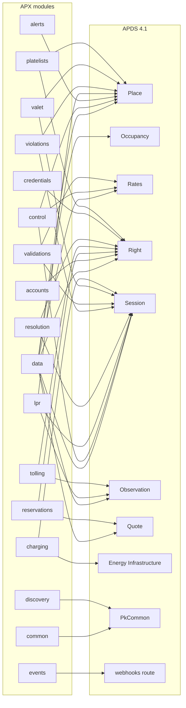

## Introduction

APX (APDS Parking eXtensions) is an additive companion specification to
the APDS 4.1 API specification of the Alliance for Parking Data Standards,
whose core data model is published as ISO/TS 5206-1 (APX Part 0 §0.1).
APDS gives the parking sector a common language for places, rates, rights,
sessions, occupancy and observations. APX builds on that language. It
defines the parts of an interoperable API that APDS leaves open on
purpose: real-time delivery, operational control, alerting, discovery,
and the operational domains built on them, such as accounts and payments,
LPR, reservations and permits, tolling, enforcement, validations,
credentials, valet, EV charging and plate lists.

APX follows one rule above all others: APDS first (APX Part 0 §0.2).
Wherever APDS 4.1 defines a route, schema or convention, APX uses it as
published. APX never redefines, subsets or re-shapes an APDS entity. A
plain APDS 4.1 client works against an APX implementation without change
for the routes it uses. APX is a proving ground for APDS, not a
competitor: when APDS standardizes a concept APX occupies, the APDS
construct wins and APX adopts it (APX Part 3 §3.3(8)).

APX has been shared with the APDS committee. Its data elements are
offered to APDS separately, in the APX Data Specification
(`docs/apds-submission/`). This document set describes the whole of APX
as it stands, and marks which elements are proposed to APDS and which
stay in APX.

### APX Technical Documentation

The APX Technical Documentation follows the structure of the APDS 4.1
document set. It comprises:

- **01 Overview**: what APX is, why it exists, and how it relates to APDS.
- **02 Information Model** (this document): the APX modules, their
  classes and relationships, enumerations and code lists, and how each
  builds on APDS classes.
- **03 Data Dictionary**: the definition of every APX class, attribute
  and value.
- **04 Use Case Document**: worked use cases showing how the data and
  the API are applied.
- **05 Interface Specification**: the routes, delivery, security, errors
  and conformance rules of the APX API.
- **06 Requests to APDS**: the corrections, suggestions and data element
  proposals APX offers to APDS.

The normative machine-readable definition is the OpenAPI 3.1 document
`spec/dist/apx-v1.yaml`, together with the APX data-profile overlay
(`spec/openapi/overlays/apx-data-overlay.yaml`) and the registry files in
`spec/registries/` (APX Part 0 §0.5, Part 3 §3.4). For APX paths and
schemas, where prose and OpenAPI disagree, the OpenAPI prevails and the
prose must be corrected. For APDS-native paths, the vendored APDS 4.1
document prevails; APX prose never overrides APDS (APX Part 0 §0.5).

The present document is the Information Model. It describes concepts and
relationships. Exact attribute types, multiplicities and values are
generated from the OpenAPI schemas into the tables of each module, and
defined in full in the Data Dictionary.

## Release changes

APX is published in editions. An edition pins an exact set of artifacts
by checksum in `spec/edition.json` (APX Part 3 §3.4). Within major version
1 every change is additive; removing or re-typing anything needs a new
major version (APX Part 3 §3.2). Changes before 1.0 marked "breaking"
were permitted as pre-1.0 revisions. The full record is `CHANGELOG.md`.

**Unreleased (after 0.14.0)**

- No normative change. The `DeviceStatus` description now states exactly
  how APX device states relate to APDS `RefillPointStatusEnum`.
- Added the APX Data Specification for the APDS committee
  (`docs/apds-submission/`), generated from
  `spec/proposals/apds-additions/*.yaml`.

**0.14.0 (2026-10-12)**

- EV charging (Part 23, class `apx-charging`): live charging-point status
  with bay-presence fusion, and a `ChargingSession` that references the
  APDS Session.
- Session detail written by a pairing engine (Part 5 §5.8): the
  `apds-ext:apx:session-detail@1.0` decoration with the reads behind a
  Session, its lifecycle, closure and match evidence.
- Change feed on eighteen APX list routes (Part 5 §5.2 rule 8).
- Read review and plate correction (Part 13 §13.3a(4a)); read-back by
  path; images of a read (§13.3c).
- Payment detail (Part 13 §13.6a): itemized lines as APDS `PaymentLine`
  and the rate sold.
- Plate lists (Part 24, class `apx-plate-lists`) and list-arrival alerts.
- Replication between a site and an aggregator (Part 18 §18.6);
  credential digests (Part 9 §9.6); occupancy history (Part 5 §5.5a);
  lookup keys in request bodies (`…:search`).
- Negotiated rates may state any amount (`negotiatedAmounts` feature,
  Part 6 §6.6).

**0.13.0 (2026-09-29)**

- An audit of every Part against the bundle, Annex A and the registries.
- Breaking: `PaymentRecord.method` replaced by `meansOfPayment` (APDS
  `MeansOfPaymentEnum`) and `channel`.
- New registries `apx-access-denial-reasons` and `apx-features`; Part 11
  §11.1a sets how to choose the form of a vocabulary.

**0.12.0 to 0.12.2 (2026-09-28)**

- LPR reads report facts; APX no longer derives meaning. New
  `accessEvent` (entry or exit) reported by the LPR system, and the
  `apds-ext:apx:lane-cameras@1.0` decoration on `VehicularAccess`.
  `laneTravel` deprecated.
- 0.12.1: a route to revise `accessEvent`; every APX decoration is now
  validated wherever it appears.
- 0.12.2: native `PUT` bodies are validated against a typed change
  payload per class.

**0.11.0 (2026-09-25)**

- A vetting release. Every declared error has a registered problem type
  (Part 12). One optimistic-concurrency and idempotent-replay rule for
  every versioned write (Part 4 §4.2a).

**0.10.0 (2026-09-24)**

- Negotiated rates and ticket matching (Part 6 §6.6–6.7), optional
  features of `apx-control`, with the `apds-ext:apx:ratepolicy@1.0`
  decoration on the APDS RateTable.

**0.9.0 and 0.9.1 (2026-09-21 to 2026-09-23)**

- LPR read fidelity (Part 13 §13.3a): the `apds-ext:apx:lpr-read@1.0`
  decoration with per-attribute confidence and alternate reads.
- 0.9.1: informative documentation and example overlays; registries
  published on the specification site.

**0.4.0 to 0.8.0 (2026-09-19 to 2026-09-20)**

- 0.4.0 and 0.6.0: Violations (Part 19), enforcement policy and signage.
- 0.5.0: Validations program management (Part 20).
- 0.7.0: Credentials lifecycle (Part 21), materialized as APDS
  `CredentialAssigned`.
- 0.8.0: Valet (Part 22).

**0.3.0 (2026-09-05)**

- Customer Service and Resolution (Part 17); identifier locality and
  aggregation (Part 4 §4.1a); change-feed cursor scope and grant
  expansion (Part 5 §5.2). Breaking: `apx_places` is fail-closed.

**0.1.0 to 0.2.0 (2026-08-21 to 2026-09-02)**

- 0.1.0: the first complete draft of every v1 domain, with APDS 4.1
  vendored verbatim.
- 0.1.1: occupancy snapshot and the analytics event topics.
- 0.2.0: the normative data-profile overlay, privacy rules, event place
  binding and site binding on aggregators.

## Data model overview

### Modules over APDS domains

APX is organized into modules. Each module is one folder of schemas in
`spec/openapi/domains/`, one or more conformance classes, a family of
OAuth scopes and a topic prefix (APX Part 10 §10.1). Every module builds
on one or more APDS domains. APDS classes are reached by `$ref` into the
vendored APDS document, never copied.

Two modules are the base of everything else. `data` (APX Part 5) profiles
the APDS native routes. `events` (APX Part 8) completes the APDS
`/webhooks` delivery contract. `common` holds the conventions every module
reuses. The other modules each add one operational capability.

The arrows show the main APDS domains each module builds on. Every
module also uses the PkCommon datatypes (DateTime, Reference,
AmountInCurrency and others), which are not drawn.

### How APX carries APDS objects

APX relates to APDS objects in three ways only:

1. **By reference.** An APX resource names an APDS entity with an APDS
   `Reference` or `VersionedReference`, typed by `className` (APX Part 4
   §4.1). A Command targets `{"id": "…", "className":
   "SupplementalEquipment"}`. An Account names its APDS RightHolder.
   APX never embeds or copies the entity.
2. **By decoration.** APX attaches its own data to an APDS entity
   through the entity's `extensions` container, under a key in the `apx`
   namespace, for example `apds-ext:apx:lpr-read@1.0` on an Observation
   (APX Part 4 §4.3). These are Level B decorations: a plain APDS
   consumer ignores them and still reads a valid APDS object. They are
   the only way APX data appears inside an APDS payload.
3. **By reuse of datatypes.** APX uses APDS DateTime, Duration,
   MultilingualString, AmountInCurrency, Reference, VersionedReference,
   DeletedReference and Url by `$ref`, and never introduces a parallel
   datatype for a concept APDS models (APX Part 4 §4.4).

Some APX resources are read-models rather than stored records. The
occupancy snapshot is derived from the APDS Place hierarchy and is never
written directly (APX Part 5 §5.5). The LPR read is a projection of an
APDS Observation (APX Part 13 §13.3).

### The common envelope

Every APX-defined resource shares one envelope, defined in the `common`
module:

- `ApxResourceCore`: `id` (an RFC 9562 UUID) and `version` (a positive
  integer). This is the same shape APDS uses for `D2VersionedIdentifiable`
  objects, so any APX resource can itself be the target of an APDS
  Reference (APX Part 4 §4.1).
- `RecordInfo`: provenance aligned with the APDS RecordType:
  creation and last-update time and user, the creator, and, for
  replicated records, the origin implementation (APX Part 4 §4.2, Part
  18 §18.6).
- `Extensions`: the APDS extension container, with keys of the form
  `apds-ext:<namespace>:<class>@<major>.<minor>` (APX Part 4 §4.3).

Resources with a lifecycle (Commands, Alerts, toll transactions,
violations and others) also keep an immutable `statusHistory[]`, the
authoritative audit record (APX Part 4 §4.2).

### Identity and versioning

All identifiers, APX and APDS alike, are local to the implementation
that issued them. A client must not assume an id minted by one
implementation resolves at another (APX Part 4 §4.1a). APX resource ids
are UUIDs. APDS entity ids are whatever APDS makes them: unique strings,
UUIDs by convention only. When an aggregating implementation imports a
place whose ids collide, it mints new ids and records each source id in
the APDS `operatorDefinedReference` (APX Part 4 §4.1a, Part 18 §18.2).

`version` increases on every state-changing update. A writer that
replaces or amends a versioned resource sends the version it last read,
as `If-Match` or in the body; a stale version is refused with 409
`version-conflict` and nothing is written (APX Part 4 §4.2a).

The specification itself is versioned at three levels (APX Part 3 §3.2).
The API major version is in the URL (`/v1`). Event topics carry their own
version (`.v1`), and a topic's payload never changes within it. Each
registry versions on its own: every added entry increments the list
version, following the APDS PkCommon rule.
