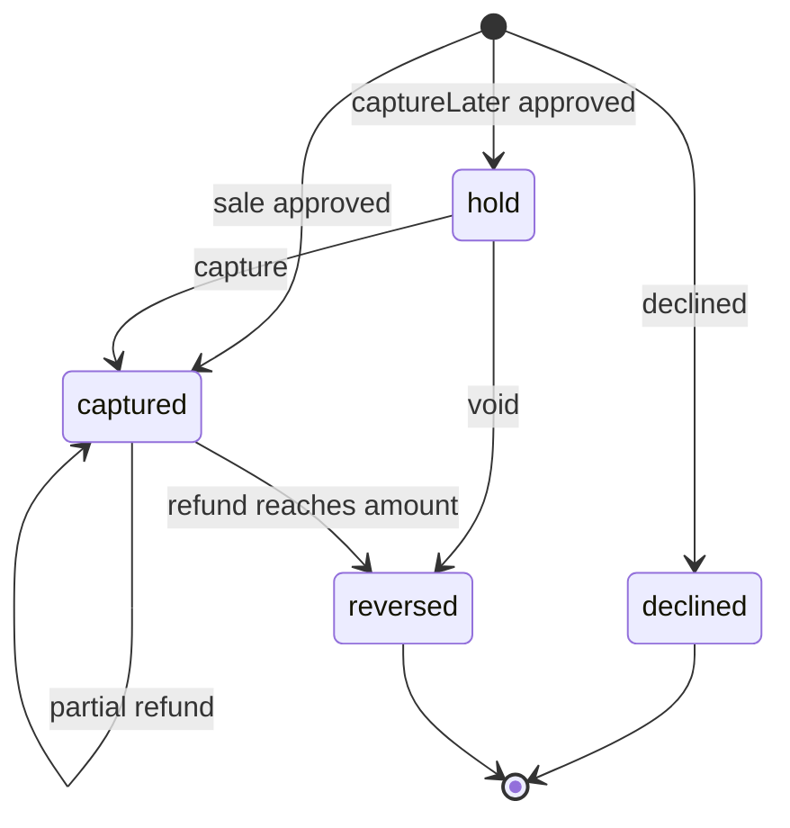
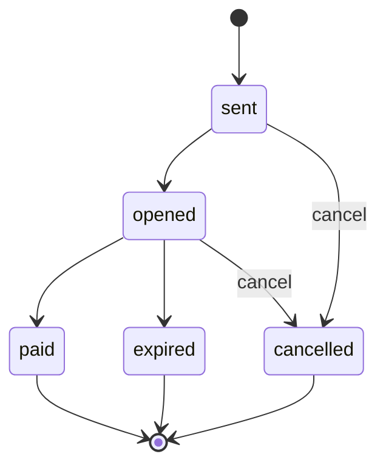

## Purpose

The accounts module serves call-centre and back-office work over live
parking state: looking up an account, taking a payment, sending a payment
link, refunding, and writing a payment back to an accounting system (APX
Part 13 §13.1–13.2, §13.6). It is anchored on the APDS Right domain. An
Account is anchored on an APDS RightHolder, and a payment record maps
field by field to the APDS Payment.

Its conformance classes are `apx-accounts` and `apx-payment-history`,
which requires it. The schemas are in
`spec/openapi/domains/accounts/schemas.yaml`. Card capture stays in the
implementer's PCI scope. No APX request carries more than the last four
card digits (APX Part 0 §0.4, Part 13 §13.1).

## Concepts

### Account

An **Account** is a billable parking account, such as a monthly parker or
a fleet, anchored on an APDS RightHolder through `holder` (APX Part 13
§13.1). It carries `name`, `phone` and `email` (personal data, returned
only under `apx.accounts:read`), `cardNumber` (an access credential
number, never a payment card number), `plates`, `balance`,
`accountStatus` (`enabled` or `disabled`) and `places`. When the server
claims `apx-credentials`, `credentials` lists the account's credential
records; `cardNumber` and `plates` remain the APDS-only summary.

Lookups by name, phone, email, card or plate return only accounts whose
places fall inside the caller's grant; under an empty grant the answer is
an empty list, never 403, so it never confirms that a record exists
elsewhere (APX Part 13 §13.5). `AccountSearch` carries the same keys in a
request body, so personal data never enters a URL (APX Part 9 §9.6).

### Payment record

A **PaymentRecord** is the action record of taking a payment:
addressable, idempotent, and able to record outcomes the APDS Payment
cannot, such as a decline (APX Part 13 §13.6). It carries:

- `place`, the required site binding (APX Part 13 §13.5).
- `amount`, `dateCollected` and `transactionID`.
- `meansOfPayment`, the APDS `MeansOfPaymentEnum`, and `channel`, where it
  was captured: `lane`, `payStation`, `agent`, `autoAttendant`, `online`
  or `other`. `autoAttendant` means a PCI-compliant voice system took the
  card out of band.
- `paymentStatus` (`approved`, `declined`, `reversed`) and, for an
  approved payment, `captureStatus` (`captured`, or `authorized` for a
  hold). `captureLater` asks for an authorization only.
- `refundedAmount`, the cumulative amount given back.
- `account` or `ticketNumber`, and `cardLast4`.
- `postings`, the accounting write-backs made.

A declined attempt is still recorded and published. Every recorded
payment, and every later change to its status, amount or refunded amount,
publishes `apx.accounts.payment.recorded.v1` with the full current record
(APX Part 13 §13.4). A hold is kept out of sight of consumers that predate
`captureStatus`: it is not listed unless asked for, not published until
capture, and never materialized as an APDS Payment (APX Part 13 §13.1a).

### Payment detail

`PaymentDetail` is the Level B decoration
`apds-ext:apx:payment-detail@1.0` (APX Part 13 §13.6a). `lines[]` is the
itemization as APDS `PaymentLine` objects, used by `$ref`. Each line's
code is its `idCode`, from the `apx-payment-line-codes` registry (`base`,
`convenienceFee`, `serviceFee`, `tax`, `discount`, `validation`, `idle`,
`energy`) or an implementer code. A `validation` line is `paymentType:
validation` and records the amount offset, not money collected. The
`payment` lines must sum to `amount`. `rateSold` names the rate sold: its
name, the APDS RateTable at the version applied when the deck is the
source, the `product` and the `class`.

There is one store. `lines` appears only on a PaymentRecord; on a
materialized APDS Payment the lines become the Payment's own
`paymentLines`, and the decoration there carries `rateSold` only. A server
never invents a line it was not given, and an absent fee line means
unknown, not zero.

### Payment link and posting

A **PaymentLink** is a hosted payment page sent to a customer by SMS or
email for an account, ticket or session (APX Part 13 §13.1a). It is the
customer-service action of first resort when policy blocks a gate
override. It carries the place, the amount, the delivery `channel`, a
masked `sentTo`, `status`, `expiresAt`, and, once paid, the resulting
PaymentRecord. Like a Command, it can carry a `correlationId`, a
resolution context and approval evidence (APX Part 17).
`PaymentLinkCancel` is its cancel body.

A **Posting** is the write-back of an approved, captured payment to a
monthly-parking or receivables system: the confirmation number, whether
the account was updated, the new balance, the target system and the time.
`PostingRequest` is its request body.

### Payment history

`apx-payment-history` finds the payments made on a ticket or an account
(APX Part 13 §13.2). A query must carry a key: the last four ticket or
card digits, a full ticket number, or an account. A lookup by truncated
digits without a date is limited to the last 8 hours. `PaymentSearch`
carries the same keys in a body. With `mode=change` the route is a change
feed instead, delivering what the payment topic delivers to the same
credential.

## Lifecycle

The payment states and transitions are normative (APX Part 13 §13.1a).

`captured` is `approved` with `captureStatus` captured or absent; `hold`
is `approved` with `captureStatus` authorized. A capture may lower the
amount but not raise it. A void releases the hold and leaves it
`reversed`, with nothing collected. A refund adds to `refundedAmount`;
the record becomes `reversed` when that reaches `amount`. A posting leaves
the state unchanged. Every other action is 409 `payment-state-illegal`,
and `declined` and `reversed` are terminal.

A payment link moves `sent → opened → paid | expired | cancelled`, and
can be cancelled while `sent` or `opened`; from then on the hosted page
accepts no payment. Cancelling a link that is `paid`, `expired` or
`cancelled` is 409 `payment-state-illegal` (APX Part 13 §13.1a).

## Relationship to APDS

APDS classes used as they stand: RightHolder (the account's holder),
Payment and PaymentLine (the itemization and the materialized record),
RateTable (the rate sold), `MeansOfPaymentEnum`, and the datatypes
AmountInCurrency, DateTime, Reference and VersionedReference. An
implementation that persists APDS Payments must materialize every
approved, captured PaymentRecord as a native Payment, so plain APDS
consumers see the money without speaking APX (APX Part 13 §13.6).
Declined and reversed records exist only on the APX surface, because APDS
has no vocabulary for them.

Proposed to APDS (APX Data Specification, Right and PkCommon):

| Element | Change | Tier |
| --- | --- | --- |
| `RightHolder` | Additions: `accountStatus`, `elementId`, `accountBalance` (from `Account`) | 2 |
| `Payment` | Additions: `paymentStatus`, `captureStatus`, `meansOfPayment`, `paymentChannel`, `elementId`, `refundedAmount` (from `PaymentRecord`) | 2 |
| `AccountStatusEnum`, `PaymentStatusEnum`, `CaptureStatusEnum` | New enumerations | 2 |
| `PaymentTypeEnum` | New values: `convenienceFee`, `serviceFee`, `discount`, `energy`, `idle` | 2 |
| `RateSold` | New class (from `PaymentDetail.rateSold`) | 3 |
| `RateProductEnum`, `RateClassEnum` | New enumerations | 3 |
| `InteractionChannelEnum` | New shared enumeration, used by `Payment.paymentChannel` | 1 |

These let parties exchange declined and reversed payments, uncaptured
authorizations, partial refunds, how and where a customer paid, and which
rate a payment bought, without a second parallel holder or payment record.
The same needs are also listed as suggestions in
`docs/apds-change-requests.md`, Part B, together with an identifiable
RightHolder (erratum 014). Until APDS publishes one, APX refers to a holder
as `{"id", "className": "RightHolder"}` with a local id (APX Part 1 §1.3
item 14).

APX-only: `PaymentLink`, `Posting`, `PostingRequest`,
`PaymentLinkCancel`, `AccountSearch` and `PaymentSearch`. They are
call-centre and accounting operations, not exchanged parking data. The
`ticketNumber`, `cardLast4` and `postings` members of PaymentRecord also
stay on the APX surface (APX Part 13 §13.6).
