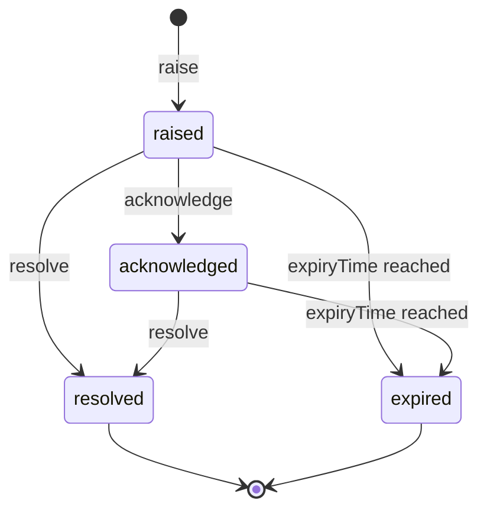

## Purpose

The alerts module describes operational conditions that need attention:
a faulted device, a blocked lane, an overstay, a vehicle in an EV bay
that is not charging, a watched plate arriving (APX Part 7). APDS 4.1
describes the places, equipment, sessions and rights such conditions
concern, and its Use Case Document lists transaction exceptions and space
statuses an operation must act on (§C.2.2). It has no class for the
condition itself. This domain is net-new, built on the APX common
conventions and delivered over the Part 8 fabric.

Its conformance class is `apx-alerts`. The schemas are in
`spec/openapi/domains/alerts/schemas.yaml`.

## Concepts

### Alert

An **Alert** is a versioned, identifiable record of one operational
condition (APX Part 7 §7.1). Its `alertType`, `severity`, `status` and
`detectionTime` are required.

- `alertType` is open. Values come from the `apx-alert-types` registry,
  seeded from the APDS Use Case §C.2.2 exceptions and space statuses, or
  from an implementer's own code list (APX Part 11). Examples are
  `deviceFault`, `occupancyThresholdExceeded`, `evBayNotCharging` and
  `watchListArrival`.
- `severity` is closed: `info < warning < minor < major < critical`, so
  every receiver ranks alerts the same way.
- `source` says where the condition was detected: a `device` (a Reference
  to an APDS SupplementalEquipment) and a `place` (a HierarchyElement
  id). Filtering by place is subtree-inclusive: an alert on a lane matches
  its parent Place.
- `relatedEntity` is the APDS or APX entity the alert concerns, such as a
  Session, an AssignedRight or a Command.
- `occurrenceTime` is when the condition happened; `detectionTime` is
  when the system learned of it. Both are RFC 3339.
- `expiryTime` is the end of the alert's validity window. A client may
  set it on raise, and the server may apply a default per alert type and
  return the value applied.
- `description` is multilingual text.
- `statusHistory[]` is the immutable audit trail: each entry has a state,
  time, actor and optional detail.

The server assigns `id` when the raise carries none. A client may supply
its own UUID; an id that already exists is 409 `id-collision` (APX Part 7
§7.1). Raising requires an `Idempotency-Key`, because device retry storms
must not duplicate alerts; a replay returns the alert as it now stands
(APX Part 7 §7.2).

### Evidence

When the entity an operator acts on and the evidence for the alert are
different, `relatedEntity` is the entity acted on, and the evidence rides
the alert's `extensions` under `apds-ext:apx:alert-evidence@1.0` as a list
of Observation references (APX Part 7 §7.1). For example, a
`refusedServiceArrival` alert carries the PlateListEntry as
`relatedEntity` and the plate read as evidence, and should reference the
`displayMessage` command whose result proves what the lane showed (APX
Part 7 §7.6). The two EV bay types carry the camera Observation as
evidence (APX Part 7 §7.5).

### Alerts with no place

An alert whose subject has no place, such as a `webhookDeliveryFailed`
alert about a subscription, carries no `source.place`. It is bound to the
organisation that owns its subject or raised it, is visible to that
organisation's tokens holding `apx.alerts:read` whatever their place
grant, and is excluded from any place-filtered list. Other organisations
never see it (APX Part 7 §7.1).

### Transitions

`AlertTransition` is the optional body of acknowledge and resolve. Its
`detail` is copied into the history entry the transition appends. Its
`agent` names the human or AI principal acting through the client and is
recorded as that entry's `actor`; authorization is still the token's (APX
Part 7 §7.2).

### Where alerts come from

Other modules raise alerts as a consequence of their own rules. A device
moving to `fault` should raise `deviceFault` (APX Part 6 §6.4). A
configured occupancy threshold crossing should raise
`occupancyThresholdExceeded` (APX Part 5 §5.5). An exhausted webhook
retry schedule raises `webhookDeliveryFailed` (APX Part 8 §8.3), which
must never itself be delivered to the failed subscription (APX Part 7
§7.4).

### Alerts raised from a call

Some site cases begin as a customer call: a receipt is wanted, a refund
is asked for, a citation is queried, damage is reported, or a customer
asks to be called back. The alert types `receiptRequested`,
`refundRequested`, `citationInquiry`, `damageReported` and
`customerCallbackRequested` carry these to the people on site, and
`consumableLow` carries a device's empty paper or ticket stock (APX Part
7 §7.7). An alert raised during a call cites its `supportInteraction`, so
the site sees the call it came from.

## Lifecycle

The normal path is `raised → acknowledged → resolved`; `raised →
resolved` directly is permitted (APX Part 7 §7.3). `expired` is a
server-side terminal state: an alert still `raised` or `acknowledged` at
its `expiryTime` becomes `expired`. An alert without an `expiryTime` never
expires. `resolved` and `expired` are terminal and never transition
again. An illegal transition, such as resolving a resolved alert, is 409
`alert-transition-illegal`.

Creation publishes `apx.alert.raised.v1`, and every transition publishes
`apx.alert.status.v1`, with the Alert as `data` (APX Part 7 §7.4).
Subscribers can filter these topics by `severityFloor`, `alertTypes` and
place (APX Part 8 §8.5a).

## Relationship to APDS

APDS elements used as they stand: SupplementalEquipment (the source
device), HierarchyElements (the source place), any identifiable entity as
`relatedEntity`, Observations as evidence, and the datatypes DateTime,
MultilingualString and Reference. The seed values of the alert types
come from APDS Use Case §C.2.2.

Proposed to APDS, in a new Operations package (APX Data Specification,
Operations):

| Element | Change | Level | Tier |
| --- | --- | --- | --- |
| `Alert` | New class | C | 2 |
| `AlertTypeEnum` | New enumeration | — | 2 |
| `AlertSeverityEnum` | New enumeration | — | 2 |
| `AlertStatusEnum` | New enumeration | — | 2 |

`Alert` is Level C because it adds a new root concept. In the proposal
its link to the place uses `HierarchyElementGeneral`, its link to
equipment uses SupplementalEquipment, and its link to the record it
concerns is a plain Reference. `AlertTypeEnum` carries the APX values
except one: `webhookDeliveryFailed` concerns APX's own delivery systems
rather than the parking operation, so it is not proposed. Alert types
stay open in practice: an operation can publish more in a
`UserDefinedCodeList`. Device status itself is proposed in the Place
domain (see the control module); an alert of type `deviceFault` or
`deviceOffline` draws attention to a change in it.

APX-only: `statusHistory` (audit detail that stays in the APX profile),
`AlertTransition` (an API request body), the
`apds-ext:apx:alert-evidence@1.0` decoration, and the organisation
binding of place-less alerts.
