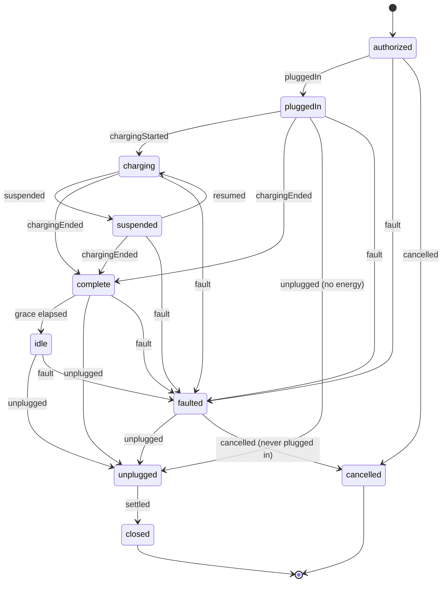

## Purpose

This module covers the parking side of EV charging: which chargers are
free, what is actually in the bay in front of each one, and the charge a
vehicle took during its stay (APX Part 23). That charge includes the
energy, the state, the idle time after it finished, what it cost and how
that cost is collected.

**Status.** Part 23 was registered in APX 0.14.0 as the optional class
`apx-charging` (CHANGELOG). Its data elements are offered to APDS as
Tier 3, for discussion only (`docs/data-model-by-domain.md`).

APDS 4.1 describes the static infrastructure completely:
ElectricChargingEquipment, ElectricChargingPoint, Connector, RefillPoint
with its `refillPointIndex`, `evChargingPoints` on PlaceInformation, the
`electricVehicleOnly` restriction, and the Space that is the bay. APX
references all of it and redefines none of it. What APDS does not have is
anything dynamic: no availability, no charging session, no idle handling,
and no link from a charge to the parking Session.

## Concepts

### Charging point status

A **ChargingPointStatus** is the dynamic overlay on an APDS
ElectricChargingEquipment, keyed by a reference to it (APX Part 23
§23.1). It carries `refillPointIndex` and `evseId`, so a consumer can join
it to the static APDS record and to the charging network's record. It
holds point-level and per-connector `availability`, the current charging
session, `reservedFor` (an APDS AssignedRight), and `bay`, the fused bay
presence.

`availability` is a closed list: `available`, `occupied` (cable
connected, no energy flowing), `charging`, `reserved`, `blocked`,
`inoperative`, `outOfOrder` and `unknown`. The point's value is the
busiest of its connectors. A blocked bay overrides `available` and
`unknown`, but never a connected cable. `connectorIndex` is the 1-based
position in the static APDS `connectors[]`. Static fields such as
connector type and rated power are not repeated.

### Bay presence and fusion

The charger knows whether a cable is connected. It does not know whether
a vehicle is in the bay. An overhead camera, a ground sensor or an
attendant knows what is in the bay, but not whether it is charging. The
parking system is where the two meet (APX Part 23 §23.3).

A **ChargingBayPresence** is one report from a presence source: the
presence, the source (`overheadCamera`, `groundSensor`, `charger`,
`attendant`, `inferred`), the APDS Observation carrying the evidence, the
time, a minimized vehicle (plate when the camera has LPR; whether it is
EV-capable), a confidence and an access-controlled image link.

The server MUST fuse the latest report with the connector state into
`bay.presence` and the point's availability. A vehicle with a connected
cable is `vehiclePluggedIn`. A vehicle without one is
`vehicleNotPluggedIn`, and the point becomes `blocked`. An obstruction
is `blocked`. A camera that sees an empty bay while the charger reports
a cable gives `unknown`, because the sources disagree. `sinceTime` is the
dwell clock.

A vehicle not plugged in beyond the place's grace SHOULD raise an alert,
and MAY become a `restrictedSpace` violation candidate (APX Part 19).
Where a free-vend charger has no authentication of its own, the bay
camera's plate MAY attribute the charge to the parking Session the plate
entered on. This is how "one bill at exit" works.

### Charging session

A **ChargingSession** is one charge of one vehicle (APX Part 23 §23.2).
It references the point and connector, the APDS Session the charge
happened inside (`parkingSession`), and the AssignedRight that entitles
it (a charging reservation or a permit). It holds a minimized vehicle,
the authorization, a timeline, energy, the stop reason, an idle policy
snapshot, cost, settlement, the charging network's identifiers, and the
immutable `statusHistory[]`.

**Energy** carries the charger's meter at start and stop, `deliveredKwh`
(the APDS `kWh` delivery unit), power and state of charge where the
vehicle reports it. Servers MUST NOT invent `deliveredKwh` from time and
rated power (APX Part 23 §23.4).

**Cost** is expressed as APDS AmountInCurrency for energy, time, idle,
fees and total. Absent components are unknown, not zero.

**Settlement** says how the money is collected (APX Part 23 §23.5):

- `parkingSession`: the charge is a line on the APDS Session and is paid
  with the parking;
- `directPayment`: the charge is settled on its own by an APX Part 13
  payment;
- `chargingNetwork`: the charging network or its roaming partner bills
  the driver.

The **idle policy** (grace minutes, idle rate, maximum idle) is
snapshotted at authorization and never re-priced. The customer read MUST
expose it, so an app can say "10 minutes grace, then $0.40 per minute"
before the fact.

### Events from the bridge

A **ChargingEvent** is the APX counterpart of an OCPP 2.0.1
TransactionEvent. The operator's bridge to its charging network posts
these events to drive the session. APX carries charger and roaming
identifiers (`evseId`, the OCPP transaction id, the OCPI session id, the
charge record id) opaquely. It is not a charger protocol and not a
roaming protocol. Smart charging, tariff publication and roaming clearing
stay with the charging network (APX Part 23 §23.15).

### Links to other modules

A ValetTicket may carry a charging request and reference the
ChargingSession, which points back (APX Part 23 §23.8). Charger actions
(start, stop, unlock a cable) are APX Part 6 commands, never Part 23
writes (APX Part 23 §23.9). The occupancy snapshot gains an optional
`evCharging` block (APX Part 23 §23.7).

## Lifecycle

The transition table in APX Part 23 §23.2 is normative; the diagram
renders it. Anything else is refused with `charging-transition-illegal`.
Events MUST be applied in time order. A meter value updates energy
without a transition.

- `complete` to `idle` is applied by the server when the grace period has
  passed since charging ended and the cable is still connected. It also
  publishes `apx.charging.idle.started.v1`. With no idle policy, the
  session stays `complete` until unplugged.
- `unplugged` to `closed` is applied by the server on settlement.
- `closed` and `cancelled` are terminal.

The split of the OCPP state EVConnected into `pluggedIn`, `complete` and
`idle` is deliberate: the parking side cares whether the car is waiting,
done or overstaying.

## Relationship to APDS

APDS classes used as they stand: ElectricChargingEquipment,
ElectricChargingPoint, Connector, RefillPoint (`refillPointIndex`),
PlaceInformation (`evChargingPoints`), Space (the bay), Session (the
parking stay), AssignedRight, ObservationElement (bay evidence),
DeliveryUnitEnum, AuthenticationAndIdentificationEnum and
AmountInCurrency.

Proposed to APDS, in the existing EnergyInfrastructure package, as Level
B additions offered for discussion (see the APX Data Specification):

| Element | Change | Tier |
| --- | --- | --- |
| `ChargingPointStatus` | New class | 3 |
| `ConnectorStatus` | New class | 3 |
| `ChargingBayPresence` | New class | 3 |
| `ChargingSession` | New class | 3 |
| `ChargingCost` | New class | 3 |
| `ChargingIdleTerms` | New class | 3 |
| `BayPresenceEnum` | New enumeration | 3 |
| `BayPresenceSourceEnum` | New enumeration | 3 |
| `ChargingSessionStatusEnum` | New enumeration | 3 |
| `ChargingStopReasonEnum` | New enumeration | 3 |
| `ChargingSettlementModeEnum` | New enumeration | 3 |

In the proposal, point and connector status reuse the APDS
RefillPointStatusEnum as it stands; its values cover every state APX
reports. A ChargingPointStatus refers to a refill point by its
SupplementalEquipment and `refillPointIndex`, as a dynamic publication is
expected to. The session states and stop reasons follow the OCPP 2.0.1
vocabulary so the two map directly. Charging protocol identifiers are
carried as ExternalIdentifier values and not interpreted. The Operations
proposal adds the alert types `evBayNotCharging` and `evBayBlocked`; a
violation type for a vehicle left in a bay after charging could be added
if these additions are taken up.

APX-only: ChargingEvent and ChargingPaymentAttachment (bridge and API
operations), `statusHistory[]`, and the customer-scope minimization
rules.
