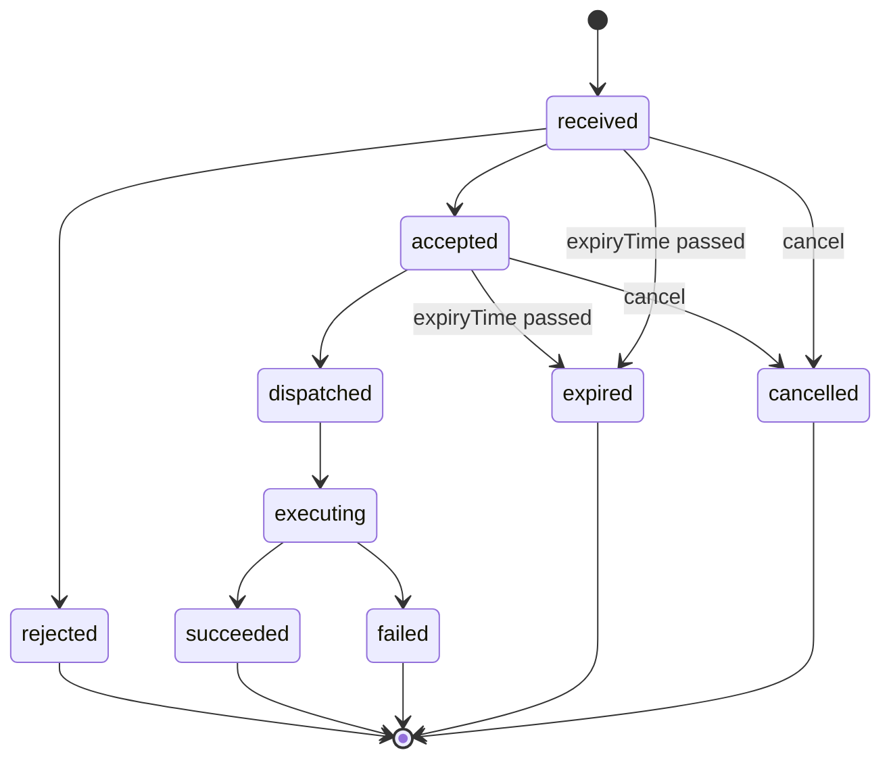

## Purpose

The control module is the APX command plane. APDS 4.1 inventories devices
as SupplementalEquipment and marks access-controlled places, but defines
no way to act on them (APX Part 6). This module adds commands against
lanes, devices and places; the lane inquiry a call centre uses as a
screen-pop; the list of venues allowed to validate tickets; the live state
of devices; and two optional features that close an open ticket at the
exit lane: negotiated rates and ticket matching (APX Part 6 §6.6–6.7).

Its conformance class is `apx-control`. The schemas are in
`spec/openapi/domains/control/schemas.yaml`. Every schema refers to APDS
entities rather than copying them.

## Concepts

### Command

A **Command** asks for an operational action against a `target`: a
Reference to a SupplementalEquipment (a device) or a HierarchyElement (a
lane or place) (APX Part 6 §6.1). Legacy "location id plus lane number"
addressing maps to the Place and VehicularAccess ids.

- `commandType` is open, from the `apx-command-types` registry:
  `vendGate`, `holdGateOpen`, `closeLane`, `lostTicket`, `pushRate`,
  `applyValidation`, `setDeviceState`, `displayMessage`, `restartDevice`,
  the passback and courtesy commands of Part 17, `pushNegotiatedRate`,
  `matchTicket`, and the charging commands of Part 23 (§6.8).
- `parameters` are normative per type, for example a VersionedReference
  to a RateTable for `pushRate`, or a ticket and provider for
  `applyValidation`.
- `requestedBy` is the organisation. `agent` and `agentType` (`human` or
  `ai`) name the principal who started the command; they are required on
  `pushNegotiatedRate` and `matchTicket`. `reason`, `correlationId` and a
  `resolutionContext` link the command into a customer-service audit
  chain (APX Part 17).
- `approval` carries approval evidence when policy required it. The same
  `Approval` shape is used for domain actions such as refunds (APX Part
  17 §17.3).
- `expiryTime` makes a command perishable: a command not dispatched by
  then becomes `expired` and must not fire. A gate vend requested ten
  minutes ago must not open the gate now.
- `confirmationLevel` says how far success was physically confirmed:
  `accepted`, `deviceAcknowledged` or `physicallyConfirmed`. A consumer
  must not report an outcome stronger than this level.
- `statusHistory[]` is the immutable audit of every transition.

Creating a command requires an `Idempotency-Key`. Refusals the server can
decide from its own state are synchronous errors, and nothing is
dispatched; outcomes only the device can report arrive as `failed` in the
history (APX Part 6 §6.1). A command that succeeds carries a
`CommandResult` naming what it produced: the issued ticket, its Session
and the fee for `lostTicket`; the matched Session and amount for
`matchTicket`; the table version applied for `pushNegotiatedRate`; and,
for `displayMessage`, proof of what the device showed (APX Part 6 §6.1a).

The lost-ticket fee is part of the APDS rate deck: a RateLine described
`lostTicketFee` in the applicable RateTable. With no such line the
command is refused, never guessed (APX Part 6 §6.1).

### Lane status

**LaneStatus** is the transaction context at a lane now (APX Part 6
§6.2). It composes APDS references and data and adds no parallel
entities. `currentTicket` holds the Session, issue time, amount due,
applied validations (each with the actual amount it removed), the latest
plate read (an APDS Observation reference), any negotiated rate or stated
amount in effect, and the matching command. `monthlyCredential` holds the
credential presented, the access decision and denial reason (registry
`apx-access-denial-reasons`), and recent activity. `matchCandidates[]`
appears when ticket matching applies.

### Validation provider

A **ValidationProvider** is a venue allowed to validate tickets at a
place, with its `validationType` and nominal `benefit` (APX Part 6 §6.3).
The list is authoritative: an `applyValidation` naming a provider not on
it is refused. Validations are the sanctioned way to adjust one ticket's
amount. When `apx-validations` is claimed, each provider row carries the
`program` it derives from (APX Part 20).

### Device status

**DeviceStatus** is a live state overlay keyed by a Reference to an APDS
SupplementalEquipment (APX Part 6 §6.4). It never repeats the equipment's
descriptive fields. `deviceState` comes from the `apx-device-states`
registry (`available`, `occupied`, `inoperative`, `outOfService`,
`fault`, `unknown`). APDS 4.1 has a status list only for refill points,
`RefillPointStatusEnum` in the Data Dictionary; APX device states follow
its style and share four of its values. The same object can decorate an
APDS SupplementalEquipment as `apds-ext:apx:devicestatus@1.0`. A
transition to `fault` should raise a `deviceFault` alert.

### Rate policy and match candidate

**RatePolicy** is the Level B decoration `apds-ext:apx:ratepolicy@1.0` on
an APDS RateTable: `negotiable`, an optional `displayName` and a `note`
(APX Part 6 §6.6). Because it rides inside the table, every consumer that
mirrors `/rates` receives it. `pushNegotiatedRate` applies a flagged
table, or, with the `negotiatedAmounts` feature, a stated amount with a
required reason, to the current ticket at one lane only. The deck itself
never changes. APX sets no selection rules; it requires attribution.

A **MatchCandidate** is an open Session that plausibly belongs to the
vehicle at the lane, found from a plate read, a credential, the account
registry or a reservation (`matchedBy`), with its evidence, confidence and
`amountDueIfMatched` (APX Part 6 §6.7). Candidates are advisory. Only a
`matchTicket` command binds one, and on vend the Session closes in APDS
terms and publishes `SessionUpdated`. APX keeps no parallel matching
store: the match is the Session's exit.

### Faults, supplies and maintenance

A device status may carry the fault the device reports (`fault`: a code,
a display text and since when), the level of each consumable it holds
(`consumables[]`: tickets, receipt paper, cash and coins, each `ok`,
`low`, `empty` or `unknown`), and whether it is in `maintenanceMode`, so
that test calls can be kept out of service figures (APX Part 6 §6.4). The
APDS-style `lastCommunication` already says when the device was last
heard from, so no separate "last seen" member is added. A consumable that
runs low raises a `consumableLow` alert. Three commands complete what an
agent does at a device: `ejectTicket`, `cancelTransaction` and
`reprintReceipt` (APX Part 6 §6.1). What a device *is*, its role, make,
model and position, is the Site configuration module's equipment detail
(APX Part 26 §26.1).

## Lifecycle

The lifecycle is `received → accepted | rejected → dispatched → executing
→ succeeded | failed | expired | cancelled` (APX Part 6 §6.1). Every
transition appends to `statusHistory[]` and publishes
`apx.control.command.status.v1`. A command can be cancelled until it is
`dispatched`; afterwards cancel is refused with 409
`command-not-cancellable`. A command whose `expiryTime` passes before
dispatch becomes `expired` and never fires. The diagram draws these
rules; the lifecycle stated in Part 6 §6.1 governs.

`holdGateOpen` stays `executing` while the gate is held. It is released by
its own `expiryTime`, by a later `closeLane` at the lane, or by a
`setDeviceState` on the held device, and then becomes `succeeded` with the
cause in `detail`. A dispatched hold is never cancelled.

## Relationship to APDS

APDS classes used as they stand: SupplementalEquipment (the device),
VehicularAccess and other HierarchyElements (lanes and places), RateTable
and RateLine (the deck, including the lost-ticket fee), Session,
Observation, Credential and RightHolder (as references), and the
datatypes AmountInCurrency, Duration, DateTime, Url, Reference and
VersionedReference. An applied validation should also be recorded in APDS
terms, as a Payment of type `validation` and the Segment's
`validationId`, so APDS consumers see it without speaking APX (APX Part 6
§6.3). A negotiated table is an ordinary RateTable, so the Session segment
references it as it would any other rate.

Proposed to APDS (APX Data Specification, Place and Rates):

| Element | Change | Package | Tier |
| --- | --- | --- | --- |
| `EquipmentStatus` | New class (from `DeviceStatus`) | SupplementalFacility | 1 |
| `EquipmentStatusEnum` | New enumeration (from `apx-device-states`) | SupplementalFacility | 1 |
| `EquipmentTypeEnum` | New values: `barrier`, `gate`, `ticketDispenser`, `intercom` | SupplementalFacility | 1 |
| `RateTable` | Additions to an APDS class: `negotiable`, `negotiatedRateLabel`, `negotiationNote` (from `RatePolicy`) | Rates | 2 |

The proposed `EquipmentStatusEnum` reuses `RefillPointStatusEnum` names
where the meaning is the same. It calls `faulted` and `closed` what the
APX registry calls `fault` and `inoperative`; APX would adopt the APDS
names once agreed. The merchant validation program behind
`ValidationProvider` is proposed with the validations module.

APX-only: `Command`, `CommandResult`, `Approval`, `LaneStatus`,
`ValidationProvider` and `MatchCandidate`. They describe the command
workflow and the lane screen-pop, which are interface rather than data,
and stay in the APX API.
