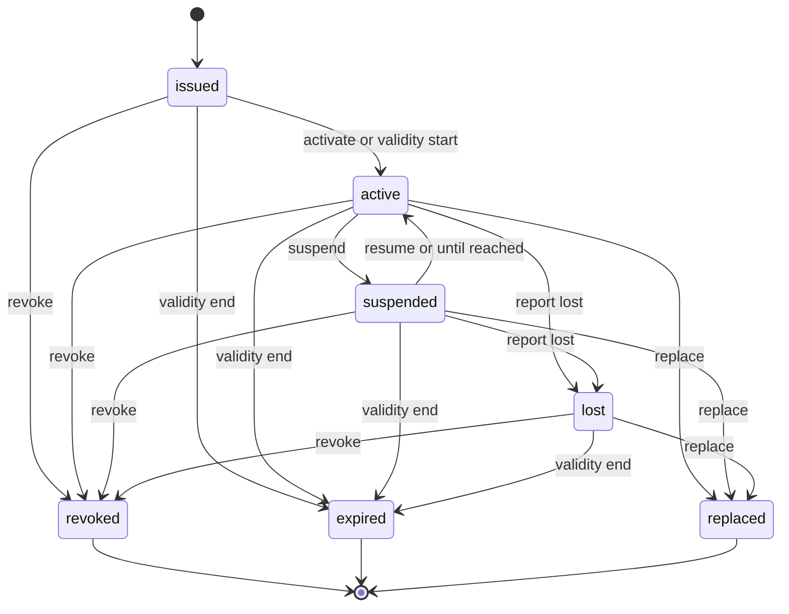

## Purpose

This module covers the lifecycle of access credentials: keycards, fobs,
RFID tags and transponders, mobile credentials, hangtags, and plates used
as the credential (APX Part 21). It covers issue, activation, suspension,
loss, revocation and replacement, and the access events behind the
question "why was I denied at the gate?".

APDS 4.1 models a credential as a CredentialAssigned on an AssignedRight,
with a type, an identifier and an issuer. It has no status, no
replacement, no physical media and no access events. APX adds those in a
**CredentialRecord**; the name differs because APDS already owns the name
`Credential`. APDS stays authoritative for what the credential entitles.
The record is materialized onto the AssignedRight, so a plain APDS lane
or enforcement client always sees the current credential.

## Concepts

### Credential record

A **CredentialRecord** is one physical or virtual credential (APX Part 21
§21.1). It holds:

- `credentialType`: the read technology, an APDS CredentialTypeEnum
  value;
- `credentialIdentification`: what the lane reads;
- `credentialAssignedType`: the APDS CredentialAssignedTypeEnum value
  (`vehicle`, `customer`, `other`);
- `holder` and `account`, `assignedRights[]` and `places[]`;
- `validity`, and `activateOnStart`;
- `media`: the physical form (`physicalCard`, `fob`, `transponder`,
  `hangtag`, `mobile`, `plate`, `ticket`, `virtual`), serial number,
  batch and deposit status (`held`, `refunded`, `forfeited`);
- `credentialStatus` and `suspension` (reason and an optional `until`);
- `replaces` and `replacedBy`;
- the immutable `statusHistory[]`.

`credentialIdentification` MUST be unique per `credentialType` across the
implementation among non-terminal records, because a lane cannot tell two
cards with the same number apart (APX Part 21 §21.1 rule 2). Where a
technology has no APDS value (magstripe, NFC), implementations map to the
nearest value and carry the exact technology in `extensions`. That is a
reconciliation item for the APDS committee, not something APX extends on
its own.

### Materialization onto the AssignedRight

This is the security property the module exists for (APX Part 21 §21.2).
While a record is `active`, the server MUST present it as a
CredentialAssigned on each of its AssignedRights, with `type` equal to
`credentialType` and `identifier` a Reference to the record. A stock APDS
client reading or filtering `/rights/assigned` therefore sees exactly the
credentials that will open the gate. On suspend, loss, revocation or
expiry the server MUST remove that CredentialAssigned, and the lane MUST
deny the credential from that instant. A replacement swaps predecessor
and successor in one AssignedRight update.

### Replacement

A replacement issues the successor in one call (APX Part 21 §21.3). The
successor inherits holder, account, rights, places and validity unless
the request overrides them, and carries `replaces`. The predecessor
becomes `replaced`, with `replacedBy` set. It keeps every field it had,
as the record of what the card was; only its status, `replacedBy`,
deposit status, history, version and record info change.

### Access events

Every presentation of a credential at a lane produces an access event
(APX Part 21 §21.4). It records the time, Place, lane (APDS
VehicularAccess), reader (APDS SupplementalEquipment), `direction`
(`entry` or `exit`), `outcome` (`granted` or `denied`), a `denialReason`
when denied, and the APDS Session a granted access opened or closed.

- A **CredentialAccessEvent** names the matched record in `credential`.
- An **AccessEvent** is the superset shape. When nothing matched
  (`denialReason: unknownCredential`), it has no `credential`, and
  `presented` is required instead.
- A **PresentedCredential** is what the reader actually read: a
  `credentialType` and a `credentialIdentification`.

Denial reasons come from the open `apx-access-denial-reasons` registry.
Its seeded values include one per non-active lifecycle state
(`credentialNotYetActive`, `credentialSuspended`, `credentialLost`,
`credentialRevoked`, `credentialReplaced`, `credentialExpired`), plus
`unknownCredential`, `passback`, `accountBalance`, `outsidePlace` and
`outsideValidity`. APDS EventTypeEnum has no access events; the
`apx.credentials.access.v1` topic fills that gap. Passback state itself
stays in APX Part 17.

Identification values, serial numbers and access events are personal
data when joined to a holder. APX Part 9 §9.6 applies, and the server
MUST NOT offer an "is this identification in use" oracle (APX Part 21
§21.5).

## Lifecycle

The lifecycle in APX Part 21 §21.1 is normative. `revoked`, `expired` and
`replaced` are terminal.

- A record issued with `activateOnStart` becomes `active` on its own at
  `validity.start`; otherwise it stays `issued` until activated.
- A suspension MAY carry `until`; the server resumes it at that instant,
  with actor `system`.
- `expired` is applied by the server when `validity.end` passes on any
  record not already terminal.
- A card never handed over (`issued`) is revoked and issued anew, not
  replaced. Replacing from a terminal state is refused with
  `credential-not-replaceable`. Any other illegal move is
  `credential-transition-illegal`.
- A request whose window is already over is refused at once; the server
  never issues and expires in one call.

Every transition appends to `statusHistory[]` and publishes
`apx.credentials.status.v1`.

## Relationship to APDS

APDS classes used as they stand: AssignedRight and CredentialAssigned
(the materialization target), CredentialTypeEnum,
CredentialAssignedTypeEnum, RightHolder and Contact (the holder),
HierarchyElement, VehicularAccess, SupplementalEquipment and Session.

Proposed to APDS, in the Right and Session packages, as Level B additions
(see the APX Data Specification):

| Element | Package | Change | Tier |
| --- | --- | --- | --- |
| `CredentialAssigned` (`credentialStatus`, `replacesCredentialId`, `replacedByCredentialId`, `credentialValidity`, `credentialMedia`, `credentialSuspension`) | Right | Additions to an APDS class | 1 |
| `CredentialMedia` | Right | New class | 1 |
| `CredentialSuspension` | Right | New class | 1 |
| `PresentedCredential` | Right | New class | 1 |
| `CredentialStatusEnum` | Right | New enumeration | 1 |
| `CredentialMediaFormEnum` | Right | New enumeration | 1 |
| `DepositStatusEnum` | Right | New enumeration | 1 |
| `AccessEvent` | Session | New class | 1 |
| `AccessOutcomeEnum` | Session | New enumeration | 1 |
| `AccessDenialReasonEnum` | Session | New enumeration | 1 |

In the proposal the status sits on the assigned credential, not on
Credential, because it describes one credential's use for one
AssignedRight. PresentedCredential specialises Credential and becomes the
single class for any credential value carried without an assigned
credential: the access event, the valet ticket, the toll transaction and
the plate list entry. AccessEvent stands on its own, since a refused
attempt has no Session. Its direction reuses the APDS AccessTypeEnum
values `entry` and `exit`. The denial reasons could equally be published
as a recommended code list; that choice is left to the APDS committee.

APX-only: the CredentialRecord resource itself, as an API shape, and the
transition and replace request bodies. Their data reaches APDS through
the CredentialAssigned additions above rather than as a separate record.
