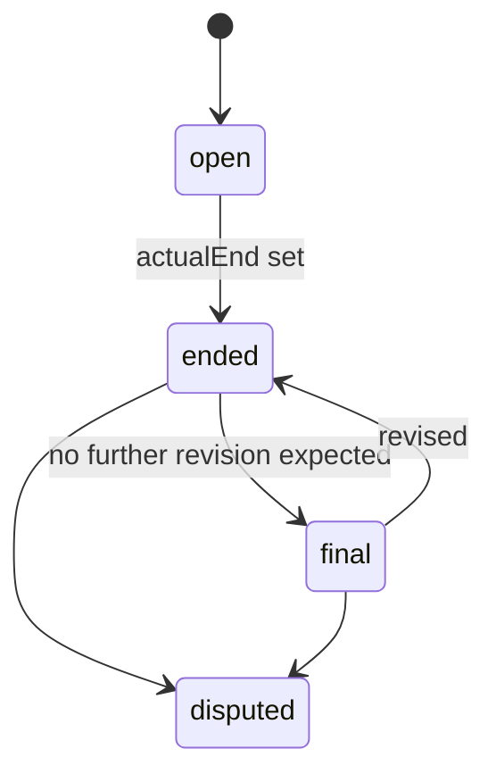

## Purpose

The data module is the APX profile over the APDS native data routes
(`/places`, `/observations`, `/contacts`, `/rights/specs`,
`/rights/assigned`, `/rates`, `/sessions`, `/quotes`). APX defines no
parallel data routes. It adds the behaviour APDS leaves open: update
modes, an ordered change feed, convenience reads of occupancy, and the
record a pairing engine writes on a Session (APX Part 5). Its conformance
class `apx-data` is one of the two base classes.

The schemas are in `spec/openapi/domains/data/schemas.yaml`. Most of them
describe pages and payloads around APDS entities rather than new
entities. The two decorations, `SessionDetail` and `MatchEvidence`, carry
new data on the APDS Session and on APX resources that cite a Session.

## Concepts

### Full and Change updates

APDS defines Full and Change updates for Place information (Use Case
§C.1.1.6). APX applies them to every native entity class, in both
directions (APX Part 5 §5.1). A Full payload is the complete current
state. A Change payload carries the identity (`id`, `version`) and only
the changed fields: an explicit `null` clears a field, and an absent field
is unchanged. A native `PUT` names its mode in the `APX-Update-Mode`
header, defaulting to `full`, which is stock APDS behaviour.

`ChangePayload` is the generic change shape: `id` required, `version`
optional, any other member allowed. The build derives a typed change
payload per class, for example `RateTableChangePayload`, which checks each
member present against the class's own property schema and refuses
members the class does not define (APX Part 5 §5.1a). The generic shape
remains the item of every change-feed page, so what a writer sends and
what a reader receives are the same thing.

### Change feed

APDS's `modified_since` parameter is the coarse fallback. For gapless
incremental sync APX adds `mode` (`ModeParam`) and `cursor`
(`CursorParam`) (APX Part 5 §5.2). With `mode=change`, a native route
returns a `ChangeFeedPage`: `publicationTime` and `publisher`, the
`updateMode`, the changed `items`, `deleted` tombstones (APDS
`DeletedReference`), the opaque `cursor` that resumes after this page,
`grantAdditions`, and `next`.

The key rules (APX Part 5 §5.2):

- The feed is ordered and gapless per class: replaying from any issued
  cursor yields every later change exactly once.
- Cursors are opaque and scoped to class, credential and filter set.
  They are honoured for at least 7 days and never survive a move to a
  different implementation.
- A filtered feed is gapless within its filter, and within the
  credential's `apx_places` grant.
- When a grant gains a subtree, the next page names the new subtree roots
  in `grantAdditions`, and the client runs a full sync for them.

APX list routes of stateful resources (commands, alerts, accounts,
payments, violations and the rest) carry the same feed in their own list
envelope (APX Part 5 §5.2 rule 8). The members `ChangeFeedUpdateMode`,
`ChangeFeedCursor`, `ChangeFeedTombstones`, `ChangeFeedGrantAdditions` and
`ChangeFeedNext` are defined once here and reused by those routes. A
change page there carries `updateMode: change`; items are whole current
representations, never change payloads, because APX resources change by
domain operations and keep their own history.

### Occupancy snapshot and history

APDS keeps occupancy inside the Place hierarchy, as Supply and
DemandTable. `OccupancySnapshot` answers "how full is this place now" in
one read (APX Part 5 §5.5). It holds the element Reference, `computedAt`,
the verbatim APDS `Supply` and latest `DemandType`, and a derived
`available` count: supply quantity minus demand count, never negative,
and `null` when either side is unknown. It may also carry an `evCharging`
block of charging-point counts (APX Part 23 §23.7).

`OccupancyHistoryPage` gives one bucket per interval between two times,
each with `maxCount`, a time-weighted `avgCount`, the supply in force, and
how many demand records it rests on (APX Part 5 §5.5a). Buckets align to
interval boundaries in the place's time zone. A bucket with no record has
no counts.

Both are read-models, not resources. They have no id or version, are
never written, and must be derivable from the APDS Place hierarchy, which
stays the source of truth. Fields the implementation does not know are
absent, never guessed.

### Session detail

APDS describes a Session's money and rights but not how the visit was
assembled. When the system that pairs reads into Sessions is a separate
client, it writes what it decided as the Level B decoration
`apds-ext:apx:session-detail@1.0` (`SessionDetail`) on the APDS Session,
through the native `POST /sessions` and `PUT /sessions/{id}` (APX Part 5
§5.8). A server that pairs reads itself should write the same block.

- `reads[]` (`SessionReadBinding`) binds each ObservationElement to the
  Session with a `role`: `entry`, `exit`, `duplicate` or `activity`. At
  most one is `representative`. A read bound as `entry` or `exit` to one
  Session of a place cannot be bound so to another, unless the write
  names the old Session in `supersedes` (409 `read-already-bound`).
- `closure` (`SessionClosure`) says why and how the Session ended:
  `endReason` from the `apx-session-end-reasons` registry, whether the
  end was inferred by a rule, and `startObserved: false` for a Session
  closed from an exit with no observed entry. Consumers exclude such
  Sessions from dwell and occupancy figures.
- `parent` names the visit an area Session belongs to; the parent's
  hierarchy element must be an ancestor of the child's. `passThrough`
  marks an area stay shorter than the area's minimum dwell, never scored
  or billed. Consumers count visits by Sessions without a parent.
- `flags` carries open markers such as `entryUnknown` or `reentry`.

`matches[]` holds `MatchEvidence`: how a link to a target was made. It
records the `target` (an AssignedRight, ValetTicket, Violation,
PlateListEntry or Observation), the `matchType`, how the plates agreed
(`plate.method`, edit cost, jurisdiction), the vehicle evidence level,
whether the match was `applied` or only a shadow, and whether a `system`
or a `person` decided. It carries no plate characters and no make, model
or colour. The same object is the decoration
`apds-ext:apx:match-evidence@1.0` on a Violation and a ValetTicket, with
the Session as target; both ends of one link must agree. Lenient or
unapplied evidence may excuse a stay but never accuse one (APX Part 5
§5.8 rule 5, Part 19 §19.4).

## Lifecycle

`SessionDetail.lifecycle` records where the writer considers the Session
to be (APX Part 5 §5.8 rule 3).

`open` has no `actualEnd`; every other state has one, and a write where
`lifecycle` and `actualEnd` disagree is refused with 422
`request-unprocessable`. `final` is the writer's statement, never a lock:
a server must not refuse a later revision because a Session is `final`.
The diagram shows the usual paths. APX enforces only the agreement of
`lifecycle` with `actualEnd`; it fixes no other transition rule.

## Relationship to APDS

APDS classes used as they stand: every native entity class served on the
eight routes, `Supply`, `DemandType`, `DeletedReference`, `Reference`,
`DateTime` and `Duration`. The occupancy reads compose APDS Supply and
DemandType without change. Session detail sits in the extensions
container of the APDS Session, which the data overlay declares (APX Part
1 §1.3 item 10).

Proposed to APDS (APX Data Specification):

| Element | Change | Package | Tier |
| --- | --- | --- | --- |
| `Session` | Additions to an APDS class (`sessionRead`, `sessionClosure`, `matchEvidence`, `parentSessionId`, `lifecycle`, `passThrough`) | Session | 1 |
| `SessionRead` | New class (from `SessionReadBinding`) | Session | 1 |
| `SessionClosure` | New class | Session | 1 |
| `SessionReadRoleEnum` | New enumeration | Session | 1 |
| `SessionEndReasonEnum` | New enumeration (from `apx-session-end-reasons`) | Session | 1 |
| `SessionLifecycleEnum` | New enumeration | Session | 2 |
| `MatchEvidence` | New class | Session | 3 |
| `MatchTypeEnum`, `MatchDecisionEnum` | New enumerations | Session | 3 |
| `DemandType` | Additions to an APDS class (period summary) | Demand | 3 |

`MatchEvidence` is kept small in the proposal and offered for discussion:
it records what a Session was matched to, while the scoring behind a
match is left to implementations. The `DemandType` addition lets one
record summarise a period, with its start and end, highest and average
count, and number of readings, so occupancy history can be exchanged in
APDS terms. A Session end reason is also listed among the suggestions in
`docs/apds-change-requests.md`, Part B.

APX-only: the change-feed pages and parameters, the change payloads, the
`APX-Update-Mode` header and the occupancy snapshot. They are interface
behaviour. The snapshot needs nothing new from APDS: it is made of Supply
and DemandType plus an `available` figure any receiver can calculate (APX
Data Specification, Occupancy).
