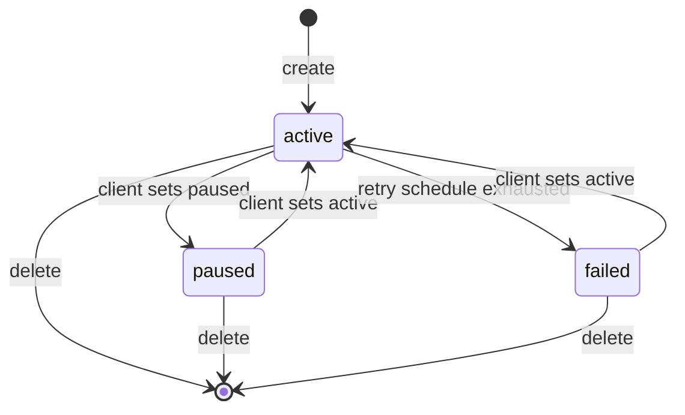

## Purpose

The events module is the APX delivery fabric. APDS 4.1 defines the
`/webhooks` route to subscribe and unsubscribe, but leaves the delivery
contract to each project. APX completes it as a superset: a stock APDS
`EventSubscription` with an endpoint and a list of topics works unchanged
(APX Part 8). The module adds signed delivery, a retry schedule, a
delivery ledger, place-bound filtering, and an optional Server-Sent Events
stream for consumers that cannot expose an inbound endpoint.

Its conformance classes are `apx-events` (webhooks, a base class) and
`apx-events-sse` (the stream). The schemas are in
`spec/openapi/domains/events/schemas.yaml`; the envelope itself is in the
common module.

## Concepts

### Subscription

`ApxEventSubscription` is a superset of the APDS EventSubscription. Only
`topics` is required. A stock body of `endpoint` and APDS `EventTypeEnum`
topics gets stock behaviour; every APX member is optional (APX Part 8
§8.1). The members are:

- `endpoint` and `topics[]`. Topics mix APDS EventTypeEnum values and APX
  topics (`apx.<domain>.<event>.vN`, registry `apx-topics`) freely.
- `transport`: `webhook` (the default) or `sse`.
- `filters` (`SubscriptionFilters`): `places`, `severityFloor` and
  `alertTypes`.
- The signing material: `secret` or `secretRef`, `keyId`, the read-only
  `activeKeyIds`, and `retireKeyIds` to end a rotation.
- `status`: `active`, `paused` or `failed`.
- `id`, `version`, `recordInfo` and `extensions`.

A topic is accepted only if the credential could read its data
synchronously, and a place filter only inside the token's `apx_places`
grant (APX Part 8 §8.1). The signing secret is returned once, in the
creation response, and never again. `ApxEventSubscriptionPatch` is the
JSON Merge Patch body of an update: members present replace the stored
value and absent members are unchanged.

A filter can narrow a grant but never widen it. `places` is
subtree-inclusive. `severityFloor` and `alertTypes` apply to the alert
topics only, and both must hold (APX Part 8 §8.5a).

### Envelope and place binding

Every delivery carries exactly one `EventEnvelope` (common module). For an
APDS EventTypeEnum topic, `data` is the APDS `EventData` and `subject`
references the changed entity (APX Part 8 §8.2). Each topic names the
schema of its `data` (APX Part 8 §8.7).

Every event about a physical location is bound to a place, so filters and
grants can be applied (APX Part 8 §8.5). In order of precedence the
binding comes from a `place` field in `data`, a `source.place` field in
`data`, a `subject` that references a HierarchyElement, or the place that
inventories or contains the subject. An event with no resolvable binding
goes only to subscriptions without a place filter, and never to a
subscriber whose grant would not include it: when in doubt, the publisher
drops rather than leaks.

### Delivery ledger

Webhook delivery is an HTTP POST of the envelope, signed with HMAC-SHA-256
over the attempt's timestamp and the body (APX Part 8 §8.3). Each attempt
is signed on its own; the body, and with it the envelope `id`, is the same
across attempts and is the receiver's deduplication key.

`DeliveryRecord` is one entry in a subscription's ledger: one record per
event and subscription, with the latest `deliveryId`, `eventId`,
`attempts`, `status` (`delivered`, `retrying`, `failed`), `lastCode`,
`time`, and `attemptHistory[]`. Each `DeliveryAttempt` holds that
attempt's delivery id, time and HTTP code. A receiver and a publisher
disputing a retry therefore share one record.

The retry schedule is fixed: 0 s, 30 s, 2 min, 10 min, 1 h, then hourly up
to 24 hours, 27 attempts in all. When the last attempt fails the
subscription becomes `failed`, and a `SubscriptionFailure` is published as
`apx.subscription.failed.v1` to the organisation's other subscriptions
that list the topic, never to the failed one. It names the subscription,
its endpoint, the failure time, the first failed event, the attempts and
the last code. Where `apx-alerts` is implemented, a
`webhookDeliveryFailed` alert is raised as well (APX Part 8 §8.3).

### Stream

The SSE stream delivers the same envelopes to a subscription whose
`transport` is `sse` (APX Part 8 §8.4). Each frame carries a
per-subscription sequence number and one envelope. A reconnecting client
resumes after its last sequence. The server buffers at least 1000 events
or 15 minutes; a position older than the buffer is refused with 410
`stream-position-expired`, and the client re-syncs through the change
feed. Ordering is best-effort on both transports. The change feed of the
data module is the exactly-once path.

## Lifecycle

`active` delivers. `paused` is set by the client; matching events are
held for up to 24 hours and delivered in order on resume, and an event
older than that is dropped (APX Part 8 §8.1). `failed` is set only by the
server when the retry schedule is exhausted; a client cannot set it.
While `failed`, the only update accepted is one that sets `status:
active`, which also resets the retry state. Every other update, and the
SSE stream, is refused with 410 `subscription-failed`. Reading the
subscription and its ledger, and deleting it, work in every state.

A secret rotation runs alongside this lifecycle. A new secret joins
`activeKeyIds` and signs every delivery from then on; the old key retires
when the client names it in `retireKeyIds`, or 24 hours after the rotation
(APX Part 8 §8.1, Part 9 §9.4).

## Relationship to APDS

APDS elements used as they stand: the `/webhooks` route, the APDS
EventSubscription body, the `EventTypeEnum` topics and the `EventData`
shape, together with `Reference`, `DateTime` and `Url`. The stock APDS
response is preserved: a request without `Prefer: return=representation`
receives the APDS `ResponseStatus`, with the new subscription's id in
`ids[]` (APX Part 8 §8.1).

Proposed to APDS: no data element. Delivery is interface behaviour, and
the APX Data Specification proposes data, not interface.

Offered as a suggestion (`docs/apds-change-requests.md`, Part B): event
types in `EventTypeEnum` for access attempts and corrections, so that a
subscriber could hear a lane denial or a corrected read through APDS
events. APX meets that need today with the topics
`apx.credentials.access.v1` and `apx.data.observation.updated.v1`.

APX-only: all schemas in this module (`ApxEventSubscription`,
`ApxEventSubscriptionPatch`, `SubscriptionFilters`, `DeliveryRecord`,
`DeliveryAttempt`, `SubscriptionFailure`). Should APDS later standardize a
delivery contract, the APDS construct wins and APX adopts it (APX Part 3
§3.3(8)).
