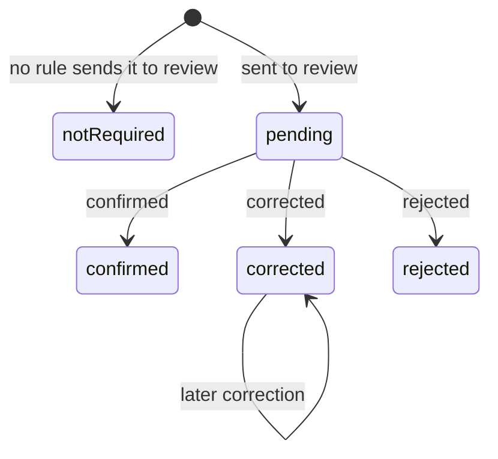

## Purpose

The LPR module makes licence plate reads useful across systems (APX Part
13 §13.3). Ingest is native: LPR vendors post reads to the APDS
`/observations` route, with Confidence and Image, and nothing new is
needed to send them. APX adds what modern recognition engines know beyond
one plate string and one overall score; a way to describe a lane's
cameras; a human review of doubtful reads; and a cross-lookup between
plates, tickets, Observations and Sessions.

Its conformance class is `apx-lpr`. The schemas are in
`spec/openapi/domains/lpr/schemas.yaml`. Two of them are decorations on
APDS entities: `LprReadDetail` on the Observation and `LaneCameras` on the
VehicularAccess.

## Concepts

### Read detail

APDS's Observation carries the plate, the vehicle's country, state or
province, make, model and colour, one overall Confidence and a confidence
per character. It has no confidence per attribute, no alternate
candidates, and nothing about how the vehicle moved. APX adds these as the
Level B decoration `apds-ext:apx:lpr-read@1.0` (`LprReadDetail`) in the
Observation's `extensions` container, so a plain APDS consumer still sees
a valid Observation (APX Part 13 §13.3a).

- **Per-attribute reads.** `plate`, `country`, `stateProvince`,
  `plateCategory`, `make`, `model`, `color` and `bodyType` are each an
  `AttributeRead`: a `value` with its own `confidence` on the 0–1 scale.
  The winning values must also appear in the APDS-native fields, so
  APDS-only readers see them. When the engine did not report a country,
  APDS 4.1 cannot form `vehicleAncillaryIdentification`, so make, model
  and colour appear in the decoration only.
- **Alternate reads.** `alternateReads[]` keeps the candidate plates the
  engine rejected, best first.
- **Passage geometry.** These are camera facts: `movement` relative to
  the camera (`toward`, `away`, `stopped`, `unknown`), `frameReads`,
  `platesRead`, `plateFace` (`front`, `rear`, `unknown`), `plateBox` (the
  plate's position as fractions of the frame), and `speed` in km/h when
  measured.
- **Access event.** `accessEvent` (`entry`, `exit`, `unknown`) says
  whether the vehicle was entering or leaving the facility. The LPR system
  reports it; the APX server must not infer it from movement or plate
  face. The LPR system may revise it later, for example after pairing
  reads, and the server then increments the Observation's version and
  publishes `apx.data.observation.updated.v1`.
- `captureGroup` groups the reads of one vehicle's passage, from one
  camera or several; `engine` identifies the recognition engine.

The plate-bearing members are personal data and appear only under
`apx.lpr:*` scopes. The passage facts identify nobody and are also served
under `apx.data:read`, so a counting display can tell an entry from an
exit without learning the plate (APX Part 13 §13.3a(7)).

### Lane cameras

A lane's LPR cameras are described on its APDS VehicularAccess by the
Level B decoration `apds-ext:apx:lane-cameras@1.0` (`LaneCameras`) (APX
Part 13 §13.3a(5)). Each camera has a `cameraId`, unique within the Place
and equal to `Image.cameraID` on its reads, and `faces`: `inward` (looking
into the facility) or `outward`. Facing is relative to the facility, not
to the lane's mode, so it holds on reversible lanes. The decoration
describes the setup only. APX derives nothing from it, and defines no
notion of wrong-way travel.

### Reads, passages and Sessions

Each read is one event: one plate seen by one camera, with its access
event. A Session is one complete visit, opened by an entry and closed by
an exit, with times taken from the reads' capture times, never their
arrival times (APX Part 13 §13.3a(6), (8)). How reads are paired into
Sessions is implementation-defined. A pairing engine records which reads
a Session rests on with the session-detail decoration of the data module
(APX Part 5 §5.8), and the server answers "which reads are behind this
Session" from those bindings.

### The read view

An **LprRead** is one plate read joined with its ticket and Session
context: a projection of one Observation, not a stored resource (APX Part
13 §13.3). It carries the required `place`, the `lane` and `cameraId`
where known, the plate and `confidence`, the `detail`, the `observation`
and `observationDateTime`, the `session`, `imageLink` and every unpurged
image in `images[]`, `purgedImagery`, the customer's `recentReservations`,
and the Observation's other extensions. `laneTravel` is deprecated since
0.12.0 and servers should return `unknown`.

`images[].imageType` is an APDS `ImageTypeEnum` value or one of
`plateExtended` and `context`, carried as strings until APDS adds them
(APX Part 13 §13.3c). When imagery passes its retention it is removed and
`purgedImagery` is set, so "picture purged" is distinguishable from "no
picture taken" (APX Part 13 §13.3b).

A lookup must name a plate, ticket, Observation or Session; it is never a
bulk export, and it returns only reads inside the caller's grant (APX Part
13 §13.3, §13.5). `LprReadSearch` carries the same keys in a request body,
so a plate never enters a URL.

### Read review

A read the place sends to human review carries `detail.review` with
`state: pending` and its `reasons`, from the `apx-read-review-reasons`
registry (APX Part 13 §13.3a(4a)). A reviewer decides with a
`PlateCorrection`: `confirmed` keeps the engine's values, `corrected`
writes the given plate, country and state into the APDS fields and the
decoration, and `rejected` marks the read unusable for pairing and
enforcement. On the first correction the server keeps the engine's values,
with their confidences, in `review.original`, and never changes them
afterwards. A Violation cannot be issued while any of its evidence reads
is `pending` or `rejected` (APX Part 19 §19.4 rule 6).

## Lifecycle

This is the lifecycle of `detail.review.state` (APX Part 13 §13.3a(4a)).
A read no rule sent to review is `notRequired` or carries no `review`. A
review decision is made through `PUT /v1/lpr/reads/{observation}/plate`.
Every decision that changes the read sets the state, `decidedTime` and
`decidedBy`, increments the Observation's version and publishes
`apx.data.observation.updated.v1`; resending the same decision and values
changes nothing. A later correction replaces the current values but never
`review.original`. `corrected` without a plate, or plate values with any
other decision, is 422 `request-unprocessable`. The review queue itself,
including assignment and ordering, stays private to the implementation.

## Relationship to APDS

APDS classes used as they stand: ObservationElement (with its
Confidence, CharacterConfidence, Image and VehicleAncillaryIdentification),
VehicularAccess (the lane), Session, `ImageTypeEnum`, and the datatypes
DateTime, Reference and Url. APDS 4.1 has no route that returns or
replaces one Observation by id; APX adds read-back and revision routes
under `/v1/lpr/reads/{observation}` (APX Part 13 §13.3, §13.3a(4)).

Proposed to APDS (APX Data Specification, Observation and Place):

| Element | Change | Tier |
| --- | --- | --- |
| `ObservationElement` | Additions: `accessDirection`, `movement`, `plateFace`, `speed`, and associations to the classes below | 1 |
| `AttributeRead`, `AlternateRead` | New classes | 1 |
| `ReadAttributeEnum`, `VehicleMovementEnum` | New enumerations | 1 |
| `ReadReview` | New class | 2 |
| `Image` | Addition: `plateRegion` | 2 |
| `ImageRegion` | New class (from `plateBox`) | 2 |
| `ImageTypeEnum` | New values: `plateExtended`, `context` | 2 |
| `PlateFaceEnum`, `ReadReviewStateEnum`, `ReadReviewReasonEnum` | New enumerations | 2 |
| `VehicularAccess` | Addition: `laneCamera` | 2 |
| `LaneCamera` | New class | 2 |
| `CameraFacingEnum` | New enumeration | 2 |

In the proposal the access event reuses the APDS `AccessTypeEnum`, with
its values `entry` and `exit`, as `accessDirection`. The recognized values
stay where APDS 4.1 puts them, and each AttributeRead repeats one with
its own confidence. Separately, outside these additions, APX suggests
making `VehicleAncillaryIdentification.country` optional, so a read with
no plate country could still carry make, model and colour. Reading and
correcting one Observation by id is also offered as a suggestion
(`docs/apds-change-requests.md`, Part B).

APX-only: `LprRead` (a projection for lookups), `LprReadSearch` and
`PlateCorrection` (request bodies), and the deprecated `laneTravel`. The
decoration members `captureGroup`, `frameReads`, `platesRead` and `engine`
are not part of the proposal and remain in the APX decoration.
