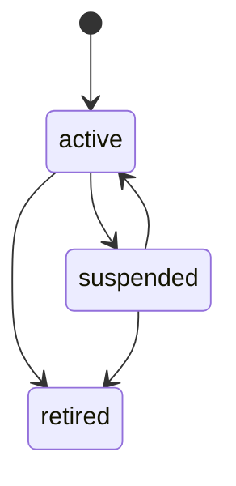

## Purpose

This module covers lists about a plate that someone other than the
vehicle's keeper maintains: a city's scofflaw list, an operator's watch
list, the plates allowed to park without a right of their own, and the
enforcement and service vehicles whose visits are recorded but never
enforced (APX Part 24). A list says what to do when a listed plate is
seen at a place.

APDS 4.1 has nothing for this. A plate list is not a credential (APX Part
21 models the media a customer holds) and not a right (APX Part 14 models
what a holder is entitled to). The vehicle credential on a list is the
APDS CredentialTypeEnum pair that a lane reads, reused as it stands.
Screening, that is matching a read against the lists and deciding what
happens, stays with the implementation and its operator.

## Concepts

### Plate list

A **PlateList** carries the policy (APX Part 24 §24.1): a name, a
category, an owner, the places where it applies, a status and a
description. Entries are kept separately, so a list can be maintained
entry by entry. `entryCount` is server-set.

The `category` is a value from the `apx-plate-list-categories` registry
or an implementer category: `allow`, `watch`, `scofflaw` or
`enforcementVehicle`. The `owner` is the APDS Organisation that maintains
the list, such as a city or an operator. Visibility follows the place
grant: a list is visible to a token whose grant covers any of its places,
and to tokens of its owner.

### Place flags

**PlateListPlaceFlags** say what the list does at one HierarchyElement
subtree (APX Part 24 §24.1 rule 2):

- `enforced`: a match counts at this place, as compliant for `allow`, or
  as enforceable for `scofflaw` and `watch`;
- `alertOnArrival`: a match raises the category's arrival alert;
- `refuseService`: a match refuses service at a lane.

A list with no places applies nowhere, but its entries are still kept.

### Entry

A **PlateListEntry** is one credential on a list (APX Part 24 §24.2). It
holds the credential (an APDS CredentialTypeEnum value, its
identification, and an optional jurisdiction), a validity window with
open bounds where absent, the reasons the owner records (amount owed,
notice count, the owner's reference, a note), and an optional vehicle
description to help an officer confirm the match.

Adding an entry whose credential is already on the list with an
overlapping validity updates that entry rather than creating a second.
So a nightly load is naturally idempotent. `details` carries no personal
data beyond the plate.

### Screening (informative)

A lane, an LPR system or a handheld screens each read against the lists
that apply at its place. APX defines the facts, not the decision (APX
Part 24 §24.4):

- `alertOnArrival` raises the APX Part 7 alert of the category
  (`watchListArrival`, `scofflawArrival`), with the entry as the related
  record.
- `refuseService` withholds the vend and shows the refused-service
  message through an APX Part 6 `displayMessage` command; the alert is
  `refusedServiceArrival`.
- An `allow` list that is `enforced` satisfies the APX Part 19 §19.3
  eligibility check at that place, with the entry as its basis.
- A match on an `enforcementVehicle` list is recorded and never screened
  further.

Where a Session results, the match is recorded as MatchEvidence with
`matchType: list` (APX Part 5 §5.8).

### Privacy and synchronisation

Plate values appear only under the plate-list scopes. A consumer that
only screens MAY hold a credential digest of each entry instead and match
by digest (APX Part 24 §24.2 rule 5). Both lists and entries serve the
APX Part 5 change feed, so an edge system can keep a local copy current.
The change event carries no plate values (APX Part 24 §24.3).

## Lifecycle

A list is `active`, `suspended` or `retired`. A suspended or retired list
stops applying anywhere; its entries remain readable for audit (APX Part
24 §24.1 rule 4). Part 24 defines no transition table, so the diagram
shows the statuses rather than a normative set of moves. The policy is replaced by a
versioned PUT. An entry has no status of its own: it is in force within
its validity, and is removed by DELETE, which the entry feed reports as a
tombstone.

## Relationship to APDS

APDS classes used as they stand: CredentialTypeEnum (the listed
credential), Organisation (the owner), HierarchyElement (the places) and
AmountInCurrency (amount owed).

Proposed to APDS, in a new `PlateList` sub-package of the Right package,
as Level B additions (see the APX Data Specification):

| Element | Change | Tier |
| --- | --- | --- |
| `PlateList` | New class | 2 |
| `PlateListPlaceFlags` | New class | 2 |
| `PlateListEntry` | New class | 2 |
| `PlateListCategoryEnum` | New enumeration | 2 |

In the proposal the listed credential is a PresentedCredential, the class
proposed for any credential value that is not an assigned credential. The
list's period and state use the APDS Validity class, with the shared
RecordEndReasonEnum (PkCommon) for why it ended. PlateListCategoryEnum is
suggested as an extensible code list: APDS would fix the attribute and a
starting set of values, and further values would be published as
user-defined code lists, as APDS already does elsewhere. The arrival
alert types are proposed with the Alert in the Operations package.

APX-only: the credential digest decoration and the change event are
delivery mechanisms, not data, and are not proposed. Screening itself is
left to implementations.
