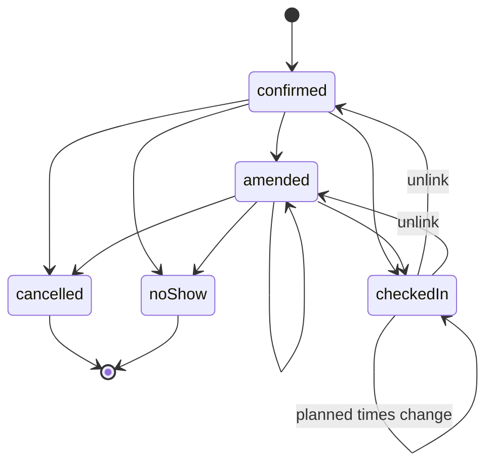

## Purpose

This module covers reservations and permits. Both are thin profiles over
the APDS Right domain. APX defines no separate booking or permit entity.
A reservation is an APDS AssignedRight with a small extension that holds
its state. A permit is an APDS AssignedRight issued from a pooled
RightSpecification (APX Part 14).

The aim is that a stock APDS lane or enforcement client can honour a
reservation or permit without knowing anything about APX. APX adds only
what APDS does not yet hold: the state of a reservation, the link to the
Session that used it, the renewal chain of a permit, and a limit on how
many of a permit's vehicles may park at once.

## Concepts

### Reservation

A reservation is an AssignedRight that carries the
`apds-ext:apx:reservation@1.0` extension (ReservationExtension). The
presence of the extension marks the right as a reservation (APX Part 14
§14.1). The extension holds:

- `reservationState`: confirmed, amended, checkedIn, cancelled or noShow.
- `plannedStart` and `plannedEnd`: mirrors of the APDS PlannedUse.
- `checkInSession`: the Session that used the reservation.
- `noShowAfter`: a server-set instant after which an unused reservation
  becomes a no-show.

The APDS PlannedUse is authoritative for the planned times.
`plannedUses[0].startTime` and `endTime` win. The extension's mirrors
MUST match them on every write. When the two disagree, the server applies
the PlannedUse and rewrites the extension. So a plain APDS client that
edits the PlannedUse still moves the reservation (APX Part 14 §14.1).

The whole flow uses native APDS routes and classes. A quote is an APDS
QuoteRightRequest and QuoteRightResponse. Booking creates the
AssignedRight. The plate on file is a CredentialAssigned of type
`licensePlate` under `rightHolder.credentials[]`. Cancelling sets
`plannedUses[0].cancelTime`. A no-show sets `plannedUses[0].expiryTime`.

### Check-in and the link to a Session

Check-in is the creation of an APDS Session whose Segment references the
AssignedRight. This is the normative link (APX Part 14 §14.1, step 5). At
LPR sites the plate usually makes the link. Where it cannot (barcode-only
reservations, unreadable plates), an explicit link binds the Session to
the AssignedRight. The link MUST land in the APDS Session as
`segments[].assignedRight` and be visible to plain APDS clients. A link
is never silently replaced; an audited unlink, with a reason, is the only
undo (APX Part 14 §14.1b).

### Permit

A permit is an AssignedRight issued from a RightSpecification that has
`rightPools`. One permit may carry many vehicle credentials, following
the APDS annual-permit pattern of one right, many vehicles (APX Part 14
§14.2). The issue request maps onto native classes (APX Part 14 §14.2b):

- the holder becomes a CustomerCredential in `rightHolder.credentials[]`;
- each vehicle becomes a VehicleCredential in the same list;
- the validity becomes one PlannedUse, with `expiry` at its end.

The pool slot belongs to the right, not to a vehicle. Adding or removing
a vehicle never consumes or returns a slot. Cancellation or expiry
returns the slot to the APDS RightPool (APX Part 14 §14.2c).

**PoolAvailability** is a read view over one APDS RightPool: `issued` is
`distributedAssignedRights`, `available` is `availableAssignedRights`,
and `capacity` is their sum. An operator that sells above its space
count MAY also report `spaces`.

**PermitExtension** (`apds-ext:apx:permit@1.1`) links a renewal to the
permit it renews (`renews`, and the server-set `renewedBy`). It also
holds `maxConcurrentVehicles` and `overageBilling`. A vehicle that
arrives while the limit is reached is an overage. Its stay is an ordinary
Session. `overageBilling.mode` is `rack`, `dayRate` or `none` (APX Part
14 §14.2d).

### Customer identity is local

APX assumes no central catalogue of users. RightHolder identifiers are
local to the system that issued them. A caller correlates customers
across systems by the strongest credential it has: a plate on file,
camera reads, or a ticket number (APX Part 14 §14.1a).
**ReservationSummary** is the compact view returned by history lookups
and carried by the no-show event.

## Lifecycle

The transition table in APX Part 14 §14.1 is normative. A booking starts
`confirmed`. An amendment before check-in sets `amended`. Creating the
Session sets `checkedIn`. An amendment after check-in changes only the
planned times; the state stays `checkedIn`. The only way back from
`checkedIn` is the audited unlink of §14.1b, which returns the
reservation to its pre-check-in state. `noShow` follows when
`noShowAfter` passes with no check-in. `cancelled` and `noShow` are
terminal. Any other transition is refused with 409.

A permit has no state machine of its own in APX. It is active within its
PlannedUse and ends at `expiry` or on cancellation (APX Part 14 §14.2c).

## Relationship to APDS

APDS classes used as they stand: AssignedRight, PlannedUse,
RightSpecification, RightPool, RightHolder, CredentialAssigned
(CustomerCredential and VehicleCredential), QuoteRightRequest and
QuoteRightResponse, Payment, and Session with its Segments.

Proposed to APDS, as Level B additions to AssignedRight in the Right
package (see the APX Data Specification):

| Element | Change | Tier |
| --- | --- | --- |
| `AssignedRight` (`reservationState`, `checkInSessionId`, `noShowTime`, `renewsAssignedRightId`, `renewedByAssignedRightId`, `maxConcurrentVehicles`, `overageBilling`) | Additions to an APDS class | 2 |
| `OverageBilling` | New class | 2 |
| `ReservationStateEnum` | New enumeration | 2 |
| `OverageBillingModeEnum` | New enumeration | 2 |

The proposal keeps the PlannedUse authoritative for planned times. The
existing APDS ReservationTypeEnum is unrelated and unchanged.

APDS 4.1's AssignedRight declares no `extensions` container. APX carries
its extension keys there regardless, and lists this as an item for
reconciliation with APDS (APX Part 14 §14.2).

APX-only: PoolAvailability, PermitIssueRequest and ReservationSummary.
They are request and view shapes over APDS data, not new data, so they
are not proposed. The waitlist is not standardised at all (APX Part 14
§14.2).
