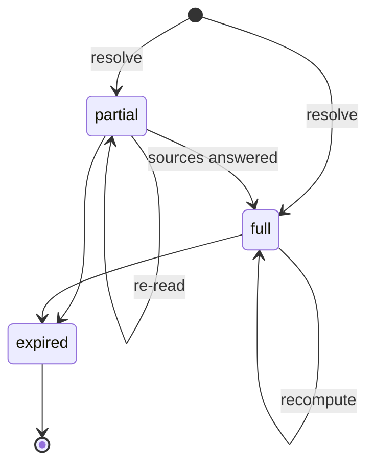
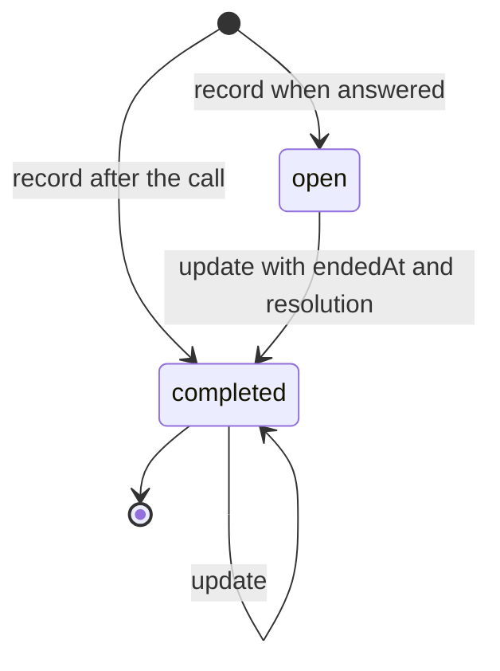

## Purpose

This module covers customer service and resolution. When a customer
presses the intercom, the agent, human or AI, should not have to log into
another system and reconstruct what happened. One call assembles the
context, and the server, not the agent, decides which actions are
permitted (APX Part 17).

The module adds little new data. A resolution context is an aggregation
of records other modules already define: the Place, the lane, the APDS
Session, the RightHolder, the AssignedRight, payments and device status.
The new concepts are the policy decision about each action, the
anti-passback overlay on a credential, plate candidates for correction,
and the record of a support interaction.

## Concepts

### Resolution request and context

A **ResolutionResolveRequest** carries whatever parking identifiers the
caller has: device, place, lane, session, holder, credential, plate,
ticket number or reservation code. At least one is required. The server
MUST resolve every relationship it can and MUST NOT fail because some
identifiers are missing (APX Part 17 §17.1). APX accepts no telephony
identifiers. The call platform maps the call to a lane or device before
it calls APX, so no parking system needs telephony concepts.

A **ResolutionContext** is the result. Its core is small: id, version,
computation time, status, Place and the allowed actions. Every other
section is optional: the vehicle as resolved, the lane status, the
Session, the holder, the account, the AssignedRight, a ReservationSummary,
the credential, the passback state, the last access decision, recent
payments, live device status, recent overrides and support history. A
server includes what it knows and omits what it does not (APX Part 17).

Two rules bound the context. It MUST NOT include any section the caller's
token could not read through that section's own route; it is a
convenience, never a privilege escalation. And it MUST NOT wait for a
slow source; it MAY return `status: partial` with the sources still
pending (APX Part 17 §17.2).

A **ResolutionIssue** classifies what the context is about. Its code
comes from the open `apx-issue-types` registry (APX Part 17 §17.8).

### Allowed actions

An **AllowedAction** is one policy decision about one action, for this
context, this credential and this moment (APX Part 17 §17.3). It says
whether the action is allowed, whether it needs approval and by which
role, and why when it is denied or gated. An `execution` descriptor says
how to run it: a Part 6 control command, or a domain operation by its
operationId. So the agent sees one list and never needs to know which
module executes the action (APX Part 17 §17.4).

The decisions are binding. A command or domain write that the current
context does not allow is refused (`action-not-allowed`); one that needs
approval is refused without approval evidence (`approval-required`). An
AI agent MUST NOT decide permissibility itself. `recommendedAction` is
advisory and MUST be one of the allowed actions. Policy content is
operator-defined and outside APX; only the decision format and its
enforcement are normative.

### Passback, plate candidates and overrides

A **PassbackStatus** is an anti-passback overlay on one APDS Credential:
its state, where it is expected and recorded to be, and its last access
event. A credential the server knows but does not track has state
`unknown` (APX Part 17 §17.8).

A **PlateCandidate** is one candidate read for a plate correction. It is
a projection over APDS Observations. Its country and state follow APDS
VehicleAncillaryIdentification, and its confidence projects APDS
`Confidence.overallConfidence`. The agent picks a candidate and corrects
the Session's plate. The correction MUST land in the APDS Session
(`identifiedCredentials[]` and `identifiedVehicle`) and MUST NOT create a
parallel plate store (APX Part 17 §17.5).

An **OverrideRecord** summarises a recent manual override, such as a
courtesy exit, from the Part 6 Command that performed it.

### Support interaction

A **SupportInteraction** records one customer-service contact: channel,
agent type (human or AI), start and end, Place, issue, a short summary,
the subjects it was about (Session, holder, account, credential,
reservation, plate) and references to the actions taken. It holds a
summary, never a transcript (APX Part 17 §17.6). Recorded interactions
appear in later contexts as `supportHistory`, so an agent can see that
the customer called twice yesterday.

### Correlation

Two identifiers tie an episode together (APX Part 17 §17.7).
`interactionId` is opaque and owned by the calling application; APX
never interprets it. `correlationId` is a UUID a caller may mint at first
contact and carry on every request, context, command, payment link,
event and support interaction of the same episode.

## Lifecycle

A context is created by a resolve request. It is `full` or, while a
source is slow, `partial`. Each read recomputes it, and `version`
increments when anything material changed. Contexts MAY expire; one hour
or more is recommended. After expiry the caller resolves again. When an
action names a context, the server SHOULD record the context version its
check used, and keep that version's allowed actions for the audit period
(APX Part 17 §17.2). `expired` is a descriptive state here; the schema
holds only `full` and `partial`.

A support interaction MAY be recorded when the call is answered and
completed later with its end time, resolution, summary and actions (APX
Part 17 §17.6). Every update increments `version`. `open` and `completed`
are descriptive; the record has no status field.

## Relationship to APDS

APDS classes referenced: Place and its hierarchy, VehicularAccess (the
lane), SupplementalEquipment (devices, and an intercom where one is
inventoried), Session, RightHolder, AssignedRight, Credential,
ObservationElement, Confidence and VehicleAncillaryIdentification. Every
entity is referenced, never redefined, and every write goes through an
existing module (Part 6 control, Part 13 payments, the Session plate and
right links).

Proposed to APDS, in the new Operations package (Level C), for discussion
(see the APX Data Specification):

| Element | Change | Tier |
| --- | --- | --- |
| `SupportInteraction` | New class | 3 |
| `SupportAgentTypeEnum` | New enumeration | 3 |
| `SupportIssueTypeEnum` | New enumeration | 3 |

SupportInteraction is offered for discussion only, because it may lie
outside the scope APDS sets itself. In the proposal its channel uses the
shared InteractionChannelEnum proposed in PkCommon, and its issue types
start from the `apx-issue-types` values. The passback state is not
proposed as a class: it follows from the access events of a credential,
and AccessEvent is proposed in the Session package.

APX-only: ResolutionResolveRequest, ResolutionContext, AllowedAction,
ResolutionIssue, PassbackStatus, PlateCandidate and OverrideRecord. They
are aggregation, policy and workflow shapes over APDS data, not new
parking data, so they are not proposed.
