## Purpose

This module lets one source describe a location's whole setup (APX Part
26). A system that joins a location today learns its layout from three
places at once: the parking vendor's portal for the lanes and devices,
the call platform for which intercom rings where, and a spreadsheet for
the cameras. From APX alone a consumer can tell what hardware a location
has and where it stands, how a parker at any point of it reaches help,
what each camera looks at and how to see it, which other systems know the
location by which identifiers, and whom to escalate to.

APDS 4.1 already gives the skeleton: the place hierarchy, with
VehicularAccess as the lane and SupplementalEquipment as a device, each
with a name, a location and opening times; AccessLaneSpecific for a
lane's type and sequence; untyped external identifiers on a facility; and
EquipmentTypeEnum for the kind of equipment. That enumeration was written
for rest areas and general parking: it has a payment machine, a toll
terminal and a public phone, and no gate, ticket dispenser, reader,
camera, intercom or door. This module adds what is missing as decorations
on the APDS elements, and one new resource for the ways a parker calls
for help. Equipment type stays the APDS enumeration; it is never
redefined.

## Concepts

### Equipment detail

**EquipmentDetail** is a decoration on every piece of hardware at a
location, cameras, signs, readers, doors and servers included (APX Part
26 §26.1). Its required `role` says what the item does, as a value of the
fixed `apx-equipment-roles` code list: vehicle barriers (gate, overhead
door, bollard, traffic spikes), pedestrian barriers (access door,
turnstile), ticketing and payment (ticket dispenser, exit verifier, exit
pay station, pay-on-foot, cashier booth, validation terminal, payment
terminal), credential readers (card, tag, barcode), vehicle detection
(loop, presence sensor), the camera, communications (intercom, analog
dialer, emergency phone), signs and displays, and on-site infrastructure
(lane controller, facility server, video recorder, video gateway). An
implementation uses one of these codes and never free text; the APDS
equipment type is still written as the nearest APDS value, and the role
adds to it.

The detail also carries the item's identity (manufacturer, model, serial
number, and its MAC addresses, one per network interface, because a MAC
is sometimes the serial number, labels come off, and a MAC can always be
read back from the network), its firmware and software versions
(recommended, because knowing what runs on each device is what makes
integration at scale possible), where it stands (`area`, `level` and the
`lane` it serves, where it serves one), when it was installed, how it
relates to other items (`builtInto` the host it is part of, and the
barriers it `controls`), and who services it, as an organisation and a
support reference, never a person.

Network addresses are deliberately left out. Together with model and
firmware version, an address map of a site's devices tells an attacker
which unit to reach and which known weakness to try, and no APX flow
needs one: commands go through the API, camera views arrive as
short-lived links, launches as single-use URLs. An optional member behind
a restricted scope could be added later if a real need arises.

### Areas

The `apx-area-types` code list names where something stands, for
equipment, cameras and comms points (APX Part 26 §26.2): the vehicle
areas (lane, entry and exit plaza, ramp, parking level, roof, charging
area, loading dock, perimeter) and the pedestrian and staff areas
(elevator, elevator lobby, lobby, stairwell, pedestrian entrance, payment
area, cashier booth, office, equipment room). An item on a lane carries
the lane area and names the lane.

### Cameras and views

A camera is equipment with the camera role anywhere in the place, not
only on a lane, and carries **CameraDetail** beside its equipment detail
(APX Part 26 §26.3): how it is mounted (built in, overhead, pole, wall,
ceiling), what it looks at (the plate, the vehicle, the driver, the
interaction with the equipment, pedestrians, an area overview), which way
it faces on a lane, whether it is the primary camera for its lane or
area, whether it can pan, tilt and zoom, which recorder keeps it and on
which channel, which streams it can deliver, how long its recordings are
kept, and, for a camera that cannot sit behind a gateway, a credential
reference that the receiving system looks up in its own vault. The
decoration carries no address, user name or password. The LPR module's
lane-cameras decoration is unchanged: it remains the statement of which
camera reads which lane.

A **CameraView** is how an agent sees a camera. A **CameraViewRequest**
asks for a live view, a snapshot or a playback between two instants (for
a dispute: "I entered at 2:14"), naming the agent and the correlation
identifier; the answer is a single-use URL bound to the agent that
expires within five minutes and needs no further credential. Whoever
holds the camera answers: the parking system, the video system, or an
on-site gateway that holds the camera's password and serves the link. The
password never leaves the site. Driver and pedestrian views capture
faces, so each camera states its retention, every view is logged against
the agent and the correlation identifier, and a link is never reused or
shared outside the interaction it was issued for.

### Comms points

A **CommsPoint** is any way a parker reaches help from a lane or a
location (APX Part 26 §26.4). It is not always an intercom: a posted
phone number on a sign, an analog dialer on a phone line, a kiosk, a QR
code or an app all count, and a lane may have one of each. It carries its
type, the place, the lane where it serves exactly one, the inventoried
hardware where it is one, and the barrier an agent opens for it (a gate
or an access door). At least one of three identifiers is present: the
`phoneNumber` that is called when help is requested, dialed by the parker
for a posted number or by the intercom itself when its button is pushed;
the `callerId` the device calls out as; and the `commsDeviceId` the call
systems use when they identify it by neither. Coverage says when it is
answered and in which languages, without naming the call center.

SIP user names, realms and passwords are deliberately left out: a user
name with its realm is half of a line's login, they exist only for SIP
devices, and the call platform already maps its own SIP data to its
device and account identifiers. A comms point resolves to its lane when
it has one and otherwise to its place only; a posted number shared by
many lanes can never name the lane by itself. The Resolution module's
resolve request takes a comms point, a caller id, a dialed number or a
comms device id, and a server that holds no comms points says so.
Whoever runs the calls writes the comms points, through the create,
replace and delete operations; a parking system never has to hold or
understand them.

### Place operations

**PlaceOperations** is a decoration on the place (APX Part 26 §26.4 and
§26.5). Its `commsAccountId` is the identifier the call platform uses for
the whole site, so that with the comms device ids a call maps to a
location and a lane from APX alone. Its `escalationContacts` say whom to
ask when the agent cannot settle a matter, as **roles only** (site
manager, attendant, security, operator on call, maintenance), in calling
order with their hours. Names and phone numbers stay with the call
platform, so APX holds no personal contact data. An approval request of
the Resolution module is addressed to one of these roles.

### External identifiers

**ExternalIdentifiers** is a decoration any hierarchy element may carry:
a list of system and identifier pairs, where the system is a URI the
issuing system owns, as a rule its own domain (APX Part 26 §26.6). APDS
external identifiers are untyped strings, so a reader cannot tell which
system an identifier belongs to; the decoration adds the system and
changes nothing else. APX names no products or platforms: the issuer
names itself. An **IdentifierResolveRequest** asks for the APX record
behind a pair, and the **IdentifierResolution** answers with the target
reference, its class and its place, so any system finds the record for an
identifier it holds in one call. An unknown pair, or one outside the
grant, is not found; the answer never confirms another party's record.

### Change notices

Every create, change or removal of a piece of equipment or its
decorations publishes `apx.equipment.changed.v1`, and of a comms point
`apx.commspoints.changed.v1`; removal carries the last representation.
The equipment and comms-point lists serve the Data module's change feed,
so another system keeps a copy of a site's setup current without
re-reading the whole place, and catches up after an outage (APX Part 26
§26.7).

### After-hours access

Both transient parkers and permit holders may have to authenticate at an
access door to reach their car after the lanes close (APX Part 26 §26.8).
The door is place-level equipment with no lane; its reader controls it
and takes a ticket, receipt, code, card or PIN; its comms point names the
intercom built into the door and the door it serves. An attempt at the
door is recorded like a lane access event, and an agent opens the door
with a Control `vendGate` command whose target is the door. A call from
the intercom resolves through the comms device id to the comms point,
from it to the door, and the agent's allowed actions include the vend,
with the door camera's view a click away.

## Lifecycle

```mermaid
stateDiagram-v2
    [*] --> described : equipment or comms point created
    described --> described : decoration or record changed (version + 1)
    described --> removed : deleted; feed emits a tombstone
    removed --> [*]
```

Equipment and comms points are descriptions, not processes, so the
module has no state machine of its own. A record is created, changed by
versioned replacement (the comms point by its own `PUT`, the equipment
through the native place routes) and removed with a tombstone on the
feed; every step publishes its change topic. A camera view has a short
life of its own: issued, used once, expired within five minutes.

## Relationship to APDS

APDS classes used as they stand: HierarchyElement and its
specialisations Place, VehicularAccess and SupplementalEquipment
(decorated, never redefined), EquipmentTypeEnum (the equipment type,
still written as the nearest APDS value), Organisation (the service
provider), Period (coverage and escalation hours) and Reference.

Proposed to APDS, in the Place domain, as Level B additions (see the APX
Data Specification):

| Element | Change | Tier |
| --- | --- | --- |
| `SupplementalEquipment` | Additions: manufacturer, model, serial number, MAC addresses, firmware and software versions, installation date, role, area, level, built-into and controls relations | 2 |
| `EquipmentRoleEnum` | New enumeration | 2 |
| `AreaTypeEnum` | New enumeration | 2 |
| `Camera` | New class (a specialisation of SupplementalEquipment) | 2 |
| `CameraMountingEnum`, `CameraViewEnum` | New enumerations | 2 |
| `CommsPoint` | New class | 3 |
| `CommsPointTypeEnum` | New enumeration | 3 |

The lane-equipment values for EquipmentTypeEnum (barrier, gate, ticket
dispenser, intercom) are proposed separately, as Tier 1, by the Control
module. The equipment role is offered as an extensible code list beside
the equipment type, so APDS would fix the attribute and a starting set of
values. CommsPoint is offered for discussion, because the numbers a
parker calls sit between parking data and telephony; the proposal carries
the phone number and caller id and no SIP data, as APX does.

APX-only: ExternalIdentifiers (APDS already has untyped external
identifiers; the typed form is an APX decoration until the committee
decides), PlaceOperations (call-platform and escalation workflow),
CameraView and its request (a delivery mechanism), IdentifierResolution
and its request (a lookup), and the change topics.
