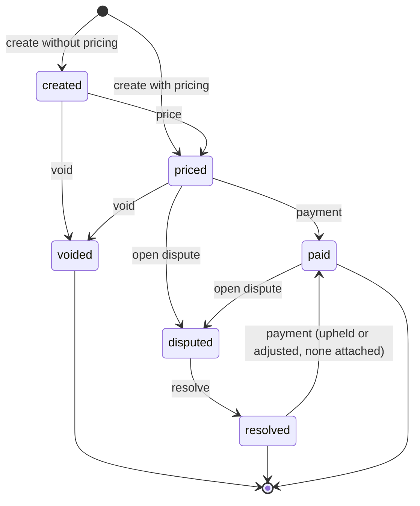

## Purpose

This module covers toll charges. It is the one net-new surface in APX:
APDS 4.1 has no toll entities (APX Part 15). APDS already holds every
ingredient of a toll charge: the read of the vehicle, the equipment at
the toll point, the amount and the payment. What it lacks is the record
that ties them into one charge that a customer can pay or dispute.

The TollTransaction is that record. It is still built entirely to APDS
conventions. The toll point is an APDS SupplementalEquipment. The reads
are native APDS Observations. Money is AmountInCurrency. Settlement is a
reference to an APDS Payment.

## Concepts

### Toll transaction

A **TollTransaction** is a versioned, identifiable record of one toll
charge (APX Part 15 §15.1). It holds:

- `tollPoint`: a reference to the SupplementalEquipment that charged the
  vehicle.
- `observations`: references to the APDS Observations the charge was
  built from (plate or transponder reads).
- `credential`: the credential as read. `credentialType` SHOULD be an
  APDS CredentialTypeEnum value, such as `licensePlate` or `rfid`.
  `credentialIdentification` is the plate string or tag id as read.
- `pricing`: the amount owed.
- `payment`: a reference to the settling APDS Payment, or APX
  PaymentRecord (APX Part 13).
- `transactionStatus`: where the charge is in its lifecycle.
- `dispute`: the open or resolved dispute, if any.
- `statusHistory`: the immutable audit of every transition (APX Part 4
  §4.2).

Gantries retry. So creating a transaction requires an Idempotency-Key,
and a replay returns the transaction the key created (APX Part 15 §15.2).
A transaction may be created already priced, or created unpriced and
priced later by an external pricing engine.

### Dispute

A **dispute** is a challenge to a priced or paid charge. The operator
opens it, either on the holder's behalf or on its own initiative.
`disputedBy` names the party (RightHolder, Organisation or Contact) on
whose behalf it was raised; it may be absent when the operator raised it.
APX v1 defines no customer-channel dispute scope (APX Part 15 §15.1).

The base reasons are `wrongVehicle`, `duplicateCharge`, `wrongClass`,
`notLiable` and `other`. The base resolutions are `upheld` (the charge
stands), `refunded` (money returned), `adjusted` (a new amount is owed)
and `withdrawn` (the disputing party abandoned it). Both lists are
registered code lists (`apx-toll-dispute-reasons`,
`apx-toll-dispute-resolutions`); implementers MAY add codes (APX Part 11).

An `adjusted` resolution MUST carry the new amount. The server replaces
`pricing` with it and keeps the old amount in `dispute.originalPricing`.
This is the only way `pricing` changes after a charge is priced.

A paid charge is never voided. It is corrected by a dispute resolved
`refunded`; the refund itself is an APX Part 13 refund.

## Lifecycle

The transition table in APX Part 15 §15.1 is normative. Any other move is
refused with `toll-transition-illegal` and changes nothing.

- A transaction created with `pricing` starts `priced`; otherwise
  `created`.
- Only `created` and `priced` can be voided. `voided` is terminal.
- A payment settles a `priced` charge. It also settles a `resolved` one
  whose resolution was `upheld` or `adjusted` and which has no payment
  attached yet. Re-attaching the same payment is a no-op; a different one
  is refused.
- A dispute can be opened only on a `priced` or `paid` charge. A
  resolved dispute cannot be reopened (`dispute-closed`).
- A `refunded` transaction takes no further payment.

Every transition publishes `apx.tolling.transaction.status.v1` (APX Part
15 §15.3).

## Relationship to APDS

APDS classes used as they stand: SupplementalEquipment (the toll point),
ObservationElement (the reads), Payment (settlement), RightHolder,
Organisation and Contact (the disputing party), and the AmountInCurrency
datatype. The credential type reuses the APDS CredentialTypeEnum. Toll
reads themselves flow as ordinary APDS Observation data.

Proposed to APDS, in a new `Tolling` sub-package of the Observation
package, as Level B additions (see the APX Data Specification):

| Element | Change | Tier |
| --- | --- | --- |
| `TollTransaction` | New class | 2 |
| `TollDispute` | New class | 2 |
| `TollTransactionStatusEnum` | New enumeration | 2 |
| `TollDisputeReasonEnum` | New enumeration | 2 |
| `TollDisputeResolutionEnum` | New enumeration | 2 |

In the proposal the credential read is carried as a PresentedCredential,
the class proposed in the Right domain for any credential value that is
not an assigned credential. The dispute reasons and resolutions are
maintained by APX today as user-defined code lists. They could equally be
typed as PkCommon ReferencedCodeListEntry, with these values as the
recommended initial list. That choice is left to the APDS committee.

APX-only: `statusHistory` is audit detail and stays in the APX profile.
The request bodies (TollPricing, TollPaymentAttachment, TollVoid,
TollDisputeOpen, TollDisputeResolution) are API operations, not data, and
are not proposed. The void reason is an implementer code list.
