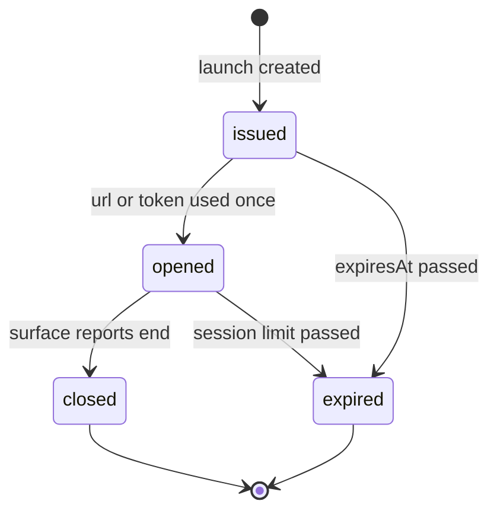

## Purpose

This module covers the launch of a vendor's own screen for a member of
staff, and the return of what was done there as APX data (APX Part 25).
Most remote-assistance actions still happen in a vendor's web portal
rather than through an API: the agent opens the portal in another
window, issues the lost ticket or applies the validation there, and
types a note into the call record. The two records never agree
afterwards. A UI launch opens that screen with automatic login, bound to
one agent, one place and one subject, and everything the agent does on
it comes back through the API, so the call record and the vendor's
record stay in step.

The module is defined once and used by every other module. A module
offers a screen by adding a **surface** to the `apx-ui-surfaces` registry;
the launch, the lifecycle and the loopback are the same for tolling,
licence plate recognition, reservations and validations. "Screen-pop"
already names the lane inquiry of the Control module (APX Part 6 §6.2),
so this module speaks of a UI launch.

APDS 4.1 has nothing for this. It defines no user interface, no agent
identity, and no way to refer a person from one system's screen to
another's.

## Concepts

### Surface

A **UiSurface** is one screen an implementation offers to staff,
advertised in the discovery document (APX Part 25 §25.1). Its name is a
value of the `apx-ui-surfaces` code list, written as module and view:
`lane.console`, `session.detail`, `reservation.detail`,
`violation.appeal`, `toll.dispute`, `place.console` and so on. Each entry
names the **subject class** the surface opens, such as a Session or a
Violation; the general surfaces (`reservation.search`, `place.console`,
`module.home`) open with the place as subject or with none.

The discovery entry also says how the surface may be shown
(`displayModes`: embedded, pop-up or tab), how it may be launched
(`launchModes`: handshake or signed token), which actions it can report
back, the launch URL for the signed-token mode, and the places where it
is offered. The discovery soundness rule applies: a listed surface must be
launchable by that client for at least one granted place.

### Launch request and launch

A **UiLaunchRequest** is what the host sends to open a surface: the
surface, the place, the agent and whether the agent is a person or an AI,
the correlation identifier of the episode, the display mode, and
optionally the subject, the lane, the host's own interaction identifier,
the fields it wants back and how long the launch may wait to be opened,
at most sixty seconds (APX Part 25 §25.2).

A **UiLaunch** is one opening of a surface for one agent. In the
**handshake** mode the host posts the request with its ordinary APX token
and receives the launch with a single-use `url` that lives at most sixty
seconds; it opens that URL for the agent. This mode also serves
implementations that authenticate the host by request header, because a
browser cannot add headers when it opens a page. In the **signed token**
mode the host signs the same members as the claims of a JWS, with the
host as issuer, the implementation as audience, an expiry at most sixty
seconds away and a unique token identifier, and sends it to the surface's
launch URL by form post or URL fragment, never in a query string. The
implementation verifies the signature against keys registered at
onboarding and creates the launch itself. Both modes log the agent in
automatically: the agent never sees a vendor login page and never holds
vendor credentials. A launch is bound to its surface, subject, agent and
place, and the opened session cannot reach another subject.

### Loopback

Loopback is the heart of the module (APX Part 25 §25.4). Everything an
agent does on a launched surface must appear in APX exactly as if it had
been done through the API:

- **Native first.** An action whose APX operation the implementation
  supports produces that operation's own effect: the Control command, the
  refund, the validation redemption, the plate correction. The record
  carries the launch's correlation identifier and agent, and publishes the
  events the operation publishes. A consumer following the correlation
  identifier sees the action with no knowledge that a screen was involved.
- **Fallback.** An action with no supported APX operation is recorded as
  a **UiActionRecord** on the launch: the action (a command type, the
  nearest operation, or `other`), its outcome (completed, failed or no
  action), when it occurred, a short summary, and a reference to any
  native resource that was nevertheless created.
- **Return fields.** The host may ask, as JSON pointers into the schema
  the action concerns, for the values it needs back. The record carries
  them in `fields`; a value the implementation cannot supply is listed as
  unavailable with a reason, never silently omitted.

A launch closed with no native effect and no action record means the
agent did nothing; the implementation never infers an action from a
screen having been opened. Summaries and fields carry no personal data
beyond what the referenced APX resources already carry.

### Link to resolution

An **AllowedAction** of the Resolution module may have an execution of
type `ui`, naming the surface and the subject, so an agent's console
offers "do it in the vendor's screen" when no API operation exists for
the action, and the policy decision applies to the launch exactly as to
a command (APX Part 25 §25.5). A support interaction may list launches
and action records beside commands in its actions.

### Security

A launch URL and a launch token are bearer secrets: single use, sixty
seconds at most, bound, HTTPS only, never in a query string, a referrer
or a log line. They carry no personal data and no secrets; the surface
reads what it needs through its own back end. Embedding requires the
host's origin to be registered, and the implementation sets
`frame-ancestors` to exactly the registered origins; otherwise the
surface is offered as a pop-up or a tab. Signing keys and handshake
secrets are rotatable with an overlap window and are never returned by
any read. The opened session ends when the launch closes or expires, and
every record produced on the surface names the agent of the launch, not
a shared vendor account (APX Part 25 §25.6).

## Lifecycle

A launch is `issued` on creation and `opened` on the first use of its URL
or token; a second use is refused by the surface. It is `closed` when the
surface reports the end of the session, or when the implementation
observes it, and `expired` when its expiry passes while still issued, or
when an opened launch outlives the implementation's session limit (one
hour after opening is recommended). The terminal states never transition
again: an action or a close on a terminal launch is refused, as is one on
an issued launch whose expiry has passed. Every transition publishes
`apx.ui.launch.changed.v1`, and every action record publishes
`apx.ui.action.recorded.v1` (APX Part 25 §25.3 and §25.4).

## Relationship to APDS

APDS classes referenced: HierarchyElement (the place), VehicularAccess
(the lane), and whichever APDS or APX class the surface opens as its
subject: Session, Observation, AssignedRight and the rest. Every subject
is referenced, never redefined, and every native effect of an action goes
through the module that owns it.

Nothing in this module is proposed to APDS. A launch, its token and its
action record are workflow and delivery mechanisms between two systems,
not parking data, and the APDS model describes data. The actions a
surface reports come back as the APDS and APX records those modules
already define, and those are proposed where their own module proposes
them.

APX-only: UiSurface, UiLaunchRequest, UiLaunch, UiActionRecord and the
informative UiLaunchToken claim set.
