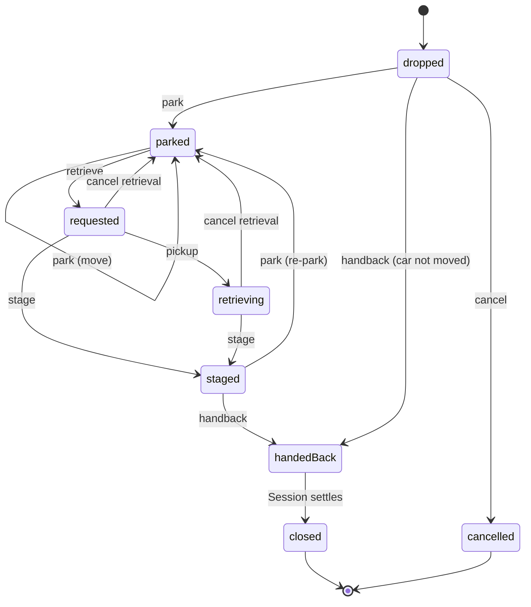

## Purpose

This module covers valet custody: taking a vehicle from its owner,
knowing where it and its keys are, bringing it back when asked, and
handing it to the right person with the evidence to answer "that scratch
wasn't there" (APX Part 22). A retrieval may be asked for from a text, an
app, a web page, a voice bot, a kiosk or the stand.

APDS 4.1 has no valet entity; its only mention is the `valetOnly`
operating restriction. So this is a net-new surface, but it is built to
APDS conventions. The stay is a native APDS Session, opened at drop-off,
closed at handback and priced by the place's rates. The claim ticket MAY
be an AssignedRight. The parked position is a Space. APX adds only what
APDS lacks: custody, keys, condition evidence, the retrieval queue,
staging and handback. It holds them in a **ValetTicket** that references
the Session and never restates it.

## Concepts

### Valet ticket

A **ValetTicket** is one custody of one vehicle (APX Part 22 §22.1). It
holds:

- `place`, `ticketNumber`, `vehicle`, and a minimized `customer` (a
  display name, an opaque or masked contact handle, and a reference to
  the contact record);
- `session` (the APDS Session) and optionally `assignedRight`;
- `dropOff`: time, lane, attendant, mileage, fuel, key tag, items left
  and the drop-off condition report;
- `storage`: the Space or zone, and where the keys are;
- `retrieval`: channel, requested and scheduled times, ETA, promised
  time, staging lane and the runner;
- `handback`: time, verification method and the handback condition
  report;
- `charging`: an optional charging request (see below);
- `valetStatus` and the immutable `statusHistory[]`.

The server writes `storage`, `retrieval`, `handback` and
`statusHistory`. It ignores them in a create body (APX Part 22 §22.1
rule 5).

### Condition report

A **ConditionReport** records the state of the vehicle: free-text notes,
structured damage entries (vehicle area, description, severity `minor`,
`moderate` or `major`, and an image), image links for the walk-around,
and whether the customer acknowledged it (APX Part 22 §22.2). Imagery is
carried as access-controlled links, never inline.

A damage claim is answered by comparing the drop-off and handback
reports. The customer's acknowledgement is what makes the drop-off report
binding. Once the ticket leaves `dropped`, the drop-off report is
immutable. A correction is a new damage entry with a later recorded time,
never an edit.

### Retrieval and the queue

A retrieval request names its channel (`sms`, `app`, `web`, `voiceBot`,
`kiosk`, `attendant`, `callCenter`) and may schedule a pickup. A bot or
support channel may pass an opaque APX Part 17 interaction id; the
contract holds no telephony identifiers (APX Part 22 §22.3).

The server MUST set `etaMinutes` and `promisedTime` on every request.
`etaMinutes` counts down to `promisedTime` and is recomputed on every
read. The runner board lists tickets that are `requested`, `retrieving`
or `staged`, ordered by promised time. A repeat request while a car is
already on its way returns the current ticket and changes nothing.

### Handback

The attendant MUST verify the claimant by ticket, phone, one-time code,
ID or recognition. A failed verification is refused and MUST be recorded
in the history; the value checked is discarded, never stored (APX Part
22 §22.4). Mileage at handback against mileage at drop-off is the joyride
check. Money is not taken here: the APDS Session is closed and paid
through the place's normal flow, and the valet fee is a rate line on the
Session.

### Customer scope and privacy

The `apx.valet:request` scope serves texts, web apps and voice bots. It
is bound to the ticket it was minted for, and every ticket it receives is
minimized to a fixed list of members (APX Part 22 §22.5). A ticket it is
not bound to is 404, so a claim link cannot enumerate tickets. Raw phone
numbers and e-mail addresses MUST NOT be carried on the ticket (APX Part
22 §22.6).

### Charging and pairing

`charging` records that the guest asked for the car to be charged, with a
target state of charge and instructions. Once the valet plugs in, it
references the APX Part 23 ChargingSession (APX Part 22 §22.9). A valet
stay inside a facility is an area Session: it names the visit as its
parent and closes with end reason `valetHandback` (APX Part 5 §5.8).

## Lifecycle

The lifecycle in APX Part 22 §22.1 is normative. Any other transition is
refused with `valet-transition-illegal`.

- `retrieve` from `dropped` is refused with `valet-vehicle-not-located`:
  nobody knows where the car is yet.
- `pickup` (the runner taking the car) is optional; `stage` straight from
  `requested` is conforming.
- A re-park from `staged` clears staging and records the cancelled
  retrieval with reason `re-parked`.
- `handedBack` to `closed` is applied by the server when the APDS Session
  settles, paid or comped.
- `cancel` ends a drop-off whose custody was never taken. The server
  SHOULD close the Session it opened at no charge.

Every transition publishes `apx.valet.ticket.status.v1`; a retrieval also
publishes `apx.valet.retrieval.requested.v1` (APX Part 22 §22.7).

## Relationship to APDS

APDS classes used as they stand: Session (the stay), AssignedRight (the
claim ticket, when used), Space (the parked position), VehicularAccess
(the drop-off lane, or a valet stand), Contact and RightHolder (the
customer, or an APX Part 13 Account), and rate lines on the Session for
the fee.

Proposed to APDS (see the APX Data Specification), as Level B additions:

| Element | Package | Change | Tier |
| --- | --- | --- | --- |
| `ValetTicket` | Session | New class | 2 |
| `ValetStatusEnum` | Session | New enumeration | 2 |
| `HandbackVerificationEnum` | Session | New enumeration | 2 |
| `ConditionReport` | Observation | New class | 2 |
| `DamageItem` | Observation | New class | 2 |
| `DamageSeverityEnum` | Observation | New enumeration | 2 |
| `RightTypeEnum` value `valet` | Right | New value for an APDS enumeration | 2 |

The proposed ValetTicket references the APDS Session, AssignedRight and
Space. It uses VehicleAncillaryIdentification for the vehicle, a
PresentedCredential for its plate, and a ConditionReport at drop-off and
at handback. Its retrieval channel uses the shared InteractionChannelEnum
proposed in PkCommon. The `valet` value lets any APDS consumer, such as
an enforcement vendor, tell a vehicle in valet custody from one parked
without a right. `DamageItem.vehicleArea` stays a string from an operator
code list; no standard values are proposed yet.

APX-only: operational detail that is not proposed, such as the key tag
and key location, mileage, fuel, items left, the staging lane, the
runner, the charging request and `statusHistory[]`. The park, pickup,
stage, retrieval, cancel and handback request bodies are API operations.
