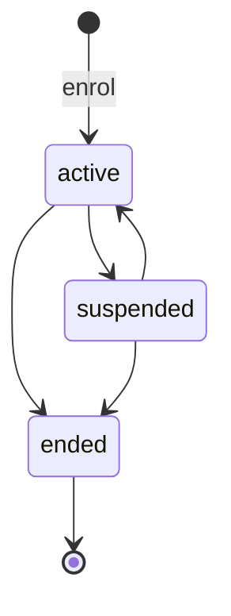
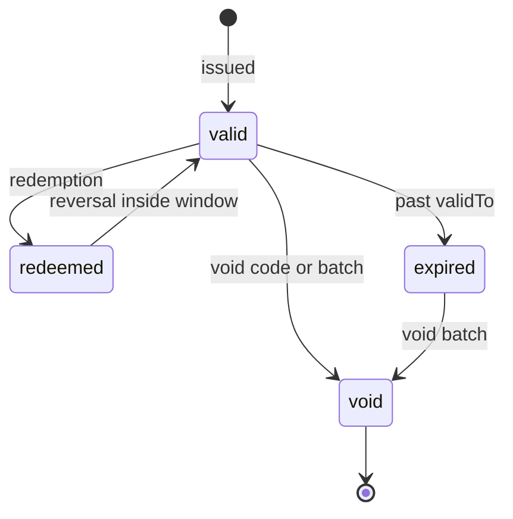
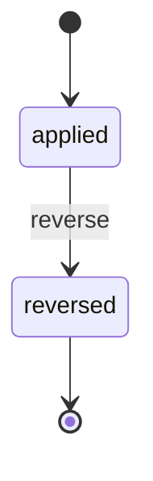

## Purpose

This module covers merchant validation programmes: who may validate
parking at a place, on what terms, with what stock of codes or stamps,
and who pays (APX Part 20). It builds around two pieces APX Part 6 §6.3
already defines, the provider lookup and the `applyValidation` command.
It adds merchant enrolment, instrument stock, the redemption ledger every
channel writes, and merchant billing statements.

APDS 4.1 already records that a validation happened: PaymentTypeEnum
`validation`, `Segment.validationType` and `Segment.validationId`,
`RateTable.validation` and RateDiscount. It records nothing about who may
validate, on what terms, or who pays. APX composes the APDS constructs and
redefines none of them. The id of an applied validation is the APDS
`Segment.validationId`.

## Concepts

### Validation programme

A **ValidationProgram** is one merchant's enrolment at one place, or at
the root of a subtree (APX Part 20 §20.1). The merchant (`provider`) is
an APDS Contact or Organisation. The place is a HierarchyElement. The
programme holds:

- `benefit`: what one validation is worth;
- `rules`: the closed rule set evaluated at redemption;
- `billing`: how the merchant is charged;
- `issuanceMethods`: the instrument forms it may issue (`code`,
  `qrCode`, `stamp`, `digital`, `api`);
- `programStatus` and its immutable `statusHistory`.

Active programmes are the source of the Part 6 provider list. When this
module is claimed, the provider lookup returns exactly the active
programmes at the queried element or an ancestor (APX Part 20 §20.1).

### Benefit

A **ValidationBenefit** is exactly one of `amount` (money off),
`duration` (comped time, valued at the applicable rate) or `percentage`
(a proportionate discount with the APDS RateDiscount `discountRate`
meaning). It always carries a plain-language `description`, so an agent
can explain it in a dispute. Benefit changes apply to redemptions from
the update onward. An instrument already issued keeps the benefit it was
issued with.

### Rules

The rule set is closed, so that two implementations evaluate a programme
the same way (APX Part 20 §20.3): `maxPerTicket`, `maxPerDay`,
`validityWindow`, `stackable` and `applicableRateTables` (APDS
RateTables). Stacking is evaluated both ways: the incoming programme must
be stackable if another is applied, and every programme already applied
must be stackable. A RateTable that does not accept validations, per APDS
`RateTable.validation`, refuses the redemption. Other rules
(day-of-week, minimum spend) ride in `extensions` and are the
implementer's to enforce.

### Issuance and instruments

A **ValidationIssuance** is a batch of instruments of one method issued
to one programme (APX Part 20 §20.2). For `code`, `qrCode` and `digital`
batches, the server generates the codes and returns them exactly once.
Codes MUST be unguessable and unique across the implementation. A
`stamp` batch carries no codes; it is physical stock counted for billing.
An `api` batch stands for redemptions a merchant system records without
a per-instrument code.

A **ValidationInstrument** is one code and its status, window and
benefit. Voiding a batch voids every instrument in it that is `valid` or
`expired` (the stolen sheet of codes); redeemed instruments are not
touched.

### Redemption

A **ValidationRedemption** is one validation applied to one ticket or
Session. It is the ledger entry every channel writes: a pay station, a
lane, a merchant app, an API client, or an agent's `applyValidation`
command (channel `callCenter`) (APX Part 20 §20.3).

On success the server MUST materialize the APDS record: a Payment of type
`validation`, and the Segment's `validationType` and `validationId`. It
returns that id as `validationId`, so APDS clients see the same
redemption without speaking APX. `amountReduced` and `durationComped`
record the actual effect on the amount due, never the nominal benefit.
The instrument is consumed.

A reversal restores the amount due while the Session is still open and
returns the instrument to `valid` while inside its window. For a closed,
settled Session it is a billing correction only (APX Part 20 §20.4).

### Billing statement

`billing.model` says who pays: `merchantPays`, `operatorAbsorbs` or
`split` (APX Part 20 §20.6). A **ValidationStatement** summarises a
period's redemptions. A preview can be computed for any period. Closing a
period produces an immutable statement; closed periods MUST NOT overlap.
A redemption reversed after its statement closed appears as a negative
`credit` line on the next statement, never as an edit to the closed one.
APX does not invoice or take money for statements; that stays in the
operator's accounting system.

### Merchant scope

The `apx.validations:redeem` scope confines a merchant token to its own
programmes. Another provider's resource is 404, exactly as one that does
not exist (APX Part 20 §20.5). Plate values never appear on validation
records.

## Lifecycle

ValidationProgram (APX Part 20 §20.1). Every change goes through a
versioned PUT. `ended` is terminal; any transition out of it is refused
with `program-not-active`.

ValidationInstrument (APX Part 20 §20.2 and §20.4). A redeemed code
cannot be voided; reverse the redemption first. A ValidationIssuance is
`issued` or `void`.

ValidationRedemption (APX Part 20 §20.4). A second reversal is refused
with `redemption-reversed`. A ValidationStatement is a `preview` with no
id, or `closed` and immutable.

## Relationship to APDS

APDS classes used as they stand: Contact and Organisation (the
merchant), HierarchyElement (the place), Session and Segment
(`validationType`, `validationId`), Payment with PaymentTypeEnum
`validation`, RateTable (`validation`), RateDiscount (`discountRate`
semantics), AmountInCurrency and Duration.

Proposed to APDS (see the APX Data Specification). Programme classes sit
in a new `Validation` sub-package of the Right package; the benefit sits
in Rates; the redemption sits in Session. All are Level B.

| Element | Package | Change | Tier |
| --- | --- | --- | --- |
| `ValidationRedemption` | Session | New class | 1 |
| `ValidationRedemptionStatusEnum` | Session | New enumeration | 1 |
| `ValidationBenefit` | Rates | New class | 2 |
| `ValidationProgram` | Validation | New class | 2 |
| `ValidationRules` | Validation | New class | 2 |
| `ValidationIssuance` | Validation | New class | 2 |
| `ValidationInstrument` | Validation | New class | 2 |
| `ValidationIssuanceMethodEnum` | Validation | New enumeration | 2 |
| `ValidationIssuanceStatusEnum` | Validation | New enumeration | 2 |
| `ValidationInstrumentStatusEnum` | Validation | New enumeration | 2 |
| `ValidationBilling` | Validation | New class | 3 |
| `ValidationBillingModelEnum` | Validation | New enumeration | 3 |
| `ValidationBillingCycleEnum` | Validation | New enumeration | 3 |

The redemption is proposed first because its `validationId` is the value
already placed in `Segment.validationId`; it does not depend on the
programme proposal. In APDS the programme's period and state would use
the APDS Validity class, with the shared RecordEndReasonEnum (PkCommon)
for why it ended, and the redemption channel would use the shared
InteractionChannelEnum.

APX-only: ValidationStatement and its lines, the issuance request, the
void detail and the reversal body. Statements are an accounting
handoff, not parking data; APX itself does not invoice or take money for
them (APX Part 20 §20.6).
