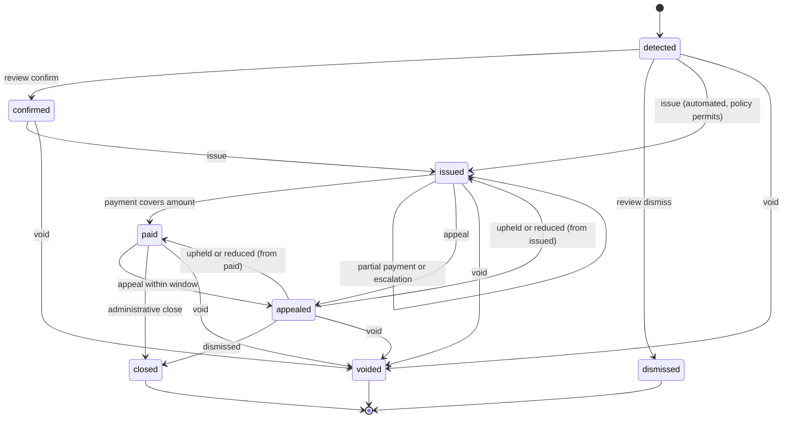

## Purpose

This module covers enforcement: what operators variously call tickets,
notices, warnings and citations, under one record, the **Violation**
(APX Part 19). APDS 4.1 has no violation entity, so this is a net-new
surface. But APDS already holds the pieces enforcement needs, and APX
builds on them rather than beside them.

Eligibility comes from the APDS AssignedRight, which the APDS text calls
"the most important source of information for connected enforcement
systems to check the eligibility of a parked vehicle". Evidence is the
APDS Observation and Image. The location is a HierarchyElement. Money is
AmountInCurrency, and settlement links an APDS Payment. Identity reuses
the APDS Enforcement Provider (`ep`) role. The module adds the finding
itself, its lifecycle, the rules that govern issuing it, and the signs
that gave notice.

## Concepts

### Violation

A **Violation** is a versioned, identifiable finding that a vehicle at a
place was not covered by a valid right. One record carries the whole
story (APX Part 19 §19.1):

- `violationType`, from the `apx-violation-types` registry or an
  implementer code list, and `violationStatus`;
- `place` (any HierarchyElement) and optionally `space`;
- `detection` (how it was found), `vehicle` (the credential and its
  jurisdiction) and `location`;
- `observations[]` and `evidence[]`: references to APDS Observations and
  access-controlled image links, never inline media (APX Part 9 §9.6);
- `eligibilityCheck`: the eligibility answer at detection time;
- `relatedSession` and `relatedRight`;
- `notice`: what was issued;
- `amount`, `dueTime`, `payments[]`, `amountPaid` and `payment`;
- `appeal`;
- `policy` and `signage[]`: frozen at issue;
- `amountHistory[]` and the immutable `statusHistory[]`.

### Detection

A **ViolationDetection** records how the violation was found. Its `mode`
is one of three (APX Part 19 §19.4):

- `automated`: a camera or sensor pipeline finds it. It MUST carry at
  least one observation or evidence link, and SHOULD carry a confidence
  and the rule that fired.
- `guided`: the system surfaces a candidate and an officer decides on
  site. It MUST be reviewed by a human before issue.
- `manual`: an officer finds it. The officer still confirms it, so every
  issued violation has a `confirmed` entry with an actor.

The mode matters because many jurisdictions allow an automated finding
to be issued only after review, or only by post. The detector and the
officer are opaque strings; APX implies no personnel directory.

### Eligibility check

An **EligibilityResult** answers "is this vehicle entitled to be here
right now, and by what?" (APX Part 19 §19.3). It lists every
AssignedRight and Session considered as `basis[]`, each with a status:
`valid`, `expired`, `notYetValid`, `wrongPlace`, `consumed` or
`suspended`. It may give an advisory `suggestedViolationType`, a
`graceUntil` and the latest plate read.

The answer MUST be derivable from the APDS entities the server holds. A
client could compute it from the native routes, and the AssignedRight
stays authoritative where they disagree. A right bound to an ancestor of
the place (a campus permit) covers it; one bound to a sibling is
`wrongPlace`. Evaluation at a past instant uses the rights as they were
then.

### Notice, payment and appeal

The **notice** records what was issued: kind (warning, notice,
citation), notice number, issue time, issuer and delivery method. The
notice number is how drivers, agencies and courts refer to a violation.

This module never takes money (APX Part 19 §19.6). `amount` is what is
owed. Each payment applied is a **ViolationAppliedPayment** that raises
`amountPaid`; `paid` means `amountPaid` reaches `amount`. A part payment
leaves the violation `issued` (APX Part 19 §19.6a). The money itself moves
through APX Part 13 or an APDS Payment.

The **appeal** records one challenge per violation: reason, appellant,
the state it was opened from, and its resolution, `upheld`, `reduced`
(with a new amount) or `dismissed`. A driver may pay and then appeal
within the policy's appeal window; a refund on such an appeal is a Part
13 refund, recorded as `appeal.refund`.

`amount` changes only at issue, through an appeal reduction, or through
a server-applied escalation step. Every change is appended to
`amountHistory[]`, and `amount` always equals its last entry.

### Location

**ViolationLocation** is modelled on the APDS `Observation.Location`
shape and reuses its member names and types: `observedLocation`,
`observerLocation` and `observedLocationTextual`. It differs in two
ways: `observerLocation` is optional (a fixed sensor may have none) and
APX adds `accuracyMetres`. GeoJSON positions are longitude first (APX
Part 19 §19.9).

### Enforcement policy

An **EnforcementPolicy** is a machine-readable summary of the rules that
govern issuing a violation at a place (APX Part 19 §19.10). The operator
configures it from the governing statute, cited in `authority`. It is
never the statute itself. It binds to a HierarchyElement and applies to
its subtree; the policy in force is the nearest active ancestor-or-self
policy whose effective window covers the instant. It holds:

- `deliveryRules[]`: which delivery methods are lawful for which
  detection modes, the notice deadline, the minimum evidence, and whether
  a location is required;
- `unreviewedIssuance`: whether, and above what confidence, an automated
  detection may be issued without review;
- `penaltyCap`: absolute and relative ceilings on the issued amount,
  with `onExceed` `refuse` or `clamp`;
- `escalation[]` and `overallCeiling`: server-applied penalty steps;
- `appealWindowDays`, `paymentGraceDays` and `signageRequired`.

The policy is binding on the server, as allowed actions are in APX Part
17. At issue the server checks the violation against it and refuses what
it forbids. On success it freezes the policy version, the signage in
force, the unpaid fee and the cap onto the violation, so a later change
does not alter what applied. Escalation steps fire once each, after their
number of days, and the clock pauses during an appeal. Clients MUST NOT
compute penalties themselves.

### Signage

**Signage** records what was posted at a place: the verbatim text, a
photo, the sign's location, its type and the window it was in force (APX
Part 19 §19.11). Notice-and-signage laws make the posted sign evidence,
as much as the plate photo. Signage binds to a HierarchyElement with
subtree inheritance. Its history is immutable: new wording is a new
record or version. The server freezes onto the violation every sign in
force at the place or an ancestor at detection time. Signage records what
was displayed, not what is charged.

### Imported violations

Enforcement vendors often issue citations on their own systems and
report them later. A **ViolationImport** records such a violation in
whatever state its source reached, with the source's times, actors,
notice, amounts and payments (APX Part 19 §19.13). The
**ViolationSource** decoration (`apds-ext:apx:violation-source@1.0`)
keys it by `system` and `recordId`, and orders updates by
`sourceRevision` or `sourceUpdatedTime`. The source decided, so the
server runs no eligibility check and applies no policy clamp to an
import. Thereafter it follows the normal lifecycle.

A **ViolationSessionLink** sets, corrects or clears `relatedSession`
after creation. It is not a lifecycle transition. Its match evidence is
recorded as `apds-ext:apx:match-evidence@1.0` (APX Part 5 §5.8). A
lenient or unapplied match may excuse a stay but never accuse one: it
blocks issue (APX Part 19 §19.4 rule 5).

### Charging bays

A vehicle in an EV bay that is not plugged in is the existing
`restrictedSpace` type. `chargingBayIdle` covers a vehicle left connected
beyond the posted idle limit (APX Part 19 §19.12, Part 23 §23.10).

## Lifecycle

The lifecycle in APX Part 19 §19.1 is normative. `dismissed`, `closed`
and `voided` are terminal.

- Review is valid only from `detected`. A dismissal MUST carry a reason.
  A detection that finds the vehicle entitled is still recorded, as
  `dismissed`, so the audit shows what was checked.
- Issue is valid from `confirmed`, or from `detected` only when the mode
  is `automated` and the policy in force permits unreviewed issuance.
  Issue is also refused while a cited LPR read is pending or rejected in
  review, or when the match evidence is lenient or unapplied (APX Part 19
  §19.4).
- There is one appeal per violation. `upheld` and `reduced` return the
  violation to the state the appeal was opened from; `dismissed` closes
  it.
- `paid` to `closed` is a server-side administrative step with no API
  operation.
- Void is valid from every non-terminal state and deletes nothing.

An EnforcementPolicy is `active`, `superseded` or `retired`. Signage is
`active`, `superseded` or `removed`. Both are versioned; an update takes
the version last read (APX Part 4 §4.2a).

## Relationship to APDS

APDS classes used as they stand: AssignedRight and Session (eligibility),
ObservationElement, Image and Confidence (evidence), HierarchyElement and
Space (location of the finding), CredentialTypeEnum (the vehicle),
Contact and Organisation (issuer and appellant), Payment, and
AmountInCurrency. ViolationLocation follows the APDS Location shape.

Proposed to APDS, as a new Enforcement package (Level C, because it adds
new root concepts), and Signage in the Place domain (Level B). See the
APX Data Specification.

| Element | Change | Tier |
| --- | --- | --- |
| `Violation` | New class | 1 |
| `ViolationDetection` | New class | 1 |
| `Notice` | New class | 1 |
| `ViolationTypeEnum` | New enumeration | 1 |
| `ViolationStatusEnum` | New enumeration | 1 |
| `DetectionModeEnum` | New enumeration | 1 |
| `NoticeKindEnum` | New enumeration | 1 |
| `NoticeDeliveryMethodEnum` | New enumeration | 1 |
| `Appeal` | New class | 2 |
| `EnforcementPolicy` | New class | 2 |
| `NoticeDeliveryRule` | New class | 2 |
| `EscalationStep` | New class | 2 |
| `AppealReasonEnum` | New enumeration | 2 |
| `AppealResolutionEnum` | New enumeration | 2 |
| `Signage` | New class (Place) | 2 |
| `SignTypeEnum` | New enumeration (Place) | 2 |
| `PenaltyLimit` | New class | 3 |

The proposal differs from the APX shapes in a few deliberate ways. In
APDS the policy and signage periods and states would use the APDS
Validity class, with the shared RecordEndReasonEnum (proposed in
PkCommon) for why a record ended. The policy points to the signage that
gives notice of it, rather than the other way round, so the Place
additions do not depend on the new Enforcement domain. Notice kinds,
delivery methods and appeal reasons are offered as a first draft, since
they vary by jurisdiction and would benefit from members' experience.

APX-only: `statusHistory[]` and `amountHistory[]` stay in the APX
profile as audit detail. The EligibilityResult is a convenience read over
APDS data. ViolationImport, ViolationSource and ViolationSessionLink are
integration shapes, and the review, issue, payment, appeal and void
bodies are API operations. None of these is proposed.

Should APDS standardise an enforcement entity natively, the APDS
construct wins and this Part migrates to it (APX Part 3 §3.3(8)).
