## Introduction

APX (APDS Parking eXtensions) is a companion API specification built on
APDS 4.1, the Alliance for Parking Data Standards specification that is the
basis of ISO/TS 5206-1. APDS defines a common language for parking and
kerbside data: places, rates, rights, sessions, observations and the
relationships between them. APX keeps that language unchanged and adds what
an operating parking system also has to exchange: commands to lane
equipment, alerts, signed event delivery, accounts and payments, licence
plate reads, reservations, customer-service context, enforcement and the
other modules described in the APX standard (docs/standard, Parts 0–24).

### APX technical documentation

The APX technical documentation follows the shape of the APDS 4.1
documentation set. It comprises:

| No. | Document | Content |
|---|---|---|
| 01 | Overview | What APX is, how it relates to APDS 4.1 and ISO/TS 5206-1, conformance classes and how to read the set |
| 02 | Information Model | APX packages and classes, how they attach to the APDS model, relationship diagrams |
| 03 | Data Dictionary | Definitions of every APX data element and code list |
| 04 | Use Case Document | Example use cases for applying APX (the present document) |
| 05 | Interface Specification | The API operations, request and response shapes, errors and security |
| 06 | Requests to APDS | The additions and changes APX proposes to the APDS model |

The present document is the Use Case Document.

### Use cases and examples

Analysing use cases is a useful way to understand functional requirements.
As APDS does for its data model, APX uses this technique to identify and
check the data objects and operations that the specification needs. The use
cases also show the scope and purpose of APX. The use cases in this
document are designed to:

- describe real-world parking operations that cross the boundary between
  two or more systems (a PARCS, a call center, an LPR vendor, an operator
  back office, a city platform, a reservation provider);
- show which APDS 4.1 classes and which APX objects carry each step;
- show how the APX operations are used in sequence.

Each use case comes with example data. The examples are taken from the APX
scenario files and are trimmed for length; they do not introduce fields of
their own. As in APDS, the use cases illustrate the specification; they do
not prescribe how an operator must run its business. Where APDS assumes a
request/response exchange for illustration, APX use cases also show push
delivery (webhooks), because event delivery is part of what APX
standardises (Part 8).

### How to read a use case

Every use case in Annex D uses the same template:

| Field | Content |
|---|---|
| **Summary** | Two to four sentences on the situation and the outcome |
| **Parties** | The systems and people involved, and their role. APDS terms (Distributing Party, Receiving Party) are used where they apply |
| **Preconditions** | What must already be true before the flow starts |
| **Flow** | Numbered steps. Each step names the API operation (for example `POST /v1/commands`) and the data object exchanged |
| Sequence diagram | The same flow as a Mermaid sequence diagram |
| **Data exchanged** | Each object used, where it is defined (APDS 4.1, an APX Part, or proposed to APDS), and notes |
| **Postconditions / outcome** | What is true when the flow ends |
| **Example** | One short JSON example from the scenario file |
| **APX references** | The APX Parts and sections that define the behaviour, and the scenario file |

In the **Data exchanged** tables, "APDS 4.1" means the class is defined in
the APDS 4.1 API (`spec/vendor/apds/4.1/apds-api-4.1.yaml`). "APX Part N"
means the object is defined by APX in that Part. "Proposed to APDS" means
APX has asked APDS to add the class or attribute to the APDS model
(`spec/proposals/apds-additions/`, document 06); until APDS decides, the APX
definition applies. Lane and device references use the APDS classes
`VehicularAccess` and `SupplementalEquipment`; all references follow the
APX identity rules in Part 4.

### Relationship to the APDS use cases

The APDS 4.1 Use Case Document covers the core model. Its C.1 examples show
places, occupancy, rates, quotes, sessions, observations and the main
parking products (prepaid, monthly, transient, permits, reservations,
events). Its C.2 use cases show complex arrangements such as pay-by-space
with check-in and enforcement with check-in. APX does not repeat those.
The APX use cases build on them: they assume the APDS objects exist and
are exchanged on the native APDS routes, and they show the operational
layer APX adds on top.

The short, data-only examples that APX has proposed to APDS for inclusion
in the APDS Use Case Document are kept separately, as section C.3 in
`docs/apds-submission/04-use-cases.md`. The present document is the fuller
APX version: it names the API operations, the order of the exchange and
the parties.

Every use case in Annex D is backed by an executable scenario in
`docs/scenarios/`. Each JSON payload in a scenario that is marked for
validation is checked against the bundled specification
(`spec/dist/apx-v1.yaml`) by `npm run scenarios:check`, so the examples in
this document cannot drift from the specification without the check
failing.

## Annex D (informative) APX use cases

### D.1 Operations, platform, resolution and automated enforcement use cases

The use cases in D.1 cover the lane, the call center, data synchronisation,
reservations, the analytics feed, customer-service resolution and automated
enforcement.

#### D.1.1 Lane status when a call reaches the call center

**Summary.** A driver at the exit lane of Lakeside Garage presses the
intercom help button and the PARCS routes the call to the operator's call
center. Before the agent speaks, the agent console makes one call that
returns everything about the lane: the ticket in the machine, the amount
due, the plate read and any monthly credential that was presented and
denied. A second call confirms that the exit gate itself is healthy.

**Parties.**

| Party | Role |
|---|---|
| Call-center agent console | Receiving Party; client with the `apx.control:read` scope |
| Lakeside Garage APX server (PARCS) | Distributing Party; holds lane, ticket and device state |
| Driver | Person at the lane who started the call |

**Preconditions.**

- The intercom call carries the lane's identifier (a `VehicularAccess` id).
- The console holds an access token with `apx.control:read` (Part 9).
- The server claims the `apx-control` conformance class.

**Flow.**

1. The console requests the live lane context with
   `GET /v1/lanes/{id}/current`. The server returns a `LaneStatus`: the
   current ticket (number, session, issued time, amount due, paid flag,
   validations, LPR read with confidence and image link) and the monthly
   credential presented at the lane, with its access decision and recent
   events.
2. The agent reads the denial reason (`account past due`), which is
   usually the reason for the call.
3. The console checks the exit gate with `GET /v1/devices/{id}`. The
   server returns a `DeviceStatus` with `deviceState`, last communication
   and the time the state last changed.
4. If the lane id is unknown, the server answers with an RFC 9457
   `Problem` of type `target-not-found` (status 404).

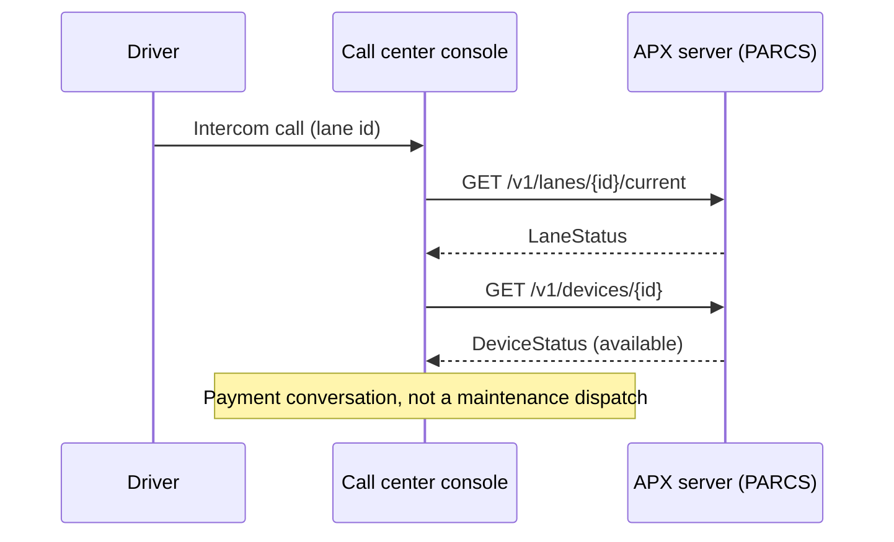

**Data exchanged.**

| Object | Defined in | Notes |
|---|---|---|
| `LaneStatus` | APX Part 6 §6.2 | Screen-pop: current ticket, LPR read, monthly credential |
| `VehicularAccess` | APDS 4.1 | The lane, referenced by id |
| `Session` | APDS 4.1 | Referenced from the current ticket |
| `ObservationElement` | APDS 4.1 | The LPR read behind `currentTicket.lpr` (referenced with `className` `Observation`) |
| `Credential` | APDS 4.1 | The monthly card presented at the lane |
| `DeviceStatus` | APX Part 6 §6.4; proposed to APDS as `EquipmentStatus` | Live state of the gate |
| `SupplementalEquipment` | APDS 4.1 | The gate, referenced by id |
| `Problem` | APX Part 12 | Error document for an unknown lane |

**Postconditions / outcome.** The agent knows the amount owed ($9.00), the
plate and its confidence, that the monthly card was denied for a past-due
account, and that the gate is `available`. No data was changed. The next
actions (apply a validation, vend the gate) are D.1.2.

**Example.** `LaneStatus` returned by `GET /v1/lanes/{id}/current`
(trimmed):

```json
{
  "lane": { "id": "b2000000-0000-4000-8000-000000000002", "className": "VehicularAccess" },
  "currentTicket": {
    "ticketNumber": "T-1001",
    "session": { "id": "f1000000-0000-4000-8000-000000000001", "className": "Session" },
    "amountDue": { "currencyType": "USD", "currencyValue": 9.0 },
    "paidInFull": false,
    "validations": [],
    "lpr": { "plate": "SYN-1234", "confidence": 0.97 }
  },
  "monthlyCredential": {
    "credential": { "id": "e3000000-0000-4000-8000-000000000001", "className": "Credential" },
    "cardNumber": "MC-0777",
    "accessGranted": false,
    "denialReason": "account past due"
  }
}
```

**APX references.** Part 6 §6.2 (lane inquiry), §6.4 (device status);
Part 12 (error model); Part 9 (scopes). Scenario:
`docs/scenarios/01-lane-status-call-center.md`.

#### D.1.2 Call-center gate vend: validate, vend, fault, alert

**Summary.** Continuing D.1.1, the driver saw a film at the cinema next door
but the ticket was never validated. The agent checks which merchants may
validate at the place and what each validation is worth, applies the
cinema's validation and vends the gate, both as audited commands. Meanwhile
a pay station fails; the PARCS publishes the device state change and raises
an alert, which the agent acknowledges without a phone call.

**Parties.**

| Party | Role |
|---|---|
| Call-center agent console | Client with `apx.control:read`, `apx.control:execute`, `apx.alerts:read`, `apx.alerts:write`; Receiving Party for events |
| Lakeside Garage APX server (PARCS) | Distributing Party; executes commands and publishes events |
| Exit gate and pay station | Lane equipment controlled and monitored by the PARCS |
| Lakeside Cinema | Merchant validation provider |

**Preconditions.**

- D.1.1 has run; the agent knows the lane and ticket `T-1001`.
- The console has an event subscription to `apx.control.device.state.v1`
  and `apx.alert.raised.v1` (created as in D.1.3).
- The operator's alerting policy maps pay-station faults to alerts.

**Flow.**

1. The console lists validation providers with
   `GET /v1/validations/providers?place={id}`. Each `ValidationProvider`
   discloses its `validationType` and `benefit`.
2. The console sends `POST /v1/commands` with `commandType`
   `applyValidation`, the lane as target and the ticket and provider in
   `parameters`, plus an `Idempotency-Key` header. The server answers
   `202 Accepted` with the `Command`.
3. The console sends `POST /v1/commands` with `commandType` `vendGate`, a
   `reason` and an `expiryTime`, so the command expires rather than
   opening the gate later for another car.
4. The console polls `GET /v1/commands/{id}`. The `Command` shows the
   append-only `statusHistory` from `received` to `succeeded`.
5. A pay station stops responding. The server delivers an
   `EventEnvelope` on `apx.control.device.state.v1` whose `data` is a
   `DeviceStatus` with `deviceState` `fault`.
6. The server raises an `Alert` (`alertType` `deviceFault`) and delivers
   it on `apx.alert.raised.v1`.
7. The agent acknowledges it with `POST /v1/alerts/{id}/acknowledge`; the
   `Alert` moves to `acknowledged` with the agent's note in
   `statusHistory`.

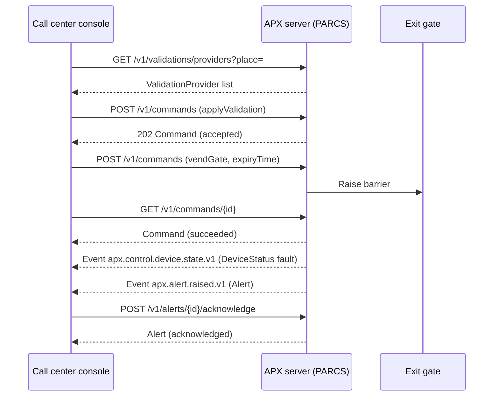

**Data exchanged.**

| Object | Defined in | Notes |
|---|---|---|
| `ValidationProvider` | APX Part 6 §6.3 | Who may validate at the place and the disclosed benefit |
| `Command` | APX Part 6 §6.1 | `applyValidation` and `vendGate`; idempotent, perishable, audited |
| `EventEnvelope` | APX Part 8 §8.2 | Wraps every pushed event |
| `DeviceStatus` | APX Part 6 §6.4; proposed to APDS as `EquipmentStatus` | Data of `apx.control.device.state.v1` |
| `Alert` | APX Part 7 §7.1; proposed to APDS | Raised for the fault, then acknowledged |
| `VehicularAccess`, `SupplementalEquipment` | APDS 4.1 | Command target and faulted device |

**Postconditions / outcome.** The validation is applied and the gate has
opened; who did what, when and why is recorded in each command's
`statusHistory`. The pay-station fault is known to subscribers and the
alert is acknowledged with "field tech dispatched".

**Example.** The `vendGate` command after polling (trimmed):

```json
{
  "id": "5e8d7c6b-4a39-4281-b0f1-2e3d4c5b6a70",
  "version": 5,
  "commandType": "vendGate",
  "target": { "id": "b2000000-0000-4000-8000-000000000002", "className": "VehicularAccess" },
  "reason": "customer assistance — cinema validation applied, remainder waived per policy",
  "expiryTime": "2026-08-06T18:16:00Z",
  "status": "succeeded",
  "statusHistory": [
    { "state": "received", "time": "2026-08-06T18:14:31Z", "actor": "apx-operator" },
    { "state": "accepted", "time": "2026-08-06T18:14:31Z", "actor": "lakeside-parcs" },
    { "state": "dispatched", "time": "2026-08-06T18:14:32Z", "actor": "lakeside-parcs" },
    { "state": "executing", "time": "2026-08-06T18:14:32Z", "actor": "gate-c1000000-0002" },
    { "state": "succeeded", "time": "2026-08-06T18:14:34Z", "actor": "gate-c1000000-0002", "detail": "barrier raised" }
  ]
}
```

**APX references.** Part 6 §6.1 (commands), §6.3 (validations), §6.4
(device status); Part 7 (alerts); Part 8 (delivery fabric). Scenario:
`docs/scenarios/02-call-center-gate-vend.md`.

#### D.1.3 Data synchronisation and signed webhooks

**Summary.** A city curb-management platform onboards Lakeside Garage. It
discovers what the server offers from one well-known URL, obtains a token,
pulls the APDS data on the native routes, stays in sync with the APX change
feed, and subscribes to push events whose signatures it verifies. It can
also query the delivery ledger to check that every event arrived.

**Parties.**

| Party | Role |
|---|---|
| City curb-management platform | Receiving Party; client `city-platform` with `apx.data:read`, `apx.subscriptions:manage` |
| Lakeside Garage APX server | Distributing Party; serves APDS data and delivers events |

**Preconditions.**

- The platform has OAuth2 client credentials issued by the operator.
- The server is reachable at its host and serves
  `/.well-known/apx-configuration`.

**Flow.**

1. The platform reads `GET /.well-known/apx-configuration`
   (unauthenticated). The `ApxConfiguration` names the token endpoint, the
   APX and APDS versions, the conformance classes and the registries.
2. The platform obtains a token with `POST /oauth/token`
   (`grant_type=client_credentials`).
3. The platform makes the initial pull on the native APDS routes, for
   example `GET /places` and `GET /sessions?modified_since=…`. These are
   stock APDS 4.1 exchanges; `modified_since` is a Unix epoch integer.
4. To stay in sync, the platform calls the same routes with
   `mode=change&cursor=…`. The server returns a `ChangeFeedPage` with
   changed items, tombstones in `deleted`, and the next `cursor`.
5. The platform subscribes with `POST /webhooks`, sending an
   `ApxEventSubscription` (a superset of the APDS `EventSubscription`)
   with topics and place and severity filters. The `201` response
   discloses the signing secret once.
6. Events arrive as signed `EventEnvelope` deliveries with `APX-Timestamp`
   and `APX-Signature` headers. The receiver checks the HMAC-SHA256
   signature and rejects anything outside the ±5-minute window.
7. The platform checks delivery with `GET /webhooks/{id}/deliveries`,
   which returns one `DeliveryRecord` per event and subscription.

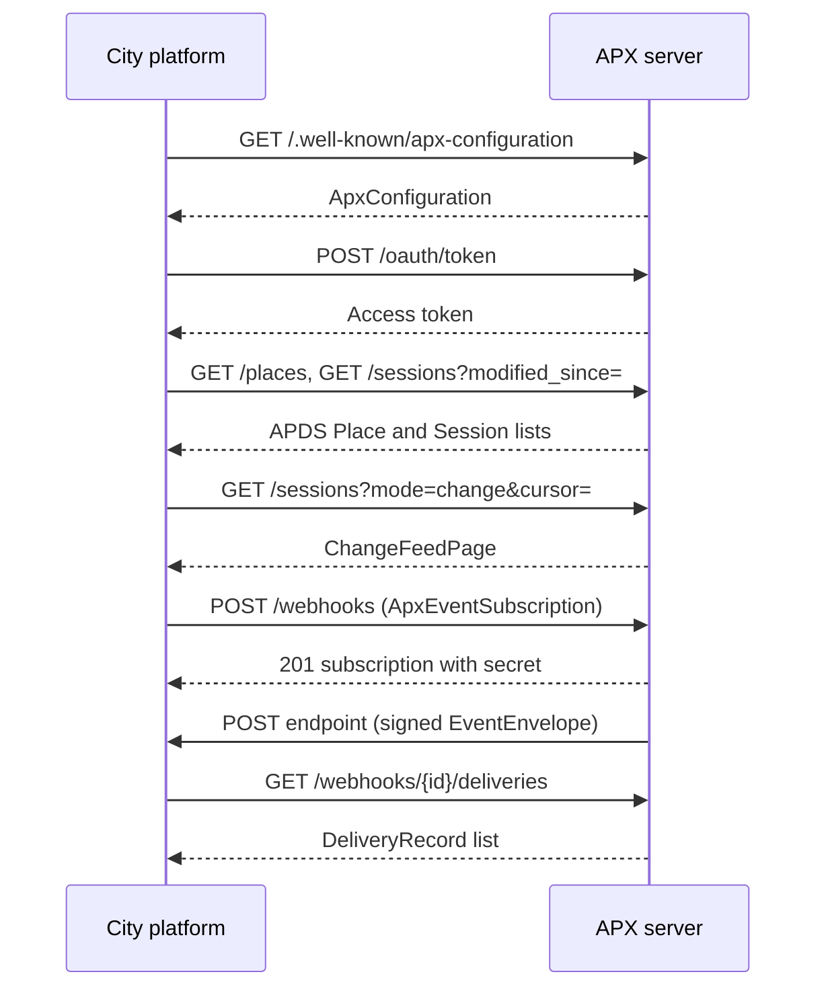

**Data exchanged.**

| Object | Defined in | Notes |
|---|---|---|
| `ApxConfiguration` | APX Part 16; Part 3 | Bootstrap document; lists claimed conformance classes |
| `Place`, `Session` | APDS 4.1 | Stock shapes on the native routes |
| `ChangeFeedPage` | APX Part 5 §5.2 | Ordered changes, tombstones, cursor |
| `ApxEventSubscription` | APX Part 8 §8.1 | Superset of APDS `EventSubscription` |
| `EventSubscription` | APDS 4.1 | The base APX extends at `/webhooks` |
| `EventEnvelope` | APX Part 8 §8.2 | Delivered event |
| `DeliveryRecord` | APX Part 8 §8.3 | Attempt count, status, last HTTP code |

**Postconditions / outcome.** The platform holds a full copy of the data it
is entitled to, keeps it current from a cursor that replays every change
exactly once, receives events it can authenticate, and can audit delivery.
A cursor older than the history window returns `target-not-found`, telling
the client to re-sync with `mode=full`. A subscription that keeps failing
moves to `failed` and the server emits `apx.subscription.failed.v1`.

**Example.** A `ChangeFeedPage` from `GET /sessions?mode=change` (trimmed):

```json
{
  "publicationTime": "2026-08-06T18:20:00Z",
  "updateMode": "change",
  "items": [
    {
      "id": "f1000000-0000-4000-8000-000000000001",
      "version": 4,
      "className": "Session",
      "segments": [{ "actualEnd": "2026-08-06T18:14:34Z" }]
    }
  ],
  "deleted": [
    { "id": "f1000000-0000-4000-8000-000000000099", "className": "Session", "deleteTimestamp": "2026-08-06T17:58:12Z" }
  ],
  "cursor": "c:00042",
  "next": null
}
```

**APX references.** Part 16 (discovery); Part 5 §5.2 (change feed); Part 8
§8.1–8.3 (subscriptions, envelope, webhook delivery); Part 9 §9.1, §9.4
(authentication, webhook authenticity). Scenario:
`docs/scenarios/03-data-sync-and-webhooks.md`.

#### D.1.4 LPR transient parker with a lost ticket

**Summary.** A transient parker reaches the exit without the ticket. The
agent works down an identity chain: the plate the entry camera read, then
any account for that plate, then payment history by the last four digits of
the card. In the scenario the plate read finds the ticket; if nothing had
matched, a `lostTicket` command issues a replacement priced from the
place's disclosed lost-ticket fee. The agent takes the remaining payment,
which posts back to accounting.

**Parties.**

| Party | Role |
|---|---|
| Call-center agent console | Receiving Party; client with `apx.lpr:read`, `apx.accounts:read`, `apx.control:execute`, `apx.payments:write` |
| Lakeside Garage APX server (PARCS) | Distributing Party; holds LPR reads, accounts, payments |
| LPR cameras | Produce the plate reads (APDS observations) |
| Accounting system (PARIS) | Receives the payment posting |
| Driver | Person at the lane without a ticket |

**Preconditions.**

- The lane inquiry (D.1.1) shows no ticket in the machine.
- The entry camera recorded a read of the vehicle.
- The place's rate deck discloses a lost-ticket fee (needed only for the
  fallback in step 4).

**Flow.**

1. The console searches reads with `GET /v1/lpr/reads?plate=SYN-1234`.
   The `LprRead` links the plate to ticket `T-1001`, the session, the
   observation, the entry time and an image link.
2. The console checks for an account with `GET /v1/accounts?plate=…`. The
   list is empty: no monthly account.
3. The console searches payment history with
   `GET /v1/payments?cardLast4=0777&date=2026-08-06`. Only the truncated
   card number is searchable. A `PaymentRecord` shows $4.50 already paid
   on `T-1001`.
4. Fallback, if nothing had matched: `POST /v1/commands` with
   `commandType` `lostTicket`. The `Command` result carries the issued
   ticket and the fee as `amountDue`. The command fails rather than
   guesses if no fee is disclosed.
5. The agent takes the remainder with `POST /v1/payments`. The returned
   `PaymentRecord` carries a `Posting` with the accounting confirmation
   number.

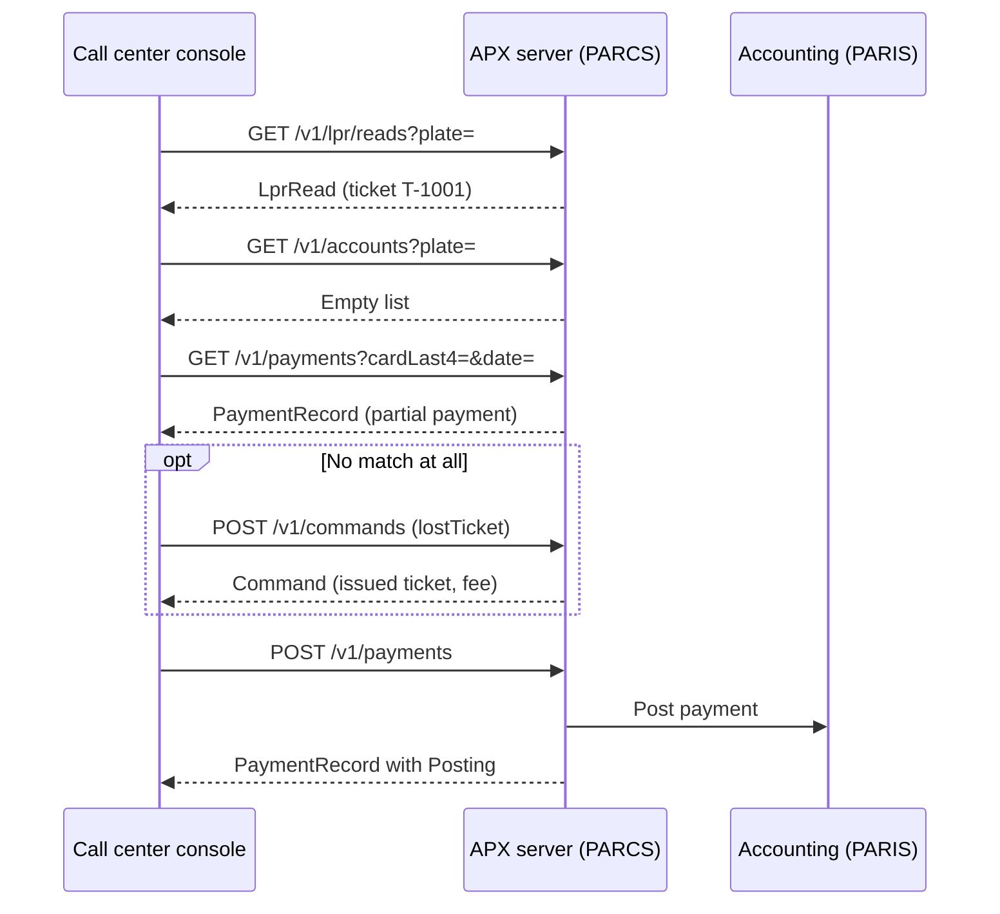

**Data exchanged.**

| Object | Defined in | Notes |
|---|---|---|
| `LprRead` | APX Part 13 §13.3 | Plate read with ticket, session and image link |
| `ObservationElement` | APDS 4.1 | The underlying camera read; LPR detail additions proposed to APDS (Part 13 §13.3a) |
| `Account` | APX Part 13 §13.1; proposed to APDS as an extension of `RightHolder` | Searched by plate; none found |
| `PaymentRecord` | APX Part 13 §13.1a, §13.2; proposed to APDS as an extension of `Payment` | Searchable by `cardLast4` only |
| `Posting` | APX Part 13 §13.1a | Write-back confirmation from accounting |
| `Command` | APX Part 6 §6.1 | `lostTicket` fallback |
| `Session`, `Place` | APDS 4.1 | Referenced from the read and the payment |

**Postconditions / outcome.** The ticket is identified by two independent
credentials (plate and card fragment), the remaining $4.50 is paid, and
the phone payment lands in the same accounting ledger as the earlier
pay-station payment, with a reconcilable `transactionID` and posting
confirmation.

**Example.** The `PaymentRecord` returned by `POST /v1/payments` (trimmed):

```json
{
  "id": "9c0d1e2f-3a4b-4c5d-8e6f-7a8b9c0d1e2f",
  "transactionID": "PARIS-20260806-00347",
  "place": { "id": "b1000000-0000-4000-8000-000000000001", "className": "Place" },
  "dateCollected": "2026-08-06T18:26:40Z",
  "amount": { "currencyType": "USD", "currencyValue": 4.5 },
  "meansOfPayment": "paymentCreditCard",
  "paymentStatus": "approved",
  "ticketNumber": "T-1001",
  "cardLast4": "0777",
  "postings": [
    { "confirmationNumber": "CONF-88214", "accountUpdated": false, "postedTo": "PARIS", "time": "2026-08-06T18:26:41Z" }
  ]
}
```

**APX references.** Part 13 §13.1, §13.1a, §13.2, §13.3 (accounts,
payments, payment history, LPR); Part 6 §6.1 (`lostTicket`). Scenario:
`docs/scenarios/04-lpr-lost-ticket.md`.

#### D.1.5 Reservation lifecycle: quote, book, amend, check-in, no-show

**Summary.** A driver books a space for a concert through a reservation
app, extends the booking, and is recognised by plate on arrival. A second
booking is never used and is marked as a no-show. APX adds no separate
booking object: a reservation is an APDS `AssignedRight` carrying the
`apds-ext:apx:reservation@1.0` extension, so any APDS system sees a normal
assigned right.

**Parties.**

| Party | Role |
|---|---|
| Reservation platform | Distributing Party for bookings; client with `apx.reservations:manage`, `apx.data:read`; Receiving Party for no-show events |
| Lakeside Garage APX server (PARCS) | Receiving Party for bookings; recognises plates, creates sessions, runs the no-show sweep |
| Entry LPR camera | Reads the plate at arrival |
| Driver | Holder of the reservation |

**Preconditions.**

- A `RightSpecification` for the event window exists at the place.
- The server claims `apx-reservations`; the platform subscribes to
  `apx.reservation.noshow.v1` for step 6.

**Flow.**

1. Price discovery uses the stock APDS quote: `POST /quotes` with a
   `QuoteRightRequest`; the server returns a `QuoteRightResponse`.
2. The platform books with `POST /rights/assigned`, sending an
   `AssignedRight` with a client-supplied `id`, `version: 1`, the plate as
   a `CredentialAssigned` under `rightHolder.credentials[]`, the window in
   `plannedUses[0]` and the reservation extension. The server answers
   `201` with an APDS `ResponseStatus` naming the new id.
3. The platform reads it back with `GET /rights/assigned/{id}`; the server
   has set `noShowAfter` (planned start plus the 30-minute grace).
4. To amend, the platform sends `PUT /rights/assigned/{id}` citing the
   version it last read; the extension state becomes `amended` and
   `plannedUses[0]` moves with it. A racing write citing an old version
   is refused with `version-conflict`.
5. On arrival the entry camera reads the plate; the PARCS matches it,
   opens the gate, creates the APDS `Session`, and sets the extension to
   `checkedIn` with `checkInSession`. Agents can see the booking with
   `GET /v1/reservations/recent?plate=…`, which returns
   `ReservationSummary` items.
6. After the grace period the no-show sweep marks the unused booking
   `noShow` and delivers an `EventEnvelope` on
   `apx.reservation.noshow.v1` whose `data` is a `ReservationSummary`.

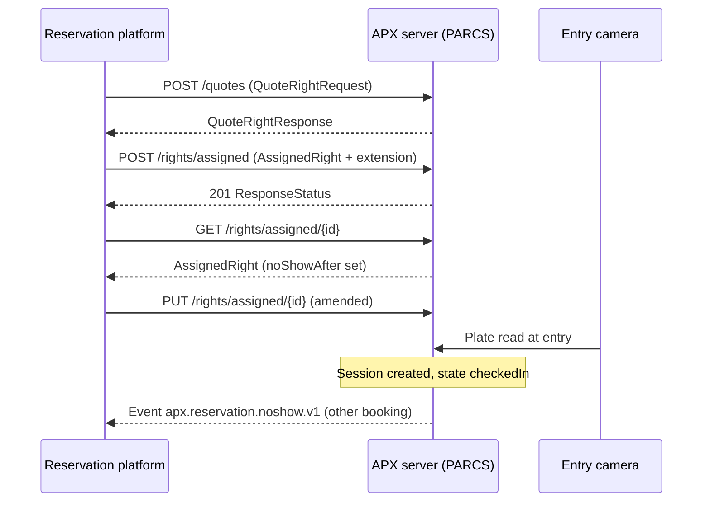

**Data exchanged.**

| Object | Defined in | Notes |
|---|---|---|
| `QuoteRightRequest`, `QuoteRightResponse` | APDS 4.1 | Stock quote flow |
| `AssignedRight` | APDS 4.1 | The reservation itself |
| `CredentialAssigned` | APDS 4.1 | Plate on file (`type` `licensePlate`) |
| `ReservationExtension` | APX Part 14 §14.1; proposed to APDS as an extension of `AssignedRight` (with `ReservationStateEnum`) | State, planned window, `noShowAfter`, `checkInSession` |
| `ResponseStatus` | APDS 4.1 | Answer to the native create |
| `Session` | APDS 4.1 | Created at check-in |
| `ReservationSummary` | APX Part 14 §14.1 | Recent-reservations lookup and no-show event data |
| `EventEnvelope` | APX Part 8 §8.2 | No-show event |

**Postconditions / outcome.** One reservation is `checkedIn` and linked to
its session; the other is `noShow` and the platform has been told, so it
can refund or charge under its own policy. The lifecycle states are
`confirmed`, `amended`, `checkedIn`, `cancelled` and `noShow`. Any APDS
intermediary must pass the `extensions` keys through unchanged.

**Example.** The stored `AssignedRight` after check-in (trimmed):

```json
{
  "id": "e2000000-0000-4000-8000-000000000002",
  "version": 3,
  "rightSpecification": { "id": "e1000000-0000-4000-8000-000000000001", "version": 1, "className": "RightSpecification" },
  "rightHolder": {
    "credentials": [
      { "type": "licensePlate", "credentialAssignedType": "vehicle", "identifier": { "id": "SYN-1234", "className": "USNumberPlate" } }
    ]
  },
  "plannedUses": [ { "startTime": "2026-08-14T18:00:00Z", "endTime": "2026-08-15T01:00:00Z" } ],
  "extensions": {
    "apds-ext:apx:reservation@1.0": {
      "reservationState": "checkedIn",
      "plannedStart": "2026-08-14T18:00:00Z",
      "plannedEnd": "2026-08-15T01:00:00Z",
      "checkInSession": { "id": "f1000000-0000-4000-8000-000000000014", "className": "Session" }
    }
  }
}
```

**APX references.** Part 14 §14.1 (reservations); Part 4 §4.2a
(optimistic concurrency), §4.3 (extensions container); Part 8 §8.7
(topic data). Scenario: `docs/scenarios/05-reservation-lifecycle.md`.

#### D.1.6 Reservation for a set time, then extending it

**Summary.** A business traveller books Lakeside Garage for a fixed window,
06:00–18:00. The window is extended once before arrival and once during the
stay; the mid-stay extension is priced with the stock APDS session-extension
quote. A third request, overnight, is declined by the same quote. No special
"extend" operation exists: every extension is a versioned `PUT` on the same
`AssignedRight`.

**Parties.**

| Party | Role |
|---|---|
| Reservation platform | Distributing Party for the booking; client with `apx.reservations:manage` |
| Lakeside Garage APX server (PARCS) | Receiving Party; prices extensions and holds the reservation |
| Traveller | Holder of the reservation (plate `SYN-5150`) |

**Preconditions.**

- A `RightSpecification` for the product exists.
- The rate deck for the place is disclosed, so the platform can show the
  price of an extension.

**Flow.**

1. The platform books with `POST /rights/assigned` (an `AssignedRight`
   with the plate under `rightHolder.credentials[]`, the window in
   `plannedUses[0]` and the reservation extension). The server answers
   `201` with a `ResponseStatus`.
2. Before arrival the flight moves. The platform sends
   `PUT /rights/assigned/{id}` citing version 1, with the new end time and
   state `amended`. The server stores version 2.
3. At 05:52 the entry camera reads the plate; the PARCS creates the
   `Session` and the extension records `checkInSession`.
4. Mid-stay, the platform prices more time with `POST /quotes`, sending a
   `QuoteSessionExtensionRequest` for the live session. The
   `QuoteSessionExtensionResponse` gives `revisedEndTime` 22:00.
5. The traveller accepts; the platform sends `PUT /rights/assigned/{id}`
   citing version 3. The state stays `checkedIn`; only `plannedEnd` and
   `plannedUses[0]` move.
6. A further request to 09:00 the next day returns a
   `QuoteSessionExtensionResponse` with `reason` `noExtensionPossible`;
   `revisedEndTime` stays at the committed 22:00.

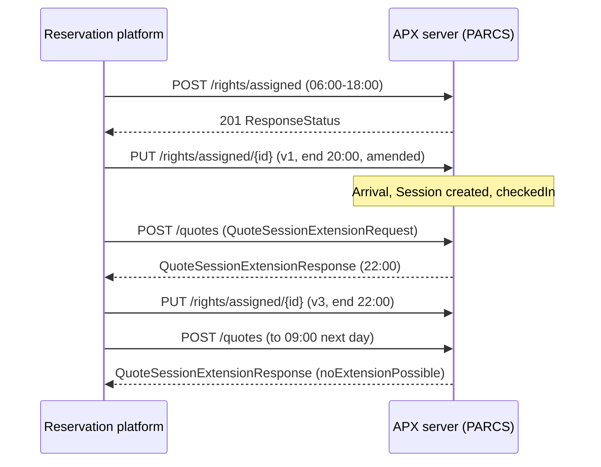

**Data exchanged.**

| Object | Defined in | Notes |
|---|---|---|
| `AssignedRight` | APDS 4.1 | The reservation; its version history is the audit trail |
| `CredentialAssigned` | APDS 4.1 | Plate on file |
| `ReservationExtension` | APX Part 14 §14.1; proposed to APDS as an extension of `AssignedRight` | `plannedStart`/`plannedEnd` mirror `plannedUses[0]` |
| `ResponseStatus` | APDS 4.1 | Answer to the create |
| `QuoteSessionExtensionRequest`, `QuoteSessionExtensionResponse` | APDS 4.1 | Stock session-extension quote; `reason` on decline |
| `Session` | APDS 4.1 | Created at check-in |

**Postconditions / outcome.** The reservation ends at 22:00 after two
extensions. The pre-arrival `amended` state applies only before a session
exists; after check-in the reservation stays `checkedIn`. A declined quote
never shortens what was already granted. Two amendments racing on the same
version are refused with `version-conflict`.

**Example.** The declined extension quote:

```json
{
  "id": "6e7f8a9b-0c1d-4e2f-8a3b-4c5d6e7f8a9b",
  "version": 1,
  "requestSessionExtensionId": { "id": "7f8a9b0c-1d2e-4f3a-8b4c-5d6e7f8a9b0c", "version": 1 },
  "sessionId": { "id": "f1000000-0000-4000-8000-000000000021", "version": 1, "className": "Session" },
  "requestTime": "2026-08-11T21:50:44Z",
  "responseTime": "2026-08-11T21:50:45Z",
  "revisedEndTime": "2026-08-11T22:00:00Z",
  "reason": "noExtensionPossible"
}
```

**APX references.** Part 14 §14.1 rules 3 and 5 (amendment, check-in
linkage); Part 4 §4.2a (optimistic concurrency). Scenario:
`docs/scenarios/06-reservation-set-time-extension.md`.

#### D.1.7 The analytics feed: occupancy, payments, plate reads

**Summary.** The owner of Lakeside Garage runs an analytics platform and
wants utilisation, revenue and sensor traffic in its own warehouse. One
subscription mixes APDS session topics with APX topics for payments,
observations and occupancy. A point-in-time occupancy read answers "how
full is it now", and the change feed fills gaps after an outage.

**Parties.**

| Party | Role |
|---|---|
| Analytics platform (owner BI) | Receiving Party; client `owner-bi` with `apx.data:read`, `apx.accounts:read`, `apx.subscriptions:manage` |
| Lakeside Garage APX server | Distributing Party; publishes events and serves reads |
| Ops team (optional) | Receives `occupancyThresholdExceeded` alerts where `apx-alerts` is deployed |

**Preconditions.**

- The platform has credentials with the scopes above.
- The server supports `apx-data`, `apx-events`, `apx-accounts` and
  `apx-lpr`.
- The operator has configured an occupancy threshold (90%).

**Flow.**

1. The platform subscribes with `POST /webhooks`, sending an
   `ApxEventSubscription` with topics `SessionCreated`, `SessionUpdated`,
   `apx.accounts.payment.recorded.v1`, `apx.data.observation.created.v1`
   and `apx.data.occupancy.v1`, filtered to the place.
2. A dashboard reads `GET /v1/places/{id}/occupancy`. The
   `OccupancySnapshot` carries the APDS `Supply` and `DemandType` and a
   derived `available` count.
3. When occupancy crosses 90%, the server delivers an `EventEnvelope` on
   `apx.data.occupancy.v1` whose `data` is an `OccupancySnapshot`.
4. When a parker pays, the server delivers
   `apx.accounts.payment.recorded.v1` with a `PaymentRecord`. Each camera
   read or RFID hit arrives on `apx.data.observation.created.v1` with the
   APDS `ObservationElement`.
5. For backfill after an outage, the platform pulls
   `GET /sessions?mode=change&cursor=…` and
   `GET /observations?mode=change&cursor=…`.

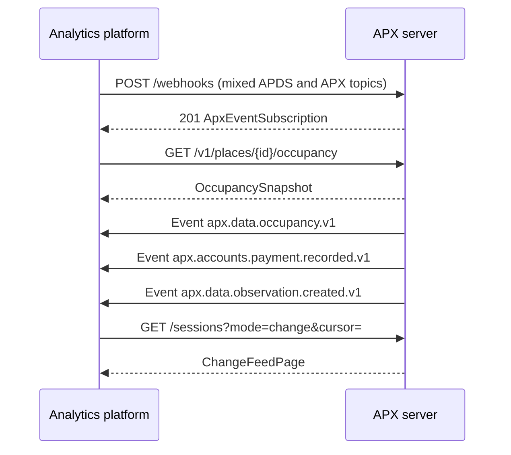

**Data exchanged.**

| Object | Defined in | Notes |
|---|---|---|
| `ApxEventSubscription` | APX Part 8 §8.1 | Topics from APDS and APX mix in one subscription |
| `OccupancySnapshot` | APX Part 5 §5.5 | `available = supplyQuantity − count`, clamped at zero |
| `Supply`, `DemandType` | APDS 4.1 | Carried unchanged in the snapshot |
| `EventEnvelope` | APX Part 8 §8.2 | Every delivery |
| `PaymentRecord` | APX Part 13 §13.1a; proposed to APDS as an extension of `Payment` | Data of the payment topic |
| `ObservationElement` | APDS 4.1 | Data of the observation topic |
| APDS `EventData` (`Session`) | APDS 4.1 | Data of `SessionCreated`/`SessionUpdated` |
| `ChangeFeedPage` | APX Part 5 §5.2 | Backfill and audit |

**Postconditions / outcome.** The warehouse receives sessions, payments,
observations and occupancy in real time, can read occupancy on demand, and
can replay what it missed. APDS `EventTypeEnum` has no payment or
observation events; the `apx.*` topics fill that gap. The Place hierarchy
stays the source of truth for occupancy.

**Example.** An occupancy event (trimmed):

```json
{
  "id": "9a0b1c2d-3e4f-4a5b-8c6d-7e8f9a0b1c2d",
  "type": "apx.data.occupancy.v1",
  "source": "https://api.lakeside-garage.example/v1",
  "subject": { "id": "b1000000-0000-4000-8000-000000000001", "className": "Place" },
  "time": "2026-08-25T17:52:11Z",
  "data": {
    "place": { "id": "b1000000-0000-4000-8000-000000000001", "className": "Place" },
    "computedAt": "2026-08-25T17:52:11Z",
    "supply": { "supplyViewType": "spaceView", "supplyQuantity": 420 },
    "demand": { "count": 379, "percentage": 90.2, "occupancyCalculation": "counted", "recordDateTime": "2026-08-25T17:52:00Z" },
    "available": 41
  }
}
```

**APX references.** Part 5 §5.2 (change feed), §5.5 (occupancy snapshot);
Part 8 §8.7 (topic data schemas); Part 13 §13.4 (analytics feed); Part 7
(alerts). Scenario: `docs/scenarios/07-analytics-occupancy-feed.md`.

#### D.1.8 Resolution context: monthly parker, balance hold, courtesy limit

**Summary.** A monthly parker is denied at the exit because the account has
an outstanding balance. The call platform opens a resolution context for
the lane; one response carries who the parker is, why access was denied,
the two courtesy exits already granted, and what the agent may and may not
do. The courtesy exit is refused by policy, the parker pays through a
payment link, and the interaction is recorded for next time.

**Parties.**

| Party | Role |
|---|---|
| Call-center platform (AI agent) | Receiving Party; client with `apx.resolution:read`, `apx.control:execute`, `apx.support:manage` |
| Lakeside Garage APX server (PARCS and policy engine) | Distributing Party; assembles the context and evaluates policy |
| Intercom | Call-platform hardware, mapped to the lane by the platform |
| Monthly parker | Account holder with the balance |

**Preconditions.**

- The call platform maps the intercom to the lane's id; APX never sees
  telephony identifiers.
- The server claims `apx-resolution` and `apx-control`.
- Operator policy limits courtesy exits (two within 48 hours).

**Flow.**

1. The platform sends `POST /v1/resolution/contexts` with
   `interactionId`, `correlationId`, `channel` `intercom` and the lane.
2. The server resolves lane, denial, credential and account and returns a
   `ResolutionContext`: `issue` `accountBalanceDenied`, vehicle, holder,
   `Account` with balance, `accessDecision`, `recentOverrides` and
   `allowedActions`. `courtesyExit` is `allowed: false` with reason
   `courtesyLimitReached`; sending a payment link is allowed.
3. The parker chooses to pay. Following the action's `execution`
   descriptor (`type: domain`), the platform calls
   `POST /v1/payment-links` with the account, `channel` `sms`, the
   context and the correlation id. The server returns a `PaymentLink`
   with the amount and expiry.
4. The payment arrives as `apx.accounts.payment.recorded.v1`, the hold
   clears and the gate vends on the retry.
5. The platform records the call with `POST /v1/support/interactions`,
   sending a `SupportInteraction` that links the payment link.

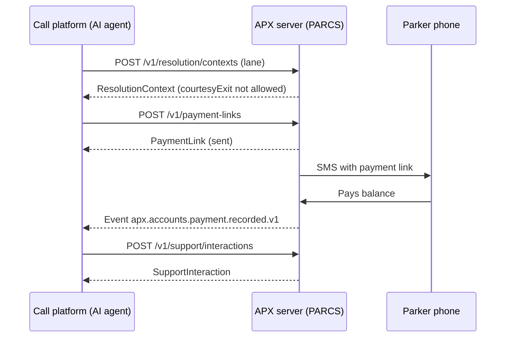

**Data exchanged.**

| Object | Defined in | Notes |
|---|---|---|
| `ResolutionContext` | APX Part 17 §17.2 | Assembled context for the interaction |
| `AllowedAction` | APX Part 17 §17.3, §17.4 | Server-side policy decision with `execution` descriptor |
| `Account` | APX Part 13 §13.1; proposed to APDS as an extension of `RightHolder` | Balance and status |
| `Credential` | APDS 4.1 | Monthly credential referenced from the context |
| `PaymentLink` | APX Part 13 §13.1a | Financial action on the payment surface |
| `PaymentRecord` | APX Part 13 §13.1a; proposed to APDS as an extension of `Payment` | Arrives as the payment event |
| `SupportInteraction` | APX Part 17 §17.6; proposed to APDS | Record of the call |
| `VehicularAccess`, `Place` | APDS 4.1 | Lane and place references |

**Postconditions / outcome.** The balance is paid, the parker exits
normally, and the interaction is stored. A later context for the same
plate carries it in `supportHistory`. The AI agent did not decide that the
courtesy exit was off the table; the policy layer did, and a command for
it would have been refused by the command plane (Part 17 §17.3). One
correlation id ties the call, context, payment and record together.

**Example.** Two entries of `allowedActions` from the context:

```json
[
  {
    "action": "post-apx-v1-payment-links",
    "display": "Send payment link",
    "target": { "id": "c2000000-0000-4000-8000-000000000004", "className": "Account" },
    "allowed": true,
    "requiresApproval": false,
    "execution": { "type": "domain", "operationId": "post-apx-v1-payment-links" }
  },
  {
    "action": "courtesyExit",
    "display": "Courtesy exit",
    "target": { "id": "b2000000-0000-4000-8000-000000000002", "className": "VehicularAccess" },
    "allowed": false,
    "requiresApproval": true,
    "approvalRole": "supervisor",
    "execution": { "type": "control", "command": "courtesyExit" },
    "reason": { "code": "courtesyLimitReached", "display": "Two courtesy exits have already been provided within the previous 48 hours.", "policy": "max-two-courtesy-exits-48h" }
  }
]
```

**APX references.** Part 17 §17.1–17.4, §17.6, §17.7 (resolution,
policy, action categories, support interactions, correlation); Part 13
§13.1a (payment links); Part 6 §6.1. Scenario:
`docs/scenarios/08-resolution-monthly-balance.md`.

#### D.1.9 Resolution context: paid ticket, gate vend failed

**Summary.** A transient parker pays at the pay-on-foot machine, but the
exit gate does not open. The resolution context shows the ticket paid in
full, the gate healthy and communicating, and a single vend allowed by
policy. The agent vends the gate and reports the outcome no more strongly
than the command's confirmation level allows: first "the open command was
sent", then, once the gate sensor confirms, "the gate is open".

**Parties.**

| Party | Role |
|---|---|
| Call-center platform (AI agent) | Receiving Party; client with `apx.resolution:read`, `apx.control:execute` |
| Lakeside Garage APX server (PARCS and policy engine) | Distributing Party; context, policy and command execution |
| Exit gate with gate-state sensor | Executes the vend and confirms it physically |
| Driver | Paid parker at the lane |

**Preconditions.**

- The intercom is mapped to the lane id by the call platform.
- Ticket `T-58201` is paid in full.
- The server claims `apx-resolution` and `apx-control`.

**Flow.**

1. The platform sends `POST /v1/resolution/contexts` with the lane. The
   `ResolutionContext` has `issue` `gateVendFailed`, a `laneStatus` with
   `paidInFull: true`, a `devices[]` entry showing the gate `available`,
   `vendGate` allowed and `holdGateOpen` not allowed
   (`holdOpenRestricted`).
2. The platform sends `POST /v1/commands` with `commandType` `vendGate`,
   a `reason`, the `resolutionContext`, the `correlationId` and an
   `expiryTime`. The `Command` returns with `confirmationLevel`
   `accepted`.
3. The platform polls `GET /v1/commands/{id}`. The `Command` reaches
   `succeeded` with `confirmationLevel` `physicallyConfirmed`, after the
   gate-state sensor reports the barrier open.

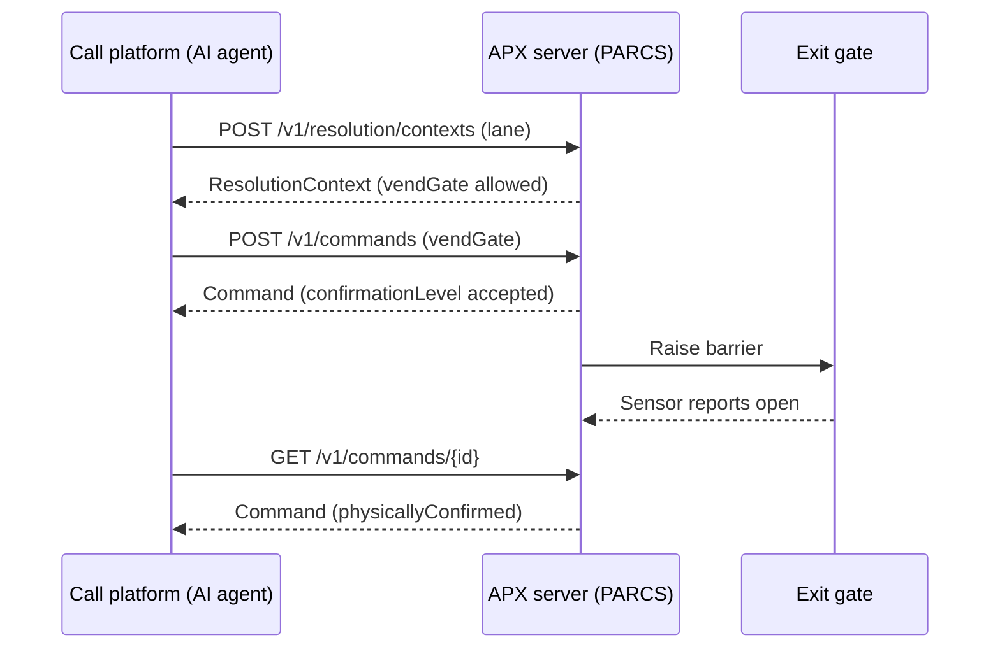

**Data exchanged.**

| Object | Defined in | Notes |
|---|---|---|
| `ResolutionContext` | APX Part 17 §17.2 | Carries `laneStatus` and `devices[]` overlays |
| `LaneStatus` | APX Part 6 §6.2 | Paid ticket in the machine |
| `DeviceStatus` | APX Part 6 §6.4; proposed to APDS as `EquipmentStatus` | Gate health |
| `AllowedAction` | APX Part 17 §17.3 | `vendGate` allowed, `holdGateOpen` refused |
| `Command` | APX Part 6 §6.1; Part 17 §17.4 | `vendGate` with `confirmationLevel` |
| `Session`, `VehicularAccess`, `SupplementalEquipment` | APDS 4.1 | References |

**Postconditions / outcome.** The gate is open and confirmed by the sensor;
the driver leaves. The confirmation levels are `accepted`,
`deviceAcknowledged` and `physicallyConfirmed`, and an agent must not claim
more than the current level. One correlation id ties the call, context,
command and sensor confirmation, and `statusHistory` records who opened
the gate and why.

**Example.** The command after polling (trimmed):

```json
{
  "id": "d1000000-0000-4000-8000-000000000041",
  "version": 4,
  "commandType": "vendGate",
  "target": { "id": "b2000000-0000-4000-8000-000000000002", "className": "VehicularAccess" },
  "resolutionContext": { "id": "e5000000-0000-4000-8000-000000000011", "className": "ResolutionContext" },
  "correlationId": "3f1a2b3c-4d5e-4f60-8a1b-2c3d4e5f6a70",
  "status": "succeeded",
  "confirmationLevel": "physicallyConfirmed",
  "statusHistory": [
    { "state": "received", "time": "2026-09-03T20:41:40Z", "actor": "apx-operator" },
    { "state": "accepted", "time": "2026-09-03T20:41:40Z", "actor": "lakeside-parcs" },
    { "state": "dispatched", "time": "2026-09-03T20:41:41Z", "actor": "lakeside-parcs" },
    { "state": "executing", "time": "2026-09-03T20:41:41Z", "actor": "gate-b3000000-0031" },
    { "state": "succeeded", "time": "2026-09-03T20:41:43Z", "actor": "gate-b3000000-0031", "detail": "barrier raised — gate-state sensor reports open" }
  ]
}
```

**APX references.** Part 6 §6.1 (commands, confirmation level); Part 17
§17.1–17.4; Part 4 §4.2 (provenance). Scenario:
`docs/scenarios/09-resolution-gate-vend-failed.md`.

#### D.1.10 Resolution context: card declined at the exit lane

**Summary.** A transient parker's card is declined twice at the exit
terminal. The resolution context already contains the declined payment
attempt, the $18.00 owed, and one action allowed by policy: a payment link
to the driver's phone. Vending the gate for an unpaid session is refused by
policy. The driver pays through the link with another card and the ticket
then opens the gate on re-insert.

**Parties.**

| Party | Role |
|---|---|
| Call-center platform | Receiving Party; client with `apx.resolution:read`, `apx.payments:write` |
| Lakeside Garage APX server (PARCS and policy engine) | Distributing Party; context, policy, payment links |
| Hosted payment page | Implementer's payment page; holds the card data (PCI scope) |
| Driver | Transient parker with ticket `T-61077` |

**Preconditions.**

- The intercom is mapped to the lane id.
- The server claims `apx-resolution` and `apx-accounts`.
- Operator policy forbids free vends for unpaid transient sessions.

**Flow.**

1. The platform sends `POST /v1/resolution/contexts` with the lane. The
   `ResolutionContext` has `issue` `paymentDeclined`, a `laneStatus` with
   $18.00 due, a `payments[]` entry with `paymentStatus` `declined` and
   `cardLast4` `4242`, a payment link allowed, and `vendGate` refused with
   reason `sessionUnpaid`.
2. Following the `execution` descriptor (`type: domain`), the platform
   calls `POST /v1/payment-links` with the place, ticket number, `channel`
   `sms`, context and correlation id, and no `amount`. Omitting the amount
   charges the current amount due.
3. The server returns a `PaymentLink` with the amount, the masked
   destination and the expiry.
4. The driver pays; the server publishes
   `apx.accounts.payment.recorded.v1`, the lane shows `paidInFull: true`,
   and the ticket opens the gate on re-insert.

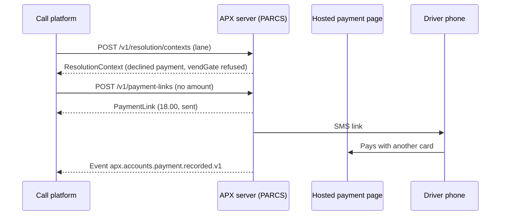

**Data exchanged.**

| Object | Defined in | Notes |
|---|---|---|
| `ResolutionContext` | APX Part 17 §17.2 | With `laneStatus` and `payments[]` overlays |
| `LaneStatus` | APX Part 6 §6.2 | Amount due on the ticket |
| `PaymentRecord` | APX Part 13 §13.1a; proposed to APDS as an extension of `Payment` | The declined attempt, as evidence |
| `AllowedAction` | APX Part 17 §17.3, §17.4 | One financial, one physical action |
| `PaymentLink` | APX Part 13 §13.1a | Lifecycle of the hosted link; never card data |
| `Session`, `Place`, `VehicularAccess` | APDS 4.1 | References |

**Postconditions / outcome.** The session is paid and the driver exits on
the normal flow, without a command. Had the agent sent `vendGate`, the
command plane would have answered `403 action-not-allowed`: the context's
decisions are binding (Part 17 §17.3). One correlation id chains decline,
context, link and payment event.

**Example.** The `PaymentLink` returned by `POST /v1/payment-links`:

```json
{
  "id": "e6000000-0000-4000-8000-000000000052",
  "version": 1,
  "place": { "id": "b1000000-0000-4000-8000-000000000001", "className": "Place" },
  "ticketNumber": "T-61077",
  "session": { "id": "c4000000-0000-4000-8000-000000000022", "className": "Session" },
  "amount": { "currencyType": "USD", "currencyValue": 18.00 },
  "channel": "sms",
  "sentTo": "+1•••••••8812",
  "status": "sent",
  "expiresAt": "2026-09-04T22:38:31Z",
  "resolutionContext": { "id": "e5000000-0000-4000-8000-000000000012", "className": "ResolutionContext" },
  "correlationId": "8d2b3c4e-5f6a-4b70-9c1d-2e3f4a5b6c80"
}
```

**APX references.** Part 17 §17.3, §17.4; Part 13 §13.1a (payment
lifecycle and payment links). Scenario:
`docs/scenarios/10-resolution-payment-declined.md`.

#### D.1.11 Resolution context: a merchant validation that was not applied

**Summary.** A driver sees $14.00 due and says the restaurant validated the
ticket, but the ticket carries no validation. The agent checks the place's
validation provider list, which says whether the restaurant may validate
and what the validation is worth ($3.00 off, not free parking). The agent
applies the validation as a command; the amount due is recalculated and the
driver pays the remainder.

**Parties.**

| Party | Role |
|---|---|
| Call-center platform | Receiving Party; client with `apx.resolution:read`, `apx.control:read`, `apx.control:execute` |
| Lakeside Garage APX server (PARCS and policy engine) | Distributing Party; context, provider list, command execution |
| Harbor Restaurant | Merchant validation provider |
| Driver | Transient parker with ticket `T-70443` |

**Preconditions.**

- The intercom is mapped to the lane id.
- Harbor Restaurant is configured as a validation provider at the place.
- The server claims `apx-resolution` and `apx-control`.

**Flow.**

1. The platform sends `POST /v1/resolution/contexts` with the lane. The
   `ResolutionContext` has `issue` `validationMissing`, a `laneStatus`
   with an empty `validations` list, `applyValidation` allowed and
   `vendGate` refused (`sessionUnpaid`: a validation adjusts the amount,
   it does not waive the remainder).
2. The platform reads `GET /v1/validations/providers?place={id}`. Harbor
   Restaurant is listed with `validationType` `flatDiscount` and a
   `benefit` of $3.00 off.
3. The platform sends `POST /v1/commands` with `commandType`
   `applyValidation`, the ticket and the provider in `parameters`, a
   `reason`, the context and the correlation id. The `Command` reaches
   `succeeded` with `confirmationLevel` `deviceAcknowledged`.
4. The lane now shows the applied validation with `amountReduced` $3.00
   and `amountDue` $11.00. The driver pays at the terminal and the gate
   opens normally.

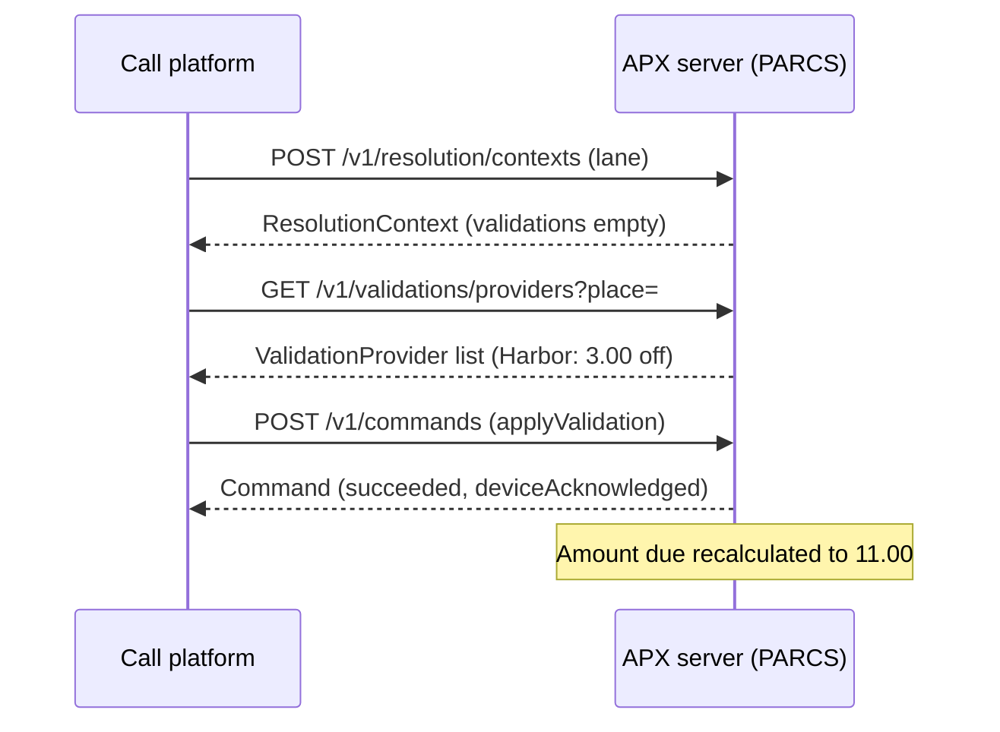

**Data exchanged.**

| Object | Defined in | Notes |
|---|---|---|
| `ResolutionContext` | APX Part 17 §17.2 | Context with `laneStatus` overlay |
| `LaneStatus` | APX Part 6 §6.2 | `currentTicket.validations[]` and `amountDue` |
| `ValidationProvider` | APX Part 6 §6.3 | Authoritative list; benefit disclosed |
| `AllowedAction` | APX Part 17 §17.3 | `applyValidation` allowed, `vendGate` refused |
| `Command` | APX Part 6 §6.1, §6.3 | `applyValidation` with ticket and provider |
| `Session`, `VehicularAccess` | APDS 4.1 | References |

**Postconditions / outcome.** The validation is applied and recorded as
dispute evidence, $11.00 is paid, and the gate opens on the normal exit
flow. An `applyValidation` naming a provider not on the list is rejected
with `422 validation-provider-unknown` (Part 6 §6.3). Every claim the
agent made came from the API.

**Example.** The provider list returned by
`GET /v1/validations/providers`:

```json
{
  "data": [
    {
      "provider": { "id": "a2000000-0000-4000-8000-000000000011", "className": "Organisation" },
      "name": "Lakeside Cinema",
      "validationType": "twoHoursComped",
      "benefit": { "description": "First two hours comped", "duration": "PT2H" }
    },
    {
      "provider": { "id": "a2000000-0000-4000-8000-000000000012", "className": "Organisation" },
      "name": "Harbor Restaurant",
      "validationType": "flatDiscount",
      "benefit": { "description": "$3.00 off", "amount": { "currencyType": "USD", "currencyValue": 3.00 } }
    }
  ]
}
```

**APX references.** Part 6 §6.1, §6.3 (commands, validations); Part 17
§17.3, §17.4. Scenario: `docs/scenarios/11-resolution-validation-missing.md`.

#### D.1.12 Resolution context: rate dispute

**Summary.** On Sunday morning the exit display asks $45.00; the driver
parked four hours and expected the $12.00 daily maximum. The event flat
rate from Saturday's concert is still active at the lane. The agent checks
the rate deck on the native APDS `/rates` route, and, with a supervisor's
approval attached as policy requires, pushes the correct rate table as an
audited command. The correction reprices this ticket and every one behind
it.

**Parties.**

| Party | Role |
|---|---|
| Call-center platform | Receiving Party; client with `apx.resolution:read`, `apx.control:execute` |
| Supervisor | Human approver required by the `approvalRole` |
| Lakeside Garage APX server (PARCS and policy engine) | Distributing Party; context, rate deck, command execution |
| Driver | Transient parker with ticket `T-81290` |

**Preconditions.**

- The intercom is mapped to the lane id.
- The place publishes its rate tables on the native `/rates` route.
- Operator policy requires supervisor approval for a rate-table push.

**Flow.**

1. The platform sends `POST /v1/resolution/contexts` with the lane. The
   `ResolutionContext` has `issue` `rateDispute`, a `laneStatus` with
   $45.00 due, and `pushRate` allowed with `requiresApproval: true` and
   `approvalRole` `supervisor`.
2. The agent reads `GET /rates?place={id}` (APDS). The event table is
   still active at the lane; the standard table with the $12.00 daily
   maximum is the one scheduled for Sunday.
3. A supervisor approves. The platform sends `POST /v1/commands` with
   `commandType` `pushRate`, `parameters.rateTable` as a versioned
   reference to the standard table, a `reason`, the `approval` evidence,
   the context and the correlation id.
4. The `Command` reaches `succeeded` with `confirmationLevel`
   `deviceAcknowledged`; open transactions at the lane are repriced. The
   ticket requotes at $12.00 and the driver pays at the terminal.

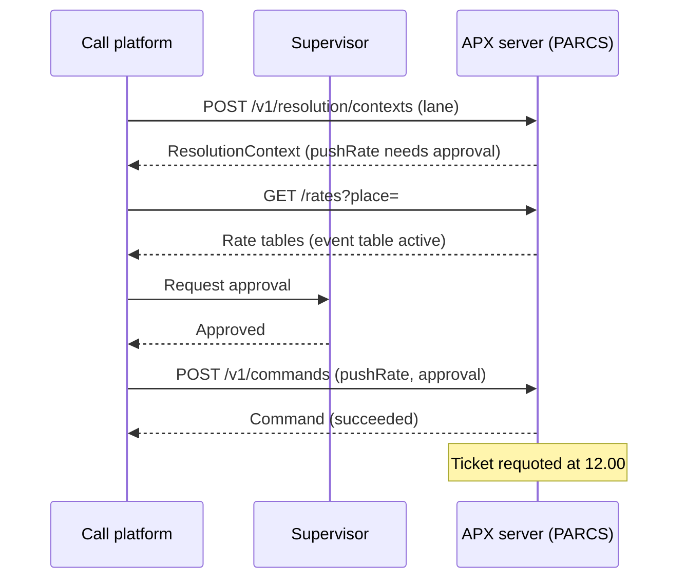

**Data exchanged.**

| Object | Defined in | Notes |
|---|---|---|
| `ResolutionContext` | APX Part 17 §17.2 | Frames the dispute |
| `AllowedAction` | APX Part 17 §17.3 | `pushRate` with `requiresApproval` and `approvalRole` |
| `RateTable` | APDS 4.1 | Read on `/rates`; named by a versioned reference in the command |
| `Command` | APX Part 6 §6.1; Part 17 §17.4 | `pushRate` with `approval` evidence |
| `LaneStatus` | APX Part 6 §6.2 | Amount due before and after |
| `Session`, `VehicularAccess` | APDS 4.1 | References |

**Postconditions / outcome.** The correct table (version 12) is active at
the lane and the driver pays $12.00. The command records what changed, why,
who asked, who approved and against which dispute; later contexts at this
lane show the push in `recentOverrides[]`. Without `approval` the command
plane would answer `403 approval-required` (Part 17 §17.3). APX adds no
parallel rate model; rates stay on the APDS routes.

**Example.** The `pushRate` command (trimmed):

```json
{
  "id": "d1000000-0000-4000-8000-000000000043",
  "version": 3,
  "commandType": "pushRate",
  "target": { "id": "b2000000-0000-4000-8000-000000000002", "className": "VehicularAccess" },
  "parameters": {
    "rateTable": { "id": "f2000000-0000-4000-8000-000000000062", "version": 12, "className": "RateTable" }
  },
  "reason": "rateDispute — event flat-rate table left active after 2026-09-05 concert",
  "approval": { "approvedBy": "supervisor:m.alvarez", "approvedAt": "2026-09-06T15:25:40Z", "note": "Schedule confirms standard table for 2026-09-06." },
  "resolutionContext": { "id": "e5000000-0000-4000-8000-000000000014", "className": "ResolutionContext" },
  "correlationId": "9e0f1a2b-3c4d-4e5f-8a6b-7c8d9e0f1aa0",
  "status": "succeeded",
  "confirmationLevel": "deviceAcknowledged"
}
```

**APX references.** Part 6 §6.1 (`pushRate.rateTable`); Part 17 §17.3,
§17.4. Scenario: `docs/scenarios/12-resolution-rate-dispute.md`.

#### D.1.13 Resolution context: anti-passback violation

**Summary.** A monthly parker is denied at the entry because the system
records her credential as already inside: the day before, an attendant
waved cars out through a blocked exit and her exit was never read. The
resolution context shows the passback state and policy rules out a blind
gate vend. The agent resets the credential's passback state with a command,
and the parker's next badge is granted as a normal entry.

**Parties.**

| Party | Role |
|---|---|
| Call-center platform | Receiving Party; client with `apx.resolution:read`, `apx.control:read`, `apx.control:execute` |
| Lakeside Garage APX server (PARCS and policy engine) | Distributing Party; passback state, context and commands |
| Monthly parker | Credential holder at the entry lane |

**Preconditions.**

- The intercom is mapped to the entry lane id.
- The credential's last recorded access is an entry with no matching
  exit.
- The server claims `apx-resolution` and `apx-control`.

**Flow.**

1. The platform sends `POST /v1/resolution/contexts` with the entry lane.
   The `ResolutionContext` has `issue` `passbackViolation`, a `passback`
   overlay (`state` `violation`, `recordedPresence` `inside`, last access
   an entry the previous morning), an `accessDecision` of `denied`,
   `resetPassback` allowed and `vendGate` refused
   (`passbackUncorrected`).
2. The console refreshes the overlay with
   `GET /v1/credentials/{id}/passback`, which returns a `PassbackStatus`.
3. The platform sends `POST /v1/commands` with `commandType`
   `resetPassback`, the place as target, the credential in `parameters`,
   a `reason`, the context and the correlation id. The `Command` reaches
   `succeeded` (`deviceAcknowledged`).
4. A re-read of `GET /v1/credentials/{id}/passback` shows `state`
   `normal`. The parker badges again and the PARCS grants entry on its own
   rules.

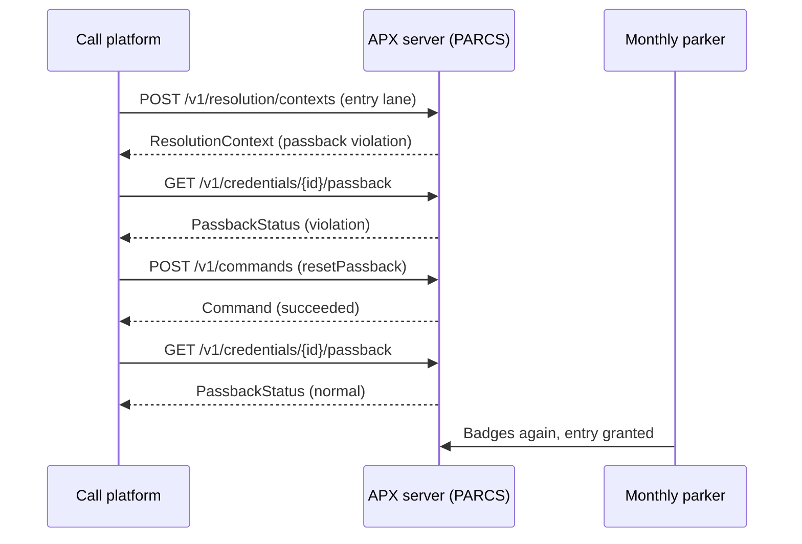

**Data exchanged.**

| Object | Defined in | Notes |
|---|---|---|
| `ResolutionContext` | APX Part 17 §17.2 | With `passback` and `accessDecision` |
| `PassbackStatus` | APX Part 17 §17.4 | Recorded against expected presence, last access |
| `AllowedAction` | APX Part 17 §17.3 | Reset allowed, vend refused |
| `Command` | APX Part 6 §6.1; Part 17 §17.4 | `resetPassback` with `parameters.credential` |
| `Credential` | APDS 4.1 | The monthly credential |
| `Place`, `VehicularAccess` | APDS 4.1 | Command target and lane |

**Postconditions / outcome.** The credential's state is corrected rather
than bypassed, so the next exit will also work. No gate was vended and
nothing counts against courtesy policy. One correlation id links the call,
context, decision and reset.

**Example.** The `passback` overlay in the context:

```json
{
  "credential": { "id": "c3000000-0000-4000-8000-000000000013", "className": "Credential" },
  "state": "violation",
  "expectedPresence": "outside",
  "recordedPresence": "inside",
  "lastAccess": {
    "direction": "entry",
    "occurredAt": "2026-09-01T08:03:47Z",
    "place": { "id": "b1000000-0000-4000-8000-000000000001", "className": "Place" },
    "lane": { "id": "b2000000-0000-4000-8000-000000000001", "className": "VehicularAccess" }
  }
}
```

**APX references.** Part 17 §17.1–17.4 (`resetPassback`, `forceIn`,
`forceOut` command types; passback read side); Part 6 §6.1. Scenario:
`docs/scenarios/13-resolution-passback-violation.md`.

#### D.1.14 Resolution context: prepaid reservation, misread plate

**Summary.** A visitor prepaid an evening reservation for plate `SVN-4821`,
but the entry camera read `5VN-4B21` at 0.41 confidence, so the PARCS
opened a plain transient session. At the exit the terminal asks for the
full drive-up price. The agent picks the correct plate from the lane's
recent plate candidates and corrects the session's plate; the PARCS's own
matching then links the reservation and the amount due drops to zero.

**Parties.**

| Party | Role |
|---|---|
| Call-center platform | Receiving Party; client with `apx.resolution:read`, `apx.lpr:read`, `apx.data:write` |
| Lakeside Garage APX server (PARCS and policy engine) | Distributing Party; context, LPR candidates, session correction |
| Entry and exit LPR cameras | Produced the misread and the clean read |
| Visitor | Reservation holder with confirmation code `LKG-88214` |

**Preconditions.**

- A confirmed reservation (`AssignedRight` with the reservation
  extension) exists for the correct plate.
- The exit camera has produced a fresh read of the vehicle.
- The server claims `apx-resolution`, `apx-lpr` and `apx-reservations`.

**Flow.**

1. The platform sends `POST /v1/resolution/contexts` with the lane and the
   `reservationCode` the visitor reads out. The `ResolutionContext` has
   `issue` `reservationMismatch`, the vehicle read at 0.41, the session,
   a `reservation` summary in state `confirmed`, a plate correction
   allowed (`execution.type: domain`) and `vendGate` refused
   (`sessionUnsettled`).
2. The platform reads
   `GET /v1/lpr/candidates?lane={id}&since=…`. The `PlateCandidate` list
   shows the exit read `SVN-4821` at 0.97 and the entry misread at 0.41.
3. The visitor confirms the plate. The platform sends
   `PUT /v1/sessions/{id}/plate` with the plate, country, state, the
   chosen observation as evidence and a `reason`.
4. The PARCS matches the corrected plate to the reservation and applies
   the prepaid rate.
5. The platform re-reads `GET /v1/resolution/contexts/{id}`; `version` is
   2 and `accessDecision` is `granted` with amount due 0.00.

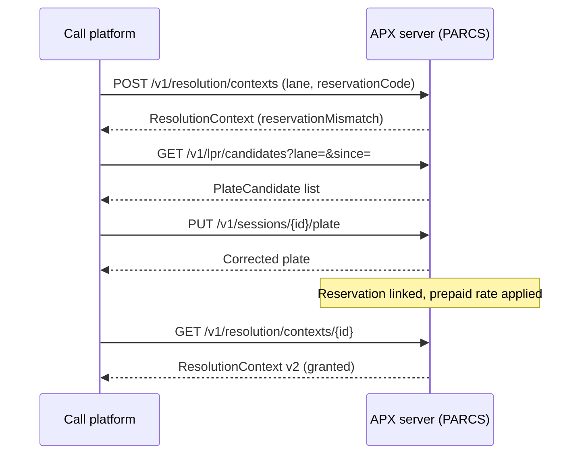

**Data exchanged.**

| Object | Defined in | Notes |
|---|---|---|
| `ResolutionContext` | APX Part 17 §17.2 | With `vehicle`, `session` and `reservation` |
| `ReservationSummary` | APX Part 14 §14.1 | The unlinked reservation |
| `PlateCandidate` | APX Part 17 §17.5 | Ranked reads with access-controlled image links |
| `ObservationElement` | APDS 4.1 | The chosen read, cited as evidence |
| `Session` | APDS 4.1 | Target of the plate correction |
| `AssignedRight` | APDS 4.1 | The reservation; extension proposed to APDS |
| `AllowedAction` | APX Part 17 §17.3, §17.4 | Domain plate correction allowed, vend refused |

The response to `PUT /v1/sessions/{id}/plate` is a small inline shape of
the operation, not a named schema.

**Postconditions / outcome.** The session carries the correct plate, the
reservation is linked and the gate opens on the normal exit flow, with no
override or courtesy counted. Where no plate can carry the link (for
example barcode-only reservations), `PUT /v1/sessions/{id}/assigned-right`
links session and reservation explicitly (Part 14 §14.1b).

**Example.** The plate candidates returned by `GET /v1/lpr/candidates`:

```json
{
  "data": [
    {
      "plate": "SVN-4821", "country": "US", "stateProvince": "FL",
      "confidence": 0.97,
      "observationDateTime": "2026-09-02T22:39:04Z",
      "lane": { "id": "b2000000-0000-4000-8000-000000000002", "className": "VehicularAccess" },
      "observation": { "id": "f2000000-0000-4000-8000-000000000014", "className": "Observation" },
      "plateImage": "https://api.lakeside-garage.example/v1/media/f2000000-0014/plate.jpg"
    },
    {
      "plate": "5VN-4B21", "country": "US", "stateProvince": "FL",
      "confidence": 0.41,
      "observationDateTime": "2026-09-02T17:41:22Z",
      "lane": { "id": "b2000000-0000-4000-8000-000000000001", "className": "VehicularAccess" },
      "observation": { "id": "f2000000-0000-4000-8000-000000000013", "className": "Observation" }
    }
  ]
}
```

**APX references.** Part 17 §17.2, §17.4, §17.5 (plate candidates and
correction); Part 14 §14.1b (linking a reservation to a session); Part 9
§9.6 (privacy of imagery). Scenario:
`docs/scenarios/14-resolution-reservation-plate-mismatch.md`.

#### D.1.15 Resolution context: payment terminal fault

**Summary.** A transient parker's cards do not work at the exit terminal.
The fault is in the terminal's card reader, which failed four minutes
earlier, and the resolution context shows it before the agent asks the
driver to try again. Policy allows a free vend because the fault is the
operator's, and gates a remote restart of the terminal behind maintenance
approval.

**Parties.**

| Party | Role |
|---|---|
| Call-center platform | Receiving Party; client with `apx.resolution:read`, `apx.control:execute` |
| Lakeside Garage APX server (PARCS and policy engine) | Distributing Party; context, commands, device events |
| Payment terminal and exit gate | Lane equipment |
| Maintenance technician | Approves and runs the restart |
| Driver | Transient parker at the lane |

**Preconditions.**

- The intercom is mapped to the lane id.
- The terminal reports `deviceState` `fault`.
- The server claims `apx-resolution`, `apx-control` and `apx-alerts`.

**Flow.**

1. The platform sends `POST /v1/resolution/contexts` with the lane. The
   `ResolutionContext` has `issue` `equipmentFault`, a `devices[]` list
   with the terminal in `fault` and the gate `available`, `vendGate`
   allowed, and `restartDevice` allowed with `requiresApproval: true`
   and `approvalRole` `maintenance`.
2. Where `apx-alerts` is deployed, a `deviceFault` alert has already been
   raised on `apx.alert.raised.v1` (as in D.1.2).
3. The platform sends `POST /v1/commands` with `commandType` `vendGate`,
   a `reason`, an `expiryTime`, the context and the correlation id.
4. The platform polls `GET /v1/commands/{id}`; the `Command` reaches
   `succeeded` with `confirmationLevel` `physicallyConfirmed`.
5. Later a technician approves and runs `restartDevice`. When the
   terminal recovers, the server publishes `apx.control.device.state.v1`
   with a `DeviceStatus` of `available`, and the alert clears on
   `apx.alert.status.v1`.

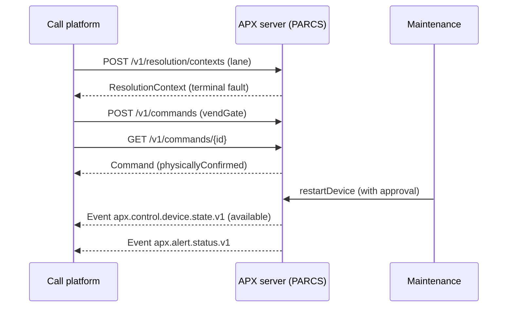

**Data exchanged.**

| Object | Defined in | Notes |
|---|---|---|
| `ResolutionContext` | APX Part 17 §17.2 | With `devices[]` overlay |
| `DeviceStatus` | APX Part 6 §6.4; proposed to APDS as `EquipmentStatus` | Terminal and gate state |
| `AllowedAction` | APX Part 17 §17.3 | Vend allowed; restart needs `maintenance` approval |
| `Command` | APX Part 6 §6.1 | `vendGate`, later `restartDevice` |
| `Alert` | APX Part 7; proposed to APDS | `deviceFault`, raised then cleared |
| `EventEnvelope` | APX Part 8 §8.2 | Device-state and alert events |
| `SupplementalEquipment`, `Session`, `VehicularAccess` | APDS 4.1 | References |

**Postconditions / outcome.** The driver leaves through a confirmed open
gate; the free exit is attributable to policy for an equipment fault, not
to the agent. The terminal is restarted under maintenance approval, and the
next context at the lane shows healthy devices. One correlation id ties the
call, context, fault and vend.

**Example.** The `devices[]` overlay in the context:

```json
[
  {
    "device": { "id": "c1000000-0000-4000-8000-000000000021", "className": "SupplementalEquipment" },
    "deviceState": "fault",
    "lastCommunication": "2026-09-02T19:22:40Z",
    "stateChangedTime": "2026-09-02T19:18:31Z"
  },
  {
    "device": { "id": "c1000000-0000-4000-8000-000000000022", "className": "SupplementalEquipment" },
    "deviceState": "available",
    "lastCommunication": "2026-09-02T19:22:41Z"
  }
]
```

**APX references.** Part 17 §17.2–17.4; Part 6 §6.1, §6.4; Part 7 (alerts);
Part 8 §8.7. Scenario: `docs/scenarios/15-resolution-equipment-fault.md`.

#### D.1.16 Automated enforcement: LPR overstay, mailed notice, appeal, payment

**Summary.** A gateless pay-by-plate lot is swept by a mobile LPR van. The
van reads a plate whose pay-by-plate session ended 26 minutes earlier. The
enforcement pipeline records a violation; the server runs the eligibility
check and stores the result. Operator policy allows unreviewed issuance for
automated detections at confidence 0.9 or above, so a notice is mailed. The
driver appeals, the reviewer reduces the amount, and the driver pays
online.

**Parties.**

| Party | Role |
|---|---|
| LPR enforcement pipeline (mobile van) | Distributing Party for detections; client with `apx.violations:manage` |
| Lakeside Garage APX server | Receiving Party; runs eligibility, holds violations, publishes events |
| Appeals portal | Client with `apx.violations:manage` and `apx.payments:write` |
| Reviewer | Resolves the appeal |
| Driver | Registered keeper of plate `SYN-4471` (a `Contact`) |

**Preconditions.**

- The van's read is stored as an APDS observation (`POST /observations`).
- The lot's published enforcement policy allows unreviewed issuance for
  automated detections with confidence ≥ 0.9.
- The server claims `apx-violations`, `apx-accounts` and `apx-events`.

**Flow.**

1. The pipeline sends `POST /v1/violations` with an `Idempotency-Key`,
   `violationType` `expiredRight`, the place, a `detection` (`mode`
   `automated`, confidence 0.94, rule), the vehicle, the observation and
   image evidence. The server runs the eligibility check, stores the
   `EligibilityResult` in `eligibilityCheck` (session found, `expired`)
   and returns the `Violation` in status `detected`.
   `apx.violations.detected.v1` is published.
2. The pipeline sends `POST /v1/violations/{id}/issue` with `noticeKind`
   `notice`, the amount ($35.00), the due time and `deliveryMethod`
   `mail`. The `Violation` moves to `issued` with a `notice` number.
   `apx.violations.issued.v1` is published.
3. The driver appeals through the portal: `POST /v1/violations/{id}/appeals`
   with `reason` `paidExtension`, detail, appellant and evidence links.
   The status becomes `appealed`.
4. The reviewer checks the APDS session (`GET /sessions/{id}`) and finds
   the extension was bought after the read, then sends
   `POST /v1/violations/{id}/appeals/resolve` with `resolution` `reduced`
   and `adjustedAmount` $15.00. The status returns to `issued`.
5. The portal takes the card with `POST /v1/payments`, then attaches the
   `PaymentRecord` with `POST /v1/violations/{id}/payment`. The status
   becomes `paid`.

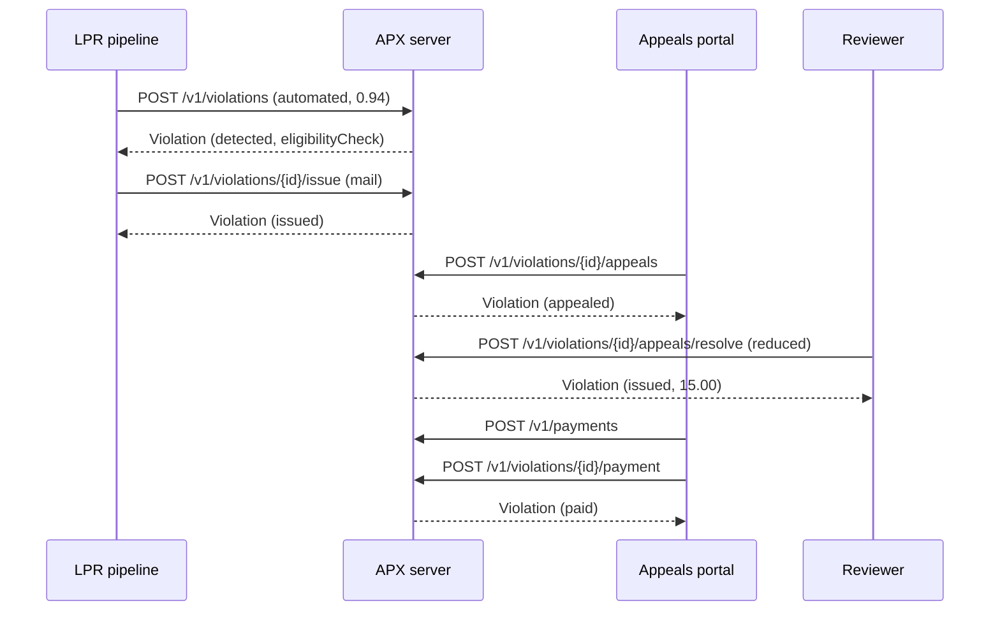

**Data exchanged.**

| Object | Defined in | Notes |
|---|---|---|
| `Violation` | APX Part 19 §19.1; proposed to APDS (with `ViolationDetection`, `Notice`, `Appeal`) | Lifecycle `detected` → `issued` → `appealed` → `issued` → `paid` |
| `EligibilityResult` | APX Part 19 §19.3 | Stored on the violation at creation |
| `ObservationElement` | APDS 4.1 | The van's read |
| `Session` | APDS 4.1 | The expired pay-by-plate session |
| `Contact` | APDS 4.1 | The appellant |
| `PaymentRecord` | APX Part 13 §13.1a; proposed to APDS as an extension of `Payment` | Linked to the violation |
| `SupplementalEquipment`, `Place` | APDS 4.1 | Detector and place references |
| `EventEnvelope` | APX Part 8 §8.2 | `apx.violations.*` and payment events |

**Postconditions / outcome.** The violation is `paid` at the reduced
amount with a complete `statusHistory`. The payment's
`apx.accounts.payment.recorded.v1` event reaches the financial feed and the
violation's `apx.violations.status.v1` event reaches the enforcement feed,
linked by one reference. Had the vehicle been entitled, the violation would
still have been recorded, as `dismissed`, with the basis. A `guided`
detection cannot be issued this way (`409 violation-not-issuable`), and a
second appeal is refused with `409 appeal-closed`.

**Example.** The `eligibilityCheck` stored on the violation (trimmed):

```json
{
  "place": { "id": "b1000000-0000-4000-8000-000000000004", "className": "Place" },
  "credential": { "credentialType": "licensePlate", "credentialIdentification": "SYN-4471" },
  "checkedTime": "2026-09-18T09:31:04Z",
  "entitled": false,
  "basis": [
    {
      "session": { "id": "f1000000-0000-4000-8000-000000000044", "className": "Session" },
      "rightType": "payByPlate",
      "validFrom": "2026-09-18T07:05:00Z",
      "validTo": "2026-09-18T09:05:00Z",
      "status": "expired"
    }
  ],
  "suggestedViolationType": "expiredRight",
  "graceUntil": "2026-09-18T09:20:00Z"
}
```

**APX references.** Part 19 §19.1–19.4 (violation, endpoints, eligibility,
automated and guided enforcement), §19.6 (settlement and appeals), §19.7
(eventing), §19.10 (enforcement policy); Part 13 §13.1a (payments).
Scenario: `docs/scenarios/16-violation-automated-overstay.md`.
