### D.2 Commerce, enforcement and service use cases

The use cases in this clause cover the commercial and service side of a
parking operation: enforcement, merchant validation, credentials, valet,
gateless LPR, tolling, negotiated rates, ticket matching, EV charging,
session pairing, plate review, imported citations, catching up after an
outage, itemized payments, and, from APX 0.15, vendor screens opened with
loopback, a location described from APX alone, calls resolved by caller id
or posted number, remote approvals, and receipts and coded refunds, and,
from APX 0.16, a lane sign's message recorded beside the stay's
compliance, and the stay grace on a handheld. Use cases D.2.1 to D.2.16
are taken from the worked scenarios in the APX repository
(`docs/scenarios/17-…` to `32-…`); D.2.17 to D.2.24 are taken from the
module scenarios of `apx-ui-launch`, `apx-site-config`, `apx-resolution`,
`apx-control`, `apx-accounts`, `apx-data` and `apx-violations`. The request and
response bodies in those scenarios are checked against the APX bundle
(`spec/dist/apx-v1.yaml`) by the repository's test suite.

Each use case uses the same layout: a summary, the parties, the
preconditions, the flow, a sequence diagram, the data exchanged, the
outcome, a short example taken from the scenario, and references. In the
**Data exchanged** tables, "APDS 4.1" means the class is defined in the
APDS 4.1 API specification and APX uses it unchanged. "APX Part N" means
APX defines it. "Proposed to APDS" means the class is also in the APX
proposals for APDS (`spec/proposals/apds-additions/`). All people, plates,
cards and identifiers are synthetic.

APX routes are served under `/v1/`. APDS-native routes (`/observations`,
`/sessions`, `/rates`, `/rights/assigned`) are served at their APDS paths
on the same host.

#### D.2.1 Guided enforcement with a handheld eligibility check

**Summary.**

An enforcement officer walks a permit-only level with a handheld that
scans plates. For each plate the handheld asks the server whether the
vehicle is entitled to be there now, and shows the officer only the ones
that are not. The officer records the finding, confirms it on site, and
issues a windshield citation. A guided finding cannot be issued until a
person has reviewed it.

**Parties.**

| Party | Role |
|---|---|
| Enforcement handheld app | Receiving Party for the eligibility check; writes the Violation. Scopes `apx.violations:read`, `apx.violations:manage`; APDS `ep` role for native reads |
| Lakeside Garage APX server | Distributing Party; holds rights, observations and violations |

**Preconditions.**

- Level 2 (`b1…0003`) is a child of the garage in the Place hierarchy.
- Monthly permits exist as APDS AssignedRights; LPR observations exist for
  the plates.
- The handheld holds a token with the scopes above and a grant covering the
  garage.

**Flow.**

1. The handheld calls `GET /v1/enforcement/eligibility?credential=SYN-1234&place=…`.
   The EligibilityResult says `entitled: true`, with a monthly permit as
   the basis. The permit is bound to the garage, an ancestor of Level 2,
   and so it counts (Part 19 §19.3 rule 2). Nothing is created.
2. The same call for `SYN-8820` returns `entitled: false`. The basis is a
   valid monthly permit with `status: wrongPlace` (it is for Level 3), and
   the result carries `suggestedViolationType: wrongPlace` and the last LPR
   read.
3. The handheld calls `POST /v1/violations` with an `Idempotency-Key`,
   `detection.mode: guided`, the space, the vehicle and a photo in
   `evidence[]`. The server returns a Violation in state `detected`, with
   the eligibility answer frozen in `eligibilityCheck` and the permit in
   `relatedRight`.
4. An integration that calls `POST /v1/violations/{id}/issue` straight away
   is refused with 409 `violation-not-issuable`: a guided detection must be
   reviewed first.
5. The officer calls `POST /v1/violations/{id}/review` with
   `decision: confirm`. The state becomes `confirmed`.
6. The handheld prints from pre-numbered stock and calls
   `POST /v1/violations/{id}/issue` with `noticeKind: citation`, the
   `noticeNumber`, the amount, `dueTime` and `deliveryMethod: windshield`.
   The state becomes `issued` and `apx.violations.issued.v1` is published.

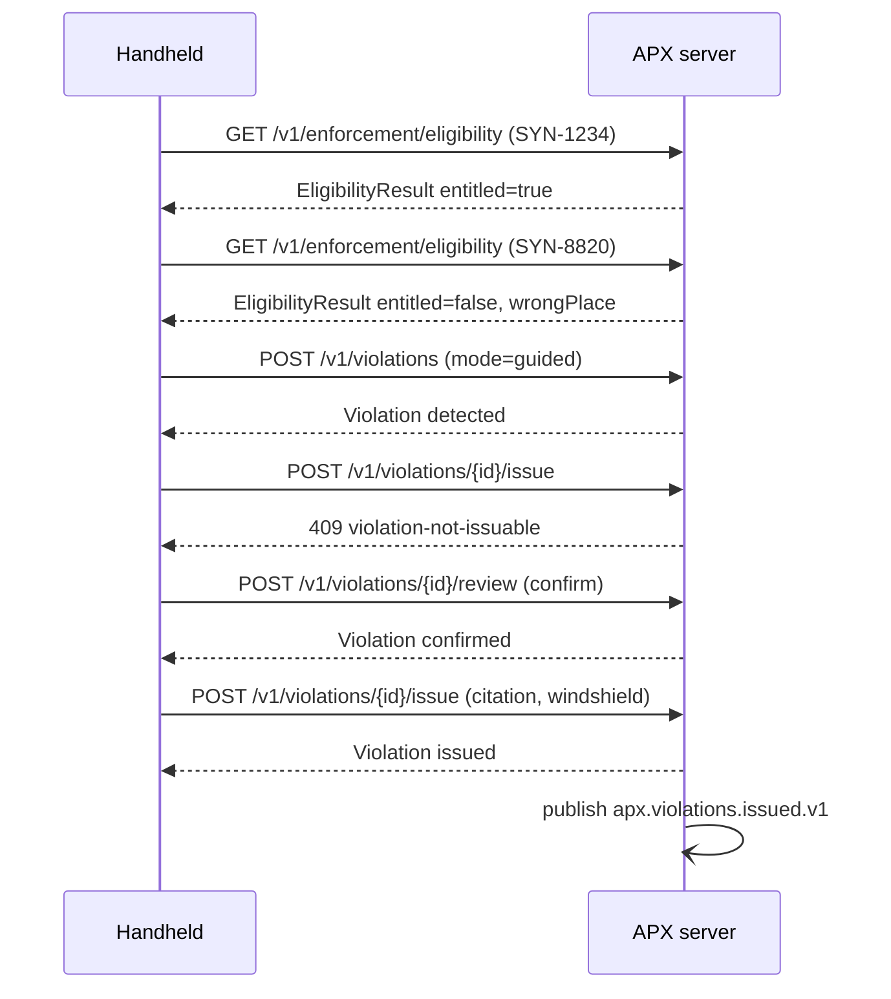

**Data exchanged.**

| Object | Defined in | Notes |
|---|---|---|
| EligibilityResult | APX Part 19 §19.3 | The answer to "is this vehicle entitled here now"; `basis[]` lists the rights considered |
| Violation | APX Part 19 §19.1; proposed to APDS (Enforcement: Violation, ViolationDetection, Notice) | The finding, its notice and its `statusHistory[]` |
| AssignedRight | APDS 4.1 | The permit that forms the basis and `relatedRight` |
| ObservationElement | APDS 4.1 | The LPR read referenced in `lastRead` |
| Place, Space, SupplementalEquipment, Contact | APDS 4.1 | Where the vehicle was, the handheld device, the officer |
| AmountInCurrency | APDS 4.1 | The citation amount |
| Problem | APX Part 12 | The 409 refusal |

**Postconditions / outcome.**

The violation is `issued` with the notice recorded and the officer named in
`statusHistory[]`. It then follows the normal path: paid through the Part 13
payment surface and linked with `POST /v1/violations/{id}/payment`, or
appealed. Had the officer chosen `dismiss`, the record would move to
`dismissed` with the reason. It is never deleted, so the false-positive rate
can be measured.

**Example.**

Step 2, the eligibility answer for the vehicle parked on the wrong level:

```json
{
  "place": { "id": "b1000000-0000-4000-8000-000000000003", "className": "Place" },
  "credential": { "credentialType": "licensePlate", "credentialIdentification": "SYN-8820" },
  "checkedTime": "2026-09-18T10:14:05Z",
  "entitled": false,
  "basis": [
    {
      "right": { "id": "e1000000-0000-4000-8000-000000000027", "className": "AssignedRight" },
      "rightType": "monthlyPermit",
      "validFrom": "2026-09-01T00:00:00Z",
      "validTo": "2026-09-30T23:59:59Z",
      "status": "wrongPlace"
    }
  ],
  "suggestedViolationType": "wrongPlace"
}
```

**APX references.**

Part 19 §19.1 (Violation and lifecycle), §19.3 (eligibility check), §19.4
(automated and guided enforcement), §19.7 (eventing). Scenario
`docs/scenarios/17-violation-guided-handheld.md`.

#### D.2.2 Merchant validation program

**Summary.**

A restaurant in the garage validates two hours of parking for its guests.
The operator enrols the restaurant as a validation program. The restaurant
issues its own QR codes, and a guest redeems one at the pay station. A
second code on the same ticket is refused by the program's rules. At month
end the operator closes the period into a statement that bills the
restaurant.

**Parties.**

| Party | Role |
|---|---|
| Operator back office | Distributing Party for the program; scope `apx.validations:manage` |
| Harbor Bistro app (merchant) | Issues codes; scope `apx.validations:redeem`, with `apx_org` set to the restaurant, so it is confined to its own program (Part 20 §20.5) |
| Operator pay station | Redeems codes for every merchant at the place; scope `apx.validations:manage` |
| Lakeside Garage APX server | Holds programs, instruments, redemptions and statements |

**Preconditions.**

- The garage is a Place on the server; the restaurant is a known
  organisation.
- The guest has an open APDS Session with a ticket number.

**Flow.**

1. The back office calls `POST /v1/validations/programs` with the place,
   provider, benefit (`duration: PT2H`), rules (`maxPerTicket: 1`,
   `maxPerDay: 200`, `validityWindow: P1D`, `stackable: false`) and billing
   (`merchantPays`, $4.00 a unit, monthly). The ValidationProgram is
   `active`. From then on `GET /v1/validations/providers?place=…` (Part 6)
   lists the restaurant, with `program` pointing to it.
2. The restaurant's iPad calls `POST /v1/validations/programs/{id}/issuances`
   with `quantity: 50` and `method: qrCode`. The ValidationIssuance
   returns the codes once. A retry with the same key returns the issuance
   without the codes.
3. The pay station checks a scanned code with
   `GET /v1/validations/instruments/{code}` (ValidationInstrument,
   `instrumentStatus: valid`), then applies it with
   `POST /v1/validations/redemptions`. The ValidationRedemption is
   `applied` and records `amountReduced` ($6.00, what actually came off the
   ticket). The APDS Session now carries the `validationId` on its segment
   and a Payment of type `validation`. `apx.validations.redeemed.v1` is
   published.
4. A second code on the same ticket is refused with 422
   `redemption-limit-exceeded` (`maxPerTicket=1`). The code stays `valid`
   for another ticket.
5. At month end the back office previews the period with
   `GET /v1/validations/programs/{id}/statement?from=…&to=…`, then closes it
   with `POST /v1/validations/programs/{id}/statements`. The
   ValidationStatement is `closed` and
   `apx.validations.statement.closed.v1` is published.

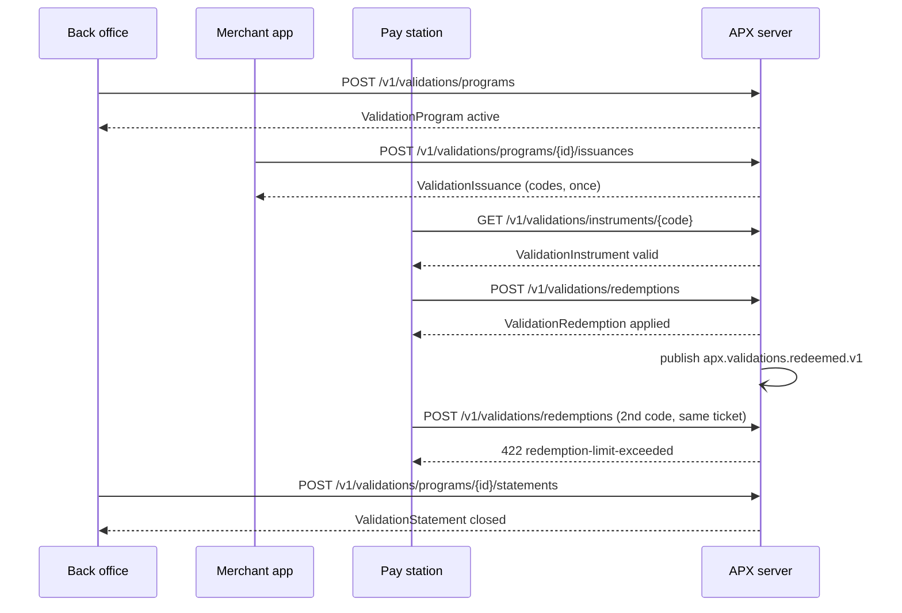

**Data exchanged.**

| Object | Defined in | Notes |
|---|---|---|
| ValidationProgram | APX Part 20 §20.1; proposed to APDS (Right: ValidationProgram, ValidationRules, ValidationBilling; Rates: ValidationBenefit) | The merchant's program, rules and billing terms |
| ValidationIssuance, ValidationInstrument | APX Part 20 §20.2; proposed to APDS (Right) | A batch of codes, and one code's state |
| ValidationRedemption | APX Part 20 §20.3; proposed to APDS (Session) | One code applied to one ticket |
| ValidationStatement | APX Part 20 §20.6 | Closed billing period; APX only |
| Session, Segment, Payment | APDS 4.1 | The stay the code was applied to, and the `validation` Payment an APDS-only consumer sees |
| Place, AmountInCurrency | APDS 4.1 | |
| Problem | APX Part 12 | The 422 refusal |

**Postconditions / outcome.**

The restaurant is invoiced from the statement's `id`: 412 redemptions at
$4.00 is $1,648.00. The $2,418.00 of parking actually comped is the
operator's own figure. The statement cannot be changed after it is closed. A
later reversal of one of its redemptions still succeeds, but it appears as a
negative `credit` line on the next statement (§20.4, §20.6).

**Example.**

Step 3, the redemption the pay station receives (trimmed):

```json
{
  "id": "e7000000-0000-4000-8000-000000000041",
  "version": 1,
  "program": { "id": "e5000000-0000-4000-8000-000000000001", "className": "ValidationProgram" },
  "instrumentCode": "HB-7Q2M-K9X4-3TPD",
  "ticketNumber": "T-2210",
  "session": { "id": "f1000000-0000-4000-8000-000000000210", "className": "Session" },
  "appliedTime": "2026-09-12T21:33:05Z",
  "channel": "payStation",
  "validationId": "VAL-20260912-000318",
  "amountReduced": { "currencyType": "USD", "currencyValue": 6.0 },
  "durationComped": "PT2H",
  "redemptionStatus": "applied"
}
```

**APX references.**

Part 20 §20.1–20.8; Part 6 §6.3 (provider lookup). Scenario
`docs/scenarios/18-validation-program-merchant.md`.

#### D.2.3 Enforcement policy, signage and escalation

**Summary.**

A surface lot is subject to a state law on private-lot notices: which
detections may be mailed, by when, with what evidence, how large the
penalty may be, how it escalates, and that signs must be posted. The
operator puts the law on file as an enforcement policy and records the
entrance sign. A handheld detection that tries to go out by mail is refused.
It is issued on the windshield instead, with the policy and sign frozen on
the record. Thirty days later the server applies the first escalation step
itself.

**Parties.**

| Party | Role |
|---|---|
| Operator back office | Writes the policy and signage; scope `apx.violations:manage` |
| Enforcement handheld | Records and issues the violation; scope `apx.violations:manage` |
| APX server scheduler | Applies escalation steps (`actor: apx-scheduler`) |
| Lakeside Garage APX server | Distributing Party; enforces the policy on issue |

**Preconditions.**

- Lot C (`b1…0004`) is a Place on the server.
- Counsel has summarized the law into delivery rules, a penalty cap and an
  escalation schedule.

**Flow.**

1. The back office calls `POST /v1/enforcement/policies`. The
   EnforcementPolicy holds `deliveryRules` (automated detections: mail or
   electronic within `P14D`, with at least one observation, one image and a
   location; guided or manual: windshield or handed within `PT1H`),
   `penaltyCap` (2× the unpaid fee, `onExceed: refuse`), two `escalation`
   steps (`late-30`: +25%; `late-60`: +$15), `overallCeiling` (3× the
   issued amount), `appealWindowDays: 21` and `signageRequired: true`.
2. The back office calls `POST /v1/enforcement/signage` with the sign text
   in English and Spanish, its location, a photo, `signType: entrance`, and
   the policy. `GET /v1/enforcement/signage/effective?place=…&at=…` returns
   the sign in force at a given time.
3. The handheld calls `POST /v1/violations` with `detection.mode: guided`
   and a `location` holding both `observedLocation` and
   `observerLocation`.
4. The handheld calls `POST /v1/violations/{id}/issue` with
   `deliveryMethod: mail`. The server refuses with 422
   `delivery-method-not-permitted`: under this policy a guided detection
   may only be delivered by windshield or by hand.
5. The handheld issues again with `deliveryMethod: windshield`. The
   Violation is `issued`. It carries `policy` and `signage[]` as versioned
   references, and an `amountHistory[]` entry that records the cap check.
   An amount above the cap would have been refused with
   `penalty-exceeds-cap`; a lot with no sign on file, with
   `signage-required`.
6. With no payment and no appeal, the server applies `late-30` after 30
   days, raises the amount from $35.00 to $43.75, and publishes
   `apx.violations.status.v1`.

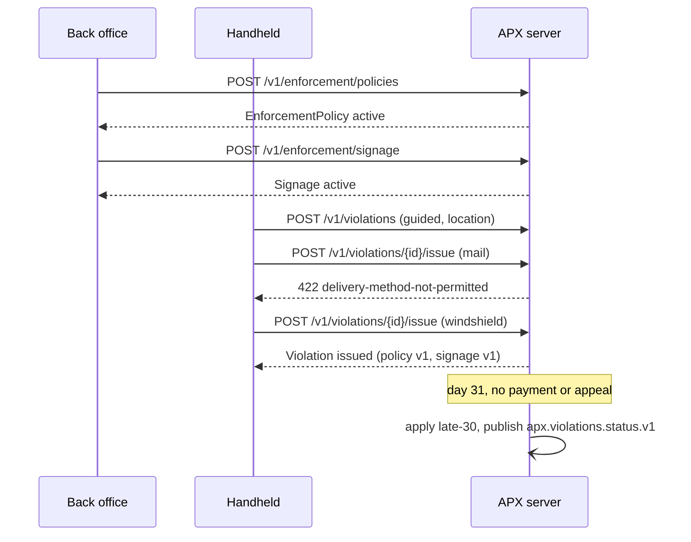

**Data exchanged.**

| Object | Defined in | Notes |
|---|---|---|
| EnforcementPolicy | APX Part 19 §19.10; proposed to APDS (Enforcement: EnforcementPolicy, NoticeDeliveryRule, PenaltyLimit, EscalationStep) | The law at the place; inherited by child places that carry no policy of their own |
| Signage | APX Part 19 §19.11; proposed to APDS (Place) | What was posted, where, and when |
| Violation | APX Part 19 §19.1, §19.9; proposed to APDS (Enforcement) | Carries `location`, frozen `policy` and `signage[]`, `amountHistory[]` |
| MultilingualString, Point, VersionedReference | APDS 4.1 | Sign text, sign and vehicle positions, frozen references |
| Problem | APX Part 12 | The 422 refusal |

**Postconditions / outcome.**

No client computes the escalated amount. The schedule is on the policy, the
server applies it, and every consumer (the driver's portal, collections, the
appeals reviewer) reads the same `amountHistory[]`. `late-60` would add $15
at day 60, and the amount can never pass the ceiling of $105. An appeal
opened in the meantime pauses the schedule (§19.10 rule 3).

**Example.**

Step 6, the amount history after escalation (trimmed):

```json
{
  "id": "d3000000-0000-4000-8000-000000000003",
  "version": 4,
  "violationStatus": "issued",
  "policy": { "id": "d4000000-0000-4000-8000-000000000001", "version": 1, "className": "EnforcementPolicy" },
  "signage": [ { "id": "d5000000-0000-4000-8000-000000000001", "version": 1, "className": "Signage" } ],
  "amount": { "currencyType": "USD", "currencyValue": 43.75 },
  "amountHistory": [
    { "amount": { "currencyType": "USD", "currencyValue": 35.0 }, "time": "2026-09-18T10:24:02Z", "reason": "issued" },
    { "amount": { "currencyType": "USD", "currencyValue": 43.75 }, "time": "2026-10-19T00:00:05Z", "reason": "escalation", "step": "late-30", "detail": "+25% per policy d4000000-…-0001 v1; ceiling 3× = 105.00" }
  ]
}
```

**APX references.**

Part 19 §19.9 (location), §19.10 (enforcement policy), §19.11 (signage).
Scenario `docs/scenarios/19-violation-policy-signage-escalation.md`.

#### D.2.4 Lost keycard replaced in one call

**Summary.**

A monthly parker phones to say their keycard is lost. The agent reports the
card lost and issues a replacement from pre-encoded stock in one call. That
evening someone presents the old card at an entry lane that only speaks
APDS, and the lane refuses it because the card is no longer on the parker's
AssignedRight. The next day the access log shows the parker every use of
the old card.

**Parties.**

| Party | Role |
|---|---|
| Call-center agent console | Scopes `apx.accounts:read`, `apx.credentials:manage` |
| Entry lane (APDS-native) | Receiving Party; reads `/rights/assigned` |
| Parker's app | Scope `apx.credentials:read` |
| Lakeside Garage APX server | Distributing Party; keeps credentials and the AssignedRight in step |

**Preconditions.**

- The parker has an account and a monthly AssignedRight.
- The card is a CredentialRecord in state `active`, materialized on that
  AssignedRight (Part 21 §21.2).
- The front desk holds pre-encoded replacement cards.

**Flow.**

1. The agent calls `GET /v1/credentials?account=…&status=active` and finds
   the card: `credentialType: rfid`, `media.form: physicalCard`, a $25.00
   deposit `held`. It was activated by the server itself on
   `validity.start` (actor `system`, §21.1 rule 6).
2. The agent calls `POST /v1/credentials/{id}/report-lost` with a reason.
   The record becomes `lost`, its CredentialAssigned is removed from the
   AssignedRight, and `apx.credentials.status.v1` is published.
3. The agent calls `POST /v1/credentials/{id}/replace` with an
   `Idempotency-Key`, the new card number, its media and
   `oldDepositStatus: forfeited`. The server returns the successor, which is
   `active`, carries `replaces`, and inherits the holder, account, assigned
   right, places and validity. In the same step the AssignedRight's
   credentials change from the old card to the new one in one
   `AssignedRightUpdated` event. The old record becomes `replaced`, with
   `replacedBy` set. A second `replace` on it is refused with 409
   `credential-not-replaceable`.
4. At 18:02 the old card is presented at the APDS-native entry lane. The lane
   queries `GET /rights/assigned?credential_type=rfid&credential_id=C-0048812`,
   finds nothing, and denies entry. The server records a
   CredentialAccessEvent with `outcome: denied`,
   `denialReason: credentialReplaced`, and publishes
   `apx.credentials.access.v1`.
5. The next morning the parker's app calls
   `GET /v1/credentials/{id}/access-events?since=…` and sees the last
   legitimate exit and the refused attempt.

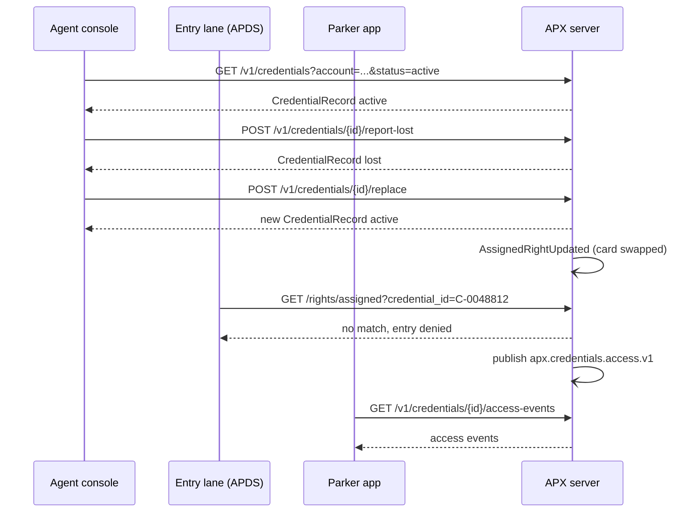

**Data exchanged.**

| Object | Defined in | Notes |
|---|---|---|
| CredentialRecord | APX Part 21 §21.1; proposed to APDS (Right: extension of CredentialAssigned, with CredentialMedia) | The managed card, its media, deposit and lifecycle |
| CredentialAccessEvent | APX Part 21 §21.4; proposed to APDS as AccessEvent (Session) | One presentation at a lane and its outcome |
| AssignedRight, CredentialAssigned | APDS 4.1 | Where the card is materialized; what the lane reads |
| VehicularAccess, SupplementalEquipment, Session | APDS 4.1 | Lane, reader, and the stay a granted presentation belongs to |
| Problem | APX Part 12 | The 409 refusal |

**Postconditions / outcome.**

The new card works and the old card opens nothing. No sync job or separate
blocklist was needed: the lane refused the card because the right no longer
carried it. The old record keeps its history (Part 21 §21.3), and a retry of
the replace call with the same key returns the same successor.

**Example.**

Step 4, the access event recorded for the refused card:

```json
{
  "id": "d7000000-0000-4000-8000-000000000410",
  "credential": { "id": "d6000000-0000-4000-8000-000000000101", "className": "CredentialRecord" },
  "occurredAt": "2026-09-19T18:02:17Z",
  "place": { "id": "b1000000-0000-4000-8000-000000000001", "className": "Place" },
  "lane": { "id": "b2000000-0000-4000-8000-000000000001", "className": "VehicularAccess" },
  "device": { "id": "b2000000-0000-4000-8000-000000000011", "className": "SupplementalEquipment" },
  "direction": "entry",
  "outcome": "denied",
  "denialReason": "credentialReplaced"
}
```

**APX references.**

Part 21 §21.1–21.4, §21.6. Registry `apx-access-denial-reasons`. Scenario
`docs/scenarios/20-credential-lost-card-replacement.md`.

#### D.2.5 Valet drop-off, retrieval by text and verified handback

**Summary.**

A guest leaves a car at a hotel valet stand. The attendant's app records a
condition report with photos and an existing scuff, and the guest
acknowledges it. Later the guest texts to ask for the car and gets an
arrival estimate. The runner stages the car, the attendant checks the claim
code and records the handback condition. When the guest later claims a new
scratch, the acknowledged drop-off report answers the claim.

**Parties.**

| Party | Role |
|---|---|
| Attendant scanning app | Creates and moves the ticket; scope `apx.valet:manage` |
| Guest's phone, through an SMS gateway | Requests the car; scope `apx.valet:request`, on a token bound to this ticket at drop-off |
| Runner board | Reads the queue; scope `apx.valet:read` |
| Lakeside Garage APX server | Distributing Party; opens the APDS Session for the stay |

**Preconditions.**

- The valet stand is a Place (`b1…0005`) with a drop-off lane and a staging
  lane, both VehicularAccess elements.
- The valet rate is charged on the APDS Session, not on the ticket.

**Flow.**

1. The attendant calls `POST /v1/valet/tickets` with an `Idempotency-Key`,
   the ticket number, vehicle, customer display name and masked contact,
   and `dropOff`. `dropOff` holds mileage, fuel, key tag, items left, and a
   `conditionReport` with damage items, photos and
   `customerAcknowledged: true`. The ValetTicket is `dropped`, and the
   server opens and references the APDS Session for the stay.
2. A runner parks the car: `POST /v1/valet/tickets/{id}/park` with the zone
   and key location. The ticket is `parked`.
3. The guest texts "CAR". The gateway calls
   `POST /v1/valet/tickets/{id}/retrieve` with `channel: sms` on the guest's
   token. The ticket is `requested`, with `etaMinutes` and `promisedTime`.
   The customer scope gets a minimized read: no storage, no key tag, no
   `statusHistory`, no condition report (Part 22 §22.5). A repeated request
   returns the same ticket with 200 and adds nothing to the runner board
   (§22.3 rule 4). `apx.valet.retrieval.requested.v1` is published.
4. The runner board calls `GET /v1/valet/queue?place=…` and sees the zone
   and key hook.
5. The runner calls `POST /v1/valet/tickets/{id}/stage` with the staging
   lane. At the stand the attendant calls
   `POST /v1/valet/tickets/{id}/handback` with `verificationMethod: code`,
   the code, mileage and a handback condition report. The ticket is
   `handedBack`. A code that did not match would return 403
   `valet-verification-failed`, and the attempt would be kept in
   `statusHistory`.
6. The session is paid at the stand through the normal payment surface, and
   the ticket moves to `closed`.

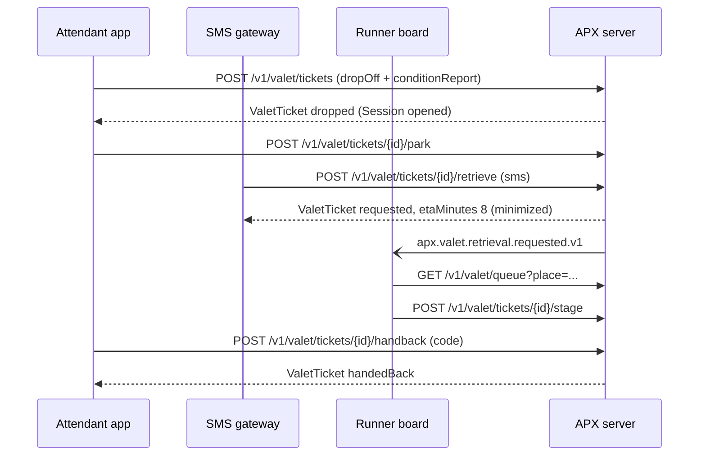

**Data exchanged.**

| Object | Defined in | Notes |
|---|---|---|
| ValetTicket | APX Part 22 §22.1; proposed to APDS (Session) | Custody record from drop-off to close |
| ConditionReport | APX Part 22 §22.2; proposed to APDS (Observation: ConditionReport, DamageItem) | Drop-off and handback condition, photos, acknowledgement |
| Session | APDS 4.1 | The stay; the valet rate is a line on it |
| Place, VehicularAccess | APDS 4.1 | Stand, drop-off lane, staging lane |
| Problem | APX Part 12 | The 403 refusal |

**Postconditions / outcome.**

The ticket is closed with a full custody history. A week later, when the
guest reports a scratch on the bumper, the agent reads the drop-off report:
a 6 cm scuff, photographed and acknowledged by the guest at drop-off, and a
handback report that says it was unchanged. The claim is answered from the
record.

**Example.**

Step 3, the minimized read returned to the guest's token:

```json
{
  "id": "d8000000-0000-4000-8000-000000000419",
  "version": 3,
  "place": { "id": "b1000000-0000-4000-8000-000000000005", "className": "Place" },
  "ticketNumber": "V-20419",
  "vehicle": { "credentialType": "licensePlate", "credentialIdentification": "SYN-7734", "make": "Audi", "colour": "grey" },
  "customer": { "displayName": "R. Ortega" },
  "dropOff": { "time": "2026-09-20T18:30:14Z" },
  "retrieval": {
    "requestedTime": "2026-09-20T20:41:03Z",
    "channel": "sms",
    "etaMinutes": 8,
    "promisedTime": "2026-09-20T20:49:03Z"
  },
  "valetStatus": "requested"
}
```

**APX references.**

Part 22 §22.1–22.5, §22.7. Scenario
`docs/scenarios/21-valet-dropoff-retrieve-handback.md`.

#### D.2.6 Gateless lot with a shared driveway

**Summary.**

A gateless pay-by-plate lot has one driveway with an entry lane and an exit
lane separated only by paint, each with a camera set up to read rear plates.
On a snowy morning a pickup comes in on the exit lane to avoid ice. Both
cameras read it, the LPR system reports both reads as an entry, and a
session opens. APX derives nothing: the cameras report what they saw, the
LPR system says entry or exit, and the session is the visit between them.

**Parties.**

| Party | Role |
|---|---|
| Site LPR system | Distributing Party for reads and lane configuration; scope `apx.data:write` (native ingest) |
| Operator ops console | Receiving Party; scope `apx.lpr:read` |
| Riverside Lot APX server | Stores reads and sessions |

**Preconditions.**

- Each lane is an APDS VehicularAccess whose `accessType` says what the lane
  is for.
- Each lane carries the APX decoration `apds-ext:apx:lane-cameras@1.0`,
  which names its cameras and the way each faces (Part 13 §13.3a(5)). The
  entry camera faces `inward`, the exit camera `outward`.
- Camera ids are unique within the place.

**Flow.**

1. At 07:41 the exit-lane camera reads the pickup's front plate coming
   toward it. The LPR system calls `POST /observations` (native APDS) with
   the decoration `apds-ext:apx:lpr-read@1.0`: per-attribute confidences,
   `plateFace: front`, `movement: toward`, `accessEvent: entry` and a
   `captureGroup`. The Observation `id` is the engine's own read id, so a
   re-send after a network drop gets 409 `id-collision` and no second read
   appears (§13.3a(8)).
2. The entry-lane camera reads the rear plate moving away. A second
   Observation, in the same `captureGroup`, also reports
   `accessEvent: entry`.
3. A session opens at 07:41:08, the capture time of the passage's first
   read.
4. The ops console calls `GET /v1/lpr/reads?plate=RVR-8821`. It sees two
   reads, two cameras, two lanes, one passage, one entry and one session.
   There is no wrong-way flag and no alert: the lane a car uses does not
   change what it did (§13.3a(6)).
5. At 09:12 the exit camera reads the rear plate moving away
   (`accessEvent: exit`) and the session closes. The engine also reports its
   second choice in `alternateReads`.
6. The console calls `GET /v1/lpr/reads?session=…` and gets all three reads
   behind the visit.

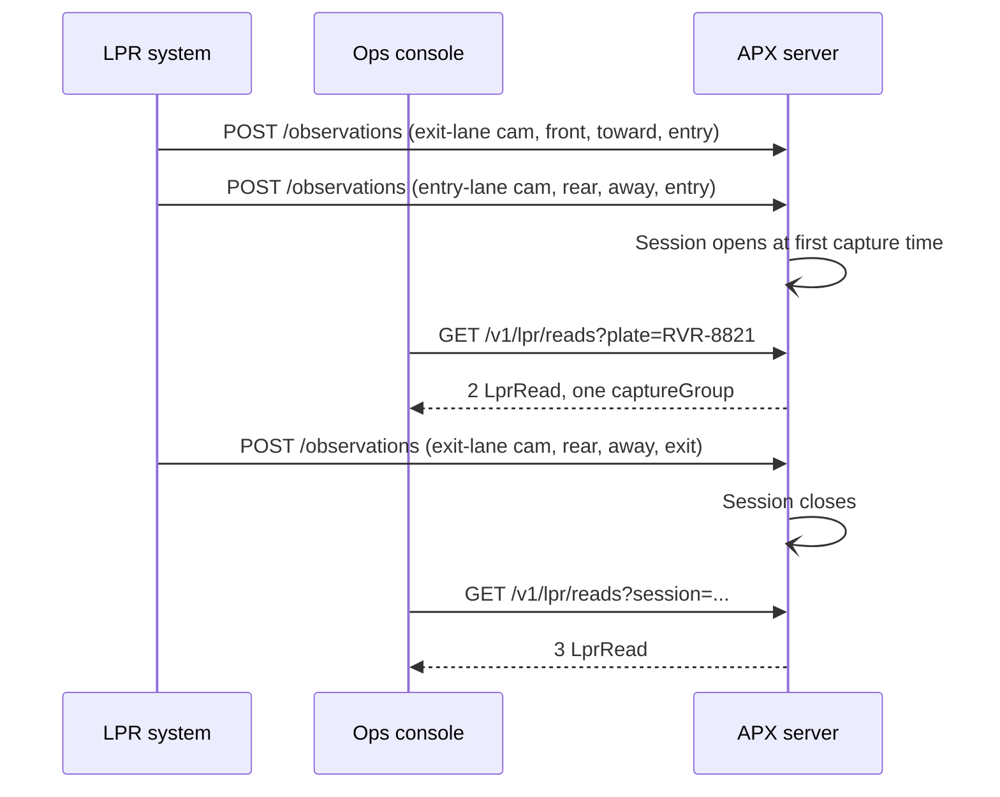

**Data exchanged.**

| Object | Defined in | Notes |
|---|---|---|
| VehicularAccess | APDS 4.1; extension proposed to APDS (Place: LaneCamera, CameraFacingEnum) | The lane |
| LaneCameras | APX Part 13 §13.3a(5) | Decoration `apds-ext:apx:lane-cameras@1.0` |
| ObservationElement | APDS 4.1; extension proposed to APDS (Observation) | The native read |
| LprReadDetail | APX Part 13 §13.3a; proposed to APDS (Observation: AttributeRead, AlternateRead, VehicleMovementEnum, PlateFaceEnum) | Decoration `apds-ext:apx:lpr-read@1.0` |
| LprRead | APX Part 13 §13.3 | The read as the LPR query returns it |
| Session | APDS 4.1 | The visit, billed by plate |

**Postconditions / outcome.**

The session runs from 07:41:08 to 09:12:02 and is billed by plate. Its times
come from when the cameras saw the truck, not when the reads reached the
server, which on a bad-signal day can be hours later (§13.3a(8)). The
second-choice plate is kept so that a Part 17 correction could offer it
without anyone retyping it.

**Example.**

Step 1, the APX decoration on the exit-lane read (trimmed):

```json
"apds-ext:apx:lpr-read@1.0": {
  "plate": { "value": "RVR-8821", "confidence": 0.91 },
  "stateProvince": { "value": "IL", "confidence": 0.88 },
  "bodyType": { "value": "pickup", "confidence": 0.96 },
  "frameReads": 4,
  "platesRead": 2,
  "plateFace": "front",
  "movement": "toward",
  "accessEvent": "entry",
  "captureGroup": "riverside/20261214T074108/0417",
  "engine": "vendor-x/7.2"
}
```

**APX references.**

Part 13 §13.3 and §13.3a(3), (5), (6), (8). Scenario
`docs/scenarios/22-lpr-shared-driveway.md`.

#### D.2.7 Toll gantry charge, retry and dispute

**Summary.**

A tolled access road into the garage complex has a gantry that reads
transponders and plates and bills an account on file. A transponder passage
is created, priced and settled. The gantry's retry after an uplink drop is a
no-op because of the idempotency key. A second passage, read by plate only
at low confidence, is billed to a holder who was elsewhere. She disputes it,
the operator agrees and resolves it as refunded, and a later attempt to
reopen it is refused.

**Parties.**

| Party | Role |
|---|---|
| Gantry bridge | Creates transactions; scope `apx.tolling:manage` |
| Back office | Settles and resolves; scopes `apx.tolling:manage`, `apx.payments:write` |
| Holder, through the call center | Raises the dispute |
| Lakeside APX server | Distributing Party for toll transactions |

**Preconditions.**

- The gantry is an APDS SupplementalEquipment (`b4…0001`).
- Transponder and plate reads are first ingested as native APDS
  Observations. The toll transaction references them and does not restate
  them.

**Flow.**

1. The bridge calls `POST /v1/tolling/transactions` with a required
   `Idempotency-Key`, the toll point, the observations, the credential and
   the price. The TollTransaction is `priced` and
   `apx.tolling.transaction.created.v1` is published.
2. After an uplink drop the bridge sends the same request under the same
   key. The server returns 200 with the original transaction, unchanged. The
   same key with a different body would get 409 `idempotency-conflict`.
3. The nightly batch charges the account and calls
   `POST /v1/tolling/transactions/{id}/payment` with a reference to the
   PaymentRecord. The transaction is `paid`.
4. A second passage with no transponder is read by plate at 0.71
   confidence, then created, priced and billed in the same way. Ten days
   later the holder calls. The agent calls
   `POST /v1/tolling/transactions/{id}/disputes` with
   `reason: wrongVehicle`. The transaction is `disputed`, and its reads
   stay referenced.
5. The back office compares the gantry image with the holder's vehicle and
   calls `POST /v1/tolling/transactions/{id}/disputes/resolve` with
   `resolution: refunded`. The transaction is `resolved`. The refund itself
   is a Part 13 refund against the original payment.
6. A reconciliation job working from a stale export tries to open the
   dispute again and is refused with 409 `dispute-closed`.

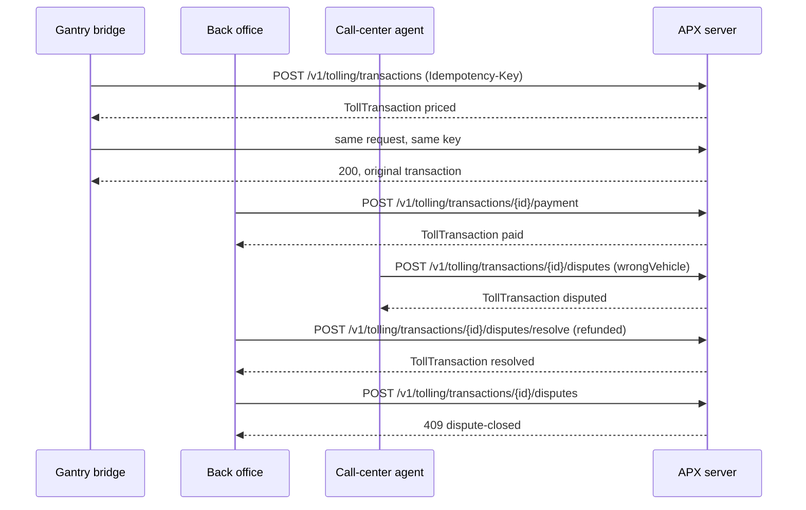

**Data exchanged.**

| Object | Defined in | Notes |
|---|---|---|
| TollTransaction | APX Part 15 §15.1; proposed to APDS (Observation: TollTransaction, TollDispute) | The passage, its price, payment and dispute |
| ObservationElement | APDS 4.1 | The transponder and plate reads |
| SupplementalEquipment | APDS 4.1 | The gantry (toll point) |
| PaymentRecord | APX Part 13 §13.1a; proposed to APDS as an extension of Payment | The money; the toll record holds only a reference |
| Problem | APX Part 12 | The 409 refusals |

**Postconditions / outcome.**

The first passage is paid once. The second is resolved as refunded, with
the original reads still referenced as evidence. Every transition published
`apx.tolling.transaction.status.v1`, so analytics and gantry-health
dashboards saw the dispute without polling.

**Example.**

Step 5, the resolved transaction (trimmed):

```json
{
  "id": "e9000000-0000-4000-8000-000000000802",
  "version": 5,
  "credential": { "credentialType": "licensePlate", "credentialIdentification": "SYN-9930" },
  "pricing": { "currencyType": "USD", "currencyValue": 2.75 },
  "payment": { "id": "9c0d1e2f-3a4b-4c5d-8e6f-7a8b9c0d1902", "className": "PaymentRecord" },
  "transactionStatus": "resolved",
  "dispute": {
    "reason": "wrongVehicle",
    "openedTime": "2026-10-02T15:20:11Z",
    "resolvedTime": "2026-10-03T09:41:02Z",
    "resolution": "refunded"
  }
}
```

**APX references.**

Part 15 §15.1–15.3; Part 13 §13.1a (refunds). Registries
`apx-toll-dispute-reasons`, `apx-toll-dispute-resolutions`. Scenario
`docs/scenarios/23-tolling-gantry-dispute.md`.

#### D.2.8 Negotiated rate at the exit lane

**Summary.**

A driver at an exit lane disputes a correct event-rate charge. The operator
allows its call center to settle this kind of complaint with one flagged
rate table. The agent sees which tables may be offered from the rate deck
the call platform already mirrors, applies one to the car in the lane, and
the command record names the agent. The next car is priced as before.

**Parties.**

| Party | Role |
|---|---|
| Call platform | Receiving Party; mirrors the deck on the native `/rates` route (`apx.data:read`) |
| Call-center agent console | Scopes `apx.control:read`, `apx.control:execute` |
| Lakeside Garage APX server and PARCS | Distributing Party; applies the command at the lane |

**Preconditions.**

- The server advertises the `negotiatedRates` feature (registry
  `apx-features`).
- The table that may be offered carries the decoration
  `apds-ext:apx:ratepolicy@1.0` with `negotiable: true`.
- The call platform has synced the deck with the Part 5 change feed.

**Flow.**

1. The agent's screen-pop calls `GET /v1/lanes/{id}/current`. The LaneStatus
   shows ticket `T-4471`, in since 09:12, $45.00 due, no validations.
2. The console already holds the deck from
   `GET /rates?place_ids=…&mode=change&cursor=…`. The event table has no
   decoration. The customer-service table carries `negotiable: true`, a
   `displayName` and a `note`. The note is guidance for the presenting
   system; the server never evaluates it (Part 6 §6.6).
3. The agent calls `POST /v1/commands` with
   `commandType: pushNegotiatedRate`, the lane as `target`, the table as a
   versioned reference in `parameters.rateTable`, `agent`,
   `agentType: human` and `reason`. The Command `succeeded` with
   `confirmationLevel: deviceAcknowledged`.
4. `GET /v1/lanes/{id}/current` now shows $20.00 due and a `negotiatedRate`
   block naming the table, the command and the agent.
5. A different agent who tries a table without the flag is refused with 422
   `rate-not-negotiable`.

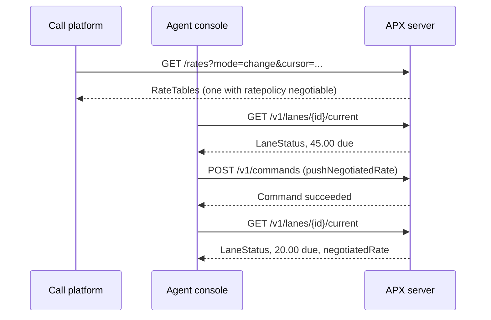

**Data exchanged.**

| Object | Defined in | Notes |
|---|---|---|
| LaneStatus | APX Part 6 §6.2 | The screen-pop |
| RateTable | APDS 4.1 | The deck, on the native route |
| RatePolicy | APX Part 6 §6.6; proposed to APDS as an extension of RateTable | Decoration `apds-ext:apx:ratepolicy@1.0` |
| Command | APX Part 6 §6.1 | `pushNegotiatedRate`, with `agent`, `agentType`, `reason` |
| VersionedReference, Session | APDS 4.1 | The exact table version; the stay it priced |
| Problem | APX Part 12 | The 422 refusal |

**Postconditions / outcome.**

The record settles what was offered (table `f2…0064` at version 2), to whom
(the current ticket at lane 2 only), and who chose it (`agent`, separate
from `requestedBy`). `pushRate` would have repriced the lane for every car,
which is why it needs a supervisor and this command does not. The session's
APDS segment references the table like any other rate. APX sets no selection
rules: which flagged table to offer, and when, is the presenting system's
and the operator's decision (Part 6 §6.6). The `apx-features` registry also
lists `negotiatedAmounts`, where an agent states an amount; this scenario
does not use it.

**Example.**

Step 3, the command request:

```json
{
  "commandType": "pushNegotiatedRate",
  "target": { "id": "b2000000-0000-4000-8000-000000000002", "className": "VehicularAccess" },
  "parameters": {
    "rateTable": { "id": "f2000000-0000-4000-8000-000000000064", "version": 2, "className": "RateTable" }
  },
  "agent": "agent:j.okafor",
  "agentType": "human",
  "reason": "rate complaint referred by tenant Harbor Dental; customer-service flat offered"
}
```

**APX references.**

Part 6 §6.1, §6.2, §6.6; Part 5 §5.2 (change feed). Registries
`apx-command-types`, `apx-features`. Scenario
`docs/scenarios/24-negotiated-rate-exit-lane.md`.

#### D.2.9 Ticket matching at the exit lane

**Summary.**

A driver at an exit lane has no ticket. The entry was recorded anyway: the
camera read the plate on the way in and again on the way out, and the
server already knows which open session matches. The agent confirms with
the driver, binds the exit to the entry, and the ticket closes at the real
fare instead of a lost-ticket fee or a free vend. A monthly holder without
his card is matched the same way through the phone number on his account.

**Parties.**

| Party | Role |
|---|---|
| Call-center agent console | Scopes `apx.control:read`, `apx.control:execute`, `apx.accounts:read` |
| Lakeside Garage APX server and PARCS | Distributing Party; computes candidates and binds the exit |

**Preconditions.**

- The server advertises the `ticketMatching` feature (registry
  `apx-features`).
- Entry reads are on file as APDS Observations linked to open Sessions.
- The call platform has already mapped the call to the lane before calling
  APX (Part 17 §17.1).

**Flow.**

1. With no ticket in the machine, `GET /v1/lanes/{id}/current` returns
   `matchCandidates` (Part 6 §6.7). The one candidate matched by
   `plateRead` names the session, ticket `T-4502`, entry time and lane, the
   evidence Observation, a confidence and `amountDueIfMatched` ($14.00).
   Candidates are advisory; nothing is bound yet.
2. The agent reads the plate back to the driver, gets a yes, and calls
   `POST /v1/commands` with `commandType: matchTicket`, the session and the
   evidence in `parameters`, `agent`, `agentType: human` and `reason`. The
   Command `succeeded`.
3. `GET /v1/lanes/{id}/current` now shows `T-4502` as the current ticket,
   priced from 08:02, with `matchedCommand`. The driver pays and the gate
   vends. The APDS Session closes with its exit segment, and
   `SessionUpdated` is published.
4. A monthly holder without his card gives the phone number on his
   account. `GET /v1/lanes/{id}/current?phone=…` returns a candidate
   matched by `account`, with the RightHolder as evidence and $0.00 due. The
   agent sends the same `matchTicket` command, and the gate vends as a
   matched exit on the permit, not as a courtesy vend (Part 17 §17.4).
5. When `matchCandidates` is empty, the agent falls back to `lostTicket`
   and the deck's `lostTicketFee` line (Part 6 §6.1).
6. The server refuses a match on a closed session with 422
   `session-not-open`, and a `matchTicket` without `agent` with 400
   `agent-required`.

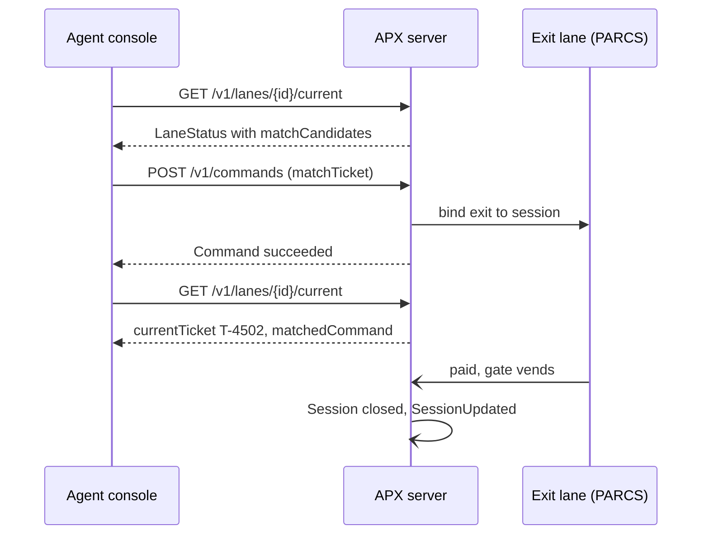

**Data exchanged.**

| Object | Defined in | Notes |
|---|---|---|
| LaneStatus | APX Part 6 §6.2 | Screen-pop, with `currentTicket` or `matchCandidates` |
| MatchCandidate | APX Part 6 §6.7 | Advisory candidate; `matchedBy` is `plateRead` or `account` |
| Command | APX Part 6 §6.1 | `matchTicket`, with `agent` required |
| Session, Segment, ObservationElement | APDS 4.1 | The open stay, its exit segment, the plate read |
| Account (RightHolder) | APX Part 13 §13.1; proposed to APDS as an extension of RightHolder | Evidence for the account match |
| Problem | APX Part 12 | The 422 and 400 refusals |

**Postconditions / outcome.**

Each open ticket is closed at the right fare, and each record names the
agent and the path taken. There is no separate APX matching store to
reconcile later: the match is the session's exit, and `matchedCommand` on
the screen-pop says who made it. APX does not say how confident a match must
be or who must approve it; it does require the name of whoever made it.

**Example.**

Step 1, the candidate on the screen-pop (trimmed):

```json
{
  "lane": { "id": "b2000000-0000-4000-8000-000000000002", "className": "VehicularAccess" },
  "matchCandidates": [
    {
      "session": { "id": "c4000000-0000-4000-8000-000000000051", "className": "Session" },
      "ticketNumber": "T-4502",
      "entryTime": "2026-09-24T08:02:17Z",
      "plate": "KLM4410",
      "matchedBy": "plateRead",
      "evidence": { "id": "f2000000-0000-4000-8000-000000000911", "className": "Observation" },
      "confidence": 0.94,
      "amountDueIfMatched": { "currencyType": "USD", "currencyValue": 14.0 }
    }
  ]
}
```

**APX references.**

Part 6 §6.1, §6.2, §6.7; Part 17 §17.1, §17.4. Scenario
`docs/scenarios/25-ticket-matching-exit-lane.md`; compare Scenario 04
(lost ticket).

#### D.2.10 EV charging billed on the parking session

**Summary.**

A garage's chargers free-vend: anyone who plugs in can charge, and the
energy is attributed to the parking stay by an overhead bay camera that
reads the plate. The camera also sees a non-EV parked in front of a
charger. A driver charges, the charge completes, the idle period begins
after a grace period, and the cable will not release until an agent sends an
unlock command. Energy and idle time are two lines on the parking session,
paid once at exit. This is the optional conformance class `apx-charging`
(Part 23).

**Parties.**

| Party | Role |
|---|---|
| Charging-network bridge | Reports sessions and meter events; scope `apx.charging:manage` |
| Overhead camera analytics | Reports bay presence; scope `apx.charging:manage` |
| Driver's PWA | Reads the charge status; scope `apx.charging:status`, bound to this session |
| Agent console | Sends the unlock; scopes `apx.control:execute`, `apx.charging:read` |
| Lakeside Garage APX server | Distributing Party; fuses charger and bay data, prices idle |

**Preconditions.**

- The chargers are APDS ElectricChargingEquipment, each linked to a Space.
- The driver's car entered and has an open APDS Session.
- The idle policy (grace, rate, maximum) is known to the bridge.

**Flow.**

1. `GET /v1/charging/points?place=…` returns ChargingPointStatus for each
   charger. The camera reported, with `POST /v1/charging/points/{id}/bay`
   (idempotent), a vehicle in front of E2 that is not plugged in and not
   EV-capable. The server combines this with the charger's own status:
   `presence: vehicleNotPluggedIn`, point `availability: blocked`
   (§23.3). An `iceInEvSpace` alert (Part 7) is open.
2. The bridge calls `POST /v1/charging/sessions` with the charger,
   connector, space, `parkingSession`, `authorization.method:
   unlimitedAccess`, `idlePolicy` and `settlement.mode: parkingSession`. The
   ChargingSession is `authorized`.
3. The bridge reports each charger transaction event with
   `POST /v1/charging/sessions/{id}/events` (ChargingEvent): `pluggedIn`,
   `chargingStarted`, then `meterValue` every few minutes.
4. The driver's PWA calls `GET /v1/charging/sessions/{id}` and gets a
   minimized read with no plate, credential or network identifiers
   (§23.6).
5. `chargingEnded` (`stopReason: evFull`) makes the session `complete`.
   When the 10-minute grace has passed, the server (not the bridge) moves
   it to `idle` and publishes `apx.charging.idle.started.v1`.
6. The cable is latched. The agent calls `POST /v1/commands` with
   `commandType: unlockConnector`. The Command `succeeded` with
   `confirmationLevel: deviceAcknowledged`: the charger said it unlocked
   (Part 6 §6.1).
7. `unplugged` makes the session `unplugged`, with energy and idle cost
   posted to the APDS Session. When that session is paid, the charging
   session becomes `closed`. `POST /v1/charging/sessions/{id}/payment` is
   not called, because the settlement mode is `parkingSession`.

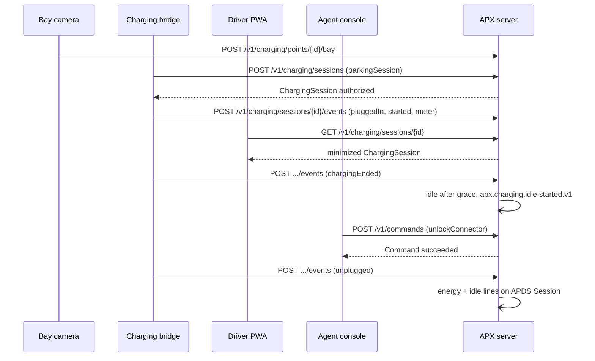

**Data exchanged.**

| Object | Defined in | Notes |
|---|---|---|
| ElectricChargingEquipment, Space, Session | APDS 4.1 | The charger, its bay, the parking stay |
| ChargingPointStatus, ChargingBayPresence | APX Part 23 §23.1, §23.3; proposed to APDS (EnergyInfrastructure) | Live status, fused with what the camera sees |
| ChargingSession | APX Part 23 §23.2, §23.5; proposed to APDS (EnergyInfrastructure: ChargingSession, ChargingCost, ChargingIdleTerms) | The charge, its timeline, energy, idle and cost |
| ChargingEvent | APX Part 23 §23.4 | One charger transaction event |
| Command | APX Part 6 §6.1, §6.8 | `unlockConnector` |
| Alert | APX Part 7; proposed to APDS (Operations) | `iceInEvSpace` |
| EventEnvelope | APX Part 8 §8.2 | Carries `apx.charging.idle.started.v1` |

**Postconditions / outcome.**

24.6 kWh and 13 idle minutes appear as two lines on the APDS Session, next to
the parking. The driver pays $13.81 plus parking at the exit pay station. On
a network-billed charger (`settlement.mode: chargingNetwork`) the garage
would hold the same energy and idle record with no money on it. E2 is still
`blocked` for the enforcement officer.

**Example.**

Step 7, the idle policy and cost on the final session (trimmed):

```json
{
  "id": "e2000000-0000-4000-8000-000000000042",
  "version": 18,
  "parkingSession": { "id": "f1000000-0000-4000-8000-000000000777", "className": "Session" },
  "chargingStatus": "unplugged",
  "energy": { "meterStartWh": 1418320, "meterStopWh": 1442920, "deliveredKwh": 24.6 },
  "stopReason": "evFull",
  "idlePolicy": { "graceMinutes": 10, "idleRate": { "currencyType": "USD", "currencyValue": 0.40 }, "idleRatePer": "minute", "maxIdleMinutes": 60, "appliesToSettlement": true },
  "cost": {
    "energy": { "currencyType": "USD", "currencyValue": 8.61 },
    "idle": { "currencyType": "USD", "currencyValue": 5.20 },
    "total": { "currencyType": "USD", "currencyValue": 13.81 },
    "tariffReference": "lsg-l2-std-2026"
  },
  "settlement": { "mode": "parkingSession" }
}
```

**APX references.**

Part 23 §23.1–23.6, §23.9, §23.12; Part 6 §6.8. Registries
`apx-command-types`, `apx-alert-types`. Scenario
`docs/scenarios/26-ev-charging-one-bill-idle-unlock.md`.

#### D.2.11 Reversible lane and a late correction

**Summary.**

A garage has a centre lane that runs inbound in the morning and outbound in
the evening, with one camera facing each way. Another lane still has a
camera that reads front plates. APX does not care which setup a lane has; it
needs each camera's facing written down. A van comes in on the centre lane.
One of its two reads is first reported as `unknown` and then corrected, and
the correction reaches billing as an event.

**Parties.**

| Party | Role |
|---|---|
| Site LPR system | Distributing Party for reads and lane configuration; scope `apx.data:write` |
| Billing platform | Receiving Party; Part 8 subscription to the observation topics, scope `apx.lpr:read` |
| Harbor Street APX server | Stores reads and publishes events |

**Preconditions.**

- The centre lane is a VehicularAccess with `accessType: reversible` and
  two cameras (`inward`, `outward`) in `apds-ext:apx:lane-cameras@1.0`.
- Facing is relative to the garage, so it does not change when the lane
  flips.

**Flow.**

1. At 08:05 both centre cameras read the van. The inward camera reports the
   rear plate moving away, and the LPR system marks it `accessEvent: entry`.
   The outward camera read the front plate in one frame only, too few to
   determine `movement`, so that read is ingested with
   `accessEvent: unknown`. The server publishes
   `apx.data.observation.created.v1` for each read, and the billing platform
   opens a session from the entry read.
2. The LPR system pairs the two reads by `captureGroup` and corrects the
   unknown one with `PUT /v1/lpr/reads/{observation}/access-event`, sending
   `If-Match: "1"` and `{ "accessEvent": "entry" }`. The server answers with
   the new Observation version.
3. The server publishes `apx.data.observation.updated.v1` with the whole
   Observation at version 2. The billing platform keys on the Observation
   id, keeps version 2, and attaches the read to the session it already
   opened.
4. At 17:40 the lane runs outbound. The van leaves; both reads are
   `accessEvent: exit` in one `captureGroup`, and the session closes at the
   capture time. `GET /v1/lpr/reads?session=…` returns all four reads.

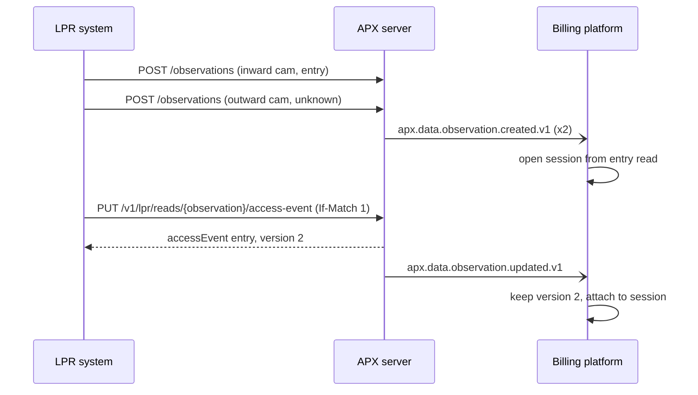

**Data exchanged.**

| Object | Defined in | Notes |
|---|---|---|
| VehicularAccess | APDS 4.1; extension proposed to APDS (Place: LaneCamera) | `accessType: reversible` |
| LaneCameras | APX Part 13 §13.3a(5) | One camera each way |
| ObservationElement | APDS 4.1 | The native read |
| LprReadDetail | APX Part 13 §13.3a; proposed to APDS (Observation) | `movement`, `accessEvent`, `captureGroup` |
| EventEnvelope | APX Part 8 §8.2 | Created and updated events |
| Session | APDS 4.1 | The visit the billing platform keeps |

**Postconditions / outcome.**

One visit, four reads, one session. How the LPR system paired the reads (by
group, by lane mode, or by preferring the rear plate) is its own logic; APX
carries only the result (Part 13 §13.3a(4)). Had the rear-plate read been
missed, the correction event would have opened the session at 08:05:31, the
capture time, not 08:05:33 when the correction arrived.

**Example.**

Step 2, the correction and the server's answer:

```http
PUT /v1/lpr/reads/f2000000-0000-4000-8000-000000000805/access-event HTTP/1.1
Content-Type: application/json
If-Match: "1"

{ "accessEvent": "entry" }
```

```json
{
  "observation": { "id": "f2000000-0000-4000-8000-000000000805", "className": "Observation" },
  "accessEvent": "entry",
  "version": 2
}
```

**APX references.**

Part 13 §13.3a(3)–(5), §13.4; Part 8. Scenario
`docs/scenarios/27-lpr-reversible-lane.md`.

#### D.2.12 A separate pairing service writes session detail

**Summary.**

The LPR cameras feed the APX server, but a separate pairing service turns
reads into stays. It decides which reads make up a visit, which permit
covers it, and why each stay ended, and writes those decisions back. APDS
gives it the Session to write. APX adds the decoration
`apds-ext:apx:session-detail@1.0` for what the Session has no member for.

**Parties.**

| Party | Role |
|---|---|
| Pairing service | Distributing Party for Sessions; scopes `apx.data:write`, `apx.lpr:read` |
| Lakeside APX server | Stores Sessions and reads; claims `apx-lpr` |

**Preconditions.**

- The garage is place `b1…0001`; its valet section is the area `b1…0021`
  beneath it.
- Reads are on the server as Observations.

**Flow.**

1. A permit holder's plate is read as `SYN-4O71`; the permit says
   `SYN-4071`. Folding the look-alike O and 0 makes them equal. The service
   calls `POST /sessions` (native APDS) with the decoration: `reads[]` (one
   `entry` marked `representative`, one `duplicate`), `lifecycle: open`, and
   a `matches[]` entry with `plate.method: fold` and vehicle evidence level
   `good`. The server publishes `SessionCreated`; the decoration adds no
   topic (§5.8 rule 7). `GET /v1/lpr/reads?session=…` now returns both
   reads.
2. The car goes into the valet section. The service opens an area Session
   with `parent` naming the visit. The parent's element is an ancestor of
   the child's, as §5.8 rule 6 requires.
3. At handback the service closes the area Session with
   `PUT /sessions/{id}`, `APX-Update-Mode: change` and `If-Match`, setting
   `lifecycle: ended` and `closure.endReason: valetHandback`. The exit read
   then closes the visit with `endReason: exitRead`.
4. A car is seen only leaving. APDS requires `actualStart`, so the service
   sets it equal to `actualEnd` and writes `closure.endReason: exitOnly`,
   `startObserved: false`. Dwell and occupancy reports skip it (§5.8
   rule 4).
5. An older build tries to bind a read that is already bound to another
   visit, without naming that visit in `supersedes`. The server refuses with
   409 `read-already-bound` and changes nothing (§5.8 rule 2). The client
   sent `Accept: application/problem+json`, so the refusal is a Problem
   (Part 5 §5.1a).

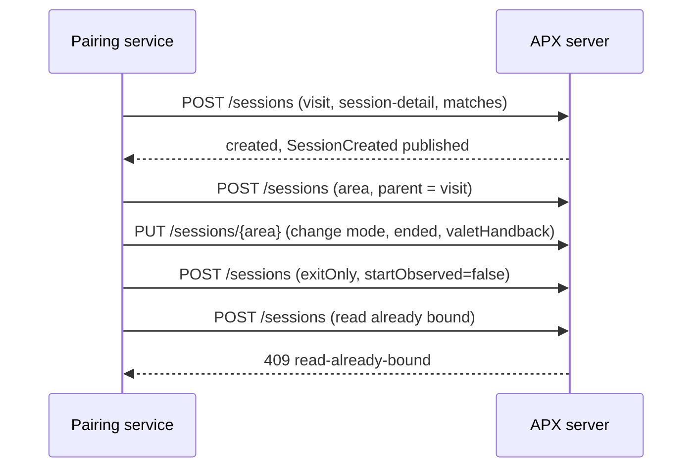

**Data exchanged.**

| Object | Defined in | Notes |
|---|---|---|
| Session, Segment, AssignedRight | APDS 4.1 | The visit, its segment, the covering permit |
| SessionDetail | APX Part 5 §5.8; proposed to APDS (Session extension, SessionRead, SessionClosure) | Decoration `apds-ext:apx:session-detail@1.0` |
| MatchEvidence | APX Part 5 §5.8; proposed to APDS (Session) | How plates compared and how strong the vehicle evidence was; holds no plate characters |
| ObservationElement | APDS 4.1 | The reads bound to the visit |
| Problem | APX Part 12 | The 409 refusal |

**Postconditions / outcome.**

Four Sessions are on file, each with its reads, its end reason and, where it
applies, its parent. A dashboard that counts visits counts Sessions without a
`parent`. A read is never in two visits: to move one deliberately, the
service names the current Session in `supersedes`, and the same write takes
the read over.

**Example.**

Step 4, the decoration on the exit-only Session:

```json
"apds-ext:apx:session-detail@1.0": {
  "reads": [
    { "observation": { "id": "f3000000-0000-4000-8000-000000000150", "className": "ObservationElement" }, "role": "exit", "representative": true }
  ],
  "lifecycle": "ended",
  "closure": { "endReason": "exitOnly", "startObserved": false }
}
```

**APX references.**

Part 5 §5.1, §5.1a, §5.8; Part 13 §13.3a(6); Part 9 §9.6. Registry
`apx-session-end-reasons`. Scenario
`docs/scenarios/28-session-detail-pairing-client.md`.

#### D.2.13 Plate review before enforcement

**Summary.**

A city's rules say no notice may be mailed on a camera read below 0.8
confidence unless a person has checked it. A rear camera reads a plate at
0.52, and the LPR system marks the read for review. The enforcement pipeline
records an overstay overnight, but the server will not let it issue on an
unchecked read. In the morning a reviewer corrects the plate. The pipeline
re-runs its rule on the corrected plate and dismisses the overstay. A read
of a bike-rack reflector is rejected.

**Parties.**

| Party | Role |
|---|---|
| Site LPR system | Distributing Party for reads; scope `apx.data:write` (native ingest) |
| Operator review desk | Sees reads with `apx.lpr:read`; records decisions with `apx.data:write` |
| Enforcement pipeline | Scope `apx.violations:manage` |
| Glenwood Street APX server | Stores reads and violations; blocks issuance on unreviewed evidence |

**Preconditions.**

- The operator's policy sends low-confidence reads to review. Which reads
  go to review, and who works the queue, is the operator's business; APX
  carries only the state (Part 13 §13.3a(4a)).
- The lot's policy allows unreviewed issuance for automated detections.

**Flow.**

1. At 22:14 the LPR system calls `POST /observations` with the decoration
   `apds-ext:apx:lpr-read@1.0`. It carries `review.state: pending` with
   reasons `lowConfidence` and `ambiguousCharacters` from the
   `apx-read-review-reasons` registry, and the engine's second choice in
   `alternateReads`.
2. At 06:00 the pipeline finds no paid session for the plate and records an
   automated overstay with `POST /v1/violations`, citing the read in
   `observations[]`. Its `POST /v1/violations/{id}/issue` is refused with
   409 `violation-not-issuable`, because the evidence read is still
   `pending`, whatever the lot's policy says (Part 19 §19.4 rule 6;
   APX-VIO-16).
3. The review desk finds the read with `GET /v1/lpr/reads?observation=…`,
   looks at the image, and calls `PUT /v1/lpr/reads/{observation}/plate`
   with `If-Match: "1"`, `decision: corrected`, the corrected plate, a
   reason and the reviewer. The server writes the plate into
   `observedCredentialId` and `vehicleAncillaryIdentification`, so a plain
   APDS client sees it. It sets `review.state`, `decidedTime` and
   `decidedBy`, keeps the engine's values in `review.original`, increments
   the Observation version, and publishes
   `apx.data.observation.updated.v1`.
4. The pipeline receives the event, keeps version 2, and re-runs its rule.
   The corrected plate was paid until 23:00, so the pipeline calls
   `POST /v1/violations/{id}/review` with `decision: dismiss` and
   `reason: plateMisread`.
5. The reviewer rejects the reflector read with `decision: rejected`. A
   `plate` sent with `rejected` would get 422 `request-unprocessable`.

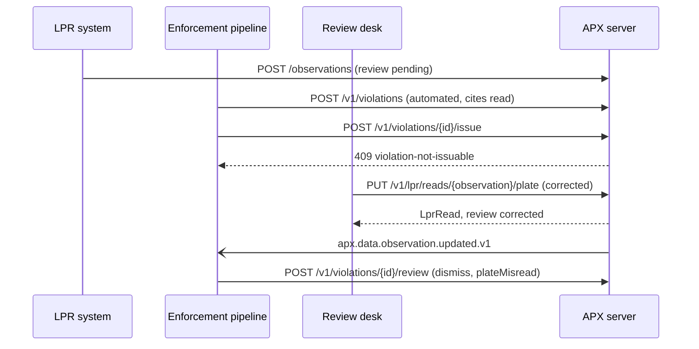

**Data exchanged.**

| Object | Defined in | Notes |
|---|---|---|
| ObservationElement, VehicleAncillaryIdentification | APDS 4.1 | The read; the corrected plate is written here |
| LprReadDetail | APX Part 13 §13.3a(4a); proposed to APDS (Observation: ReadReview, ReadReviewStateEnum, ReadReviewReasonEnum) | `review` with state, reasons and the original values |
| LprRead | APX Part 13 §13.3 | Returned to the review desk |
| Violation | APX Part 19 §19.1; proposed to APDS (Enforcement) | The overstay, later dismissed |
| EventEnvelope | APX Part 8 §8.2 | `apx.data.observation.updated.v1` |
| Problem | APX Part 12 | The 409 and 422 refusals |

**Postconditions / outcome.**

Nothing was sent on a read nobody checked. The correction is per read: it
changes no Session, and every Session the read feeds sees it. Sending the
same decision again returns 200 at version 2 and publishes nothing. A
second reviewer who decided first would cause 409 `version-conflict`. The
rejected read stays on file until its retention ends (§13.3b), but it can
never support pairing or a notice.

**Example.**

Step 3, the review block after the correction (trimmed):

```json
"review": {
  "state": "corrected",
  "reasons": ["lowConfidence", "ambiguousCharacters"],
  "decidedTime": "2026-12-17T08:20:41Z",
  "decidedBy": "glenwood-desk-04",
  "original": {
    "plate": { "value": "GLN-8B03", "confidence": 0.52 },
    "stateProvince": { "value": "OR", "confidence": 0.9 }
  }
}
```

**APX references.**

Part 13 §13.3a(4a), §13.3b, §13.4; Part 19 §19.4 rule 6; Annex A
APX-LPR-08, APX-VIO-16. Scenario `docs/scenarios/29-lpr-plate-review.md`.

#### D.2.14 A citation imported from another enforcement system

**Summary.**

Officers write citations on a separate citation platform. The operator's
APX server holds the sessions, rights and reports, and needs those
citations as Violations, with the platform's times and status, without
claiming it issued them. A citation is imported, a part payment arrives as a
newer revision, and the nightly reconciliation links the citation to the
stay the car was in.

**Parties.**

| Party | Role |
|---|---|
| Citation platform connector | Distributing Party for citations; scope `apx.violations:manage` |
| Reconciliation job | Links the stay; scope `apx.violations:manage` |
| Reporting | Receiving Party; scope `apx.violations:read` |
| Lakeside Garage APX server | Stores the imported violation |

**Preconditions.**

- Lot C is a Place on the server, and the car's stay is an APDS Session.
- The connector identifies each citation by `system` and `recordId` and
  numbers its revisions.

**Flow.**

1. The connector calls `POST /v1/enforcement/violation-imports` with
   `Idempotency-Key: example-enforcement:EX-2026-018342:1` and the citation
   as the platform recorded it, in state `issued`, with the decoration
   `apds-ext:apx:violation-source@1.0`. The server records it (201) with
   the officer's issue time. It runs no eligibility check and applies no
   policy cap: the platform issued it under its own authority (§19.13
   rule 4). It publishes `apx.violations.detected.v1` and
   `apx.violations.issued.v1`.
2. The driver pays $15 on the platform. The connector sends revision 3
   with `sourceStatus: partiallyPaid`, `amountPaid` and a `payments[]`
   entry carrying the platform's `reference`. Revision 3 is newer, so it
   applies in place (200, version 2) and `apx.violations.status.v1` is
   published. The violation stays `issued`: `paid` requires `amountPaid` to
   reach `amount` (§19.6a rule 2). Resending revision 3 is a no-op; sending
   revision 1 now is 409 `version-conflict`.
3. The reconciliation job calls `POST /v1/violations/{id}/session` with
   `If-Match: "2"`, the Session, `reason: lateMatch` and the match
   `evidence`. The server writes the evidence onto the violation as
   `apds-ext:apx:match-evidence@1.0` and bumps the version to 3. This is
   not a lifecycle transition, so nothing is added to `statusHistory[]`
   (§19.13 rule 6). A Session outside Lot C's hierarchy would be 422
   `request-unprocessable`.
4. Reporting finds the record by the platform's key:
   `GET /v1/violations?sourceSystem=example-enforcement&sourceRecordId=EX-2026-018342`.

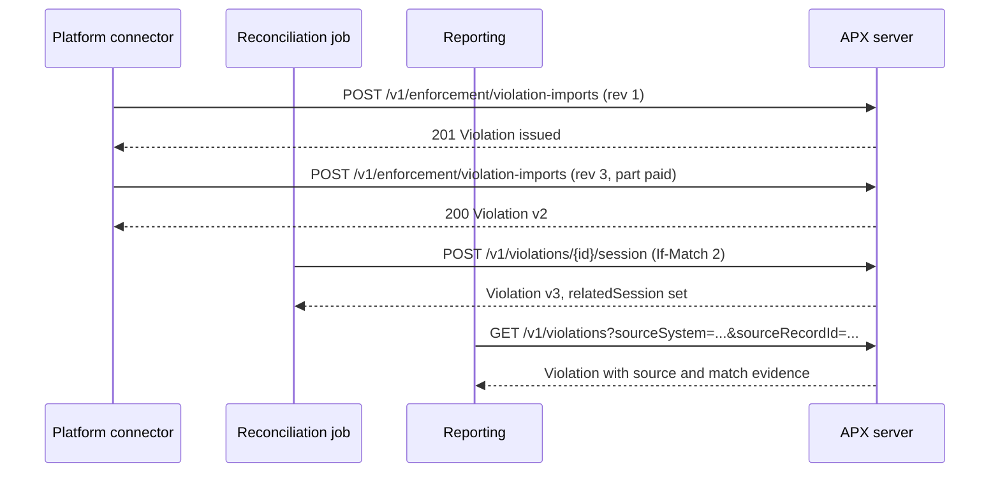

**Data exchanged.**

| Object | Defined in | Notes |
|---|---|---|
| Violation | APX Part 19 §19.1, §19.6a, §19.13; proposed to APDS (Enforcement) | The imported citation with `amountPaid`, `payments[]` and `relatedSession` |
| ViolationSource | APX Part 19 §19.13 | Decoration `apds-ext:apx:violation-source@1.0`; APX only |
| MatchEvidence | APX Part 5 §5.8; proposed to APDS (Session) | Decoration `apds-ext:apx:match-evidence@1.0` |
| Session, AmountInCurrency | APDS 4.1 | The stay and the amounts |
| Problem | APX Part 12 | The 409 and 422 refusals |

**Postconditions / outcome.**

One record per citation, keyed on `system` and `recordId` (APX-VIO-14). The
times are the officer's. `sourceStatus` keeps the platform's own word, and
`violationStatus` carries the APX state it maps to. Part payments are
visible (APX-VIO-13). The stay is linked when it is known, with the evidence
for the match beside it (APX-VIO-15).

**Example.**

Step 2, the source decoration as stored (trimmed):

```json
"apds-ext:apx:violation-source@1.0": {
  "system": "example-enforcement",
  "recordId": "EX-2026-018342",
  "sourceStatus": "partiallyPaid",
  "sourceRevision": 3,
  "sourceUpdatedTime": "2026-10-04T09:12:00Z",
  "receivedTime": "2026-10-04T09:15:02Z",
  "officer": "0417"
}
```

**APX references.**

Part 19 §19.3, §19.4 rule 5, §19.6a, §19.10, §19.13; Annex A APX-VIO-13 to
APX-VIO-15. Scenario `docs/scenarios/30-violation-imported-citation.md`.

#### D.2.15 Catching up by cursor after three days offline

**Summary.**

An enforcement back office keeps its own copy of a garage's violations and
payments. The site link drops on Friday night and stays down until Monday.
Webhook retries for Friday's events stopped 24 hours later (Part 8 §8.3), so
push alone cannot fill the gap. The back office catches up from the cursor
it holds, using the change feed on the APX list routes.

**Parties.**

| Party | Role |
|---|---|
| Enforcement back office | Receiving Party; scopes `apx.violations:read`, `apx.accounts:read`, grant on Lakeside Garage |
| Lakeside Garage APX server | Distributing Party; claims `apx-violations`, `apx-accounts`, `apx-payment-history` |

**Preconditions.**

- The back office holds the cursor from its last change page on Friday.
- Cursors are kept for 7 days (Part 5 §5.2 rule 2).

**Flow.**

1. On first sync, the back office calls
   `GET /v1/violations?mode=change&place=…` with no cursor. The page has no
   items and holds the feed's current head cursor (§5.2 rule 8.3). It then
   lists everything with `mode=full`, and only then follows the cursor. A
   violation that changes in between appears in both; the office keeps the
   higher `version` (rule 8.2).
2. On Monday it calls the same route with its Friday cursor. The page has
   `updateMode: change`, `data[]` (each item the whole violation as it now
   stands), `deleted[]` (tombstones with `className: Violation`), `cursor`
   and `next`. It follows `next` until it is null.
3. A narrower feed with `status=issued` and its own cursor still includes a
   violation that was `issued` before Saturday's payment and `paid` after
   it: a change belongs to a filtered feed if the resource matched the
   filter before or after the change (rule 8.4). The collections queue drops
   it.
4. The office reconciles money with `GET /v1/payments?mode=change&place=…&cursor=…`.
   With `mode=change` the route needs no lookup key and has no 8-hour
   window (rule 8.6, APX-PHX-02). A card-fragment search with
   `mode=change` is refused with 400 `invalid-request`.
5. A server restored from an old backup presents a cursor older than the
   retention window and gets 404 `target-not-found`. It starts again from
   step 1.

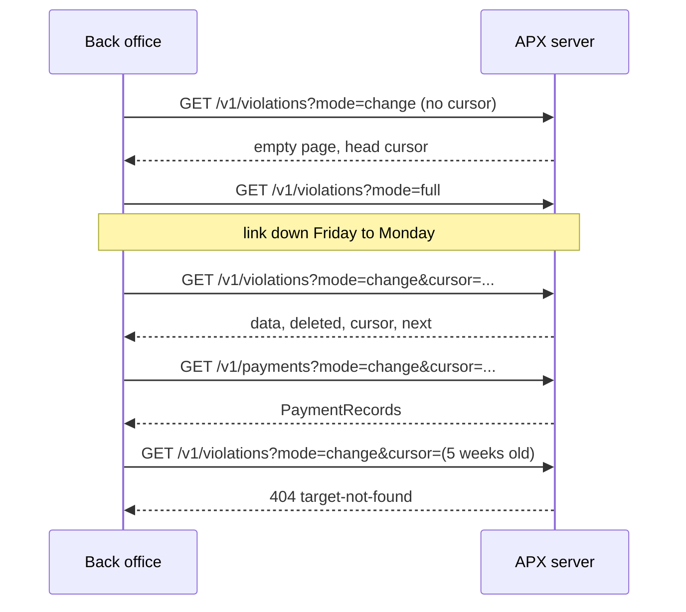

**Data exchanged.**

| Object | Defined in | Notes |
|---|---|---|
| Violation | APX Part 19 §19.1; proposed to APDS (Enforcement) | Whole resource in each change item |
| PaymentRecord | APX Part 13 §13.1a, §13.2; proposed to APDS as an extension of Payment | The payment feed |
| ChangeFeedUpdateMode, ChangeFeedCursor, ChangeFeedTombstones, ChangeFeedNext | APX Part 5 §5.2 | Members of a change page |
| DeletedReference | APDS 4.1 | Tombstone entries |
| Problem | APX Part 12 | The 400 and 404 refusals |

**Postconditions / outcome.**

The back office has every change since Friday, including a payment it never
saw as an event and a violation purged under the retention schedule (Part 9
§9.6; rule 8.5). Nothing is missed and nothing is counted twice. A cursor
refusal is always a Problem, because the cursor is an APX parameter
(§5.1a).

**Example.**

Step 2, the change page (one item kept):

```json
{
  "updateMode": "change",
  "data": [
    {
      "id": "d3000000-0000-4000-8000-000000000027",
      "version": 6,
      "violationType": "noValidRight",
      "violationStatus": "paid",
      "payment": { "id": "9c0d1e2f-3a4b-4c5d-8e6f-7a8b9c0d1e51", "className": "PaymentRecord" }
    }
  ],
  "deleted": [
    { "id": "d3000000-0000-4000-8000-000000000003", "className": "Violation", "deleteTimestamp": "2026-10-11T03:00:00Z" }
  ],
  "cursor": "v:7f3a:001377",
  "next": "/v1/violations?mode=change&place=b1000000-0000-4000-8000-000000000004&cursor=v%3A7f3a%3A001377"
}
```

**APX references.**

Part 5 §5.1a, §5.2; Part 8 §8.3; Part 13 §13.2, §13.4; Annex A APX-CORE-18,
APX-PHX-02. Scenario `docs/scenarios/31-change-feed-after-link-loss.md`.

#### D.2.16 Itemized payment and the revenue report

**Summary.**

An online booking channel sells an evening flat rate and adds a convenience
fee. The operator's revenue report must split parking revenue from fees,
group sales by rate, and check each sale against the published rate deck.
The channel sends each payment with its lines and the rate it sold. A
payment whose lines do not add up is refused, a fee refund leaves the lines
as they were, and a validated stay shows the validation as its own line.

**Parties.**

| Party | Role |
|---|---|
| Online booking channel | Distributing Party for payments; scope `apx.payments:write` |
| Revenue platform | Receiving Party; scope `apx.accounts:read`, plus a Part 8 subscription to `apx.accounts.payment.recorded.v1` |
| Lakeside APX server | Stores PaymentRecords and persists native APDS Payments (APX-ACC-07) |

**Preconditions.**

- The rate deck is published as APDS RateTables.
- Line codes come from the `apx-payment-line-codes` registry.

**Flow.**

1. The channel calls `POST /v1/payments` with an `Idempotency-Key`, the
   total in `amount` ($12.75), and the decoration
   `apds-ext:apx:payment-detail@1.0`. The decoration holds `rateSold`
   (named as the seller names it, with the `rateTable` it was priced from)
   and `lines[]`: APDS PaymentLines with `idCode` `base` ($12.00) and
   `convenienceFee` ($0.75). The `payment` lines add up to `amount`, so the
   server returns the PaymentRecord with the decoration unchanged. The same
   record is published on `apx.accounts.payment.recorded.v1` and returned by
   `GET /v1/payments`. The server also materializes it as a native APDS
   Payment whose `paymentLines` are these lines (§13.6).
2. A second booking has lines that add up to $13.25 against an amount of
   $12.75. The server refuses it with 422 `request-unprocessable` before
   the payment layer is called. Nothing is charged and no PaymentRecord is
   created (§13.6a(3)).
3. Customer service refunds the fee with `POST /v1/payments/{id}/refund`
   for $0.75. The record stays `approved` with `refundedAmount`, and the
   lines still describe the sale as it was made (§13.6a(5)). The recorded
   event is published again with this state.
4. A validated stay at the pay station: `amount` $3.00, a `base` line of
   $3.00 (`paymentType: payment`) and a `validation` line of $15.00
   (`paymentType: validation`, outside the sum). On the native Payment the
   validation line carries the validation's identifier in `identifierId`,
   and the decoration carries `rateSold` only, never `lines` (§13.6a(4)).
5. The revenue platform builds its report by rate sold, with parking,
   fees, validated, collected and refunded columns.

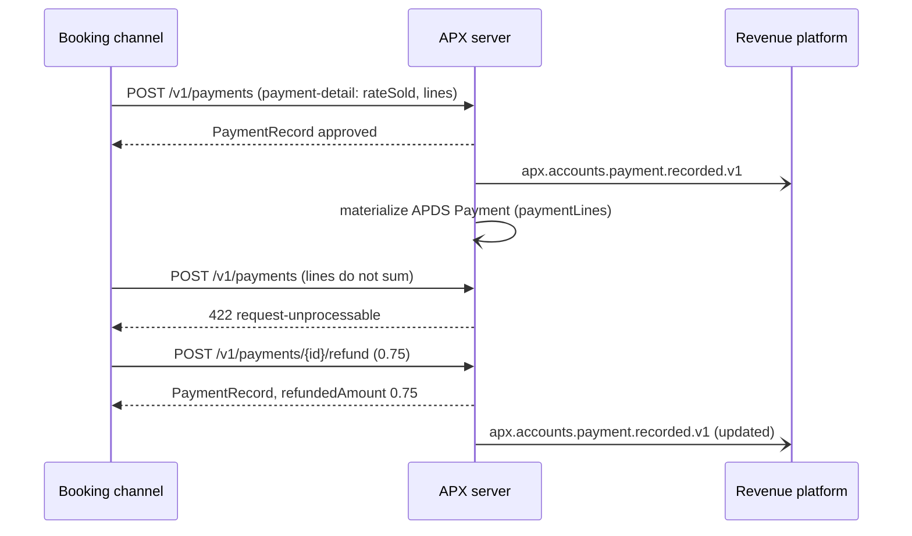

**Data exchanged.**

| Object | Defined in | Notes |
|---|---|---|
| PaymentRecord | APX Part 13 §13.1a; proposed to APDS as an extension of Payment | The payment as the channel and revenue platform see it |
| PaymentDetail | APX Part 13 §13.6a; proposed to APDS (Right: RateSold; PaymentTypeEnum extension) | Decoration `apds-ext:apx:payment-detail@1.0` |
| Payment, PaymentLine | APDS 4.1 | The native record and its lines |
| RateTable, VersionedReference, AmountInCurrency | APDS 4.1 | The table the sale was priced from |
| Problem | APX Part 12 | The 422 refusal |

**Postconditions / outcome.**

The report splits each sale into parking, fees and validation, and checks
the $12.00 against version 4 of the named rate table. A payment without the
decoration still counts as collected, and its split is shown as unknown, not
as a zero fee: an absent line is never read as a zero-value line
(§13.6a(6)). A plain APDS consumer sees $3.00 collected and $15.00
validated, and ignores the extension.

**Example.**

Step 1, the decoration on the payment:

```json
"apds-ext:apx:payment-detail@1.0": {
  "rateSold": {
    "id": "evening-flat",
    "name": "Evening Flat Rate",
    "rateTable": { "id": "c1000000-0000-4000-8000-000000000031", "version": 4, "className": "RateTable" },
    "product": "standard",
    "class": "standard"
  },
  "lines": [
    { "id": "e1000000-0000-4000-8000-000000000101", "version": 1, "paymentType": "payment", "idCode": "base",
      "value": { "currencyType": "USD", "currencyValue": 12.00 } },
    { "id": "e1000000-0000-4000-8000-000000000102", "version": 1, "paymentType": "payment", "idCode": "convenienceFee",
      "value": { "currencyType": "USD", "currencyValue": 0.75 } }
  ]
}
```

**APX references.**

Part 13 §13.1a, §13.4, §13.6, §13.6a; Part 11 (registry
`apx-payment-line-codes`); Annex A APX-ACC-07, APX-ACC-09. Scenario
`docs/scenarios/32-payment-detail-revenue.md`.

#### D.2.17 A help call answered in the vendor's own screen, with loopback

**Summary.**

A parker at the exit lane of a garage presses the intercom. The call
centre's console resolves the lane and sees that the parking vendor
offers no API operation for a lost-ticket fee at this site, but does
offer its lane console as a surface. The agent opens the vendor's screen
without logging in, issues the lost-ticket fee there, and the result
comes back to the call record as an APX command carrying the call's
correlation identifier. Nothing is typed into a note.

**Parties.**

| Party | Role |
|---|---|
| Call-centre console | Host: Receiving Party for the resolution context and the launch; scopes `apx.resolution:read`, `apx.ui:launch`, `apx.ui:read`, `apx.support:manage` |
| Parking vendor's APX server | Implementation: Distributing Party; offers the surface `lane.console`; records the loopback with `apx.ui:record` from its own screen's back end |
| Agent | A person at the console; named on every record the launch produces |

**Preconditions.**

- The vendor's discovery document lists `uiSurfaces[]` with
  `lane.console` for the garage, display modes `popup` and `tab`, launch
  mode `handshake`, and `actions` including `lostTicket`.
- The call platform has mapped the intercom to the comms point of exit
  lane 2 (D.2.20), so the console resolves by `commsPoint`.

**Flow.**

1. The console calls `POST /v1/resolution/contexts` with `commsPoint` and
   a fresh `correlationId`. The context names the lane, the ticket in the
   machine and the allowed actions. `lostTicket` is allowed, with
   `execution: { type: ui, surface: lane.console, subject: <lane> }`,
   because the vendor has no API for the fee at this site (Part 25 §25.5).
2. The console calls `POST /v1/ui/launches` with the surface, the lane
   as subject, the place, the agent, `agentType: human`, the
   `correlationId`, `displayMode: popup` and
   `returnFields: ["/amount", "/ticketNumber"]`. The server returns 201
   `UiLaunch` with `status: issued`, a single-use `url` and `expiresAt`
   sixty seconds away (§25.2).
3. The console opens the URL in a pop-up. The vendor's screen opens on
   exit lane 2 for that agent, already logged in. The launch becomes
   `opened`; `apx.ui.launch.changed.v1` is published.
4. The agent issues the lost-ticket fee on the vendor's screen. The
   vendor's back end, which also runs the APX server, creates the Part 6
   `lostTicket` Command itself, with `agent`, `agentType` and the launch's
   `correlationId` (§25.4 rule 1). The command's events are published as
   for any command.
5. The agent closes the screen. The back end calls
   `POST /v1/ui/launches/{id}/close`; the launch becomes `closed` and the
   topic is published again.
6. The console reads `GET /v1/ui/launches/{id}`: `status: closed`, no
   usable `url`, and `actions[]` empty, because the action was native.
   It follows the `correlationId` through `GET /v1/commands` and finds the
   lost-ticket command with its amount, and records the
   `SupportInteraction` with the command and the launch in `actions[]`
   and `resolution.code: resolved`.
7. A second agent, given the same URL by mistake, is refused by the
   surface: the launch is single use (§25.3).

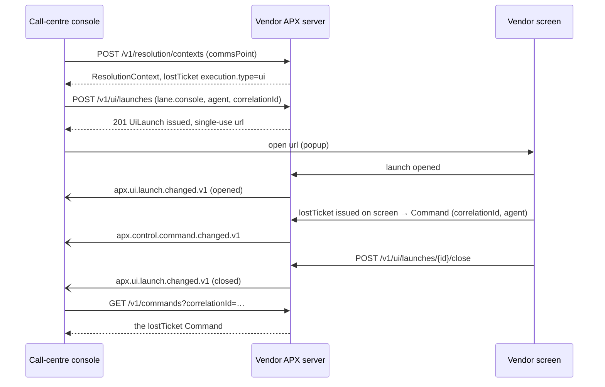

**Data exchanged.**

| Object | Defined in | Notes |
|---|---|---|
| ResolutionContext, AllowedAction | APX Part 17 §17.2, §17.3 | `execution.type: ui` names the surface |
| UiSurface | APX Part 25 §25.1 | In the discovery document |
| UiLaunchRequest, UiLaunch | APX Part 25 §25.2, §25.3 | Single-use URL, sixty seconds |
| Command | APX Part 6 §6.1; proposed to APDS | The native effect of the action on the screen |
| SupportInteraction | APX Part 17 §17.6; proposed to APDS (Tier 3) | Lists the command and the launch |

**Postconditions / outcome.**

The call record and the vendor's record agree: one lost-ticket command,
one agent, one correlation identifier. A report that joins calls to
vendor transactions by `correlationId` finds the fee. Had the vendor's
screen performed something APX has no operation for, the back end would
have posted a `UiActionRecord` instead, with the two return fields
filled or declared unavailable (D.2.18).

**Example.**

Step 2, the launch request:

```json
{
  "surface": "lane.console",
  "subject": { "id": "b1000000-0000-4000-8000-000000000012", "className": "VehicularAccess" },
  "place": { "id": "b1000000-0000-4000-8000-000000000001", "className": "Place" },
  "agent": "agent-417",
  "agentType": "human",
  "correlationId": "0f3d2c1b-7a6e-4d5c-9b8a-1e2f3a4b5c6d",
  "displayMode": "popup",
  "returnFields": ["/amount", "/ticketNumber"]
}
```

**APX references.**

Part 25 §25.1 to §25.5; Part 17 §17.3; Part 6 §6.1; Annex A APX-UIL-01
to APX-UIL-06. Module scenarios `docs/scenarios/by-module/apx-ui-launch/`.

#### D.2.18 A screen action APX has no operation for

**Summary.**

An agent opens a tolling vendor's dispute screen for a transaction and,
on that screen, re-sends a statement to the customer by post. APX has no
operation for posting a statement. The vendor records a `UiActionRecord`
on the launch with the outcome and the fields the host asked for, and
marks the one field it cannot supply as unavailable.

**Parties.**

| Party | Role |
|---|---|
| Operator's back office | Host; scopes `apx.ui:launch`, `apx.ui:read` |
| Tolling vendor's APX server | Implementation; surface `toll.dispute`; its screen's back end holds `apx.ui:record` |

**Preconditions.**

- The vendor lists `toll.dispute` with `launchModes: [signedToken]` and a
  `launchUrl`; the host's signing key is registered with the vendor.

**Flow.**

1. The host signs a launch token (`ES256`) whose claims are the launch
   request members, `iss` the host, `aud` the vendor, `exp` sixty seconds
   after `iat`, a unique `jti`, and `returnFields: ["/statementNumber",
   "/sentAt"]`. It posts the token to the `launchUrl` by HTML form; the
   token never appears in a query string (Part 25 §25.2 rule 2, §25.6).
2. The vendor verifies the signature, refuses nothing (the `jti` is new),
   creates the `UiLaunch` and opens the dispute screen for the agent.
3. The agent re-sends the statement by post. The screen's back end calls
   `POST /v1/ui/launches/{id}/actions` with `action: other`,
   `outcome: completed`, `occurredAt`, `summary: "Statement re-sent by
   post"`, `fields: { "/statementNumber": "ST-88213" }` and
   `unavailable: [{ "field": "/sentAt", "reason": "notSupported" }]`,
   because the postal queue does not report a send time (§25.4 rule 3).
   `apx.ui.action.recorded.v1` is published.
4. The host reads the launch: `actions[]` holds the record. Its report
   shows the statement number and "sent time not supported by vendor",
   never a blank.
5. An hour later, with the screen still open, the launch outlives the
   vendor's session limit and becomes `expired`; a late
   `POST …/actions` is refused with `409 ui-launch-closed` (§25.3).

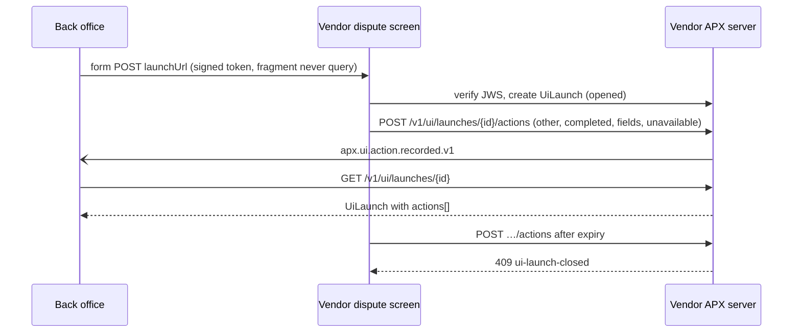

**Data exchanged.**

| Object | Defined in | Notes |
|---|---|---|
| UiLaunchToken | APX Part 25 §25.2 (informative schema) | The JWS claim set |
| UiLaunch, UiActionRecord | APX Part 25 §25.3, §25.4 | The fallback record with `fields` and `unavailable[]` |
| Problem | APX Part 12 | `ui-launch-closed` |

**Postconditions / outcome.**

The host knows exactly what was done and what it cannot know. The
implementation never inferred an action from the screen being opened,
and never silently dropped a requested field.

**APX references.**

Part 25 §25.2 rule 2, §25.3, §25.4 rules 2 and 3, §25.6; Annex A
APX-UIL-03, APX-UIL-05, APX-UIL-07.

#### D.2.19 Reading a location's whole setup from APX alone

**Summary.**

A monitoring service joins a garage. Instead of the vendor's portal, the
call platform's device list and a camera spreadsheet, it reads the
equipment and the comms points of the place from the APX server, with
each item's role, position, make, model, firmware and relations, and
subscribes to the change notices so that its copy stays current.

**Parties.**

| Party | Role |
|---|---|
| Monitoring service | Receiving Party; scopes `apx.siteconfig:read`, `apx.subscriptions:manage` |
| Garage APX server | Distributing Party; class `apx-site-config` |

**Preconditions.**

- Every SupplementalEquipment at the garage carries
  `apds-ext:apx:equipment-detail@1.0`; cameras also carry
  `apds-ext:apx:camera@1.0`; the place carries
  `apds-ext:apx:place-operations@1.0`.

**Flow.**

1. `GET /v1/equipment?place=<garage>` returns every item of hardware in
   the subtree with its decorations: on exit lane 2 a `gate`, an
   `exitVerifier` that `controls` the gate, an `intercom`, an overhead
   `camera` with `view: [equipmentInteraction]` and a pole-mounted camera
   with `view: [plate, vehicle]`, `faces: outward`; a `payOnFoot` station
   in the `paymentArea` on level G with a built-in driver camera; a
   `videoRecorder` and a `videoGateway` in the `equipmentRoom` (Part 26
   §26.1 to §26.3). Each item carries `manufacturer`, `model`,
   `firmwareVersion`, `softwareVersion`, `serialNumber` and
   `macAddresses[]`, and no network address.
2. `GET /v1/equipment?place=<garage>&role=camera&level=P2` answers "every
   camera on P2": one in the `elevatorLobby`, one on the `ramp`, one in
   the `stairwell`.
3. `GET /v1/comms-points?place=<garage>` returns the intercom of each
   lane (`type: intercom`, `equipment`, `serves` the lane's gate,
   `commsDeviceId`, `callerId`), the posted number on the pay-on-foot sign
   (`type: postedNumber`, `phoneNumber`, no lane) and the street door's
   intercom (`serves` the door) (§26.4).
4. The place's `PlaceOperations` gives `commsAccountId` and the
   escalation roles in calling order: `siteManager` by day,
   `operatorOnCall` at night (§26.5).
5. The service subscribes to `apx.equipment.changed.v1` and
   `apx.commspoints.changed.v1`. When the vendor swaps the exit verifier,
   the notice carries the new element with its decoration; the service
   updates its copy. After an outage it reads
   `GET /v1/equipment?place=…&mode=change&cursor=…` to catch up (§26.7).
6. The service holds the vendor's own lane identifier from a work order.
   `POST /v1/identifiers:resolve` with `{ system:
   "https://parcs-vendor.example", id: "LOT-0042-L2" }` returns the
   VehicularAccess reference and its place (§26.6).

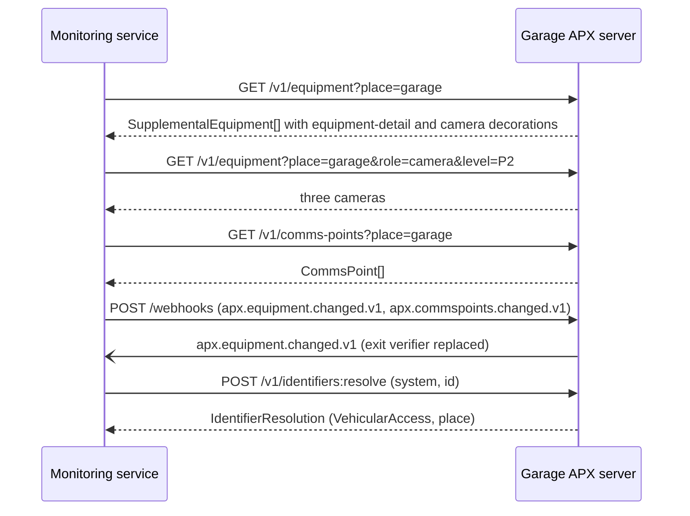

**Data exchanged.**

| Object | Defined in | Notes |
|---|---|---|
| SupplementalEquipment, VehicularAccess, Place | APDS 4.1 | Used as published; decorated, never redefined |
| EquipmentDetail | APX Part 26 §26.1; proposed to APDS (Tier 2) | Role from the fixed `apx-equipment-roles` list |
| CameraDetail | APX Part 26 §26.3; proposed to APDS (Camera, Tier 2) | Mounting, views, facing, recorder, streams |
| CommsPoint | APX Part 26 §26.4; proposed to APDS (Tier 3) | Phone number, caller id, comms device id |
| PlaceOperations | APX Part 26 §26.5 | Call-platform account and escalation roles |
| ExternalIdentifiers, IdentifierResolution | APX Part 26 §26.6 | Typed ids and the lookup |

**Postconditions / outcome.**

The service describes the garage from one source and keeps it current
without re-reading the place. It never received a password or a network
address (Part 9 §9.7, Part 26 §26.1 rule 8).

**Example.**

One item from step 1, the exit verifier:

```json
{
  "id": "b1000000-0000-4000-8000-000000000121",
  "version": 3,
  "className": "SupplementalEquipment",
  "equipmentType": "other",
  "extensions": {
    "apds-ext:apx:equipment-detail@1.0": {
      "role": "exitVerifier",
      "manufacturer": "Example Parking Systems",
      "model": "XV-200",
      "firmwareVersion": "4.12.1",
      "softwareVersion": "2026.3",
      "serialNumber": "XV2-018823",
      "macAddresses": ["3c5ab4120f9e"],
      "installedAt": "2025-03-14",
      "area": "lane",
      "level": "G",
      "lane": { "id": "b1000000-0000-4000-8000-000000000012", "className": "VehicularAccess" },
      "controls": [{ "id": "b1000000-0000-4000-8000-000000000120", "className": "SupplementalEquipment" }]
    }
  }
}
```

**APX references.**

Part 26 §26.1 to §26.7; Part 5 §5.2; Part 9 §9.7; Annex A APX-SCF-01 to
APX-SCF-05, APX-SCF-09 to APX-SCF-11. Module scenarios
`docs/scenarios/by-module/apx-site-config/`.

#### D.2.20 Which lane is calling: caller id, posted number and the street door

**Summary.**

Three help requests reach the same call centre from one garage. An
intercom on exit lane 2 calls out with its own caller id; a parker at the
pay-on-foot station dials the number posted on the sign from a mobile
phone; a permit holder presses the intercom at the street door after
hours. The console resolves each one from APX alone, and for the posted
number learns that the lane cannot be known until the agent asks.

**Parties.**

| Party | Role |
|---|---|
| Call platform | Writes the comms points it runs: scope `apx.siteconfig:manage`; supplies the caller id or dialled number of each call |
| Call-centre console | Resolves with `apx.resolution:read`; opens doors with `apx.control:execute` |
| Garage APX server | Holds equipment, comms points and the resolution contexts |

**Preconditions.**

- The call platform has written the comms points (D.2.19) with
  `callerId` on the lane intercoms, `phoneNumber` on the posted number,
  and `commsDeviceId` on the street-door intercom. No SIP data is held in
  APX (Part 26 §26.4 rule 4).
- The street door is `role: accessDoor` with no lane, its reader
  `controls` it, its intercom is `builtInto` it, and its comms point
  `serves` it (§26.8).

**Flow.**

1. **Lane intercom.** The platform hands the console the call's caller
   id. `POST /v1/resolution/contexts` with `callerId: "+15550101202"`
   resolves the comms point, its `lane` and the ticket in the machine,
   and lists `vendGate` on the lane's gate among the allowed actions
   (§26.4 rule 6; Part 17 §17.1).
2. **Posted number.** The platform hands over the dialled number and
   the parker's own mobile number. The console resolves with
   `dialedNumber: "+15550100900"`. The comms point is the posted number,
   with `place` and no `lane`; the context names the place only. The
   agent asks which machine the parker is at, and resolves again with
   the `device`. The parker's mobile number is never sent to APX; it
   identifies the parker, not the lane.
3. **Street door.** The platform hands over the voice platform's device
   id. The console resolves with `commsDeviceId`. The comms point
   `serves` the door; the context lists `vendGate` with the door as
   target. The permit holder's card had failed at the reader; the agent
   checks the permit in the context, sees the door camera's view through
   `POST /v1/cameras/{id}/views` (`kind: live`), and sends `vendGate` on
   the door. The command is confirmed and the door opens.
4. **Unknown number.** A call from a number the garage does not hold is
   resolved by a server that keeps no comms points for that place: it
   answers `422 comms-point-unknown`, and the console falls back to
   asking the parker where they are.

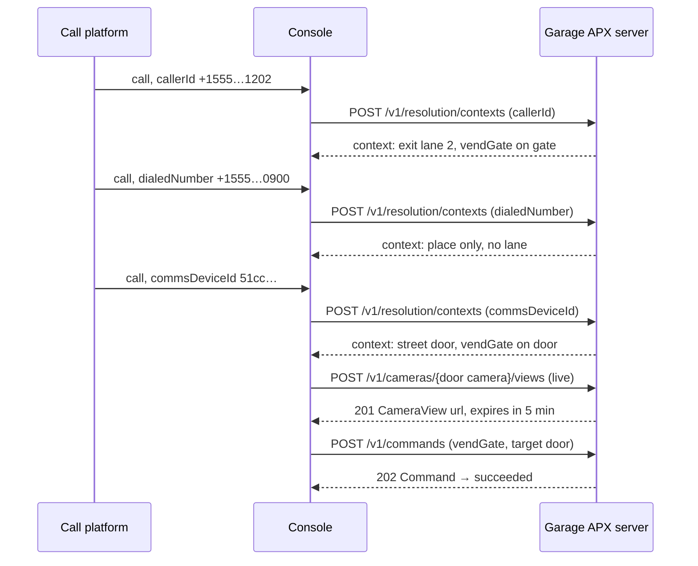

**Data exchanged.**

| Object | Defined in | Notes |
|---|---|---|
| CommsPoint | APX Part 26 §26.4 | Written by the call platform |
| ResolutionResolveRequest, ResolutionContext | APX Part 17 §17.1, §17.2 | `callerId`, `dialedNumber`, `commsDeviceId`, `commsPoint` |
| CameraViewRequest, CameraView | APX Part 26 §26.3 | Live view of the door camera |
| Command | APX Part 6 §6.1 | `vendGate` with the door as target |
| Problem | APX Part 12 | `comms-point-unknown` |

**Postconditions / outcome.**

Each call reached the right lane, place or door without any telephony
concept reaching the parking system beyond a phone number on a comms
point. The posted number resolved only to the place, as the standard
says it must. The door opening is a command on the door, audited like a
lane vend.

**Example.**

Step 3, the resolve request:

```json
{ "commsDeviceId": "51ccae163e847b7ed27811c900a231aa",
  "correlationId": "8e1b0d2a-4c3f-4a6b-9e7d-2f1a0b3c4d5e",
  "channel": "intercom" }
```

**APX references.**

Part 26 §26.4 rule 6, §26.3 rule 2, §26.8; Part 17 §17.1; Part 6 §6.1;
Annex A APX-SCF-06 to APX-SCF-08, APX-RES-01.

#### D.2.21 Asking a remote manager before a courtesy exit

**Summary.**

An AI agent handling an intercom call finds that a courtesy exit is
allowed only with a supervisor's approval. It raises an approval request
addressed to the site's `operatorOnCall` role, the manager decides from a
phone, and the agent sends the command with the decision as its approval
evidence. A second request on the same decided approval is refused.

**Parties.**

| Party | Role |
|---|---|
| AI agent | Scopes `apx.resolution:read`, `apx.support:manage`, `apx.control:execute` |
| On-call manager's app | Decides approvals: scope `apx.support:manage`; subscribed to `apx.approvals.changed.v1` |
| Garage APX server | Evaluates policy, holds approval requests |

**Preconditions.**

- The place's `escalationContacts` list `operatorOnCall` for the night
  hours (Part 26 §26.5).
- The context's allowed action `courtesyExit` has `requiresApproval:
  true` and `approvalRole: operatorOnCall`.

**Flow.**

1. The agent calls `POST /v1/approvals` with the place, `action:
   courtesyExit`, the gate as `target`, `requestedBy`, `agentType: ai`,
   `role: operatorOnCall`, the `correlationId`, a `reason` and
   `expiresAt` ten minutes away. The server returns 201 `ApprovalRequest`
   with `status: pending` and publishes `apx.approvals.changed.v1`
   (Part 17 §17.3a).
2. The manager's app, subscribed by role, shows the request. The manager
   calls `POST /v1/approvals/{id}/decide` with `outcome: approved`,
   `decidedBy` and a note. The request becomes `approved`; the topic is
   published again.
3. The agent sends `POST /v1/commands` (`courtesyExit`) with
   `approval.approvalRequest` referencing the decided request. The server
   checks the request is `approved`, for this action and target, and
   dispatches the command.
4. A later `decide` on the same request is refused with
   `409 approval-closed`. A request that nobody decides by `expiresAt`
   becomes `expired`, and a command citing it is refused with
   `403 approval-required`.

```mermaid
sequenceDiagram
    participant AI as AI agent
    participant APX as Garage APX server
    participant MGR as On-call manager
    AI->>APX: POST /v1/approvals (courtesyExit, role operatorOnCall)
    APX-->>AI: 201 ApprovalRequest pending
    APX-)MGR: apx.approvals.changed.v1
    MGR->>APX: POST /v1/approvals/{id}/decide (approved)
    APX-->>MGR: ApprovalRequest approved
    APX-)AI: apx.approvals.changed.v1
    AI->>APX: POST /v1/commands (courtesyExit, approval.approvalRequest)
    APX-->>AI: 202 Command accepted
    MGR->>APX: POST /v1/approvals/{id}/decide (again)
    APX-->>MGR: 409 approval-closed
```

**Data exchanged.**

| Object | Defined in | Notes |
|---|---|---|
| AllowedAction | APX Part 17 §17.3 | `requiresApproval`, `approvalRole` |
| ApprovalRequest, ApprovalDecision | APX Part 17 §17.3a | Addressed to a role, never a person |
| Approval (on Command) | APX Part 6 §6.1 | Cites the request as evidence |
| PlaceOperations | APX Part 26 §26.5 | The roles that may be asked |

**Postconditions / outcome.**

The courtesy exit happened with a recorded, attributable approval, and
the manager was reached by role, so APX held no manager's name or phone
number.

**APX references.**

Part 17 §17.3, §17.3a; Part 6 §6.1; Part 26 §26.5; Annex A APX-RES-10,
APX-RES-11.

#### D.2.22 Re-sending a receipt and recording why a refund was given

**Summary.**

A customer calls two days after paying at a pay station: the receipt
printer was out of paper, and the machine did not return the change.
The agent re-sends the receipt by e-mail and refunds the undispensed
change with a coded reason, so that the operator's report can count
"change not dispensed" across sites and the device's supply alert is
checked.

**Parties.**

| Party | Role |
|---|---|
| Call-centre console | Scopes `apx.accounts:read`, `apx.payments:write`, `apx.control:read` |
| Garage APX server | Holds payment records and device status |

**Preconditions.**

- The payment is a settled PaymentRecord found by
  `POST /v1/payments:search` with the card's last four digits and the
  time.
- The pay station's `DeviceStatus` reports `consumables: [{ kind:
  receiptPaper, level: empty }]` and an alert `consumableLow` was raised
  that evening (Part 6 §6.4; Part 7).

**Flow.**

1. The agent calls `POST /v1/payments/{id}/receipt` with `channel:
   email` and the customer's address as `destination` in the body, never
   in the URL. The server answers 202 `ReceiptDelivery` with `status:
   queued` (Part 13 §13.1a). A request with `channel: print` at a
   station that is out of paper would be refused with
   `422 receipt-channel-unsupported`.
2. The agent calls `POST /v1/payments/{id}/refund` for the undispensed
   change with `reasonCode: changeNotDispensed` from `apx-refund-reasons`
   and a free-text `reason`. The record shows `refundedAmount`.
3. The agent records the `SupportInteraction` with `issue.code:
   receiptRequest`, the two actions, and `resolution.code: resolved`
   from `apx-interaction-outcomes` (Part 17 §17.6).
4. The operator's weekly report groups refunds by `reasonCode` and finds
   the station's change dispenser among the sites with repeated
   `changeNotDispensed`, which the `consumables` level on its device
   status and the `consumableLow` alerts corroborate.

```mermaid
sequenceDiagram
    participant CON as Console
    participant APX as Garage APX server
    CON->>APX: POST /v1/payments:search (last four, time)
    APX-->>CON: PaymentRecord settled
    CON->>APX: POST /v1/payments/{id}/receipt (email, destination)
    APX-->>CON: 202 ReceiptDelivery queued
    CON->>APX: POST /v1/payments/{id}/refund (reasonCode changeNotDispensed)
    APX-->>CON: PaymentRecord refundedAmount
    CON->>APX: POST /v1/support/interactions (receiptRequest, resolved)
    APX-->>CON: 201 SupportInteraction
```

**Data exchanged.**

| Object | Defined in | Notes |
|---|---|---|
| PaymentRecord | APX Part 13 §13.1a; proposed to APDS | Found by search, refunded with a coded reason |
| ReceiptRequest, ReceiptDelivery | APX Part 13 §13.1a | Destination in the body |
| DeviceStatus | APX Part 6 §6.4; proposed to APDS (EquipmentStatus, Tier 1) | `consumables[]`, `fault`, `maintenanceMode` |
| SupportInteraction | APX Part 17 §17.6 | Issue type and outcome from the registries |

**Postconditions / outcome.**

The customer has the receipt and the change; the operator has a coded
reason it can count, an issue type it can count, and a device whose
empty paper and failing change dispenser show in its status rather than
in a note.

**APX references.**

Part 13 §13.1a; Part 6 §6.4; Part 7 §7.7; Part 17 §17.6; Part 11
(registries `apx-refund-reasons`, `apx-interaction-outcomes`,
`apx-issue-types`); Annex A APX-ACC-10, APX-CTL-17, APX-ALT-08.

#### D.2.23 "Payment not found": the exit sign's message and the stay's compliance

**Summary.**

A car with no payment reaches the exit of a gated garage. The edge
controller on site, deciding from its own copy of the rights, shows
"Payment not found" on the lane sign; no APX command is involved. It
records what the sign showed. Later the compliance engine scores the
stay, and the operator's analyst counts how often the sign showed the
unpaid message, to see whether the signs change what parkers do.

**Parties.**

| Party | Role |
|---|---|
| Edge controller | Drives the lane signs; scope `apx.displays:record` |
| Compliance engine | Scores stays; scopes `apx.data:write`, `apx.compliance:write` |
| Operator's analyst | Reads display records under `apx.siteconfig:read` and compliance under `apx.compliance:read` |
| City platform | Reads Sessions under `apx.data:read` only |
| Garage APX server | Classes `apx-site-config`, `apx-data`, `apx-violations` |

**Preconditions.**

- The exit sign is a SupplementalEquipment with `role: laneDisplay` on
  exit lane 2 (Part 26 §26.1).
- The garage's EnforcementPolicy carries `stayGrace` with
  `entryMinutes: 15` and `exitMinutes: 15` (Part 19 §19.10 rule 7).

**Flow.**

1. The exit camera reads the plate. The edge finds no payment for the
   stay and shows its unpaid message on the sign.
2. The edge writes `POST /v1/display-records` with the sign as
   `display`, `messageKind: transientExitUnpaid`, the read and the Session,
   `shownTime`, the content hash and the wording version. The server
   derives the place from the sign, stores no text and no plate, and
   publishes `apx.displays.shown.v1` (Part 26 §26.9). A retry after a lost
   answer returns the same record.
3. The compliance engine scores the stay as `lateStart` (sequence 1) and
   writes `apds-ext:apx:stay-compliance@1.0` on the Session with the
   policy version it used. When a late payment arrives the next morning
   it writes `paidLate` with the flag `paidAfterExit` (sequence 2). An
   older evaluation arriving late is refused with 409
   `evaluation-out-of-order` (Part 5 §5.9).
4. The city platform reads the Session and receives it without the
   compliance block, because its token has no `apx.compliance:read`.
5. The analyst lists `GET /v1/display-records?place=…&messageKind=
   transientExitUnpaid&since=…&until=…` for the month, and reads the
   compliance of the same stays, to compare the weeks before and after
   the signs went live.

```mermaid
sequenceDiagram
    participant EDGE as Edge controller
    participant ENG as Compliance engine
    participant APX as Garage APX server
    participant AN as Analyst
    EDGE->>EDGE: no payment found, sign shows unpaid message
    EDGE->>APX: POST /v1/display-records (transientExitUnpaid)
    APX-->>EDGE: 201 DisplayRecord; event apx.displays.shown.v1
    ENG->>APX: PUT /sessions/{id} (stay-compliance lateStart, seq 1)
    APX-->>ENG: 200
    ENG->>APX: PUT /sessions/{id} (stay-compliance paidLate, seq 2)
    APX-->>ENG: 200
    AN->>APX: GET /v1/display-records?messageKind=transientExitUnpaid
    APX-->>AN: display records for the month
    AN->>APX: GET /sessions/{id}
    APX-->>AN: Session with stay-compliance (scope apx.compliance:read)
```

**Data exchanged.**

| Object | Defined in | Notes |
|---|---|---|
| DisplayRecord, DisplayProof | APX Part 26 §26.9, Part 6 §6.1a | Written by the edge; no text, no plate |
| Session | APDS 4.1 | With the `stay-compliance` decoration |
| StayCompliance | APX Part 5 §5.9 | Status, family, flags, sequence, policy version |
| EnforcementPolicy | APX Part 19 §19.10 | `stayGrace` the evaluation measured against |
| EventEnvelope | APX Part 8 | `apx.displays.shown.v1` |

**Postconditions / outcome.**

The operator holds proof of what the sign told the driver and when, and
a compliance status any authorised system reads the same way. Neither
record issued anything: a violation, if one follows, is issued under the
Violations module with its own evidence rules.

**Example.**

Step 2, the display record:

```json
{ "display": { "id": "c1000000-0000-4000-8000-000000000040", "className": "SupplementalEquipment" },
  "messageKind": "transientExitUnpaid",
  "session": { "id": "c4000000-0000-4000-8000-000000000077", "className": "Session" },
  "shownTime": "2026-10-21T14:03:12Z",
  "contentHash": "sha256:9f2c1e0b7a4d",
  "wordingVersion": "exit-2026-10" }
```

**APX references.**

Part 26 §26.9; Part 5 §5.9; Part 6 §6.1a; Part 9 §9.6 rule 8; Part 11
(registries `apx-display-message-kinds`, `apx-stay-compliance-statuses`,
`apx-stay-compliance-flags`); Annex A APX-SCF-12, APX-SCF-13,
APX-DATA-12, APX-DATA-13.

#### D.2.24 Fifteen minutes each way: the stay grace on a handheld

**Summary.**

A surface lot's ruling is 15 minutes of grace after entry and 15 after
the paid time ends, kept apart. The back office adds the grace to the
lot's enforcement policy. An officer's handheld then shows, for each
uncovered car, the time its grace runs out, and the officer waits until
it has passed.

**Parties.**

| Party | Role |
|---|---|
| Back office | Maintains the policy; scope `apx.violations:manage` |
| Officer's handheld | Asks the eligibility check; scope `apx.violations:read` |
| Lot APX server | Class `apx-violations` |

**Preconditions.**

- The lot has an active EnforcementPolicy (version 2) without
  `stayGrace`.

**Flow.**

1. The back office replaces the policy with `If-Match: "2"`, adding
   `stayGrace: { entryMinutes: 15, exitMinutes: 15 }`. The server answers
   200 with version 3 (Part 19 §19.10 rules 5 and 7).
2. At 10:09 the handheld asks about a car that entered at 10:02 and has
   paid nothing. The answer is not entitled, with `graceUntil` 10:17: the
   entry plus `entryMinutes` (Part 19 §19.3 rule 5).
3. At 11:06 it asks about a car whose pay-by-plate session ended at
   11:00. The answer is not entitled, the session `expired`, with
   `graceUntil` 11:15: the end of the right plus `exitMinutes`.
4. A policy with a negative grace is refused with 400 `invalid-request`.

```mermaid
sequenceDiagram
    participant BO as Back office
    participant HH as Handheld
    participant APX as Lot APX server
    BO->>APX: PUT /v1/enforcement/policies/{id} (stayGrace 15/15)
    APX-->>BO: 200 version 3
    HH->>APX: GET /v1/enforcement/eligibility (SYN-5150)
    APX-->>HH: entitled false, graceUntil 10:17
    HH->>APX: GET /v1/enforcement/eligibility (SYN-6262)
    APX-->>HH: entitled false, expired, graceUntil 11:15
```

**Data exchanged.**

| Object | Defined in | Notes |
|---|---|---|
| EnforcementPolicy | APX Part 19 §19.10 | `stayGrace.entryMinutes`, `stayGrace.exitMinutes` |
| EligibilityResult | APX Part 19 §19.3 | `graceUntil` derived from the policy in force |

**Postconditions / outcome.**

The handheld, the exit sign and the compliance engine read the same
grace from the same policy, and its versions show which grace applied
on any day an appeal asks about. How a stay past the grace is scored
stays with the engine.

**Example.**

Step 2, the answer:

```json
{ "credential": { "credentialType": "licensePlate", "credentialIdentification": "SYN-5150" },
  "checkedTime": "2026-10-22T10:09:00Z",
  "entitled": false,
  "basis": [],
  "graceUntil": "2026-10-22T10:17:00Z" }
```

**APX references.**

Part 19 §19.3 rule 5, §19.10 rule 7; Annex A APX-VIO-18, APX-VIO-06.

### D.3 Module conformance scenarios

The use cases in D.1 and D.2 are end-to-end stories. Under them sits a
second set: **421 scenarios**, one set for each conformance class, in
`docs/scenarios/by-module/`. They were written to find the places where the
specification could not say what a real deployment needs. Each module's
scenarios follow the same method. Every Annex A row for the class gets a
passing and a refusing scenario. Every operation and declared response code
appears somewhere. Every state machine is walked through its legal
transitions and its illegal ones are tried. Every command type and registry
entry appears. Missing scope, out-of-grant targets, idempotency replay,
stale versions and unknown extension keys are repeated in each module. Each
scenario has a kind: `happy`, `refusal`, `lifecycle`, `security` or `edge`.

Every request and response is checked against the bundled specification
by `npm run vetting`. What the specification could not express is recorded
for each module as a finding in that module's `findings.md` (221 in all).
Most have since been fixed, and the findings tables say how.

| Module | Scenarios | What they exercise |
|---|---|---|
| `apx-accounts` (with `apx-payment-history`) | 27 | Account lookup by phone, plate, card and name; balance payment over IVR; declined payments and payment links; refunds needing a supervisor; card-in/card-out authorize and capture; keyed payment-history lookups; full card numbers never carried |
| `apx-alerts` | 23 | Raising, acknowledging, resolving and expiring alerts; idempotent retries; forbidden transitions; the ops board and the place-subtree rule; space-status alerts; implementer alert types |
| `apx-control` | 28 | Gate vends confirmed by sensor; retries and key reuse; perishable commands; cancellation; device rejection; lost ticket; validations; `pushRate`; device inventory; screen-pop; negotiated rates and amounts; ticket matching; passback corrections; courtesy exits |
| `apx-credentials` | 26 | Issue, activate, suspend, resume, report lost or stolen, replace and revoke; access events at the gate; expiry; mobile upgrade with deposit refund; fleet onboarding; uniqueness across garages |
| `apx-data` | 36 | Plain APDS reads; `modified_since` and tombstones; the cursor feed; full and change-mode writes; explicit null; stale versions in both error styles; rate, right specification, assigned right and contact writes; LPR ingest; quotes; occupancy; session detail written by a pairing client; stay compliance written by an engine and hidden without its scope |
| `apx-discovery` (with `apx-mtls`) | 17 | Bootstrapping from a hostname; per-client capability documents; class dependencies; grant changes; registry versions; advisory limits; mutual TLS |
| `apx-events` (with `apx-events-sse`) | 24 | Subscriptions at the APDS `/webhooks` route; signing; retry schedule and failure; secret rotation; place binding and grant filtering; SSE with `Last-Event-ID`; the topics of each optional class |
| `apx-lpr` | 35 | Read ingest with the detail block; plate-to-ticket and ticket-to-plate; candidates; plate correction; lane cameras and facing; shared driveways and reversible lanes; revising `accessEvent`; late and re-sent reads; retention; multi-plate engines |
| `apx-permits` | 15 | Pool availability and permit issue; empty pools; renewal; adding a vehicle; cancellation; a permit not yet started; a plate already on another permit |
| `apx-reservations` | 25 | Quote, book, amend, check in, extend, cancel and no-show on the native routes; recent-reservation lookup; explicit session-to-right link and unlink |
| `apx-resolution` | 32 | Resolution contexts from intercom, chat and phone; allowed actions; passback and plate corrections; partial reads when a service is slow; context expiry; recording support interactions by humans and AI agents |
| `apx-tolling` | 24 | Gantry ingest and idempotency; settlement; asynchronous pricing; disputes and their four resolutions; voids; lookups by plate, tag and time |
| `apx-valet` | 25 | Drop-off with condition reports; park; retrieval by every channel; scheduled pickups; staging; verified handback; the customer scope; dated condition corrections; cancelled drop-offs |
| `apx-validations` | 25 | Program enrolment, suspension and end; code issuance; redemption and the closed rule set; reversal; month-end statements; merchant scope; voiding stolen codes |
| `apx-violations` | 37 | Eligibility; automated, guided and manual detection; review; issuance under policy, cap and signage; payment; appeals; escalation; void; policy and signage versions; imports from external systems; part payments; linking the stay; evidence that cannot accuse; the stay grace and `graceUntil` |
| `apx-ui-launch` | 9 | Handshake and signed-token launches; single-use URLs; loopback as a native command and as a UiActionRecord with return fields; expired and closed launches; unknown surfaces and display modes; scope refusals; launch topics |
| `apx-site-config` | 13 | Equipment with roles, areas and decorations; cameras and views (live, snapshot, playback) with their refusals; comms points by caller id, dialled number and comms device id; create, replace and delete with version conflicts and tombstones; identifier resolution; escalation contacts; change topics; the after-hours access door; display records written by the edge, and their refusals |
| **Total** | **421** | |

`apx-charging` and `apx-plate-lists` have no module folder yet. Several of
the newer rules are shown in the worked scenarios 28 to 32 in D.2; the
UI launch and site configuration suites are new with those Parts.

A further **150 proposed operational cases** are in
`docs/scenarios/proposed/`, ten for each of the 15 module files above. They
were drafted on 2026-09-29 from a brief that asked for cases a parking
operations professional would recognize: people, entitlements, money,
repeated visits, exceptions, and how modules interact. They are proposals,
not verified scenarios. Each is being triaged as one of: not realistic or
out of scope, operator policy only, already covered, needs a scenario, or a
specification gap. Accepted cases will become validated scenarios in
`docs/scenarios/by-module/`, and gaps will become findings and, where
needed, specification changes.

## Annex E (informative) APX external code lists

APX publishes its open vocabularies as external code lists in
`spec/registries/`. Each file is an APDS UserDefinedCodeList document,
validated against `registry.schema.json`. The table lists every registry,
the field that uses it, the number of values at the current list version,
and some example values.

| Registry | Extends / used by | Number of values | Example values |
|---|---|---|---|
| `apx-access-denial-reasons` | `CredentialAccessEvent.denialReason`, `AccessEvent.denialReason` (Part 21); lane inquiry `monthlyCredential.denialReason` (Part 6) | 11 | `credentialSuspended`, `credentialReplaced`, `passback`, `outsideValidity` |
| `apx-alert-types` | `Alert.alertType` (Part 7); seeded from the APDS Use Case C.2.2 transaction exceptions | 24 | `noCheckOut`, `wrongSpace`, `iceInEvSpace`, `intercomRequest` |
| `apx-area-types` | `EquipmentDetail.area` (Part 26 §26.2) | 19 | `lane`, `entryPlaza`, `exitPlaza`, `ramp` |
| `apx-command-types` | `Command.commandType` (Part 6) | 21 | `vendGate`, `lostTicket`, `matchTicket`, `unlockConnector` |
| `apx-comms-point-types` | `CommsPoint.type` (Part 26 §26.4) | 7 | `intercom`, `analogDialer`, `postedNumber`, `kiosk` |
| `apx-conformance-classes` | `/.well-known/apx-configuration` (Part 16) | 22 | `apx-data`, `apx-control`, `apx-violations`, `apx-charging` |
| `apx-device-states` | `DeviceStatus.deviceState` (Part 6 §6.4); in the style of APDS `RefillPointStatusEnum` | 6 | `available`, `occupied`, `outOfService`, `fault` |
| `apx-display-message-kinds` | `DisplayRecord.messageKind` (Part 26 §26.9) | 9 | `transientEntrance`, `monthlyEntrance`, `entranceRefused`, `transientExitPaid` |
| `apx-equipment-roles` | `EquipmentDetail.role` (Part 26 §26.1) | 30 | `gate`, `overheadDoor`, `bollard`, `trafficSpikes` |
| `apx-escalation-roles` | `PlaceOperations.escalationContacts[].role`, `ApprovalRequest.role` (Part 26 §26.5, Part 17 §17.3a) | 6 | `siteManager`, `attendant`, `security`, `operatorOnCall` |
| `apx-features` | `features` in `/.well-known/apx-configuration` and discovery documents (Part 6 §6.5, Part 16) | 5 | `negotiatedRates`, `ticketMatching`, `negotiatedAmounts` |
| `apx-interaction-outcomes` | `SupportInteraction.resolution.code` (Part 17 §17.6) | 7 | `resolved`, `vended`, `transferred`, `escalated` |
| `apx-issue-types` | `ResolutionIssue.code` (Part 17) | 34 | `gateVendFailed`, `paymentDeclined`, `lostTicket`, `rateDispute` |
| `apx-payment-line-codes` | APDS `PaymentLine.idCode` in `PaymentDetail.lines[]` (Part 13 §13.6a) | 8 | `base`, `convenienceFee`, `tax`, `validation` |
| `apx-plate-list-categories` | `PlateList.category` (Part 24) | 4 | `allow`, `watch`, `scofflaw`, `enforcementVehicle` |
| `apx-read-review-reasons` | `LprReadDetail.review.reasons` (Part 13 §13.3a(4a)) | 6 | `lowConfidence`, `ambiguousCharacters`, `conflictingReads` |
| `apx-refund-reasons` | Refund request `reasonCode` (Part 13 §13.1a) | 5 | `changeNotDispensed`, `doubleCharge`, `overcharge`, `serviceFailure` |
| `apx-session-end-reasons` | `SessionDetail.closure.endReason` (Part 5 §5.8) | 10 | `exitRead`, `stale`, `valetHandback`, `exitOnly` |
| `apx-stay-compliance-flags` | `StayCompliance.flags[]` (Part 5 §5.9) | 5 | `paidAfterExit`, `matchedFuzzy`, `endInferred`, `onList` |
| `apx-stay-compliance-statuses` | `StayCompliance.status`, `StayCompliance.pendingStatus` (Part 5 §5.9) | 16 | `unscored`, `stale`, `fromList`, `permit` |
| `apx-toll-dispute-reasons` | `TollTransaction.dispute.reason` (Part 15) | 5 | `wrongVehicle`, `duplicateCharge`, `wrongClass`, `notLiable` |
| `apx-toll-dispute-resolutions` | `TollTransaction.dispute.resolution` (Part 15) | 4 | `upheld`, `refunded`, `adjusted`, `withdrawn` |
| `apx-topics` | `EventEnvelope.type` and subscription topics (Part 8) | 35 | `apx.control.command.status.v1`, `apx.violations.issued.v1`, `apx.credentials.access.v1` |
| `apx-ui-surfaces` | `UiSurface.surface`, `UiLaunch.surface`, `AllowedAction.execution.surface` (Part 25) | 15 | `lane.console`, `session.detail`, `reservation.detail`, `reservation.search` |
| `apx-violation-types` | `Violation.violationType`, `EligibilityResult.suggestedViolationType` (Part 19) | 11 | `noValidRight`, `expiredRight`, `wrongPlace`, `chargingBayIdle` |

These registries follow the APDS user-defined code list approach described
in the APDS Use Case Document, Annex D. A field that uses a registry is
typed as a string and names its registry; the registry, not the schema,
lists the values. Entries are only ever added: a `definedValue` is never
removed or given a new meaning, and every addition increments the list
`version` (Part 11 §11.1). Implementers who need values of their own
publish their own lists, with their own `creator` and `locator`, and refer to
them with `ReferencedCodeListEntry` and `CodeListValue.codeListId`; they do
not change the APX files. Anyone may request a new entry by opening an issue
in the specification repository (Part 11 §11.3). The registries are
published at <https://github.com/rneubauer/apx/tree/main/spec/registries>.

## Bibliography

- Alliance for Parking Data Standards, *APDS Overview*, Version 4.1, 14
  January 2026.
- Alliance for Parking Data Standards, *APDS Information Model*, Version 4.1,
  14 January 2026.
- Alliance for Parking Data Standards, *APDS Data Dictionary*, Version 4.1,
  14 January 2026.
- Alliance for Parking Data Standards, *APDS Use Case Document*, Version 4.1,
  14 January 2026.
- Alliance for Parking Data Standards, *APDS API Specification*, Version 4.1
  (OpenAPI document, vendored in the APX repository at
  `spec/vendor/apds/4.1/apds-api-4.1.yaml`).
- ISO/TS 5206-1:2023, *Parking — Part 1: Core data model*.
- EN 16157-1:2018, *Intelligent transport systems — DATEX II data exchange
  specifications for traffic management and information — Part 1: Context
  and framework*.
- APX — APDS Parking eXtensions, specification repository,
  <https://github.com/rneubauer/apx>.
