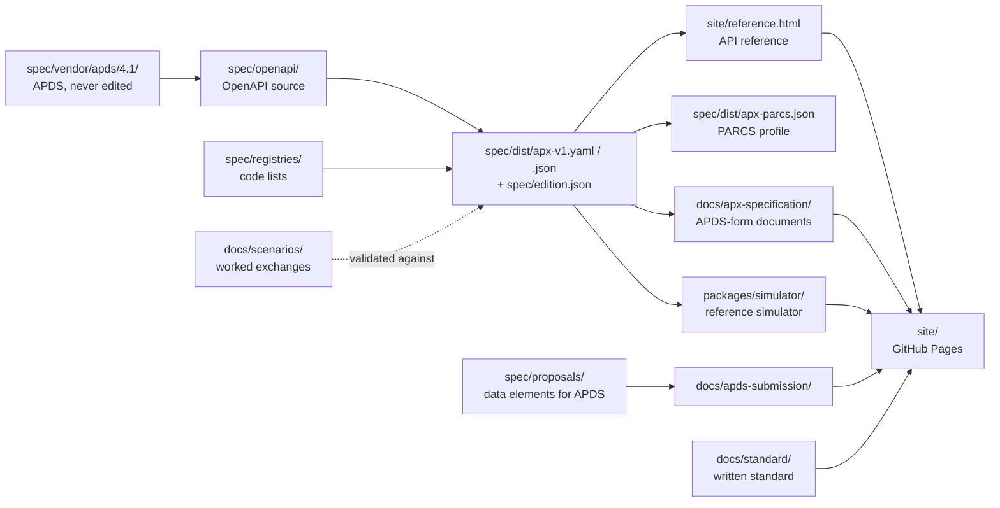

# Developer guide

This guide is for people who change this repository. Read
[CONTRIBUTING.md](../../CONTRIBUTING.md) first for the ground rules: APDS
first, additive only, the OpenAPI source is normative, registries are
add-only.

## Architecture

APX is a specification. The OpenAPI source is the single source of truth.
Everything else is either written beside it (the standard's prose and
the scenarios) or generated from it and checked in CI.



## Code map

| Path | What it is |
|---|---|
| `spec/openapi/apx.yaml` | Root of the OpenAPI 3.1 source |
| `spec/openapi/domains/<domain>/` | One folder per domain (`control`, `lpr`, `violations` and so on): paths, schemas, examples |
| `spec/openapi/overlays/` | Overlays applied after bundling: the Part 5 data profile, the reading layer for the reference, and examples |
| `spec/dist/` | Generated bundles. Never edit by hand; CI fails if they are stale. |
| `spec/edition.json` | Generated: version, APDS release, checksums of the bundles |
| `spec/vendor/apds/4.1/` | APDS 4.1 vendored verbatim and checksum-guarded |
| `spec/registries/` | Code-list registries (alert types, command types, topics, conformance classes and others) |
| `spec/proposals/` | Data elements proposed to APDS, one YAML file per APDS domain |
| `spec/oasdiff/` | Configuration for the breaking-change gate |
| `docs/standard/` | The written standard, Parts 0 to 26 and Annex A |
| `docs/scenarios/` | Worked scenarios; `by-module/` is the vetting suite, `proposed/` holds candidate scenarios |
| `docs/apx-specification/`, `docs/apds-submission/` | Generated document sets; hand-written parts are in each folder's `src/` |
| `docs/decisions/` | Architecture decision records |
| `tools/` | Build and check scripts (see below) |
| `tools/apx-docs/` | Shared code for the document sets: Markdown, the Data Dictionary, the Information Model and print layout |
| `packages/simulator/` | The reference simulator: `src/kernel/` (routing, auth, store, clock, events), `src/domains/` (one module per conformance class), `worlds/` (seed data), `web/` (the in-browser build) |
| `.github/workflows/` | `ci.yml` (the gate), `docs.yml` (builds and publishes the site), `release.yml` (attaches bundles to a tagged release) |

### Tools

| Script | Run by | What it does |
|---|---|---|
| `check-vendor.mjs` | `vendor:check` | Fails if the vendored APDS files changed |
| `check-registries.mjs` | `registries:check` | Validates the code-list registries |
| `build-edition.mjs`, `apply-overlay.mjs` | `spec:bundle` | Applies overlays and writes `edition.json` |
| `build-profile-spec.mjs` | `spec:profile` | Builds the PARCS Starter Profile bundle |
| `validate-examples.mjs` | `examples:check` | Validates the examples inside the OpenAPI source |
| `validate-scenarios.mjs` | `scenarios:check` | Validates every marked body in `docs/scenarios/` |
| `vetting-scenarios.mjs` | `vetting` | Reports vetting-suite coverage per module |
| `build-apx-docs.mjs`, `check-apx-docs-coverage.mjs` | `apxdocs:build`, `apxdocs:check` | Generates and checks `docs/apx-specification/` |
| `build-apds-submission.mjs` | `submission:build`, `submission:check` | Generates and checks `docs/apds-submission/` |
| `check-doc-links.mjs` | `docs:links` | Fails if a relative link in any Markdown file points at nothing |
| `build-apds-submission-pdf.mjs` | `apxdocs:pdf` | Prints either document set to PDF (needs Chrome or Edge) |
| `build-reference-input.mjs`, `build-standard.mjs`, `build-site.mjs`, `build-apx-docs-html.mjs` | `docs:build` | Build the GitHub Pages site into `site/` |

## Build, run and test

Requires Node 20 or later. There is no Docker and there are no native
modules.

```bash
npm install
npm test                 # the full gate CI runs
npm run spec:bundle      # regenerate spec/dist/ after editing spec/openapi/
npm run apxdocs:build    # regenerate docs/apx-specification/
npm run submission:build # regenerate docs/apds-submission/
npm run docs:build       # build the site into site/
npm run sim              # simulator with its UI on http://127.0.0.1:4100
npm test --prefix packages/simulator   # simulator tests and vetting replay
```

## Making a change

A change to the API is one pull request that contains all of:

1. The OpenAPI change under `spec/openapi/`, and the regenerated
   `spec/dist/` and `spec/edition.json`.
2. The matching prose in `docs/standard/`, and new Annex A rows if there
   is a new testable requirement.
3. Scenarios: a vetting case in `docs/scenarios/by-module/` with
   `apx:validate` markers, and simulator support in
   `packages/simulator/src/domains/` so the replay passes.
4. Regenerated document sets (`npm run apxdocs:build` and, if
   `spec/proposals/` changed, `npm run submission:build`).
5. A decision record in `docs/decisions/` if the change settles a design
   question.
6. A `CHANGELOG.md` entry under `[Unreleased]`.

The pull request template has a checkbox for each of these.

## Releasing

1. On a `release/x.y.z` branch, bump the version in `package.json`, the
   CHANGELOG heading, the README version line, the Part 0 status line,
   `info.version` in `spec/openapi/apx.yaml`, both overlays and the
   discovery schema example.
2. Run `npm run spec:bundle`, `npm run submission:build` and
   `npm run apxdocs:build`. Their checks fail if the edition is not
   stamped.
3. Open a pull request and merge it once CI is green.
4. Push an annotated tag `vX.Y.Z` on the merge commit. `release.yml`
   attaches the bundles, and `docs.yml` republishes the site.

## Conventions

- Commit messages follow Conventional Commits (`feat:`, `fix:`, `docs:`,
  `ci:`, `chore:`).
- Spectral (`npm run spec:style`) checks the APX conventions: paths are
  lowercase kebab-case, event topics are `apx.<domain>.<event>.vN`, secured
  operations declare 401, 403 and 429, and every operation has a
  description.
- Extension identity follows APDS: `apds-ext:apx:<class>@<version>`.
- Never put real customer data, plates or personal data in examples or
  scenarios.
