# APX simulator user guide

This guide is for someone who has never seen the APX simulator. It shows
every screen of its browser UI and says what each control does. The
screenshots are made by a script from the built-in sample worlds and demos
(see [Regenerating the screenshots](#regenerating-the-screenshots)).

## What the simulator is, and is not

The simulator is a working copy of an APX server, with a web page on top.
It answers every APX route, keeps a clock you control, and sends the
events the standard describes. It exists so you can watch a scenario
happen instead of only reading about it.

- It is a **reference for behaviour**. When the written standard and the
  simulator seem to differ, the standard wins.
- It is **not a product**. Do not run a car park on it.
- It checks itself. Every request it accepts and every answer it gives is
  checked against the APX bundle, and it reports any answer that fails.
- It uses **made-up data only**: sample worlds such as `apx-control` and
  `apx-events`.
- Where the standard leaves a choice open, the simulator makes one. That
  choice is not part of the standard.

## Opening it

**Online.** Go to <https://rneubauer.github.io/apx/simulator/>. Each visitor
gets a private copy that runs inside the page. Nothing leaves your
browser, and a reload starts over. A scenario you build lasts until you
reload, so use **Download** to keep it.

**On your machine.** From the repository root run:

```sh
npm run sim
```

Then open <http://127.0.0.1:4100/>. It redirects to `/ui/`. Stop it with
Ctrl+C. The local copy can also save scenario files into
`packages/simulator/scenarios/`.

## The page at a glance

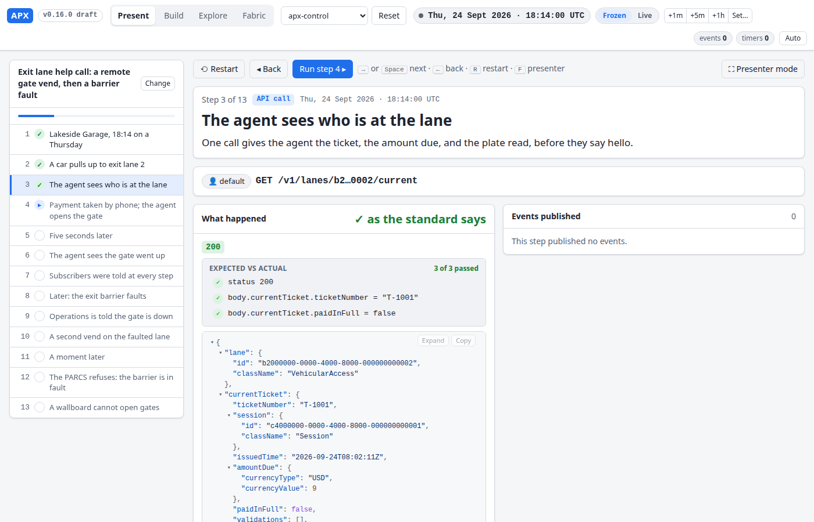

Every screen shares one header.

| Control | What it does |
|---|---|
| **Present**, **Build**, **Explore**, **Fabric** | Switch view. The address bar changes to match (`#present`, `#build`, `#explore`, `#fabric`). |
| Edition tag (for example `v0.16.0 draft`) | The APX edition this simulator serves. |
| **World** picker | Loads another world. A world is the starting data: places, lanes, devices, credentials and so on. Changing it clears all state. |
| **Reset** | Reloads the current world and clears everything done to it. If a scenario is open, it reloads the scenario's world. |
| Run state and clock | Shows the simulated time and a state such as frozen, live, running or offline. |
| **Frozen** and **Live** | Frozen: time moves only when you move it. Live: the clock runs in real time and scheduled things happen on their own. |
| **+1m**, **+5m**, **+15m**, **+1h** | Move the clock forward. Things that fall due, such as webhook retries and reservation no-shows, fire as the clock passes them. |
| **Set...** | Opens a box asking for an instant in ISO 8601, UTC, and sets the clock to it. |
| `events` and `timers` counters | Events in the outbox, and timers waiting on the clock. A red `contract issues` counter appears if a response failed the bundle's schema. |
| Theme button (**Auto**, **Light**, **Dark**) | Auto follows your operating system. Click to pin Light or Dark. The choice is remembered in the browser. |

If the simulator stops answering, a banner says so, the clock shows
*offline*, and the page reconnects on its own.

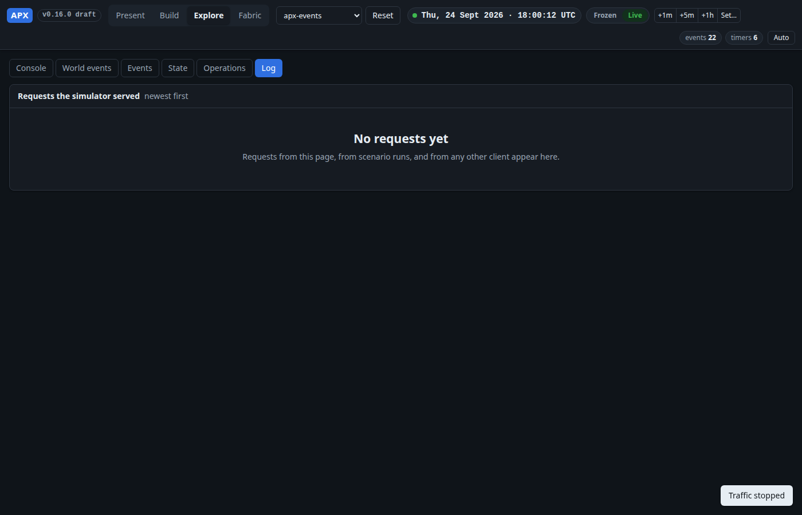

## Present: walk through a scenario

Use Present to show a story one step at a time. Each scenario is written
for one world and loads that world when you open it.

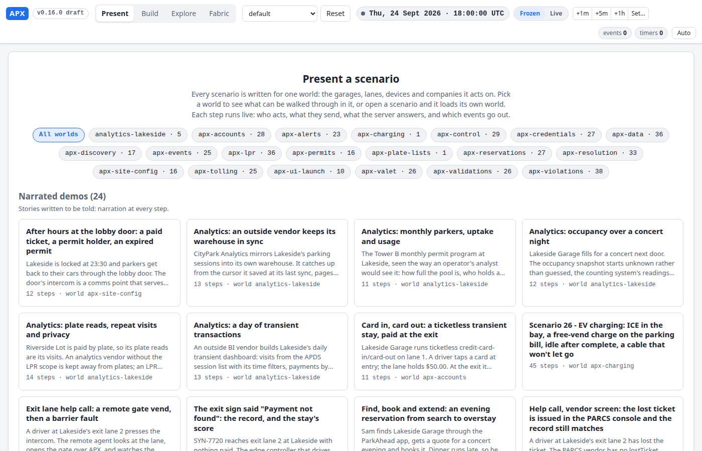

**The picker.**

- **World chips** (`All worlds`, then one chip per world with a count)
  show only the scenarios for that world. Picking a world also loads it.
- **Narrated demos** are cards. Click one to open it.
- **Vetting suite** is the list of test cases from the standard, grouped by
  kind (happy path, lifecycle, edge, refusal, security). Pick a world to
  see its cases. They run step by step like a demo. The suite is
  read-only here. A vetting case opens with a step that loads the module's
  world and replays the cases before it, so the records it needs exist.
- A world with no scenario offers **Explore** and **Build a demo for it**.

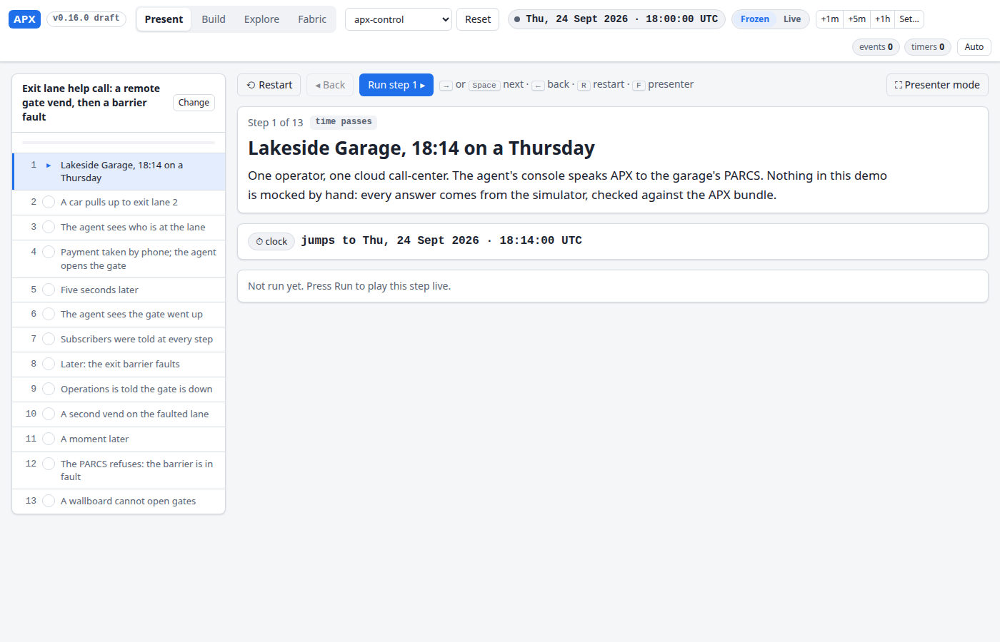

**The stage.** Once a scenario is open you see:

- **Timeline** (left): the title, a progress bar, and every step with a
  mark: a tick for passed, a cross for failed, an arrow for next. Click a
  finished step to look at it again. **Change** goes back to the picker.
- **Step card**: the step number, the kind of step (for example API call),
  the simulated time, the title and the narration.
- **Request line**: who is acting (a credential chip) and the method and
  path they send.
- **What happened**: the server's answer, with its status code.
- **Expected vs actual**: one line per check the step makes (status,
  problem type, each field of the expected body, event counts), each with
  a pass mark, or the value that really came back if it failed.
- **Events published**: the events this step caused. If there are none it
  says so.
- JSON blocks are tinted. Click the line that opens an object to fold it.
  **Copy** copies the block. **Expand** shows all of it without scrolling.

**Buttons and keys.**

| Control | Key | What it does |
|---|---|---|
| **Run step N** (the main button) | Right arrow or Space | Runs the next step. |
| **Back** (also the small left arrow) | Left arrow | Shows the previous step again. It does not undo anything. |
| **Restart** | R | Reloads the scenario's world and starts again. |
| **Presenter mode** | F | Full screen. See below. |

A step that opens a vendor screen shows an **Open the vendor screen**
button. See [The mock vendor screen](#the-mock-vendor-screen).

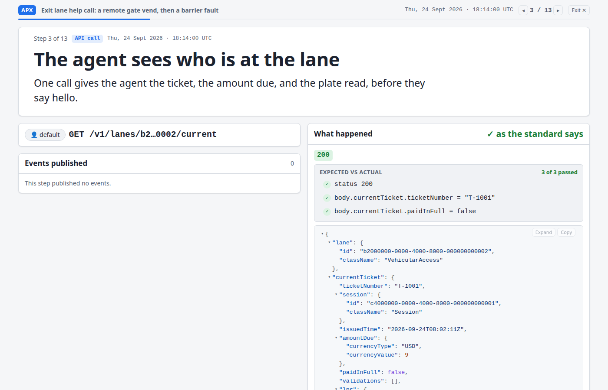

**Presenter mode** hides the app header and the step list. The title and
narration are set large, the request sits beside the answer, and a step
counter and progress bar stay at the top. The same keys work. **Exit**,
Esc or F leaves it. If the browser refuses full screen, the mode still
hides the extra parts.

## Explore: poke the simulator

Explore is for trying things by hand. It has six tabs.

### Console

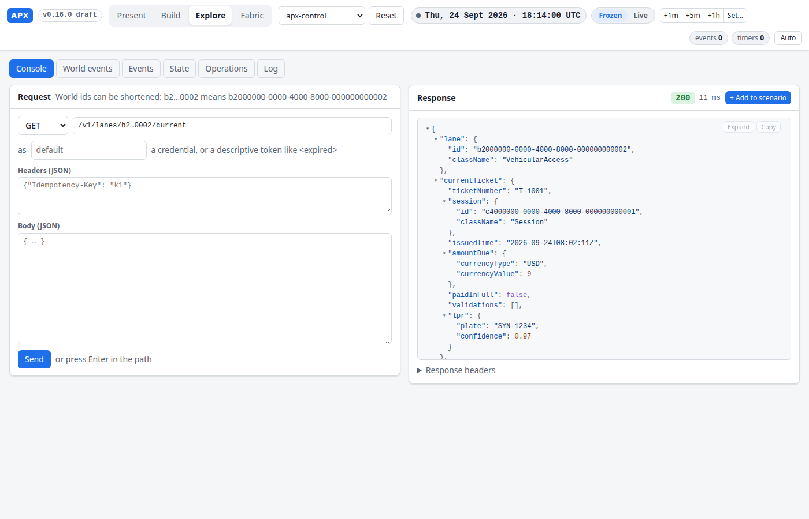

A request console. You choose:

- the **method** (GET, POST, PUT, PATCH, DELETE) and the **path**. The
  path box suggests routes as you type. Pressing Enter in it sends.
- the **credential** ("as"): a named credential, or a descriptive token
  such as `<expired>`. Empty means `default`.
- **Headers (JSON)**, for example `{"Idempotency-Key": "k1"}`.
- **Body (JSON)**.

World ids can be shortened: `b2...0002` stands for
`b2000000-0000-4000-8000-000000000002`.

**Send** sends it. The right side shows the status, the problem type if
the answer was a refusal, the round-trip time, the body, and the
**Response headers**. **+ Add to scenario** copies the request into the
scenario open in Build.

### World events

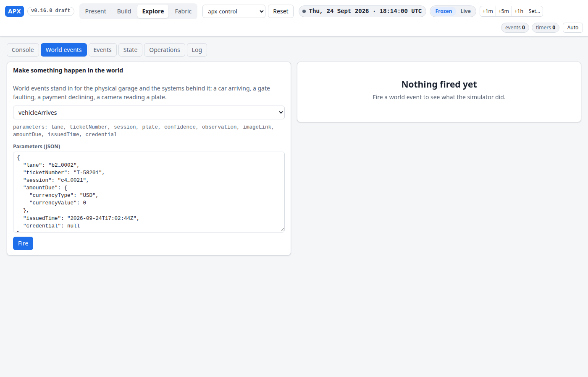

Choose a kind of event for the world to act out (the list comes from the
simulator, for example a vehicle arriving or a device changing state), fill
in **Parameters (JSON)**, and press **Fire**. The result appears on the
right, with **+ Add to scenario**. This guide does not list the kinds,
because they depend on the build. The list in the page is the source of
truth.

### Events

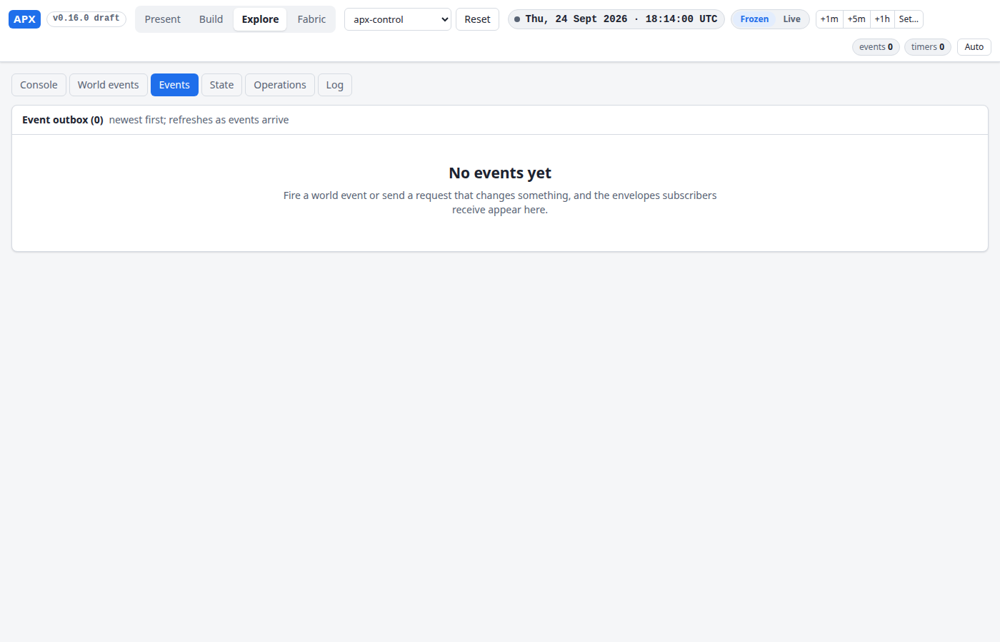

The outbox: every event envelope the world has published. A drop-down
filters by event type and shows a count for each. The tab is empty until
something publishes an event.

### State

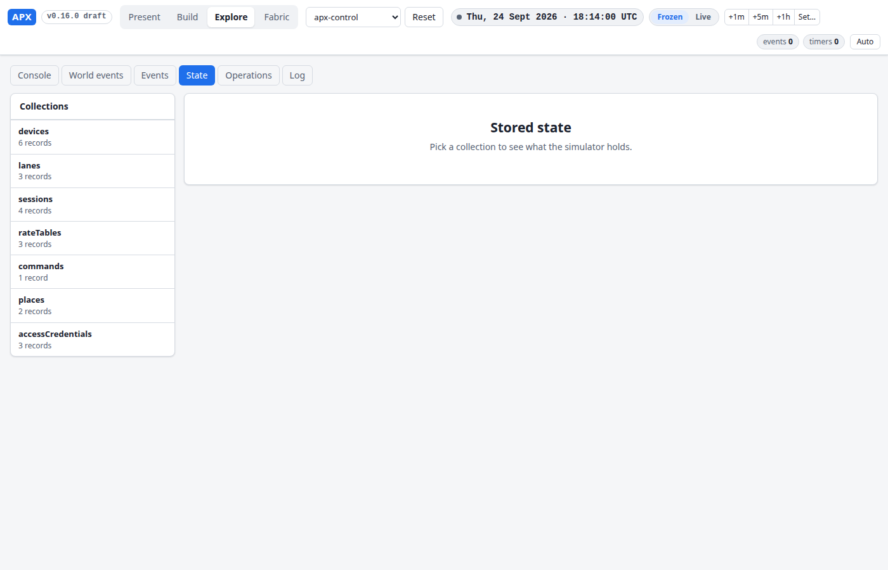

The records the simulator holds. The left list shows each collection and
how many records it has. Click one to see its records.

### Operations

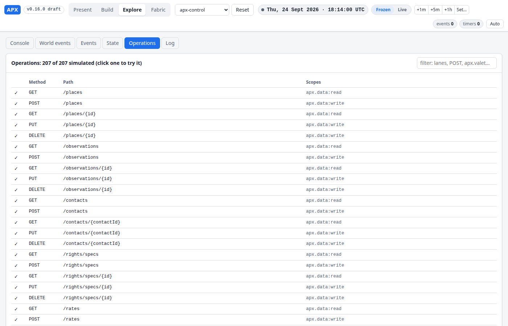

Every operation in the bundle, with its **Method**, **Path** and
**Scopes**. A tick in the first column means the simulator implements it.
The box at the top filters the list (for example `lanes`, `POST`, or
`apx.valet`). The console's path box offers these paths.

### Log

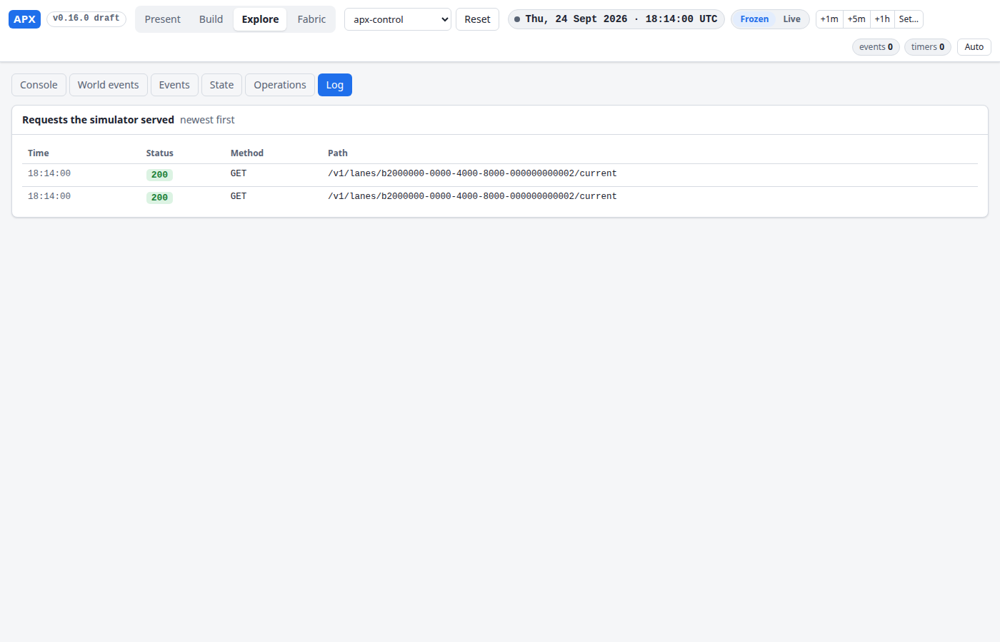

"Requests the simulator served", newest first, with **Time**, **Status**,
**Method** and **Path**. It includes requests from this page, from
scenario runs and from any other client.

## Build: create and edit scenarios

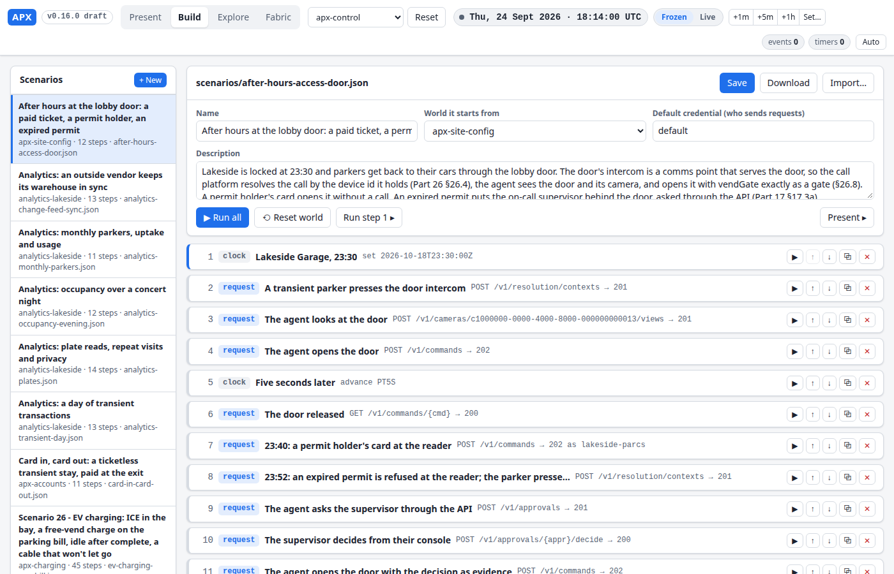

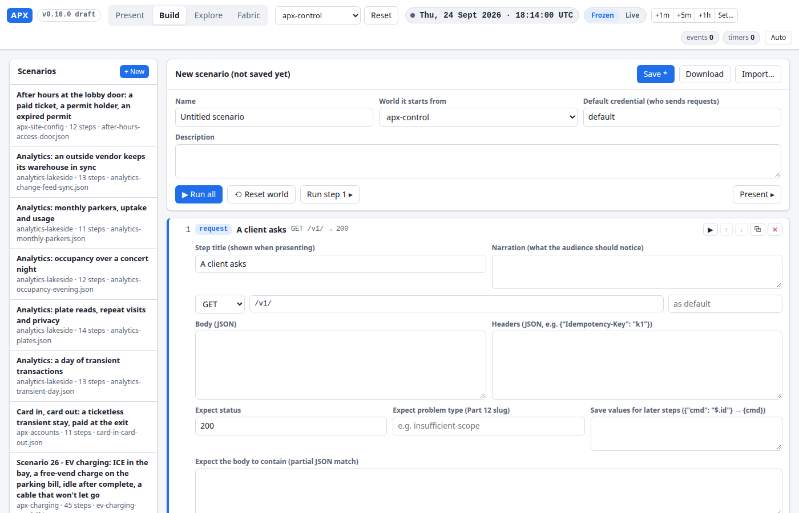

Build makes the same scenario files that Present plays and that
`apx-sim run` reads.

**Left: Scenarios.** Every saved scenario, with its world, step count and
file name. Click one to open it. **+ New** starts a new one. If you have
unsaved changes the page asks before discarding them. With nothing open,
the main area offers **New scenario**.

**Top of the main area.**

| Control | What it does |
|---|---|
| **Save** (**Save \*** when there are unsaved changes) | Writes `scenarios/<id>.json`. |
| **Download** | Downloads the scenario as a file. |
| **Import...** | Loads a scenario file from your computer. |
| **Name**, **World it starts from**, **Default credential (who sends requests)**, **Description** | The scenario's details. |
| **Run all** | Runs every step. |
| **Reset world** | Reloads the starting world. |
| **Run step N** | Runs the next step only. It reads **All steps run** at the end. |
| **Present** | Opens the scenario in the Present view. |

**Steps.** Under the details is the list of steps. Each step has these
buttons: run this step now, move up, move down, duplicate, delete. The
**Add step** bar adds:

- **+ Request**: a method, path and credential, then an optional body and
  headers, **Expect status**, **Expect problem type (Part 12 slug)**,
  **Save values for later steps** and **Expect the body to contain
  (partial JSON match)**.
- **+ World event**: pick an event and edit its parameters. Picking one
  fills in a worked example.
- **+ Clock**: **Advance by** a duration such as `PT5M` or `30s`, or **Set
  to** an instant. Timers that fall due fire as the clock passes them.
- **+ Check events**: asserts what the outbox holds.
- **+ Narration**: a step with words only.

Every step has a **Step title (shown when presenting)** and a
**Narration (what the audience should notice)**. There is also an **Edit
as JSON** section for any member of a step, with **Apply JSON**.

On the hosted copy a saved scenario lasts only until you reload, so use
**Download**.

## Fabric: watch events being delivered

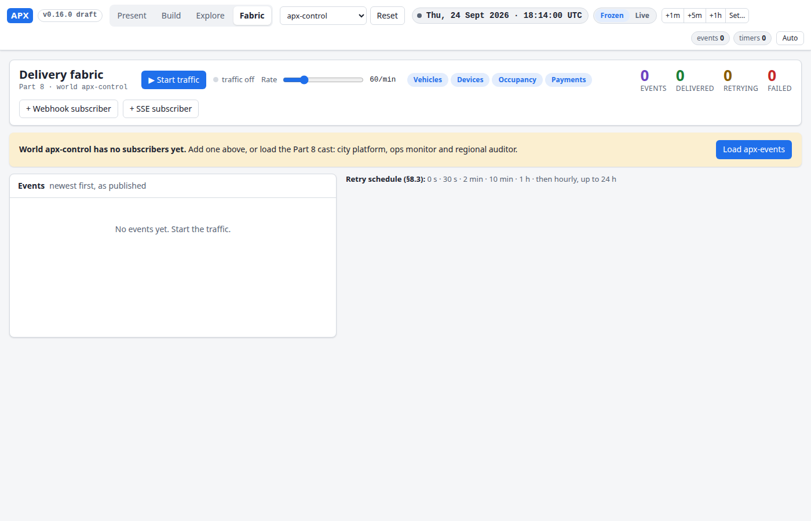

Fabric shows the Part 8 delivery fabric live: events as they are
published, the subscribers, and each delivery attempt. If the current
world has no subscribers, a **Load apx-events** button loads the sample
world that has two.

At the top, **Start traffic** (it becomes **Stop traffic**) starts a
steady mix of world events. It switches the clock to Live. A **Rate**
slider sets how many events a minute, and the chips **Vehicles**,
**Devices**, **Occupancy** and **Payments** turn parts of the mix on and
off. A chip is disabled if the world has nothing to play for it. If the
clock is frozen, traffic shows "paused: clock frozen" and **Go live**
resumes it. Counters show events, delivered, retrying and failed.
**+ Webhook subscriber** and **+ SSE subscriber** add a demo subscriber.

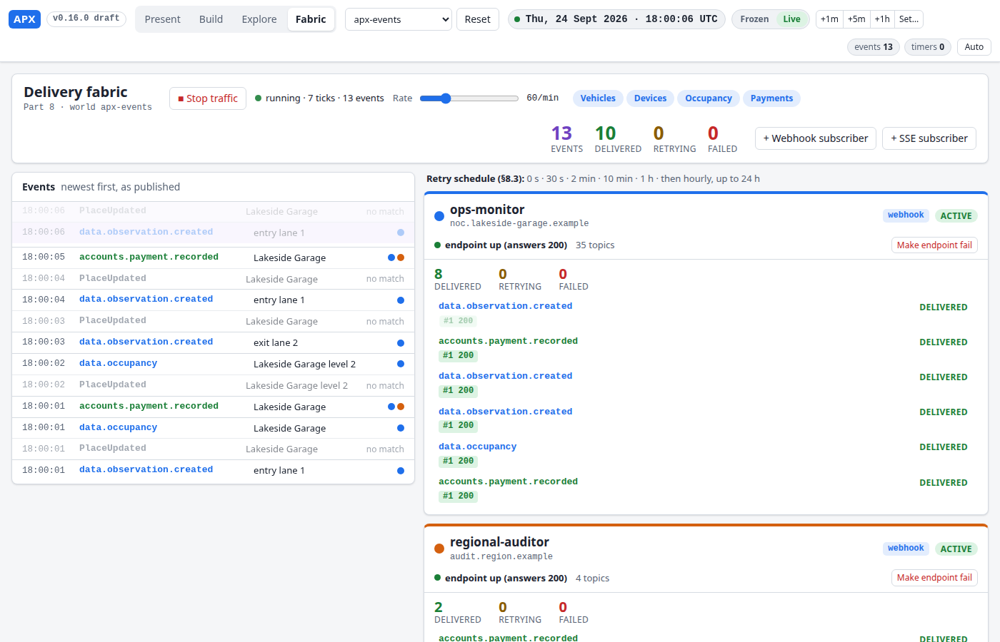

- **Events** (left, newest first): each event and the dots of the
  subscribers it went to. Grey "no match" events matched nobody's topics
  or places. That is expected.
- **Subscribers** (right): one card each, with its transport, status,
  endpoint health, counters and recent deliveries. The retry schedule
  (section 8.3 of the standard) is printed above them.
- On a webhook card, **Make endpoint fail** makes its endpoint answer 503.
  Deliveries turn amber and show a countdown such as `retry #2 in 0:29`.
  **Recover endpoint** lets the retries succeed. Use the header's **+1m**
  and **+5m** to move through the waits.
- On an SSE card, **Drop client** disconnects the simulated client and
  **Reconnect** brings it back. It catches up from `Last-Event-ID`.

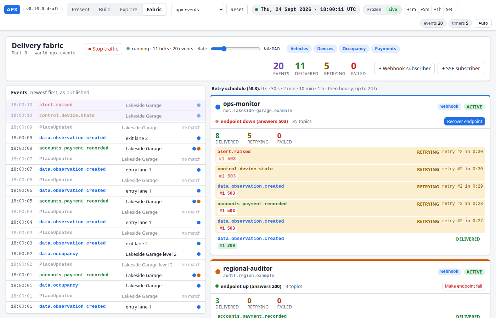

## The mock vendor screen

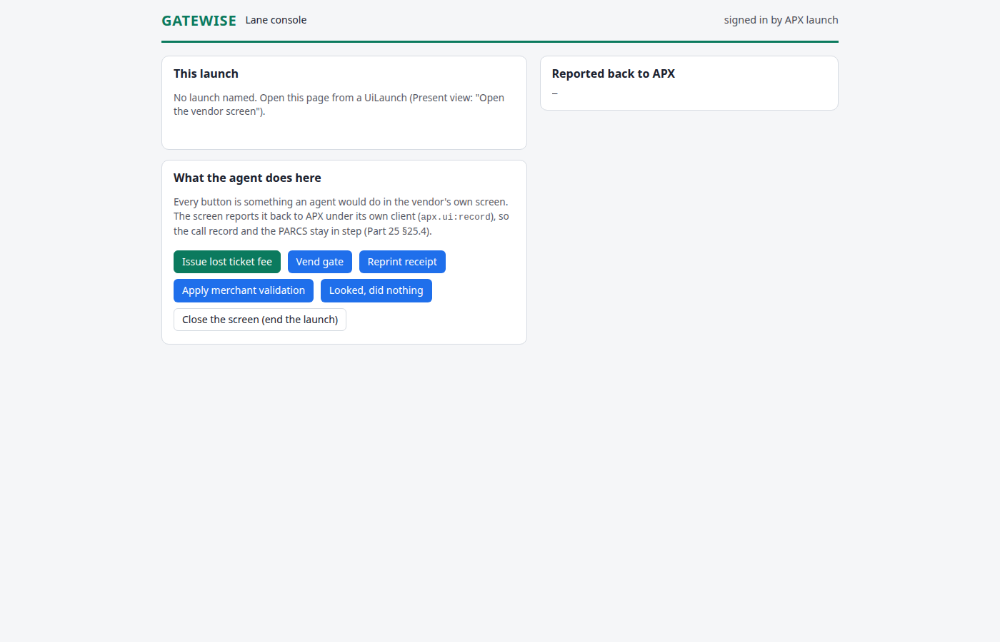

`vendor.html` stands in for a PARCS vendor's own console. You do not open
it directly. A scenario step that launches a vendor screen shows **Open the
vendor screen** in Present. The page then signs the agent in with a
single-use url and reports every button press back through the APX API.
Its action buttons include **Issue lost ticket fee**, **Vend gate** and
**Reprint receipt**. The screenshot above was taken with no launch, so it
shows the page's empty state. It was not captured in a live launch. To see
it live, play the demo `help-call-vendor-screen` in Present.

## Common tasks

### Run a narrated demo

1. Open **Present**.
2. Optionally click a world chip to narrow the list.
3. Click a demo card. Its world loads.
4. Press **Run step 1** (or Space or the right arrow).
5. Read the narration, the answer and the **Expected vs actual** list.
6. Keep pressing the main button. The progress bar fills as steps pass.
7. To start over, press **Restart** or R.

For a good first demo, try "Exit lane help call" in `apx-control`.
[DEMO.md](../../packages/simulator/DEMO.md) lists all the demos and which to use
for a talk.

### Send a request to a route

1. Open **Explore**, then **Console**.
2. Pick the method and type the path, or look one up in **Operations**.
3. Choose a credential in the "as" box, or leave it as `default`.
4. For a POST, PUT or PATCH, write the **Body (JSON)**. Add headers if
   needed.
5. Press **Send**.
6. Read the status, problem type and body on the right.
7. To keep the request, press **+ Add to scenario**.

### Inspect state, events and deliveries

1. **State**: Explore, then **State**, then a collection. These are the
   records the simulator holds.
2. **Events**: Explore, then **Events**. Use the drop-down to filter by
   type. These are the envelopes subscribers receive.
3. **Deliveries**: open **Fabric**. Each subscriber card lists its recent
   attempts with status codes and retry countdowns.
4. **Requests**: Explore, then **Log**.

The simulator also serves these as plain routes, for example `GET
/sim/state`, `/sim/events`, `/sim/deliveries` and `/sim/log`. They are
the simulator's own windows, not APX routes.

### Move time

1. In the header, press **+1m**, **+5m**, **+15m** or **+1h**, or **Set...**
   for an exact instant.
2. Anything scheduled for that time fires: retries, no-shows, expiries.
3. Keep the clock on **Frozen** for presenting, so every run is the same.
   Switch to **Live** to let things happen on their own.

### Reset or start over

1. Press **Reset** in the header to reload the world and clear all state.
2. In Present, press **Restart** (or R) to reload the scenario's world.
3. In Build, press **Reset world** before **Run all**.
4. On the hosted copy, reloading the page resets everything, including
   unsaved scenarios.

### Use presenter mode

1. Open a scenario in **Present**.
2. Press **Presenter mode**, or press F.
3. Step with the arrow keys or Space. R restarts.
4. Leave with **Exit**, Esc or F.

Before a talk, pick the Light theme, zoom the browser to 125 to 150
percent with Ctrl and +, and press R once so the scenario starts from its
world.

### Build and play your own scenario

1. Open **Build** and press **+ New**.
2. Set the **Name**, **World it starts from** and **Default credential**.
3. Add steps with **+ Request**, **+ World event**, **+ Clock**, **+ Check
   events** and **+ Narration**.
4. Press **Run all** to test it. Fix any step that fails.
5. Press **Save** (local copy) or **Download** (hosted copy).
6. Press **Present** to play it.

## Regenerating the screenshots

The images in `images/` come from a script. With the simulator running
(`npm run sim`), run this from the repository root:

```sh
npm run docs:screenshots
```

The script drives a headless Chromium and needs Node 22 or later. Its
header comment lists the settings you can change.

## FAQ

**Is this the real APX server?**
No. It is a reference for behaviour. It follows the standard, but it is
not meant to run a real site.

**Can I point my own software at it?**
Yes, on a local copy. It serves the APX routes at `http://127.0.0.1:4100`.
Get a token with `node packages/simulator/bin/apx-sim.mjs token
lakeside-parcs` and use it as a bearer token. The hosted copy runs inside
your browser page, so outside clients cannot reach it.

**Why did nothing happen "later"?**
The clock is frozen unless you start it with `--realtime` or press
**Live**. Press **+1m** or **+5m**, or switch to **Live**.

**Why are some events grey with "no match"?**
No subscriber's topics or places match them. That is the standard's place
binding working.

**What does `/sim/...` mean in a step?**
Those are the simulator's own inspection routes, not APX routes.

**Where is my scenario?**
On a local copy, in `packages/simulator/scenarios/<id>.json`. On the
hosted copy it is gone after a reload unless you used **Download**.

**Is the data real?**
No. Every world is made up.

**Can other people on my network use my local copy?**
Only if you start it with `--host 0.0.0.0`. Then anyone who can reach the
port can drive it and save scenario files, so only do that on a network
you trust. Do not do it on a call.

**A step failed on screen. What now?**
Press R and run it again. If it fails again, move on. The hosted copy is
the same simulator, so you can try it there too.

**The page stopped updating.**
The header clock shows *offline* if the server stopped. Restart `npm run
sim` and reload the page.

**Does the simulator cover every APX route?**
The simulator README and DEMO.md say it implements every operation in the
bundle (207 of 207). The **Operations** tab marks each one it implements.

**Where do I read more?**
The [simulator README](../../packages/simulator/README.md), the
[demo runbook](../../packages/simulator/DEMO.md) and the
[UI file notes](../../packages/simulator/ui/README.md).

## What this guide does not cover

- The list of world-event kinds and their parameters. Open **World
  events** in Explore to see the list for your build.
- The vendor screen in a live launch (see above).
- Any control not mentioned here. If you find one, the UI's own hover
  text is the best guide.
